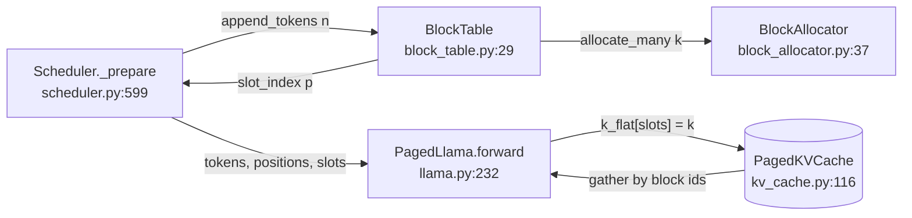
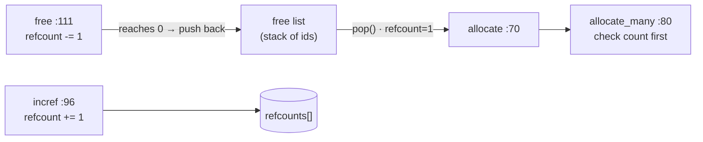
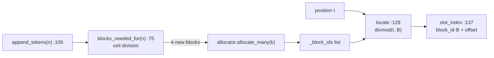
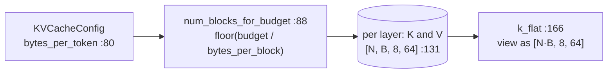
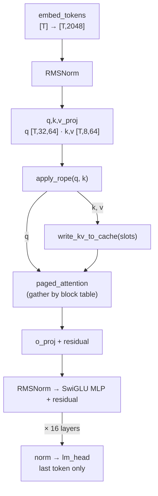

# Day 1 code walkthrough: mini-vLLM paging

Companion to [[Day 01 - mini-vLLM I]]. Repo `vLLMmini`, branch `main` (`3679394`). Read this **with the files open**:
each section has one small figure of the pipeline, then the exact code in reading order, then what each piece does
and how it hands off to the next.

**The whole day in one line:** the scheduler decides *how many* tokens a request adds → `BlockTable` turns token
positions into *slot numbers* → the model *writes* K,V into those slots and *reads* them back by block table.



---

## 1. The memory pool: `BlockAllocator`



The pool is two plain Python lists: a **stack of free ids** and a **refcount per block**.

`src/mini_vllm/block_allocator.py:40–47`
```python
def __init__(self, num_blocks: int) -> None:
    if num_blocks <= 0:
        raise ValueError(f"num_blocks must be positive, got {num_blocks}")
    self._num_blocks = num_blocks
    self._ref_counts = [0] * num_blocks
    # LIFO: the most recently freed block is reused first, which keeps a
    # working set hot rather than cycling through the whole pool.
    self._free_blocks = list(reversed(range(num_blocks)))
```

- `reversed(range(...))` + `pop()` from the end hands out block 0 first. It is **LIFO**: a block freed a moment ago is reused next, which keeps recently touched memory hot.

`src/mini_vllm/block_allocator.py:70–94`
```python
def allocate(self) -> int:
    """Take one block from the pool with a reference count of 1."""
    if not self._free_blocks:
        raise OutOfBlocksError(
            f"no free blocks ({self._num_blocks} total, all allocated)"
        )
    block_id = self._free_blocks.pop()
    self._ref_counts[block_id] = 1
    return block_id

def allocate_many(self, count: int) -> list[int]:
    """Take `count` blocks, all or nothing.

    All-or-nothing matters: a partial allocation that then raises would
    leak every block taken before the failure, and the caller — mid-way
    through extending a sequence — has no clean way to know what to undo.
    """
    if count < 0:
        raise ValueError(f"count must be non-negative, got {count}")
    if count > len(self._free_blocks):
        raise OutOfBlocksError(
            f"requested {count} blocks, only {len(self._free_blocks)} free "
            f"({self._num_blocks} total)"
        )
    return [self.allocate() for _ in range(count)]
```

- `allocate` is O(1): pop an id, set its refcount to 1.
- `allocate_many` **checks the count before taking anything**. If it took blocks one by one and ran out halfway, the caller would hold half a sequence's blocks with no clean way to undo. This is the "all or nothing" rule (Day 1 Q7).

`src/mini_vllm/block_allocator.py:96–119`
```python
def incref(self, block_id: int) -> int:
    """Add a reference to an already-allocated block. Returns the new count.

    This is how Phase 4 will attach a second sequence to a shared prefix
    block. Increffing a free block is a bug — it would resurrect a block
    that is simultaneously claimed by the free list.
    """
    self._check_id(block_id)
    if self._ref_counts[block_id] == 0:
        raise ValueError(
            f"block {block_id} is free; cannot add a reference to it"
        )
    self._ref_counts[block_id] += 1
    return self._ref_counts[block_id]

def free(self, block_id: int) -> int:
    """Drop one reference. Returns the new count; returns to pool at zero."""
    self._check_id(block_id)
    if self._ref_counts[block_id] == 0:
        raise ValueError(f"block {block_id} is already free (double free)")
    self._ref_counts[block_id] -= 1
    if self._ref_counts[block_id] == 0:
        self._free_blocks.append(block_id)
    return self._ref_counts[block_id]
```

- `incref` refuses a free block: adding a reference to a block that is also on the free list would let two owners collide.
- `free` drops **one** reference. The block goes back to the pool **only at zero**. This one `if` is why a block shared by two requests (Day 2's prefix cache) survives when one of them finishes (Q6).

**Check yourself:** pool of 4. `allocate()` twice, `incref(first)`, `free(first)`. What is on the free list now, and what are the refcounts?

---

## 2. Logical → physical: `BlockTable`



One `BlockTable` per request. It is the request's page table: list index = logical block, value = physical block id.

`src/mini_vllm/block_table.py:75–84`
```python
def blocks_needed_for(self, num_new_tokens: int) -> int:
    """How many *additional* blocks appending `num_new_tokens` would take.

    The scheduler needs this to decide admission without mutating anything.
    """
    if num_new_tokens < 0:
        raise ValueError(f"num_new_tokens must be non-negative, got {num_new_tokens}")
    total = self._num_tokens + num_new_tokens
    blocks_after = (total + self._block_size - 1) // self._block_size
    return max(0, blocks_after - len(self._block_ids))
```

- How many **extra** blocks would `n` more tokens need? `(total + B − 1) // B` is ceiling division. Subtract the blocks already held. It doesn't change anything, so the scheduler can ask it during admission without side effects.

`src/mini_vllm/block_table.py:106–124`
```python
def append_tokens(self, num_new_tokens: int) -> list[int]:
    """Extend the sequence by `num_new_tokens`, allocating blocks as needed.

    Returns the newly allocated block ids (empty when the tokens fit in the
    current last block). Raises `OutOfBlocksError` without changing any
    state if the pool cannot satisfy the request — the caller's sequence is
    left exactly as it was, so a failed append is safe to retry after the
    scheduler frees memory.
    """
    if num_new_tokens < 0:
        raise ValueError(f"num_new_tokens must be non-negative, got {num_new_tokens}")
    if num_new_tokens == 0:
        return []
    needed = self.blocks_needed_for(num_new_tokens)
    # all-or-nothing; raises before we touch _num_tokens
    new_blocks = self._allocator.allocate_many(needed)
    self._block_ids.extend(new_blocks)
    self._num_tokens += num_new_tokens
    return new_blocks
```

- Order matters: **allocate first, then update state.** If `allocate_many` raises, `_num_tokens` is untouched, so the request is exactly as before and can retry later.
- A new block is taken only when the tokens cross a block boundary. With B = 16, a decode step allocates once every 16 steps.

`src/mini_vllm/block_table.py:128–145`
```python
def locate(self, position: int) -> tuple[int, int]:
    """Translate a logical token position to (physical_block_id, offset)."""
    if not 0 <= position < self._num_tokens:
        raise IndexError(
            f"position {position} out of range [0, {self._num_tokens})"
        )
    logical_block, offset = divmod(position, self._block_size)
    return self._block_ids[logical_block], offset

def slot_index(self, position: int) -> int:
    """Flat physical slot index for a logical position.

    Slots are numbered `block_id * block_size + offset`, which is the
    addressing the Phase 2 gather and the Phase 5 Triton kernel use to
    index the KV cache as one flat array.
    """
    block_id, offset = self.locate(position)
    return block_id * self._block_size + offset
```

- `divmod(position, B)` gives (logical block, offset). The table maps the logical block to a physical id.
- **slot = block_id × B + offset.** This is the one formula to know cold. Example: B = 4, table `[7, 2]`, position 5 → logical block 1, offset 1 → physical 2 → slot 9.

`src/mini_vllm/block_table.py:60–71`
```python
@property
def capacity(self) -> int:
    """Token slots currently allocated, including unused slots in the last block."""
    return len(self._block_ids) * self._block_size

@property
def num_wasted_slots(self) -> int:
    """Allocated-but-unused slots: the project's internal fragmentation metric.

    Always < block_size, because only the final block can be partial.
    """
    return self.capacity - self._num_tokens
```

- `num_wasted_slots` = slots held − tokens stored. Only the last block can be partly empty, so waste < B per request. Summed over requests, this is the fragmentation metric behind 16.8% → 3.9%.

**Check yourself:** B = 4, an empty table, `append_tokens(5)` then `append_tokens(1)` ×3. How many `allocate_many` calls actually take a block? What is `num_wasted_slots` at the end?

---

## 3. The bytes: `PagedKVCache`



`src/mini_vllm/kv_cache.py:79–92`
```python
@property
def bytes_per_token(self) -> int:
    """KV bytes for one token across all layers (K and V)."""
    return 2 * self.num_layers * self.num_kv_heads * self.head_dim * self.itemsize

@property
def bytes_per_block(self) -> int:
    return self.bytes_per_token * self.block_size

def num_blocks_for_budget(self, budget_bytes: int) -> int:
    """How many blocks fit in `budget_bytes`. Floor, never over-commits."""
    if budget_bytes < 0:
        raise ValueError(f"budget must be non-negative, got {budget_bytes}")
    return budget_bytes // self.bytes_per_block
```

- `bytes_per_token = 2 (K and V) × layers × KV heads × head_dim × bytes`. Llama-3.2-1B in bf16: 2 × 16 × 8 × 64 × 2 = **32 KiB**. A 16-token block is 512 KiB.
- `//` rounds **down**: never promise more blocks than fit.

`src/mini_vllm/kv_cache.py:131–139`
```python
shape = (num_blocks, config.block_size, config.num_kv_heads, config.head_dim)
self._k = [
    torch.zeros(shape, dtype=config.dtype, device=self.device)
    for _ in range(config.num_layers)
]
self._v = [
    torch.zeros(shape, dtype=config.dtype, device=self.device)
    for _ in range(config.num_layers)
]
```

- One tensor per layer for K and one for V, each `[num_blocks, block_size, kv_heads, head_dim]`. The block id is simply the **first index**. So the allocator owns ids, and this tensor owns the bytes they point to.

`src/mini_vllm/kv_cache.py:166–176`
```python
def k_flat(self, layer: int) -> torch.Tensor:
    """Key cache viewed as flat slots: [num_blocks * block_size, heads, dim].

    This is the view a flat slot index addresses, and the one the Phase 5
    kernel will index. It is a view, not a copy — writes through it land in
    the block-shaped tensor.
    """
    c = self.config
    return self._k[self._check_layer(layer)].view(
        self.num_slots, c.num_kv_heads, c.head_dim
    )
```

- `.view(...)` reshapes without copying. Row `block_id × B + offset` of the flat view is exactly element `[block_id, offset]` of the block view. That is why `slot_index` works as an address.

---

## 4. One token through one layer: `PagedLlama.forward`



`src/mini_vllm/model/llama.py:264–265`
```python
hidden = self.embed_tokens(input_ids)
cos, sin = self.rotary(positions)
```

`src/mini_vllm/model/llama.py:275–306`
```python
for index, layer in enumerate(self.layers):
    input_norm, post_norm = self._layer_norms(layer)
    attn = layer.self_attn
    total_tokens = hidden.shape[0]

    residual = hidden
    x = input_norm(hidden)

    q = attn.q_proj(x).view(total_tokens, self.num_q_heads, self.head_dim)
    k = attn.k_proj(x).view(total_tokens, self.num_kv_heads, self.head_dim)
    v = attn.v_proj(x).view(total_tokens, self.num_kv_heads, self.head_dim)
    q, k = apply_rope(q, k, cos, sin)

    # Write this step's KV before attending, so a sequence attends to
    # its own new tokens (context_lens already counts them).
    write_kv_to_cache(cache, index, slot_mapping, k, v)

    if decode_meta is not None:
        out = paged_attention_decode(q, cache, index, decode_meta, self.scale)
    else:
        out = paged_attention(
            q, cache, index, block_tables, query_lens, context_lens, self.scale
        )
    out = out.reshape(total_tokens, self.num_q_heads * self.head_dim)
    hidden = residual + attn.o_proj(out)

    residual = hidden
    x = post_norm(hidden)
    mlp = layer.mlp
    hidden = residual + mlp.down_proj(
        nn.functional.silu(mlp.gate_proj(x)) * mlp.up_proj(x)
    )
```

Read it top to bottom with shapes (T = all tokens of all requests this step, concatenated):
- `x = input_norm(hidden)`: RMSNorm *before* attention (pre-norm). `residual` keeps the un-normalised input for the skip connection.
- `q_proj` → `[T, 32, 64]`; `k_proj`, `v_proj` → `[T, 8, 64]`. **8 KV heads for 32 query heads = GQA**: 4 query heads share one K,V. That is why the KV cache is 4× smaller than with full multi-head attention.
- `apply_rope` rotates q and k by their **position**, not their index in the flat batch.
- **`write_kv_to_cache` happens before attention**, so each new token can attend to itself.
- `hidden = residual + o_proj(out)`: the first residual. Then the MLP: `down(silu(gate(x)) * up(x))` = SwiGLU, with a second residual.

`src/mini_vllm/paged_attention.py:61–65`
```python
k_flat = cache.k_flat(layer)
v_flat = cache.v_flat(layer)
slots = slot_mapping.to(device=k_flat.device, dtype=torch.long)
k_flat[slots] = key.to(k_flat.dtype)
v_flat[slots] = value.to(v_flat.dtype)
```

- The write is one **scatter**: token i's K goes to row `slots[i]`. Consecutive tokens can land in non-adjacent blocks; the table hides that.

`src/mini_vllm/paged_attention.py:85–100`
```python
k_cache = cache.k(layer)
v_cache = cache.v(layer)
blocks = torch.as_tensor(block_ids, dtype=torch.long, device=k_cache.device)

needed = (context_len + cache.block_size - 1) // cache.block_size
if needed > blocks.numel():
    raise ValueError(
        f"context_len {context_len} needs {needed} blocks, "
        f"block table has {blocks.numel()}"
    )
blocks = blocks[:needed]

# [n_blocks, block_size, kv_heads, dim] -> flat token order, then truncate
# the unused tail of the final block.
k = k_cache[blocks].reshape(-1, k_cache.shape[2], k_cache.shape[3])[:context_len]
v = v_cache[blocks].reshape(-1, v_cache.shape[2], v_cache.shape[3])[:context_len]
```

- The read is a **gather**: index the block-shaped cache by the request's block ids, flatten to token order, cut off the empty tail of the last block (`[:context_len]`). Day 3's Triton kernel fuses this gather into attention so this intermediate tensor is never built.

`src/mini_vllm/model/llama.py:308–311`
```python
hidden = self.norm(hidden)
if logits_indices is not None:
    hidden = hidden[logits_indices]
return self.lm_head(hidden)
```

- Logits only at `logits_indices`: one position per request (its last token). The vocabulary is 128,256 wide, so computing it for every prefill token would dominate the step.

---

## 5. How it all connects in one step

`src/mini_vllm/scheduler.py:599–612`
```python
def _prepare(self, request: Request) -> ScheduledRequest:
    """Grow the block table and build this iteration's flat inputs."""
    num_new = request.num_uncomputed_tokens
    request.table.append_tokens(num_new)
    start = request.num_computed_tokens
    all_ids = request.all_token_ids
    return ScheduledRequest(
        request=request,
        token_ids=all_ids[start : start + num_new],
        positions=list(range(start, start + num_new)),
        slot_mapping=[
            request.table.slot_index(p) for p in range(start, start + num_new)
        ],
    )
```

- `_prepare` is the **glue**: it grows the table by the uncomputed tokens (section 2), then builds `token_ids`, `positions` and `slot_mapping` for exactly those tokens.
- The engine concatenates these lists across requests and calls `forward` (section 4), which writes K,V to the slots (section 3).

**End-of-day test:** B = 4, request A has 5 prompt tokens, physical blocks come out as `[7, 2]`. Write A's `slot_mapping` for its prefill. Then A decodes one token: does `append_tokens(1)` allocate? Which slot does token 5 go to? (*Answers: slots 28, 29, 30, 31, 8; no allocation; slot 9.*)
