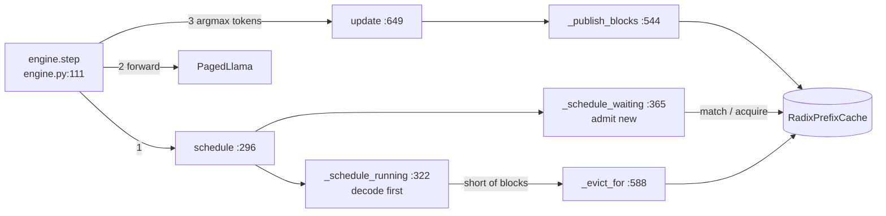
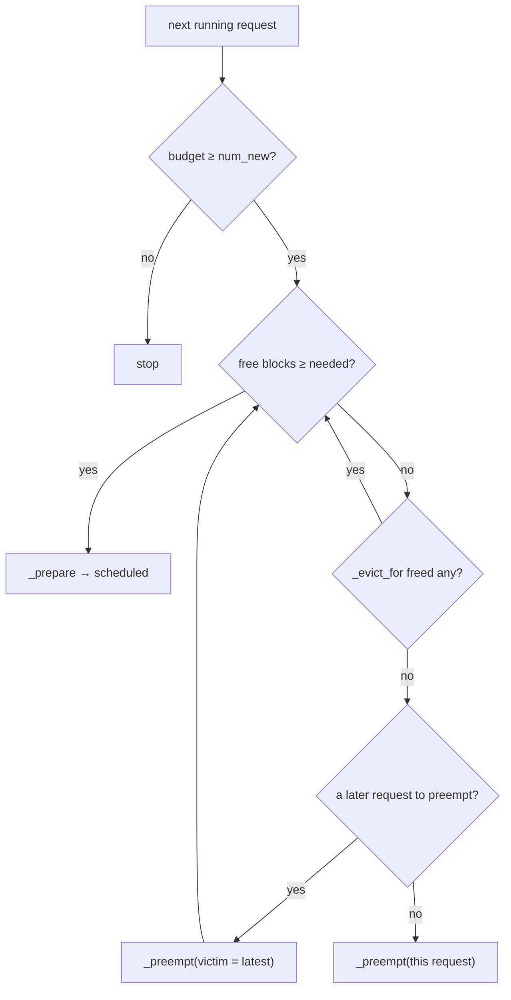
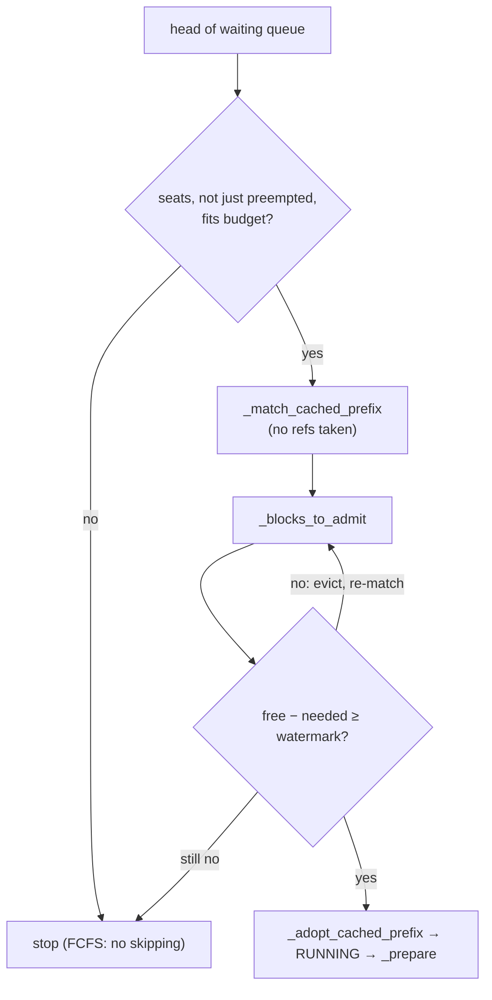
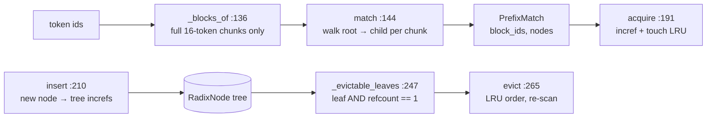

# Day 2 code walkthrough: the scheduler and the radix prefix cache

Companion to [[Day 02 - mini-vLLM II]]. Repo `vLLMmini`, branch `main` (`3679394`). Builds on
[[Day 01 - code walkthrough]].

**The whole day in one picture:** every engine step asks the scheduler for a batch, runs one forward pass, then
hands the sampled tokens back.



---

## 1. One step: `engine.step` and `schedule`

`src/mini_vllm/engine.py:113–150`
```python
output = self.scheduler.schedule()
if output.is_empty:
    if self.scheduler.waiting:
        raise RuntimeError(
            "scheduler admitted nothing while requests wait: the block "
            "pool is too small for the smallest queued request"
        )
    return []

token_ids, positions, slots, query_lens = [], [], [], []
for scheduled in output.scheduled:
    token_ids.extend(scheduled.token_ids)
    positions.extend(scheduled.positions)
    slots.extend(scheduled.slot_mapping)
    query_lens.append(scheduled.num_tokens)

# Logits are needed only at each request's final token; the vocab
# projection is 128256 wide, so computing it for every prefill token
# would dominate an iteration containing a long prompt.
logits_indices, offset = [], 0
for q_len in query_lens:
    offset += q_len
    logits_indices.append(offset - 1)

with torch.inference_mode():
    logits = self.model(
        input_ids=self._tensor(token_ids),
        positions=self._tensor(positions),
        cache=self.cache,
        slot_mapping=self._tensor(slots),
        block_tables=[s.request.table.block_ids for s in output.scheduled],
        query_lens=query_lens,
        context_lens=[s.request.num_tokens for s in output.scheduled],
        logits_indices=self._tensor(logits_indices),
    )

sampled = logits.argmax(dim=-1).tolist()
return self.scheduler.update(output, sampled)
```

- **Plan:** `schedule()` returns `output.scheduled`, one entry per request, each with its token ids, positions and slots (Day 1's `_prepare`).
- **Flatten:** all requests' tokens are concatenated into one ragged batch. `query_lens` remembers where each request starts and ends. A 500-token prefill and twenty 1-token decodes share one forward pass. That's continuous batching at the tensor level.
- **Sample and record:** `argmax` per request, then `scheduler.update`.

`src/mini_vllm/scheduler.py:303–310`
```python
output = SchedulerOutput()
budget = self.config.max_num_batched_tokens

budget = self._schedule_running(output, budget)
self._schedule_waiting(output, budget)
assert not (set(id(r) for r in output.preempted) &
            set(id(s.request) for s in output.scheduled)), \
    "a request was both preempted and scheduled in one iteration"
```

- **Running requests first, then waiting ones**, both from one token budget (`max_num_batched_tokens`, 8192). A decode needs at most one new block; a new prefill can need hundreds. Serving arrivals first would starve requests that are nearly done.

---

## 2. Decode and preemption: `_schedule_running`



`src/mini_vllm/scheduler.py:324–363`
```python
index = 0
while index < len(self.running):
    request = self.running[index]
    num_new = request.num_uncomputed_tokens
    if num_new > budget:
        break

    # A decode needs a new block only when crossing a block boundary.
    needed = request.table.blocks_needed_for(num_new)
    while self.allocator.num_free_blocks < needed:
        # Cached blocks are unused by definition; preemption discards
        # work a live request already did. Always prefer the former —
        # and retry it after *every* preemption, not just once up front.
        # Now that blocks are published mid-flight, a victim's blocks
        # frequently do not return to the pool at all: freeing its table
        # drops them to the tree's reference alone, which makes them
        # evictable rather than free. A single eviction pass would then
        # preempt the whole running set while reclaimable blocks sat in
        # the cache. This terminates because every `continue` strictly
        # increases the free count and the cache is finite.
        if self._evict_for(needed):
            continue
        victim = self._pick_victim(protect_index=index)
        if victim is None:
            # Nothing left to take from: this request must itself yield.
            self._preempt(request)
            output.preempted.append(request)
            break
        self._preempt(victim)
        output.preempted.append(victim)
    else:
        # Loop exited without preempting this request: it can run.
        output.scheduled.append(self._prepare(request))
        budget -= num_new
        index += 1
        continue

    # `request` was preempted; it has been removed from self.running,
    # so index now points at the next request.
return budget
```

- `blocks_needed_for(num_new)` is 0 most steps and 1 when the request crosses a block boundary.
- The inner `while` keeps freeing memory until the block fits. **Cheapest first:** evict cached blocks no live request uses. Only then preempt, which throws away real work.
- `_pick_victim` returns the **last** request in `running`, the most recently admitted. Older requests keep their place, so first-come first-served order survives.
- Python's `while … else`: the `else` runs only when the loop ends **without `break`**, meaning "this request got its block". That's where it's scheduled.

`src/mini_vllm/scheduler.py:626–645`
```python
def _preempt(self, request: Request) -> None:
    """Drop the request's KV and return it to the queue.

    Recompute rather than swap: its blocks go straight back to the pool and
    `num_computed_tokens` resets, so the request re-enters as a prefill of
    prompt plus whatever it had already generated.
    """
    request.table.free()
    request.num_computed_tokens = 0
    # Its blocks are no longer its own, and the ones it published may be
    # evicted before it runs again. Re-publishing from scratch is a no-op
    # for entries still in the tree and the right thing for those that are
    # not; carrying the old count would skip republishing blocks the tree
    # has since dropped.
    request.num_published_blocks = 0
    request.status = RequestStatus.WAITING
    request.num_preemptions += 1
    self.running.remove(request)
    self.waiting.insert(0, request)  # keep it ahead of later arrivals
    self.stats.num_preemptions += 1
```

- **Preemption by recompute:** free the blocks, set `num_computed_tokens = 0`, put the request at the **front** of the queue. When it's re-admitted, everything it has (prompt plus generated tokens) is uncomputed, so it simply re-prefills. With greedy decoding it produces exactly the tokens it would have.

---

## 3. Admission: `_schedule_waiting`



`src/mini_vllm/scheduler.py:383–440`
```python
while self.waiting:
    if len(self.running) >= self.config.max_num_seqs:
        break
    request = self.waiting[0]
    # Re-admitting a request preempted moments ago would undo the
    # preemption and thrash. It becomes eligible again next iteration.
    if id(request) in preempted_now:
        break
    if request.num_uncomputed_tokens > budget:
        break  # FCFS: do not skip ahead to a smaller request

    # `is not None`, not truthiness: a preempted request's table is
    # empty and therefore falsy, and quietly replacing it here left
    # `table` and `request.table` as two different objects.
    table = (
        request.table
        if request.table is not None
        else BlockTable(self.allocator, self.block_size)
    )
    match = self._match_cached_prefix(request, table)
    needed = self._blocks_to_admit(request, table, match)
    # Reclaiming cached blocks is cheaper than preempting a live
    # request, so try that before giving up on this admission.
    #
    # Eviction can reclaim the very prefix this request matched, which
    # *raises* what it needs — freeing one block can cost it two. So
    # re-match and go round again rather than assuming a single pass
    # suffices; assuming it did wedged the scheduler, which then
    # admitted nothing while requests waited. This terminates: every
    # round that continues freed at least one block, and the cache
    # holds finitely many.
    while self.allocator.num_free_blocks - needed < self.watermark_blocks:
        if self._evict_for(needed) == 0:
            break
        match = self._match_cached_prefix(request, table)
        needed = self._blocks_to_admit(request, table, match)
    if self.allocator.num_free_blocks - needed < self.watermark_blocks:
        break

    # Hold back a request that would duplicate a prefill already
    # starting this iteration; one iteration later it can reuse it.
    chunk = self._first_uncached_chunk(request, match)
    if chunk is not None and chunk in pending:
        break

    # Admission can no longer fail, so this is the first point at which
    # the request may be touched.
    if match is not None:
        self._adopt_cached_prefix(request, table, match)
    if chunk is not None:
        pending.add(chunk)
    num_tokens = request.num_uncomputed_tokens

    self.waiting.pop(0)
    request.table = table
    request.status = RequestStatus.RUNNING
    self.running.append(request)
    output.scheduled.append(self._prepare(request))
```

Read it as **check, check, check, then commit**:
- `num_uncomputed_tokens > budget → break`: FCFS. A big request at the head blocks smaller ones behind it (simple and fair, but head-of-line blocking).
- `match` and `_blocks_to_admit` only *ask*: nothing is changed yet.
- **The watermark:** keep a slice of the pool free after admitting, so running requests can still grow. Without it you admit, the next decode finds no block, and you preempt at once (thrash).
- Eviction can remove the very prefix this request matched, which *raises* what it needs. Hence the re-match inside the loop.
- `pending`: two requests admitted in the same step that share an *uncached* prefix would both prefill it in one forward pass. Neither can reuse the other's work there, so the second waits one step and then hits the cache.
- **Only after all checks pass** does `_adopt_cached_prefix` take references and seed the table. The old code did this *before* the watermark check; when the check failed, the references leaked and `num_computed_tokens` pointed at blocks the table didn't hold. That's your hardest-bug story (README 879).

`src/mini_vllm/scheduler.py:518–521`
```python
if match is None or not match.is_hit:
    return table.blocks_needed_for(request.num_uncomputed_tokens)
total_blocks = (request.num_tokens + self.block_size - 1) // self.block_size
return total_blocks - match.num_blocks
```

- A cache hit **lowers** the blocks needed: the matched blocks already exist, so only the rest of the prompt needs new ones.

---

## 4. The radix cache: lookup, insert, evict



`src/mini_vllm/prefix_cache.py:136–142`
```python
def _blocks_of(self, token_ids: list[int]) -> list[tuple[int, ...]]:
    """Split into complete blocks; the trailing partial block is dropped."""
    full = len(token_ids) // self.block_size
    return [
        tuple(token_ids[i * self.block_size : (i + 1) * self.block_size])
        for i in range(full)
    ]
```

- Only **full** blocks are keys. A half-full last block is still being written, so it can't be shared yet.

`src/mini_vllm/prefix_cache.py:155–174`
```python
node = self.root
block_ids: list[int] = []
nodes: list[RadixNode] = []
for chunk in self._blocks_of(token_ids):
    child = node.children.get(chunk)
    if child is None or child.block_id is None:
        break
    node = child
    block_ids.append(child.block_id)
    nodes.append(child)

if record_stats and block_ids:
    self.stats.num_hits += 1
    self.stats.cached_tokens_reused += len(block_ids) * self.block_size

return PrefixMatch(
    block_ids=block_ids,
    num_tokens=len(block_ids) * self.block_size,
    nodes=nodes,
)
```

- The tree is keyed by a whole 16-token tuple per level, so one dict lookup matches one block. Matching stops at the first chunk not in the tree. The result is a list of physical block ids.
- `match` takes **no references**. That's what lets admission ask "how much would this save?" safely.

`src/mini_vllm/prefix_cache.py:197–206`
```python
now = now if now is not None else time.monotonic()
for node, block_id in zip(match.nodes, match.block_ids):
    self.allocator.incref(block_id)
    node.touch(now)
    # Ancestors are equally hot: reusing a path implies traversing it.
    parent = node.parent
    while parent is not None and not parent.is_root:
        parent.touch(now)
        parent = parent.parent
return list(match.block_ids)
```

- `acquire` commits: one `incref` per matched block (Day 1's allocator), and it refreshes the LRU timestamp of the node *and its ancestors*.

`src/mini_vllm/prefix_cache.py:221–243`
```python
now = now if now is not None else time.monotonic()
chunks = self._blocks_of(token_ids)
node = self.root
newly_cached = 0

for index, chunk in enumerate(chunks):
    if index >= len(block_ids):
        break
    child = node.children.get(chunk)
    if child is None:
        child = RadixNode(token_ids=chunk, block_id=block_ids[index], parent=node)
        node.children[chunk] = child
        # The tree's own reference: this is what keeps the block alive
        # after the inserting sequence releases it.
        self.allocator.incref(block_ids[index])
        self._nodes[id(child)] = child
        newly_cached += 1
        self.stats.num_insertions += 1
        self.stats.num_blocks_cached += 1
    child.touch(now)
    node = child

return newly_cached
```

- `insert` walks the same path. A **new** node gets the request's physical block and the **tree takes its own reference**. That reference keeps the block alive after the request finishes. Existing nodes are left alone, so other requests' matches stay valid.

`src/mini_vllm/prefix_cache.py:253–259`
```python
return [
    node
    for node in self._nodes.values()
    if node.is_leaf
    and node.block_id is not None
    and self.allocator.ref_count(node.block_id) == 1
]
```

`src/mini_vllm/prefix_cache.py:278–288`
```python
while freed < num_blocks:
    candidates = self._evictable_leaves()
    if not candidates:
        break
    candidates.sort(key=lambda n: n.last_accessed)
    for node in candidates:
        if freed >= num_blocks:
            break
        self._remove(node)
        freed += 1
return freed
```

- Evictable = a **leaf** whose refcount is **exactly 1** (only the tree holds it). A running request adds a reference, so its blocks are never candidates.
- Never an inner node: its children would become unreachable but still allocated.
- Evicting a leaf can turn its parent into a leaf, so the loop re-scans.

---

## 5. After the forward pass: `update`, publish, finish

`src/mini_vllm/scheduler.py:667–683`
```python
for scheduled, token_id in zip(output.scheduled, sampled_token_ids):
    request = scheduled.request
    # Everything handed to the model this iteration now has KV.
    request.num_computed_tokens = request.num_tokens
    # ...which is exactly the moment newly filled blocks become
    # publishable, and the only moment they are. See `_publish_blocks`.
    self._publish_blocks(request)

    if request.first_token_time is None:
        request.first_token_time = now
    request.output_token_ids.append(int(token_id))

    hit_limit = len(request.output_token_ids) >= request.max_new_tokens
    hit_eos = self.eos_token_id is not None and token_id == self.eos_token_id
    if hit_limit or hit_eos:
        self._finish(request, now)
        just_finished.append(request)
```

`src/mini_vllm/scheduler.py:576–586`
```python
if self.prefix_cache is None or request.table is None:
    return 0
num_full = request.num_computed_tokens // self.block_size
if num_full <= request.num_published_blocks:
    return 0
newly_cached = self.prefix_cache.insert(
    request.all_token_ids[: num_full * self.block_size],
    request.table.block_ids,
)
request.num_published_blocks = num_full
return newly_cached
```

- Order matters: first `num_computed_tokens = num_tokens` (everything in this pass now has K,V), **then** publish, **then** append the sampled token. The sampled token has no K,V yet, so a block keyed on it must not be published.
- `num_full` counts only full, computed blocks. `num_published_blocks` means the tree walk runs once per 16 steps, not every step.
- Publishing **during** the run (not only at finish) is what makes the cache useful under continuous batching: requests sharing a system prompt are all in flight before the first one finishes.

`src/mini_vllm/scheduler.py:688–702`
```python
def _finish(self, request: Request, now: float) -> None:
    request.status = RequestStatus.FINISHED
    request.finish_time = now
    if request.table is not None:
        # Publish *before* freeing: insertion takes the tree's own
        # reference, so cached blocks survive the release below instead of
        # being handed straight back to the pool. `update` has already
        # published this request's full blocks; this call is the no-op that
        # keeps `_finish` correct on its own terms rather than by relying on
        # its caller having done it.
        self._publish_blocks(request)
        request.table.free()  # blocks go back immediately, not at batch end
    if request in self.running:
        self.running.remove(request)
    self.finished.append(request)
```

- Publish **before** free. Insert takes the tree's reference first, so `table.free()` drops the block to refcount 1 (cached, evictable) instead of 0 (gone).

**End-of-day test:** B = 4, a 10-token system prompt S. Request A = S + 6 tokens finishes. Request B = S + 3 new tokens arrives. How many tokens does B match? How many does it prefill? What are the refcounts of the matched blocks while B runs? (*Match 8 tokens: S fills 2 full blocks and the third block mixes S with A's own tokens, so it doesn't match. B prefills 5. Refcount 2: the tree and B.*)
