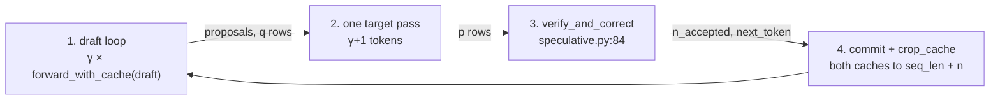
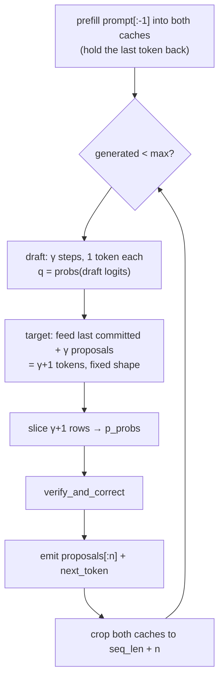
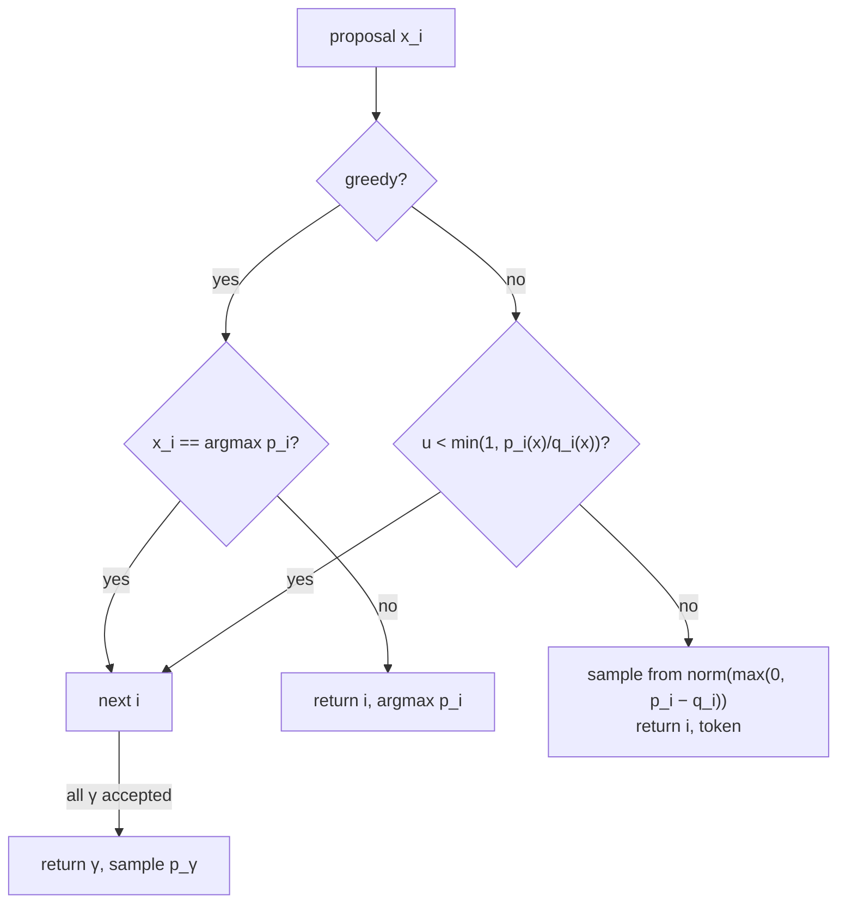
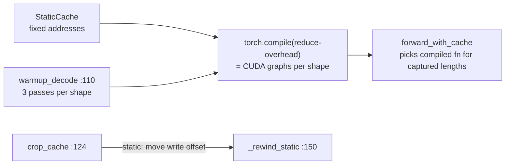

# Day 4 code walkthrough: speculative decoding

Companion to [[Day 04 - Speculative decoding]]. Repo `speculative_decoding`, branch `main` (`99ed1c2`), package
`src/specdec/`.

**One iteration in one picture:** the draft guesses γ tokens one at a time; the target checks all of them in one
pass; the accept/reject rule keeps a prefix and adds one token; both caches are cut back to what was kept.



---

## 1. Turning logits into the distributions p and q

`src/specdec/sampling.py:64–70`
```python
width = logits.shape[-1]
if width == vocab_size:
    return logits
if width > vocab_size:
    return logits[..., :vocab_size]
pad = logits.new_full((*logits.shape[:-1], vocab_size - width), NEG_INF)
return torch.cat([logits, pad], dim=-1)
```

- The 14B target and the 0.5B draft have **different embedding widths** (152064 vs 151936) even though they share a tokenizer. The accept rule compares `p[x]` and `q[x]`, so both must index the same vocabulary. Every model's logits are cut to the **narrowest** width. Widening instead would let the target sample an id the draft can't embed, and the draft would crash with an `IndexError`.

`src/specdec/sampling.py:80–106`
```python
logits = logits.float()

if cfg.is_greedy:
    probs = torch.zeros_like(logits)
    probs.scatter_(-1, logits.argmax(dim=-1, keepdim=True), 1.0)
    return probs

logits = logits / cfg.temperature

if cfg.top_k is not None:
    k = min(cfg.top_k, logits.shape[-1])
    kth = torch.topk(logits, k, dim=-1).values[..., -1:]
    logits = logits.masked_fill(logits < kth, NEG_INF)

if cfg.top_p is not None and cfg.top_p < 1.0:
    sorted_logits, sorted_idx = torch.sort(logits, descending=True, dim=-1)
    sorted_probs = torch.softmax(sorted_logits, dim=-1)
    # Keep the minimal prefix whose cumulative mass reaches top_p. Using the
    # *exclusive* cumsum keeps the token that crosses the threshold, and the
    # top-1 token is always kept even if it alone exceeds top_p.
    exclusive_cum = sorted_probs.cumsum(dim=-1) - sorted_probs
    drop_sorted = exclusive_cum >= cfg.top_p
    drop_sorted[..., 0] = False
    drop = drop_sorted.scatter(-1, sorted_idx, drop_sorted)
    logits = logits.masked_fill(drop, NEG_INF)

return torch.softmax(logits, dim=-1)
```

- Greedy decoding is a **point mass**: probability 1 at the argmax. That makes the general rule below collapse to "accept iff the draft guessed the argmax".
- Otherwise: temperature, then top-k, then top-p, in Hugging Face's order, so the baseline matches `model.generate`. The top-p trick: an *exclusive* cumulative sum keeps the token that crosses the threshold.

---

## 2. The decode loop: `SpeculativeDecoder.generate`



`src/specdec/speculative.py:321–326`
```python
prefill = cur_ids[: prompt_len - 1]
if prefill.numel():
    forward_with_cache(self.target.model, target_cache, prefill, 0)
    forward_with_cache(self.draft.model, draft_cache, prefill, 0)
    n_target_fwd += 1
    n_draft_fwd += 1
```

- **Hold the last prompt token back.** Both caches start one position behind the sequence. So verification always feeds exactly *last committed token + γ proposals* = **γ+1 tokens**, every time. Fixed shapes are what make CUDA graphs possible (section 4).

`src/specdec/speculative.py:341–356`
```python
draft_tokens: list[torch.Tensor] = []
q_rows: list[torch.Tensor] = []
pos = cache_length(draft_cache)
pending = cur_ids[pos:]
for _ in range(gamma):
    logits = forward_with_cache(self.draft.model, draft_cache, pending, pos)[-1]
    n_draft_fwd += 1
    pos += int(pending.numel())
    q = logits_to_probs(align_vocab(logits, self.vocab_size), cfg)
    x = sample_from_probs(q, generator)
    draft_tokens.append(x)
    q_rows.append(q)
    pending = x.view(1)

proposals = torch.stack(draft_tokens)
q_probs = torch.stack(q_rows)
```

- The draft runs γ forward passes of 1 token each (the first may be 2 tokens after a full accept; see `decode_shapes`). It **samples** each proposal from its own `q` and keeps every `q` row for the accept test.

`src/specdec/speculative.py:361–371`
```python
t_len = cache_length(target_cache)
feed = torch.cat([cur_ids[t_len:], proposals])
logits = forward_with_cache(self.target.model, target_cache, feed, t_len)
n_target_fwd += 1
# Row j predicts the token after absolute position t_len + j. We need
# predictions for absolute positions seq_len-1 .. seq_len+gamma-1,
# giving the gamma proposal distributions plus the bonus row.
lo = seq_len - 1 - t_len
p_probs = logits_to_probs(
    align_vocab(logits[lo : lo + gamma + 1], self.vocab_size), cfg
)
```

- **One target forward over γ+1 tokens** gives γ+1 rows of logits: row j predicts the token after position `t_len + j`. Rows 0..γ−1 are `p` at each proposal; row γ is the **bonus** distribution, a free extra token if everything is accepted.

`src/specdec/speculative.py:374–376`
```python
n_accepted, next_token = verify_and_correct(
    proposals, q_probs, p_probs, cfg, generator
)
```

`src/specdec/speculative.py:388–396`
```python
emitted = torch.cat([proposals[:n_accepted], next_token.view(1)])

# --- 4. Commit, and roll the caches back to what we kept. ----------
# K/V for rejected proposals were computed for tokens that are not
# part of the sequence; they must not leak into later attention.
cur_ids = torch.cat([cur_ids, emitted])
keep = seq_len + n_accepted
crop_cache(target_cache, keep)
crop_cache(draft_cache, keep)
```

- Emit `n_accepted` proposals + 1 token, so each iteration yields **between 1 and γ+1 tokens** for one target pass.
- `keep = seq_len + n_accepted`, **not** `+ 1`: the new `next_token` has no K,V in either cache yet. It becomes the "last committed token" fed at the start of the next iteration, which is exactly what the shape trick expects.

---

## 3. The accept/reject rule: `verify_and_correct`



`src/specdec/speculative.py:115–144`
```python
for i in range(k):
    x = draft_tokens[i]
    p_i, q_i = p_probs[i], q_probs[i]

    if cfg.is_greedy:
        # p is a point mass at argmax, so the general rule below degenerates
        # to exact agreement: accept iff the draft guessed the target's
        # argmax, else emit that argmax. Special-cased for clarity and to
        # avoid burning entropy on a coin flip whose outcome is determined.
        target_token = p_i.argmax()
        if bool(x == target_token):
            continue
        return i, target_token

    acceptance_prob = min(1.0, float(p_i[x]) / float(q_i[x]))
    if uniform_scalar(generator, p_probs.device) < acceptance_prob:
        continue

    residual = torch.clamp(p_i - q_i, min=0.0)
    total = residual.sum()
    if bool(total <= 0):
        # Unreachable in exact arithmetic: sum (p-q)_+ == 0 implies p == q,
        # which would have accepted with probability 1. Only float noise can
        # land here, and p is the right answer in that limit.
        residual, total = p_i, p_i.sum()
    return i, sample_from_probs(residual / total, generator)

# Every proposal accepted: the verification pass already gave us the target
# distribution one position further along, so we get a token for free.
return k, sample_from_probs(p_probs[k], generator)
```

Map each line to the algorithm:
- `acceptance_prob = min(1, p(x)/q(x))`: if the target likes x at least as much as the draft did, always accept; otherwise accept with probability p/q.
- On rejection, sample from the **residual** `max(0, p − q)`, renormalised. This is the part that makes the output exactly `p`: accepted mass `min(p, q)` plus residual mass `max(0, p − q)` sums to `p(x)` (Day 4 A2 proof).
- The `total <= 0` branch only fires on floating-point noise: a zero residual means `p == q`, which would have been accepted.
- Falling out of the loop means all γ were accepted, so take the bonus token from `p_probs[k]`.

**Check yourself:** greedy, γ = 4, the target's argmaxes are `[a, b, c, d, e]` and the draft proposed `[a, b, z, d]`. What does `verify_and_correct` return, and how many tokens are emitted? (*`(2, c)`; 3 tokens: a, b, c.*)

---

## 4. Rollback and the 0.88× → 2.25× fix



`src/specdec/cache_utils.py:137–146`
```python
if length >= cache.length:
    return
if cache.static:
    _rewind_static(cache.backend, length)
else:
    # Passing the delta as a negative number means "remove this many
    # tokens", which is the only spelling accepted across both the
    # transformers 4.x and 5.x cache APIs.
    cache.backend.crop(length - cache.length)
cache.length = length
```

`src/specdec/cache_utils.py:163–166`
```python
for layer in backend.layers:
    counter = getattr(layer, "cumulative_length", None)
    if counter is not None:
        counter.fill_(length)
```

- **Rollback without erasing.** On the static cache, `crop` just moves each layer's write counter back. Stale K,V above it are harmless: the next forward overwrites them before attention reads them, and the causal mask hides anything above the query's position.
- `fill_` changes the counter **in place**. A CUDA graph is bound to the tensor addresses it recorded, so making a new tensor would silently break every captured graph.

`src/specdec/cache_utils.py:185–189`
```python
if cache.length != start_pos:
    raise ValueError(
        f"cache holds {cache.length} positions but forward starts at {start_pos}; "
        "cache and sequence have drifted out of sync"
    )
```

- A guard against the most dangerous bug in this design: the cache length drifting away from the sequence. It fails loudly instead of attending to the wrong positions.

`src/specdec/compile_utils.py:87–91`
```python
model._specdec_compiled_forward = torch.compile(
    model.forward, mode=mode, fullgraph=fullgraph, dynamic=False
)
model._specdec_decode_shapes = shapes
model._specdec_compile_mode = mode
```

`src/specdec/compile_utils.py:131–139`
```python
for n in sorted(frozenset(int(s) for s in shapes)):
    # Three passes per shape: the first compiles, and cudagraph trees needs
    # a couple more before it is replaying rather than still recording.
    for _ in range(3):
        cache = cache_factory()  # acquiring from a pool already resets it
        forward_with_cache(model, cache, torch.randint(0, vocab, (prefix_len,), device=device), 0)
        forward_with_cache(model, cache, torch.randint(0, vocab, (n,), device=device), prefix_len)
        reset_cache(cache)
torch.cuda.synchronize()
```

- **Why it was 0.88× in eager mode:** at batch 1, each layer is a handful of tiny kernels, and Python launches them one by one. The GPU finishes each faster than the CPU can launch the next, so a step costs about *layers × launch time*, whatever the model's width. A 1.5B draft with 28 layers then costs as much as a 7B target with 28 layers, and speculation can't win.
- **The fix:** a `StaticCache` (fixed shapes and addresses) + `torch.compile(mode="reduce-overhead")`, which records each step as a CUDA graph and replays it with one launch. Then a 14B target (48 layers) against a 0.5B draft (24 layers) makes the cost ratio `c` small.
- `warmup_decode` compiles and records each shape **before** timing. Otherwise the benchmark would charge compile time to whichever arm ran first.
