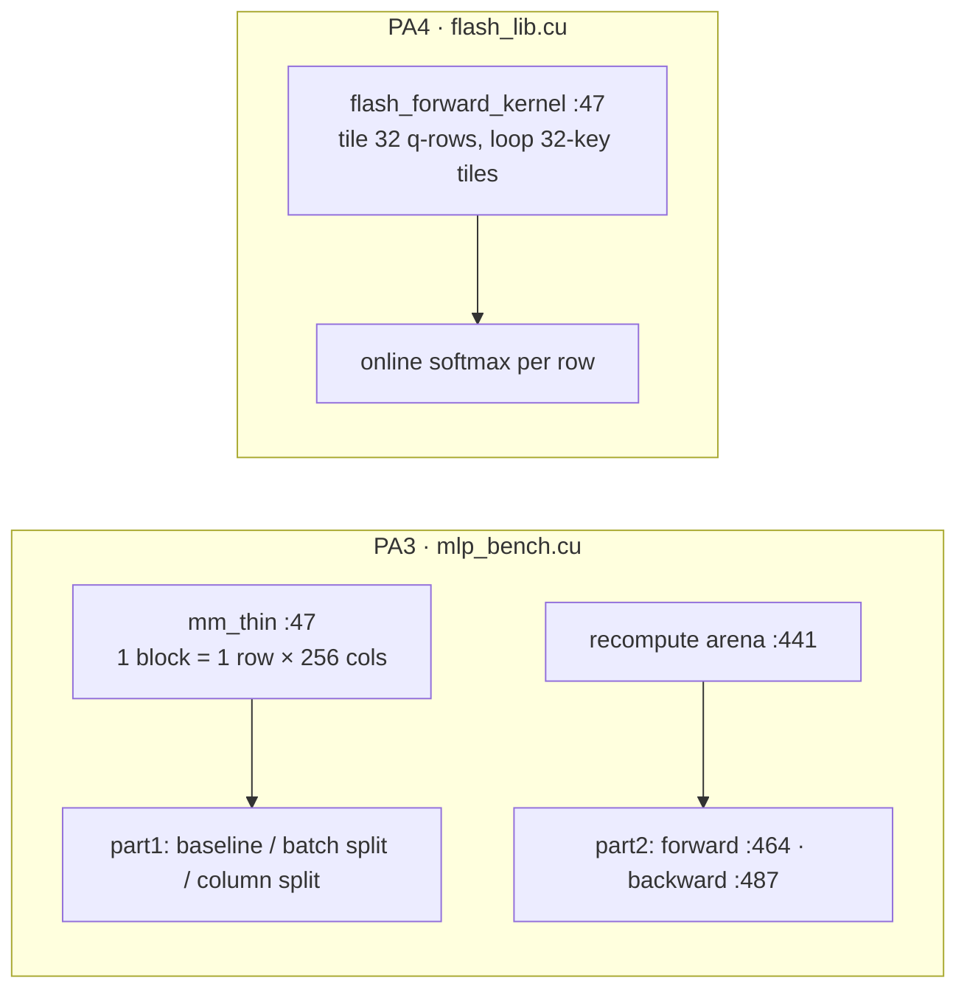
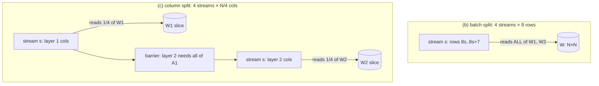
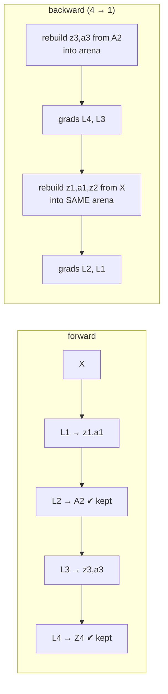
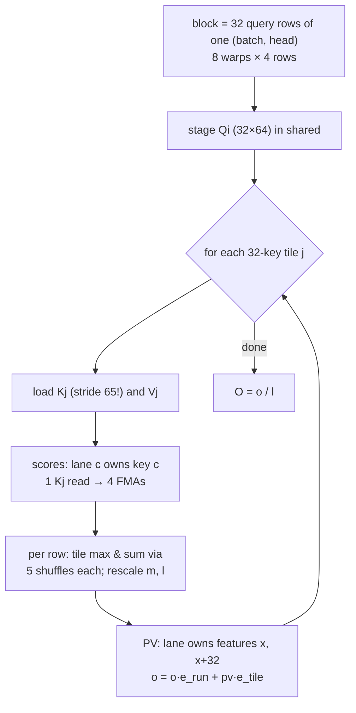

# Day 6 code walkthrough: streams, checkpointing, FlashAttention

Companion to [[Day 06 - CUDA II]]. Repo `sysml` (`16870fb`): `mlp/mlp_bench.cu` (PA3) and
`flashattention/flash_lib.cu` (PA4). Builds on [[Day 05 - code walkthrough]].



---

## 1. The thin GEMM every stream variant uses

`mlp/mlp_bench.cu:53–79`
```cpp
__shared__ float sA[BK];

const int m   = blockIdx.y;
const int col = blockIdx.x * BN + threadIdx.x;
if (m >= M) return;

float acc = 0.0f;
for (int k0 = 0; k0 < K; k0 += BK) {
    // Stage this row-slice of A cooperatively.
    for (int t = threadIdx.x; t < BK; t += BN) {
        int k = k0 + t;
        sA[t] = (k < K) ? A[(size_t)m * K + k] : 0.0f;
    }
    __syncthreads();

    if (col < N) {
        int kmax = (K - k0 < BK) ? (K - k0) : BK;
        for (int kk = 0; kk < kmax; ++kk)
            acc = fmaf(sA[kk], B[(size_t)(k0 + kk) * N + col], acc);
    }
    __syncthreads();
}

if (col < N) {
    float v = acc + (bias ? bias[col] : 0.0f);
    C[(size_t)m * N + col] = relu ? (v > 0.0f ? v : 0.0f) : v;
}
```

- One block per (batch row `m`, 256-column chunk). The block stages a `BK`-long slice of row `m` of A in shared memory (lines 62–65), then each thread walks down one column of B.
- `B[(k0+kk)*N + col]`: adjacent threads, adjacent columns, so **coalesced**. But each of the 32 row-blocks re-reads the same column slice of W from global memory. Reuse of W across the batch depends entirely on the L1/L2 caches. Keep that in mind for section 2.

---

## 2. Streams: batch split vs column split



`mlp/mlp_bench.cu:254–257`
```cpp
auto baseline = [&] {
    mm_thin<BN,BK><<<grd, blk>>>(X,  W1, b1, A1, B, N, N, 1);
    mm_thin<BN,BK><<<grd, blk>>>(A1, W2, b2, Y,  B, N, N, 0);
};
```

`mlp/mlp_bench.cu:262–273`
```cpp
auto streamed = [&] {
    for (int s = 0; s < NS; ++s) {
        int r0 = s * chunk;
        int rows = (r0 + chunk <= B) ? chunk : (B - r0);
        if (rows <= 0) continue;
        dim3 g((N + BN - 1) / BN, rows);
        mm_thin<BN,BK><<<g, blk, 0, st[s]>>>(X  + (size_t)r0 * N, W1, b1,
                                             A1 + (size_t)r0 * N, rows, N, N, 1);
        mm_thin<BN,BK><<<g, blk, 0, st[s]>>>(A1 + (size_t)r0 * N, W2, b2,
                                             Y  + (size_t)r0 * N, rows, N, N, 0);
    }
    for (int s = 0; s < NS; ++s) cudaStreamSynchronize(st[s]);
```

- **Batch split:** each stream gets 8 rows, but each still multiplies by the **whole** W1 and W2 (`W1` is passed unchanged). W is N² floats while X is only 32·N, so weight traffic dominates and the split multiplies it, and it launches 4× as many kernels. It never helped: up to 4× slower.

`mlp/mlp_bench.cu:280–299`
```cpp
auto streamed_col = [&] {
    for (int s = 0; s < NS; ++s) {
        int c0 = s * cchunk;
        int cols = (c0 + cchunk <= N) ? cchunk : (N - c0);
        if (cols <= 0) continue;
        dim3 g((cols + BN - 1) / BN, B);
        mm_thin<BN,BK><<<g, blk, 0, st[s]>>>(X, W1 + c0, b1 + c0,
                                             A1 + c0, B, N, N, 1);
    }
    for (int s = 0; s < NS; ++s) cudaStreamSynchronize(st[s]);
    for (int s = 0; s < NS; ++s) {
        int c0 = s * cchunk;
        int cols = (c0 + cchunk <= N) ? cchunk : (N - c0);
        if (cols <= 0) continue;
        dim3 g((cols + BN - 1) / BN, B);
        mm_thin<BN,BK><<<g, blk, 0, st[s]>>>(A1, W2 + c0, b2 + c0,
                                             Y + c0, B, N, N, 0);
    }
    for (int s = 0; s < NS; ++s) cudaStreamSynchronize(st[s]);
};
```

- **Column split:** stream `s` gets `W1 + c0`, a quarter of the columns. Each stream touches only its own slice of W, which is far more likely to stay in L2 between its 32 row-blocks.
- Layer 2 needs **all** of A1, so there's a full sync between the layers (line 289).
- 1.73× at N = 32768 only. The baseline already launches about 4 waves of blocks at that size, so the GPU was full. The gain is most likely **cache locality**, not streams running concurrently. Say so.
- The stream variants call `cudaStreamSynchronize` inside the timed loop; the baseline doesn't. At small N that host round-trip is part of why they look slower.

---

## 3. Gradient checkpointing: one arena, two segments



`mlp/mlp_bench.cu:411–420`
```cpp
float *Z1=nullptr,*A1=nullptr,*Z2=nullptr,*A2=nullptr,*Z3=nullptr,*A3=nullptr,*Z4=nullptr;
CUDA_CHECK(cudaMalloc(&A2, n2 * sizeof(float)));   // checkpoint
CUDA_CHECK(cudaMalloc(&Z4, n4 * sizeof(float)));   // checkpoint
if (!checkpointed) {
    CUDA_CHECK(cudaMalloc(&Z1, n1 * sizeof(float)));
    CUDA_CHECK(cudaMalloc(&A1, n1 * sizeof(float)));
    CUDA_CHECK(cudaMalloc(&Z2, n2 * sizeof(float)));
    CUDA_CHECK(cudaMalloc(&Z3, n3 * sizeof(float)));
    CUDA_CHECK(cudaMalloc(&A3, n3 * sizeof(float)));
}
```

- Both modes keep the two checkpoints, `A2` and `Z4`. Only the baseline also keeps `Z1, A1, Z2, Z3, A3`. That is the entire memory difference.

`mlp/mlp_bench.cu:453–462`
```cpp
float *arena = nullptr;
float *rZ1=nullptr,*rA1=nullptr,*rZ2=nullptr,*rZ3=nullptr,*rA3=nullptr;
if (checkpointed) {
    size_t segA = 2 * n1 + n2;
    size_t segB = 2 * n3;
    size_t arena_floats = segA > segB ? segA : segB;
    CUDA_CHECK(cudaMalloc(&arena, arena_floats * sizeof(float)));
    rZ1 = arena;  rA1 = rZ1 + n1;  rZ2 = rA1 + n1;   // segment A layout
    rZ3 = arena;  rA3 = rZ3 + n3;                    // segment B, aliased
}
```

- **The trick:** segment B (`Z3, A3`) and segment A (`Z1, A1, Z2`) are never needed at the same time, so both live in **one** arena of `max(2·n3, 2·n1 + n2)` floats. Note `rZ3 = arena` and `rZ1 = arena`: they alias. The first version gave each recomputed tensor its own permanent buffer and saved **0 MB** (story S3).

`mlp/mlp_bench.cu:493–501`
```cpp
if (checkpointed) {
    // segment B, from the A2 checkpoint
    mm_tiled<<<g2(Nb,H3), dim3(TS,TS)>>>(A2, W3, rZ3, Nb, H2, H3);
    k_add_bias_relu<<<g1(n3),256>>>(rZ3, b3, Nb, H3, 0);
    k_relu_into<<<g1(n3),256>>>(rZ3, rA3, n3);
    z3 = rZ3; a3 = rA3;
} else {
    z3 = Z3; a3 = A3;
}
```

`mlp/mlp_bench.cu:513–523`
```cpp
// z3 / a3 are dead from here on: rebuild segment A over the same arena.
if (checkpointed) {
    mm_tiled<<<g2(Nb,H1), dim3(TS,TS)>>>(X, W1, rZ1, Nb, IN, H1);
    k_add_bias_relu<<<g1(n1),256>>>(rZ1, b1, Nb, H1, 0);
    k_relu_into<<<g1(n1),256>>>(rZ1, rA1, n1);
    mm_tiled<<<g2(Nb,H2), dim3(TS,TS)>>>(rA1, W2, rZ2, Nb, H1, H2);
    k_add_bias_relu<<<g1(n2),256>>>(rZ2, b2, Nb, H2, 0);
    z1 = rZ1; a1 = rA1; z2 = rZ2;
} else {
    z1 = Z1; a1 = A1; z2 = Z2;
}
```

- Backward first rebuilds segment B from the `A2` checkpoint, uses `z3, a3` for the layer 4 and 3 gradients, and **only then** rebuilds segment A over the same memory. Any use of `z3` after line 513 would read garbage. The comment states the ordering rule.
- The cost is those two extra mini-forwards: +35.5 ms on a 136 ms backward (+26%).

`mlp/mlp_bench.cu:548–550`
```cpp
CUDA_CHECK(cudaDeviceSynchronize());
CUDA_CHECK(cudaMemGetInfo(&free_after, &total));
peak = free_before - free_after;
```

- Memory = how much free memory dropped after **everything** is allocated (including the arena). Every buffer is a `cudaMalloc` made up front, so footprint = peak. 962 → 834 MiB is the **whole training step** (−13.3%); the activations alone fell 400 → 272 MiB (−32%).

---

## 4. FlashAttention: tiles, warps, online softmax



`flashattention/flash_lib.cu:55–61`
```cpp
const int KS = D + 1;             // padded Kj row stride, see header

extern __shared__ float smem[];
float* Qi = smem;
float* Kj = Qi + BR * D;
float* Vj = Kj + BC * KS;
float* S  = Vj + BC * D;          // BR * BC
```

- Shared memory = `Qi | Kj | Vj | S`. **`KS = D + 1 = 65`** is the row stride of `Kj`. This one line is the 7.0× story.

`flashattention/flash_lib.cu:118–126`
```cpp
if (lane < kv_len) {
    const float* kptr = Kj + lane * KS;
    for (int x = 0; x < D; ++x) {
        const float kv = kptr[x];
        #pragma unroll
        for (int r = 0; r < RPW; ++r)
            a[r] = fmaf(Qi[(r0 + r) * D + x], kv, a[r]);
    }
}
```

- Score phase: lane `c` owns key `c`, so at a fixed feature `x` the 32 lanes read `Kj[c·KS + x]`. With stride 64, the bank is `(c·64 + x) mod 32 = x mod 32`: **all 32 lanes on one bank, a 32-way conflict**. With stride 65 the bank is `(c + x) mod 32`, all different. 2377 → 339 ms.
- `x` is the outer loop, so one `kv` load feeds **4 FMAs** (4 query rows per warp). The `Qi` reads are the same address for all lanes, so they broadcast. Moving from 1 to 4 rows per warp gave 339 → 160 ms (story S2).

`flashattention/flash_lib.cu:130–152`
```cpp
for (int r = 0; r < RPW; ++r) {
    float s = (lane < kv_len) ? a[r] * softmax_scale : -INFINITY;

    float m_tile = s;
    #pragma unroll
    for (int off = 16; off > 0; off >>= 1)
        m_tile = fmaxf(m_tile, __shfl_xor_sync(0xffffffff, m_tile, off));

    float p = (lane < kv_len) ? __expf(s - m_tile) : 0.0f;

    float l_tile = p;
    #pragma unroll
    for (int off = 16; off > 0; off >>= 1)
        l_tile += __shfl_xor_sync(0xffffffff, l_tile, off);

    S[(r0 + r) * BC + lane] = p;

    const float m_new = fmaxf(m_run[r], m_tile);
    e_run[r]  = __expf(m_run[r] - m_new);   // 0 on the first tile
    e_tile[r] = __expf(m_tile   - m_new);
    l_run[r]  = e_run[r] * l_run[r] + e_tile[r] * l_tile;
    m_run[r]  = m_new;
}
```

- For each of the warp's 4 rows: the tile max needs a reduction across 32 lanes. `__shfl_xor_sync` with offsets 16, 8, 4, 2, 1 swaps registers between lanes, giving the max in **5 steps with no shared memory**. The sum is reduced the same way.
- `p = e^{s − m_tile}` is written to the warp's own rows of `S`. Then the running state updates: `m_new = max(m_run, m_tile)`, `e_run = e^{m_run − m_new}` rescales the old sum and output, and `e_tile = e^{m_tile − m_new}` rescales this tile's.
- On the first tile `m_run = −∞`, so `e_run = 0`, which correctly discards the empty initial state.

`flashattention/flash_lib.cu:158–172`
```cpp
for (int x = lane; x < D; x += WARP, ++jj) {
    float pv[RPW];
    #pragma unroll
    for (int r = 0; r < RPW; ++r) pv[r] = 0.0f;

    for (int c = 0; c < kv_len; ++c) {
        const float vv = Vj[c * D + x];
        #pragma unroll
        for (int r = 0; r < RPW; ++r)
            pv[r] = fmaf(S[(r0 + r) * BC + c], vv, pv[r]);
    }
    #pragma unroll
    for (int r = 0; r < RPW; ++r)
        o_acc[r][jj] = o_acc[r][jj] * e_run[r] + pv[r] * e_tile[r];
}
```

- PV phase: now lane `x` owns **feature** `x` (and `x + 32`). `Vj[c·D + x]` with adjacent `x` hits adjacent banks, so no padding is needed here.
- `o = o·e_run + pv·e_tile` is the online-softmax update for the output. Divide by `l_run` once at the very end (lines 175–183).
- `__syncwarp()` (line 153), not `__syncthreads()`: each warp reads only its own rows of `S`, so only lanes within one warp need to agree.

**Check yourself:** with stride 64, which bank do lanes 0, 1 and 31 hit at `x = 5`? With stride 65? (*64: all bank 5. 65: banks 5, 6 and 4.*)
