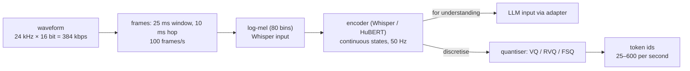
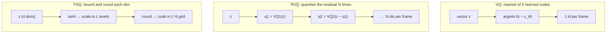
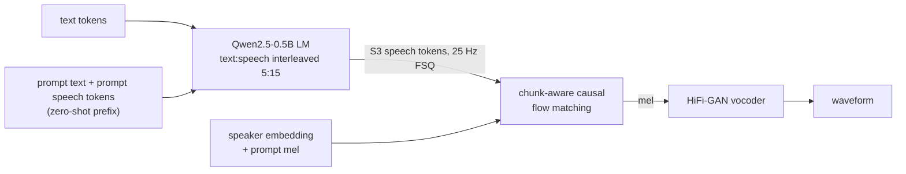
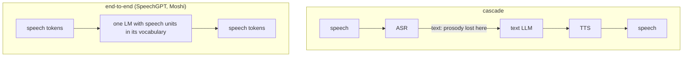

# Day 7 walkthrough: speech pipelines in pictures (no repo code)

Companion to [[Day 07 - Seminar and speech basics]]. The seminar was a reading project, so there is **no code of
yours** today. Instead: one figure per pipeline, plus a few **illustrative** NumPy snippets (written for this note,
not from any repo) that make the quantisers concrete. Numbers come from [[Seminar - prep]] §5.2.

---

## 1. Audio → features → tokens



- **Continuous** features feed understanding (speech in, text out). **Discrete** tokens let an LM *generate* speech the way it generates text.
- The **token rate** sets the sequence length: 10 s at 25 Hz = 250 tokens; at 600/s (EnCodec 6 kbps) = 6,000 tokens. That's 24× longer and ~576× the attention FLOPs.

---

## 2. Three quantisers



*Illustration (not your code):*
```python
import numpy as np
z = np.random.randn(8)                        # one frame's 8-d latent

# VQ: one learned codebook of K codes
codebook = np.random.randn(1024, 8)
vq_id = np.argmin(((codebook - z) ** 2).sum(1))        # 1 token, 10 bits

# RVQ: N codebooks, each quantises what the previous ones missed
books, residual, ids = [np.random.randn(1024, 8) for _ in range(4)], z.copy(), []
for cb in books:
    k = np.argmin(((cb - residual) ** 2).sum(1))
    ids.append(k); residual -= cb[k]                    # 4 tokens per frame, 40 bits

# FSQ: no codebook to learn; L levels per dimension
L = 3
fsq = np.round(np.tanh(z) * (L // 2))                   # each dim in {-1, 0, 1}
# 3^8 = 6,561 codes: CosyVoice 2's codebook size
```

- **VQ** can **collapse**: most inputs pick a few codes and the rest never train.
- **RVQ** gives N tokens per frame, so the flattened sequence grows **linearly** in N (not exponentially; your slide 5 is wrong there).
- **FSQ** can't collapse: every grid point is reachable by construction.
- **Bitrate = frames/s × codebooks × log2(K)**. WavTokenizer 75 × 1 × 12 = 900 bps; CosyVoice 2 25 × log2(6561) ≈ 317 bps.

---

## 3. CosyVoice 2: text in, speech out



- The S3 tokens come from an ASR-trained tokenizer, so they carry **content** (and some prosody). The **voice** comes from the speaker embedding and the prompt mel, which feed the **flow model**, not the LM (the CosyVoice 2 LM's `forward` never reads the speaker embedding; see [[Day 08 - code walkthrough]] §3). This is why your Day 8 LoRA adapts only the LM: it teaches the LM which S3 tokens Hindi and Telugu text should produce.

---

## 4. Cascade vs end-to-end



- Cascade: modular, debuggable, reuses text LLMs. Latencies **add**, errors **compound** (10% WER → a 20-word question is fully right only 0.9²⁰ ≈ 12% of the time), and emotion is lost at the ASR step.
- End-to-end: lower latency and keeps paralinguistics, but needs paired speech data and is harder to debug.

*Illustration: the bitrate helper from today's rebuild:*
```python
from math import log2
def bitrate(fps, n_codebooks, K):
    return fps * n_codebooks * log2(K)          # bits per second
assert bitrate(75, 8, 1024) == 6000             # EnCodec 6 kbps
assert bitrate(75, 1, 4096) == 900              # WavTokenizer
print(round(bitrate(25, 1, 6561)))              # CosyVoice 2 ≈ 317
```
