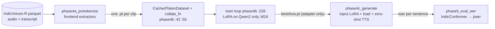
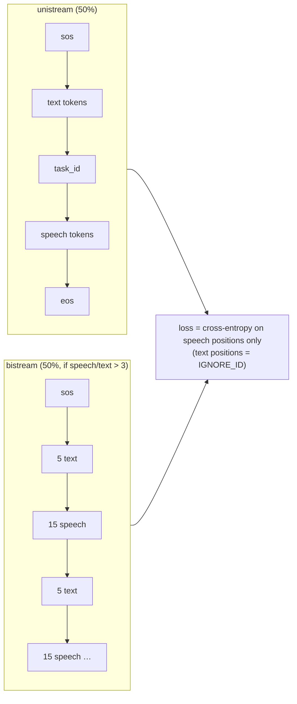

# Day 8 code walkthrough: CosyVoice Indic LoRA

Companion to [[Day 08 - CosyVoice]]. Repo `/data/jayavardhan/cosyvoice_rnd` (`0bb4e20`). Your code is `scripts/`;
`cosyvoice/` is Alibaba's upstream package (one function from it is here because your loss comes from it).



---

## 1. Pretokenize once, so training never runs the frozen tokenisers

`scripts/phase4a_pretokenize.py:140–169`
```python
try:
    tok_ret = fe._extract_speech_token(tmp_path)
    speech_tokens = tok_ret[0] if isinstance(tok_ret, tuple) else tok_ret
    if speech_tokens.dim() == 2:
        speech_tokens = speech_tokens.squeeze(0)

    spk_ret = fe._extract_spk_embedding(tmp_path)
    spk_emb = spk_ret[0] if isinstance(spk_ret, tuple) else spk_ret
    if spk_emb.dim() == 2:
        spk_emb = spk_emb.squeeze(0)

    # Also pre-tokenize text using CV's tokenizer
    text = str(row["normalized"]).strip()
    text_tok_ret = fe._extract_text_token(text)
    text_tokens = text_tok_ret[0] if isinstance(text_tok_ret, tuple) else text_tok_ret
    if text_tokens.dim() == 2:
        text_tokens = text_tokens.squeeze(0)
finally:
    Path(tmp_path).unlink(missing_ok=True)

duration = float(row["duration"])

torch.save({
    "id": cid,
    "text": text,
    "text_tokens": text_tokens.cpu().to(torch.long),
    "speech_tokens": speech_tokens.cpu().to(torch.long),
    "spk_emb": spk_emb.cpu().to(torch.float32),
    "duration_s": duration,
}, cache_path)
```

- For each clip, CosyVoice's own frontend gives three things: **S3 speech tokens** (25 Hz, the training *target*), the **text tokens** (the *condition*), and a **speaker embedding**.
- Note: the CosyVoice 2 LLM's `forward` (section 3) never reads the speaker embedding; it's used by the flow model at synthesis time. It's cached here because the batch format carries it, not because the LoRA loss uses it.
- Skip if the cache file exists (line 126), so an interrupted run resumes.

---

## 2. Batching and LoRA injection

`scripts/phase4b_train_lora.py:66–89`
```python
B = len(items)
text_lens = [it["text_tokens"].shape[-1] for it in items]
speech_lens = [it["speech_tokens"].shape[-1] for it in items]
L_text = max(text_lens)
L_speech = max(speech_lens)

text_token = torch.zeros(B, L_text, dtype=torch.long)
speech_token = torch.zeros(B, L_speech, dtype=torch.long)
for i, it in enumerate(items):
    t = it["text_tokens"].to(torch.long)
    s = it["speech_tokens"].to(torch.long)
    text_token[i, :t.shape[-1]] = t
    speech_token[i, :s.shape[-1]] = s

return {
    "text_token": text_token,
    "text_token_len": torch.tensor(text_lens, dtype=torch.int32),
    "speech_token": speech_token,
    "speech_token_len": torch.tensor(speech_lens, dtype=torch.int32),
    "embedding": torch.stack([it["spk_emb"].to(torch.float32) for it in items], dim=0),
    # CV3-only keys; harmless for CV2 (its forward only reads what it needs)
    "instruct_token": torch.zeros(B, 0, dtype=torch.long),
    "instruct_token_len": torch.zeros(B, dtype=torch.int32),
}
```

- Pad text and speech tokens to the longest in the batch, and pass the **true lengths**. Upstream unpads with them, so padding never enters the loss.

`scripts/phase4b_train_lora.py:155–169`
```python
# ---- Freeze EVERYTHING (llm + flow + hift) ----
for sub in (cv.model.llm, cv.model.flow, cv.model.hift):
    for p in sub.parameters():
        p.requires_grad = False

# ---- Apply LoRA only to the inner Qwen2ForCausalLM ----
# Both CV2 and CV3 have cv.model.llm.llm.model as the inner Qwen2ForCausalLM
# (CV3 just inherits from Qwen2LM with extra forward logic). Detect by class name.
cv_version = "cv3" if "CosyVoice3" in type(cv.model.llm).__name__ else "cv2"
inner_qwen = cv.model.llm.llm.model
log({"event": "cv_version_detected", "cv_version": cv_version,
     "llm_class": type(cv.model.llm).__name__})

lora_qwen = apply_lora_to_qwen(inner_qwen, args.lora_r, args.lora_alpha, args.lora_dropout)
cv.model.llm.llm.model = lora_qwen
```

`scripts/phase4b_train_lora.py:101–108`
```python
config = LoraConfig(
    r=r,
    lora_alpha=alpha,
    lora_dropout=dropout,
    target_modules=["q_proj", "k_proj", "v_proj", "o_proj",
                    "gate_proj", "up_proj", "down_proj"],
    bias="none",
)
```

- **Freeze everything** (LLM, flow, vocoder), then inject LoRA adapters into all seven projections of the inner Qwen2. `inject_adapter_in_model` marks only the new A and B matrices as trainable.
- `inject_adapter_in_model` instead of `get_peft_model`: it keeps the original module classes, so CosyVoice's hard-coded attribute paths (`self.llm.model.model.embed_tokens`) still resolve.

`scripts/phase4b_train_lora.py:172–181`
```python
def all_params():
    for sub in (cv.model.llm, cv.model.flow, cv.model.hift):
        yield from sub.parameters()

n_trainable = sum(p.numel() for p in all_params() if p.requires_grad)
n_total     = sum(p.numel() for p in all_params())
log({"event": "lora_applied",
     "trainable_params": n_trainable,
     "total_params": n_total,
     "trainable_pct": round(100 * n_trainable / n_total, 3)})
```

- `n_total` sums **LLM + flow + vocoder**. So 8,798,208 / 647,972,675 = 1.36% is the adapter's share of **all of CosyVoice 2**, not of the 0.5B Qwen alone (against Qwen's ~494M it would be ~1.8%). Say "1.36% of the full CosyVoice 2 model".

---

## 3. What the loss actually is (upstream `Qwen2LM`)



`cosyvoice/llm/llm.py:341–343`
```python
else:
    this_lm_target = torch.tensor([IGNORE_ID] * (1 + instruct_token_len[i] + text_token_len[i]) + speech_token[i].tolist() + [self.eos_token])
    this_lm_input = torch.concat([sos_emb.squeeze(dim=0), instruct_token_emb[i], text_token_emb[i], task_id_emb.squeeze(dim=0), speech_token_emb[i]], dim=0)
```

`cosyvoice/llm/llm.py:318–331`
```python
if random.random() < 0.5 and speech_token_len[i] / text_token_len[i] > self.mix_ratio[1] / self.mix_ratio[0]:
    this_lm_target, this_lm_input = [IGNORE_ID], [sos_emb.squeeze(dim=0)]
    this_lm_target += [IGNORE_ID] * instruct_token_len[i]
    this_lm_input.append(instruct_token_emb[i])
    for j in range(((text_token_len[i] + 1) / self.mix_ratio[0]).ceil().int().item()):
        this_text_token = text_token[i][j * self.mix_ratio[0]: (j + 1) * self.mix_ratio[0]].tolist()
        this_speech_token = speech_token[i][j * self.mix_ratio[1]: (j + 1) * self.mix_ratio[1]].tolist()
        if len(this_text_token) == self.mix_ratio[0]:
            assert len(this_speech_token) == self.mix_ratio[1]
            this_lm_target += [IGNORE_ID] * (self.mix_ratio[0] - 1)
            this_lm_target += this_speech_token
            this_lm_target.append(self.fill_token)
            this_lm_input.append(text_token_emb[i][j * self.mix_ratio[0]: (j + 1) * self.mix_ratio[0]])
            this_lm_input.append(speech_token_emb[i][j * self.mix_ratio[1]: (j + 1) * self.mix_ratio[1]])
```

`cosyvoice/llm/llm.py:400–405`
```python
# 4. run lm forward
lm_output, lm_output_mask = self.llm(lm_input, lm_input_len.to(device))
logits = self.llm_decoder(lm_output)
loss = self.criterion_ce(logits, lm_target.to(device))
acc = th_accuracy(logits.view(-1, self.llm_decoder.out_features), lm_target, ignore_label=IGNORE_ID)
return {'loss': loss, 'acc': acc}
```

- The input is `[sos, text…, task_id, speech…]`. The **target** is `IGNORE_ID` for every text position and the next speech token (then `eos`) for every speech position. So the model is trained to **predict speech tokens given the text**: next-token cross-entropy, label-smoothed.
- Half the time the sequence is **interleaved 5 text : 15 speech**. That's the streaming mode (Day 7): the model learns to start speaking before all the text has arrived.
- Your LoRA therefore learns *which S3 tokens Hindi/Telugu text should produce*. The voice and the rendering stay with the frozen flow model and vocoder.

---

## 4. The training loop

`scripts/phase4b_train_lora.py:235–250`
```python
with torch.autocast(device_type="cuda", dtype=torch.bfloat16):
    out = cv.model.llm(batch, DEVICE)
    loss = out["loss"] if isinstance(out, dict) else out
    loss = loss / args.grad_accum

loss.backward()
accum += 1

if accum >= args.grad_accum:
    torch.nn.utils.clip_grad_norm_(
        [p for p in cv.model.llm.parameters() if p.requires_grad],
        max_norm=1.0,
    )
    opt.step()
    opt.zero_grad()
    accum = 0
```

- **bf16 autocast:** the forward runs in bfloat16, which has FP32's exponent range, so no loss scaler is needed (FP16 would need one).
- **Gradient accumulation:** divide the loss by `grad_accum` and step once every 4 batches. Batch 4 × 4 = an effective batch of 16 clips.
- **Clip the gradient norm to 1.0** over the LoRA parameters only.

`scripts/phase4b_train_lora.py:267–288`
```python
if val_loss < best_val:
    best_val = val_loss
    patience_left = args.early_stop_patience   # reset
    save_dir = args.ckpt_dir / "best"
    save_dir.mkdir(parents=True, exist_ok=True)
    lora_state = {n: p.detach().cpu()
                  for n, p in cv.model.llm.named_parameters()
                  if p.requires_grad}
    torch.save(lora_state, save_dir / "lora.pt")
    log({"event": "saved_best", "step": step,
         "val_loss": val_loss, "path": str(save_dir),
         "n_params_saved": len(lora_state)})
else:
    patience_left -= 1
    log({"event": "patience", "step": step,
         "patience_left": patience_left,
         "best_val": best_val, "current_val": val_loss})
    if patience_left <= 0:
        log({"event": "early_stop", "step": step,
             "best_val": best_val})
        early_stopped = True
        break
```

- Validate every 300 optimiser steps. On a new best, save **only** the trainable tensors (`requires_grad`), so `lora.pt` holds just the adapter (~17 MB in bf16). After 4 checks without improvement, stop early. A wall-clock budget (`--hours-budget`) also bounds the run.
- This is **one process on one GPU**: no `torch.distributed` anywhere. The 4 H200s ran separate jobs (Hindi, Telugu, joint) at the same time.

---

## 5. Generate and score

`scripts/phase4c_generate.py:59–68`
```python
own_state = dict(cv.model.llm.named_parameters())
loaded = 0
skipped = []
for name, tensor in state.items():
    if name in own_state and own_state[name].shape == tensor.shape:
        own_state[name].data.copy_(tensor.to(own_state[name].device))
        loaded += 1
    else:
        skipped.append(name)
return loaded, skipped
```

- Rebuild the same LoRA structure, then copy in the saved tensors by name, checking shapes. `skipped` would reveal a rank or target-module mismatch between training and inference.

`scripts/phase4c_generate.py:139–141`
```python
chunks = list(cv.inference_zero_shot(
    text, effective_prompt, args.prompt_wav, stream=False,
))
```

- **Zero-shot synthesis:** the text plus a prompt wav and its transcript. The prompt supplies the voice to clone.

`scripts/phase5_eval_wer.py:138–145`
```python
for sid, cat, ref, hyp in zip(ids, cats, refs, hyps):
    ref_n = normalize_hindi(ref)
    hyp_n = normalize_hindi(hyp)
    try:
        w = wer(ref_n, hyp_n)
        c = cer(ref_n, hyp_n)
    except ValueError:
        w, c = 1.0, 1.0
```

`scripts/phase5_eval_wer.py:166–169`
```python
df = pd.DataFrame(all_rows)
for label in df["label"].unique():
    sub = df[df["label"] == label]
    print(f"{label:<20} {len(sub):>4} {sub['wer'].mean():>6.3f} {sub['cer'].mean():>6.3f}")
```

- IndicConformer transcribes each generated wav. Both reference and hypothesis are normalised (whitespace, punctuation, the danda `।`), then `jiwer` computes per-clip WER.
- **The reported WER is the mean of per-clip WERs** (line 169), not one corpus-level WER. A few babbling clips with WER ≫ 1 (many inserted words) can pull the mean to 1.99. Say this when you explain "WER above 1".

**Check yourself:** a reference of 4 words; the hypothesis has 1 substitution and 6 inserted words. What's the clip's WER? (*(1 + 0 + 6) / 4 = 1.75.*)
