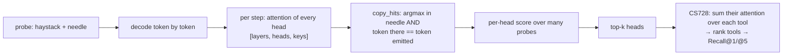
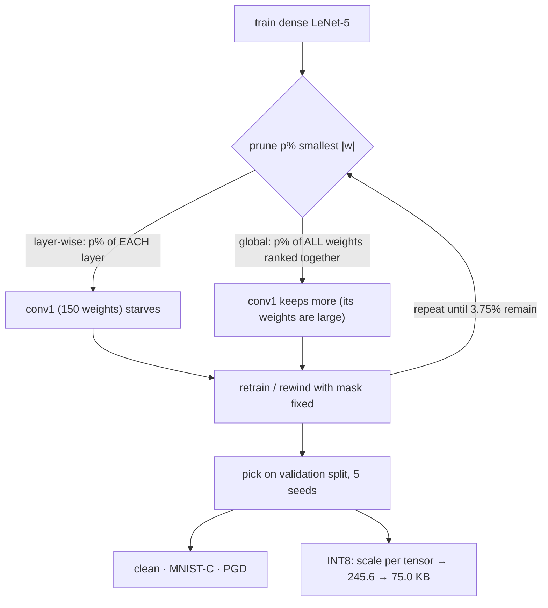

# Day 9 walkthrough: retrieval heads (worked example) and the pruning pipeline

Companion to [[Day 09 - CS728 and LeNet-5]].

> [!warning] Your CS728 and LeNet-5 code is not on the server
> Sections 1–2 read a **worked example**: your own `LongContext_RAG/heads/` (branch `main`, `bfb2ec9`), which scores
> retrieval heads the way Wu et al. do. It's the same idea as CS728's Hit Count. Section 3 gives the pruning pipeline
> as a figure. Once the course code is copied to `interview_materials/`, ask Claude to add its snippets here.



---

## 1. Catching a head in the act of copying

`heads/scorer.py:121–143`
```python
def copy_hits(
    attn: torch.Tensor,
    prompt_ids: torch.Tensor,
    generated_token: int,
    needle_start: int,
    needle_end: int,
) -> tuple[torch.Tensor, torch.Tensor]:
    """Which heads were caught copying `generated_token` out of the needle?

    A hit needs both halves of the rule: the head's attention argmax lands
    *inside* the needle span, and the token sitting at that position *is* the
    token being emitted. Attending to the needle while generating something else
    is not retrieval, and emitting a needle token while attending elsewhere is
    not retrieval either.

    Returns (argmax_index, hit_mask), both [layers, heads].
    """
    j = attn.argmax(dim=-1)
    in_span = (j >= needle_start) & (j < needle_end)
    # Positions past the prompt are freshly generated tokens; they can never be
    # in the needle span, so clamping only keeps the gather in bounds.
    tok_at_j = prompt_ids[j.clamp(max=prompt_ids.numel() - 1)]
    return j, in_span & (tok_at_j == generated_token)
```

- A head scores a **hit** at a decode step only if **both** hold: its attention argmax `j` is *inside* the needle, **and** the token at `j` is the token being generated. Attending to the needle while emitting something else isn't retrieval, and nor is emitting a needle token while looking elsewhere.
- All of this runs on `[layers, heads]` tensors at once: one `argmax` over keys, then two boolean masks.

`heads/scorer.py:83–101`
```python
cur = ids[:, -1:]
generated: list[int] = []
for _ in range(self.max_new_tokens):
    with self.capture.recording():
        out = self.model(input_ids=cur, past_key_values=cache, use_cache=True)
    attn = self.capture.stack()  # [layers, heads, keys]
    nxt = int(out.logits[0, -1].argmax())
    if nxt in self.eos_ids:
        break
    generated.append(nxt)
    if nxt in needle_tokens:
        copyable_steps += 1

    j, hit = copy_hits(attn, prompt_ids, nxt, ns, ne)
    hit_steps += hit.to(torch.int32)
    rel = (j - ns).clamp(0, klen - 1)
    covered |= torch.zeros_like(covered).scatter_(
        2, rel.unsqueeze(-1), hit.unsqueeze(-1)
    )
```

- The prompt is prefilled first, then tokens are generated **one at a time** so each step's attention is a clean `[layers, heads, keys]` row.
- `covered` marks which needle *positions* each head has copied. A head's score = covered positions / needle length (`|g_h| / |k|` in the paper).

---

## 2. From instance scores to a head ranking

`heads/run_head_id.py:129–142`
```python
n = len(results)
mean = [[total[l][h] / n for h in range(n_heads)] for l in range(n_layers)]

# Copy-precision, micro-averaged: of every decode step across the sweep where
# the emitted token was in the needle, how often did this head's argmax point
# at it? Unlike |g_h|/|k| this does not depend on how much of the needle the
# answer happens to cover, so needles whose answer is a short span are not
# penalised. Micro rather than macro so an instance with one copy step cannot
# swing the average.
copyable = sum(r.copyable_steps for r in results)
precision = [
    [(hits[l][h] / copyable if copyable else 0.0) for h in range(n_heads)]
    for l in range(n_layers)
]
```

- Average the per-instance scores over all probes, giving one number per (layer, head).
- **Copy-precision** (micro-averaged): over every step where the emitted token was in the needle, how often did this head point at it? Unlike the coverage score, it doesn't depend on how much of the needle the answer happens to use.

**How CS728's Hit Count maps onto this:** a probe = a query whose correct tool is known; a "hit" = the head's top attention lands on the correct tool's description; count hits per head, keep the **top 10**. At test time, rank tools by the summed attention of those 10 heads over each tool's tokens. Recall@k = the share of queries whose correct tool ranks in the top k.

**Check yourself:** 4 heads, 3 probes. Hits per head: H1 = 3, H2 = 0, H3 = 2, H4 = 3. With top-2 selection, which heads are kept? Then for one query the kept heads put attention mass `[0.1, 0.6, 0.3]` and `[0.2, 0.5, 0.3]` on tools A, B, C, and B is correct. Is it a Recall@1 hit? (*H1 and H4; summed mass [0.3, 1.1, 0.6], so B ranks first: yes.*)

---

## 3. LeNet-5 compression: the pipeline



*Illustration (not your code), the core of global magnitude pruning:*
```python
import torch
def global_masks(model, keep_frac):
    ws = [p for n, p in model.named_parameters() if n.endswith("weight")]
    allw = torch.cat([w.detach().abs().flatten() for w in ws])
    thresh = allw.kthvalue(int((1 - keep_frac) * allw.numel())).values   # one threshold for all layers
    return [(w.detach().abs() > thresh).float() for w in ws]
# layer-wise would compute `thresh` separately inside each layer instead
```

- **The diagnosis, in one sentence:** layer-wise pruning removes the same *fraction* from every layer, so conv1, which holds very few weights, is cut to almost nothing and the network loses its first feature detectors. That hurts corrupted inputs (MNIST-C) most. Global pruning ranks all weights together and leaves conv1 more.
- **INT8 arithmetic to check:** 245.6 / 75.0 = 3.27×. Pure float32 → int8 would be 4×; the gap is scales, biases and any layers left in float.
