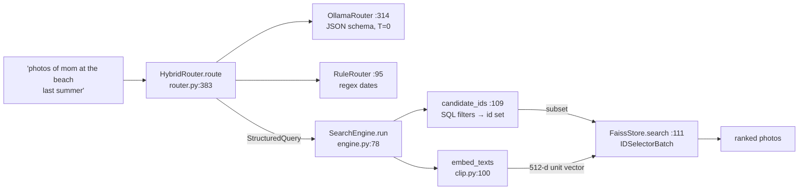

# Day 10 code walkthrough: Photo-Seek search

Companion to [[Day 10 - Photo-Seek I]]. Repo `photo_seek`, branch **`upgrade-2026-10`** (`aa5d476`); read it with
`git show upgrade-2026-10:<path>`. Paths below are under `src/photoseek/`.



---

## 1. Parsing: the LLM for words, the rules for dates

`src/photoseek/search/router.py:314–337` (`upgrade-2026-10`)
```python
def route(self, query: str, *, limit: int | None = None) -> StructuredQuery:
    self.last_fallback, self.last_error = False, None
    try:
        raw = self._generate(query)
        parsed = _extract_json(raw)
        if parsed is None:
            raise ValueError(f"no JSON object in model output: {raw[:200]!r}")

        parsed["raw"] = query.strip()
        parsed["limit"] = limit or self.config.top_k
        structured = StructuredQuery.from_dict(parsed)

        # A model that returns nothing usable is worse than the rules.
        if structured.is_empty:
            raise ValueError("model returned an empty query")

        return structured

    except Exception as exc:  # noqa: BLE001 - any failure means fall back
        if not self.config.fallback_to_rule:
            raise
        self.last_fallback, self.last_error = True, str(exc)
        log.warning("LLM router failed (%s); falling back to rule router", exc)
        return self._fallback.route(query, limit=limit)
```

- The LLM call returns JSON constrained by a schema. **Any** failure (bad JSON, empty result, timeout, server down) falls back to the rule router, and `last_fallback` records that it happened. The UI never breaks because Ollama did.
- `is_empty` counts as a failure: a model that returns nothing usable is worse than the rules.

`src/photoseek/search/router.py:114–123` (`upgrade-2026-10`)
```python
def _extract_dates(self, text: str) -> tuple[str, date | None, date | None]:
    lowered = text.lower()

    # "last summer", "this winter"
    for season, (start_m, end_m) in _SEASONS.items():
        match = re.search(rf"\b(last|this|past)\s+{season}\b", lowered)
        if match:
            year = self._season_year(end_m, previous=match.group(1) in ("last", "past"))
            start, end = _season_range(season, year)
            return _cut(text, match.span()), start, end
```

`src/photoseek/search/router.py:183–186` (`upgrade-2026-10`)
```python
year = self.today.year
if previous and self.today.month <= end_month:
    year -= 1
return year
```

- "last summer" = the most recent **completed** summer. Asked in November 2026: `today.month (11) <= 8` is false, so the year stays 2026 → June 1 – Aug 31, 2026. Asked in July 2026, it would be 2025.
- The match is cut out of the text (`_cut`), so "last summer" doesn't also end up in the CLIP query.

`src/photoseek/search/router.py:383–388` (`upgrade-2026-10`)
```python
def route(self, query: str, *, limit: int | None = None) -> StructuredQuery:
    structured = self.llm.route(query, limit=limit)
    ruled = self.rules.route(query, limit=limit)
    if ruled.date_from or ruled.date_to:
        structured.date_from, structured.date_to = ruled.date_from, ruled.date_to
    return structured
```

- **The hybrid in four lines:** run both; if the rules found a date, their dates overwrite the LLM's. The LLM was better at people and places (97 / 95 vs 83 / 85) but worse at relative dates (82 vs 87). The hybrid got all four filters right on 84% of queries, against 73% (LLM) and 58% (rules).

---

## 2. Executing: filters first, then vectors

`src/photoseek/search/engine.py:84–107` (`upgrade-2026-10`)
```python
if structured.place and not self._place_known(structured.place):
    text = structured.text
    if structured.place.lower() not in text.lower():
        text = f"{text} {structured.place}".strip()
    structured = replace(structured, text=text, place=None)
    self.last.query = structured
    self.last.place_as_text = True

candidates = self.candidate_ids(structured)
self.last.n_candidates = None if candidates is None else len(candidates)
if candidates is not None and not candidates:
    return []

if not structured.text.strip():
    # A pure-filter query ("photos of mom last summer") has nothing to
    # rank semantically, so it is not forced through the index.
    return self._hydrate([(pid, 0.0) for pid in self._by_date(candidates)][
        : structured.limit
    ])

self._ensure_models()
[vector] = self.embedder.embed_texts([structured.text])
hits = self.store.search(vector, structured.limit, subset=candidates)
return self._hydrate([(hit.id, hit.score) for hit in hits])
```

- **Place fallback (lines 84–90):** if no photo has that place label (nothing is reverse-geocoded), "beach" moves into the CLIP text instead of filtering everything out (story 4.4).
- **`None` vs `set()`:** `None` = no filters, search everything; an empty set = filters matched nothing, return nothing.
- A pure-filter query ("photos of mom last summer") has no text to rank by, so it skips CLIP and sorts by date.

`src/photoseek/search/engine.py:124–148` (`upgrade-2026-10`)
```python
if structured.date_from:
    clauses.append("p.taken_at >= ?")
    params.append(structured.date_from.isoformat())
if structured.date_to:
    # taken_at carries a time, so "<= 2025-08-31" would drop that day.
    clauses.append("p.taken_at < ?")
    params.append((structured.date_to + timedelta(days=1)).isoformat())
if structured.place:
    clauses.append("p.place LIKE ?")
    params.append(f"%{structured.place}%")

if structured.people:
    resolved = self.resolve_people(structured.people)
    self.last.unknown_people = [name for name, iid in resolved.items() if iid is None]
    if self.last.unknown_people:
        log.info("unknown people in query: %s", self.last.unknown_people)
        return set()
    for identity_id in dict.fromkeys(resolved.values()):
        clauses.append(
            "EXISTS (SELECT 1 FROM faces f WHERE f.photo_id = p.id AND f.identity_id = ?)"
        )
        params.append(identity_id)

sql = "SELECT p.id FROM photos p WHERE " + " AND ".join(clauses)
return {row["id"] for row in self.catalog.conn.execute(sql, params)}
```

- Dates: `taken_at < date_to + 1 day`, because `taken_at` has a time part. `<= '2026-08-31'` would drop photos taken on Aug 31 after midnight.
- People: one `EXISTS (… faces f WHERE f.identity_id = ?)` clause **per person**, AND-ed together, so all named people must be in the photo. An unknown name returns `set()` instead of being ignored, so a typo shows up as "no results" rather than silently widening the search.
- Every value is a `?` parameter: no SQL injection from query text.

---

## 3. The vector side: CLIP + FAISS

`src/photoseek/embed/clip.py:105–114` (`upgrade-2026-10`)
```python
out: list[Vector] = []
batch_size = max(1, self.config.batch_size) * 8  # text is cheap
for start in range(0, len(texts), batch_size):
    tokens = self._tokenizer(list(texts[start:start + batch_size])).to(self.device)
    with torch.inference_mode():
        features = self._model.encode_text(tokens).float()
        if self.config.normalize:
            features = torch.nn.functional.normalize(features, dim=-1)
    out.extend(features.cpu().numpy())
return out
```

- Text goes through CLIP's **text** encoder into the same 512-d space as the images, then gets L2-normalised. For unit vectors, inner product = cosine similarity.

`src/photoseek/index/faiss_store.py:131–145` (`upgrade-2026-10`)
```python
params = None
if subset is not None:
    subset_ids = np.fromiter(subset, dtype="int64")
    if subset_ids.size == 0:
        return []
    k = min(k, int(subset_ids.size))
    params = faiss.SearchParameters(sel=faiss.IDSelectorBatch(subset_ids))

k = min(k, int(self._index.ntotal))
scores, found = self._index.search(q, k, params=params)
return [
    SearchHit(id=int(i), score=float(s))
    for i, s in zip(found[0], scores[0])
    if i != -1
]
```

- **Pre-filtering:** `IDSelectorBatch(subset)` tells the flat index to score **only** the allowed ids. Post-filtering (take the top k, then drop disallowed ones) could return fewer than k, or nothing, when the filter is strict.
- `k = min(k, len(subset))`, and FAISS pads with id −1 when it has fewer hits, which line 144 drops.

`src/photoseek/index/faiss_store.py:96–99` (`upgrade-2026-10`)
```python
self._ensure_index()
if self._index.ntotal:
    self.remove(id_arr)
self._index.add_with_ids(vecs, id_arr)
```

- Re-adding an id first removes the old vector (`IndexIDMap2` supports deletion by id), so re-embedding a photo can't leave a stale duplicate.

**Check yourself:** "photos of Anna and Ravi in June 2025" with Anna known and Ravi unknown. What does `candidate_ids` return, and does CLIP run? (*An empty set; no, `run` returns `[]` at line 94–95, and `unknown_people` is reported.*)
