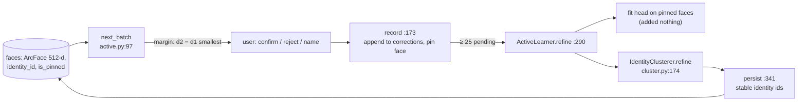
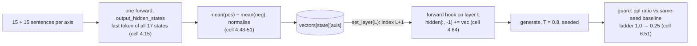

# Day 11 code walkthrough: face clustering with corrections, and emotion steering

Companion to [[Day 11 - Photo-Seek II and emotion steering]]. Morning: `photo_seek`, branch `upgrade-2026-10`
(`aa5d476`, paths under `src/photoseek/`). Afternoon: `emotion_steering/Project.ipynb` (`d725cbe`); notebook
references are **cell N, line L**.

---

## Part 1: Photo-Seek faces



### 1. Which face to ask about: `next_batch`

`src/photoseek/faces/active.py:119–130` (`upgrade-2026-10`)
```python
identities, centroids = _centroids(Z, assigned)
if identities:
    dist = 1.0 - Z[candidates] @ centroids.T
    column = {iid: c for c, iid in enumerate(identities)}
    own = np.asarray([column.get(assigned[i], -1) for i in candidates])
    nearest = dist.argmin(axis=1)
    proposed = np.where(own >= 0, own, nearest)
    d1 = dist[np.arange(len(candidates)), proposed]
    others = dist.copy()
    others[np.arange(len(candidates)), proposed] = np.inf
    d2 = others.min(axis=1) if len(identities) > 1 else np.full(len(candidates), 2.0)
    proposed_ids = [identities[p] for p in proposed]
```

- For each unpinned face: `d1` = distance to its **proposed** identity (its own, or the nearest if it has none); `d2` = distance to the **next** closest identity.

`src/photoseek/faces/active.py:137–149` (`upgrade-2026-10`)
```python
if strategy == "uncertainty":
    order = np.argsort(-d1, kind="stable")
    confidence = 1.0 - d1
    reason = "far from the centroid of its proposed identity"
elif strategy == "margin":
    order = np.argsort(d2 - d1, kind="stable")
    confidence = d2 - d1
    reason = "nearly as close to another identity"
elif strategy == "random":
    rng = np.random.default_rng(self._rng_seed + self._round)
    order = rng.permutation(len(candidates))
    confidence = 1.0 - d1
    reason = "random baseline"
```

- **Uncertainty** asks about the faces farthest from their own identity (`-d1` sorted). **Margin** asks about the faces nearly tied between two people (`d2 − d1` smallest). **Random** is the control.
- Margin won: a 41% error cut vs 32% (uncertainty) vs 7% (random) after 1,000 simulated reviews. A margin face sits on a boundary, so one answer settles exactly the decision the clustering was unsure about.
- `_spread` caps questions at 2 per proposed identity, so one big messy cluster doesn't eat the whole batch.

### 2. Updating clusters without starting over: `IdentityClusterer.refine`

`src/photoseek/faces/cluster.py:232–249` (`upgrade-2026-10`)
```python
means = np.stack([X[m].mean(axis=0) for m in members])
dist = 1.0 - X @ means.T
for row, fid in enumerate(ids):
    if fid in pinned:
        continue
    allowed = dist[row].copy()
    for iid in identities:
        if (fid, iid) in rejected_pairs:
            allowed[index[iid]] = np.inf
    best = int(allowed.argmin())
    own = assign[fid]
    if own is not None and np.isfinite(allowed[index[own]]):
        if allowed[best] < allowed[index[own]]:
            assign[fid] = identities[best]
    elif np.isfinite(allowed[best]) and allowed[best] <= threshold:
        assign[fid] = identities[best]
    else:
        assign[fid] = None
```

- **Distance to an identity = `1 − x · mean(members)`**, with the mean **left unnormalised**. That equals the average cosine distance to all members, which is the same rule the clustering threshold (0.75) was tuned for. The first version used a *normalised* centroid, which sits closer to every face than the members do on average. So a refine with **zero** answers pulled 100–170 noise faces into identities. A no-answers control run exposed it (story 4.2).
- **The rules per face:** pinned faces never move; a rejected identity becomes `inf` (a cannot-link); an assigned face moves only to a **strictly closer** identity; an unassigned face joins only if within the threshold.
- Why not re-cluster from the pinned faces? The sampler asks about **outliers**, so a person seeded from their pinned faces is centred on their edge, and the rest of the person splits off (story 4.1, the docstring at 201–204).

### 3. Commit only after success: `ActiveLearner.refine`

`src/photoseek/faces/active.py:311–333` (`upgrade-2026-10`)
```python
labelled = [i for i in range(len(ids)) if pinned[i] and assigned[i] is not None]
head_trained = False
if train_head:
    head = self.fit_refinement_head(X[labelled], [assigned[i] for i in labelled])
    head_trained = head is not None

Z = self.head.transform(X)
pinned_map = {ids[i]: assigned[i] for i in labelled}
rejected = [
    (row["face_id"], row["identity_id"])
    for row in self.catalog.conn.execute(
        "SELECT face_id, identity_id FROM corrections "
        "WHERE kind = 'reject' AND face_id IS NOT NULL AND identity_id IS NOT NULL"
    )
]
clusterer = IdentityClusterer(self.faces_config)
result = clusterer.refine(ids, Z, dict(zip(ids, assigned)),
                          pinned=pinned_map, rejected=rejected)
clusterer.persist(self.catalog, result)

after = dict(self.catalog.conn.execute("SELECT id, identity_id FROM faces").fetchall())
moved = sum(1 for fid, before in zip(ids, assigned) if after.get(fid) != before)
self.catalog.consume_corrections([row["id"] for row in pending])
```

- Fit the adapter head on pinned faces, project all faces through it, read every `reject` as a cannot-link, run the clusterer, persist, and **only then** mark the corrections consumed (line 333). A crash mid-retrain leaves them pending, so the user's answers aren't lost.
- The head is a 512×512 linear map on **frozen** ArcFace vectors. It changed BCubed F1 by −0.07, so the gain is from the constraints and the sampler, not from "fine-tuning ArcFace".

**Check yourself:** a face assigned to identity 7 with distances `{7: 0.40, 9: 0.38, 12: 0.90}`, not pinned, no rejections. Does it move? Now the user rejected 7 for it: where does it go? Then what if 9 were 0.80 with threshold 0.75? (*Moves to 9: 0.38 < 0.40. After rejecting 7: own is inf, so the `elif` applies; 9 at 0.38 ≤ 0.75, so it joins 9. At 0.80: over the threshold, so it becomes unassigned and goes to the leftover clustering.*)

---

## Part 2: Emotion steering



### 4. Calibration: difference of means

`Project.ipynb` cell 4, lines 15–19
```python
def _get_all_layer_last_token_states(self, text):
    inputs = self.tokenizer(text, return_tensors="pt").to(self.device)
    outputs = self.model(**inputs, output_hidden_states=True)
    # hidden_states[0] = embedding output, hidden_states[i+1] = output of layer i
    return [h[:, -1, :].squeeze(0).detach().float().cpu() for h in outputs.hidden_states]
```

`Project.ipynb` cell 4, lines 45–52
```python
self.all_layer_vectors = {i: {} for i in range(num_states)}
for name in calibration_data:
    for i in range(num_states):
        pos_mean = pos_sums[name][i] / pos_counts[name]
        neg_mean = neg_sums[name][i] / neg_counts[name]
        direction = pos_mean - neg_mean
        direction = direction / direction.norm()
        self.all_layer_vectors[i][name] = direction.to(self.device).to(self.model.dtype)
```

- One forward pass per sentence returns **all 17** hidden states (embedding output + 16 layers). The last token's state at each one is kept, so vectors for every layer come from 120 passes in total. Switching layers is then a dictionary lookup (story S3).
- `direction = mean(pos) − mean(neg)`, normalised to length 1. Strength is applied later, so a slider value of 5 means a vector of norm 5.

`Project.ipynb` cell 4, lines 58–61
```python
def set_layer(self, layer_id):
    """Switch active injection layer — a cache lookup, not a recomputation."""
    self.layer_id = layer_id
    self.vectors = self.all_layer_vectors.get(layer_id + 1, {})  # +1 offsets the embedding layer
```

- `hidden_states[0]` is the embedding output, so layer `L`'s output is index `L + 1`. The vector you add to layer L's output must come from that same position.

### 5. Injection: the forward hook

`Project.ipynb` cell 4, lines 64–72
```python
def _hook_fn(self, module, input, output):
    if self._inject_vec is None:
        return output
    if isinstance(output, tuple):
        hidden = output[0]
        hidden[:, -1, :] += self._inject_vec.to(hidden.dtype)
        return (hidden,) + output[1:]
    output[:, -1, :] += self._inject_vec.to(output.dtype)
    return output
```

`Project.ipynb` cell 4, lines 92–104
```python
target_layer = self.model.model.layers[self.layer_id]
handle = target_layer.register_forward_hook(self._hook_fn)
try:
    if seed is not None:
        torch.manual_seed(seed)
    with torch.no_grad():
        out = self.model.generate(
            **inputs, max_new_tokens=max_new_tokens,
            do_sample=True, temperature=0.8, pad_token_id=self.tokenizer.eos_token_id
        )
finally:
    handle.remove()
    self._inject_vec = None
```

- The hook adds the vector to the **last position** of layer L's output on **every** forward pass. During prefill that's the last prompt token; during decoding it's each new token. Earlier positions stay unsteered, but their K/V at later layers were computed from the steered state and are cached that way.
- `finally:` removes the hook and clears the vector even if generation throws. Without that, the next "unsteered" call (the guard's baseline) would still be steered.
- `torch.manual_seed(seed)` right before `generate`: the steered and baseline runs draw the same random numbers, so they differ only by the vector (story S2).

### 6. The guard: back off before the text collapses

`Project.ipynb` cell 6, lines 45–48
```python
logits = steerer.model(ids).logits[:, :-1, :].float()
targets = ids[:, 1:]
token_logprobs = torch.log_softmax(logits, dim=-1).gather(-1, targets.unsqueeze(-1)).squeeze(-1)
return math.exp(-token_logprobs[:, prompt_len - 1:].mean().item())
```

`Project.ipynb` cell 6, lines 66–85
```python
for scale in rungs:
    raw, ids, plen = steerer.generate(
        prompt, manual_vec=vec * scale, seed=seed,
        max_new_tokens=max_new_tokens, return_ids=True)
    ppl = continuation_perplexity(steerer, ids, plen)
    ratio = ppl / base_ppl if base_ppl else float("nan")
    result["trace"].append({"scale": scale, "ppl": ppl, "ratio": ratio})
    if verbose:
        print(f"  scale {scale:.2f} → ppl {ppl:7.1f} ({ratio:.2f}x baseline)")

    # nan (degenerate/too-short) is not evidence of collapse — accept it
    if (not enabled) or (not math.isfinite(ratio)) or ratio <= ppl_ratio_max:
        result.update(text=strip_response(raw), applied_scale=scale, ppl=ppl,
                      ratio=ratio, degraded=(scale < 1.0), collapsed=False)
        return result

# every rung tripped the threshold — fall back to the safe unsteered output
result.update(text=result["base_text"], applied_scale=0.0, ppl=base_ppl,
              ratio=1.0, degraded=True, collapsed=True)
return result
```

- Score the steered continuation with the **unsteered** model: "how surprised is the base model by what its steered self wrote?" Only the generated part counts (`prompt_len − 1` onwards). Divide by the same-seed baseline's perplexity.
- Accept at the first ladder rung with ratio ≤ 1.75; otherwise try 75%, 50%, 25%, then return the baseline text with `collapsed=True`.
- **A gap to own:** a NaN ratio (a continuation under 2 tokens) is **accepted** (line 77). The 1.75 threshold was never calibrated against data, and the guard costs 2–5 generations per request.
