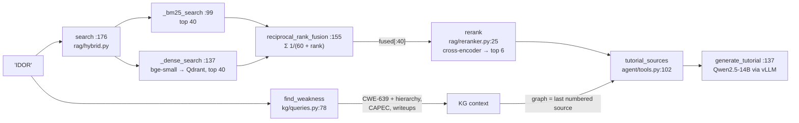

# Day 12 code walkthrough: BountyBrain

Companion to [[Day 12 - BountyBrain]]. Repo `bountybrain`, branch **`upgrade-2026-10`** (`4267980`); read it with
`git show upgrade-2026-10:<path>`. Paths below are under `bountybrain/`.



---

## 1. Resolving a topic in the graph

`bountybrain/kg/queries.py:87–120` (`upgrade-2026-10`)
```python
text = str(term).strip()
if text.upper().startswith("CWE-") and text[4:].isdigit():
    v = s.execute(
        select(Vulnerability).where(Vulnerability.cwe_id == int(text[4:]))
    ).scalar_one_or_none()
    return _weakness_dict(v) if v else None

v = s.execute(
    select(Vulnerability).where(func.lower(Vulnerability.name) == text.lower())
).scalar_one_or_none()
if v:
    return _weakness_dict(v)

# An exact alias beats any substring hit. Without this, "SQL injection"
# substring-matched "SQL Injection: Hibernate" (a Variant) ahead of
# CWE-89, whose alias it is, and "path traversal" landed on CWE-24.
exact = s.execute(
    select(Vulnerability).where(Vulnerability.aliases_json.ilike(f'%"{text}"%'))
).scalars().all()
if exact:
    rank = {"Base": 0, "Variant": 1, "Class": 2, "Compound": 3, "Pillar": 4}
    exact.sort(key=lambda v: rank.get(v.abstraction or "", 9))
    return _weakness_dict(exact[0])

# fall back to a name substring match, preferring the most
# specific abstraction so "injection" does not return the Pillar
rank = {"Variant": 0, "Base": 1, "Compound": 2, "Class": 3, "Pillar": 4}
rows = s.execute(
    select(Vulnerability).where(Vulnerability.name.ilike(f"%{text}%"))
).scalars().all()
if not rows:
    return None
rows.sort(key=lambda v: rank.get(v.abstraction or "", 9))
return _weakness_dict(rows[0])
```

A cascade from most to least exact:
1. `CWE-89` or a number → a direct lookup.
2. An exact name (case-insensitive).
3. **An exact alias.** `aliases_json` is a JSON list stored as text, so `ILIKE '%"IDOR"%'` (with the quotes) matches the whole alias, not a fragment. If several weaknesses share the alias, prefer the **Base** abstraction.
4. Only then a name substring, preferring the **most specific** abstraction (Variant before Pillar).

- The comment at lines 100–102 is story 4.8: "SQL injection" used to match "SQL Injection: Hibernate" (a Variant) by substring before CWE-89, whose alias it is.
- The curated aliases (like "IDOR") are only here because the builder **persists** them (`kg/build.py:440`). Before that fix, the keyword classifier read them from disk while the LLM's shortlist didn't, which confounded the classifier comparison (story 4.4).

---

## 2. Hybrid retrieval

`bountybrain/rag/hybrid.py:194–202` (`upgrade-2026-10`)
```python
else:
    dense = _dense_search(query, depth, flt)
    lexical = _bm25_search(query, depth, flt)
    runs = [r for r in (dense, lexical) if r]
    fused = reciprocal_rank_fusion(runs) if runs else []
    if mode == "hybrid_rerank":
        hits = rerank(query, fused[:depth], top_n=top_k)
    else:
        hits = fused[:top_k]
```

- Both arms retrieve **40 candidates** (`depth`), not just `top_k`. The reranker can only promote what it's given.
- `runs = [r for r in (dense, lexical) if r]`: if Qdrant is unreachable, the dense arm returns `[]` and retrieval degrades to BM25 instead of failing.

`bountybrain/rag/hybrid.py:99–118` (`upgrade-2026-10`)
```python
def _bm25_search(query: str, limit: int, flt: dict | None = None) -> list[Hit]:
    build_bm25()
    bm = _bm25_state["bm25"]
    if bm is None:
        return []
    rows = _bm25_state["rows"]
    scores = bm.get_scores(_tokenize(query))
    order = sorted(range(len(scores)), key=lambda i: -scores[i])

    hits: list[Hit] = []
    for i in order:
        if scores[i] <= 0:
            break
        row = rows[i]
        if flt and not _matches(row, flt):
            continue
        hits.append(_row_to_hit(row, float(scores[i])))
        if len(hits) >= limit:
            break
    return hits
```

- BM25 scores **every** chunk in memory (11,355 of them), sorts, and stops at the first zero score. It's good at exact identifiers ("CWE-918", "SSRF") that an embedder can blur.

`bountybrain/rag/hybrid.py:155–170` (`upgrade-2026-10`)
```python
def reciprocal_rank_fusion(runs: list[list[Hit]], k: int = RRF_K) -> list[Hit]:
    """Fuse ranked lists by 1/(k + rank), summed across runs."""
    scores: dict[tuple[int, int], float] = {}
    best: dict[tuple[int, int], Hit] = {}
    for run in runs:
        for rank, hit in enumerate(run, start=1):
            key = (hit.document_id, hit.chunk_idx)
            scores[key] = scores.get(key, 0.0) + 1.0 / (k + rank)
            if key not in best:
                best[key] = hit
    fused = []
    for key, score in sorted(scores.items(), key=lambda kv: -kv[1]):
        hit = best[key]
        hit.score = score
        fused.append(hit)
    return fused
```

- **RRF:** each list contributes `1/(60 + rank)` per chunk, and the sums are sorted. It uses **ranks only**, so BM25's unbounded scores and cosine's [−1, 1] never need calibrating against each other. A chunk ranked well by both arms beats one ranked first by only one: rank 1 in one list gives 1/61 ≈ 0.0164, while rank 5 in both gives 2/65 ≈ 0.0308.
- The key is `(document_id, chunk_idx)`, so the same chunk from both arms is merged.

`bountybrain/rag/reranker.py:25–34` (`upgrade-2026-10`)
```python
def rerank(query: str, hits: list, top_n: int = 5) -> list:
    model = _model()
    if model is None or not hits:
        return hits[:top_n]
    pairs = [(query, h.text) for h in hits]
    scores = model.predict(pairs)
    ranked = sorted(zip(hits, scores, strict=True), key=lambda x: -x[1])
    for h, s in ranked:
        h.score = float(s)
    return [h for h, _ in ranked[:top_n]]
```

- The cross-encoder reads `(query, chunk)` **together**, so it can judge actual relevance, but that's one model call per pair. So it reranks only the 40 fused candidates. The ablation: R@1 went 0.675 → 0.800 with reranking, and hybrid+rerank reached R@5 0.965, MRR 0.861.

**Check yourself:** dense ranks [A, B, C]; BM25 ranks [C, D, A]. Compute the RRF scores with k = 60 and give the fused order. (*A: 1/61 + 1/63 ≈ 0.0323; C: 1/63 + 1/61 ≈ 0.0323 (a tie with A); B: 1/62 ≈ 0.0161; D: 1/62 ≈ 0.0161. The order between tied items follows insertion: A, C, B, D.*)

---

## 3. Grounded generation

`bountybrain/agent/tools.py:110–125` (`upgrade-2026-10`)
```python
numbered = [
    {"title": s["title"], "url": s["url"], "doc_type": s.get("doc_type"),
     "text": s["text"][:SOURCE_CHARS]}
    for s in sources
]
brief = _context_brief(context)
if brief:
    numbered.append(
        {
            "title": "BountyBrain knowledge graph (MITRE CWE/CAPEC, disclosed-report metadata)",
            "url": (context or {}).get("weakness", {}).get("url", ""),
            "doc_type": "graph",
            "text": json.dumps(brief, indent=2),
        }
    )
return numbered
```

- Every passage is numbered and cut to 1,200 characters. The **graph facts become the last numbered source** too. When they were an unnumbered "context" block, the model used them without citing them, and nothing could check those claims.

`bountybrain/agent/tools.py:145–152` (`upgrade-2026-10`)
```python
try:
    return chat(
        system=TUTORIAL_SYSTEM,
        user=tutorial_prompt(topic, sources, context),
        max_tokens=2048,
    )
except (LLMError, Exception):
    return _template_tutorial(topic, sources, context)
```

- If vLLM is down or errors, fall back to a deterministic template, so the page always renders. The measured result to quote honestly: 54.5% of sentences carry a citation, and 32.6% are cited *and* supported (judged by the same Qwen, against 40 hand labels made by Claude).

---

## 4. The planner fix (story 4.2)

`bountybrain/recon/planner.py:299–307` (`upgrade-2026-10`)
```python
prior = _global_class_prior(s)
observed = {c: len(e["signatures"]) for c, e in per_cwe.items()}
total_observed = sum(observed.values())
conditional = {
    c: (n + SMOOTHING_ALPHA * prior.get(c, 0.0))
    / (total_observed + SMOOTHING_ALPHA)
    for c, n in observed.items()
}
max_conditional = max(conditional.values(), default=0.0) or 1.0
```

- Applicability = **P(weakness | this product's stack)**, shrunk toward the global prior: `(n_c + α·prior_c) / (N + α)` with α = 25 (a pseudo-count).
- The old score was a log-count that saturated at 1.0 for any popular product, so every class tied on applicability and the stack-independent terms decided the ranking. That lost to "rank by global frequency" (P@1 0.280 vs 0.325). With the conditional estimate it reached **0.427**.
- The pseudo-count keeps a product with 3 signatures from being ranked purely on those 3: its estimate is mostly the prior until it has data.
