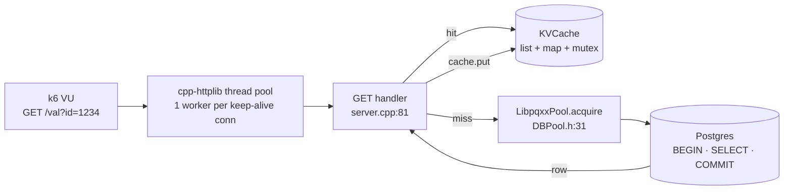
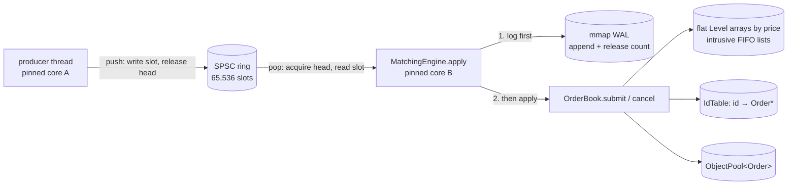

# Day 13 code walkthrough: the DECS KV server and the Micro Exchange engine

Companion to [[Day 13 - DECS and Micro Exchange]]. Morning: `decs/project/` (`82de05e`). Afternoon: `microexchange`,
branch **`upgrade-2026-10`** (`1fc2869`), read with `git show upgrade-2026-10:<path>`.

---

## Part 1: DECS



### 1. The LRU cache

`project/KVCache.h:12–46`
```cpp
class KVCache {
  size_t capacity;
  std::list<std::pair<int, std::string>> items;
  std::unordered_map<int, std::list<std::pair<int, std::string>>::iterator> index;
  std::mutex mtx;

public:
  KVCache(size_t cap) : capacity(cap) {}

  bool get(int key, std::string &value) {
    std::lock_guard<std::mutex> lock(mtx);
    auto it = index.find(key);
    if (it == index.end())
      return false;

    // Move to front (LRU)
    items.splice(items.begin(), items, it->second);
    value = it->second->second;
    // std::cout << "Cache hit: " << key << " -> " << value << std::endl;
    return true;
  }

  void put(int key, const std::string &value) {
    std::lock_guard<std::mutex> lock(mtx);
    if (index.count(key)) {
      items.erase(index[key]);
    } else if (items.size() >= capacity) {
      auto last = items.back();
      index.erase(last.first);
      items.pop_back();
    }
    items.emplace_front(key, value);
    index[key] = items.begin();
    // std::cout << "Cache put: " << key << " -> " << value << std::endl;
  }
```

- A **doubly linked list** keeps recency order (front = newest); a **hash map** goes from key to list node. Both `get` and `put` are O(1).
- `splice` moves a node to the front **without** copying or reallocating it. That's why the map can store list iterators safely.
- `put` on a full cache evicts `items.back()`, the least recently used entry.
- **One mutex** for everything: simple and correct, but every reader serialises on it. At 11K requests/s that lock is part of the per-request CPU cost. A sharded cache (N mutexes by key hash) is the standard fix.

### 2. The connection pool

`project/DBPool.h:31–44`
```cpp
pqxx::connection *acquire() {
  std::unique_lock<std::mutex> lock(mtx);
  cv.wait(lock, [&] { return !pool.empty(); });
  pqxx::connection *conn = pool.front();
  pool.pop();
  return conn;
}

void release(pqxx::connection *conn) {
  std::unique_lock<std::mutex> lock(mtx);
  pool.push(conn);
  lock.unlock();
  cv.notify_one();
}
```

- A queue of open connections, guarded by a mutex and a condition variable. `cv.wait(lock, predicate)` sleeps until a connection is free; the predicate form handles spurious wake-ups.
- `release` unlocks **before** `notify_one`, so the woken thread doesn't immediately block on the mutex.
- No timeout: if every connection leaks, every request blocks forever. That makes the leak in section 4 serious.

### 3. A GET, miss then hit

`project/server.cpp:97–127`
```cpp
string cached_value;

if (cache.get(id_int, cached_value)) {
  res.set_content(cached_value, "text/plain");
  return;
}

db::connection *conn = nullptr;
try {
  conn = pool.acquire();
  db::work txn{*conn};
  db::result r =
      txn.exec_params("SELECT value FROM kv_store WHERE id = $1", id_int);
  txn.commit();
  pool.release(conn);

  if (r.empty()) {
    res.status = 404;
    res.set_content("No value found for id: " + to_string(id_int),
                    "text/plain");
  } else {
    string db_val = r[0][0].as<string>();
    cache.put(id_int, db_val);
    res.set_content(db_val, "text/plain");
  }
} catch (const std::exception &e) {
  if (conn)
    pool.release(conn);
  res.status = 500;
  res.set_content(string("Database error: ") + e.what(), "text/plain");
}
```

- A hit returns at line 101 without touching Postgres: ~90 µs of server-core CPU per request at saturation.
- A miss costs **three round trips** to Postgres (`BEGIN`, the `SELECT`, `COMMIT`) inside `db::work`: ~270 µs per request. A read-only query doesn't need a transaction; `pqxx::nontransaction` would save two round trips.
- A 404 isn't cached, so repeated reads of a missing key always go to the database.

### 4. Two bugs to know before anyone points at them

`project/server.cpp:158–163`
```cpp
txn.exec_params(sql, id_int, val);
txn.commit();
pool.release(conn);

cache.put(id_int, val);
res.set_content("Key saved/updated: " + to_string(id_int), "text/plain");
```

- **The cache-aside race:** the database write commits at 159, and the cache update happens at 162, outside any common lock. Two concurrent PUTs to one key can commit in order A, B and update the cache in order B, A, leaving the cache stale (A) until eviction. Likewise, a GET that read the old row can `put` it after a PUT already updated the cache.

`project/server.cpp:190–197`
```cpp
db::connection *conn = nullptr;
try {
  db::connection *conn = pool.acquire();
  db::work txn{*conn};
  db::result r =
      txn.exec_params("DELETE FROM kv_store WHERE id = $1", id_int);
  txn.commit();
  pool.release(conn);
```

- **The connection leak:** line 192 declares a **new** `conn` inside the `try`, shadowing the outer one at 190. If the DELETE throws, the `catch` sees the outer `conn`, still `nullptr`, and never releases. The pool shrinks by one connection per failed DELETE.

---

## Part 2: Micro Exchange



### 5. The lock-free SPSC ring buffer

`include/core/ring_buffer.hpp:27–47` (`upgrade-2026-10`)
```cpp
bool push(const T& item) {
    const size_t head = head_.load(std::memory_order_relaxed);
    if (head - tail_cache_ >= Capacity) {
        tail_cache_ = tail_.load(std::memory_order_acquire);
        if (head - tail_cache_ >= Capacity) return false;
    }
    slots_[head & (Capacity - 1)] = item;
    head_.store(head + 1, std::memory_order_release);
    return true;
}

bool pop(T& out) {
    const size_t tail = tail_.load(std::memory_order_relaxed);
    if (tail == head_cache_) {
        head_cache_ = head_.load(std::memory_order_acquire);
        if (tail == head_cache_) return false;
    }
    out = slots_[tail & (Capacity - 1)];
    tail_.store(tail + 1, std::memory_order_release);
    return true;
}
```

`include/core/ring_buffer.hpp:59–65` (`upgrade-2026-10`)
```cpp
alignas(kCacheLine) std::atomic<size_t> head_{0};
size_t tail_cache_ = 0;  // producer's view of tail_

// alignas above also rounds sizeof(RingBuffer) up to a multiple of the
// cache line, so a neighbouring object cannot land on the consumer's line.
alignas(kCacheLine) std::atomic<size_t> tail_{0};
size_t head_cache_ = 0;  // consumer's view of head_
```

- **Indices only grow**; the slot is `index & (Capacity − 1)`, so the capacity must be a power of two. "Full" means `head − tail ≥ Capacity`, so there's no wrap-around special case.
- **The ordering contract:** the producer writes the slot, *then* `head_.store(…, release)`. The consumer `head_.load(acquire)`, *then* reads the slot. Release/acquire guarantees that if the consumer sees the new head, it also sees the slot's contents. With `relaxed` on both, the CPU or compiler could reorder, and the consumer could read a half-written command.
- **Cached indices:** each side keeps its own copy of the other's index (`tail_cache_`, `head_cache_`) and reloads it only when the queue *looks* full or empty. Most pushes and pops then touch no cache line the other core writes.
- `alignas(64)` puts `head_` and `tail_` on separate cache lines, so the producer writing `head_` doesn't keep invalidating the consumer's line (**false sharing**).

### 6. Matching: price-time priority with O(1) unlinking

`src/order_book.cpp:126–143` (`upgrade-2026-10`)
```cpp
if (side == Side::Buy) {
    while (qty > 0 && best_ask_ <= price) {
        Level& lvl = asks_[best_ask_];
        while (qty > 0 && lvl.head) {
            Order* maker = lvl.head;  // oldest order at this price wins
            const uint64_t x = std::min(qty, maker->qty);
            qty -= x;
            maker->qty -= x;
            lvl.qty -= x;
            resting_qty_ -= x;
            filled_qty_ += 2 * x;  // both sides of the trade
            filled += x;
            if (record_trades_)
                trades_.push_back(Trade{id, maker->id, maker->price, x});
            if (maker->qty == 0) erase_order(maker);
        }
        if (lvl.head == nullptr) raise_best_ask();
    }
```

- `best_ask_` indexes a **flat array of price levels**, no tree. While the incoming buy price crosses the best ask, trade against `lvl.head`, the **oldest** order at that price (time priority). Fill `min(qty, maker->qty)`; remove the maker when it's fully filled. When a level empties, `raise_best_ask` scans up to the next non-empty price.

`src/order_book.cpp:82–88` (`upgrade-2026-10`)
```cpp
void OrderBook::erase_order(Order* o) {
    Level& lvl = (o->side == Side::Buy ? bids_ : asks_)[o->price];
    if (o->prev) o->prev->next = o->next; else lvl.head = o->next;
    if (o->next) o->next->prev = o->prev; else lvl.tail = o->prev;
    index_.erase(o->id);
    pool_.release(o);
}
```

- **O(1) erase:** each `Order` carries its own `prev`/`next` (an *intrusive* list), so removing it is two pointer fixes. Then the id is removed from the table and the node goes back to the pool. No search, no allocation.

`baseline/naive_engine.hpp:107–119` (`upgrade-2026-10`)
```cpp
template <typename Levels>
void erase_from(Levels& levels, const OrderPtr& o) {
    auto lvl = levels.find(o->price);
    if (lvl == levels.end()) return;
    std::list<OrderPtr>& orders = lvl->second;
    for (auto i = orders.begin(); i != orders.end(); ++i) {
        if ((*i)->id == o->id) {
            orders.erase(i);
            break;
        }
    }
    if (orders.empty()) levels.erase(lvl);
}
```

- **What "O(n) cancellation" really meant:** the naive engine finds the order by id in O(1) too, but then **walks the price level's `std::list`** to find the node, which is O(orders at that price). Plus `std::map` levels and `shared_ptr` orders: an allocation per order (983,976 allocations vs 3).

### 7. Write-ahead log

`include/engine/matching_engine.hpp:24–31` (`upgrade-2026-10`)
```cpp
void apply(const Command& c) {
    if (journal_) journal_->log(c, ex_);  // write-ahead: log before mutating state
    ex_.apply(c);
    ++processed_;
    if (hist_) {
        const uint64_t cycles = rdtsc() - c.tsc;
        hist_->record(static_cast<uint64_t>(TscClock::to_ns(cycles)));
    }
```

`include/persistence/wal_logger.hpp:76–82` (`upgrade-2026-10`)
```cpp
bool append(const Command& c) {
    const uint64_t n = header_->count;
    if (n >= max_records_) return false;
    records_[n] = c;
    std::atomic_ref<uint64_t>(header_->count).store(n + 1, std::memory_order_release);
    return true;
}
```

- **Log, then apply** (line 25): if the process dies after logging, recovery replays the command; if it dies before, the command was never applied. Either way the book and the log agree.
- `append` copies the 40-byte command into an mmap'd segment, then publishes the new count with **release**. The follower thread (and a reader after a SIGKILL) that loads the count with acquire sees only fully written records.
- A full segment returns `false` (the journal then rotates). The original `main` silently dropped records here.

**Check yourself:** asks resting at 101: [S1 qty 40, S2 qty 30] (S1 older). A buy for 50 @ 102 arrives. What trades happen, what rests, and what does `lvl.head` point to afterwards? (*S1 fills 40 and is erased; S2 fills 10 and keeps 20; nothing of the buy rests; `lvl.head` = S2.*)
