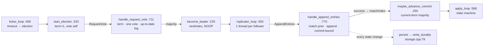
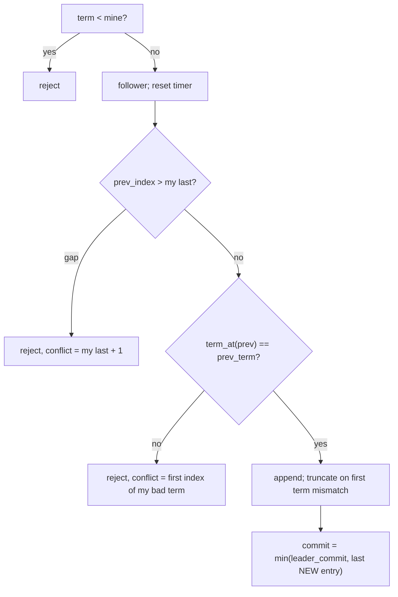

# Day 14 code walkthrough: Raft (raftkv)

Companion to [[Day 14 - Raft]]. Repo `raftkv`: the **upgrade** is branch `upgrade-2026-10` (`bad36f1`), the
**original** is commit `2a19135` (= `origin/main`). Your local `main` was fast-forwarded to the upgrade, so read the
original by commit id. Snippets are from the upgrade unless marked.



---

## 1. Voting: three rules, in order

`src/raft_node.cpp:725–759` (`upgrade-2026-10`)
```cpp
if (term > current_term_) {
  become_follower(term, "candidate has newer term");
  dirty = true;
}

const uint64_t my_last_index = last_log_index();
const uint64_t my_last_term = term_at(my_last_index);
const std::string mine =
    std::to_string(my_last_term) + "/" + std::to_string(my_last_index);
const std::string theirs =
    std::to_string(cand_last_term) + "/" + std::to_string(cand_last_index);

// Each refusal below maps to one rule from the Raft paper; the debug line
// names which one decided the outcome.
bool granted = false;
std::string reason;
if (term < current_term_) {
  reason = "stale-term " + std::to_string(term) + "<" + std::to_string(current_term_);
} else if (voted_for_ != -1 && voted_for_ != candidate) {
  reason = "already-voted n" + std::to_string(voted_for_) + " in t" +
           std::to_string(current_term_);
} else {
  const bool up_to_date = cand_last_term > my_last_term ||
                          (cand_last_term == my_last_term && cand_last_index >= my_last_index);
  if (!up_to_date) {
    reason = "log-behind " + theirs + "<" + mine;
  } else {
    voted_for_ = candidate;
    granted = true;
    dirty = true;
    last_heard_ = Clock::now();
    election_timeout_ = random_election_timeout();
    reason = "log-ok " + theirs + ">=" + mine + ", no prior vote";
  }
}
```

1. **Newer term?** Step down to follower at that term first (and forget the old vote).
2. **Stale term** → refuse. **Already voted** for someone else this term → refuse.
3. **Election restriction:** grant only if the candidate's log is at least as up to date: a higher last term, or the same last term and at least as long. A candidate missing a committed entry can never collect a majority, because every majority includes a node that has that entry.

- `persist()` before replying (line 766): a vote that's forgotten after a crash could let one node vote twice in one term, which could elect two leaders.

## 2. Becoming leader, and the commit rule

`src/raft_node.cpp:235–251` (`upgrade-2026-10`)
```cpp
for (const PeerInfo& peer : cluster_) {
  if (peer.id == id_) continue;
  next_index_[peer.id] = last_log_index() + 1;
  match_index_[peer.id] = 0;
  last_contact_[peer.id] = Clock::now();  // grace period before the quorum check
}

if (debug::at(debug::kOn)) {
  dbg("LEADER t" + std::to_string(current_term_) + " log=" + std::to_string(last_log_index()));
}

// A no-op entry from the new term lets the current-term commit rule finish
// committing anything inherited from previous terms.
log_.push_back(LogEntry{current_term_, last_log_index() + 1, "NOOP -"});
entrylog::appended(last_log_index(), current_term_, "NOOP -");
persist();
maybe_advance_commit();
```

- `nextIndex` = the leader's last index + 1 for every follower (optimistic); `matchIndex` = 0 (nothing confirmed yet).
- **The NOOP entry from the new term:** the commit rule below only counts *current-term* entries. Without a new entry, older entries inherited by the leader would wait until a client wrote something.

`src/raft_node.cpp:255–276` (`upgrade-2026-10`)
```cpp
void RaftNode::maybe_advance_commit() {
  if (role_ != Role::Leader) return;
  for (uint64_t n = last_log_index(); n > commit_index_; --n) {
    if (term_at(n) != current_term_) break;
    int replicas = 1;
    for (const auto& [peer_id, matched] : match_index_) {
      if (matched >= n) ++replicas;
    }
    if (replicas >= majority()) {
      if (debug::at(debug::kOn)) {
        dbg("COMMIT " + std::to_string(commit_index_) + "->" + std::to_string(n) + " t" +
            std::to_string(current_term_) + " on " + std::to_string(replicas) + "/" +
            std::to_string(cluster_.size()));
      }
      const uint64_t previous = commit_index_;
      commit_index_ = n;
      record_commits(previous);
      apply_cv_.notify_all();
      return;
    }
  }
}
```

- Walk down from the end of the log; **stop at the first entry not from the current term** (line 258). Count replicas via `match_index_` (+1 for the leader itself). The highest current-term index on a majority becomes the commit index, which commits everything before it too.
- Why not count old-term entries? **Figure 8:** an old-term entry can sit on a majority and still be overwritten by a later leader. Once a *current*-term entry is on a majority, no node without it can win an election.

## 3. AppendEntries: check, repair, append, commit



`src/raft_node.cpp:824–846` (`upgrade-2026-10`)
```cpp
if (check_index > last_log_index()) {
  const uint64_t conflict = last_log_index() + 1;
  if (verbose) {
    dbg("AE NO gap prev=" + std::to_string(prev_index) + " mine=" +
            std::to_string(last_log_index()) + " -> conflict=" + std::to_string(conflict),
        detail);
  }
  if (dirty) persist();
  return Message{"AER", {std::to_string(current_term_), "0", std::to_string(conflict)}};
}
if (check_index >= 1 && term_at(check_index) != check_term) {
  const uint64_t bad_term = term_at(check_index);
  uint64_t first = check_index;
  while (first > snapshot_index_ + 1 && term_at(first - 1) == bad_term) --first;
  if (verbose) {
    dbg("AE NO term-mismatch i" + std::to_string(prev_index) + " mine=t" +
            std::to_string(bad_term) + " want=t" + std::to_string(prev_term) +
            " -> conflict=" + std::to_string(first),
        detail);
  }
  if (dirty) persist();
  return Message{"AER", {std::to_string(current_term_), "0", std::to_string(first)}};
}
```

- **Log matching:** if the follower's entry at `prev_index` has `prev_term`, everything before it matches too (Raft's log-matching property). Otherwise reject.
- **Fast backup:** instead of "try one index earlier", reply with the **first index of the conflicting term**, so the leader skips a whole term per round trip.

`src/raft_node.cpp:848–857` (`upgrade-2026-10`)
```cpp
for (const LogEntry& entry : entries) {
  if (has_index(entry.index)) {
    if (term_at(entry.index) == entry.term) continue;
    entrylog::truncated(entry.index, term_at(entry.index));
    log_.resize(entry.index - snapshot_index_ - 1);
  }
  log_.push_back(entry);
  entrylog::appended(entry.index, entry.term, entry.command);
  dirty = true;
}
```

- An entry that already exists with the same term is skipped; on the **first** term mismatch the log is truncated from there and the leader's entries are appended. Entries that agree are never truncated, which keeps a delayed, duplicate message harmless.

`src/raft_node.cpp:862–865` (`upgrade-2026-10`)
```cpp
const uint64_t last_new_entry = entries.empty() ? check_index : entries.back().index;
if (leader_commit > commit_index_ && last_new_entry > commit_index_) {
  const uint64_t previous = commit_index_;
  commit_index_ = std::min(leader_commit, last_new_entry);
```

`src/raft_node.cpp:661–663` (`2a19135`)
```cpp
if (leader_commit > commit_index_) {
  const uint64_t previous = commit_index_;
  commit_index_ = std::min(leader_commit, last_log_index());
```

- **Story 1, the bug you fixed.** The original bounded the commit by `last_log_index()`, the end of the follower's *whole* log. But stale entries can sit past the entries this message just verified. The fix bounds it by the **last entry this message proved**. Trace: B holds stale term-3 entries 75..200; the leader sends 11..74 with `leader_commit = 300`. Old: `min(300, 200) = 200`, so B commits its stale 75..200, a safety violation. New: `min(300, 74) = 74`.

## 4. Durability

`src/storage.cpp:78–91` (`upgrade-2026-10`)
```cpp
bool write_durably(const std::string& path, const std::string& dir, const std::string& blob) {
  const std::string tmp = path + ".tmp";
  int fd = open_file_write(tmp);
  if (fd < 0) return false;
  if (!write_all(fd, blob.data(), blob.size()) || !file_sync(fd)) {
    file_close(fd);
    return false;
  }
  file_close(fd);

  if (!replace_file(tmp, path)) return false;
  sync_directory(dir);
  return true;
}
```

- **Write a temp file → fsync it → rename over the real file → fsync the directory.** `rename` is atomic, so after a crash the file is either all old or all new. The first fsync makes the *contents* durable; the directory fsync makes the *rename* durable.
- What a SIGKILL test can't show: the data reaches the page cache before fsync anyway, so only a power cut would catch a missing fsync.

`src/main.cpp:367–375` (`upgrade-2026-10`)
```cpp
// Load the saved state before the port opens, so no inbound RPC can touch
// the log before it has been read back from disk.
std::string start_error;
if (!node.start(&start_error)) {
  std::cerr << "cannot start: " << start_error << "\n";
  return 1;
}

if (!transport.start([&node](const Message& request, const std::string& peer) {
```

- **Story 2:** load state, *then* open the port. In the original the port opened first. An early RPC with a higher term triggered `persist()` of the **empty** in-memory log over the saved file, then `start()` loaded that empty file, so the node forgot entries it had acknowledged.

**Check yourself:** 5 nodes, leader in term 4 with `match_index = {n2: 50, n3: 48, n4: 50, n5: 30}`, its own log ends at 50, entries 46–50 are term 4, and `commit_index = 40`. What does `maybe_advance_commit` set? (*n = 50: leader + n2 + n4 = 3 ≥ majority 3, so commit = 50.*) Why can't a term-4 leader's log end in a term-3 entry? And if `match_index` were `{n2: 50, n3: 45, n4: 44, n5: 30}`, what would it commit? (*`become_leader` appends a term-4 NOOP. Only the leader and n2 have ≥ 46, so 2 < 3: nothing commits; the loop stops at the first term-3 entry below 46.*)
