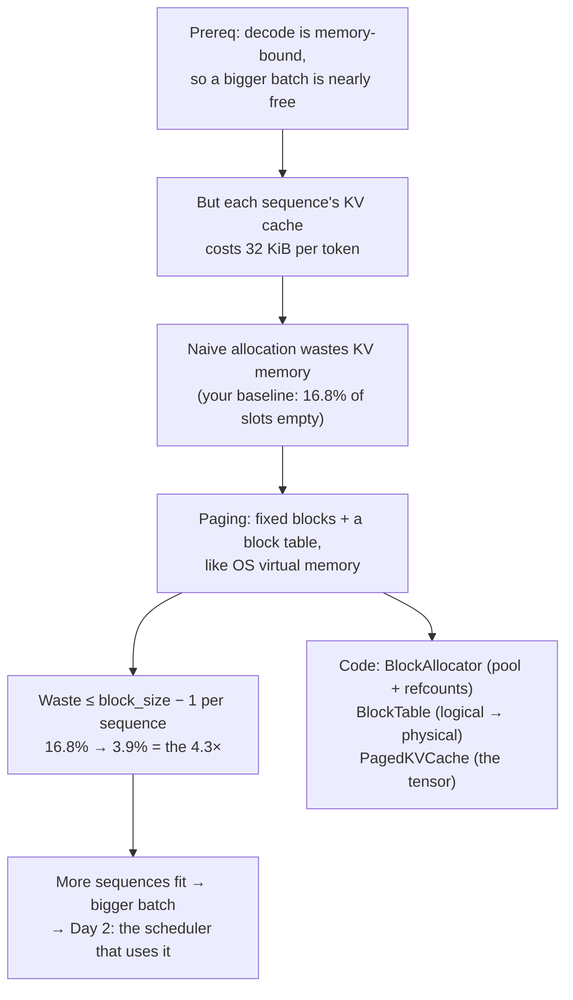
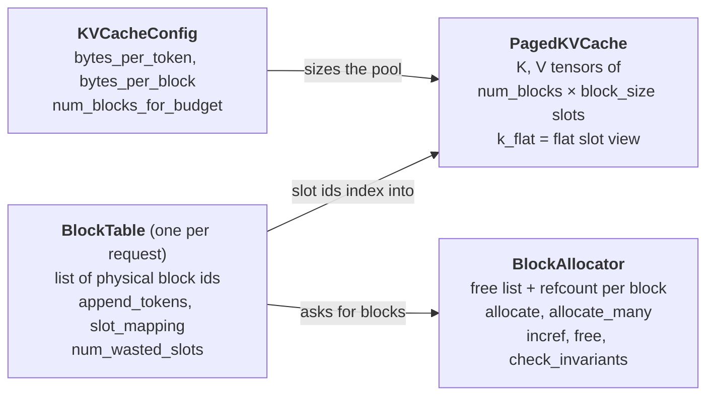

# Day 1 (Sun Nov 8): foundations, then mini-vLLM paging

Part of [[Interview plan (Nov 2026)]]. Repo `vLLMmini` (branch `main`). About 6.5 h. **This is your first day of
reading**, so it starts from the foundations that everything later builds on.

**Resume bullet (part 1 of 2):** "Built a paged KV-cache memory manager and continuous-batching scheduler for LLM inference,
reducing GPU memory fragmentation by **4.3×** and achieving **3.82×** throughput over the HuggingFace baseline."
Today covers the *paged memory manager* and the **4.3×**. The scheduler and the 3.82× are tomorrow ([[Day 02 - mini-vLLM II]]).

**By tonight you can:**
- explain how one token flows through a transformer, and why decode is memory-bound;
- compute KV memory, block counts and slot indices by hand;
- explain fragmentation and paging, with the code lines that implement them;
- rebuild the block manager yourself.

> [!tip] Tools for today
> - **Interactive lab:** <https://claude.ai/artifact/SNFAyKDabiFMnwXppfj8wi> (offline copy: `figures/inference-lab.html`). The *Paging simulator* tab is loaded with today's hand trace (D), so you can check your paper answer step by step. The *Questions* tab has today's questions as flashcards.
> - All figures live in `Interview prep/Days/figures/`.

## Today in one picture



## Schedule

| #   | Time   | Kind     | What                                                                                                  |
| --- | ------ | -------- | ----------------------------------------------------------------------------------------------------- |
| 1   | 90 min | theory   | Foundations: [[Prereq - LLM inference basics]] sections 1–6, plus the video below                     |
| 2   | 45 min | code     | `model/llama.py`: one token through one layer (B0)                                                    |
| 3   | 15 min | practice | The prerequisite's self-check, out loud                                                               |
| —   | break  |          |                                                                                                       |
| 4   | 20 min | read     | The README for the big picture: *Architecture* (line 14), *Model* (466), *The Phase 0 baseline* (554) |
| 5   | 60 min | theory   | PagedAttention (A)                                                                                    |
| 6   | 75 min | code     | `block_allocator.py`, `block_table.py`, `kv_cache.py` (B1)                                            |
| 7   | 75 min | rebuild  | Your own block manager (C)                                                                            |
| 8   | 20 min | trace    | Block tables by hand (D)                                                                              |
| 9   | 25 min | practice | The questions (E); write your fumbles at the bottom                                                   |

**Foundations, block 1 (90 min).** Read [[Prereq - LLM inference basics]] sections 1–6, then:
- **Video, about 30 min:** Umar Jamil, *"LLaMA explained: KV-Cache, Rotary Positional Embedding, RMS Norm, Grouped Query Attention, SwiGLU"*. Watch the KV-cache and grouped-query-attention parts. Llama-3.2-1B, your model, uses all of these.
- **If attention itself is rusty**, read Jay Alammar's *"The Illustrated Transformer"* (blog) first, about 30 min.
- **Optional, any evening:** Horace He, *"Making Deep Learning Go Brrrr From First Principles"*: compute- vs memory- vs overhead-bound work.

## A. Theory: PagedAttention (block 5, 60 min)

**Read:** Kwon et al., *Efficient Memory Management for LLM Serving with PagedAttention* (SOSP 2023): §1, §3 (the memory
problem), §4.1–4.3 (PagedAttention, the KV manager, decoding with it).

**Watch or read (30 min, pick one):**
- YouTube: *"Fast LLM Serving with vLLM and PagedAttention"*, the Anyscale talk by the vLLM authors;
- the vLLM launch blog post, *"vLLM: Easy, Fast, and Cheap LLM Serving with PagedAttention"* (blog.vllm.ai, June 2023).

### A1. The problem in plain words

The KV cache of a request grows by 32 KiB with every token, and you do not know in advance how long the answer will be. If each request gets **one contiguous chunk** of memory, you must decide its size up front, and every choice wastes memory:

![[d1-fragmentation.svg]]

- **Internal fragmentation:** space reserved *inside* a request's chunk that never holds a token (the red squares in rows 1 and 2).
- **External fragmentation:** free memory split into gaps *between* chunks, each too small for a new request although the total would be enough.
- **Your baseline is option 2**, not option 1: the Phase 0 HF baseline left-pads every sequence to the longest prompt in its batch. That padding is the measured **16.8%** (README *The Phase 0 baseline*). Option 1 (reserve `max_len`) is what the PagedAttention paper criticises in earlier serving systems.

### A2. The fix: borrow virtual memory from the OS

| Operating system | mini-vLLM | In your code |
|---|---|---|
| process | request / sequence | — |
| virtual page | logical block (`B` consecutive tokens) | index into the block table |
| physical frame | physical block in one pre-allocated pool | an integer id from `BlockAllocator` |
| page table | block table, one per request | `BlockTable` |
| free-frame list | free list | `BlockAllocator` free list |
| shared pages + refcount (e.g. after `fork`) | shared prefix blocks + refcount (Day 2) | `incref`, `free` |
| page fault → allocate a frame | last block full → allocate one more block | `append_tokens` |

![[d1-block-table.svg]]

**Concepts:**
- **Contiguous KV wastes memory.** Without paging, each request reserves its worst case up front: `max_len` slots, or in your baseline the batch's longest length. Waste = reserved − used: **internal** fragmentation (inside a reservation) plus **external** fragmentation (free gaps too small to use).
- **Paging.** Fixed blocks of `B` tokens. A per-request **block table** maps logical block *i* to a physical block id, like an OS page table. Memory grows one block at a time.
- **Bounded waste.** At most `B − 1` empty slots per sequence, in the last block only; about `(B − 1)/2` on average.
- **Refcounts.** Several requests may point at one physical block (shared prefixes, on Day 2). It is freed only at refcount 0.

**Maths for your model (Llama-3.2-1B, bf16, B = 16):**
- KV bytes per token = 2 × 16 layers × 8 KV heads × 64 head_dim × 2 B = **32 KiB**.
- Bytes per block = 16 × 32 KiB = **512 KiB** (all layers).
- Blocks from a budget: 40 GB free → `floor(40·10⁹ / 524,288)` ≈ **76,000 blocks** ≈ 1.2M tokens.
- Slot of position `t`: `block_id = table[t // B]`, `offset = t % B`, `slot = block_id·B + offset` (`BlockTable.slot_mapping`).
- **The 4.3×:** padding waste on the `independent` workload fell from **16.8%** of allocated KV slots to **3.9%** (README *Fragmentation*, line 321). It is slightly *worse* on uniform prompts: with equal lengths, contiguous allocation wastes nothing, while paging still wastes part of the last block.

> [!warning] Precision on the 4.3× (say it before they ask)
> | workload | naive (pad to longest) | paged, B = 16 | |
> |---|---|---|---|
> | `independent` | 16.8% | **3.9%** | 4.3× better, 904 slots saved |
> | `shared_prefix` (prompts 132–139 tokens) | 0.8% | 2.8% | worse by 176 slots |
>
> - It is a **ratio of wasted-slot fractions**, computed by `benchmarks/fragmentation.py` from the tokenizer alone (no GPU). The naive 16.8% matches the waste measured in the real Phase 0 run, which cross-checks the accounting.
> - Paging recovers waste that comes from **length variance**. With near-uniform prompts there is nothing to recover and block rounding costs more. That workload's win is prefix sharing (Day 2).

> [!quote] Say it like this (30 seconds)
> "Decode is memory-bound, so throughput comes from batching, and the batch is capped by KV memory. The HF baseline pads every sequence to the longest in its batch, and 16.8% of the KV slots held nothing. I replaced that with a block allocator: fixed 16-token blocks from one pool, a per-request block table like an OS page table, and refcounts so blocks can be shared later. Waste is bounded by one partial block per sequence, and it fell to 3.9%, 4.3× less. On uniform-length prompts paging is slightly worse, which is expected: there is no padding to recover."

## B. Code

### B0. The model (block 2, 45 min)

`model/llama.py`: follow one token through embedding → one decoder layer (RMSNorm → Q/K/V projections → RoPE →
attention with 32 query and 8 KV heads → output projection → SwiGLU MLP) → logits. Write down every tensor shape (hidden
2048, head_dim 64). Where does the code write K and V into the cache?

Use the figure from the prerequisite as your map, and fill in the right-hand column from the code:

![[p1-one-token-one-layer.svg]]

| Step | Shape (from the figure) | Line in `llama.py` (fill in) |
|---|---|---|
| embedding | `[T, 2048]` | |
| q/k/v projections | Q `[T, 32, 64]`, K/V `[T, 8, 64]` | |
| RoPE (and `resolve_rope_config`) | unchanged | |
| **K, V written to the paged cache** | at `slot_mapping` | |
| attention over the cache | `[T, 32, 64]` → `[T, 2048]` | |
| MLP | `[T, 8192]` → `[T, 2048]` | |
| logits | `[T, 128256]` | |

> [!info] Two things in this file worth an interview story
> - **Tokens are flattened and ragged**, `[total_tokens]` rather than `[batch, seq_len]`, so there is no padding anywhere (README *Phase 2*).
> - **The RoPE bug:** `config.rope_theta` does not exist in transformers 5.x, so a `getattr` default silently gave **10000 instead of 500000**. Short prompts still read fluently; only a comparison against HF's rotary module caught it (74.8% of cos/sin values wrong). `resolve_rope_config` now raises instead of defaulting (README *The bug this phase actually found*).

### B1. The memory manager (block 6, 75 min, deep)

How the three files fit together:



| File, line | Read for |
|---|---|
| `block_allocator.py` 37 `BlockAllocator` | the free list and refcount array |
| — 70 `allocate`, 80 `allocate_many` | why `allocate_many` is all-or-nothing (no partial allocation leaks) |
| — 96 `incref`, 111 `free`, 121 `free_many` | a block returns to the free list only at refcount 0 |
| — 144 `check_invariants` | every block is free XOR has refcount > 0 |
| `block_table.py` 75 `blocks_needed_for` | ceiling division |
| — 106 `append_tokens` | when a new block is taken |
| — 128 `locate`, 137 `slot_index`, 147 `slot_mapping` | the formula from A |
| — 66 `num_wasted_slots` | the fragmentation metric behind 16.8% → 3.9% |
| `kv_cache.py` 34 `KVCacheConfig`: 80 `bytes_per_token`, 85 `bytes_per_block`, 88 `num_blocks_for_budget` | check them against your maths |
| — 98 `blocks_for_free_memory`, 116 `PagedKVCache.__init__`, 166 `k_flat` | the cache tensor's shape, and why "flat" |

Then read README *Phase 1: paged memory manager* (line 602) and *Fragmentation* (321).

> [!question] Answer these while reading (write the line numbers)
> 1. What order does the free list hand blocks out in? (It changes the ids in trace D, not the counts.)
> 2. What exactly happens in `allocate_many` when there are not enough free blocks? Is any state changed?
> 3. In `append_tokens`, what condition triggers a new block? Test it at a length that is an exact multiple of the block size.
> 4. What is the shape of the cache tensor, and what does `k_flat` reshape it to? Why does one integer per token (the slot) make the write simpler?
> 5. Why were refcounts built in Phase 1, before anything shared blocks? (README: retrofitting later would mean auditing every call site for use-after-free.)

## C. Rebuild it yourself (block 7, 75 min)

Without looking at the code, write `toy_paging.py` (about 100 lines of pure Python):
1. `BlockAllocator(num_blocks)` with `allocate()`, `allocate_many(n)` (all or nothing), `incref(b)`, `free(b)`; raise when out of blocks.
2. `BlockTable(block_size, allocator)` with `append_tokens(n)`, `slot_mapping()` and `num_wasted_slots()`.
3. 3 requests of different lengths, each adding 1 token per step. Print the wasted slots each step, and compare against contiguous allocation of `max_len`.

**Check:** point `tests/test_block_allocator.py` and `tests/test_block_table.py` at your module (change the import) and
run `pytest -q` on your laptop (CPU only). Each failing test is a concept you missed.

> [!hint]- Stuck? A skeleton (open only if needed)
> ```python
> class OutOfBlocks(Exception): ...
>
> class BlockAllocator:
>     def __init__(self, num_blocks):
>         self.free_list = list(range(num_blocks))   # which order do you pop from?
>         self.ref = [0] * num_blocks
>     def allocate(self): ...          # pop one, set ref to 1, raise OutOfBlocks if empty
>     def allocate_many(self, n): ...  # check len(free_list) >= n FIRST, then pop n
>     def incref(self, b): ...         # only valid if ref[b] > 0
>     def free(self, b): ...           # ref -= 1; push back only when it reaches 0
>
> class BlockTable:
>     def __init__(self, block_size, allocator):
>         self.bs, self.alloc, self.blocks, self.n = block_size, allocator, [], 0
>     def append_tokens(self, k): ...  # need = ceil((n + k) / bs) - len(blocks)
>     def slot_mapping(self): ...      # [blocks[t // bs] * bs + t % bs for t in range(n)]
>     def num_wasted_slots(self): ...  # len(blocks) * bs - n
> ```

## D. Trace by hand (block 8, 20 min)

Block size 4, pool of 8 blocks. Request A has 5 tokens, B has 9, C has 3. Each then appends 4 tokens, one at a time. Write down:
- every block table after each append;
- the free list;
- the slot of token 7 of request B;
- the total wasted slots at the end, compared with contiguous allocation at `max_len = 16`.

Do it on paper first. Then check it in the lab's *Paging simulator* tab (press **Step**), and only then open the answer.

> [!success]- Worked answer (assumes the free list hands out the lowest id first, and A, B, C append in that order each step)
> **Admission.** A needs ⌈5/4⌉ = 2 blocks, B ⌈9/4⌉ = 3, C ⌈3/4⌉ = 1.
> A = [0, 1], B = [2, 3, 4], C = [5]. Free list = [6, 7].
>
> | step | A (tokens, table) | B | C | free |
> |---|---|---|---|---|
> | 0 | 5, [0, 1] | 9, [2, 3, 4] | 3, [5] | [6, 7] |
> | 1 | 6, [0, 1] | 10, [2, 3, 4] | 4, [5] (block now full) | [6, 7] |
> | 2 | 7, [0, 1] | 11, [2, 3, 4] | 5, [5, **6**] | [7] |
> | 3 | 8, [0, 1] (full) | 12, [2, 3, 4] (full) | 6, [5, 6] | [7] |
> | 4 | 9, [0, 1, **7**] | **needs a 4th block: none left** | 7, [5, 6] | [] |
>
> **The trap in this exercise:** the three requests finally need 3 + 4 + 2 = 9 blocks, but the pool has 8. At step 4, B cannot grow. A real engine must now **preempt** a request (free its blocks and recompute it later) — that is Day 2's scheduler. Paging bounds waste; it does not create memory.
>
> **Slot of token 7 of B** (0-indexed position 7): block = table[7 // 4] = table[1] = 3, offset = 7 % 4 = 3, slot = 3 × 4 + 3 = **15**. (If you meant the 7th token, position 6: offset 2, slot **14**.)
>
> **Waste at the end.** If B had got its block (a pool of 9): A 9 tokens in 3 blocks → 3 empty, B 13 in 4 → 3, C 7 in 2 → 1, **total 7 of 36 slots**. Each is ≤ B − 1 = 3.
> **Contiguous at max_len = 16:** 3 × 16 = 48 slots for 29 tokens → **19 wasted**. Worse: 48 slots need 12 blocks' worth of memory and the pool holds 32 slots, so only **2 of the 3 requests could even be admitted**. That is the real cost of fragmentation: fewer concurrent requests, so a smaller batch.

## E. Questions (block 9, out loud)

Answer out loud first, then unfold.

1. Why is decode memory-bound and prefill compute-bound? What is the roofline ridge point on an H200?
> [!success]- Answer
> Decode multiplies the weights by a thin `[B, 2048]` input, so each weight byte is used B times (intensity ≈ B). Prefill multiplies by `[N, 2048]`, so each byte is used N times. Ridge = 989 TFLOP/s ÷ 4.8 TB/s ≈ **206 FLOP/byte**.

2. Walk me through the KV-cache size of your model.
> [!success]- Answer
> 2 (K, V) × 16 layers × 8 KV heads × 64 head_dim × 2 B = **32 KiB per token**. A 16-token block is 512 KiB. A 4k-token sequence is 128 MiB. 40 GB free → ≈ 76,000 blocks ≈ 1.2M tokens. GQA makes this 4× smaller than 32 KV heads would.

3. Why is paging needed? Why not allocate KV for `max_len` up front?
> [!success]- Answer
> Output length is unknown in advance. Reserving `max_len` wastes the unused tail of every reservation (internal fragmentation) and leaves gaps between reservations (external fragmentation), so fewer sequences fit and the batch stays small, which keeps decode at the bottom of the roofline. Paging allocates fixed blocks on demand through a block table; any free block fits any request, and waste is at most `B − 1` per sequence. (Your own baseline padded to the batch's longest prompt rather than `max_len`; that is where the 16.8% comes from.)

4. How did you measure fragmentation, and why is paging slightly worse on uniform prompts?
> [!success]- Answer
> `benchmarks/fragmentation.py` replays the Phase 0 workload with the tokenizer only and reports the fraction of allocated KV slots that hold nothing; the naive 16.8% matches what the real Phase 0 run measured. Paged with block 16: 3.9%. On `shared_prefix` the prompts are 132–139 tokens, so padding wastes only 0.8%, while paging still rounds each sequence up to a whole block (2.8%, 176 slots worse). Paging recovers variance waste; that workload gains from prefix sharing instead.

5. Block size 16: what changes at 1 and at 256? (*Small: tiny waste, but a bigger table and less efficient kernels. Large: more waste per sequence.*)
> [!success]- Answer
> Size 1: almost no waste, but one table entry per token, an indirection for every attention read, and tiny scattered memory reads that waste bandwidth. Size 256: short tables and large contiguous reads, but up to 255 empty slots per sequence, and prefix sharing works only in whole blocks, so less of a prefix can be shared. 16 is the usual middle ground (vLLM's default too).

6. How does a block become free when two requests share it?
> [!success]- Answer
> Sharing calls `incref`, so the refcount is 2. When one request finishes, `free` decrements to 1 and the block stays allocated; when the other finishes, it reaches 0 and goes back on the free list. `check_invariants`: every block is either on the free list or has refcount > 0, never both. Try *Fork A's full blocks* then *Finish A* in the lab.

7. What does `allocate_many` being all-or-nothing protect against?
> [!success]- Answer
> A partial allocation: if it took 3 of 5 needed blocks and then ran out, the request could not run, yet it would hold 3 blocks — leaked unless every caller remembered to roll back. All-or-nothing makes admission atomic: the request gets everything or the pool is untouched. Day 2 has a related real bug: admission mutated requests it then refused.

## My notes and fumbles

-
