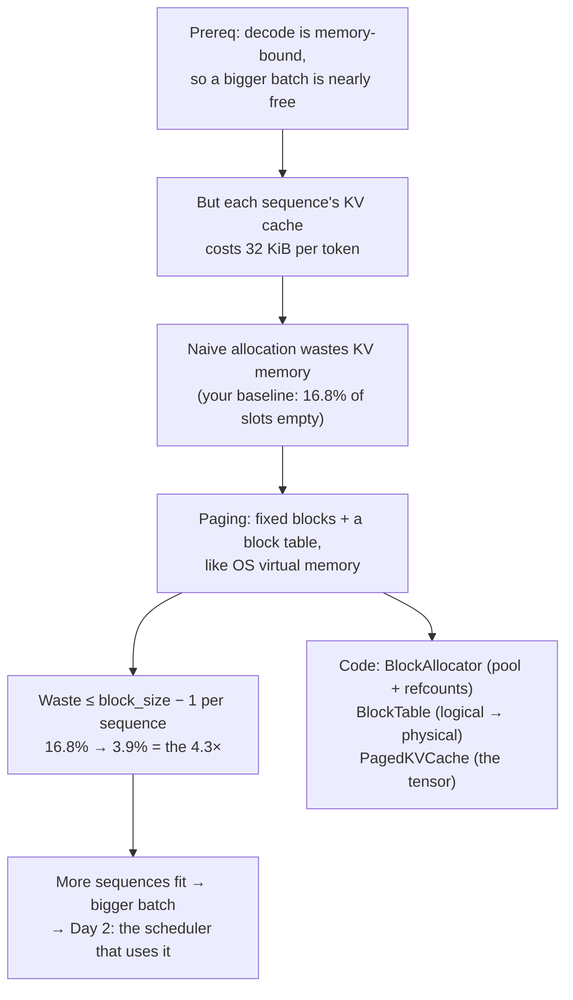
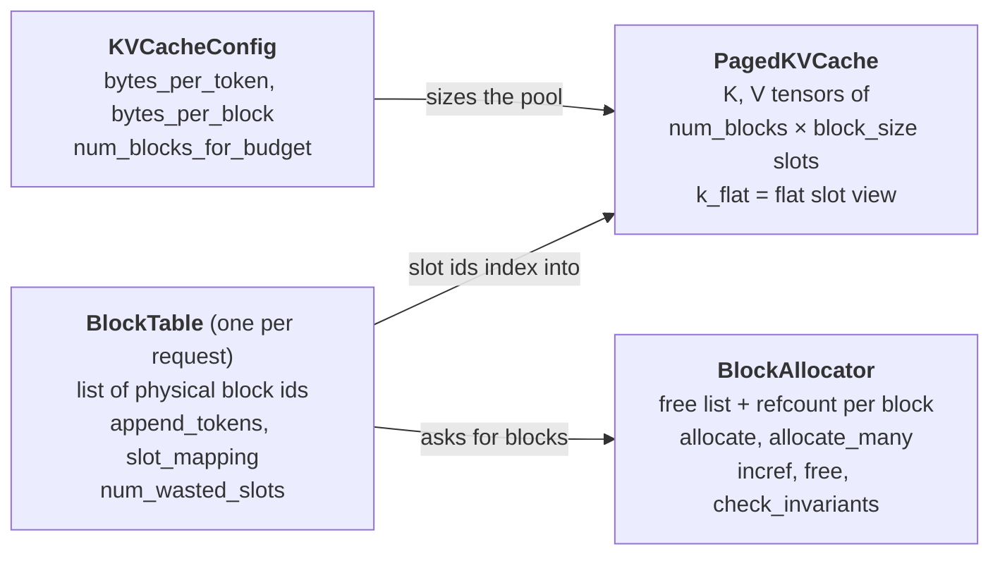
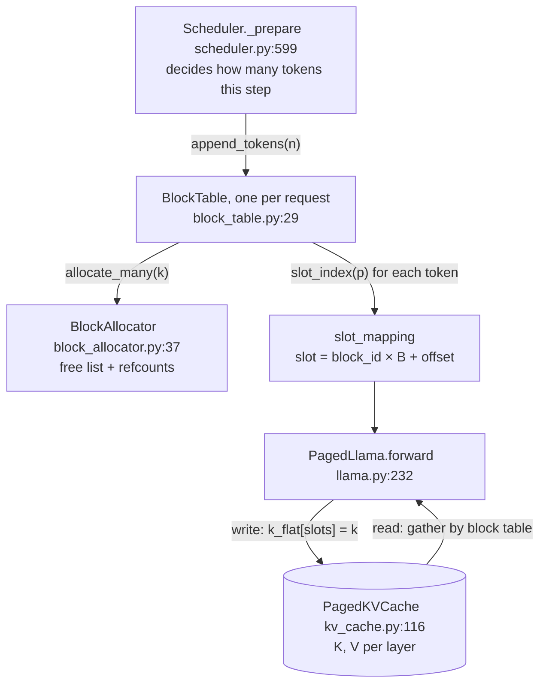
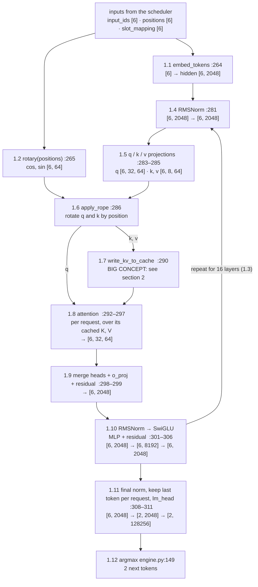
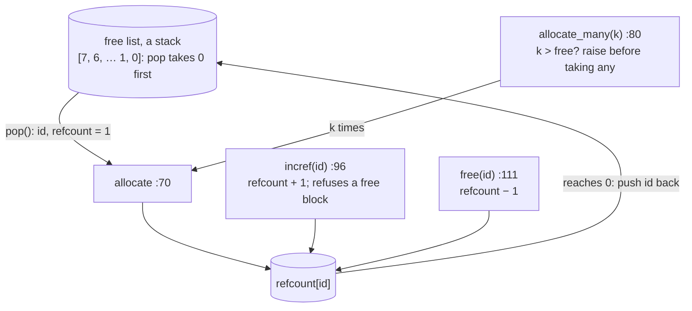
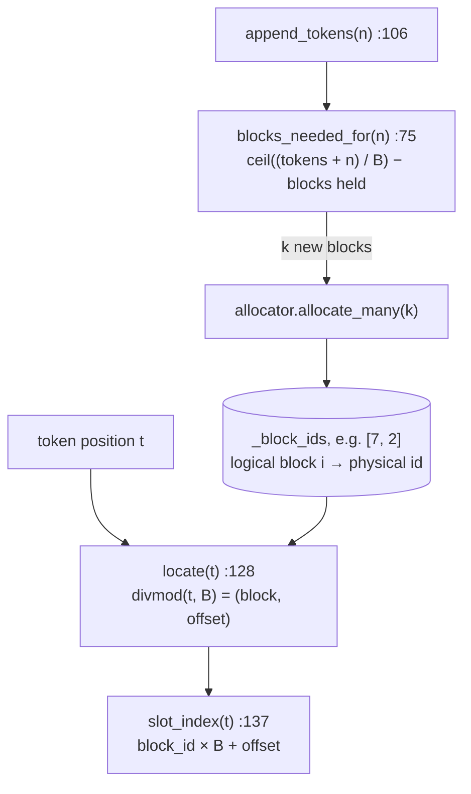
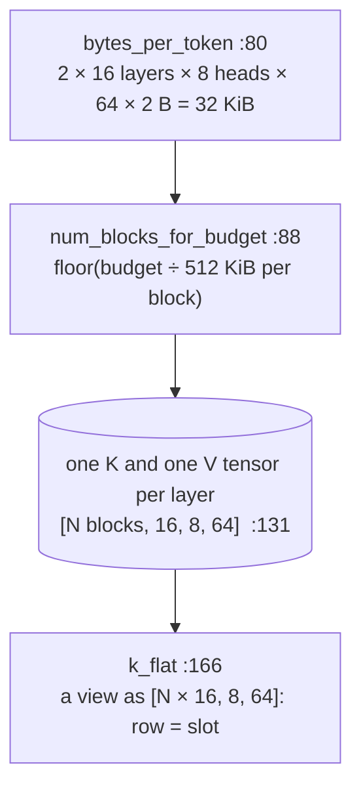
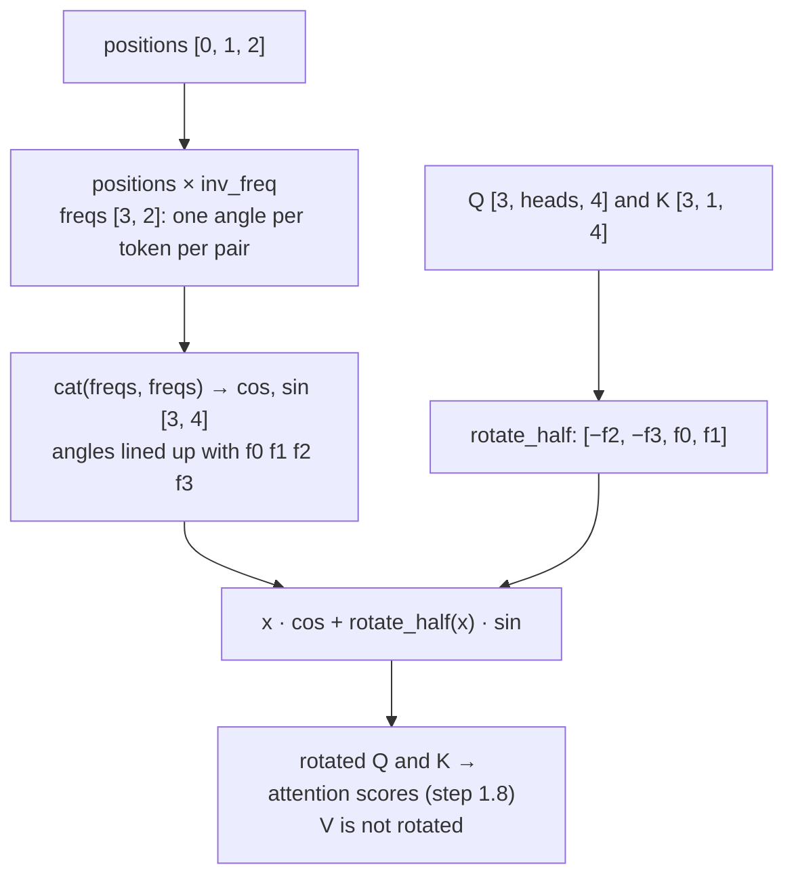

# Day 1 (Sun Nov 8): foundations, then mini-vLLM paging

Part of [[Interview plan (Nov 2026)]]. Repo `vLLMmini` (branch `main`). About 6.5 h. **This is your first day of
reading**, so it starts from the foundations that everything later builds on.

**Code, explained:** the figures, the code to read and what each snippet does are in [[#Code, explained]], right after section B.

**Resume bullet (part 1 of 2):** "Built a paged KV-cache memory manager and continuous-batching scheduler for LLM inference,
reducing GPU memory fragmentation by **4.3×** and achieving **3.82×** throughput over the HuggingFace baseline."
Today covers the *paged memory manager* and the **4.3×**. The scheduler and the 3.82× are tomorrow ([[Day 02 - mini-vLLM II]]).

**By tonight you can:**
- explain how one token flows through a transformer, and why decode is memory-bound;
- compute KV memory, block counts and slot indices by hand;
- explain fragmentation and paging, with the code lines that implement them;
- rebuild the block manager yourself.

> [!tip] Tools for today
> - **Interactive lab:** <https://claude.ai/artifact/SNFAyKDabiFMnwXppfj8wi> (offline copy: `figures/inference-lab.html`). The *Paging simulator* tab is loaded with today's hand trace (D), so you can check your paper answer step by step. The *Questions* tab has today's questions as flashcards.
> - All figures live in `Interview prep/Days/figures/`.

## Today in one picture



## Schedule

| #   | Time   | Kind     | What                                                                                                  |
| --- | ------ | -------- | ----------------------------------------------------------------------------------------------------- |
| 1   | 90 min | theory   | Foundations: [[Prereq - LLM inference basics]] sections 1–6, plus the video below                     |
| 2   | 45 min | code     | `model/llama.py`: one token through one layer (B0)                                                    |
| 3   | 15 min | practice | The prerequisite's self-check, out loud                                                               |
| —   | break  |          |                                                                                                       |
| 4   | 20 min | read     | The README for the big picture: *Architecture* (line 14), *Model* (466), *The Phase 0 baseline* (554) |
| 5   | 60 min | theory   | PagedAttention (A)                                                                                    |
| 6   | 75 min | code     | `block_allocator.py`, `block_table.py`, `kv_cache.py` (B1)                                            |
| 7   | 75 min | rebuild  | Your own block manager (C)                                                                            |
| 8   | 20 min | trace    | Block tables by hand (D)                                                                              |
| 9   | 25 min | practice | The questions (E); write your fumbles at the bottom                                                   |

**Foundations, block 1 (90 min).** Read [[Prereq - LLM inference basics]] sections 1–6, then:
- **Video, about 30 min:** Umar Jamil, *"LLaMA explained: KV-Cache, Rotary Positional Embedding, RMS Norm, Grouped Query Attention, SwiGLU"*. Watch the KV-cache and grouped-query-attention parts. Llama-3.2-1B, your model, uses all of these.
- **If attention itself is rusty**, read Jay Alammar's *"The Illustrated Transformer"* (blog) first, about 30 min.
- **Optional, any evening:** Horace He, *"Making Deep Learning Go Brrrr From First Principles"*: compute- vs memory- vs overhead-bound work.

## A. Theory: PagedAttention (block 5, 60 min)

**Read:** Kwon et al., *Efficient Memory Management for LLM Serving with PagedAttention* (SOSP 2023): §1, §3 (the memory
problem), §4.1–4.3 (PagedAttention, the KV manager, decoding with it).

> [!abstract] What it says: the PagedAttention paper (Kwon et al., SOSP 2023)
> **Key idea.** The KV cache, not compute, limits how many requests a GPU can serve at once.
> Earlier systems stored each request's KV cache in one contiguous chunk sized for the worst case.
> The paper borrows paging from operating systems: fixed-size KV blocks, a block table per request, and blocks allocated on demand.
>
> **Main figures.** One figure shows that in earlier systems only about 20–38% of the KV memory held real token states.
> The rest was reserved slots, internal fragmentation and external fragmentation.
> vLLM, by contrast, uses about 96% of it. Another figure shows logical blocks mapped to scattered physical blocks through the block table.
>
> **Claims to know.** Waste is limited to the last, partly filled block of each request.
> Throughput rises 2–4× over FasterTransformer and Orca at the same latency.
> Blocks can be shared (parallel sampling, beam search) with reference counts and copy-on-write.
> Under memory pressure a whole request is preempted, either by swapping its blocks to the CPU or by recomputing them later.
>
> **In this project.** `BlockAllocator`, `BlockTable` and the refcounts are this design at small scale; the 16.8% → 3.9% result is its waste argument, measured.


**Watch or read (30 min, pick one):**
- YouTube: *"Fast LLM Serving with vLLM and PagedAttention"*, the Anyscale talk by the vLLM authors;
- the vLLM launch blog post, *"vLLM: Easy, Fast, and Cheap LLM Serving with PagedAttention"* (blog.vllm.ai, June 2023).

> [!abstract] What it says: the vLLM talk by its authors (Anyscale)
> **Key idea.** The talk covers the same story as the paper, in slides: serving is limited by KV-cache memory, and paging fixes it.
> It walks through a request's blocks being filled one token at a time, and a new block taken only when the last one is full.
>
> **Main picture.** Logical blocks of one request map to physical blocks spread around GPU memory, through a block table.
> A second picture shows two samples of one prompt sharing the prompt's blocks, with a copy made only when one writes.
>
> **Claims to know.** Waste is near zero, at most one partial block per request.
> More requests fit, so the batch is larger and throughput higher.
>
> **In this project.** The talk's "block table" picture is exactly `BlockTable.slot_mapping`; the sharing picture is Day 2's prefix cache.

> [!abstract] What it says: the vLLM launch blog post (June 2023)
> **Key idea.** vLLM is a serving library built on PagedAttention. The post explains why KV memory is the bottleneck and how paging fixes it.
>
> **Main figure.** An animation of a request's KV blocks: logical blocks are contiguous, physical blocks are not, and the block table connects them.
>
> **Claims to know.** Existing systems waste 60–80% of KV memory through fragmentation and over-reservation; vLLM wastes under 4%.
> It reports up to 24× higher throughput than Hugging Face Transformers and up to 3.5× more than Text Generation Inference.
> Sharing blocks between parallel samples cuts their memory use by up to 55% and raises throughput by up to 2.2×.
>
> **In this project.** Your baseline is the Hugging Face path the post compares against. Your 4.3× is a waste ratio, not a throughput claim, so don't mix it with the post's 24×.


### A1. The problem in plain words

The KV cache of a request grows by 32 KiB with every token, and you do not know in advance how long the answer will be. If each request gets **one contiguous chunk** of memory, you must decide its size up front, and every choice wastes memory:

![[d1-fragmentation.svg]]

- **Internal fragmentation:** space reserved *inside* a request's chunk that never holds a token (the red squares in rows 1 and 2).
- **External fragmentation:** free memory split into gaps *between* chunks, each too small for a new request although the total would be enough.
- **Your baseline is option 2**, not option 1: the Phase 0 HF baseline left-pads every sequence to the longest prompt in its batch. That padding is the measured **16.8%** (README *The Phase 0 baseline*). Option 1 (reserve `max_len`) is what the PagedAttention paper criticises in earlier serving systems.

### A2. The fix: borrow virtual memory from the OS

| Operating system                            | mini-vLLM                                 | In your code                        |
| ------------------------------------------- | ----------------------------------------- | ----------------------------------- |
| process                                     | request / sequence                        | —                                   |
| virtual page                                | logical block (`B` consecutive tokens)    | index into the block table          |
| physical frame                              | physical block in one pre-allocated pool  | an integer id from `BlockAllocator` |
| page table                                  | block table, one per request              | `BlockTable`                        |
| free-frame list                             | free list                                 | `BlockAllocator` free list          |
| shared pages + refcount (e.g. after `fork`) | shared prefix blocks + refcount (Day 2)   | `incref`, `free`                    |
| page fault → allocate a frame               | last block full → allocate one more block | `append_tokens`                     |

![[d1-block-table.svg]]

**Concepts:**
- **Contiguous KV wastes memory.** Without paging, each request reserves its worst case up front: `max_len` slots, or in your baseline the batch's longest length. Waste = reserved − used: **internal** fragmentation (inside a reservation) plus **external** fragmentation (free gaps too small to use).
- **Paging.** Fixed blocks of `B` tokens. A per-request **block table** maps logical block *i* to a physical block id, like an OS page table. Memory grows one block at a time.
- **Bounded waste.** At most `B − 1` empty slots per sequence, in the last block only; about `(B − 1)/2` on average.
- **Refcounts.** Several requests may point at one physical block (shared prefixes, on Day 2). It is freed only at refcount 0.

> [!tip] Explained from scratch: [[#2. Deep dive: the paged KV cache|§2 the paged KV cache (fragmentation, blocks, slots, refcounts, the 4.3×)]]


**Maths for your model (Llama-3.2-1B, bf16, B = 16):**
- KV bytes per token = 2 × 16 layers × 8 KV heads × 64 head_dim × 2 B = **32 KiB**.
- Bytes per block = 16 × 32 KiB = **512 KiB** (all layers).
- Blocks from a budget: 40 GB free → `floor(40·10⁹ / 524,288)` ≈ **76,000 blocks** ≈ 1.2M tokens.
- Slot of position `t`: `block_id = table[t // B]`, `offset = t % B`, `slot = block_id·B + offset` (`BlockTable.slot_mapping`).
- **The 4.3×:** padding waste on the `independent` workload fell from **16.8%** of allocated KV slots to **3.9%** (README *Fragmentation*, line 321). It is slightly *worse* on uniform prompts: with equal lengths, contiguous allocation wastes nothing, while paging still wastes part of the last block.

> [!warning] Precision on the 4.3× (say it before they ask)
> | workload | naive (pad to longest) | paged, B = 16 | |
> |---|---|---|---|
> | `independent` | 16.8% | **3.9%** | 4.3× better, 904 slots saved |
> | `shared_prefix` (prompts 132–139 tokens) | 0.8% | 2.8% | worse by 176 slots |
>
> - It is a **ratio of wasted-slot fractions**, computed by `benchmarks/fragmentation.py` from the tokenizer alone (no GPU). The naive 16.8% matches the waste measured in the real Phase 0 run, which cross-checks the accounting.
> - Paging recovers waste that comes from **length variance**. With near-uniform prompts there is nothing to recover and block rounding costs more. That workload's win is prefix sharing (Day 2).

> [!quote] Say it like this (30 seconds)
> "Decode is memory-bound, so throughput comes from batching, and the batch is capped by KV memory. The HF baseline pads every sequence to the longest in its batch, and 16.8% of the KV slots held nothing. I replaced that with a block allocator: fixed 16-token blocks from one pool, a per-request block table like an OS page table, and refcounts so blocks can be shared later. Waste is bounded by one partial block per sequence, and it fell to 3.9%, 4.3× less. On uniform-length prompts paging is slightly worse, which is expected: there is no padding to recover."

## B. Code

### B0. The model (block 2, 45 min)

> [!tip] The code for this block, explained line by line: [[#1. Trace: one forward pass, shape by shape|Code, explained §1: the shape-by-shape trace]].

`model/llama.py`: follow one token through embedding → one decoder layer (RMSNorm → Q/K/V projections → RoPE →
attention with 32 query and 8 KV heads → output projection → SwiGLU MLP) → logits. Write down every tensor shape (hidden
2048, head_dim 64). Where does the code write K and V into the cache?

Use the figure from the prerequisite as your map, and fill in the right-hand column from the code:

![[p1-one-token-one-layer.svg]]

| Step                                | Shape (from the figure)           | Line in `llama.py` (fill in) |
| ----------------------------------- | --------------------------------- | ---------------------------- |
| embedding                           | `[T, 2048]`                       |                              |
| q/k/v projections                   | Q `[T, 32, 64]`, K/V `[T, 8, 64]` |                              |
| RoPE (and `resolve_rope_config`)    | unchanged                         |                              |
| **K, V written to the paged cache** | at `slot_mapping`                 |                              |
| attention over the cache            | `[T, 32, 64]` → `[T, 2048]`       |                              |
| MLP                                 | `[T, 8192]` → `[T, 2048]`         |                              |
| logits                              | `[T, 128256]`                     |                              |
|                                     |                                   |                              |

> [!info] Two things in this file worth an interview story
> - **Tokens are flattened and ragged**, `[total_tokens]` rather than `[batch, seq_len]`, so there is no padding anywhere (README *Phase 2*).
> - **The RoPE bug:** `config.rope_theta` does not exist in transformers 5.x, so a `getattr` default silently gave **10000 instead of 500000**. Short prompts still read fluently; only a comparison against HF's rotary module caught it (74.8% of cos/sin values wrong). `resolve_rope_config` now raises instead of defaulting (README *The bug this phase actually found*).

> [!success]- Answer key for the table (checked against `vLLMmini` `main` @ `3679394`; fill yours in first)
> | Step | Shape | Where |
> |---|---|---|
> | embedding | `[T, 2048]` | `llama.py:264` `self.embed_tokens(input_ids)`; `input_ids` must be flat `[total_tokens]` (check at 259) |
> | RoPE cos/sin, once per pass | `[T, 64]` | `llama.py:265`; theta from `resolve_rope_config` (68–94), llama3 frequency scaling in `_apply_llama3_scaling` (124–142) |
> | the 16-layer loop | — | `llama.py:275` |
> | RMSNorm (in float32, to match HF) | `[T, 2048]` | `llama.py:281`; class at 47–65 |
> | q/k/v projections | Q `[T, 32, 64]`, K/V `[T, 8, 64]` | `llama.py:283–285`: `q_proj(x).view(T, 32, 64)`, `k_proj`/`v_proj(x).view(T, 8, 64)` |
> | RoPE applied | unchanged | `llama.py:286` → `apply_rope` (157–167) |
> | **K, V written to the paged cache** | at `slot_mapping` | **`llama.py:290`** `write_kv_to_cache(cache, index, slot_mapping, k, v)` → `paged_attention.py:36–65`: `k_flat[slots] = key` |
> | attention over the cache | `[T, 32, 64]` | `llama.py:292–297`: fused Triton kernel for pure-decode steps, else the naive `paged_attention` |
> | heads back together | `[T, 2048]` | `llama.py:298` `reshape(T, 32 * 64)` |
> | o_proj + residual | `[T, 2048]` | `llama.py:299` |
> | SwiGLU MLP + residual | `[T, 8192]` → `[T, 2048]` | `llama.py:301–306`: `down_proj(silu(gate_proj(x)) * up_proj(x))` |
> | logits | `[num_selected, 128256]` | `llama.py:308–311`: final norm, keep only `logits_indices` (usually the last token of each sequence), then `lm_head` |
>
> **Points the figure skips:**
> - K and V are written **before** attention (comment at 288–289), so a sequence attends to its own new tokens.
> - Logits are computed only for `logits_indices`. The 128256-wide projection for every prefill token would be wasted work (docstring 252–255).
> - The decode metadata for the Triton kernel is built **once per forward pass, not once per layer** (267–273). Doing it 16 times would bring back the per-step overhead the kernel removes.
> - **GQA (32 Q heads, 8 KV heads):** the naive path copies each KV head 4 times with `repeat_interleave` (`paged_attention.py:104–119`, called at 220–221). `repeat` would be wrong: it tiles the heads, so query head 1 would pair with KV head 1 instead of 0. The Triton kernel copies nothing: it computes `kv_head = q_head // num_kv_groups` (`paged_attention_triton.py:85`) and reads the shared head directly.

### B1. The memory manager (block 6, 75 min, deep)

> [!tip] The code for this block, explained line by line: [[#2. Deep dive: the paged KV cache|Code, explained §2: the paged KV cache deep dive]] (2a allocator, 2b block table, 2c cache tensor, 2d write and read, 2e who builds the slots).

How the three files fit together:



| File, line                                                                                               | Read for                                                            |
| -------------------------------------------------------------------------------------------------------- | ------------------------------------------------------------------- |
| `block_allocator.py` 37 `BlockAllocator`                                                                 | the free list and refcount array                                    |
| — 70 `allocate`, 80 `allocate_many`                                                                      | why `allocate_many` is all-or-nothing (no partial allocation leaks) |
| — 96 `incref`, 111 `free`, 121 `free_many`                                                               | a block returns to the free list only at refcount 0                 |
| — 144 `check_invariants`                                                                                 | every block is free XOR has refcount > 0                            |
| `block_table.py` 75 `blocks_needed_for`                                                                  | ceiling division                                                    |
| — 106 `append_tokens`                                                                                    | when a new block is taken                                           |
| — 128 `locate`, 137 `slot_index`, 147 `slot_mapping`                                                     | the formula from A                                                  |
| — 66 `num_wasted_slots`                                                                                  | the fragmentation metric behind 16.8% → 3.9%                        |
| `kv_cache.py` 34 `KVCacheConfig`: 80 `bytes_per_token`, 85 `bytes_per_block`, 88 `num_blocks_for_budget` | check them against your maths                                       |
| — 98 `blocks_for_free_memory`, 116 `PagedKVCache.__init__`, 166 `k_flat`                                 | the cache tensor's shape, and why "flat"                            |

Then read README *Phase 1: paged memory manager* (line 602) and *Fragmentation* (321).

> [!question] Answer these while reading (write the line numbers)
> 1. What order does the free list hand blocks out in? (It changes the ids in trace D, not the counts.)
> 2. What exactly happens in `allocate_many` when there are not enough free blocks? Is any state changed?
> 3. In `append_tokens`, what condition triggers a new block? Test it at a length that is an exact multiple of the block size.
> 4. What is the shape of the cache tensor, and what does `k_flat` reshape it to? Why does one integer per token (the slot) make the write simpler?
> 5. Why were refcounts built in Phase 1, before anything shared blocks? (README: retrofitting later would mean auditing every call site for use-after-free.)

> [!success]- Answers (checked against the code)
> 1. **LIFO.** `_free_blocks = list(reversed(range(n)))` (`block_allocator.py:47`) and `allocate` uses `pop()` (76), so a fresh pool hands out 0, 1, 2, … in order. `free` appends (118), so **the most recently freed block is reused first**. The comment at 45–46 says why: it keeps a working set hot instead of cycling through the whole pool.
> 2. It raises `OutOfBlocksError` **before taking anything** (`block_allocator.py:89–93`), so nothing changes. The docstring (83–85) says why: a partial allocation that then raised would leak every block already taken, and the caller would not know what to undo. `append_tokens` builds on this (`block_table.py:106–124`): `allocate_many` either succeeds or raises before `_num_tokens` changes, so a failed append leaves the sequence exactly as it was and **is safe to retry after the scheduler frees memory**. `free_many` (121–132) does the same for frees: it checks every id before freeing any.
> 3. `blocks_needed_for` (`block_table.py:75–84`): `blocks_after = ceil((num_tokens + new) / block_size)`, written as `(total + bs − 1) // bs`, minus the blocks already held. A new block is taken exactly when a token lands on a multiple of the block size: with bs = 4, going from 4 to 5 tokens needs a 2nd block, but going from 3 to 4 does not.
> 4. One pair of tensors **per layer**, each `[num_blocks, block_size, num_kv_heads, head_dim]` = `[N, 16, 8, 64]` (`kv_cache.py:131–139`). `k_flat` (166–176) is a **view, not a copy**, of shape `[num_blocks × block_size, 8, 64]`. Slot `block_id × block_size + offset` is then a plain row index, so writing a whole step's K is one scatter, `k_flat[slots] = key` (`paged_attention.py:64`), and the Phase 5 kernel uses the same addressing. Separate per-layer tensors keep each layer's K and V contiguous, which a flat slot index assumes (module docstring, `kv_cache.py:13–16`).
> 5. Phase 4's prefix cache makes two sequences point at the same physical blocks. A block must not go back to the pool while anyone still uses it, and adding refcounts later would mean re-checking every call site for use-after-free, the hardest bug class to find by testing (`block_allocator.py:8–14`). `incref` refuses a free block (104–107) and `free` refuses a double free (114–115).

## Code, explained

Read this **with the files open**. It starts with a picture of the whole day and **the flow, step by step** (one concrete input followed through every function). Then each part has its own figure, the exact code (copied from the repo at the commit named below, so the line numbers match) and what that code does.

Repo `vLLMmini`, branch `main` (`3679394`). Read this **with the files open**:
each section has one small figure of the pipeline, then the exact code in reading order, then what each piece does
and how it hands off to the next.

**The whole day in one line:** the scheduler decides *how many* tokens a request adds → `BlockTable` turns token
positions into *slot numbers* → the model *writes* K,V into those slots and *reads* them back by block table.



### 1. Trace: one forward pass, shape by shape

**The example.** One engine step that mixes two requests:
- **A** is prefilling its **5** prompt tokens (positions 0–4);
- **B** is decoding **1** token at position 12 (its context is 13 tokens).

So the step carries **T = 6 tokens** in total. Model sizes (Llama-3.2-1B): hidden **2048**, **32** query heads and **8**
KV heads of size **64**, MLP width **8192**, vocabulary **128,256**, **16** layers.



#### The worked example used below (toy sizes, real formulas)

The real shapes (2048 features, 32 heads) are too big to draw, so each step below also shows a **toy model** with
the same formulas, the same code path and the **real RoPE base of 500,000**:
- **3 tokens**: "the", "cat", "sat", at positions 0, 1, 2 (one prefill);
- **8 features** per token (instead of 2048);
- **2 query heads and 1 KV head**, each of size **4** (instead of 32 and 8 heads of size 64). That keeps grouped-query attention: both query heads share one K and V.

Every number in the figures is computed, not made up; the script in 1.13 reproduces them. Blue cells are negative,
red cells positive, and the darker the colour, the larger the value.

#### 1.0 What comes in

The engine flattens every request's tokens into one list, so there is no batch dimension and no padding.

`src/mini_vllm/engine.py:122–135`
```python
token_ids, positions, slots, query_lens = [], [], [], []
for scheduled in output.scheduled:
    token_ids.extend(scheduled.token_ids)
    positions.extend(scheduled.positions)
    slots.extend(scheduled.slot_mapping)
    query_lens.append(scheduled.num_tokens)

# Logits are needed only at each request's final token; the vocab
# projection is 128256 wide, so computing it for every prefill token
# would dominate an iteration containing a long prompt.
logits_indices, offset = [], 0
for q_len in query_lens:
    offset += q_len
    logits_indices.append(offset - 1)
```
> [!info] New functions in this code
> - `.extend(xs)`: adds **all** items of `xs` at the end. `a = [1]; a.extend([2, 3])` → `[1, 2, 3]`. [[Function glossary#list.extend|→ examples]]
> - `.append(x)`: adds `x` at the end of a list. `[1].append(2)` → `[1, 2]`. [[Function glossary#list.append|→ examples]]

| Input | Value for our step | Shape |
|---|---|---|
| `input_ids` | A's 5 prompt tokens, then B's 1 token | `[6]` |
| `positions` | `[0, 1, 2, 3, 4, 12]` (each token's position **in its own request**) | `[6]` |
| `slot_mapping` | where each token's K, V will be stored (§2) | `[6]` |
| `query_lens` | `[5, 1]`: how many of the 6 tokens belong to each request | per request |
| `context_lens` | `[5, 13]`: total tokens each request has, including this step's | per request |
| `logits_indices` | `[4, 5]`: the last token of each request | `[2]` |

**Worked example: what comes in.** The toy request is one prefill of 3 tokens. The tokenizer turns the words into
ids from a toy vocabulary of 10 words (`the` = 5, `cat` = 2, `sat` = 7). The pool is fresh and the block size is 4, so
the request's block table is `[0]` and its tokens get slots 0, 1, 2 (Deep dive §2 explains why). `logits_indices = [2]`
because only the last token needs a prediction.

![[d1t-0-inputs.svg]]

#### 1.1 Embedding: ids → vectors

**The same step with the real model's shapes** (animated; blocks are sized by their dimensions, no values):

![[d1s-embed.svg]] [[d1s-embed.html|▶ Step through it]]

`src/mini_vllm/model/llama.py:264–264`
```python
hidden = self.embed_tokens(input_ids)
```

- **In:** `input_ids [6]` (integers). **Out:** `hidden [6, 2048]`.
- **How it works:** the embedding is a lookup table of shape `[128256, 2048]`. Row `i` is the learned vector for token `i`. Embedding = pick 6 rows. No arithmetic.

**Worked example.** The embedding table has one row per vocabulary word. `embed_tokens(input_ids)` copies rows 5, 2
and 7 (outlined in red) into `X`, in token order. That's the whole operation: no multiplication. The real table is
128,256 rows × 2048 features.

![[d1t-1a-embedding.svg]]

#### 1.2 RoPE angles, computed once for all layers

> [!tip] New to RoPE? [[#3. Deep dive: RoPE from scratch, on our three tokens|§3 builds it from scratch on this example]]: why rotate, where the angles and the base come from, and the full arithmetic for "cat".

`src/mini_vllm/model/llama.py:115–117`
```python
inv_freq = 1.0 / (
    base ** (torch.arange(0, head_dim, 2, device=device, dtype=torch.float32) / head_dim)
)
```
> [!info] New functions in this code
> - `torch.arange(start, end, step)`: a 1-D tensor counting from `start` up to (not including) `end` in steps of `step`. `torch.arange(0, 8, 2)` → `tensor([0, 2, 4, 6])`. With `head_dim = 64` it gives 0, 2, …, 62: one entry per feature pair. [[Function glossary#torch.arange|→ examples and figure]]

`src/mini_vllm/model/llama.py:144–148`
```python
def forward(self, positions: torch.Tensor) -> tuple[torch.Tensor, torch.Tensor]:
    """positions: [num_tokens] absolute positions -> (cos, sin) [num_tokens, head_dim]."""
    freqs = positions.to(torch.float32).unsqueeze(1) * self.inv_freq.unsqueeze(0)
    emb = torch.cat((freqs, freqs), dim=-1)
    return emb.cos().to(self._dtype), emb.sin().to(self._dtype)
```
> [!info] New functions in this code
> - `.to(dtype or device)`: converts a tensor's number type or moves it. `x.to(torch.float32)` makes a float32 copy (from bfloat16); `x.to('cuda')` moves it to the GPU. In Triton code, `.to(tl.float32)` converts a loaded value. [[Function glossary#x.to|→ examples and figure]]
> - `.unsqueeze(d)`: inserts a new axis of size 1 at position `d`. A `[3]` tensor → `.unsqueeze(1)` → `[3, 1]` (a column); `.unsqueeze(0)` → `[1, 3]` (a row). Needed so tensors broadcast against each other. [[Function glossary#x.unsqueeze|→ examples and figure]]
> - `torch.cat((a, b), dim=d)`: joins tensors **along an existing axis**. `torch.cat(([1, 2], [3, 4]), dim=-1)` → `[1, 2, 3, 4]`; on `[3, 2]` tensors with `dim=-1` the result is `[3, 4]`. [[Function glossary#torch.cat|→ examples and figure]]
> - `.cos()`: cosine of every element. [[Function glossary#x.cos|→ examples and figure]]
> - `.sin()`: sine of every element. [[Function glossary#x.sin|→ examples]]

- **In:** `positions [6]`. **Out:** `cos, sin [6, 64]`.
- **How it works:** RoPE (rotary position embedding) encodes position by **rotating** pairs of features. There are 32 frequencies, `inv_freq[i] = 1 / base^(2i/64)` with `base = 500,000`. Token at position `p` gets angle `p × inv_freq[i]` for pair `i`. High-frequency pairs spin fast (they encode fine, local order); low-frequency pairs spin slowly (coarse, long-range order). Llama 3 additionally slows the lowest frequencies (`_apply_llama3_scaling`, `:124–142`) to handle long contexts.
- `freqs [6, 32]` is duplicated to `[6, 64]` so it lines up with the two halves of each head (see 1.6).
- It's computed **once per forward pass**, because every layer uses the same angles.

**Worked example: the angles.** With head size 4 there are 2 frequencies: `inv_freq = 1 / 500000^(2i/4)` =
**[1, 0.0014]**. So for position p, pair 0 (features 0 and 2) gets angle **p radians**, and pair 1 (features 1 and 3)
gets **p × 0.0014**. Position 2 → angles [2.0, 0.0028] rad. `torch.cat((freqs, freqs))` repeats them, so
`cos` for position 2 is `[cos 2, cos 0.0028, cos 2, cos 0.0028]` = `[-0.42, 1.00, -0.42, 1.00]`.

**Animation: watch the angles grow with position.** Left: the fast pair turns 1 rad per position. Middle: the slow
pair hardly moves (one turn every ~4,440 positions). Right: a query at position m and a key at position n always keep
the same gap, m − n, which is why attention ends up seeing **relative** position.

![[d1t-anim-rope.svg]] [[d1t-anim-rope.html|▶ Step through it]]

#### 1.3 The layer loop

`src/mini_vllm/model/llama.py:275–281`
```python
for index, layer in enumerate(self.layers):
    input_norm, post_norm = self._layer_norms(layer)
    attn = layer.self_attn
    total_tokens = hidden.shape[0]

    residual = hidden
    x = input_norm(hidden)
```
> [!info] New functions in this code
> - `enumerate(xs)`: loops over a list and gives you each item **with its index**. `for i, x in enumerate(['a', 'b'])` gives `(0, 'a')`, then `(1, 'b')`. [[Function glossary#enumerate|→ examples]]
> - `.shape`: the tensor's size along each axis. `x.shape == (6, 2048)` means 6 rows of 2048. [[Function glossary#x.shape|→ examples]]

Steps 1.4–1.10 run **16 times**, once per decoder layer, with different weights each time. `residual = hidden` saves the layer's input for the skip connection in 1.9.

**Picture: one layer is two blocks reading from, and adding to, one stream.** The `[3, 8]` hidden state is the
*residual stream*. The attention block reads a normalised copy of it (1.4–1.8) and **adds** its result back (1.9). Then
the MLP block does the same (1.10). The stream itself is never overwritten, only added to, which is why information
from the embedding survives all 16 layers.

![[d1t-1b-layer.svg]]

#### 1.4 RMSNorm: rescale each token's vector

**The same step with the real model's shapes** (animated; blocks are sized by their dimensions, no values):

![[d1s-rmsnorm.svg]] [[d1s-rmsnorm.html|▶ Step through it]]

> [!tip] New to normalisation? [[#4. Deep dive: RMSNorm from scratch, on our three tokens|§4 builds RMSNorm from scratch]]: why normalise, what RMS means, RMSNorm vs LayerNorm, "the" number by number, and the code line by line.

`src/mini_vllm/model/llama.py:60–65`
```python
def forward(self, x: torch.Tensor) -> torch.Tensor:
    dtype = x.dtype
    x = x.to(torch.float32)
    variance = x.pow(2).mean(-1, keepdim=True)
    x = x * torch.rsqrt(variance + self.eps)
    return self.weight * x.to(dtype)
```
> [!info] New functions in this code
> - `.dtype`: the number type stored: `torch.bfloat16`, `torch.float32`, `torch.long` (64-bit integers), … [[Function glossary#x.dtype|→ examples]]
> - `.pow(p)`: raises every element to the power `p`. `x.pow(2)` squares each element. [[Function glossary#x.pow|→ examples and figure]]
> - `.mean(dim, keepdim=True)`: the average along an axis. On `[3, 8]` with `dim=-1` it averages each row's 8 numbers → `[3]`, or `[3, 1]` with `keepdim=True` (keeps the axis so the result broadcasts back over the row). [[Function glossary#x.mean|→ examples and figure]]
> - `torch.rsqrt(x)`: **reciprocal** square root, 1 / √x, element by element. `torch.rsqrt(tensor([4.]))` → 0.5. [[Function glossary#torch.rsqrt|→ examples and figure]]

- **In and out:** `[6, 2048]`. Shape unchanged.
- **How it works**, per token (per row of 2048 numbers):
  1. `variance = mean(x²)` over the 2048 features (line 63);
  2. `x = x / sqrt(variance + ε)`: now the row has root-mean-square 1 (line 64);
  3. multiply by a learned per-feature weight `w` (line 65).

  So `RMSNorm(x) = w ⊙ x / sqrt(mean(x²) + ε)`. Unlike LayerNorm, it **doesn't subtract the mean** and has **no bias**: cheaper, and it works as well for LLMs.
- **Why:** it keeps the scale of activations stable going into attention, whatever the earlier layers did. It's computed in **float32** (line 62) because bf16 rounding here changed results enough to break the layer-by-layer comparison with Hugging Face.

**Worked example.** Token "the" has 8 features. RMSNorm works on this one row:
1. square each feature, then average: `mean(x²) = 1.15`;
2. `rms = √(1.15 + 0.00001) = 1.07`;
3. divide every feature by 1.07: the row now has root-mean-square exactly 1;
4. multiply by the learned weights `w = [1.00, 0.80, 1.20, 1.00, 0.90, 1.10, 1.00, 0.70]`.

The same happens independently to "cat" (rms 1.34) and "sat" (rms 1.28). Each row is rescaled by its
**own** size, so a token with huge activations and one with tiny activations come out on the same scale.

**Animation: the five steps on token "the".**

![[d1t-anim-rmsnorm.svg]] [[d1t-anim-rmsnorm.html|▶ Step through it]]

**All three tokens at once:**

![[d1t-1-rmsnorm.svg]]

#### 1.5 Project into queries, keys and values

**The same step with the real model's shapes** (animated; blocks are sized by their dimensions, no values):

![[d1s-qkv.svg]] [[d1s-qkv.html|▶ Step through it]]

![[d1s-heads.svg]] [[d1s-heads.html|▶ Step through it]]

`src/mini_vllm/model/llama.py:283–285`
```python
q = attn.q_proj(x).view(total_tokens, self.num_q_heads, self.head_dim)
k = attn.k_proj(x).view(total_tokens, self.num_kv_heads, self.head_dim)
v = attn.v_proj(x).view(total_tokens, self.num_kv_heads, self.head_dim)
```
> [!info] New functions in this code
> - `.view(shape)`: reinterprets the same numbers with a new shape, **no copy**. A `[6, 2048]` tensor `.view(6, 32, 64)` reads each row of 2048 as 32 heads × 64. [[Function glossary#x.view|→ examples and figure]]

- **In:** `x [6, 2048]`.
- `q_proj` is a `[2048 → 2048]` matrix: `[6, 2048] → [6, 2048]`, then `.view(6, 32, 64)`: **32 query heads of 64 features**.
- `k_proj`, `v_proj` are `[2048 → 512]`: `[6, 512] → .view(6, 8, 64)`: **only 8 KV heads**. That's **grouped-query attention (GQA)**: each KV head is shared by 4 query heads, so the KV cache is 4× smaller.
- `.view` only reinterprets the 2048 numbers as 32 × 64; it doesn't copy.

**Worked example.** The normalised `x` `[3, 8]` is multiplied by three weight matrices. `Q` comes out as `[3, 8]`
and is **viewed** as 2 heads of 4 (columns h0 and h1). `K` and `V` come out as `[3, 4]`: just **one** KV head, which
both query heads will share. In the real model it's the same picture, scaled up: `[T, 2048]` → `Q [T, 32, 64]`,
`K, V [T, 8, 64]`.

![[d1t-2-qkv.svg]]

#### 1.6 Rotate q and k by position

**The same step with the real model's shapes** (animated; blocks are sized by their dimensions, no values):

![[d1s-rope.svg]] [[d1s-rope.html|▶ Step through it]]

> [!tip] New to RoPE? [[#3. Deep dive: RoPE from scratch, on our three tokens|§3 builds it from scratch on this example]]: why rotate, where the angles and the base come from, and the full arithmetic for "cat".

`src/mini_vllm/model/llama.py:151–154`
```python
def rotate_half(x: torch.Tensor) -> torch.Tensor:
    """Split the last dim in half and rotate: [x1, x2] -> [-x2, x1]."""
    half = x.shape[-1] // 2
    return torch.cat((-x[..., half:], x[..., :half]), dim=-1)
```

`src/mini_vllm/model/llama.py:165–167`
```python
cos = cos.unsqueeze(1)
sin = sin.unsqueeze(1)
return (q * cos + rotate_half(q) * sin), (k * cos + rotate_half(k) * sin)
```

- **In:** `q [6, 32, 64]`, `k [6, 8, 64]`, `cos, sin [6, 64]`. **Out:** the same shapes, rotated. **v is not rotated.**
- **How it works:** feature `j` is paired with feature `j + 32`. For a pair `(a, b)` and angle θ: `a' = a·cos θ − b·sin θ`, `b' = b·cos θ + a·sin θ`. That's exactly `x·cos + rotate_half(x)·sin`, because `rotate_half` turns `[a, b]` into `[−b, a]`.
- **Why it works:** after rotating q by angle `p_q·ω` and k by `p_k·ω`, their dot product depends only on `p_q − p_k`. So attention scores see **relative** position.
- `cos.unsqueeze(1)` → `[6, 1, 64]`, so the same angles broadcast over all heads.

**Worked example.** The table on the left lists each position's angles. RoPE then rotates every row of K by its own
position's angles (and the same happens to each head of Q):
- "the" is at position 0: angle 0, so it's **unchanged**;
- "cat" is at position 1: features (0, 2) rotate by 1 rad, features (1, 3) by 0.0014 rad. Its K goes from
  `[1.38, -0.96, -0.53, 1.10]` to `[1.19, -0.97, 0.87, 1.09]`;
- "sat" is at position 2: rotated by 2 rad and 0.0028 rad.

Columns f0 and f2 (outlined in red) change the most, because they belong to the fast pair. V is never rotated.

![[d1t-3-rope.svg]]

#### 1.7 Store this step's K and V: the paged cache

`src/mini_vllm/model/llama.py:288–290`
```python
# Write this step's KV before attending, so a sequence attends to
# its own new tokens (context_lens already counts them).
write_kv_to_cache(cache, index, slot_mapping, k, v)
```

- **In:** `k, v [6, 8, 64]` and `slot_mapping [6]`. **Out:** nothing returned; 6 rows of this layer's cache are written.
- `write_kv_to_cache` does `k_flat[slots] = k` (`paged_attention.py:64`): token `i`'s K goes to row `slots[i]` of a `[num_blocks × 16, 8, 64]` tensor.
- **Big concept.** Where those slot numbers come from (block tables, the allocator, why memory is split into 16-token blocks) is [[#2. Deep dive: the paged KV cache|§2. Deep dive: the paged KV cache]]. Read it after this trace.
- **Order matters:** the write happens **before** attention, so each new token can attend to itself.

**Worked example.** `K` after RoPE (and `V`) are scattered into this layer's cache. With block size 4 and block table
`[0]`: position p → logical block p // 4 = 0 → physical block 0 → slot 0 × 4 + (p % 4). So "the", "cat" and "sat" land
in slots **0, 1, 2**. Slot 3 is still free inside block 0 (the request's next token will go there), and blocks 1–3
belong to nobody yet or to other requests. Attention in 1.8 then reads these rows back through the same block table.

![[d1t-1c-cache-write.svg]]

#### 1.8 Attention, request by request

**The same step with the real model's shapes** (animated; blocks are sized by their dimensions, no values):

![[d1s-gqa.svg]] [[d1s-gqa.html|▶ Step through it]]

![[d1s-attn.svg]] [[d1s-attn.html|▶ Step through it]]

> [!tip] New to attention? [[#5. Deep dive: attention from scratch, on our three tokens|§5 builds attention from scratch]]: Q, K, V, the score table, why ÷√d, the causal mask, softmax step by step, the weighted average, heads and GQA, and the code line by line.

The batch mixes a prefill (A) with a decode (B), so the fused Triton kernel can't be used (it handles pure decode steps only, Day 3). The naive path runs:

`src/mini_vllm/paged_attention.py:214–222`
```python
for blocks, q_len, ctx_len in zip(block_tables, query_lens, context_lens):
    q = query[offset : offset + q_len]
    offset += q_len
    if q_len == 0:
        continue
    k, v = gather_kv(cache, layer, blocks, ctx_len)
    k = _repeat_kv_heads(k, num_q_heads)
    v = _repeat_kv_heads(v, num_q_heads)
    outputs.append(attention_scores(q, k, v, scale, compute_dtype))
```
> [!info] New functions in this code
> - `zip(a, b)`: walks several lists **in step**, pairing their items. `zip([1, 2], ['x', 'y'])` gives `(1, 'x')`, `(2, 'y')`. [[Function glossary#zip|→ examples]]

It loops over the requests. For each one:

**a. Gather its K, V from the cache** (`gather_kv`, `paged_attention.py:85–100`, also in §2). A: `[5, 8, 64]`. B: all **13** of its tokens, `[13, 8, 64]`.

**b. Expand 8 KV heads to 32** (GQA):

`src/mini_vllm/paged_attention.py:119–119`
```python
return x.repeat_interleave(num_q_heads // num_kv_heads, dim=1)
```
> [!info] New functions in this code
> - `.repeat_interleave(n, dim)`: repeats **each** element `n` times in place: `[a, b].repeat_interleave(2)` → `[a, a, b, b]`. (Plain `.repeat(2)` would give `[a, b, a, b]`.) [[Function glossary#x.repeat_interleave|→ examples and figure]]

`repeat_interleave(4)` turns KV heads `[0, 1, …, 7]` into `[0, 0, 0, 0, 1, 1, 1, 1, …]`, so query head `h` meets KV head `h // 4`. A: `[5, 32, 64]`. B: `[13, 32, 64]`.

**c. The attention maths:**

`src/mini_vllm/paged_attention.py:160–169`
```python
q = query.transpose(0, 1).to(compute_dtype)          # [heads, q_len, dim]
k = key.transpose(0, 1).to(compute_dtype)            # [heads, ctx_len, dim]
v = value.transpose(0, 1).to(compute_dtype)

scores = torch.matmul(q, k.transpose(1, 2)) * scale  # [heads, q_len, ctx_len]
mask = causal_mask(query_len, context_len, query.device)
scores = scores.masked_fill(~mask.unsqueeze(0), float("-inf"))
weights = torch.softmax(scores, dim=-1)
out = torch.matmul(weights, v)                       # [heads, q_len, dim]
return out.transpose(0, 1).to(query.dtype)
```
> [!info] New functions in this code
> - `.transpose(a, b)`: swaps two axes. `[13, 32, 64].transpose(0, 1)` → `[32, 13, 64]` (heads first). [[Function glossary#x.transpose|→ examples and figure]]
> - `torch.matmul(a, b) (also a @ b)`: matrix multiplication. For `[32, 1, 64] @ [32, 64, 13]`, it does 32 separate `[1, 64] × [64, 13]` products (one per head) → `[32, 1, 13]`. [[Function glossary#torch.matmul|→ examples and figure]]
> - `.device`: where the tensor lives: `cpu` or `cuda:0` (a GPU). [[Function glossary#x.device|→ examples]]
> - `.masked_fill(mask, value)`: replaces elements where `mask` is True with `value`. `scores.masked_fill(~allowed, -inf)` hides disallowed keys; `~` flips True/False. [[Function glossary#x.masked_fill|→ examples and figure]]
> - `float(x)`: converts to a floating-point number. `float('-inf')` is minus infinity, a value smaller than every number (used to mask scores). [[Function glossary#float|→ examples]]
> - `torch.softmax(x, dim=-1)`: softmax along an axis: each row becomes positive weights that sum to 1. `softmax([0, 0])` = `[0.5, 0.5]`. [[Function glossary#torch.softmax|→ examples and figure]]

`src/mini_vllm/paged_attention.py:135–137`
```python
q_pos = torch.arange(context_len - query_len, context_len, device=device).unsqueeze(1)
k_pos = torch.arange(context_len, device=device).unsqueeze(0)
return k_pos <= q_pos
```

| Step | Request A (prefill) | Request B (decode) |
|---|---|---|
| move heads first (`transpose`) | q `[32, 5, 64]`, k `[32, 5, 64]` | q `[32, 1, 64]`, k `[32, 13, 64]` |
| `scores = q·kᵀ × 1/√64` | `[32, 5, 5]` | `[32, 1, 13]` |
| causal mask | query at position i sees keys 0..i (a triangle) | its one query is at position 12: sees all 13 keys |
| `softmax` over the last axis | each row sums to 1 | each row sums to 1 |
| `weights · v` | `[32, 5, 64]` | `[32, 1, 64]` |
| transpose back | `[5, 32, 64]` | `[1, 32, 64]` |

- **How attention works:** for each head, each query scores every allowed key by dot product (how relevant is that token to me?). Dividing by √64 = 8 keeps the scores' scale independent of head size, so softmax doesn't saturate. Softmax turns the scores into weights that sum to 1, and the output is the weighted average of the value vectors.
- **The mask uses absolute positions** (`context_len − query_len + i`, line 135). That's why B's single query correctly sees its whole history rather than just one key.
- The results are concatenated in request order: `[5 + 1, 32, 64] = [6, 32, 64]`.

**Worked example: attention for both heads.** Read each row left to right:
1. **scores** = each query row · each key row ÷ √4. For example, head 0, query "sat" vs key "the" = -0.18.
2. **causal mask**: "the" may only look at itself, "cat" at "the" and "cat", "sat" at all three. Masked cells become −∞.
3. **softmax** per row: exponentiate and divide by the row total, so −∞ becomes weight 0 and each row sums to 1. Head 0's row for "sat" is `[0.05, 0.02, 0.93]`.
4. **· V**: each output row is the weighted average of V's rows. Head 0, "sat": `[0.01, -0.57, -3.36, -3.29]`.

Both heads use the **same** K and V (one KV head) but different queries, so they attend differently. Concatenating
`out head 0` and `out head 1` gives `[3, 8]`, which step 1.9 projects with `o_proj` and adds to the residual. In the
real model: 32 heads concatenated to `[T, 2048]`.

**Head 0:**

![[d1t-4-attention-head0.svg]]

**Head 1** (same K and V, a different query, so different weights):

![[d1t-4-attention-head1.svg]]

#### 1.9 Merge the heads, project, add the residual

**The same step with the real model's shapes** (animated; blocks are sized by their dimensions, no values):

![[d1s-oproj.svg]] [[d1s-oproj.html|▶ Step through it]]

`src/mini_vllm/model/llama.py:298–299`
```python
out = out.reshape(total_tokens, self.num_q_heads * self.head_dim)
hidden = residual + attn.o_proj(out)
```
> [!info] New functions in this code
> - `.reshape(shape)`: like `.view`, but copies if the memory layout requires it. `[6, 32, 64]` → `.reshape(6, 2048)` puts the heads side by side again. [[Function glossary#x.reshape|→ examples and figure]]

- `reshape(6, 32 × 64)`: the 32 heads' outputs side by side → `[6, 2048]`.
- `o_proj` (`[2048 → 2048]`) mixes information across heads.
- `residual + …`: **skip connection**. The layer adds a correction to its input instead of replacing it, which keeps gradients healthy through 16 layers.

**Worked example.**
1. **Concatenate the heads:** out head 0 (4 columns) and out head 1 (4 columns) → `[3, 8]`.
2. **o_proj:** × `Wo [8 × 8]` mixes the two heads' results into one `[3, 8]` attention output. Row "the": `[-1.16, 5.81, -0.12, 2.71, -1.39, -2.68, 2.82, -0.96]`.
3. **Residual add:** `H1 = X + attention output`. Row "the": `[-0.70, -1.40, 0.60, -1.70, 0.10, -0.50, -1.80, 0.00]` + `[-1.16, 5.81, -0.12, 2.71, -1.39, -2.68, 2.82, -0.96]` = `[-1.86, 4.41, 0.48, 1.01, -1.29, -3.18, 1.02, -0.96]`.

The attention block only *adds* a correction to the stream; it doesn't replace what was there.

![[d1t-1d-merge-residual.svg]]

#### 1.10 The MLP: SwiGLU

**The same step with the real model's shapes** (animated; blocks are sized by their dimensions, no values):

![[d1s-mlp.svg]] [[d1s-mlp.html|▶ Step through it]]

> [!tip] New to MLPs? [[#6. Deep dive: the SwiGLU MLP from scratch, on our three tokens|§6 builds the SwiGLU MLP from scratch]]: why a nonlinearity, ReLU vs SiLU, what gating does, where the parameters are, and "sat" number by number.

`src/mini_vllm/model/llama.py:301–306`
```python
residual = hidden
x = post_norm(hidden)
mlp = layer.mlp
hidden = residual + mlp.down_proj(
    nn.functional.silu(mlp.gate_proj(x)) * mlp.up_proj(x)
)
```
> [!info] New functions in this code
> - `nn.functional.silu(x)`: SiLU, x · sigmoid(x), element by element: smooth ReLU. `silu(1)` = 0.73, `silu(-1)` = −0.27. [[Function glossary#nn.functional.silu|→ examples]]

- `post_norm`: a second RMSNorm (same maths as 1.4).
- `gate_proj(x)` and `up_proj(x)`: two `[2048 → 8192]` projections → both `[6, 8192]`.
- `silu(g) = g · sigmoid(g)` is a smooth version of ReLU. The gating comes from the **product**: `silu(gate(x)) * up(x)` scales each of the 8192 features of the up branch by the gate branch, so the network learns, per token, which features pass and how strongly. That's SwiGLU (a gated linear unit with SiLU).
- `down_proj` (`[8192 → 2048]`) brings it back to `[6, 2048]`; add the second residual.
- This is the end of one layer. Go back to 1.4 with the new `hidden`, **16 times in total**.

**Worked example.** The toy MLP is 16 wide (the real one is 8192 = 4 × 2048).
1. **RMSNorm** of `H1` (the second norm, with its own weights).
2. **gate** and **up**: two separate `[8 × 16]` projections of the same `x` → two `[3, 16]` matrices.
3. **silu(gate) × up**, element by element. SiLU is a smooth ReLU: strongly negative gates squash a feature towards 0, positive gates let it through, scaled by `up`. Example: row "sat", feature 9: gate 2.81 → silu 2.65, up -3.97, product -10.51.
4. **down_proj** `[16 × 8]` brings it back to `[3, 8]`, and the second **residual add** gives `H2`, the output of the layer.

![[d1t-1e-mlp.svg]]

#### 1.11 From the last hidden state to logits

**The same step with the real model's shapes** (animated; blocks are sized by their dimensions, no values):

![[d1s-logits.svg]] [[d1s-logits.html|▶ Step through it]]

`src/mini_vllm/model/llama.py:308–311`
```python
hidden = self.norm(hidden)
if logits_indices is not None:
    hidden = hidden[logits_indices]
return self.lm_head(hidden)
```

- Final RMSNorm: `[6, 2048]`.
- `hidden[logits_indices]`: keep rows `[4, 5]` only, the last token of A and of B → `[2, 2048]`. The other 4 prefill positions don't need predictions.
- `lm_head` (`[2048 → 128256]`): a score for every vocabulary entry → `[2, 128256]`. Doing this for only 2 rows instead of 6 matters, because this matrix is the biggest single multiply in the model.

#### 1.12 Pick the next tokens

`src/mini_vllm/engine.py:149–150`
```python
sampled = logits.argmax(dim=-1).tolist()
return self.scheduler.update(output, sampled)
```
> [!info] New functions in this code
> - `.argmax(dim=-1)`: the **index** of the largest value along an axis. `tensor([0.1, 2.1, 0.6]).argmax()` = 1. On logits it picks the most likely token (greedy decoding). [[Function glossary#x.argmax|→ examples and figure]]
> - `.tolist()`: converts a tensor to a plain Python list (copies to the CPU). [[Function glossary#x.tolist|→ examples]]

- `argmax` over 128,256 scores per row (greedy decoding) → **2 token ids**: A's first generated token and B's next one. `scheduler.update` appends them and decides who has finished (Day 2).

**Check yourself:** for a pure decode step with 32 requests, what are the shapes of `hidden` after 1.1, of `scores` for one request with 300 tokens of context, and of the final logits? (*`[32, 2048]`; `[32, 1, 300]`; `[32, 128256]`.*)

---

**Worked example: from the last hidden state to a token.** The toy has one layer, so `H2` goes straight to the final
RMSNorm (the real model goes through 15 more layers first). `logits_indices = [2]` keeps only row "sat". Multiplying
that row by `Wlm [8 × 10]` gives one score per vocabulary word; `argmax` picks the largest: **id 3, "dog"**
(score 2.13). The weights are random, so the word means nothing. What matters is the mechanics: one
row in, 10 scores out, one id picked.

![[d1t-1f-logits.svg]]

#### 1.13 Reproduce the toy numbers yourself

Plain Python, no libraries; it runs anywhere in under a second. Change a token's features or a position and watch
the RMSNorm, RoPE and attention numbers move. It mirrors every step from 1.1 to 1.12, ending with the predicted token.

```python
import math, random
random.seed(7)
T, D, HD, BASE, EPS = 3, 8, 4, 500000.0, 1e-5
mat = lambda r, c, lo, hi: [[round(random.uniform(lo, hi), 1) for _ in range(c)] for _ in range(r)]
mm = lambda A, B: [[sum(A[i][k] * B[k][j] for k in range(len(B))) for j in range(len(B[0]))] for i in range(len(A))]
def rmsnorm(M, w):
    return [[w[j] * r[j] / math.sqrt(sum(v * v for v in r) / len(r) + EPS) for j in range(len(r))] for r in M]

# --- the weights (drawn in this exact order, so the numbers match the figures)
X = mat(T, D, -2, 2)                                   # 1.1 embedding rows of "the", "cat", "sat"
Wq, Wk, Wv = mat(D, 8, -1, 1), mat(D, 4, -1, 1), mat(D, 4, -1, 1)
VOCAB = ["BOS", "a", "cat", "dog", "mat", "the", "on", "sat", "ran", "."]
E_other = mat(len(VOCAB), D, -2, 2)                   # the other words' embedding rows
Wo = mat(D, D, -1, 1)
Wg, Wu, Wd = mat(D, 16, -1, 1), mat(D, 16, -1, 1), mat(16, D, -1, 1)
Wlm = mat(D, len(VOCAB), -1, 1)
w_in = [1.0, 0.8, 1.2, 1.0, 0.9, 1.1, 1.0, 0.7]
w_post = [0.9, 1.1, 1.0, 0.8, 1.2, 1.0, 0.9, 1.1]

x = rmsnorm(X, w_in)                                   # 1.4
Q, K, V = mm(x, Wq), mm(x, Wk), mm(x, Wv)              # 1.5
inv_freq = [1 / BASE ** (2 * i / HD) for i in range(HD // 2)]          # 1.2
def rope(v, p):                                                         # 1.6
    c = [math.cos(p * f) for f in inv_freq] * 2
    s = [math.sin(p * f) for f in inv_freq] * 2
    rh = [-a for a in v[2:]] + v[:2]
    return [v[j] * c[j] + rh[j] * s[j] for j in range(HD)]
Kr = [rope(K[i], i) for i in range(T)]                                  # 1.7 would store Kr, V at slots 0, 1, 2

heads = []                                                              # 1.8
for h in range(2):
    Qr = [rope(Q[i][4 * h:4 * h + 4], i) for i in range(T)]
    out = []
    for i in range(T):
        sc = [sum(a * b for a, b in zip(Qr[i], Kr[j])) / math.sqrt(HD) if j <= i else -math.inf for j in range(T)]
        m = max(sc); e = [math.exp(v - m) for v in sc]; wts = [v / sum(e) for v in e]
        out.append([sum(wts[j] * V[j][d] for j in range(T)) for d in range(HD)])
        print(f"head {h} query {i}: weights", [round(v, 2) for v in wts])
    heads.append(out)
O = [heads[0][i] + heads[1][i] for i in range(T)]                       # 1.9 concat heads
H1 = [[X[i][j] + a for j, a in enumerate(r)] for i, r in enumerate(mm(O, Wo))]   # o_proj + residual
n = rmsnorm(H1, w_post)                                                 # 1.10 SwiGLU
G, U = mm(n, Wg), mm(n, Wu)
act = [[g / (1 + math.exp(-g)) * u for g, u in zip(gr, ur)] for gr, ur in zip(G, U)]
H2 = [[H1[i][j] + a for j, a in enumerate(r)] for i, r in enumerate(mm(act, Wd))]
logits = mm([rmsnorm(H2, [1.0] * D)[2]], Wlm)[0]                        # 1.11 last token only
nxt = max(range(len(VOCAB)), key=lambda i: logits[i])                   # 1.12 argmax
print("logits", [round(v, 2) for v in logits], "-> next token:", VOCAB[nxt])
```
> [!info] New functions in this code
> - `random.seed(n)`: fixes Python's random generator, so the same `n` always produces the same "random" numbers. That's how the toy numbers are reproducible. [[Function glossary#random.seed|→ examples]]
> - `round(x, n)`: rounds to `n` decimal places. `round(0.7183, 1)` = 0.7. [[Function glossary#round|→ examples]]
> - `random.uniform(a, b)`: a random float between `a` and `b`. [[Function glossary#random.uniform|→ examples]]
> - `range(start, stop, step)`: the integers from `start` up to (not including) `stop`. `range(0, 10, 4)` gives 0, 4, 8. `range(3)` gives 0, 1, 2. [[Function glossary#range|→ examples]]
> - `sum(xs)`: adds up the items. `sum([1, 2, 3])` = 6. [[Function glossary#sum|→ examples]]
> - `len(xs)`: how many items. `len([7, 8, 9])` = 3. [[Function glossary#len|→ examples]]
> - `math.sqrt(x)`: the square root. `math.sqrt(16)` = 4. [[Function glossary#math.sqrt|→ examples]]
> - `math.cos(x)`: cosine of an angle in **radians**. `math.cos(1)` = 0.540. [[Function glossary#math.cos|→ examples]]
> - `math.sin(x)`: sine of an angle in radians. `math.sin(1)` = 0.841. [[Function glossary#math.sin|→ examples]]
> - `max(xs) / max(a, b)`: the largest. `max([3, 9, 2])` = 9. With `key=f` it compares `f(x)` instead: `max(range(3), key=lambda i: s[i])` is the index of the largest `s[i]`. [[Function glossary#max|→ examples]]
> - `math.exp(x)`: e to the power x. `math.exp(0)` = 1, `math.exp(-2.85)` = 0.058. [[Function glossary#math.exp|→ examples]]
> - `print(x)`: writes text to the output. `print(f'{0.5:.2f}x')` prints `0.50x`; `:.2f` = 2 decimals. [[Function glossary#print|→ examples]]

### 2. Deep dive: the paged KV cache

This is the big concept behind step 1.7, and the heart of Day 1's resume bullet ("reducing fragmentation by 4.3×").
We build it from zero, then read the code. Order:

1. what the KV cache is, and why it exists;
2. how big it is;
3. the naive way to store it, and how it wastes memory;
4. the fix borrowed from operating systems: pages;
5. the slot arithmetic;
6. growing one token at a time;
7. sharing blocks, and why refcounts exist;
8. the measured result;
9. choosing the block size;
10. the code: the memory flow, then each class (2a–2e);
11. common questions, a check, and the five things to remember.

> [!important] The one sentence to hold on to
> Instead of reserving one long, contiguous buffer per request, store K and V in **fixed-size blocks** placed
> **anywhere** in memory, and give each request a **block table** that says which blocks are its own, in order.

#### 2.1 What the KV cache is, and why it exists

Generating text is a loop: predict one token, append it, predict the next. At every step, the new token's attention
(§5) needs the **K and V of every earlier token**.

**Without a cache**, every step recomputes K and V for the whole sequence from scratch. A 1,000-token prompt followed
by 100 generated tokens means about $1000 + 1001 + \dots + 1099 \approx 105{,}000$ token computations.

**With a cache**, each token's K and V are computed **once**, when the token is first processed, and stored. Every
later step only computes the **new** token and reads the rest from memory: $1000 + 100 = 1{,}100$ token computations.
That's ~95× less work.

The price is **memory**: those stored K and V vectors are the KV cache, and they're what this whole day is about.

#### 2.2 How big it is

Per token, Llama-3.2-1B stores a K and a V vector in **every layer**, for each **KV head**:

$$\underbrace{2}_{K,\ V} \times \underbrace{16}_{\text{layers}} \times \underbrace{8}_{\text{KV heads}} \times \underbrace{64}_{\text{head size}} \times \underbrace{2\ \text{bytes}}_{\text{bf16}} = 32{,}768 \text{ bytes} = \mathbf{32\ KiB \text{ per token}}$$

- a 2,000-token conversation: 2,000 × 32 KiB ≈ **62.5 MiB**;
- 100 such conversations at once: about **6.1 GiB**;
- 40 GB of free GPU memory holds about **1.2 million tokens** of cache in total.

So the number of requests a server can run at once is limited by **KV-cache memory**, and every wasted slot is a
request that can't run.

#### 2.3 The naive way: reserve the maximum for every request

When a request arrives, we don't know how many tokens it will generate. The simple approach reserves room for the
**maximum** (`max_len`) in one contiguous buffer.

Take `max_len = 16` slots and three requests that end up using **6, 10 and 2** slots:
- reserved: 3 × 16 = **48** slots;
- actually used: 6 + 10 + 2 = **18**;
- wasted: **30 slots (62%)**.

![[d1t-15-fragmentation.svg]]

Two kinds of waste:
- **Internal fragmentation:** reserved but unused slots *inside* a request's buffer (the pale cells above).
- **External fragmentation:** when requests finish at different times, free memory ends up in scattered gaps. A new request needing one contiguous buffer may not fit anywhere, even when the gaps add up to enough.

#### 2.4 The fix: pages, like an operating system

Operating systems solved the same problem decades ago with **virtual memory**: a program sees one contiguous address
space, but the OS stores it in fixed-size **pages** scattered around physical RAM, and a **page table** maps each
virtual page to a physical one.

PagedAttention (vLLM, Kwon et al., 2023) applies this to the KV cache:
- memory is split into **blocks** of B token slots each (B = 16 in this project);
- each request gets a **block table**: a list where position $i$ holds the physical block id of the request's $i$-th logical block;
- blocks are taken from a pool **one at a time, as needed**, from anywhere.

The same three requests with B = 4 need $\lceil 6/4 \rceil + \lceil 10/4 \rceil + \lceil 2/4 \rceil = 2 + 3 + 1 = 6$
blocks = 24 slots, so **6 wasted (25%)** instead of 30, and 24 slots stay free for more requests. B's blocks (2, 4, 5)
aren't next to each other, and that doesn't matter: the block table records where they are.

| | contiguous, max_len 16 | paged, B = 4 |
|---|---|---|
| slots reserved | 48 | 24 |
| slots used | 18 | 18 |
| wasted | 30 (62%) | 6 (25%) |
| needs contiguous free memory? | yes | no: any free block works |
| worst-case waste per request | max_len − 1 | **B − 1** (only the last block can be partly empty) |

#### 2.5 The slot arithmetic

The cache tensor is one big array of slots (2c). Token number $t$ of a request (its position) lives at:

$$\text{logical block} = \lfloor t / B \rfloor, \qquad \text{offset} = t \bmod B$$
$$\text{slot} = \text{table}[\text{logical block}] \times B + \text{offset}$$

With B = 4 and request B's table `[2, 4, 5]`:
- token 0: logical block 0, offset 0 → physical block 2 → slot 2 × 4 + 0 = **8**;
- token 5: logical block 1, offset 1 → physical block 4 → slot 4 × 4 + 1 = **17**;
- token 9: logical block 2, offset 1 → physical block 5 → slot 5 × 4 + 1 = **21**.

That's `BlockTable.slot_index` (2b). The list of slots for every token being processed is the `slot_mapping` that the
model writes K and V into (step 1.7).

#### 2.6 Growing one token at a time

A request asks for a new block only when its next token **crosses a block boundary**. With B = 4, a request at 6
tokens holds 2 blocks (8 slots): tokens 7 and 8 fit; token 9 needs a 3rd block.

So with B = 16, a decoding request allocates a new block once every 16 tokens, and its waste is always under 16 slots.
That's `blocks_needed_for` and `append_tokens` (2b).

#### 2.7 Sharing blocks, and why refcounts exist

Two requests that start with the **same** text (a shared system prompt, say) have identical K and V for that prefix.
With paging they can simply **point at the same physical blocks**. Day 2's prefix cache does exactly this.

But then a block may belong to **several** requests at once, and freeing it when *one* of them finishes would destroy
the other's data. So every block has a **reference count**: how many tables (plus the prefix cache) are using it.
- allocate → refcount 1;
- another request starts sharing it → refcount + 1 (`incref`);
- a request finishes → refcount − 1 (`free`);
- the block goes back to the free pool **only at 0**.

The allocator built refcounts in from the start, before anything shared blocks, because adding them later would mean
re-checking every call site for use-after-free bugs (2a).

#### 2.8 The measured result: 16.8% → 3.9% (4.3×)

The fragmentation benchmark (README *Fragmentation*, line 321) compares wasted KV slots under the two schemes. On the
`independent` workload (requests of varied lengths), **16.8%** of allocated slots were wasted with contiguous
reservations, against **3.9%** with paging: 4.3× less waste.

On **uniform** prompts, paging is slightly *worse*: when every request has exactly the same length, contiguous
reservations waste nothing, while paging still leaves part of each request's last block empty. Say that if asked:
it shows you understand where the gain comes from.

#### 2.9 Choosing the block size B

| B | waste per request | block table | kernel efficiency |
|---|---|---|---|
| 1 | none | one entry per token: huge | poor: every token is a separate lookup |
| **16** | under 16 slots | short | good: 16 contiguous tokens per read |
| 256 | up to 255 slots | very short | good, but waste is back |

Small blocks waste less but cost more bookkeeping and slower memory reads; big blocks are the reverse. 16 is the
usual middle ground (vLLM's default too).

#### The memory flow, step by step

Follow one request through today's code. To keep the numbers small, use block size **B = 4** and a fresh pool of
**8 blocks** (the real code uses B = 16 and ~76,000 blocks). Request A has a **5-token prompt**.

1. **The scheduler admits A** and calls `_prepare(A)` (`scheduler.py:599`), which calls `table.append_tokens(5)` (`block_table.py:106`).
2. **How many blocks?** `blocks_needed_for(5)` (`:75`): ceil(5 / 4) = 2 blocks, minus 0 already held = **2**.
3. **Take them, all or nothing.** `allocate_many(2)` (`block_allocator.py:80`) checks 2 ≤ 8 free, then `pop()`s twice. The free list is `[7, 6, …, 0]`, so it hands out **0, then 1**, each with refcount 1. A's table is now `[0, 1]`.
4. **Positions → slots.** `_prepare` asks `slot_index(p)` (`block_table.py:137`) for positions 0–4: positions 0–3 are logical block 0 → physical 0 → slots 0–3; position 4 is logical block 1, offset 0 → physical 1 → slot 1 × 4 + 0 = **4**. So `slot_mapping = [0, 1, 2, 3, 4]`.
5. **One forward pass.** The engine passes `input_ids` (5 tokens), `positions [0..4]` and `slot_mapping` to `PagedLlama.forward` (`llama.py:232`).
6. **Inside every one of the 16 layers:** compute q, k, v (`:283–285`), rotate q and k (`:286`), then `write_kv_to_cache` (`:290` → `paged_attention.py:61–65`) stores token i's K and V at row `slots[i]`. Attention then `gather_kv`s blocks `[0, 1]` back into token order and cuts it to 5 tokens (`paged_attention.py:85–100`).
7. **Logits for the last token only** (`llama.py:308–311`), so 1 new token is sampled.
8. **Next step (decode):** `append_tokens(1)`: 6 tokens still fit in 2 blocks (capacity 8), so **no allocation**. Its slot is block 1, offset 1 → **5**.
9. **When A finishes:** `table.free()` → `free_many([0, 1])` → both refcounts hit 0 → both ids go back on the free list.


**Picture: a 5-token request in a fresh 8-block pool** (block size 4). Its 5 tokens need ceil(5/4) = 2 blocks, and
the LIFO free list hands out blocks 0 and 1. Token t4 is the first token of logical block 1, which lives in physical
block 1, so its slot is 1 × 4 + 0 = 4. Three slots of block 1 are allocated but empty: that's the waste paging limits
to less than one block per request.

![[d1t-5-paging.svg]]

#### 2a. The memory pool: BlockAllocator



The pool is two plain Python lists: a **stack of free ids** and a **refcount per block**.

`src/mini_vllm/block_allocator.py:40–47`
```python
def __init__(self, num_blocks: int) -> None:
    if num_blocks <= 0:
        raise ValueError(f"num_blocks must be positive, got {num_blocks}")
    self._num_blocks = num_blocks
    self._ref_counts = [0] * num_blocks
    # LIFO: the most recently freed block is reused first, which keeps a
    # working set hot rather than cycling through the whole pool.
    self._free_blocks = list(reversed(range(num_blocks)))
```
> [!info] New functions in this code
> - `raise ValueError(msg)`: Python's built-in error for "right type, wrong value". `raise` stops the function and passes the error up to the caller. The kernel wrapper raises it for a bad shape (e.g. head_dim not a power of two) instead of computing a wrong answer. [[Function glossary#ValueError|→ examples]]
> - `list(xs)`: makes a new list from any iterable. `list(reversed(range(3)))` = `[2, 1, 0]`. `list(x)` on a list makes a **copy**. [[Function glossary#list|→ examples]]
> - `reversed(xs)`: the items in reverse order. `list(reversed([0, 1, 2]))` = `[2, 1, 0]`. [[Function glossary#reversed|→ examples]]

- `reversed(range(...))` + `pop()` from the end hands out block 0 first. It is **LIFO**: a block freed a moment ago is reused next, which keeps recently touched memory hot.

`src/mini_vllm/block_allocator.py:70–94`
```python
def allocate(self) -> int:
    """Take one block from the pool with a reference count of 1."""
    if not self._free_blocks:
        raise OutOfBlocksError(
            f"no free blocks ({self._num_blocks} total, all allocated)"
        )
    block_id = self._free_blocks.pop()
    self._ref_counts[block_id] = 1
    return block_id

def allocate_many(self, count: int) -> list[int]:
    """Take `count` blocks, all or nothing.

    All-or-nothing matters: a partial allocation that then raises would
    leak every block taken before the failure, and the caller — mid-way
    through extending a sequence — has no clean way to know what to undo.
    """
    if count < 0:
        raise ValueError(f"count must be non-negative, got {count}")
    if count > len(self._free_blocks):
        raise OutOfBlocksError(
            f"requested {count} blocks, only {len(self._free_blocks)} free "
            f"({self._num_blocks} total)"
        )
    return [self.allocate() for _ in range(count)]
```
> [!info] New functions in this code
> - `.pop() / .pop(i) / .pop(key, default)`: removes and returns an item: on a list the last one (or index `i`); on a dict, the entry for `key` (or `default` if missing). `[0, 1, 2].pop()` returns 2. [[Function glossary#list.pop|→ examples]]

- `allocate` is O(1): pop an id, set its refcount to 1.
- `allocate_many` **checks the count before taking anything**. If it took blocks one by one and ran out halfway, the caller would hold half a sequence's blocks with no clean way to undo. This is the "all or nothing" rule (Day 1 Q7).

`src/mini_vllm/block_allocator.py:96–119`
```python
def incref(self, block_id: int) -> int:
    """Add a reference to an already-allocated block. Returns the new count.

    This is how Phase 4 will attach a second sequence to a shared prefix
    block. Increffing a free block is a bug — it would resurrect a block
    that is simultaneously claimed by the free list.
    """
    self._check_id(block_id)
    if self._ref_counts[block_id] == 0:
        raise ValueError(
            f"block {block_id} is free; cannot add a reference to it"
        )
    self._ref_counts[block_id] += 1
    return self._ref_counts[block_id]

def free(self, block_id: int) -> int:
    """Drop one reference. Returns the new count; returns to pool at zero."""
    self._check_id(block_id)
    if self._ref_counts[block_id] == 0:
        raise ValueError(f"block {block_id} is already free (double free)")
    self._ref_counts[block_id] -= 1
    if self._ref_counts[block_id] == 0:
        self._free_blocks.append(block_id)
    return self._ref_counts[block_id]
```

- `incref` refuses a free block: adding a reference to a block that is also on the free list would let two owners collide.
- `free` drops **one** reference. The block goes back to the pool **only at zero**. This one `if` is why a block shared by two requests (Day 2's prefix cache) survives when one of them finishes (Q6).

**Check yourself:** pool of 4. `allocate()` twice, `incref(first)`, `free(first)`. What is on the free list now, and what are the refcounts?


#### 2b. Logical to physical: BlockTable



One `BlockTable` per request. It is the request's page table: list index = logical block, value = physical block id.

`src/mini_vllm/block_table.py:75–84`
```python
def blocks_needed_for(self, num_new_tokens: int) -> int:
    """How many *additional* blocks appending `num_new_tokens` would take.

    The scheduler needs this to decide admission without mutating anything.
    """
    if num_new_tokens < 0:
        raise ValueError(f"num_new_tokens must be non-negative, got {num_new_tokens}")
    total = self._num_tokens + num_new_tokens
    blocks_after = (total + self._block_size - 1) // self._block_size
    return max(0, blocks_after - len(self._block_ids))
```

- How many **extra** blocks would `n` more tokens need? `(total + B − 1) // B` is ceiling division. Subtract the blocks already held. It doesn't change anything, so the scheduler can ask it during admission without side effects.

`src/mini_vllm/block_table.py:106–124`
```python
def append_tokens(self, num_new_tokens: int) -> list[int]:
    """Extend the sequence by `num_new_tokens`, allocating blocks as needed.

    Returns the newly allocated block ids (empty when the tokens fit in the
    current last block). Raises `OutOfBlocksError` without changing any
    state if the pool cannot satisfy the request — the caller's sequence is
    left exactly as it was, so a failed append is safe to retry after the
    scheduler frees memory.
    """
    if num_new_tokens < 0:
        raise ValueError(f"num_new_tokens must be non-negative, got {num_new_tokens}")
    if num_new_tokens == 0:
        return []
    needed = self.blocks_needed_for(num_new_tokens)
    # all-or-nothing; raises before we touch _num_tokens
    new_blocks = self._allocator.allocate_many(needed)
    self._block_ids.extend(new_blocks)
    self._num_tokens += num_new_tokens
    return new_blocks
```

- Order matters: **allocate first, then update state.** If `allocate_many` raises, `_num_tokens` is untouched, so the request is exactly as before and can retry later.
- A new block is taken only when the tokens cross a block boundary. With B = 16, a decode step allocates once every 16 steps.

`src/mini_vllm/block_table.py:128–145`
```python
def locate(self, position: int) -> tuple[int, int]:
    """Translate a logical token position to (physical_block_id, offset)."""
    if not 0 <= position < self._num_tokens:
        raise IndexError(
            f"position {position} out of range [0, {self._num_tokens})"
        )
    logical_block, offset = divmod(position, self._block_size)
    return self._block_ids[logical_block], offset

def slot_index(self, position: int) -> int:
    """Flat physical slot index for a logical position.

    Slots are numbered `block_id * block_size + offset`, which is the
    addressing the Phase 2 gather and the Phase 5 Triton kernel use to
    index the KV cache as one flat array.
    """
    block_id, offset = self.locate(position)
    return block_id * self._block_size + offset
```
> [!info] New functions in this code
> - `divmod(a, b)`: the quotient **and** the remainder at once: `divmod(9, 4)` = `(2, 1)`, because 9 = 2 × 4 + 1. [[Function glossary#divmod|→ examples]]

- `divmod(position, B)` gives (logical block, offset). The table maps the logical block to a physical id.
- **slot = block_id × B + offset.** This is the one formula to know cold. Example: B = 4, table `[7, 2]`, position 5 → logical block 1, offset 1 → physical 2 → slot 9.

`src/mini_vllm/block_table.py:60–71`
```python
@property
def capacity(self) -> int:
    """Token slots currently allocated, including unused slots in the last block."""
    return len(self._block_ids) * self._block_size

@property
def num_wasted_slots(self) -> int:
    """Allocated-but-unused slots: the project's internal fragmentation metric.

    Always < block_size, because only the final block can be partial.
    """
    return self.capacity - self._num_tokens
```

- `num_wasted_slots` = slots held − tokens stored. Only the last block can be partly empty, so waste < B per request. Summed over requests, this is the fragmentation metric behind 16.8% → 3.9%.

**Check yourself:** B = 4, an empty table, `append_tokens(5)` then `append_tokens(1)` ×3. How many `allocate_many` calls actually take a block? What is `num_wasted_slots` at the end?


#### 2c. The bytes: PagedKVCache



`src/mini_vllm/kv_cache.py:79–92`
```python
@property
def bytes_per_token(self) -> int:
    """KV bytes for one token across all layers (K and V)."""
    return 2 * self.num_layers * self.num_kv_heads * self.head_dim * self.itemsize

@property
def bytes_per_block(self) -> int:
    return self.bytes_per_token * self.block_size

def num_blocks_for_budget(self, budget_bytes: int) -> int:
    """How many blocks fit in `budget_bytes`. Floor, never over-commits."""
    if budget_bytes < 0:
        raise ValueError(f"budget must be non-negative, got {budget_bytes}")
    return budget_bytes // self.bytes_per_block
```

- `bytes_per_token = 2 (K and V) × layers × KV heads × head_dim × bytes`. Llama-3.2-1B in bf16: 2 × 16 × 8 × 64 × 2 = **32 KiB**. A 16-token block is 512 KiB.
- `//` rounds **down**: never promise more blocks than fit.

`src/mini_vllm/kv_cache.py:131–139`
```python
shape = (num_blocks, config.block_size, config.num_kv_heads, config.head_dim)
self._k = [
    torch.zeros(shape, dtype=config.dtype, device=self.device)
    for _ in range(config.num_layers)
]
self._v = [
    torch.zeros(shape, dtype=config.dtype, device=self.device)
    for _ in range(config.num_layers)
]
```
> [!info] New functions in this code
> - `torch.zeros(shape, dtype, device)`: a tensor of the given shape filled with 0. `torch.zeros((2, 3))` → a 2 × 3 grid of zeros. The KV cache is pre-allocated this way. [[Function glossary#torch.zeros|→ examples]]

- One tensor per layer for K and one for V, each `[num_blocks, block_size, kv_heads, head_dim]`. The block id is simply the **first index**. So the allocator owns ids, and this tensor owns the bytes they point to.

`src/mini_vllm/kv_cache.py:166–176`
```python
def k_flat(self, layer: int) -> torch.Tensor:
    """Key cache viewed as flat slots: [num_blocks * block_size, heads, dim].

    This is the view a flat slot index addresses, and the one the Phase 5
    kernel will index. It is a view, not a copy — writes through it land in
    the block-shaped tensor.
    """
    c = self.config
    return self._k[self._check_layer(layer)].view(
        self.num_slots, c.num_kv_heads, c.head_dim
    )
```

- `.view(...)` reshapes without copying. Row `block_id × B + offset` of the flat view is exactly element `[block_id, offset]` of the block view. That is why `slot_index` works as an address.


#### 2d. Writing and reading the cache (used in trace steps 1.7 and 1.8)

`src/mini_vllm/paged_attention.py:61–65`
```python
k_flat = cache.k_flat(layer)
v_flat = cache.v_flat(layer)
slots = slot_mapping.to(device=k_flat.device, dtype=torch.long)
k_flat[slots] = key.to(k_flat.dtype)
v_flat[slots] = value.to(v_flat.dtype)
```

- The write is one **scatter**: token i's K goes to row `slots[i]`. Consecutive tokens can land in non-adjacent blocks; the table hides that.

`src/mini_vllm/paged_attention.py:85–100`
```python
k_cache = cache.k(layer)
v_cache = cache.v(layer)
blocks = torch.as_tensor(block_ids, dtype=torch.long, device=k_cache.device)

needed = (context_len + cache.block_size - 1) // cache.block_size
if needed > blocks.numel():
    raise ValueError(
        f"context_len {context_len} needs {needed} blocks, "
        f"block table has {blocks.numel()}"
    )
blocks = blocks[:needed]

# [n_blocks, block_size, kv_heads, dim] -> flat token order, then truncate
# the unused tail of the final block.
k = k_cache[blocks].reshape(-1, k_cache.shape[2], k_cache.shape[3])[:context_len]
v = v_cache[blocks].reshape(-1, v_cache.shape[2], v_cache.shape[3])[:context_len]
```
> [!info] New functions in this code
> - `torch.as_tensor(xs, dtype, device)`: turns a Python list into a tensor (without copying if it already is one on the right device). [[Function glossary#torch.as_tensor|→ examples]]
> - `.numel()`: the total number of elements. A `[3, 4]` tensor has 12. [[Function glossary#x.numel|→ examples]]

- The read is a **gather**: index the block-shaped cache by the request's block ids, flatten to token order, cut off the empty tail of the last block (`[:context_len]`). Day 3's Triton kernel fuses this gather into attention so this intermediate tensor is never built.

#### 2e. Who builds the slots: Scheduler._prepare

`src/mini_vllm/scheduler.py:599–612`
```python
def _prepare(self, request: Request) -> ScheduledRequest:
    """Grow the block table and build this iteration's flat inputs."""
    num_new = request.num_uncomputed_tokens
    request.table.append_tokens(num_new)
    start = request.num_computed_tokens
    all_ids = request.all_token_ids
    return ScheduledRequest(
        request=request,
        token_ids=all_ids[start : start + num_new],
        positions=list(range(start, start + num_new)),
        slot_mapping=[
            request.table.slot_index(p) for p in range(start, start + num_new)
        ],
    )
```

- `_prepare` is the **glue**: it grows the table by the uncomputed tokens (section 2), then builds `token_ids`, `positions` and `slot_mapping` for exactly those tokens.
- The engine concatenates these lists across requests and calls `forward` (section 4), which writes K,V to the slots (section 3).

**End-of-day test:** B = 4, request A has 5 prompt tokens, physical blocks come out as `[7, 2]`. Write A's `slot_mapping` for its prefill. Then A decodes one token: does `append_tokens(1)` allocate? Which slot does token 5 go to? (*Answers: slots 28, 29, 30, 31, 8; no allocation; slot 9.*)

#### 2.11 Questions people usually ask next

##### "Why not just allocate exactly the right length?"

Because we don't know it. The prompt length is known, but the number of tokens a request will generate isn't, until
it emits an end token or hits its limit. Paging sidesteps the question: allocate as you go.

##### "Why not grow a contiguous buffer when it fills up, like a Python list?"

Growing means allocating a bigger buffer and **copying** everything. That's slow on a GPU in the middle of serving,
and it still needs a large contiguous free region, which fragmentation makes scarce. Blocks never move.

##### "Doesn't attention need each request's K and V to be contiguous?"

The maths doesn't care where they are, only which ones belong to the request and in what order: that's what the block
table says. The naive path **gathers** a request's blocks into token order before attending (2d); Day 3's Triton
kernel reads straight from the scattered blocks, using the block table.

##### "Is this exactly like OS paging?"

The idea is the same (fixed blocks, a mapping table, allocation on demand, sharing via refcounts). The differences:
no hardware address translation, and no swapping blocks to disk by default (this project preempts by recomputing, Day 2).

##### "What limits the number of blocks?"

GPU memory left after the model weights and some headroom: `blocks_for_free_memory` divides the free bytes by
`bytes_per_block` (2c). With 512 KiB per block, 40 GB gives about 76,000 blocks.

#### 2.12 Check your understanding

1. Without a KV cache, what does every generation step have to redo?
2. Compute the KV bytes per token for 16 layers, 8 KV heads, head size 64, bf16.
3. A request needs 10 slots. How many blocks with B = 4, and how many slots are wasted?
4. Internal vs external fragmentation: one sentence each.
5. B = 4, table `[7, 3]`: which slot holds token 6?
6. A request at 8 tokens with B = 4 appends 1 token. Does it allocate?
7. Two requests share a block and one finishes. What happens to the block?
8. Why is paging slightly worse than contiguous allocation on uniform-length prompts?
9. What does B = 1 cost, and what does B = 256 cost?

> [!success]- Answers
> 1. Recompute K and V for every earlier token.
> 2. 2 × 16 × 8 × 64 × 2 = 32,768 bytes = 32 KiB.
> 3. ⌈10/4⌉ = 3 blocks = 12 slots, so 2 wasted.
> 4. Internal: reserved but unused space inside an allocation. External: free memory split into gaps too small to use.
> 5. Logical block 6 // 4 = 1 → physical 3, offset 6 % 4 = 2 → slot 3 × 4 + 2 = 14.
> 6. Yes: 9 tokens need ⌈9/4⌉ = 3 blocks and it holds 2.
> 7. Its refcount drops from 2 to 1; it stays allocated for the other request.
> 8. With equal lengths, contiguous reservations can be sized exactly, while paging still leaves part of the last block empty.
> 9. B = 1: no waste, but a table entry per token and slow scattered reads. B = 256: up to 255 wasted slots per request.

#### 2.13 The five things to remember

1. **Why a cache:** each token's K and V are computed once and reused at every later step; the cost is memory (32 KiB per token here).
2. **The problem:** reserving `max_len` contiguously wastes most of the memory (internal fragmentation) and leaves unusable gaps (external fragmentation).
3. **The fix:** fixed blocks of B tokens, allocated on demand from anywhere; a per-request block table maps logical blocks to physical ones.
4. **The address:** `slot = table[t // B] × B + t % B`; waste per request is under B.
5. **Sharing:** refcounts let several requests use one block, freed only at 0. Measured: 16.8% → 3.9% waste (4.3×), slightly worse only for uniform lengths.

---

### 3. Deep dive: RoPE from scratch, on our three tokens

This section explains RoPE (rotary position embedding) as if you're meeting it for the first time, using the same
three tokens as the trace: **"the cat sat"** at positions 0, 1, 2. We go in this order:

1. why a Transformer needs position information at all;
2. what rotating a vector means (no Transformers yet);
3. the RoPE idea, and why rotating gives **relative** position;
4. rotating Q and K of our three tokens, number by number;
5. why we need several rotation speeds;
6. where the speeds come from (the formula);
7. what the base (10,000 vs 500,000) means;
8. Llama 3's RoPE scaling;
9. the PyTorch code, line by line, with the real tensors;
10. why the RoPE bug in this project mattered;
11. the questions people usually ask next;
12. a knowledge check, and the five things to remember.

> [!important] The one sentence to hold on to
> RoPE does **not** add position to a token. It **rotates** the token's Query and Key vectors by an angle that depends
> on the token's position.

#### 3.1 Why do we need position information?

Take two sentences with the same words in a different order:
- **A:** the · cat · sat
- **B:** sat · cat · the

The order changes the meaning, so the model must know it. But look at how attention compares two tokens:

$$S_{ij} = Q_i \cdot K_j$$

- $Q_i$ is the Query vector of token $i$, and $K_j$ is the Key vector of token $j$ (step 1.5);
- the dot product measures how strongly the two vectors line up.

Nothing in this formula says *where* token $i$ or token $j$ is. Shuffle the tokens and the scores are simply
shuffled the same way. On its own, attention sees a **bag of words**: it can't tell A from B.

**The older fix: add a position vector.** Give every position its own learned vector $P$ and add it to the embedding:

$$X_{\text{the}} = E_{\text{the}} + P_0, \quad X_{\text{cat}} = E_{\text{cat}} + P_1, \quad X_{\text{sat}} = E_{\text{sat}} + P_2$$

Each token's vector now carries both "what word" and "which position". RoPE takes a different route: it leaves the
embedding alone and **rotates Q and K** instead.

#### 3.2 Rotation first, without any Transformer

Forget Transformers for a moment and draw a 2-D arrow.

Take $v = (3, 0)$: it points to the right. Turn it by 90° and it becomes $v' = (0, 3)$: it points up.
- The length was 3 before and is 3 after.
- Only the **direction** changed.

That's all a rotation does.

![[d1t-8-rotation-basics.svg]]

**The general formula.** For any arrow $(a, b)$ turned by an angle $\theta$:

$$a' = a\cos\theta - b\sin\theta$$
$$b' = a\sin\theta + b\cos\theta$$

Check it on our arrow: $(3, 0)$ with $\theta = 90°$ ($\cos = 0$, $\sin = 1$) gives
$a' = 3 \cdot 0 - 0 \cdot 1 = 0$ and $b' = 3 \cdot 1 + 0 \cdot 0 = 3$. So $(0, 3)$. ✓

The same thing as a matrix (you don't need to memorise it):

$$\begin{bmatrix} a' \\ b' \end{bmatrix} = \begin{bmatrix} \cos\theta & -\sin\theta \\ \sin\theta & \cos\theta \end{bmatrix} \begin{bmatrix} a \\ b \end{bmatrix}$$

> Rotation changes the direction of a vector and keeps its length.

#### 3.3 The RoPE idea

Say the Query belongs to a token at position $m$ and the Key to a token at position $n$. RoPE rotates each one by
its **own** position:

$$Q'_m = R(m\omega)\,Q_m \qquad K'_n = R(n\omega)\,K_n$$

- $R(\cdot)$ means "rotate by this angle";
- $\omega$ (omega) is a **rotation speed**, in radians per position;
- $m\omega$ is the angle for position $m$.

With a speed of $\omega = 1$ radian per position:

| position | rotation angle |
|---|---|
| 0 | 0 rad (not rotated) |
| 1 | 1 rad |
| 2 | 2 rad |
| 3 | 3 rad |
| 4 | 4 rad |

##### Why does this help? The angle *difference* is the distance

- Query at position 2, Key at position 0: angles $2\omega$ and $0$, difference **$2\omega$**.
- Query at position 5, Key at position 3: angles $5\omega$ and $3\omega$, difference **$2\omega$**.

Both pairs are **2 positions apart**, and both end up with the **same angle between them**.

The dot product of two arrows depends on their lengths and on the angle between them:
$q \cdot k = |q|\,|k|\cos(\text{angle between them})$. Rotations keep the lengths, and RoPE makes the angle between
them change by exactly $(m - n)\omega$. So the positional part of the score depends only on the distance:

$$\big(R(m\omega)\,q\big)^{\top}\big(R(n\omega)\,k\big) = q^{\top} R\big((n-m)\omega\big)\,k$$

That's why RoPE is called a **relative** position encoding.

**Checked on our real example** (head 0, query "sat", key "the", score = $q \cdot k \div 2$), computed with the toy
model:

| q at position | k at position | distance | score |
|---|---|---|---|
| 2 | 0 | 2 | **−0.1833** |
| 5 | 3 | 2 | **−0.1833** |
| 102 | 100 | 2 | **−0.1833** |
| 1002 | 1000 | 2 | **−0.1833** |
| 2 | 1 | 1 | −0.8281 |
| 3 | 0 | 3 | 0.2434 |
| no RoPE at all | | | −1.0986 |

Same distance → the same score, wherever the sentence sits. A different distance → a different score.

> [!note] One clarification
> RoPE doesn't make the *whole* score depend only on distance. The content of q and k (what the words mean) still
> matters. What depends only on the distance is the **positional** part of the score.

#### 3.4 Applying RoPE to our three tokens

The toy head has **4 features**. Here's the Key vector of "cat" (from step 1.5; these 4 numbers are just the output of
the K projection):

$$K_{\text{cat}} = [1.379,\ -0.965,\ -0.531,\ 1.096]$$

##### Step 1: make pairs

A rotation happens in a 2-D plane, but we have 4 numbers $[f_0, f_1, f_2, f_3]$. So we split them into **2 pairs**.
This code pairs each feature with the one half a head away:
- **pair 0** = $(f_0, f_2)$;
- **pair 1** = $(f_1, f_3)$.

Why not $(f_0, f_1)$ and $(f_2, f_3)$? It's only the layout this implementation (Hugging Face Llama) uses. Pairing
neighbours is the same maths with the features listed in a different order.

##### Step 2: each pair gets its own speed

For the toy model: $\omega_0 = 1$ and $\omega_1 = 0.0014$. Pair 0 turns fast; pair 1 barely moves. (Section 3.6
explains where these two numbers come from.) The angle is $\theta = \text{position} \times \omega$:

| token | position | pair 0 angle | pair 1 angle |
|---|---|---|---|
| the | 0 | 0 | 0 |
| cat | 1 | 1 × 1 = **1 rad** (57°) | 1 × 0.0014 = **0.0014 rad** |
| sat | 2 | 2 × 1 = **2 rad** (115°) | 2 × 0.0014 = **0.0028 rad** |

##### Step 3: rotate "cat", pair by pair

**Pair 0:** $(f_0, f_2) = (1.379, -0.531)$, angle 1 rad, with $\cos 1 = 0.5403$ and $\sin 1 = 0.8415$.

$$a' = 1.379(0.5403) - (-0.531)(0.8415) = 0.745 + 0.447 = 1.192$$
$$b' = 1.379(0.8415) + (-0.531)(0.5403) = 1.160 - 0.287 = 0.873$$

So pair 0 goes from $(1.379, -0.531)$ to $(1.192, 0.873)$.

**Pair 1:** $(f_1, f_3) = (-0.965, 1.096)$, angle 0.0014 rad. For such a tiny angle $\cos \approx 1$ and
$\sin \approx 0.0014$, so it barely changes: $(-0.965, 1.096) \to (-0.966, 1.095)$.

| feature | before | after |
|---|---|---|
| f0 | 1.379 | **1.192** |
| f1 | −0.965 | **−0.966** |
| f2 | −0.531 | **0.873** |
| f3 | 1.096 | **1.095** |

That's the "cat" row of "K after RoPE" in step 1.6. "the" is at position 0: angle 0, $\cos 0 = 1$, $\sin 0 = 0$, so it
doesn't change at all. "sat" turns by 2 rad. Here are all three, pair 0 drawn as an arrow:

![[d1t-6-rope-tokens.svg]]

**Q gets exactly the same treatment** (each head separately). **V is never rotated.** Position only has to enter the
*comparison* between tokens, which is Q · K. V is the content that gets averaged once the weights are decided.

#### 3.5 Why do we need several rotation speeds?

Use only pair 0, at $\omega = 1$ rad per position. A full circle is $2\pi \approx 6.28$ radians, so the arrow comes
all the way round after about **6.28 positions**:

| position | angle | in degrees |
|---|---|---|
| 0 | 0 rad | 0° |
| 1 | 1 rad | 57.3° |
| 2 | 2 rad | 114.6° |
| 3 | 3 rad | 171.9° |
| 4 | 4 rad | 229.2° |
| 5 | 5 rad | 286.5° |
| 6 | 6 rad | 343.8° |
| 7 | 7 rad | 401.1° = **41.1°** after one full turn |

So position 7, after subtracting one full turn ($7 - 2\pi = 0.717$ rad), points almost the same way as position 1
(1 rad). They're close, but not identical: integer positions never land exactly on $2\pi$.

**Why that's a problem.** If this were the only pair, distances of 1, 7 and 13 tokens would give angles of 1, 7 and 13
rad, which after removing full turns are **1.00, 0.72 and 0.43 rad**. They look alike, even though the distances are
very different. A fast pair is ambiguous over longer distances.

**The fix: add slow pairs.** Pair 1 turns at only 0.0014 rad per position:

| distance | fast pair (after full turns removed) | slow pair |
|---|---|---|
| 1 | 1.00 rad | 0.0014 rad |
| 7 | 0.72 rad | 0.0099 rad |
| 13 | 0.43 rad | 0.0184 rad |

The fast pair has wrapped around, but the slow pair hasn't: it still clearly separates 1, 7 and 13.

![[d1t-10-wraparound.svg]]

##### Think of a clock

A clock has a second hand (fast), a minute hand (slower) and an hour hand (slowest). Each hand tells time at a
different scale, and together they say exactly what time it is. RoPE's pairs work the same way:

| RoPE pairs | change… | useful for… |
|---|---|---|
| fast | quickly with position | telling neighbouring tokens apart |
| medium | moderately | medium distances |
| slow | very slowly | very long distances |

In a 100,000-token sequence, a fast pair goes round thousands of times, while the slowest pair doesn't even finish one
turn. Together they give every distance its own **pattern of angles**.

> [!note] Not a fixed job per pair
> No pair is "the pair for distance 7". Each pair contributes one more positional signal, and the model learns how to
> combine all of them (section 3.11 goes into this).

The animation in step 1.2 shows two pairs: the fast one spinning, the slow one hardly moving.

#### 3.6 Where do the speeds come from? The formula

$$\text{inv\_freq}[i] = \frac{1}{\text{base}^{\,2i/d}}$$

- $d$: the size of an attention head (4 in the toy, 64 in the real model);
- $i$: which pair, from 0 to $d/2 - 1$;
- base: a hyperparameter (10,000 or 500,000);
- inv_freq: the pair's rotation speed $\omega_i$, in radians per position.

##### On our toy: $d = 4$, base = 500,000

There are $d/2 = 4/2 = 2$ pairs, so $i = 0, 1$.

**Pair 0** ($i = 0$):

$$\omega_0 = \frac{1}{500000^{\,2 \cdot 0/4}} = \frac{1}{500000^{0}} = \frac{1}{1} = 1$$

Anything to the power 0 is 1, so pair 0 always turns at **1 rad per position**.

**Pair 1** ($i = 1$):

$$\omega_1 = \frac{1}{500000^{\,2 \cdot 1/4}} = \frac{1}{500000^{0.5}} = \frac{1}{\sqrt{500000}} = \frac{1}{707.1} \approx 0.001414$$

So the toy speeds are **[1, 0.0014]**. Pair 1 is $\sqrt{500000} \approx 707$ times slower than pair 0.

**Why does the speed shrink as $i$ grows?** Because $\text{base}^{2i/d}$ grows with $i$. Each next pair is slower than
the previous one by the **same factor**, $\text{base}^{2/d}$. That's a *geometric* sequence, like 1, ½, ¼, ⅛ but with a
different ratio.

##### In the real model: $d = 64$

There are $64/2 = 32$ pairs ($i = 0 \dots 31$), each $500000^{2/64} \approx 1.51$ times slower than the one before:

$$\omega_i = \frac{1}{500000^{\,2i/64}}$$

##### Wavelength: a friendlier way to read a speed

The **wavelength** is the number of positions one full turn takes:

$$\lambda = \frac{2\pi}{\omega}$$

A full turn is $2\pi$ radians. A pair moving $\omega$ radians per position needs $2\pi/\omega$ positions to get there.
- Pair 0: $\lambda_0 = 6.283 / 1 = 6.3$ positions.
- Pair 16: $\lambda_{16} = 6.283 / 0.001414 \approx 4{,}443$ positions.

| pair i | speed ω (rad per position) | wavelength λ (positions per full turn) |
|---|---|---|
| 0 | 1.000 | 6.3 |
| 1 | 0.664 | 9.5 |
| 4 | 0.194 | 32 |
| 8 | 0.0376 | 167 |
| 12 | 0.0073 | 862 |
| 16 | 0.0014 | 4,443 |
| 20 | 0.00027 | 22,911 |
| 24 | 0.000053 | 118,143 |
| 31 | 0.000003 | 2,084,765 |

In the code this is one line, `llama.py:115–117`. `torch.arange(0, head_dim, 2) / head_dim` produces exactly $2i/d$
for every pair.

#### 3.7 What does the base mean? 10,000 vs 500,000

Look at the formula again: $\omega_i = 1 / \text{base}^{2i/d}$. The base controls **how fast the speeds fall** from
pair to pair.

- **Pair 0 doesn't care about the base:** $\omega_0 = 1$ always.
- **Every other pair does.** A bigger base makes every pair after pair 0 slower.

The slowest pair ($i = 31$, $d = 64$):

| model | base | slowest wavelength |
|---|---|---|
| Llama 2 (and the original RoPE paper) | 10,000 | about **47,000** positions |
| Llama 3 | 500,000 | about **2,085,000** positions |

![[d1t-7-rope-frequencies.svg]]

In the chart, the bars are base 500,000 and the dots are base 10,000. Apart from pair 0, every dot is below its bar:
with base 10,000 each pair turns faster, and the slowest one wraps ~44× sooner.

**Why did Meta pick 500,000?** Llama 3 was designed for longer contexts. A bigger base keeps the slow pairs changing
gradually over long distances, so far-apart positions stay distinguishable. The exact value is an empirical choice by
the model's developers.

> [!note] A subtle point
> A larger base doesn't guarantee that every position gets a unique pattern; rotation is always periodic. It just
> makes the slow pairs change more gradually over long distances.

#### 3.8 Llama 3's extra trick: RoPE scaling

Llama 3 was trained on sequences of at most **8,192** tokens, but Llama 3.2 is used with up to **131,072** (16×
longer). Very large positions would produce rotation patterns the model never saw in training, so the code applies
**llama3 scaling** (`_apply_llama3_scaling`, `llama.py:124–142`). The settings (the code reads them from
`config.rope_parameters`; quoted here from memory, since the model's `config.json` isn't on the server):

| parameter | value |
|---|---|
| `factor` | 32 |
| `low_freq_factor` | 1 |
| `high_freq_factor` | 4 |
| `original_max_position_embeddings` | 8192 |

It sorts the 32 pairs into **three groups by wavelength**:

**Group 1: fast pairs (wavelength under 8192 / 4 = 2,048), unchanged.** They encode local word order, which works the
same however long the context is. That's pairs **0–14**.

**Group 2: slow pairs (wavelength over 8192 / 1 = 8,192), divided by 32.**

$$\omega_{\text{new}} = \frac{\omega_{\text{old}}}{32} \quad\Rightarrow\quad \lambda_{\text{new}} = \frac{2\pi}{\omega_{\text{old}}/32} = 32 \cdot \frac{2\pi}{\omega_{\text{old}}} = 32\,\lambda_{\text{old}}$$

Dividing a speed by 32 makes its wavelength **32× longer**, so it covers 32× more positions. That's pairs **18–31**.

**Group 3: in between (2,048 to 8,192), blended.** Pairs **15–17** are smoothly interpolated between "unchanged" and
"÷ 32", instead of switching abruptly.

> Llama 3 keeps the fast pairs as they were and stretches the slow ones, so the model can handle a longer context.

That's the colouring of the bars in the chart above.

#### 3.9 The PyTorch code, line by line

Three pieces of code do all of the above:
1. `RotaryEmbedding.forward()` computes the angles and their cos and sin;
2. `rotate_half()` rearranges a vector so the rotation can be done with plain multiplications;
3. `apply_rope()` applies the rotation to Q and K.

##### 9.1 Angles, cos and sin

`src/mini_vllm/model/llama.py:144–148`
```python
def forward(self, positions: torch.Tensor) -> tuple[torch.Tensor, torch.Tensor]:
    """positions: [num_tokens] absolute positions -> (cos, sin) [num_tokens, head_dim]."""
    freqs = positions.to(torch.float32).unsqueeze(1) * self.inv_freq.unsqueeze(0)
    emb = torch.cat((freqs, freqs), dim=-1)
    return emb.cos().to(self._dtype), emb.sin().to(self._dtype)
```

**Line 146: `freqs = positions.unsqueeze(1) * inv_freq.unsqueeze(0)`.** Our inputs are `positions = [0, 1, 2]` and
`inv_freq = [1.0, 0.001414]`. We want **every position times every speed**:

$$\text{freqs} = \begin{bmatrix} 0 \times 1 & 0 \times 0.001414 \\ 1 \times 1 & 1 \times 0.001414 \\ 2 \times 1 & 2 \times 0.001414 \end{bmatrix} = \begin{bmatrix} 0 & 0 \\ 1 & 0.001414 \\ 2 & 0.002828 \end{bmatrix}$$

Shape `[3, 2]`: 3 tokens, 2 pairs. Row = token, column = pair, value = that pair's angle for that token.

*What `unsqueeze` does:* `positions` has shape `[3]` and `inv_freq` has shape `[2]`. `unsqueeze(1)` makes positions
`[3, 1]` (a column), and `unsqueeze(0)` makes inv_freq `[1, 2]` (a row). Multiplying a column by a row
**broadcasts** to `[3, 2]`: every combination.

**Line 147: `emb = torch.cat((freqs, freqs), dim=-1)`.** Repeat the angles side by side:

$$\text{emb} = \begin{bmatrix} 0 & 0 & 0 & 0 \\ 1 & 0.001414 & 1 & 0.001414 \\ 2 & 0.002828 & 2 & 0.002828 \end{bmatrix}$$

Why? A head has 4 features, and pair 0 is $(f_0, f_2)$ while pair 1 is $(f_1, f_3)$. After the repeat, the column order
lines up with the features:

| feature | f0 | f1 | f2 | f3 |
|---|---|---|---|---|
| belongs to | pair 0 | pair 1 | pair 0 | pair 1 |
| angle for "cat" | 1 | 0.001414 | 1 | 0.001414 |

**Line 148: `return emb.cos(), emb.sin()`.** For "cat" (row 1):
- $\cos = [0.5403,\ 1,\ 0.5403,\ 1]$;
- $\sin = [0.8415,\ 0.001414,\ 0.8415,\ 0.001414]$.

That's all this function does: angles, then their cos and sin.

##### 9.2 `rotate_half`

`src/mini_vllm/model/llama.py:151–154`
```python
def rotate_half(x: torch.Tensor) -> torch.Tensor:
    """Split the last dim in half and rotate: [x1, x2] -> [-x2, x1]."""
    half = x.shape[-1] // 2
    return torch.cat((-x[..., half:], x[..., :half]), dim=-1)
```

Take $x = [f_0, f_1, f_2, f_3]$:
1. `half = 4 // 2 = 2`;
2. `x[..., half:]` is the second half, $[f_2, f_3]$, and the minus sign makes it $[-f_2, -f_3]$;
3. `x[..., :half]` is the first half, $[f_0, f_1]$;
4. concatenate: **`rotate_half(x)` = $[-f_2,\ -f_3,\ f_0,\ f_1]$**.

| | f0 slot | f1 slot | f2 slot | f3 slot |
|---|---|---|---|---|
| x | $f_0$ | $f_1$ | $f_2$ | $f_3$ |
| rotate_half(x) | $-f_2$ | $-f_3$ | $f_0$ | $f_1$ |

Why do that? Because then the two rotation equations from 3.2 become **one** element-wise line, done for all pairs
at once (next).

##### 9.3 Apply it to Q and K

`src/mini_vllm/model/llama.py:165–167`
```python
cos = cos.unsqueeze(1)
sin = sin.unsqueeze(1)
return (q * cos + rotate_half(q) * sin), (k * cos + rotate_half(k) * sin)
```

The formula is $x' = x \cdot \cos + \text{rotate\_half}(x) \cdot \sin$, element by element. For "cat"'s Key:
- $K = [1.379,\ -0.965,\ -0.531,\ 1.096]$;
- $\text{rotate\_half}(K) = [0.531,\ -1.096,\ 1.379,\ -0.965]$.

| feature | calculation | result |
|---|---|---|
| f0 | $1.379(0.5403) + 0.531(0.8415)$ | **1.192** |
| f1 | $-0.965(1) + (-1.096)(0.001414)$ | **−0.966** |
| f2 | $-0.531(0.5403) + 1.379(0.8415)$ | **0.873** |
| f3 | $1.096(1) + (-0.965)(0.001414)$ | **1.095** |

Exactly the rotation we did by hand in 3.4. **Why it works:**
- slot f0 computes $f_0\cos\theta + (-f_2)\sin\theta = f_0\cos\theta - f_2\sin\theta$: the first rotation equation;
- slot f2 computes $f_2\cos\theta + f_0\sin\theta$: the second rotation equation.

So `rotate_half` isn't a second, mysterious rotation. It just lines the numbers up so the rotation is two
multiplications and an add.

**Why `cos.unsqueeze(1)`?** `cos` has shape `[3, 4]` (tokens × features), but `q` is `[3, heads, 4]`. Adding a middle
dimension gives `[3, 1, 4]`, which broadcasts over every head: each head is rotated by the same position angles.



#### 3.10 Why the RoPE bug in this project mattered

Llama 3.2 needs **base = 500,000**. Under transformers 5.x, `config.rope_theta` moved to `config.rope_parameters`, and
the old code read it with a fallback, roughly:

```python
base = getattr(config, "rope_theta", 10000)   # the attribute was gone, so this silently gave 10000
```
> [!info] New functions in this code
> - `getattr(obj, 'name', default)`: reads an attribute by name, returning `default` if it doesn't exist. `getattr(config, 'rope_theta', 10000)` is the exact pattern behind Day 1's RoPE bug: a missing attribute silently became 10000. [[Function glossary#getattr|→ examples]]

So the model rotated Q and K with the **wrong speeds**:

$$\text{intended: } \omega_i = \frac{1}{500000^{\,2i/64}} \qquad \text{actual: } \omega_i = \frac{1}{10000^{\,2i/64}}$$

| pair | correct (500,000) | buggy (10,000) |
|---|---|---|
| 0 | 1.000 | 1.000 |
| 1 | 0.664 | 0.750 |
| 4 | 0.194 | 0.316 |
| 8 | 0.0376 | 0.100 |
| 16 | 0.0014 | 0.010 |
| 24 | 0.000053 | 0.001 |
| 31 | 0.000003 | 0.000133 |

- Pair 0 is identical; every other pair turns at the wrong speed.
- The gap grows towards the slow end: pair 31 is ~44× too fast.

**Why did short prompts still look fine?** Pair 0 isn't affected at all, and the first few pairs are only a little
off. Those fast pairs carry most of the "which word was just before" information that short prompts depend on. So
the model still produced fluent text. That doesn't make the bug harmless: it just makes it hard to see.

**How it was found:** a direct comparison against Hugging Face's own rotary module showed **74.8% of the cos/sin values
were wrong**. The fix, `resolve_rope_config`, reads both config layouts and **raises an error** instead of silently
using a default.

> [!important] The engineering lesson
> Never silently substitute a default for an important model hyperparameter. A wrong value often gives plausible
> output, which is far harder to notice than a crash.

#### 3.11 Questions people usually ask next

##### "If the speeds are fixed in advance, aren't we forcing pair 0 to do local order and pair 31 to do long range?"

No. RoPE fixes only **how fast each pair turns**, not what it's used for.
- The learned Q and K projections (step 1.5) decide **what content** ends up in each pair.
- Attention learns **how much** each pair's positional signal matters for each relationship.

A fast pair can still help with long distances: at distance 100, pair 0's angle is 100 rad. That's many full turns,
but it still has a definite sine and cosine the model can use. It's just ambiguous *on its own*. The clock analogy is a
simplification, not a strict assignment of jobs.

For one distance, every pair gives a different angle. At distance 100 (base 500,000):

| pair | speed | angle at distance 100 |
|---|---|---|
| 0 | 1.0 | 100 rad (many turns) |
| 1 | 0.664 | 66.4 rad |
| 8 | 0.0376 | 3.76 rad |
| 16 | 0.0014 | 0.141 rad |
| 31 | 0.000003 | 0.0003 rad |

The model learns to read this whole pattern. Why not learn the speeds too? You could, but it adds more to learn and
can generalise worse to unseen lengths. A fixed schedule spanning many scales is a useful built-in assumption (an
*inductive bias*). Whether fixed schedules are optimal is an open research question.

##### "If we care about the distance between cat and sat, why rotate each token separately instead of measuring the angle between them?"

Because rotating each one by its own position **automatically creates** that angle. Take one pair, with
$q_{\text{cat}} = (1, 0)$ and $k_{\text{sat}} = (1, 0)$: both point right, the same direction. With $\omega = 1$:
- "cat" is at position 1, so its q turns by 1 rad;
- "sat" is at position 2, so its k turns by 2 rad;
- the angle **between** them is now $2 - 1 = 1$ rad, which is exactly their distance.

Move the pair to positions 5 and 6, and the gap is still 1 rad.

![[d1t-9-relative-angle.svg]]

RoPE never compares the two tokens directly. It sets each one's orientation from its own position, and the
**dot product** does the comparing. That's the clever part: no pairwise work is needed, and it fits into the normal
Q·K computation.

##### "So it's like reading the difference between two clocks, and we need several hands because each vector has many features?"

Half right. The clock picture is good: to get the *difference* between two times, you read both clocks, and several
hands make the reading precise over short **and** long spans.

But the **reason** for several speeds isn't that there are many features. It's to cover **several scales of
distance**. The number of features only decides **how many** pairs (hands) we get: 2 features → 1 pair, 64 features →
32 pairs. More pairs means more independent positional signals across more scales.

##### "'One full turn every 6.28 positions': does that mean token 7 looks like token 1?"

For pair 0 alone, roughly yes. Position 7 is $7 - 2\pi = 0.717$ rad after one full turn, close to position 1's 1 rad.
Not identical, though, because integer positions never land exactly on $2\pi$. Distances 1, 7 and 13 give 1.00, 0.72
and 0.43 rad on pair 0. That's why one speed isn't enough.

##### "So the fast pair wraps back round, and the slow pair tells us the distance?"

Yes, that's the intuition. When a fast pair's signal repeats, the slow pairs usually haven't completed a turn yet, so
they tell the cases apart (1, 7 and 13 → 0.0014, 0.0099, 0.0184 rad on pair 1). One refinement: no single pair "tells
the distance"; each adds a signal, and the model learns to combine them.

#### 3.12 Check your understanding

1. Why does a Transformer need position information?
2. What does RoPE do to the Query and Key vectors?
3. What is the rotation angle of a token at position 0?
4. With head size d = 4, how many rotation pairs are there?
5. Why does RoPE use several speeds?
6. What is a pair's wavelength?
7. What happens to the wavelength when a speed is divided by 32?
8. Is the Value vector rotated?
9. Compute pair 0 of "sat" after RoPE by hand: $(0.84, -2.59)$ turned by 2 rad.
10. With base 10,000 and d = 64, what is the speed of pair 1?

> [!success]- Answers
> 1. Attention scores are dot products, which can't see order: shuffle the tokens and the scores just shuffle.
> 2. Rotates them by an angle of position × speed, separately for each feature pair.
> 3. 0 rad, so it's unchanged.
> 4. 2 pairs: (f0, f2) and (f1, f3).
> 5. One fast speed wraps around and becomes ambiguous; slow speeds cover long distances. Together they cover every scale.
> 6. The number of positions for one full turn: 2π / speed.
> 7. It becomes 32× longer.
> 8. No, only Q and K. Position needs to affect the comparison, not the content being averaged.
> 9. cos 2 = −0.416 and sin 2 = 0.909: a′ = 0.84(−0.416) − (−2.59)(0.909) = 2.00, and b′ = 0.84(0.909) + (−2.59)(−0.416) = 1.84, matching (2.00, 1.85) up to rounding of the inputs.
> 10. 1 / 10000^(2/64) = 10000^(−0.03125) ≈ 0.750.

#### 3.13 The five things to remember

1. **Problem:** attention can't see token order on its own.
2. **Solution:** RoPE rotates Q and K by an angle that depends on each token's position.
3. **Relative position:** the positional part of the score depends only on the distance between the two tokens.
4. **Several speeds:** feature pairs turn at geometrically decreasing speeds, $1/\text{base}^{2i/d}$, so short and long distances are both represented. The base sets how slow the slowest pair is.
5. **Code:** positions × inv_freq → cos, sin → `rotate_half` → `x·cos + rotate_half(x)·sin` for Q and K. V is untouched.

Before moving on, make sure you can explain **3.3, 3.4, 3.5 and 3.9** without looking.

---

### 4. Deep dive: RMSNorm from scratch, on our three tokens

Step 1.4 (and again in 1.10 and 1.11) uses **RMSNorm**. This section builds it from zero on the same tokens. Order:

1. why a network needs normalisation at all;
2. the simplest idea: divide by the size of the vector;
3. what "RMS" is, on a 2-D example;
4. RMSNorm vs LayerNorm, and why Llama uses RMSNorm;
5. the two small extras: ε and the learned weight;
6. RMSNorm on our token "the", number by number;
7. all three tokens, and the "scale doesn't matter" property;
8. where Llama uses it (pre-norm);
9. the code, line by line, with shapes;
10. common questions;
11. a check, and the five things to remember.

> [!important] The one sentence to hold on to
> RMSNorm divides each token's vector by that vector's own **root-mean-square** size, then multiplies each feature by a
> learned weight. It changes the **scale** of a token's vector, never its **direction**.

#### 4.1 Why normalise at all?

Every layer adds its output to the residual stream (picture in 1.3). Over 16 layers, the numbers in a token's vector
can drift: grow large for some tokens and small for others. That's a problem for the next step:
- **attention** multiplies q and k. If a vector is 10× bigger, its scores are 10× (or 100×) bigger, and softmax then picks one token almost blindly;
- **training** becomes unstable when the scale of the inputs keeps changing.

So before each block, we bring every token's vector back to a **standard size**, and let the block work on that.

#### 4.2 The simplest idea: divide by the size

To make a vector "size 1", divide it by its length. For $x = (3, 4)$:
- length $= \sqrt{3^2 + 4^2} = \sqrt{25} = 5$;
- $x / 5 = (0.6,\ 0.8)$, which has length 1.

The **direction** is unchanged: $(0.6, 0.8)$ points exactly where $(3, 4)$ pointed. Only the size changed.

#### 4.3 What "RMS" means

RMS stands for **root mean square**. Read it right to left:
1. **square** each number;
2. take the **mean** (average);
3. take the square **root**.

$$\text{RMS}(x) = \sqrt{\frac{1}{d}\sum_{j=1}^{d} x_j^2}$$

For $x = (3, 4)$ (so $d = 2$):
1. squares: $9,\ 16$;
2. mean: $(9 + 16)/2 = 12.5$;
3. root: $\sqrt{12.5} = 3.54$.

Divide by it: $x / 3.54 = (0.85,\ 1.13)$. Its RMS is now exactly 1: $\sqrt{(0.85^2 + 1.13^2)/2} = 1$.

**RMS vs length.** They differ by a fixed factor: $\text{length} = \text{RMS} \times \sqrt{d}$. Here $3.54 \times \sqrt{2} = 5$.
Why use RMS rather than length? RMS doesn't depend on how many features there are. Dividing by RMS gives numbers around
±1 whether a vector has 2 features or 2048. Dividing by length would make the numbers smaller and smaller as $d$ grows.

#### 4.4 RMSNorm vs LayerNorm

Older Transformers (BERT, GPT-2) use **LayerNorm**:

$$\text{LayerNorm}(x) = \gamma \odot \frac{x - \mu}{\sigma} + \beta$$

It first **subtracts the mean** $\mu$ of the features, then divides by their standard deviation $\sigma$, then scales
by $\gamma$ and shifts by $\beta$ (both learned).

**RMSNorm** (Zhang & Sennrich, 2019) drops the mean and the shift:

$$\text{RMSNorm}(x) = w \odot \frac{x}{\sqrt{\text{mean}(x^2) + \varepsilon}}$$

On $(3, 4)$ the two give different results:
- **RMSNorm:** $(0.85, 1.13)$, the **same direction** as $(3, 4)$;
- **LayerNorm:** mean = 3.5, so $(3 - 3.5,\ 4 - 3.5) = (-0.5,\ 0.5)$; std = 0.5; result $(-1,\ 1)$, a **different direction**.

![[d1t-11-norms.svg]]

**Why does Llama use RMSNorm?**
- The paper found that the re-centring (subtracting the mean) isn't what makes normalisation work; the re-scaling is. Dropping it costs nothing in quality.
- It's cheaper: one reduction (the mean of squares) instead of two (mean, then variance), and no bias.
- It keeps the direction of the vector, which is where the meaning lives.

#### 4.5 Two small extras: ε and the learned weight

**ε (epsilon)** is a tiny constant ($10^{-5}$ here) added under the square root:
$\sqrt{\text{mean}(x^2) + \varepsilon}$. If a vector were all zeros, $\text{mean}(x^2) = 0$ and we'd divide by 0.
With ε, we divide by $\sqrt{0.00001} \approx 0.003$ instead, and 0 stays 0. For normal vectors ε is far too small to
matter.

**The learned weight $w$** (one number per feature). After dividing by RMS, every token has RMS 1: we've thrown away
each token's own scale. $w$ lets the model put scale back **per feature**: if feature 2 should matter more going into
attention, its weight grows during training. In the toy, $w = [1.0, 0.8, 1.2, 1.0, 0.9, 1.1, 1.0, 0.7]$. The real model
learns 2048 of them, separately for every norm in every layer.

#### 4.6 RMSNorm on "the", number by number

Token "the" has 8 features (its embedding row from step 1.1).

| feature | x | x² | x ÷ rms | × w | result |
|---|---|---|---|---|---|
| f0 | −0.70 | 0.49 | −0.65 | × 1.0 | **−0.65** |
| f1 | −1.40 | 1.96 | −1.31 | × 0.8 | **−1.04** |
| f2 | 0.60 | 0.36 | 0.56 | × 1.2 | **0.67** |
| f3 | −1.70 | 2.89 | −1.59 | × 1.0 | **−1.59** |
| f4 | 0.10 | 0.01 | 0.09 | × 0.9 | **0.08** |
| f5 | −0.50 | 0.25 | −0.47 | × 1.1 | **−0.51** |
| f6 | −1.80 | 3.24 | −1.68 | × 1.0 | **−1.68** |
| f7 | 0.00 | 0.00 | 0.00 | × 0.7 | **0.00** |

1. **Square** each feature: the x² column.
2. **Mean** of the squares: $(0.49 + 1.96 + 0.36 + 2.89 + 0.01 + 0.25 + 3.24 + 0.00) / 8 = 9.20 / 8 = \mathbf{1.15}$.
3. **Root** (plus ε): $\text{rms} = \sqrt{1.15 + 0.00001} = \mathbf{1.072}$.
4. **Divide** every feature by 1.072: the "x ÷ rms" column. Check: the RMS of that column is exactly 1.000.
5. **Multiply** by $w$: the result column, the "the" row of `RMSNorm(X)` in step 1.4.

The animation in step 1.4 plays these same five steps on the same token.

#### 4.7 All three tokens, and why scale doesn't matter

Each token is divided by **its own** RMS:

| token | mean(x²) | rms |
|---|---|---|
| the | 1.15 | 1.07 |
| cat | 1.80 | 1.34 |
| sat | 1.65 | 1.28 |

"cat" had the biggest numbers, so it was divided the most. Afterwards all three sit on the same scale.

**Scale invariance.** Double every feature of "cat" and normalise again: you get **exactly** the same vector,
`x ÷ rms = [−1.417, −0.224, −1.268, …]` (before × w) both times. Because $\text{RMS}(2x) = 2\,\text{RMS}(x)$, the 2 cancels:

$$\frac{2x}{\text{RMS}(2x)} = \frac{2x}{2\,\text{RMS}(x)} = \frac{x}{\text{RMS}(x)}$$

That's the whole point. The block after the norm sees **what direction** the token points in, not how loud it is.

#### 4.8 Where Llama uses it: "pre-norm"

Each decoder layer has **two** RMSNorms, and there's one at the very end:
1. `input_layernorm`: before attention (step 1.4);
2. `post_attention_layernorm`: before the MLP (step 1.10);
3. the final `norm`, after the last layer (step 1.11).

That's 2 × 16 + 1 = **33** RMSNorms in the 1B model, each with its own 2048 weights.

They sit **before** each block, not after. This is called **pre-norm**:

$$h \leftarrow h + \text{Attention}(\text{RMSNorm}(h)) \qquad h \leftarrow h + \text{MLP}(\text{RMSNorm}(h))$$

The block reads a normalised **copy**, and its output is **added** to the un-normalised stream $h$. The stream itself is
never normalised in place, so information from the embedding travels untouched through all 16 layers. This makes deep
models much easier to train than the original "post-norm" design, which normalised the stream itself after every
block. The figure in step 1.3 shows this shape.

#### 4.9 The code, line by line

`src/mini_vllm/model/llama.py:60–65`
```python
def forward(self, x: torch.Tensor) -> torch.Tensor:
    dtype = x.dtype
    x = x.to(torch.float32)
    variance = x.pow(2).mean(-1, keepdim=True)
    x = x * torch.rsqrt(variance + self.eps)
    return self.weight * x.to(dtype)
```

With our 3 tokens, `x` has shape `[3, 8]` (the real model: `[T, 2048]`).

| line | code | what happens | shape |
|---|---|---|---|
| 61 | `dtype = x.dtype` | remember the input type (bfloat16 in the real model) | |
| 62 | `x = x.to(torch.float32)` | do the maths in float32 | `[3, 8]` |
| 63 | `variance = x.pow(2).mean(-1, keepdim=True)` | square every number, average **across the 8 features** of each token | `[3, 1]` |
| 64 | `x = x * torch.rsqrt(variance + self.eps)` | `rsqrt` = 1 / √; each row times its own 1/rms | `[3, 8]` |
| 65 | `return self.weight * x.to(dtype)` | back to bfloat16, then × w per feature | `[3, 8]` |

Three details worth understanding:
- **`mean(-1)`** averages over the **last** axis, the features. One number per token: `[3, 1]` = `[[1.15], [1.80], [1.65]]`. Normalisation is **per token**; tokens never mix here.
- **`keepdim=True`** keeps that axis as size 1. Multiplying `[3, 8]` by `[3, 1]` then **broadcasts**: each row is scaled by its own number. Without `keepdim` the shape would be `[3]`, and the multiply would fail or pair the wrong numbers.
- **The name `variance` is loose.** It's the mean of squares, not a true variance (no mean is subtracted); it's the Hugging Face naming.
- **`self.weight`** has shape `[8]` (`[2048]` in the real model), and broadcasts over the token axis: every token is scaled by the same per-feature weights.

**Why float32?** bfloat16 keeps only about 3 significant digits. Summing 2048 squares in bf16 loses enough precision to
change results. The project needed an exact layer-by-layer match with Hugging Face, which also computes this in
float32 (the class docstring, lines 48–53).

#### 4.10 Questions people usually ask next

##### "Doesn't dividing by the RMS throw away information about how big the vector was?"

For the **input of the block**, yes, on purpose. But the residual stream keeps the original vector (pre-norm, 4.8),
so nothing is lost overall. The block just works on a well-scaled copy. And $w$ puts back a learned per-feature scale.

##### "Why normalise per token, not across the batch (like BatchNorm)?"

With per-token normalisation, a token's result doesn't depend on which other requests happen to be in the batch.
That matters for an inference server like this one: the same prompt must give the same answer whether it runs alone
or alongside 31 others. BatchNorm also behaves badly with variable-length sequences.

##### "Why RMS and not simply the length?"

Length grows with $\sqrt{d}$. Dividing by RMS keeps the normalised values around ±1 for any $d$ (4.3).

##### "What do the weights w actually learn?"

How strongly each feature should enter the next block. A feature the attention heads rely on gets a large weight; a
feature that only matters later can be turned down for this block. Each of the 33 norms learns its own weights.

##### "Is RMSNorm expensive?"

Very cheap: per token, one pass to sum squares and one to scale. It's tiny next to the matrix multiplications. That's
why the code can afford float32 here.

#### 4.11 Check your understanding

1. What three operations does "RMS" stand for, in order?
2. Compute the RMS of $(1, 1, 1, 1)$ and of $(2, 0, 0, 0)$.
3. What does LayerNorm do that RMSNorm doesn't?
4. What is ε for?
5. RMSNorm of "cat" and of "2 × cat": same or different? Why?
6. Over which axis does `mean(-1)` average, and what shape comes out for `[3, 8]`?
7. Why `keepdim=True`?
8. How many RMSNorms are in Llama-3.2-1B, and where?
9. What does "pre-norm" mean, and why is it easier to train?

> [!success]- Answers
> 1. Square, then mean, then square root.
> 2. Both are 1: √((1+1+1+1)/4) = 1 and √(4/4) = 1. Same RMS, very different vectors; RMSNorm leaves both as they are (before w).
> 3. It subtracts the mean of the features first (and adds a learned bias).
> 4. To avoid dividing by zero when a vector is (almost) all zeros.
> 5. The same: RMS(2x) = 2·RMS(x), so the factor 2 cancels.
> 6. The last axis, the 8 features of each token; the result is `[3, 1]`, one number per token.
> 7. So the `[3, 1]` result broadcasts against `[3, 8]`, scaling each row by its own number.
> 8. 33: two per layer (before attention, before the MLP) × 16 layers, plus one final norm.
> 9. The norm is applied to the block's input copy, and the block's output is added to the un-normalised stream. The stream carries information untouched through every layer, so gradients flow easily.

#### 4.12 The five things to remember

1. **Purpose:** give every token's vector a standard size before each block, so attention and the MLP see stable inputs.
2. **Formula:** $w \odot x / \sqrt{\text{mean}(x^2) + \varepsilon}$, per token, over its features.
3. **Versus LayerNorm:** no mean subtraction and no bias; cheaper, keeps the direction, works as well.
4. **Scale invariance:** multiplying a token's vector by any positive number doesn't change the output.
5. **Placement:** pre-norm. Normalise a copy going **into** each block; the residual stream is never normalised in place. In code: float32, `mean(-1, keepdim=True)`, `rsqrt`, × weight.

---

### 5. Deep dive: attention from scratch, on our three tokens

Step 1.8 is attention, the one place where tokens exchange information. This section builds it from zero. Order:

1. what attention is for;
2. Query, Key and Value: three roles for one token;
3. the dot product as "how well do these match?";
4. the score table for our 3 tokens;
5. why divide by √d;
6. the causal mask;
7. softmax, step by step;
8. the weighted average of V;
9. several heads, and grouped-query attention (GQA);
10. prefill vs decode;
11. the code, line by line;
12. common questions;
13. a check, and the five things to remember.

> [!important] The one sentence to hold on to
> For every token, attention **scores** all earlier tokens by how well its Query matches their Keys, turns the scores
> into **weights** with softmax, and returns the **weighted average** of their Values.

#### 5.1 What attention is for

Before attention, each token's vector only knows about **itself**: "sat" knows it's the word *sat*, but not who sat.
To predict what comes next, "sat" needs information from "cat". Attention is the mechanism that lets each token
**look back** at the earlier tokens and **pull in** what it needs.

Every other part of a layer (RMSNorm, the MLP) works on each token separately. Attention is the **only** step where
information moves between tokens.

#### 5.2 Query, Key and Value: three roles for one token

Each token is projected into three vectors (step 1.5):

| vector | role | analogy (a library) |
|---|---|---|
| **Query** $q$ | "what am I looking for?" | the question you bring |
| **Key** $k$ | "what do I contain?", used to be *found* | the label on a book's spine |
| **Value** $v$ | "what do I hand over if chosen?" | the book's contents |

For "sat": its **query** asks something like "who did this?"; the **key** of "cat" says "I'm a noun, an animal"; the
**value** of "cat" carries the information that gets copied into "sat" if the match is good.

Keys decide **who gets attention**; values decide **what is passed on**. They're separate because what makes a token
easy to find isn't the same as what it should contribute.

#### 5.3 The dot product: how well do two vectors match?

$$q \cdot k = \sum_j q_j\,k_j$$

On tiny 2-D vectors:
- $(1, 0) \cdot (1, 0) = 1$: same direction → **high** score;
- $(1, 0) \cdot (0, 1) = 0$: perpendicular → **no** match;
- $(1, 0) \cdot (-1, 0) = -1$: opposite → **negative** score.

So a query scores each key by how much they point the same way. (After RoPE, that "way" also depends on the distance
between the tokens: section 3.)

#### 5.4 The score table for our 3 tokens

Take **head 0**. Each query row is compared with each key row. For query "sat" and key "the":
- $q_{\text{sat}} = [1.121, 0.690, -0.827, -1.985]$ (after RoPE);
- $k_{\text{the}} = [0.816, 0.235, 0.532, 0.505]$;
- $q \cdot k = 1.121(0.816) + 0.690(0.235) + (-0.827)(0.532) + (-1.985)(0.505) = 0.915 + 0.162 - 0.440 - 1.002 = -0.367$.

Doing this for all 3 × 3 pairs (then dividing by 2, see 5.5) gives the score table:

| query ↓ / key → | the | cat | sat |
|---|---|---|---|
| **the** | −0.30 | −0.30 | −4.59 |
| **cat** | 0.98 | 0.55 | 1.03 |
| **sat** | −0.18 | −1.11 | **2.67** |

Row = the token that's looking; column = the token being looked at. "sat" matches itself best (2.67).

#### 5.5 Why divide by √d?

The scores are divided by $\sqrt{d}$, where $d$ is the head size: $\sqrt{4} = 2$ in the toy, $\sqrt{64} = 8$ in the
real model. Why?

**A dot product grows with the number of features.** With random vectors whose features are around ±1, the typical
size of $q \cdot k$ is about $\sqrt{d}$. Measured on random vectors:

| head size d | typical q·k | after ÷ √d |
|---|---|---|
| 4 | 1.96 | 0.98 |
| 64 | 8.16 | 1.02 |
| 2048 | 45.18 | 1.00 |

**Big scores break softmax.** Softmax of $[1, 2, 3]$ is $[0.09, 0.24, 0.67]$: a soft preference. Softmax of the same
scores ×8, $[8, 16, 24]$, is $[0.00, 0.0003, 0.9997]$: nearly all weight on one token, with almost no gradient left for
the others to learn from. Dividing by √d keeps scores around ±1 whatever the head size, so softmax stays "soft".

#### 5.6 The causal mask: no peeking at the future

A language model predicts the **next** token. While processing "cat", it must not use "sat", because when it
generates text, "sat" doesn't exist yet. So each token may look only at itself and **earlier** tokens:

| query ↓ / key → | the | cat | sat |
|---|---|---|---|
| **the** | ✓ | ✗ | ✗ |
| **cat** | ✓ | ✓ | ✗ |
| **sat** | ✓ | ✓ | ✓ |

The ✗ cells are set to **−∞** before softmax. Since $e^{-\infty} = 0$, they end up with weight exactly 0.

Why −∞ and not 0? A score of 0 still gives a weight of $e^0 = 1$ before normalising; it would still get attention.
Only −∞ removes a token completely.

#### 5.7 Softmax, step by step

Softmax turns a row of scores into weights that are all positive and sum to 1:

$$\text{softmax}(s)_j = \frac{e^{s_j}}{\sum_k e^{s_k}}$$

On the "sat" row of head 0, $s = [-0.18, -1.11, 2.67]$:
1. **Subtract the max** (2.67): $[-2.85, -3.78, 0.00]$. This doesn't change the result, because the same $e^{-2.67}$ factor appears in the top and the bottom and cancels. But it keeps $e^{s}$ from overflowing when scores are large.
2. **Exponentiate:** $[e^{-2.85}, e^{-3.78}, e^{0}] = [0.058, 0.023, 1.000]$.
3. **Sum:** $0.058 + 0.023 + 1.000 = 1.080$.
4. **Divide:** $[0.058, 0.023, 1.000] / 1.080 = [\mathbf{0.053},\ \mathbf{0.021},\ \mathbf{0.926}]$.

![[d1t-12-softmax.svg]]

The whole weight table for head 0 (each row sums to 1; masked cells are 0):

| query ↓ / key → | the | cat | sat |
|---|---|---|---|
| **the** | 1.00 | 0 | 0 |
| **cat** | 0.60 | 0.40 | 0 |
| **sat** | 0.05 | 0.02 | 0.93 |

"the" can only see itself, so its weight is 1.00 on itself.

#### 5.8 The weighted average of V

The output for each token is its weights times the V rows:

$$\text{out}_i = \sum_j w_{ij}\,v_j$$

For "sat": $0.053 \cdot v_{\text{the}} + 0.021 \cdot v_{\text{cat}} + 0.926 \cdot v_{\text{sat}}$. Feature by feature:

| feature | 0.053 × V[the] | 0.021 × V[cat] | 0.926 × V[sat] | out[sat] |
|---|---|---|---|---|
| 0 | 0.053 × 2.48 = 0.13 | 0.021 × 1.78 = 0.04 | 0.926 × −0.17 = −0.16 | **0.01** |
| 1 | 0.053 × 1.29 = 0.07 | 0.021 × 1.75 = 0.04 | 0.926 × −0.73 = −0.67 | **−0.57** |
| 2 | 0.053 × 2.85 = 0.15 | 0.021 × 5.18 = 0.11 | 0.926 × −3.91 = −3.62 | **−3.36** |
| 3 | 0.053 × −0.24 = −0.01 | 0.021 × 2.35 = 0.05 | 0.926 × −3.59 = −3.32 | **−3.29** |

![[d1t-13-weighted-sum.svg]]

The output always lies "between" the value vectors, pulled towards those with the biggest weights.

#### 5.9 Several heads, and grouped-query attention

**Why several heads?** One set of weights can express only one kind of relationship at a time. With several heads,
each with its own Q, K and V projections, one head can track "who did the action" while another tracks "the previous
word". In the toy, head 1 weights "sat"'s row as $[0.27, 0.32, 0.41]$: a much more spread-out pattern than head 0's
$[0.05, 0.02, 0.93]$. The heads' outputs are concatenated (step 1.9) and mixed by `o_proj`.

**Grouped-query attention (GQA).** Llama-3.2-1B has **32 query heads** but only **8 KV heads**. Each KV head is shared
by a group of 4 query heads: query head $h$ uses KV head $h // 4$.

![[d1t-14-gqa.svg]]

Why? The KV cache stores K and V for every past token, and it dominates serving memory (Day 1's whole topic). With 8
KV heads instead of 32, the cache is **4× smaller**: 32 KiB per token instead of 128 KiB. That means 4× more tokens fit in
GPU memory, so more requests fit in a batch. The quality cost is small, because the 32 queries can still ask different
questions of the shared keys.

#### 5.10 Prefill vs decode

The same code handles two very different shapes:

| | prefill (request A: 5 new tokens) | decode (request B: 1 new token, 13 in total) |
|---|---|---|
| queries | `[5, 32, 64]` | `[1, 32, 64]` |
| keys and values | `[5, 32, 64]` | `[13, 32, 64]` |
| scores | `[32, 5, 5]`: a 5 × 5 table per head | `[32, 1, 13]`: one row per head |
| mask | triangular | all allowed |
| cost | grows with $T^2$ | grows with $T$ |

In decode, the new token is the **last** one, so every earlier token is in its past and nothing needs masking. That's
why the mask code uses **absolute** positions (5.11).

#### 5.11 The code, line by line

**The loop over requests** (the naive path, used whenever the batch contains a prefill):

`src/mini_vllm/paged_attention.py:212–226`
```python
outputs = []
offset = 0
for blocks, q_len, ctx_len in zip(block_tables, query_lens, context_lens):
    q = query[offset : offset + q_len]
    offset += q_len
    if q_len == 0:
        continue
    k, v = gather_kv(cache, layer, blocks, ctx_len)
    k = _repeat_kv_heads(k, num_q_heads)
    v = _repeat_kv_heads(v, num_q_heads)
    outputs.append(attention_scores(q, k, v, scale, compute_dtype))

if not outputs:
    return query.new_zeros((0, num_q_heads, query.shape[-1]))
return torch.cat(outputs, dim=0)
```
> [!info] New functions in this code
> - `.new_zeros(shape)`: zeros with the same dtype and device as the tensor it's called on. [[Function glossary#x.new_zeros|→ examples]]

- `query` holds every request's queries, concatenated: `[T, 32, 64]`. `offset` walks through it, request by request.
- `gather_kv` collects **this** request's K and V from its scattered cache blocks: `[ctx_len, 8, 64]` (§2).
- `_repeat_kv_heads` expands 8 KV heads to 32 (GQA).
- `attention_scores` does the maths below; the results are concatenated back to `[T, 32, 64]`.

**Expanding KV heads:**

`src/mini_vllm/paged_attention.py:112–119`
```python
num_kv_heads = x.shape[1]
if num_q_heads == num_kv_heads:
    return x
if num_q_heads % num_kv_heads != 0:
    raise ValueError(
        f"num_q_heads {num_q_heads} is not a multiple of num_kv_heads {num_kv_heads}"
    )
return x.repeat_interleave(num_q_heads // num_kv_heads, dim=1)
```

`repeat_interleave(4, dim=1)` turns KV heads `[0, 1, …, 7]` into `[0, 0, 0, 0, 1, 1, 1, 1, …, 7, 7, 7, 7]`, so position
$h$ holds KV head $h // 4$. `repeat` would give `[0, 1, …, 7, 0, 1, …, 7, …]` and pair query head 1 with KV head 1:
wrong (the docstring warns about exactly this).

**The attention maths:**

`src/mini_vllm/paged_attention.py:157–169`
```python
query_len, num_heads, head_dim = query.shape
context_len = key.shape[0]

q = query.transpose(0, 1).to(compute_dtype)          # [heads, q_len, dim]
k = key.transpose(0, 1).to(compute_dtype)            # [heads, ctx_len, dim]
v = value.transpose(0, 1).to(compute_dtype)

scores = torch.matmul(q, k.transpose(1, 2)) * scale  # [heads, q_len, ctx_len]
mask = causal_mask(query_len, context_len, query.device)
scores = scores.masked_fill(~mask.unsqueeze(0), float("-inf"))
weights = torch.softmax(scores, dim=-1)
out = torch.matmul(weights, v)                       # [heads, q_len, dim]
return out.transpose(0, 1).to(query.dtype)
```

| line | code | shape (request B, decode) | what it does |
|---|---|---|---|
| 160–162 | `.transpose(0, 1)` | q `[32, 1, 64]`, k, v `[32, 13, 64]` | put heads first, so each head is a separate matrix |
| 164 | `q @ k.transpose(1, 2) * scale` | `[32, 1, 13]` | every query · every key, ÷ 8 (5.4, 5.5) |
| 165–166 | `masked_fill(~mask, -inf)` | `[32, 1, 13]` | hide future keys (5.6) |
| 167 | `softmax(dim=-1)` | `[32, 1, 13]` | each row → weights summing to 1 (5.7) |
| 168 | `weights @ v` | `[32, 1, 64]` | weighted average of the values (5.8) |
| 169 | `.transpose(0, 1)` | `[1, 32, 64]` | back to tokens first |

Softmax runs in float32 (`compute_dtype`), because exponentials in bfloat16 lose too much precision.

**The causal mask:**

`src/mini_vllm/paged_attention.py:135–137`
```python
q_pos = torch.arange(context_len - query_len, context_len, device=device).unsqueeze(1)
k_pos = torch.arange(context_len, device=device).unsqueeze(0)
return k_pos <= q_pos
```

- `q_pos` = the absolute positions of the queries; `k_pos` = the positions of all keys; `k_pos <= q_pos` broadcasts to a `[query_len, context_len]` table of True/False.
- Our 3-token prefill: `q_pos = [0, 1, 2]`, `k_pos = [0, 1, 2]` → the triangle of 5.6.
- Request B's decode: `q_pos = [12]`, `k_pos = [0 … 12]` → all 13 True.

Using `context_len − query_len + i` (absolute) rather than `i` is what makes decode correct: with the bare index `i = 0`,
B's only query would see just key 0.

#### 5.12 Questions people usually ask next

##### "Why softmax? Why not just divide each score by the row total?"

Scores can be negative, and dividing by a total of mixed signs makes no sense. $e^{s}$ is always positive and keeps the
ordering (a higher score always gets a higher weight). It also makes the differences between scores matter
multiplicatively, which helps the model focus.

##### "Why separate K and V? Why not use the same vector for both?"

What makes a token easy to *find* isn't the same as what it should *pass on*. A pronoun's key might say "I refer to
something earlier", while its value carries the content of what it refers to. Separate projections let the model learn
both.

##### "What does the attention cost?"

For a prefill of $T$ tokens, every token scores every earlier token: about $T^2/2$ dot products per head per layer.
That's why long prompts are expensive, and why Day 2's prefix cache helps most at long contexts. For decode, one new
token scores $T$ keys: linear in $T$, but it must **read** every cached key and value from memory. That's why decode
is memory-bound.

##### "Why √d and not d?"

The typical size of a dot product grows with $\sqrt{d}$, not $d$ (5.5). Dividing by $d$ would over-shrink the scores
and flatten every softmax towards uniform.

##### "What does GQA lose?"

Fewer distinct keys and values: 4 query heads must share each one. Experiments (the GQA paper, Ainslie et al., 2023)
show quality close to full multi-head attention, while the KV cache, and the memory traffic of every decode step,
shrink 4×.

#### 5.13 Check your understanding

1. Which step of a layer is the only one where tokens exchange information?
2. In one phrase each: what are Q, K and V for?
3. Compute $(2, 1) \cdot (1, 3)$.
4. Why divide the scores by √d? What is √d in the real model?
5. Why are masked scores set to −∞ rather than 0?
6. Softmax of $[0, 0]$? Of $[0, -\infty]$?
7. "the" can only attend to itself. What is its output?
8. With 32 query heads and 8 KV heads, which KV head does query head 13 use?
9. Shapes of the scores for a decode step with 300 tokens of context?
10. Why does the mask use absolute positions?

> [!success]- Answers
> 1. Attention.
> 2. Q: what I'm looking for. K: what I offer, used to be found. V: what I pass on if chosen.
> 3. 2·1 + 1·3 = 5.
> 4. Dot products grow like √d; without it softmax saturates onto one token. √64 = 8.
> 5. A score of 0 still gets weight e⁰ = 1 before normalising; only −∞ gives weight 0.
> 6. [0.5, 0.5]; [1, 0].
> 7. Exactly its own value vector: weight 1.0 on itself.
> 8. 13 // 4 = 3.
> 9. [32, 1, 300]: 32 heads, 1 query, 300 keys.
> 10. A decode step's single query sits at the last position; with the bare index it would see only key 0.

#### 5.14 The five things to remember

1. **Purpose:** the only step where a token gathers information from earlier tokens.
2. **Formula:** $\text{softmax}\big(QK^{\top}/\sqrt{d} + \text{mask}\big)\,V$, per head.
3. **Scaling and mask:** ÷√d keeps softmax soft; −∞ on future keys keeps the model causal.
4. **Output:** a weighted average of value vectors; the weights come from query–key matches.
5. **Heads and GQA:** several heads learn different relationships. Llama-3.2-1B shares 8 KV heads among 32 query heads, making the KV cache 4× smaller. The code expands them with `repeat_interleave` (naive path) or indexes `h // 4` (Triton).

---

### 6. Deep dive: the SwiGLU MLP from scratch, on our three tokens

Step 1.10 is the MLP ("multi-layer perceptron", also called the feed-forward network). Order:

1. what the MLP is for;
2. a plain MLP on tiny numbers;
3. why it needs a nonlinearity;
4. ReLU vs SiLU;
5. gating: what the "GLU" in SwiGLU means;
6. SwiGLU in Llama, and where most of the parameters live;
7. our token "sat", number by number;
8. the residual add;
9. the code, line by line;
10. common questions, a check, and the five things to remember.

> [!important] The one sentence to hold on to
> The MLP processes **each token on its own**: it widens the vector 4× (2048 → 8192), lets a learned **gate** decide how
> much of each wide feature passes, and projects back to 2048. Its output is **added** to the residual stream.

#### 6.1 What the MLP is for

Attention **moves** information between tokens (§5). The MLP then **transforms** each token's vector, one token at a
time, with no mixing between tokens. A common way to think about it: attention decides *what to look at*, and the MLP
holds much of *what the model knows*. It's where learned associations ("Paris" → "France") are thought to live.

#### 6.2 A plain MLP on tiny numbers

A classic MLP is: **widen, apply a nonlinearity, narrow back**.

$$\text{MLP}(x) = W_{\text{down}}\ \text{act}(W_{\text{up}}\,x)$$

Tiny example: 2 features in, 3 hidden, 2 out, with ReLU.
- $x = (1, 2)$;
- $W_{\text{up}}$ (3 × 2) = $\begin{bmatrix} 1 & 0 \\ 0 & 1 \\ 1 & -1 \end{bmatrix}$, so $W_{\text{up}}x = (1,\ 2,\ -1)$;
- ReLU sets negatives to 0: $(1,\ 2,\ 0)$;
- $W_{\text{down}}$ (2 × 3) = $\begin{bmatrix} 1 & 1 & 1 \\ 0 & 1 & 2 \end{bmatrix}$, so the output is $(1 + 2 + 0,\ 0 + 2 + 0) = (3,\ 2)$.

The hidden layer is where the work happens: each hidden unit is a "detector" that fires (positive) or stays off
(clipped to 0) depending on the input.

#### 6.3 Why the nonlinearity matters

Without it, two matrices in a row are just **one** matrix: $W_{\text{down}}(W_{\text{up}}x) = (W_{\text{down}}W_{\text{up}})\,x$.
Stacking linear layers adds no power at all. The nonlinearity in the middle (clipping, bending) is what lets the MLP
represent things a single matrix can't.

#### 6.4 ReLU vs SiLU

| x | −3 | −1 | −0.5 | 0 | 0.5 | 1 | 3 |
|---|---|---|---|---|---|---|---|
| ReLU(x) = max(0, x) | 0 | 0 | 0 | 0 | 0.5 | 1 | 3 |
| SiLU(x) = x · sigmoid(x) | −0.14 | −0.27 | −0.19 | 0 | 0.31 | 0.73 | 2.86 |

![[d1t-16-silu.svg]]

$\text{sigmoid}(x) = 1/(1 + e^{-x})$ goes smoothly from 0 (very negative x) to 1 (very positive x). So SiLU behaves like
ReLU far from 0, but it's **smooth** around 0, and it lets **small negative** values through (lowest −0.28). Smoothness
gives better gradients during training; it's the activation Llama uses.

#### 6.5 Gating: what "GLU" means

A **gated linear unit** uses **two** widening projections of the same input and multiplies them element by element:

$$\text{SwiGLU}(x) = W_{\text{down}}\Big(\text{SiLU}(W_{\text{gate}}\,x)\ \odot\ W_{\text{up}}\,x\Big)$$

- $W_{\text{up}}x$ proposes the **content** of each wide feature;
- $\text{SiLU}(W_{\text{gate}}x)$ is the **gate**: near 0 → that feature is mostly blocked; large → it passes, scaled up;
- $\odot$ multiplies them feature by feature.

Tiny example: gate scores $(2, -2)$, up values $(3, 3)$:
- $\text{SiLU}(2) = 1.76$, $\text{SiLU}(-2) = -0.24$;
- product: $(1.76 \times 3,\ -0.24 \times 3) = (5.28,\ -0.72)$.

Same content, very different outputs: the gate decided feature 1 should pass and feature 2 should almost vanish. And
because the gate depends on the token, **each token chooses its own** features. "Swi" is for Swish, another name for
SiLU. Shazeer (2020, *GLU Variants Improve Transformer*) found this beats a plain ReLU MLP at the same cost.

#### 6.6 SwiGLU in Llama, and where the parameters are

In Llama-3.2-1B: 2048 → **8192** → 2048, with three matrices per layer: `gate_proj` and `up_proj` (2048 × 8192 each)
and `down_proj` (8192 × 2048).

| part | parameters | share |
|---|---|---|
| MLPs: 3 × 2048 × 8192 × 16 layers | 805 M | **65%** |
| attention: (q 2048² + k 2048·512 + v 2048·512 + o 2048²) × 16 | 168 M | 14% |
| token embedding (shared with lm_head): 128,256 × 2048 | 263 M | 21% |
| RMSNorm weights | 0.07 M | ~0% |
| **total** | **1.236 B** | |

So most of the model's weights, and most of the arithmetic per token, are in the MLPs.

#### 6.7 Our token "sat", number by number

The toy MLP is 16 wide (2 × 8 instead of 4 × 2048). After the second RMSNorm, "sat" goes through both projections.
The first 6 of its 16 wide features:

| wide feature | gate | SiLU(gate) | up | SiLU(gate) × up |
|---|---|---|---|---|
| 0 | −1.54 | −0.27 | −0.09 | 0.02 |
| 1 | 1.14 | 0.86 | 1.64 | **1.41** |
| 2 | 1.20 | 0.92 | −0.30 | −0.27 |
| 3 | 1.45 | 1.18 | −0.37 | −0.43 |
| 4 | −2.59 | −0.18 | −3.44 | 0.62 |
| 5 | 0.75 | 0.51 | 1.87 | 0.95 |

- Feature 1: the gate is open (0.86) and up is large (1.64), so a big value passes: **1.41**.
- Feature 4: up is large (−3.44) but the gate is nearly closed (−0.18), so only **0.62** passes.
- Feature 0: both small, so almost nothing.

All 16 products then go through `down_proj` (16 → 8), giving "sat"'s MLP output
`[6.25, 9.80, −9.02, 2.83, −6.63, −5.54, −5.34, 9.15]` (the MLP figure in step 1.10 shows every value).

#### 6.8 The residual add

The MLP output is **added** to the stream, never put in its place:

$$H_2 = H_1 + \text{MLP}\big(\text{RMSNorm}(H_1)\big)$$

For "sat": $H_1 = [4.76, -2.37, 2.00, 0.47, \dots]$, plus the MLP output, gives
$H_2 = [11.01, 7.43, -7.02, 3.30, \dots]$, the end of the layer. Each layer makes a **correction** on top of what's
there, which is why information from earlier layers survives (the residual-stream figure in step 1.3).

#### 6.9 The code, line by line

`src/mini_vllm/model/llama.py:301–306`
```python
residual = hidden
x = post_norm(hidden)
mlp = layer.mlp
hidden = residual + mlp.down_proj(
    nn.functional.silu(mlp.gate_proj(x)) * mlp.up_proj(x)
)
```

| line | code | shape (real model, T tokens) |
|---|---|---|
| 301 | `residual = hidden` | `[T, 2048]`: keep the stream for the add |
| 302 | `x = post_norm(hidden)` | `[T, 2048]`: RMSNorm (§4) |
| 305 | `mlp.gate_proj(x)` | `[T, 8192]`: the gate scores |
| 305 | `nn.functional.silu(…)` | `[T, 8192]`: SiLU of each gate score |
| 305 | `mlp.up_proj(x)` | `[T, 8192]`: the content |
| 305 | `silu(gate) * up` | `[T, 8192]`: element by element |
| 304 | `mlp.down_proj(…)` | `[T, 2048]`: back to model width |
| 304 | `residual + …` | `[T, 2048]`: the residual add |

Every operation is **per token**: row $i$ of the output depends only on row $i$ of the input. That's why the MLP can
run on the flattened, ragged batch (step 1.0) with no knowledge of which request a token belongs to.

#### 6.10 Questions people usually ask next

##### "Why widen to 8192 and then come back?"

A wider hidden layer means more "detectors". The 4× ratio is a long-standing Transformer convention. With gating
there are three matrices instead of two, so some models shrink the width to about 8/3 × d to keep the same parameter
count; Llama-3.2-1B keeps 8192 (= 4 × 2048).

##### "Why two up-projections? Isn't that wasteful?"

It costs one extra matrix, but the multiplicative gate lets each token switch features on and off smoothly, and
experiments show it trains better per parameter than a plain ReLU MLP (Shazeer, 2020).

##### "Do tokens interact inside the MLP?"

No. Each token's row is processed independently. All interaction between tokens happens in attention.

##### "Why does the MLP dominate inference cost?"

Per token, it does three 2048 × 8192 matrix–vector products: about 50 M multiply-adds per layer, against about 10 M for
the attention projections. In decode, the GPU must also **read** all those weights from memory every step, which is a
big part of why decode is memory-bound.

#### 6.11 Check your understanding

1. What does the MLP do that attention doesn't, and vice versa?
2. Why is a nonlinearity required between the two matrices?
3. SiLU(0)? Roughly SiLU(5)? Roughly SiLU(−5)?
4. In SwiGLU, what does the gate do?
5. Gate score −3, up value 4: what passes? (SiLU(−3) = −0.14.)
6. Which three matrices make up a Llama MLP, and what are their shapes?
7. Roughly what share of Llama-3.2-1B's parameters are in the MLPs?
8. Is the MLP output put in place of the stream, or added to it?

> [!success]- Answers
> 1. The MLP transforms each token on its own; attention moves information between tokens.
> 2. Two linear maps in a row collapse into one linear map; the nonlinearity is what adds expressive power.
> 3. 0; about 5 (4.97); about 0 (−0.03).
> 4. Scales each wide feature by SiLU(gate score): near 0 blocks it, large lets it through.
> 5. −0.14 × 4 = −0.56.
> 6. gate_proj and up_proj, 2048 × 8192 each, and down_proj, 8192 × 2048.
> 7. About 65% (805 M of 1.236 B).
> 8. Added: H₂ = H₁ + MLP(RMSNorm(H₁)).

#### 6.12 The five things to remember

1. **Role:** per-token transformation, where much of the model's knowledge lives; no mixing between tokens.
2. **Shape:** 2048 → 8192 → 2048, three matrices: gate, up, down.
3. **SwiGLU:** `down(silu(gate(x)) * up(x))`; the gate chooses, feature by feature, how much content passes.
4. **SiLU:** x · sigmoid(x), a smooth ReLU that lets small negatives through.
5. **Weight and cost:** ~65% of all parameters, and most per-token arithmetic; its output is added to the residual stream.

## C. Rebuild it yourself (block 7, 75 min)

Without looking at the code, write `toy_paging.py` (about 100 lines of pure Python):
1. `BlockAllocator(num_blocks)` with `allocate()`, `allocate_many(n)` (all or nothing), `incref(b)`, `free(b)`, `free_many(ids)`, `ref_count(b)`, `check_invariants()`, and the properties `num_blocks`, `num_free_blocks`, `num_allocated_blocks`. Raise `OutOfBlocksError` when out of blocks.
2. `BlockTable(allocator, block_size)` (**allocator first**, as the tests call it) with `append_tokens(n)`, `blocks_needed_for(n)`, `locate(p)`, `slot_index(p)`, `slot_mapping()`, `free()`, and the properties `num_tokens`, `num_blocks`, `block_ids`, `capacity`, `num_wasted_slots`.
3. 3 requests of different lengths, each adding 1 token per step. Print the wasted slots each step, and compare against contiguous allocation of `max_len`.

**Check:** point `tests/test_block_allocator.py` and `tests/test_block_table.py` at your module (change the import) and
run `pytest -q` on your laptop (CPU only). Each failing test is a concept you missed. The code is in `/mnt/study/placement_projects/vLLMmini/`; the tests import `from mini_vllm.block_allocator import BlockAllocator, OutOfBlocksError` and `from mini_vllm.block_table import BlockTable`, so change those two lines. The tests use exactly the names in steps 1 and 2.

> [!hint]- Stuck? A skeleton (open only if needed)
> ```python
> class OutOfBlocksError(RuntimeError): ...
>
> class BlockAllocator:
>     def __init__(self, num_blocks):          # ValueError if num_blocks <= 0
>         self._ref = [0] * num_blocks
>         self._free = list(reversed(range(num_blocks)))   # pop() then gives 0, 1, 2, ...
>     num_blocks / num_free_blocks / num_allocated_blocks  # @property each
>     def ref_count(self, b): ...
>     def allocate(self): ...          # pop, ref = 1, OutOfBlocksError if empty
>     def allocate_many(self, n): ...  # check n <= len(free) FIRST, then allocate n times
>     def incref(self, b): ...         # ValueError if ref[b] == 0 (free block)
>     def free(self, b): ...           # ValueError on double free; append to free at 0
>     def free_many(self, ids): ...    # validate ALL ids, then free each
>     def check_invariants(self): ...  # in free list <=> ref == 0, no duplicates
>
> class BlockTable:
>     def __init__(self, allocator, block_size):
>         self._alloc, self._bs, self._ids, self._n = allocator, block_size, [], 0
>     num_tokens / num_blocks / block_ids / capacity / num_wasted_slots  # @property each
>     def blocks_needed_for(self, k): ...  # ceil((n + k) / bs) - len(ids), at least 0
>     def append_tokens(self, k): ...      # allocate_many FIRST, then update n
>     def locate(self, p): ...             # divmod(p, bs) -> (ids[blk], off); IndexError if out of range
>     def slot_index(self, p): ...         # ids[p // bs] * bs + p % bs
>     def slot_mapping(self): ...          # [slot_index(p) for p in range(n)]
>     def free(self): ...                  # free_many(ids); safe to call twice
> ```

## D. Trace by hand (block 8, 20 min)

Block size 4, pool of 8 blocks. Request A has 5 tokens, B has 9, C has 3. Each then appends 4 tokens, one at a time. Write down:
- every block table after each append;
- the free list;
- the slot of token 7 of request B;
- the total wasted slots at the end, compared with contiguous allocation at `max_len = 16`.

Do it on paper first. Then check it in the lab's *Paging simulator* tab (press **Step**), and only then open the answer.

> [!success]- Worked answer (A, B, C append in that order each step; block ids match the real allocator, whose fresh free list hands out 0, 1, 2, …)
> **Admission.** A needs ⌈5/4⌉ = 2 blocks, B ⌈9/4⌉ = 3, C ⌈3/4⌉ = 1.
> A = [0, 1], B = [2, 3, 4], C = [5]. Free list = [6, 7].
>
> | step | A (tokens, table) | B | C | free |
> |---|---|---|---|---|
> | 0 | 5, [0, 1] | 9, [2, 3, 4] | 3, [5] | [6, 7] |
> | 1 | 6, [0, 1] | 10, [2, 3, 4] | 4, [5] (block now full) | [6, 7] |
> | 2 | 7, [0, 1] | 11, [2, 3, 4] | 5, [5, **6**] | [7] |
> | 3 | 8, [0, 1] (full) | 12, [2, 3, 4] (full) | 6, [5, 6] | [7] |
> | 4 | 9, [0, 1, **7**] | **needs a 4th block: none left** | 7, [5, 6] | [] |
>
> **The trap in this exercise:** the three requests finally need 3 + 4 + 2 = 9 blocks, but the pool has 8. At step 4, B cannot grow: in your code `append_tokens(1)` raises `OutOfBlocksError` and B's table and token count stay exactly as they were. A real engine must now **preempt** a request (free its blocks and recompute it later) — that is Day 2's scheduler. Paging bounds waste; it does not create memory.
>
> **Slot of token 7 of B** (0-indexed position 7): block = table[7 // 4] = table[1] = 3, offset = 7 % 4 = 3, slot = 3 × 4 + 3 = **15**. (If you meant the 7th token, position 6: offset 2, slot **14**.)
>
> **Waste at the end.** If B had got its block (a pool of 9): A 9 tokens in 3 blocks → 3 empty, B 13 in 4 → 3, C 7 in 2 → 1, **total 7 of 36 slots**. Each is ≤ B − 1 = 3.
> **Contiguous at max_len = 16:** 3 × 16 = 48 slots for 29 tokens → **19 wasted**. Worse: 48 slots need 12 blocks' worth of memory and the pool holds 32 slots, so only **2 of the 3 requests could even be admitted**. That is the real cost of fragmentation: fewer concurrent requests, so a smaller batch.

## E. Questions (block 9, out loud)

Answer out loud first, then unfold.

1. Why is decode memory-bound and prefill compute-bound? What is the roofline ridge point on an H200?
> [!success]- Answer
> Decode multiplies the weights by a thin `[B, 2048]` input, so each weight byte is used B times (intensity ≈ B). Prefill multiplies by `[N, 2048]`, so each byte is used N times. Ridge = 989 TFLOP/s ÷ 4.8 TB/s ≈ **206 FLOP/byte**.

2. Walk me through the KV-cache size of your model.
> [!success]- Answer
> 2 (K, V) × 16 layers × 8 KV heads × 64 head_dim × 2 B = **32 KiB per token**. A 16-token block is 512 KiB. A 4k-token sequence is 128 MiB. 40 GB free → ≈ 76,000 blocks ≈ 1.2M tokens. GQA makes this 4× smaller than 32 KV heads would.

3. Why is paging needed? Why not allocate KV for `max_len` up front?
> [!success]- Answer
> Output length is unknown in advance. Reserving `max_len` wastes the unused tail of every reservation (internal fragmentation) and leaves gaps between reservations (external fragmentation), so fewer sequences fit and the batch stays small, which keeps decode at the bottom of the roofline. Paging allocates fixed blocks on demand through a block table; any free block fits any request, and waste is at most `B − 1` per sequence. (Your own baseline padded to the batch's longest prompt rather than `max_len`; that is where the 16.8% comes from.)

4. How did you measure fragmentation, and why is paging slightly worse on uniform prompts?
> [!success]- Answer
> `benchmarks/fragmentation.py` replays the Phase 0 workload with the tokenizer only and reports the fraction of allocated KV slots that hold nothing; the naive 16.8% matches what the real Phase 0 run measured. Paged with block 16: 3.9%. On `shared_prefix` the prompts are 132–139 tokens, so padding wastes only 0.8%, while paging still rounds each sequence up to a whole block (2.8%, 176 slots worse). Paging recovers variance waste; that workload gains from prefix sharing instead.

5. Block size 16: what changes at 1 and at 256? (*Small: tiny waste, but a bigger table and less efficient kernels. Large: more waste per sequence.*)
> [!success]- Answer
> Size 1: almost no waste, but one table entry per token, an indirection for every attention read, and tiny scattered memory reads that waste bandwidth. Size 256: short tables and large contiguous reads, but up to 255 empty slots per sequence, and prefix sharing works only in whole blocks, so less of a prefix can be shared. 16 is the usual middle ground (vLLM's default too).

6. How does a block become free when two requests share it?
> [!success]- Answer
> Sharing calls `incref`, so the refcount is 2. When one request finishes, `free` decrements to 1 and the block stays allocated; when the other finishes, it reaches 0 and goes back on the free list. `check_invariants`: every block is either on the free list or has refcount > 0, never both. Try *Fork A's full blocks* then *Finish A* in the lab.

7. What does `allocate_many` being all-or-nothing protect against?
> [!success]- Answer
> A partial allocation: if it took 3 of 5 needed blocks and then ran out, the request could not run, yet it would hold 3 blocks — leaked unless every caller remembered to roll back. All-or-nothing makes admission atomic: the request gets everything or the pool is untouched. Day 2 has a related real bug: admission mutated requests it then refused.

## My notes and fumbles

-
