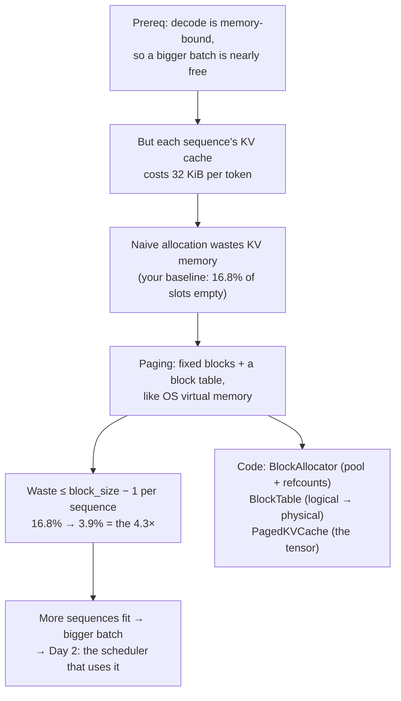
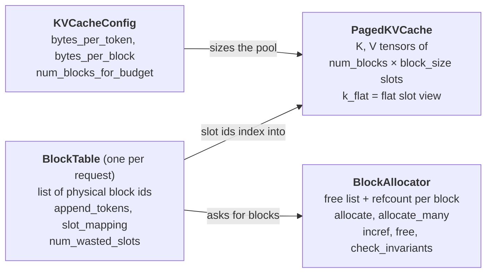
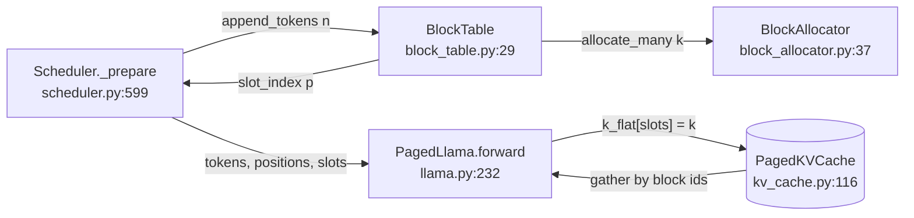
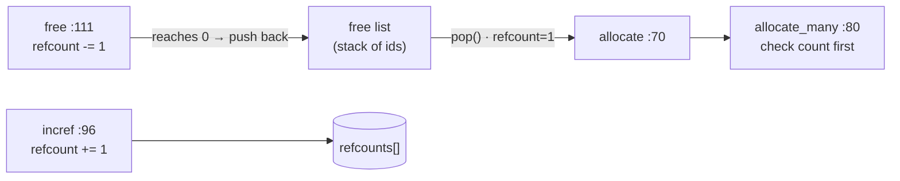
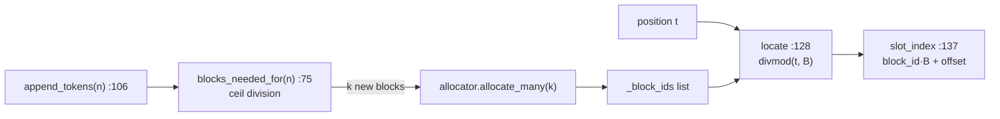
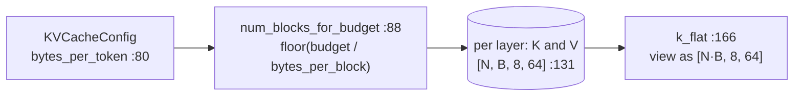
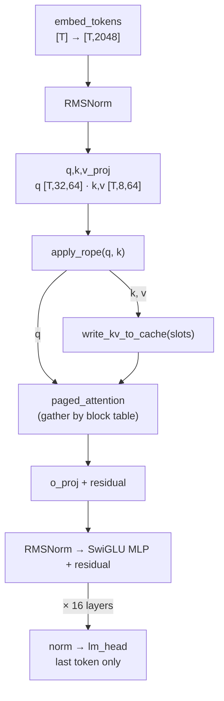

# Day 1 (Sun Nov 8): foundations, then mini-vLLM paging

Part of [[Interview plan (Nov 2026)]]. Repo `vLLMmini` (branch `main`). About 6.5 h. **This is your first day of
reading**, so it starts from the foundations that everything later builds on.

**Code, explained:** the figures, the code to read and what each snippet does are in [[#Code, explained]], right after section B.

**Resume bullet (part 1 of 2):** "Built a paged KV-cache memory manager and continuous-batching scheduler for LLM inference,
reducing GPU memory fragmentation by **4.3×** and achieving **3.82×** throughput over the HuggingFace baseline."
Today covers the *paged memory manager* and the **4.3×**. The scheduler and the 3.82× are tomorrow ([[Day 02 - mini-vLLM II]]).

**By tonight you can:**
- explain how one token flows through a transformer, and why decode is memory-bound;
- compute KV memory, block counts and slot indices by hand;
- explain fragmentation and paging, with the code lines that implement them;
- rebuild the block manager yourself.

> [!tip] Tools for today
> - **Interactive lab:** <https://claude.ai/artifact/SNFAyKDabiFMnwXppfj8wi> (offline copy: `figures/inference-lab.html`). The *Paging simulator* tab is loaded with today's hand trace (D), so you can check your paper answer step by step. The *Questions* tab has today's questions as flashcards.
> - All figures live in `Interview prep/Days/figures/`.

## Today in one picture



## Schedule

| #   | Time   | Kind     | What                                                                                                  |
| --- | ------ | -------- | ----------------------------------------------------------------------------------------------------- |
| 1   | 90 min | theory   | Foundations: [[Prereq - LLM inference basics]] sections 1–6, plus the video below                     |
| 2   | 45 min | code     | `model/llama.py`: one token through one layer (B0)                                                    |
| 3   | 15 min | practice | The prerequisite's self-check, out loud                                                               |
| —   | break  |          |                                                                                                       |
| 4   | 20 min | read     | The README for the big picture: *Architecture* (line 14), *Model* (466), *The Phase 0 baseline* (554) |
| 5   | 60 min | theory   | PagedAttention (A)                                                                                    |
| 6   | 75 min | code     | `block_allocator.py`, `block_table.py`, `kv_cache.py` (B1)                                            |
| 7   | 75 min | rebuild  | Your own block manager (C)                                                                            |
| 8   | 20 min | trace    | Block tables by hand (D)                                                                              |
| 9   | 25 min | practice | The questions (E); write your fumbles at the bottom                                                   |

**Foundations, block 1 (90 min).** Read [[Prereq - LLM inference basics]] sections 1–6, then:
- **Video, about 30 min:** Umar Jamil, *"LLaMA explained: KV-Cache, Rotary Positional Embedding, RMS Norm, Grouped Query Attention, SwiGLU"*. Watch the KV-cache and grouped-query-attention parts. Llama-3.2-1B, your model, uses all of these.
- **If attention itself is rusty**, read Jay Alammar's *"The Illustrated Transformer"* (blog) first, about 30 min.
- **Optional, any evening:** Horace He, *"Making Deep Learning Go Brrrr From First Principles"*: compute- vs memory- vs overhead-bound work.

## A. Theory: PagedAttention (block 5, 60 min)

**Read:** Kwon et al., *Efficient Memory Management for LLM Serving with PagedAttention* (SOSP 2023): §1, §3 (the memory
problem), §4.1–4.3 (PagedAttention, the KV manager, decoding with it).

**Watch or read (30 min, pick one):**
- YouTube: *"Fast LLM Serving with vLLM and PagedAttention"*, the Anyscale talk by the vLLM authors;
- the vLLM launch blog post, *"vLLM: Easy, Fast, and Cheap LLM Serving with PagedAttention"* (blog.vllm.ai, June 2023).

### A1. The problem in plain words

The KV cache of a request grows by 32 KiB with every token, and you do not know in advance how long the answer will be. If each request gets **one contiguous chunk** of memory, you must decide its size up front, and every choice wastes memory:

![[d1-fragmentation.svg]]

- **Internal fragmentation:** space reserved *inside* a request's chunk that never holds a token (the red squares in rows 1 and 2).
- **External fragmentation:** free memory split into gaps *between* chunks, each too small for a new request although the total would be enough.
- **Your baseline is option 2**, not option 1: the Phase 0 HF baseline left-pads every sequence to the longest prompt in its batch. That padding is the measured **16.8%** (README *The Phase 0 baseline*). Option 1 (reserve `max_len`) is what the PagedAttention paper criticises in earlier serving systems.

### A2. The fix: borrow virtual memory from the OS

| Operating system                            | mini-vLLM                                 | In your code                        |
| ------------------------------------------- | ----------------------------------------- | ----------------------------------- |
| process                                     | request / sequence                        | —                                   |
| virtual page                                | logical block (`B` consecutive tokens)    | index into the block table          |
| physical frame                              | physical block in one pre-allocated pool  | an integer id from `BlockAllocator` |
| page table                                  | block table, one per request              | `BlockTable`                        |
| free-frame list                             | free list                                 | `BlockAllocator` free list          |
| shared pages + refcount (e.g. after `fork`) | shared prefix blocks + refcount (Day 2)   | `incref`, `free`                    |
| page fault → allocate a frame               | last block full → allocate one more block | `append_tokens`                     |

![[d1-block-table.svg]]

**Concepts:**
- **Contiguous KV wastes memory.** Without paging, each request reserves its worst case up front: `max_len` slots, or in your baseline the batch's longest length. Waste = reserved − used: **internal** fragmentation (inside a reservation) plus **external** fragmentation (free gaps too small to use).
- **Paging.** Fixed blocks of `B` tokens. A per-request **block table** maps logical block *i* to a physical block id, like an OS page table. Memory grows one block at a time.
- **Bounded waste.** At most `B − 1` empty slots per sequence, in the last block only; about `(B − 1)/2` on average.
- **Refcounts.** Several requests may point at one physical block (shared prefixes, on Day 2). It is freed only at refcount 0.

**Maths for your model (Llama-3.2-1B, bf16, B = 16):**
- KV bytes per token = 2 × 16 layers × 8 KV heads × 64 head_dim × 2 B = **32 KiB**.
- Bytes per block = 16 × 32 KiB = **512 KiB** (all layers).
- Blocks from a budget: 40 GB free → `floor(40·10⁹ / 524,288)` ≈ **76,000 blocks** ≈ 1.2M tokens.
- Slot of position `t`: `block_id = table[t // B]`, `offset = t % B`, `slot = block_id·B + offset` (`BlockTable.slot_mapping`).
- **The 4.3×:** padding waste on the `independent` workload fell from **16.8%** of allocated KV slots to **3.9%** (README *Fragmentation*, line 321). It is slightly *worse* on uniform prompts: with equal lengths, contiguous allocation wastes nothing, while paging still wastes part of the last block.

> [!warning] Precision on the 4.3× (say it before they ask)
> | workload | naive (pad to longest) | paged, B = 16 | |
> |---|---|---|---|
> | `independent` | 16.8% | **3.9%** | 4.3× better, 904 slots saved |
> | `shared_prefix` (prompts 132–139 tokens) | 0.8% | 2.8% | worse by 176 slots |
>
> - It is a **ratio of wasted-slot fractions**, computed by `benchmarks/fragmentation.py` from the tokenizer alone (no GPU). The naive 16.8% matches the waste measured in the real Phase 0 run, which cross-checks the accounting.
> - Paging recovers waste that comes from **length variance**. With near-uniform prompts there is nothing to recover and block rounding costs more. That workload's win is prefix sharing (Day 2).

> [!quote] Say it like this (30 seconds)
> "Decode is memory-bound, so throughput comes from batching, and the batch is capped by KV memory. The HF baseline pads every sequence to the longest in its batch, and 16.8% of the KV slots held nothing. I replaced that with a block allocator: fixed 16-token blocks from one pool, a per-request block table like an OS page table, and refcounts so blocks can be shared later. Waste is bounded by one partial block per sequence, and it fell to 3.9%, 4.3× less. On uniform-length prompts paging is slightly worse, which is expected: there is no padding to recover."

## B. Code

### B0. The model (block 2, 45 min)

> [!tip] The code for this block, explained line by line: [[#Code, explained]] §4 (one token through one layer).

`model/llama.py`: follow one token through embedding → one decoder layer (RMSNorm → Q/K/V projections → RoPE →
attention with 32 query and 8 KV heads → output projection → SwiGLU MLP) → logits. Write down every tensor shape (hidden
2048, head_dim 64). Where does the code write K and V into the cache?

Use the figure from the prerequisite as your map, and fill in the right-hand column from the code:

![[p1-one-token-one-layer.svg]]

| Step                                | Shape (from the figure)           | Line in `llama.py` (fill in) |
| ----------------------------------- | --------------------------------- | ---------------------------- |
| embedding                           | `[T, 2048]`                       |                              |
| q/k/v projections                   | Q `[T, 32, 64]`, K/V `[T, 8, 64]` |                              |
| RoPE (and `resolve_rope_config`)    | unchanged                         |                              |
| **K, V written to the paged cache** | at `slot_mapping`                 |                              |
| attention over the cache            | `[T, 32, 64]` → `[T, 2048]`       |                              |
| MLP                                 | `[T, 8192]` → `[T, 2048]`         |                              |
| logits                              | `[T, 128256]`                     |                              |
|                                     |                                   |                              |

> [!info] Two things in this file worth an interview story
> - **Tokens are flattened and ragged**, `[total_tokens]` rather than `[batch, seq_len]`, so there is no padding anywhere (README *Phase 2*).
> - **The RoPE bug:** `config.rope_theta` does not exist in transformers 5.x, so a `getattr` default silently gave **10000 instead of 500000**. Short prompts still read fluently; only a comparison against HF's rotary module caught it (74.8% of cos/sin values wrong). `resolve_rope_config` now raises instead of defaulting (README *The bug this phase actually found*).

> [!success]- Answer key for the table (checked against `vLLMmini` `main` @ `3679394`; fill yours in first)
> | Step | Shape | Where |
> |---|---|---|
> | embedding | `[T, 2048]` | `llama.py:264` `self.embed_tokens(input_ids)`; `input_ids` must be flat `[total_tokens]` (check at 259) |
> | RoPE cos/sin, once per pass | `[T, 64]` | `llama.py:265`; theta from `resolve_rope_config` (68–94), llama3 frequency scaling in `_apply_llama3_scaling` (124–142) |
> | the 16-layer loop | — | `llama.py:275` |
> | RMSNorm (in float32, to match HF) | `[T, 2048]` | `llama.py:281`; class at 47–65 |
> | q/k/v projections | Q `[T, 32, 64]`, K/V `[T, 8, 64]` | `llama.py:283–285`: `q_proj(x).view(T, 32, 64)`, `k_proj`/`v_proj(x).view(T, 8, 64)` |
> | RoPE applied | unchanged | `llama.py:286` → `apply_rope` (157–167) |
> | **K, V written to the paged cache** | at `slot_mapping` | **`llama.py:290`** `write_kv_to_cache(cache, index, slot_mapping, k, v)` → `paged_attention.py:36–65`: `k_flat[slots] = key` |
> | attention over the cache | `[T, 32, 64]` | `llama.py:292–297`: fused Triton kernel for pure-decode steps, else the naive `paged_attention` |
> | heads back together | `[T, 2048]` | `llama.py:298` `reshape(T, 32 * 64)` |
> | o_proj + residual | `[T, 2048]` | `llama.py:299` |
> | SwiGLU MLP + residual | `[T, 8192]` → `[T, 2048]` | `llama.py:301–306`: `down_proj(silu(gate_proj(x)) * up_proj(x))` |
> | logits | `[num_selected, 128256]` | `llama.py:308–311`: final norm, keep only `logits_indices` (usually the last token of each sequence), then `lm_head` |
>
> **Points the figure skips:**
> - K and V are written **before** attention (comment at 288–289), so a sequence attends to its own new tokens.
> - Logits are computed only for `logits_indices`. The 128256-wide projection for every prefill token would be wasted work (docstring 252–255).
> - The decode metadata for the Triton kernel is built **once per forward pass, not once per layer** (267–273). Doing it 16 times would bring back the per-step overhead the kernel removes.
> - **GQA (32 Q heads, 8 KV heads):** the naive path copies each KV head 4 times with `repeat_interleave` (`paged_attention.py:104–119`, called at 220–221). `repeat` would be wrong: it tiles the heads, so query head 1 would pair with KV head 1 instead of 0. The Triton kernel copies nothing: it computes `kv_head = q_head // num_kv_groups` (`paged_attention_triton.py:85`) and reads the shared head directly.

### B1. The memory manager (block 6, 75 min, deep)

> [!tip] The code for this block, explained line by line: [[#Code, explained]] §1 allocator, §2 block table, §3 KV cache, §5 how they connect.

How the three files fit together:



| File, line                                                                                               | Read for                                                            |
| -------------------------------------------------------------------------------------------------------- | ------------------------------------------------------------------- |
| `block_allocator.py` 37 `BlockAllocator`                                                                 | the free list and refcount array                                    |
| — 70 `allocate`, 80 `allocate_many`                                                                      | why `allocate_many` is all-or-nothing (no partial allocation leaks) |
| — 96 `incref`, 111 `free`, 121 `free_many`                                                               | a block returns to the free list only at refcount 0                 |
| — 144 `check_invariants`                                                                                 | every block is free XOR has refcount > 0                            |
| `block_table.py` 75 `blocks_needed_for`                                                                  | ceiling division                                                    |
| — 106 `append_tokens`                                                                                    | when a new block is taken                                           |
| — 128 `locate`, 137 `slot_index`, 147 `slot_mapping`                                                     | the formula from A                                                  |
| — 66 `num_wasted_slots`                                                                                  | the fragmentation metric behind 16.8% → 3.9%                        |
| `kv_cache.py` 34 `KVCacheConfig`: 80 `bytes_per_token`, 85 `bytes_per_block`, 88 `num_blocks_for_budget` | check them against your maths                                       |
| — 98 `blocks_for_free_memory`, 116 `PagedKVCache.__init__`, 166 `k_flat`                                 | the cache tensor's shape, and why "flat"                            |

Then read README *Phase 1: paged memory manager* (line 602) and *Fragmentation* (321).

> [!question] Answer these while reading (write the line numbers)
> 1. What order does the free list hand blocks out in? (It changes the ids in trace D, not the counts.)
> 2. What exactly happens in `allocate_many` when there are not enough free blocks? Is any state changed?
> 3. In `append_tokens`, what condition triggers a new block? Test it at a length that is an exact multiple of the block size.
> 4. What is the shape of the cache tensor, and what does `k_flat` reshape it to? Why does one integer per token (the slot) make the write simpler?
> 5. Why were refcounts built in Phase 1, before anything shared blocks? (README: retrofitting later would mean auditing every call site for use-after-free.)

> [!success]- Answers (checked against the code)
> 1. **LIFO.** `_free_blocks = list(reversed(range(n)))` (`block_allocator.py:47`) and `allocate` uses `pop()` (76), so a fresh pool hands out 0, 1, 2, … in order. `free` appends (118), so **the most recently freed block is reused first**. The comment at 45–46 says why: it keeps a working set hot instead of cycling through the whole pool.
> 2. It raises `OutOfBlocksError` **before taking anything** (`block_allocator.py:89–93`), so nothing changes. The docstring (83–85) says why: a partial allocation that then raised would leak every block already taken, and the caller would not know what to undo. `append_tokens` builds on this (`block_table.py:106–124`): `allocate_many` either succeeds or raises before `_num_tokens` changes, so a failed append leaves the sequence exactly as it was and **is safe to retry after the scheduler frees memory**. `free_many` (121–132) does the same for frees: it checks every id before freeing any.
> 3. `blocks_needed_for` (`block_table.py:75–84`): `blocks_after = ceil((num_tokens + new) / block_size)`, written as `(total + bs − 1) // bs`, minus the blocks already held. A new block is taken exactly when a token lands on a multiple of the block size: with bs = 4, going from 4 to 5 tokens needs a 2nd block, but going from 3 to 4 does not.
> 4. One pair of tensors **per layer**, each `[num_blocks, block_size, num_kv_heads, head_dim]` = `[N, 16, 8, 64]` (`kv_cache.py:131–139`). `k_flat` (166–176) is a **view, not a copy**, of shape `[num_blocks × block_size, 8, 64]`. Slot `block_id × block_size + offset` is then a plain row index, so writing a whole step's K is one scatter, `k_flat[slots] = key` (`paged_attention.py:64`), and the Phase 5 kernel uses the same addressing. Separate per-layer tensors keep each layer's K and V contiguous, which a flat slot index assumes (module docstring, `kv_cache.py:13–16`).
> 5. Phase 4's prefix cache makes two sequences point at the same physical blocks. A block must not go back to the pool while anyone still uses it, and adding refcounts later would mean re-checking every call site for use-after-free, the hardest bug class to find by testing (`block_allocator.py:8–14`). `incref` refuses a free block (104–107) and `free` refuses a double free (114–115).

## Code, explained

Read this **with the files open**. Each part has a small figure of the pipeline, then the exact code (copied from the repo at the commit named below, so the line numbers match), then what it does and how it hands off to the next piece.

Repo `vLLMmini`, branch `main` (`3679394`). Read this **with the files open**:
each section has one small figure of the pipeline, then the exact code in reading order, then what each piece does
and how it hands off to the next.

**The whole day in one line:** the scheduler decides *how many* tokens a request adds → `BlockTable` turns token
positions into *slot numbers* → the model *writes* K,V into those slots and *reads* them back by block table.



---

### 1. The memory pool: `BlockAllocator`



The pool is two plain Python lists: a **stack of free ids** and a **refcount per block**.

`src/mini_vllm/block_allocator.py:40–47`
```python
def __init__(self, num_blocks: int) -> None:
    if num_blocks <= 0:
        raise ValueError(f"num_blocks must be positive, got {num_blocks}")
    self._num_blocks = num_blocks
    self._ref_counts = [0] * num_blocks
    # LIFO: the most recently freed block is reused first, which keeps a
    # working set hot rather than cycling through the whole pool.
    self._free_blocks = list(reversed(range(num_blocks)))
```

- `reversed(range(...))` + `pop()` from the end hands out block 0 first. It is **LIFO**: a block freed a moment ago is reused next, which keeps recently touched memory hot.

`src/mini_vllm/block_allocator.py:70–94`
```python
def allocate(self) -> int:
    """Take one block from the pool with a reference count of 1."""
    if not self._free_blocks:
        raise OutOfBlocksError(
            f"no free blocks ({self._num_blocks} total, all allocated)"
        )
    block_id = self._free_blocks.pop()
    self._ref_counts[block_id] = 1
    return block_id

def allocate_many(self, count: int) -> list[int]:
    """Take `count` blocks, all or nothing.

    All-or-nothing matters: a partial allocation that then raises would
    leak every block taken before the failure, and the caller — mid-way
    through extending a sequence — has no clean way to know what to undo.
    """
    if count < 0:
        raise ValueError(f"count must be non-negative, got {count}")
    if count > len(self._free_blocks):
        raise OutOfBlocksError(
            f"requested {count} blocks, only {len(self._free_blocks)} free "
            f"({self._num_blocks} total)"
        )
    return [self.allocate() for _ in range(count)]
```

- `allocate` is O(1): pop an id, set its refcount to 1.
- `allocate_many` **checks the count before taking anything**. If it took blocks one by one and ran out halfway, the caller would hold half a sequence's blocks with no clean way to undo. This is the "all or nothing" rule (Day 1 Q7).

`src/mini_vllm/block_allocator.py:96–119`
```python
def incref(self, block_id: int) -> int:
    """Add a reference to an already-allocated block. Returns the new count.

    This is how Phase 4 will attach a second sequence to a shared prefix
    block. Increffing a free block is a bug — it would resurrect a block
    that is simultaneously claimed by the free list.
    """
    self._check_id(block_id)
    if self._ref_counts[block_id] == 0:
        raise ValueError(
            f"block {block_id} is free; cannot add a reference to it"
        )
    self._ref_counts[block_id] += 1
    return self._ref_counts[block_id]

def free(self, block_id: int) -> int:
    """Drop one reference. Returns the new count; returns to pool at zero."""
    self._check_id(block_id)
    if self._ref_counts[block_id] == 0:
        raise ValueError(f"block {block_id} is already free (double free)")
    self._ref_counts[block_id] -= 1
    if self._ref_counts[block_id] == 0:
        self._free_blocks.append(block_id)
    return self._ref_counts[block_id]
```

- `incref` refuses a free block: adding a reference to a block that is also on the free list would let two owners collide.
- `free` drops **one** reference. The block goes back to the pool **only at zero**. This one `if` is why a block shared by two requests (Day 2's prefix cache) survives when one of them finishes (Q6).

**Check yourself:** pool of 4. `allocate()` twice, `incref(first)`, `free(first)`. What is on the free list now, and what are the refcounts?

---

### 2. Logical → physical: `BlockTable`



One `BlockTable` per request. It is the request's page table: list index = logical block, value = physical block id.

`src/mini_vllm/block_table.py:75–84`
```python
def blocks_needed_for(self, num_new_tokens: int) -> int:
    """How many *additional* blocks appending `num_new_tokens` would take.

    The scheduler needs this to decide admission without mutating anything.
    """
    if num_new_tokens < 0:
        raise ValueError(f"num_new_tokens must be non-negative, got {num_new_tokens}")
    total = self._num_tokens + num_new_tokens
    blocks_after = (total + self._block_size - 1) // self._block_size
    return max(0, blocks_after - len(self._block_ids))
```

- How many **extra** blocks would `n` more tokens need? `(total + B − 1) // B` is ceiling division. Subtract the blocks already held. It doesn't change anything, so the scheduler can ask it during admission without side effects.

`src/mini_vllm/block_table.py:106–124`
```python
def append_tokens(self, num_new_tokens: int) -> list[int]:
    """Extend the sequence by `num_new_tokens`, allocating blocks as needed.

    Returns the newly allocated block ids (empty when the tokens fit in the
    current last block). Raises `OutOfBlocksError` without changing any
    state if the pool cannot satisfy the request — the caller's sequence is
    left exactly as it was, so a failed append is safe to retry after the
    scheduler frees memory.
    """
    if num_new_tokens < 0:
        raise ValueError(f"num_new_tokens must be non-negative, got {num_new_tokens}")
    if num_new_tokens == 0:
        return []
    needed = self.blocks_needed_for(num_new_tokens)
    # all-or-nothing; raises before we touch _num_tokens
    new_blocks = self._allocator.allocate_many(needed)
    self._block_ids.extend(new_blocks)
    self._num_tokens += num_new_tokens
    return new_blocks
```

- Order matters: **allocate first, then update state.** If `allocate_many` raises, `_num_tokens` is untouched, so the request is exactly as before and can retry later.
- A new block is taken only when the tokens cross a block boundary. With B = 16, a decode step allocates once every 16 steps.

`src/mini_vllm/block_table.py:128–145`
```python
def locate(self, position: int) -> tuple[int, int]:
    """Translate a logical token position to (physical_block_id, offset)."""
    if not 0 <= position < self._num_tokens:
        raise IndexError(
            f"position {position} out of range [0, {self._num_tokens})"
        )
    logical_block, offset = divmod(position, self._block_size)
    return self._block_ids[logical_block], offset

def slot_index(self, position: int) -> int:
    """Flat physical slot index for a logical position.

    Slots are numbered `block_id * block_size + offset`, which is the
    addressing the Phase 2 gather and the Phase 5 Triton kernel use to
    index the KV cache as one flat array.
    """
    block_id, offset = self.locate(position)
    return block_id * self._block_size + offset
```

- `divmod(position, B)` gives (logical block, offset). The table maps the logical block to a physical id.
- **slot = block_id × B + offset.** This is the one formula to know cold. Example: B = 4, table `[7, 2]`, position 5 → logical block 1, offset 1 → physical 2 → slot 9.

`src/mini_vllm/block_table.py:60–71`
```python
@property
def capacity(self) -> int:
    """Token slots currently allocated, including unused slots in the last block."""
    return len(self._block_ids) * self._block_size

@property
def num_wasted_slots(self) -> int:
    """Allocated-but-unused slots: the project's internal fragmentation metric.

    Always < block_size, because only the final block can be partial.
    """
    return self.capacity - self._num_tokens
```

- `num_wasted_slots` = slots held − tokens stored. Only the last block can be partly empty, so waste < B per request. Summed over requests, this is the fragmentation metric behind 16.8% → 3.9%.

**Check yourself:** B = 4, an empty table, `append_tokens(5)` then `append_tokens(1)` ×3. How many `allocate_many` calls actually take a block? What is `num_wasted_slots` at the end?

---

### 3. The bytes: `PagedKVCache`



`src/mini_vllm/kv_cache.py:79–92`
```python
@property
def bytes_per_token(self) -> int:
    """KV bytes for one token across all layers (K and V)."""
    return 2 * self.num_layers * self.num_kv_heads * self.head_dim * self.itemsize

@property
def bytes_per_block(self) -> int:
    return self.bytes_per_token * self.block_size

def num_blocks_for_budget(self, budget_bytes: int) -> int:
    """How many blocks fit in `budget_bytes`. Floor, never over-commits."""
    if budget_bytes < 0:
        raise ValueError(f"budget must be non-negative, got {budget_bytes}")
    return budget_bytes // self.bytes_per_block
```

- `bytes_per_token = 2 (K and V) × layers × KV heads × head_dim × bytes`. Llama-3.2-1B in bf16: 2 × 16 × 8 × 64 × 2 = **32 KiB**. A 16-token block is 512 KiB.
- `//` rounds **down**: never promise more blocks than fit.

`src/mini_vllm/kv_cache.py:131–139`
```python
shape = (num_blocks, config.block_size, config.num_kv_heads, config.head_dim)
self._k = [
    torch.zeros(shape, dtype=config.dtype, device=self.device)
    for _ in range(config.num_layers)
]
self._v = [
    torch.zeros(shape, dtype=config.dtype, device=self.device)
    for _ in range(config.num_layers)
]
```

- One tensor per layer for K and one for V, each `[num_blocks, block_size, kv_heads, head_dim]`. The block id is simply the **first index**. So the allocator owns ids, and this tensor owns the bytes they point to.

`src/mini_vllm/kv_cache.py:166–176`
```python
def k_flat(self, layer: int) -> torch.Tensor:
    """Key cache viewed as flat slots: [num_blocks * block_size, heads, dim].

    This is the view a flat slot index addresses, and the one the Phase 5
    kernel will index. It is a view, not a copy — writes through it land in
    the block-shaped tensor.
    """
    c = self.config
    return self._k[self._check_layer(layer)].view(
        self.num_slots, c.num_kv_heads, c.head_dim
    )
```

- `.view(...)` reshapes without copying. Row `block_id × B + offset` of the flat view is exactly element `[block_id, offset]` of the block view. That is why `slot_index` works as an address.

---

### 4. One token through one layer: `PagedLlama.forward`



`src/mini_vllm/model/llama.py:264–265`
```python
hidden = self.embed_tokens(input_ids)
cos, sin = self.rotary(positions)
```

`src/mini_vllm/model/llama.py:275–306`
```python
for index, layer in enumerate(self.layers):
    input_norm, post_norm = self._layer_norms(layer)
    attn = layer.self_attn
    total_tokens = hidden.shape[0]

    residual = hidden
    x = input_norm(hidden)

    q = attn.q_proj(x).view(total_tokens, self.num_q_heads, self.head_dim)
    k = attn.k_proj(x).view(total_tokens, self.num_kv_heads, self.head_dim)
    v = attn.v_proj(x).view(total_tokens, self.num_kv_heads, self.head_dim)
    q, k = apply_rope(q, k, cos, sin)

    # Write this step's KV before attending, so a sequence attends to
    # its own new tokens (context_lens already counts them).
    write_kv_to_cache(cache, index, slot_mapping, k, v)

    if decode_meta is not None:
        out = paged_attention_decode(q, cache, index, decode_meta, self.scale)
    else:
        out = paged_attention(
            q, cache, index, block_tables, query_lens, context_lens, self.scale
        )
    out = out.reshape(total_tokens, self.num_q_heads * self.head_dim)
    hidden = residual + attn.o_proj(out)

    residual = hidden
    x = post_norm(hidden)
    mlp = layer.mlp
    hidden = residual + mlp.down_proj(
        nn.functional.silu(mlp.gate_proj(x)) * mlp.up_proj(x)
    )
```

Read it top to bottom with shapes (T = all tokens of all requests this step, concatenated):
- `x = input_norm(hidden)`: RMSNorm *before* attention (pre-norm). `residual` keeps the un-normalised input for the skip connection.
- `q_proj` → `[T, 32, 64]`; `k_proj`, `v_proj` → `[T, 8, 64]`. **8 KV heads for 32 query heads = GQA**: 4 query heads share one K,V. That is why the KV cache is 4× smaller than with full multi-head attention.
- `apply_rope` rotates q and k by their **position**, not their index in the flat batch.
- **`write_kv_to_cache` happens before attention**, so each new token can attend to itself.
- `hidden = residual + o_proj(out)`: the first residual. Then the MLP: `down(silu(gate(x)) * up(x))` = SwiGLU, with a second residual.

`src/mini_vllm/paged_attention.py:61–65`
```python
k_flat = cache.k_flat(layer)
v_flat = cache.v_flat(layer)
slots = slot_mapping.to(device=k_flat.device, dtype=torch.long)
k_flat[slots] = key.to(k_flat.dtype)
v_flat[slots] = value.to(v_flat.dtype)
```

- The write is one **scatter**: token i's K goes to row `slots[i]`. Consecutive tokens can land in non-adjacent blocks; the table hides that.

`src/mini_vllm/paged_attention.py:85–100`
```python
k_cache = cache.k(layer)
v_cache = cache.v(layer)
blocks = torch.as_tensor(block_ids, dtype=torch.long, device=k_cache.device)

needed = (context_len + cache.block_size - 1) // cache.block_size
if needed > blocks.numel():
    raise ValueError(
        f"context_len {context_len} needs {needed} blocks, "
        f"block table has {blocks.numel()}"
    )
blocks = blocks[:needed]

# [n_blocks, block_size, kv_heads, dim] -> flat token order, then truncate
# the unused tail of the final block.
k = k_cache[blocks].reshape(-1, k_cache.shape[2], k_cache.shape[3])[:context_len]
v = v_cache[blocks].reshape(-1, v_cache.shape[2], v_cache.shape[3])[:context_len]
```

- The read is a **gather**: index the block-shaped cache by the request's block ids, flatten to token order, cut off the empty tail of the last block (`[:context_len]`). Day 3's Triton kernel fuses this gather into attention so this intermediate tensor is never built.

`src/mini_vllm/model/llama.py:308–311`
```python
hidden = self.norm(hidden)
if logits_indices is not None:
    hidden = hidden[logits_indices]
return self.lm_head(hidden)
```

- Logits only at `logits_indices`: one position per request (its last token). The vocabulary is 128,256 wide, so computing it for every prefill token would dominate the step.

---

### 5. How it all connects in one step

`src/mini_vllm/scheduler.py:599–612`
```python
def _prepare(self, request: Request) -> ScheduledRequest:
    """Grow the block table and build this iteration's flat inputs."""
    num_new = request.num_uncomputed_tokens
    request.table.append_tokens(num_new)
    start = request.num_computed_tokens
    all_ids = request.all_token_ids
    return ScheduledRequest(
        request=request,
        token_ids=all_ids[start : start + num_new],
        positions=list(range(start, start + num_new)),
        slot_mapping=[
            request.table.slot_index(p) for p in range(start, start + num_new)
        ],
    )
```

- `_prepare` is the **glue**: it grows the table by the uncomputed tokens (section 2), then builds `token_ids`, `positions` and `slot_mapping` for exactly those tokens.
- The engine concatenates these lists across requests and calls `forward` (section 4), which writes K,V to the slots (section 3).

**End-of-day test:** B = 4, request A has 5 prompt tokens, physical blocks come out as `[7, 2]`. Write A's `slot_mapping` for its prefill. Then A decodes one token: does `append_tokens(1)` allocate? Which slot does token 5 go to? (*Answers: slots 28, 29, 30, 31, 8; no allocation; slot 9.*)

## C. Rebuild it yourself (block 7, 75 min)

Without looking at the code, write `toy_paging.py` (about 100 lines of pure Python):
1. `BlockAllocator(num_blocks)` with `allocate()`, `allocate_many(n)` (all or nothing), `incref(b)`, `free(b)`, `free_many(ids)`, `ref_count(b)`, `check_invariants()`, and the properties `num_blocks`, `num_free_blocks`, `num_allocated_blocks`. Raise `OutOfBlocksError` when out of blocks.
2. `BlockTable(allocator, block_size)` (**allocator first**, as the tests call it) with `append_tokens(n)`, `blocks_needed_for(n)`, `locate(p)`, `slot_index(p)`, `slot_mapping()`, `free()`, and the properties `num_tokens`, `num_blocks`, `block_ids`, `capacity`, `num_wasted_slots`.
3. 3 requests of different lengths, each adding 1 token per step. Print the wasted slots each step, and compare against contiguous allocation of `max_len`.

**Check:** point `tests/test_block_allocator.py` and `tests/test_block_table.py` at your module (change the import) and
run `pytest -q` on your laptop (CPU only). Each failing test is a concept you missed. The code is in `/mnt/study/placement_projects/vLLMmini/`; the tests import `from mini_vllm.block_allocator import BlockAllocator, OutOfBlocksError` and `from mini_vllm.block_table import BlockTable`, so change those two lines. The tests use exactly the names in steps 1 and 2.

> [!hint]- Stuck? A skeleton (open only if needed)
> ```python
> class OutOfBlocksError(RuntimeError): ...
>
> class BlockAllocator:
>     def __init__(self, num_blocks):          # ValueError if num_blocks <= 0
>         self._ref = [0] * num_blocks
>         self._free = list(reversed(range(num_blocks)))   # pop() then gives 0, 1, 2, ...
>     num_blocks / num_free_blocks / num_allocated_blocks  # @property each
>     def ref_count(self, b): ...
>     def allocate(self): ...          # pop, ref = 1, OutOfBlocksError if empty
>     def allocate_many(self, n): ...  # check n <= len(free) FIRST, then allocate n times
>     def incref(self, b): ...         # ValueError if ref[b] == 0 (free block)
>     def free(self, b): ...           # ValueError on double free; append to free at 0
>     def free_many(self, ids): ...    # validate ALL ids, then free each
>     def check_invariants(self): ...  # in free list <=> ref == 0, no duplicates
>
> class BlockTable:
>     def __init__(self, allocator, block_size):
>         self._alloc, self._bs, self._ids, self._n = allocator, block_size, [], 0
>     num_tokens / num_blocks / block_ids / capacity / num_wasted_slots  # @property each
>     def blocks_needed_for(self, k): ...  # ceil((n + k) / bs) - len(ids), at least 0
>     def append_tokens(self, k): ...      # allocate_many FIRST, then update n
>     def locate(self, p): ...             # divmod(p, bs) -> (ids[blk], off); IndexError if out of range
>     def slot_index(self, p): ...         # ids[p // bs] * bs + p % bs
>     def slot_mapping(self): ...          # [slot_index(p) for p in range(n)]
>     def free(self): ...                  # free_many(ids); safe to call twice
> ```

## D. Trace by hand (block 8, 20 min)

Block size 4, pool of 8 blocks. Request A has 5 tokens, B has 9, C has 3. Each then appends 4 tokens, one at a time. Write down:
- every block table after each append;
- the free list;
- the slot of token 7 of request B;
- the total wasted slots at the end, compared with contiguous allocation at `max_len = 16`.

Do it on paper first. Then check it in the lab's *Paging simulator* tab (press **Step**), and only then open the answer.

> [!success]- Worked answer (A, B, C append in that order each step; block ids match the real allocator, whose fresh free list hands out 0, 1, 2, …)
> **Admission.** A needs ⌈5/4⌉ = 2 blocks, B ⌈9/4⌉ = 3, C ⌈3/4⌉ = 1.
> A = [0, 1], B = [2, 3, 4], C = [5]. Free list = [6, 7].
>
> | step | A (tokens, table) | B | C | free |
> |---|---|---|---|---|
> | 0 | 5, [0, 1] | 9, [2, 3, 4] | 3, [5] | [6, 7] |
> | 1 | 6, [0, 1] | 10, [2, 3, 4] | 4, [5] (block now full) | [6, 7] |
> | 2 | 7, [0, 1] | 11, [2, 3, 4] | 5, [5, **6**] | [7] |
> | 3 | 8, [0, 1] (full) | 12, [2, 3, 4] (full) | 6, [5, 6] | [7] |
> | 4 | 9, [0, 1, **7**] | **needs a 4th block: none left** | 7, [5, 6] | [] |
>
> **The trap in this exercise:** the three requests finally need 3 + 4 + 2 = 9 blocks, but the pool has 8. At step 4, B cannot grow: in your code `append_tokens(1)` raises `OutOfBlocksError` and B's table and token count stay exactly as they were. A real engine must now **preempt** a request (free its blocks and recompute it later) — that is Day 2's scheduler. Paging bounds waste; it does not create memory.
>
> **Slot of token 7 of B** (0-indexed position 7): block = table[7 // 4] = table[1] = 3, offset = 7 % 4 = 3, slot = 3 × 4 + 3 = **15**. (If you meant the 7th token, position 6: offset 2, slot **14**.)
>
> **Waste at the end.** If B had got its block (a pool of 9): A 9 tokens in 3 blocks → 3 empty, B 13 in 4 → 3, C 7 in 2 → 1, **total 7 of 36 slots**. Each is ≤ B − 1 = 3.
> **Contiguous at max_len = 16:** 3 × 16 = 48 slots for 29 tokens → **19 wasted**. Worse: 48 slots need 12 blocks' worth of memory and the pool holds 32 slots, so only **2 of the 3 requests could even be admitted**. That is the real cost of fragmentation: fewer concurrent requests, so a smaller batch.

## E. Questions (block 9, out loud)

Answer out loud first, then unfold.

1. Why is decode memory-bound and prefill compute-bound? What is the roofline ridge point on an H200?
> [!success]- Answer
> Decode multiplies the weights by a thin `[B, 2048]` input, so each weight byte is used B times (intensity ≈ B). Prefill multiplies by `[N, 2048]`, so each byte is used N times. Ridge = 989 TFLOP/s ÷ 4.8 TB/s ≈ **206 FLOP/byte**.

2. Walk me through the KV-cache size of your model.
> [!success]- Answer
> 2 (K, V) × 16 layers × 8 KV heads × 64 head_dim × 2 B = **32 KiB per token**. A 16-token block is 512 KiB. A 4k-token sequence is 128 MiB. 40 GB free → ≈ 76,000 blocks ≈ 1.2M tokens. GQA makes this 4× smaller than 32 KV heads would.

3. Why is paging needed? Why not allocate KV for `max_len` up front?
> [!success]- Answer
> Output length is unknown in advance. Reserving `max_len` wastes the unused tail of every reservation (internal fragmentation) and leaves gaps between reservations (external fragmentation), so fewer sequences fit and the batch stays small, which keeps decode at the bottom of the roofline. Paging allocates fixed blocks on demand through a block table; any free block fits any request, and waste is at most `B − 1` per sequence. (Your own baseline padded to the batch's longest prompt rather than `max_len`; that is where the 16.8% comes from.)

4. How did you measure fragmentation, and why is paging slightly worse on uniform prompts?
> [!success]- Answer
> `benchmarks/fragmentation.py` replays the Phase 0 workload with the tokenizer only and reports the fraction of allocated KV slots that hold nothing; the naive 16.8% matches what the real Phase 0 run measured. Paged with block 16: 3.9%. On `shared_prefix` the prompts are 132–139 tokens, so padding wastes only 0.8%, while paging still rounds each sequence up to a whole block (2.8%, 176 slots worse). Paging recovers variance waste; that workload gains from prefix sharing instead.

5. Block size 16: what changes at 1 and at 256? (*Small: tiny waste, but a bigger table and less efficient kernels. Large: more waste per sequence.*)
> [!success]- Answer
> Size 1: almost no waste, but one table entry per token, an indirection for every attention read, and tiny scattered memory reads that waste bandwidth. Size 256: short tables and large contiguous reads, but up to 255 empty slots per sequence, and prefix sharing works only in whole blocks, so less of a prefix can be shared. 16 is the usual middle ground (vLLM's default too).

6. How does a block become free when two requests share it?
> [!success]- Answer
> Sharing calls `incref`, so the refcount is 2. When one request finishes, `free` decrements to 1 and the block stays allocated; when the other finishes, it reaches 0 and goes back on the free list. `check_invariants`: every block is either on the free list or has refcount > 0, never both. Try *Fork A's full blocks* then *Finish A* in the lab.

7. What does `allocate_many` being all-or-nothing protect against?
> [!success]- Answer
> A partial allocation: if it took 3 of 5 needed blocks and then ran out, the request could not run, yet it would hold 3 blocks — leaked unless every caller remembered to roll back. All-or-nothing makes admission atomic: the request gets everything or the pool is untouched. Day 2 has a related real bug: admission mutated requests it then refused.

## My notes and fumbles

-
