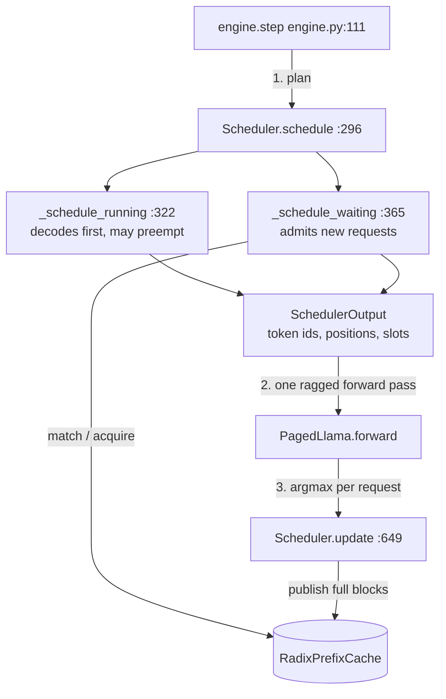
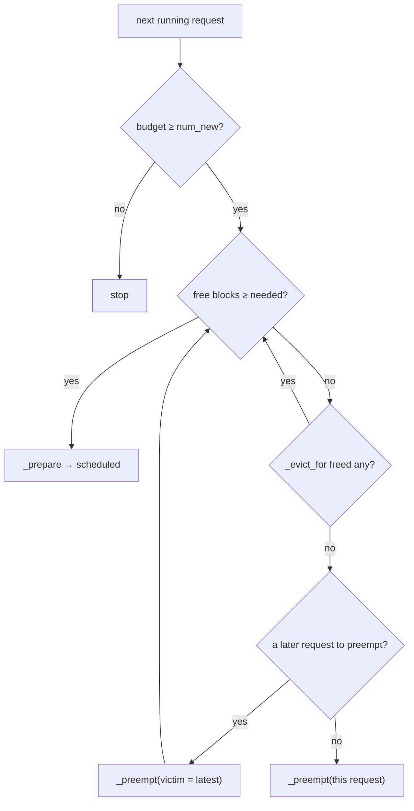
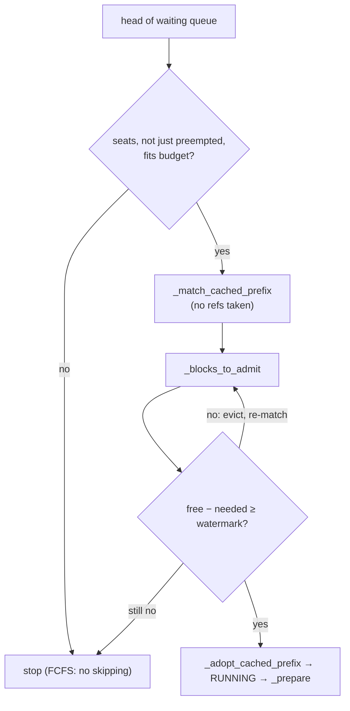
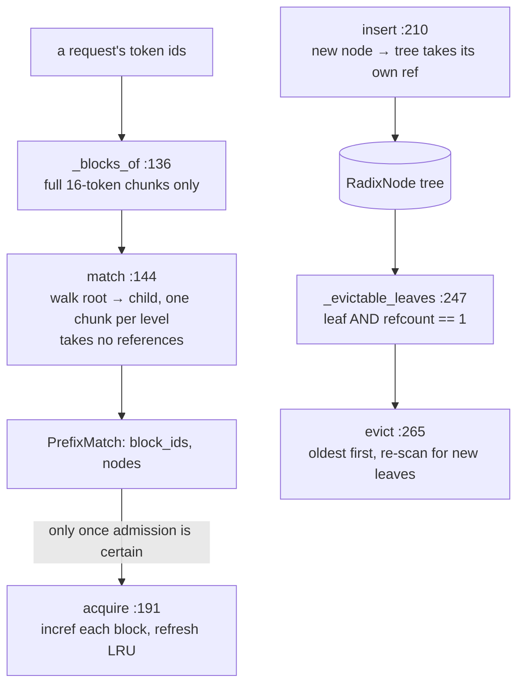
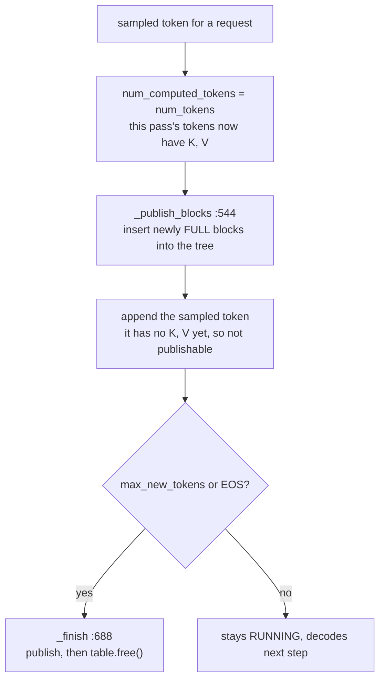

# Day 2 (Mon Nov 9): mini-vLLM II: continuous batching and the radix prefix cache

Part of [[Interview plan (Nov 2026)]]. Repo `vLLMmini` (branch `main`). About 7 h. Builds on [[Day 01 - mini-vLLM I]].

**Code, explained:** the figures, the code to read and what each snippet does are in [[#Code, explained]], right after section B.

**Resume bullets:**
- "…and continuous-batching scheduler…achieving **3.82×** throughput over the HuggingFace baseline." (part 2)
- "Implemented a radix-tree prefix cache to reuse shared KV states across requests, accelerating repeated prompt inference by up to **7.4×**…"

**By tonight you can:**
- explain the scheduler loop, admission, the token budget and recompute preemption, with the code;
- explain the radix cache and its refcounted LRU eviction, with the code;
- say exactly what "up to 7.4×" means;
- rebuild a toy radix cache.

## Schedule

| # | Time | Kind | What |
|---|---|---|---|
| 0 | 15 min | recall | Yesterday: KV formula, the slot formula, why paging |
| 1 | 40 min | theory | Continuous batching and preemption (A1) |
| 2 | 90 min | code | `scheduler.py`, minus its prefix-cache helpers (B1) |
| 3 | 30 min | trace | The scheduler trace (D1) |
| — | lunch | | |
| 4 | 45 min | theory | Radix trees and RadixAttention (A2) |
| 5 | 75 min | code | `prefix_cache.py` plus the scheduler's prefix helpers (B2) |
| 6 | 60 min | rebuild | A toy radix prefix cache (C) |
| 7 | 20 min | trace | The shared-prompt trace (D2) |
| 8 | 35 min | practice | The questions (E) |

## A. Theory

### A1. Continuous batching and preemption (40 min)

**Read:**
- the Anyscale blog *"How continuous batching enables 23x throughput in LLM inference while reducing p50 latency"* (2023), about 20 min;
- Orca (Yu et al., OSDI 2022) §3, *iteration-level scheduling*. Only the idea and its main figure, about 15 min.

> [!abstract] What it says: the Anyscale continuous-batching blog (2023)
> **Key idea.** LLM decode is limited by memory bandwidth, so batching many requests is the main way to get throughput.
> Static batching wastes that batch: it waits for the longest request before anyone new can join.
> Continuous batching re-forms the batch at every decode step.
>
> **Main figure.** Two grids of sequences over time steps. In the static grid, finished sequences leave empty slots until the whole batch ends.
> In the continuous grid, new sequences take those slots at once.
>
> **Claims to know.** The post benchmarks a 13B model on one A100. Continuous batching (Text Generation Inference, Ray Serve) gives several times the static throughput.
> vLLM's continuous batching plus paged memory gives the headline "up to 23×". Median latency also falls, because requests stop waiting for a batch to drain.
>
> **In this project.** Same comparison, smaller model: static Hugging Face baseline vs your scheduler, 3.82× throughput and TTFT p50 2448 → 179 ms.

> [!abstract] What it says: Orca (Yu et al., OSDI 2022), §3
> **Key idea: iteration-level scheduling.** The scheduler decides the batch again after every model iteration (one token), not once per request.
> A request that finishes leaves at once, and a new one can start at the next iteration.
>
> **Main figure.** Request-level scheduling, where early finishers sit idle until the batch ends, next to iteration-level scheduling, where the engine returns after each iteration.
>
> **Selective batching.** Requests in one iteration have different lengths. Orca flattens all their tokens together for the linear layers (shapes don't matter there).
> It runs attention separately per request, because attention needs each request's own keys and values.
>
> **Claims to know.** On GPT-3 175B, Orca reports about 36.9× the throughput of FasterTransformer at the same latency.
>
> **In this project.** The flattened `[T]` token batch is selective batching. `schedule()` running every step is iteration-level scheduling.


**Concepts:**
- **Static batching.** A batch runs until its longest request ends, so new requests queue. That is your HF baseline's TTFT p50 of **2448 ms**.
- **Continuous batching.** The scheduler runs **every step**: finished requests leave, waiting ones join. TTFT p50 fell to **179 ms**, and throughput rose **3.82×** (2415 vs 631 tok/s), mostly from more requests in flight per step.
- **Token budget.** Each step's tokens (prefill + one per decode) must stay ≤ `max_num_batched_tokens`, and the blocks must fit.
- **Admission.** Admit a request only if `ceil((prompt_len + 1)/B)` blocks are free above a **watermark**, a reserve kept so running requests can still grow. Without it you get thrashing: admit, then immediately preempt.
- **Preemption.** When a running request needs a block and none is free, evict a victim (the latest admitted).
  - **Swap** copies its KV to the CPU; the cost is bytes ÷ PCIe bandwidth.
  - **Recompute** drops its blocks and re-prefills later.

  You chose **recompute** (README line 742). Prefill is cheap on a 1B model, there's no CPU buffer to manage, and vLLM defaults to it too.

> [!tip] Explained from scratch: [[#6. Deep dive: continuous batching from scratch|§6 continuous batching]], [[#7. Deep dive: the scheduler's rules from scratch (budget, admission, watermark, preemption)|§7 budget, admission, watermark and preemption]]


### A2. Prefix caching (45 min)

**Read:**
- the LMSYS blog *"Fast and Expressive LLM Inference with RadixAttention and SGLang"* (Jan 2024), about 20 min;
- the SGLang paper (Zheng et al., 2024) §3: RadixAttention, eviction and its figure, about 25 min.

> [!abstract] What it says: the LMSYS RadixAttention blog (Jan 2024)
> **Key idea.** Many requests share prefixes: system prompts, few-shot examples, earlier chat turns, several samples of one question.
> RadixAttention keeps the KV cache after a request ends and stores it in a radix tree keyed by tokens.
> A new request that starts with a cached prefix reuses those KV entries instead of recomputing them.
>
> **Main figure.** A sequence of radix-tree snapshots: chat turns extend a branch, few-shot queries share one branch, and parallel samples fork from one node.
> When memory runs out, the least recently used leaves are evicted.
>
> **Claims to know.** Eviction is LRU over leaves. A cache-aware scheduler runs requests with long shared prefixes first, to raise the hit rate.
> The post reports up to about 5× higher throughput than earlier systems on prefix-heavy workloads (agents, few-shot, multi-turn chat).
>
> **In this project.** `prefix_cache.py` is the same idea, but at block level. Your hit rate (91%) only became time saved at long contexts.

> [!abstract] What it says: the SGLang paper (Zheng et al., 2024), §3
> **Key idea.** RadixAttention, formally: a radix tree whose edges hold token sequences of any length, each mapped to KV entries in a paged pool.
>
> **Main figure.** A worked example of the tree over several requests: insert, match, split a node when a new request diverges mid-edge, and evict leaves.
>
> **Claims to know.**
> - **Refcounts:** a node in use by a running request is never evicted. Only unused leaves go, least recently used first.
> - **Order:** sorting requests by longest shared prefix makes the offline batch visit the tree depth-first, which the paper argues gives the best hit rate.
> - **Speed:** the paper reports up to 6.4× higher throughput than other systems across its benchmarks.
>
> **Difference from this project.** SGLang matches token by token (page size 1) and splits nodes mid-edge. Here a node is one full 16-token block, so nothing is split and the last partial block is never shared.


**Concepts:**
- **Radix tree.** Each root-to-node path is a token prefix. Here a node holds **one full block** of `B` token ids plus its physical block id, so matching goes block by block.
- **Only full blocks are shared.** A half-filled last block is still being written, and sharing it would need copy-on-write. A request reuses `floor(matched / B)` blocks and recomputes the rest.
- **Refcounted LRU.** Evict only **leaves** with refcount 0, least recently used first. Evicting an inner node would orphan its children.
- **Hit rate is not time saved.** README *"The cache saves 91% of the tokens and 0% of the time"* (line 286).

> [!tip] Explained from scratch: [[#8. Deep dive: the radix prefix cache from scratch|§8 the radix prefix cache (match, acquire, insert, safe eviction, why 7.4× only at 8k)]]


**Maths: why 0% below 2k and 7.41× at 8k.** Prefill time is roughly `T(n) ≈ a + b·n + c·n²`: fixed overhead `a`,
linear MLP and projection cost `b·n`, and quadratic attention cost `c·n²`. For small n, `a` dominates, so skipping
tokens saves almost nothing. For large n, `n²` dominates. Your measurements (README around line 305):

| context | no cache | 90% cached | speedup |
|---|---|---|---|
| 512 | 15.5 ms | 15.5 ms | 1.00× |
| 2048 | 49.8 ms | 17.0 ms | 2.92× |
| 8192 | 665.5 ms | 89.8 ms | **7.41×** |

"Up to 7.4×" is the 8k row. Always say the context length when you quote it.

## B. Code

### B1. The scheduler (90 min, deep)

`scheduler.py`, in this order:
1. 87 `Request`, 80 `RequestStatus`, 190 `SchedulerConfig`: the state and the knobs.
2. 262 `add_request`, 257 `max_blocks_needed`, 55 `RequestTooLargeError`.
3. **296 `schedule`**: the main loop. Running requests first, then waiting ones.
4. 322 `_schedule_running`: decode steps, growing block tables, triggering preemption.
5. 365 `_schedule_waiting`: admission under the token budget and the watermark. 509 `_blocks_to_admit`.
6. 588 `_evict_for`, 616 `_pick_victim`, 626 `_preempt`: recompute preemption.
7. 649 `update`, 688 `_finish`, 704 `abort`.

Then README *Phase 3: continuous batching* (697) and *Preemption is by recompute* (742).

### B2. The prefix cache (75 min, deep)

| File, line | Read for |
|---|---|
| `prefix_cache.py` 53 `RadixNode` (63 `is_root`, 67 `is_leaf`, 70 `touch`) | what a node stores; LRU timestamps |
| — 75 `PrefixMatch`, 136 `_blocks_of` | splitting tokens into full blocks |
| — **144 `match`** | walking the tree block by block |
| — 191 `acquire` | refcounts on the matched path |
| — **210 `insert`** | publishing blocks |
| — 247 `_evictable_leaves`, **265 `evict`**, 290 `_remove` | refcount-0 leaves in LRU order |
| — 312 `check_invariants` | the rules that must always hold |
| `scheduler.py` 443 `_match_cached_prefix`, 466 `_first_uncached_chunk`, 523 `_adopt_cached_prefix`, 544 `_publish_blocks` | how admission uses the cache |
| `block_table.py` 86 `adopt_blocks` | taking over cached blocks |

README *Phase 4: radix prefix cache* (763–984). The key sections:
- *Blocks are published while the request is still running* (775);
- *Two requests cannot share a prefix neither of them has computed* (809);
- **The correctness bug: admission mutated requests it then refused** (879). This is your best "hardest bug" story; know it cold.

## Code, explained

Read this **with the files open**. It starts with a picture of the whole day and **the flow, step by step** (one concrete input followed through every function). Then each part has its own figure, the exact code (copied from the repo at the commit named below, so the line numbers match) and what that code does.

Repo `vLLMmini`, branch `main` (`3679394`). Builds on
[[Day 01 - mini-vLLM I#Code, explained]].

**The whole day in one picture:** every engine step asks the scheduler for a batch, runs one forward pass, then
hands the sampled tokens back.



### The flow, step by step

One engine step with two requests. Block size **B = 4**. Request **A** is running: prompt 10 + 2 generated = 12 tokens,
all computed, table of 3 full blocks, all published to the radix tree. Request **B** has just arrived: a 6-token
prompt whose **first 4 tokens equal A's first 4**.

1. `engine.step` (`engine.py:111`) calls `schedule()` (`scheduler.py:296`). Budget = 8,192 tokens.
2. **Running first.** `_schedule_running` (`:322`): A needs 1 token. `blocks_needed_for(1)`: 13 tokens need ceil(13/4) = 4 blocks, A holds 3, so **1 new block**. A free block exists, so `_prepare(A)` (`:599`) appends 1 token. Budget is now 8,191.
3. **Then the waiting queue.** `_schedule_waiting` (`:365`): B is at the head. Its 6 uncomputed tokens fit the budget.
4. **Ask the cache (no commitment yet).** `_match_cached_prefix` → `match` (`prefix_cache.py:144`): B's full blocks are just `[t0..t3]`, which is A's first block, so the match is **4 tokens, 1 block**.
5. **How much new memory?** `_blocks_to_admit` (`:509`): ceil(6/4) = 2 blocks total, minus 1 matched = **1**. The watermark check passes.
6. **Commit.** `_adopt_cached_prefix` (`:523`): `acquire` increfs the shared block (refcount 3 = tree + A + B) and B's table adopts it with `num_computed_tokens = 4`. `_prepare(B)` appends B's remaining 2 tokens, which allocates 1 block.
7. **One forward pass** over A's 1 token + B's 2 tokens = **3 tokens**, `query_lens = [1, 2]`.
8. **`update`** (`:649`): for each request, `num_computed_tokens = num_tokens`, then `_publish_blocks`. A has 13 computed tokens = 3 full blocks, all already published, so nothing new. B has 6 = 1 full block, already in the tree. Then each sampled token is appended, and requests that hit `max_new_tokens` or EOS are finished (published, then freed).

---

### 1. One step: `engine.step` and `schedule`

**One step as shapes** (animated; blocks are sized by their real dimensions, no values):

![[d02s-step.svg]] [[d02s-step.html|▶ Step through it]]

> [!tip] Concept from scratch: [[#6. Deep dive: continuous batching from scratch|continuous batching from scratch (§6)]]

`src/mini_vllm/engine.py:113–150`
```python
output = self.scheduler.schedule()
if output.is_empty:
    if self.scheduler.waiting:
        raise RuntimeError(
            "scheduler admitted nothing while requests wait: the block "
            "pool is too small for the smallest queued request"
        )
    return []

token_ids, positions, slots, query_lens = [], [], [], []
for scheduled in output.scheduled:
    token_ids.extend(scheduled.token_ids)
    positions.extend(scheduled.positions)
    slots.extend(scheduled.slot_mapping)
    query_lens.append(scheduled.num_tokens)

# Logits are needed only at each request's final token; the vocab
# projection is 128256 wide, so computing it for every prefill token
# would dominate an iteration containing a long prompt.
logits_indices, offset = [], 0
for q_len in query_lens:
    offset += q_len
    logits_indices.append(offset - 1)

with torch.inference_mode():
    logits = self.model(
        input_ids=self._tensor(token_ids),
        positions=self._tensor(positions),
        cache=self.cache,
        slot_mapping=self._tensor(slots),
        block_tables=[s.request.table.block_ids for s in output.scheduled],
        query_lens=query_lens,
        context_lens=[s.request.num_tokens for s in output.scheduled],
        logits_indices=self._tensor(logits_indices),
    )

sampled = logits.argmax(dim=-1).tolist()
return self.scheduler.update(output, sampled)
```
> [!info] New functions in this code
> - `raise RuntimeError(msg)`: Python's built-in error for "something is wrong at run time". `submit` raises it when the engine loop is dead, so a handler fails fast instead of waiting forever. [[Function glossary#RuntimeError|→ examples]]
> - `.extend(xs)`: adds **all** items of `xs` at the end. `a = [1]; a.extend([2, 3])` → `[1, 2, 3]`. [[Function glossary#list.extend|→ examples]]
> - `.append(x)`: adds `x` at the end of a list. `[1].append(2)` → `[1, 2]`. [[Function glossary#list.append|→ examples]]
> - `torch.inference_mode()`: a `with` block in which PyTorch records no gradients: less memory and faster, for inference only. [[Function glossary#torch.inference_mode|→ examples]]
> - `.argmax(dim=-1)`: the **index** of the largest value along an axis. `tensor([0.1, 2.1, 0.6]).argmax()` = 1. On logits it picks the most likely token (greedy decoding). [[Function glossary#x.argmax|→ examples and figure]]
> - `.tolist()`: converts a tensor to a plain Python list (copies to the CPU). [[Function glossary#x.tolist|→ examples]]

- **Plan:** `schedule()` returns `output.scheduled`, one entry per request, each with its token ids, positions and slots (Day 1's `_prepare`).
- **Flatten:** all requests' tokens are concatenated into one ragged batch. `query_lens` remembers where each request starts and ends. A 500-token prefill and twenty 1-token decodes share one forward pass. That's continuous batching at the tensor level.
- **Sample and record:** `argmax` per request, then `scheduler.update`.

`src/mini_vllm/scheduler.py:303–310`
```python
output = SchedulerOutput()
budget = self.config.max_num_batched_tokens

budget = self._schedule_running(output, budget)
self._schedule_waiting(output, budget)
assert not (set(id(r) for r in output.preempted) &
            set(id(s.request) for s in output.scheduled)), \
    "a request was both preempted and scheduled in one iteration"
```
> [!info] New functions in this code
> - `set(xs)`: a collection with no duplicates and fast membership tests: `3 in {1, 3}` is True, in constant time. [[Function glossary#set|→ examples]]
> - `id(obj)`: a unique number for an object while it lives; used to put objects in a set without comparing their contents. [[Function glossary#id|→ examples]]

- **Running requests first, then waiting ones**, both from one token budget (`max_num_batched_tokens`, 8192). A decode needs at most one new block; a new prefill can need hundreds. Serving arrivals first would starve requests that are nearly done.

---

### 2. Decode and preemption: `_schedule_running`

**_prepare and decode growth as shapes** (animated; blocks are sized by their real dimensions, no values):

![[d02s-prepare.svg]] [[d02s-prepare.html|▶ Step through it]]

![[d02s-decode.svg]] [[d02s-decode.html|▶ Step through it]]

> [!tip] Concept from scratch: [[#7. Deep dive: the scheduler's rules from scratch (budget, admission, watermark, preemption)|the scheduler rules from scratch (§7)]]



`src/mini_vllm/scheduler.py:324–363`
```python
index = 0
while index < len(self.running):
    request = self.running[index]
    num_new = request.num_uncomputed_tokens
    if num_new > budget:
        break

    # A decode needs a new block only when crossing a block boundary.
    needed = request.table.blocks_needed_for(num_new)
    while self.allocator.num_free_blocks < needed:
        # Cached blocks are unused by definition; preemption discards
        # work a live request already did. Always prefer the former —
        # and retry it after *every* preemption, not just once up front.
        # Now that blocks are published mid-flight, a victim's blocks
        # frequently do not return to the pool at all: freeing its table
        # drops them to the tree's reference alone, which makes them
        # evictable rather than free. A single eviction pass would then
        # preempt the whole running set while reclaimable blocks sat in
        # the cache. This terminates because every `continue` strictly
        # increases the free count and the cache is finite.
        if self._evict_for(needed):
            continue
        victim = self._pick_victim(protect_index=index)
        if victim is None:
            # Nothing left to take from: this request must itself yield.
            self._preempt(request)
            output.preempted.append(request)
            break
        self._preempt(victim)
        output.preempted.append(victim)
    else:
        # Loop exited without preempting this request: it can run.
        output.scheduled.append(self._prepare(request))
        budget -= num_new
        index += 1
        continue

    # `request` was preempted; it has been removed from self.running,
    # so index now points at the next request.
return budget
```
> [!info] New functions in this code
> - `len(xs)`: how many items. `len([7, 8, 9])` = 3. [[Function glossary#len|→ examples]]

- `blocks_needed_for(num_new)` is 0 most steps and 1 when the request crosses a block boundary.
- The inner `while` keeps freeing memory until the block fits. **Cheapest first:** evict cached blocks no live request uses. Only then preempt, which throws away real work.
- `_pick_victim` returns the **last** request in `running`, the most recently admitted. Older requests keep their place, so first-come first-served order survives.
- Python's `while … else`: the `else` runs only when the loop ends **without `break`**, meaning "this request got its block". That's where it's scheduled.

`src/mini_vllm/scheduler.py:626–645`
```python
def _preempt(self, request: Request) -> None:
    """Drop the request's KV and return it to the queue.

    Recompute rather than swap: its blocks go straight back to the pool and
    `num_computed_tokens` resets, so the request re-enters as a prefill of
    prompt plus whatever it had already generated.
    """
    request.table.free()
    request.num_computed_tokens = 0
    # Its blocks are no longer its own, and the ones it published may be
    # evicted before it runs again. Re-publishing from scratch is a no-op
    # for entries still in the tree and the right thing for those that are
    # not; carrying the old count would skip republishing blocks the tree
    # has since dropped.
    request.num_published_blocks = 0
    request.status = RequestStatus.WAITING
    request.num_preemptions += 1
    self.running.remove(request)
    self.waiting.insert(0, request)  # keep it ahead of later arrivals
    self.stats.num_preemptions += 1
```
> [!info] New functions in this code
> - `.remove(x)`: deletes the first item equal to `x` from a list (an error if it isn't there). [[Function glossary#list.remove|→ examples]]
> - `.insert(i, x)`: puts `x` at index `i` of a list, shifting the rest right. `waiting.insert(0, r)` puts `r` at the **front**. [[Function glossary#list.insert|→ examples]]

- **Preemption by recompute:** free the blocks, set `num_computed_tokens = 0`, put the request at the **front** of the queue. When it's re-admitted, everything it has (prompt plus generated tokens) is uncomputed, so it simply re-prefills. With greedy decoding it produces exactly the tokens it would have.

---

### 3. Admission: `_schedule_waiting`

**Admission and the watermark as shapes** (animated; blocks are sized by their real dimensions, no values):

![[d02s-admit.svg]] [[d02s-admit.html|▶ Step through it]]

> [!tip] Concept from scratch: [[#7. Deep dive: the scheduler's rules from scratch (budget, admission, watermark, preemption)|admission and the watermark from scratch (§7)]]



`src/mini_vllm/scheduler.py:383–440`
```python
while self.waiting:
    if len(self.running) >= self.config.max_num_seqs:
        break
    request = self.waiting[0]
    # Re-admitting a request preempted moments ago would undo the
    # preemption and thrash. It becomes eligible again next iteration.
    if id(request) in preempted_now:
        break
    if request.num_uncomputed_tokens > budget:
        break  # FCFS: do not skip ahead to a smaller request

    # `is not None`, not truthiness: a preempted request's table is
    # empty and therefore falsy, and quietly replacing it here left
    # `table` and `request.table` as two different objects.
    table = (
        request.table
        if request.table is not None
        else BlockTable(self.allocator, self.block_size)
    )
    match = self._match_cached_prefix(request, table)
    needed = self._blocks_to_admit(request, table, match)
    # Reclaiming cached blocks is cheaper than preempting a live
    # request, so try that before giving up on this admission.
    #
    # Eviction can reclaim the very prefix this request matched, which
    # *raises* what it needs — freeing one block can cost it two. So
    # re-match and go round again rather than assuming a single pass
    # suffices; assuming it did wedged the scheduler, which then
    # admitted nothing while requests waited. This terminates: every
    # round that continues freed at least one block, and the cache
    # holds finitely many.
    while self.allocator.num_free_blocks - needed < self.watermark_blocks:
        if self._evict_for(needed) == 0:
            break
        match = self._match_cached_prefix(request, table)
        needed = self._blocks_to_admit(request, table, match)
    if self.allocator.num_free_blocks - needed < self.watermark_blocks:
        break

    # Hold back a request that would duplicate a prefill already
    # starting this iteration; one iteration later it can reuse it.
    chunk = self._first_uncached_chunk(request, match)
    if chunk is not None and chunk in pending:
        break

    # Admission can no longer fail, so this is the first point at which
    # the request may be touched.
    if match is not None:
        self._adopt_cached_prefix(request, table, match)
    if chunk is not None:
        pending.add(chunk)
    num_tokens = request.num_uncomputed_tokens

    self.waiting.pop(0)
    request.table = table
    request.status = RequestStatus.RUNNING
    self.running.append(request)
    output.scheduled.append(self._prepare(request))
```
> [!info] New functions in this code
> - `.add(x)`: puts `x` into a set (no effect if it's already there). [[Function glossary#set.add|→ examples]]
> - `.pop() / .pop(i) / .pop(key, default)`: removes and returns an item: on a list the last one (or index `i`); on a dict, the entry for `key` (or `default` if missing). `[0, 1, 2].pop()` returns 2. [[Function glossary#list.pop|→ examples]]

Read it as **check, check, check, then commit**:
- `num_uncomputed_tokens > budget → break`: FCFS. A big request at the head blocks smaller ones behind it (simple and fair, but head-of-line blocking).
- `match` and `_blocks_to_admit` only *ask*: nothing is changed yet.
- **The watermark:** keep a slice of the pool free after admitting, so running requests can still grow. Without it you admit, the next decode finds no block, and you preempt at once (thrash).
- Eviction can remove the very prefix this request matched, which *raises* what it needs. Hence the re-match inside the loop.
- `pending`: two requests admitted in the same step that share an *uncached* prefix would both prefill it in one forward pass. Neither can reuse the other's work there, so the second waits one step and then hits the cache.
- **Only after all checks pass** does `_adopt_cached_prefix` take references and seed the table. The old code did this *before* the watermark check; when the check failed, the references leaked and `num_computed_tokens` pointed at blocks the table didn't hold. That's your hardest-bug story (README 879).

`src/mini_vllm/scheduler.py:518–521`
```python
if match is None or not match.is_hit:
    return table.blocks_needed_for(request.num_uncomputed_tokens)
total_blocks = (request.num_tokens + self.block_size - 1) // self.block_size
return total_blocks - match.num_blocks
```

- A cache hit **lowers** the blocks needed: the matched blocks already exist, so only the rest of the prompt needs new ones.

---

### 4. The radix cache: lookup, insert, evict

**Prefix match and adopt as shapes** (animated; blocks are sized by their real dimensions, no values):

![[d02s-match.svg]] [[d02s-match.html|▶ Step through it]]

> [!tip] Concept from scratch: [[#8. Deep dive: the radix prefix cache from scratch|the radix prefix cache from scratch (§8)]]



`src/mini_vllm/prefix_cache.py:136–142`
```python
def _blocks_of(self, token_ids: list[int]) -> list[tuple[int, ...]]:
    """Split into complete blocks; the trailing partial block is dropped."""
    full = len(token_ids) // self.block_size
    return [
        tuple(token_ids[i * self.block_size : (i + 1) * self.block_size])
        for i in range(full)
    ]
```
> [!info] New functions in this code
> - `tuple(xs)`: an immutable list. Tuples can be dictionary keys (lists can't), which is why token chunks are turned into tuples. [[Function glossary#tuple|→ examples]]
> - `range(start, stop, step)`: the integers from `start` up to (not including) `stop`. `range(0, 10, 4)` gives 0, 4, 8. `range(3)` gives 0, 1, 2. [[Function glossary#range|→ examples]]

- Only **full** blocks are keys. A half-full last block is still being written, so it can't be shared yet.

`src/mini_vllm/prefix_cache.py:155–174`
```python
node = self.root
block_ids: list[int] = []
nodes: list[RadixNode] = []
for chunk in self._blocks_of(token_ids):
    child = node.children.get(chunk)
    if child is None or child.block_id is None:
        break
    node = child
    block_ids.append(child.block_id)
    nodes.append(child)

if record_stats and block_ids:
    self.stats.num_hits += 1
    self.stats.cached_tokens_reused += len(block_ids) * self.block_size

return PrefixMatch(
    block_ids=block_ids,
    num_tokens=len(block_ids) * self.block_size,
    nodes=nodes,
)
```
> [!info] New functions in this code
> - `.get(key, default)`: a dict lookup that returns `default` (or None) instead of failing when `key` is missing. [[Function glossary#dict.get|→ examples]]

- The tree is keyed by a whole 16-token tuple per level, so one dict lookup matches one block. Matching stops at the first chunk not in the tree. The result is a list of physical block ids.
- `match` takes **no references**. That's what lets admission ask "how much would this save?" safely.

`src/mini_vllm/prefix_cache.py:197–206`
```python
now = now if now is not None else time.monotonic()
for node, block_id in zip(match.nodes, match.block_ids):
    self.allocator.incref(block_id)
    node.touch(now)
    # Ancestors are equally hot: reusing a path implies traversing it.
    parent = node.parent
    while parent is not None and not parent.is_root:
        parent.touch(now)
        parent = parent.parent
return list(match.block_ids)
```
> [!info] New functions in this code
> - `time.monotonic()`: a clock that never goes backwards (unaffected by system time changes); used for "last used" timestamps. [[Function glossary#time.monotonic|→ examples]]
> - `zip(a, b)`: walks several lists **in step**, pairing their items. `zip([1, 2], ['x', 'y'])` gives `(1, 'x')`, `(2, 'y')`. [[Function glossary#zip|→ examples]]
> - `list(xs)`: makes a new list from any iterable. `list(reversed(range(3)))` = `[2, 1, 0]`. `list(x)` on a list makes a **copy**. [[Function glossary#list|→ examples]]

- `acquire` commits: one `incref` per matched block (Day 1's allocator), and it refreshes the LRU timestamp of the node *and its ancestors*.

`src/mini_vllm/prefix_cache.py:221–243`
```python
now = now if now is not None else time.monotonic()
chunks = self._blocks_of(token_ids)
node = self.root
newly_cached = 0

for index, chunk in enumerate(chunks):
    if index >= len(block_ids):
        break
    child = node.children.get(chunk)
    if child is None:
        child = RadixNode(token_ids=chunk, block_id=block_ids[index], parent=node)
        node.children[chunk] = child
        # The tree's own reference: this is what keeps the block alive
        # after the inserting sequence releases it.
        self.allocator.incref(block_ids[index])
        self._nodes[id(child)] = child
        newly_cached += 1
        self.stats.num_insertions += 1
        self.stats.num_blocks_cached += 1
    child.touch(now)
    node = child

return newly_cached
```
> [!info] New functions in this code
> - `enumerate(xs)`: loops over a list and gives you each item **with its index**. `for i, x in enumerate(['a', 'b'])` gives `(0, 'a')`, then `(1, 'b')`. [[Function glossary#enumerate|→ examples]]

- `insert` walks the same path. A **new** node gets the request's physical block and the **tree takes its own reference**. That reference keeps the block alive after the request finishes. Existing nodes are left alone, so other requests' matches stay valid.

`src/mini_vllm/prefix_cache.py:253–259`
```python
return [
    node
    for node in self._nodes.values()
    if node.is_leaf
    and node.block_id is not None
    and self.allocator.ref_count(node.block_id) == 1
]
```
> [!info] New functions in this code
> - `.values()`: all the values of a dict, without the keys. [[Function glossary#dict.values|→ examples]]

`src/mini_vllm/prefix_cache.py:278–288`
```python
while freed < num_blocks:
    candidates = self._evictable_leaves()
    if not candidates:
        break
    candidates.sort(key=lambda n: n.last_accessed)
    for node in candidates:
        if freed >= num_blocks:
            break
        self._remove(node)
        freed += 1
return freed
```
> [!info] New functions in this code
> - `.sort(key=f)`: sorts a list **in place** (by `f(x)` if given). `nodes.sort(key=lambda n: n.last_accessed)` puts the least recently used first. [[Function glossary#list.sort|→ examples]]

- Evictable = a **leaf** whose refcount is **exactly 1** (only the tree holds it). A running request adds a reference, so its blocks are never candidates.
- Never an inner node: its children would become unreachable but still allocated.
- Evicting a leaf can turn its parent into a leaf, so the loop re-scans.

---

### 5. After the forward pass: `update`, publish, finish

**Publish and finish as shapes** (animated; blocks are sized by their real dimensions, no values):

![[d02s-publish.svg]] [[d02s-publish.html|▶ Step through it]]



`src/mini_vllm/scheduler.py:667–683`
```python
for scheduled, token_id in zip(output.scheduled, sampled_token_ids):
    request = scheduled.request
    # Everything handed to the model this iteration now has KV.
    request.num_computed_tokens = request.num_tokens
    # ...which is exactly the moment newly filled blocks become
    # publishable, and the only moment they are. See `_publish_blocks`.
    self._publish_blocks(request)

    if request.first_token_time is None:
        request.first_token_time = now
    request.output_token_ids.append(int(token_id))

    hit_limit = len(request.output_token_ids) >= request.max_new_tokens
    hit_eos = self.eos_token_id is not None and token_id == self.eos_token_id
    if hit_limit or hit_eos:
        self._finish(request, now)
        just_finished.append(request)
```
> [!info] New functions in this code
> - `int(x)`: converts to an integer, dropping the fraction. `int(3.9)` = 3. [[Function glossary#int|→ examples]]

`src/mini_vllm/scheduler.py:576–586`
```python
if self.prefix_cache is None or request.table is None:
    return 0
num_full = request.num_computed_tokens // self.block_size
if num_full <= request.num_published_blocks:
    return 0
newly_cached = self.prefix_cache.insert(
    request.all_token_ids[: num_full * self.block_size],
    request.table.block_ids,
)
request.num_published_blocks = num_full
return newly_cached
```

- Order matters: first `num_computed_tokens = num_tokens` (everything in this pass now has K,V), **then** publish, **then** append the sampled token. The sampled token has no K,V yet, so a block keyed on it must not be published.
- `num_full` counts only full, computed blocks. `num_published_blocks` means the tree walk runs once per 16 steps, not every step.
- Publishing **during** the run (not only at finish) is what makes the cache useful under continuous batching: requests sharing a system prompt are all in flight before the first one finishes.

`src/mini_vllm/scheduler.py:688–702`
```python
def _finish(self, request: Request, now: float) -> None:
    request.status = RequestStatus.FINISHED
    request.finish_time = now
    if request.table is not None:
        # Publish *before* freeing: insertion takes the tree's own
        # reference, so cached blocks survive the release below instead of
        # being handed straight back to the pool. `update` has already
        # published this request's full blocks; this call is the no-op that
        # keeps `_finish` correct on its own terms rather than by relying on
        # its caller having done it.
        self._publish_blocks(request)
        request.table.free()  # blocks go back immediately, not at batch end
    if request in self.running:
        self.running.remove(request)
    self.finished.append(request)
```

- Publish **before** free. Insert takes the tree's reference first, so `table.free()` drops the block to refcount 1 (cached, evictable) instead of 0 (gone).

**End-of-day test:** B = 4, a 10-token system prompt S. Request A = S + 6 tokens finishes. Request B = S + 3 new tokens arrives. How many tokens does B match? How many does it prefill? What are the refcounts of the matched blocks while B runs? (*Match 8 tokens: S fills 2 full blocks and the third block mixes S with A's own tokens, so it doesn't match. B prefills 5. Refcount 2: the tree and B.*)

---

### 6. Deep dive: continuous batching from scratch

The scheduler (sections 1–3 above) exists to do **continuous batching**. This section builds the idea from zero.
Order: why batch at all → static batching and its waste → continuous batching → the measured 3.82× and 13.7× → what
makes it possible in code → questions → check.

> [!important] The one sentence to hold on to
> Instead of running a fixed group of requests until the **slowest** one finishes, re-decide the batch at **every
> step**: finished requests leave immediately and waiting ones take their place.

#### 6.1 Why batch at all?

At batch size 1, a decode step reads **all ~2.5 GB of weights** from GPU memory to produce **one** token. The GPU's
arithmetic units mostly wait for memory (decode is memory-bound; see the prerequisite note). If 32 requests share
that step, the same weights are read **once** and used 32 times: nearly 32× more tokens for almost the same time.
So a server wants **as many requests in flight per step as memory allows**.

#### 6.2 Static batching, and where it wastes time

The simple approach (the Hugging Face baseline here): take the next B requests, run `generate` on all of them, and
start the next batch only when **every** member is done.

Take 2 batch slots and 4 requests that generate **2, 8, 3 and 5** tokens, arriving together:
- batch 1 = {A, B}: runs **8** steps, because B needs 8. A finishes at step 2, and its slot sits **idle for 6 steps**;
- batch 2 = {C, D}: starts at step 9 and runs 5 steps.

Total: **13 steps**, and 18 useful tokens in 2 × 13 = 26 slot-steps: **69%** of the capacity used.

![[d2-1-batching.svg]]

Two kinds of cost:
- **Throughput:** slots sit idle while the batch waits for its slowest member.
- **Latency (TTFT, time to first token):** C and D wait for the *whole* first batch, even though a slot freed at step 2.

#### 6.3 Continuous (iteration-level) batching

Orca (Yu et al., OSDI 2022) changed the unit of scheduling from "a batch" to "**one step**". After every step:
1. requests that just produced their last token **leave**, and their memory is freed at once;
2. waiting requests **join**, if there's room;
3. the next step runs on whoever is in the batch now.

The same example: A leaves after step 2, C joins at step 3; C leaves after step 5, D joins at step 6. Total **10
steps**, 18 of 20 slot-steps used (**90%**), and D starts at step 6 instead of 9.

| | static | continuous |
|---|---|---|
| total steps | 13 | 10 |
| slot use | 69% | 90% |
| D's first token | step 9 | step 6 |

#### 6.4 What the project measured

From the Day 2 note (README *Phase 3*):

| | HF static batching | continuous batching |
|---|---|---|
| throughput | 631 tok/s | 2,415 tok/s (**3.82×**) |
| TTFT p50 | 2,448 ms | 179 ms (**13.7× lower**) |

- **Throughput** rises mostly because **more requests are in flight per step**: no slot waits for a slow neighbour, and the paged cache (Day 1) lets more requests fit in memory.
- **TTFT** falls because a new request no longer waits for the current batch to drain; it joins the next step.

#### 6.5 What makes it possible in code

Three pieces from Days 1–2 work together:
1. **Ragged batches** (Day 1, step 1.0): every step flattens all requests' tokens into one list, so a 500-token prefill and twenty 1-token decodes share one forward pass. No padding to a common length.
2. **Per-request block tables** (Day 1, §2): memory is taken and freed one block at a time, so a request can leave or join without moving anyone else's cache.
3. **The scheduler runs every step** (`engine.step` → `schedule()`, sections 1–3 above), and `_finish` frees a finished request's blocks immediately (section 5).

#### 6.6 Questions people usually ask next

##### "Doesn't mixing prefills and decodes in one step slow the decodes down?"

Yes, somewhat: a step containing a long prefill takes longer, and the decodes in it wait for it. That's why the token
budget (`max_num_batched_tokens`, §7) caps how much prefill work a step can take. Chunked prefill (splitting long
prompts across steps) is a refinement this project doesn't do.

##### "Why is the throughput gain 3.82× and not more?"

Throughput is limited by GPU memory (how many requests' caches fit), by the per-step overhead, and by the baseline's
batch size. The README's *uniform* vs *varied* modes separate how much comes from the scheduling itself (Day 3's
benchmark deep dive).

##### "Is continuous batching only for LLMs?"

It matters most for autoregressive generation, where requests have very different, unknown output lengths. With fixed
work per request (image classification, say), static batches waste little.

#### 6.7 Check your understanding

1. Why does batching help decode so much?
2. In static batching, what decides how long a batch runs?
3. Four requests of lengths 1, 6, 6, 1 with 2 slots: total steps static vs continuous?
4. Name the two improvements continuous batching measured here, with numbers.
5. Which Day 1 design makes it cheap for requests to join and leave every step?

> [!success]- Answers
> 1. A decode step's cost is dominated by reading the weights; with more requests per step, that read is shared.
> 2. Its longest member.
> 3. Static {1, 6} = 6 steps, then {6, 1} = 6 steps → 12. Continuous: slot 1 runs the 1-token request, then a 6, then the last 1 (8 steps); slot 2 runs a 6 → 8 steps in total.
> 4. Throughput 631 → 2,415 tok/s (3.82×); TTFT p50 2,448 → 179 ms.
> 5. Paged KV memory with per-request block tables: blocks are freed and taken individually, so nobody's cache moves.

#### 6.8 The five things to remember

1. **Why batch:** decode is memory-bound, so sharing a weight read across many requests is almost free.
2. **Static batching:** a batch runs until its slowest member is done; finished slots idle; newcomers wait.
3. **Continuous batching:** re-plan every step; leave and join immediately.
4. **Measured:** 3.82× throughput (2,415 vs 631 tok/s), TTFT p50 2,448 → 179 ms.
5. **Enablers:** ragged flattened batches, paged per-request memory, and a scheduler called every step.

---

### 7. Deep dive: the scheduler's rules from scratch (budget, admission, watermark, preemption)

Sections 2–3 above walk the scheduler's code. This section explains **why** each rule exists, on a worked example
small enough to follow by hand. Order: the scheduler's job → the token budget → admission and the watermark →
preemption, recompute vs swap → the full example → questions → check.

> [!important] The one sentence to hold on to
> Every step, the scheduler first lets **running** requests decode (preempting the newest if memory runs out), then
> admits **waiting** requests in arrival order, but only while the step's token budget allows and a **watermark** of
> free blocks remains.

#### 7.1 The scheduler's job

Each step it answers: *which requests run in this forward pass, and how many tokens of each?* Two resources limit the
answer:
- **compute per step:** how many tokens one forward pass may process (the token budget);
- **memory:** how many KV blocks are free (Day 1).

#### 7.2 The token budget

**The token budget at real scale** (animated; blocks are sized by their real dimensions, no values):

![[d02s-budget.svg]] [[d02s-budget.html|▶ Step through it]]

`max_num_batched_tokens` (8,192 here) caps the tokens in one step: each decode counts 1, a prefill counts its whole
prompt. Without it, one 8,000-token prompt could join a step and make all 30 decodes in that step wait for it. With it,
a step stays bounded in time. A prompt longer than the budget is rejected at `add_request` (prefills aren't chunked
here).

#### 7.3 Why running requests go first

A decode needs at most **one** new block (only when it crosses a block boundary), while admitting a prefill can need
**many**. Serving waiting requests first would let new arrivals take the memory that nearly finished requests need to
continue. So `schedule()` runs `_schedule_running` before `_schedule_waiting`.

#### 7.4 Admission and the watermark

A waiting request is admitted only if:

$$\text{free blocks} - \text{blocks it needs now} \ \ge\ \text{watermark}$$

The watermark is a small **reserve** (1% of the pool here). Why keep spare blocks? If you admit right up to the last
free block, the very next decode step finds no block for a running request, which then gets preempted: **admit, then
immediately evict** (thrashing). The reserve lets running requests keep growing for a while.

Admission is **FCFS** (first come, first served): if the request at the head of the queue doesn't fit, nobody behind it
is admitted either. That's simple and fair, at the cost of head-of-line blocking.

#### 7.5 Preemption: recompute vs swap

**Preemption by recompute as shapes** (animated; blocks are sized by their real dimensions, no values):

![[d02s-preempt.svg]] [[d02s-preempt.html|▶ Step through it]]

When a running request needs a block and none is free:
1. first **evict cached blocks** nobody is using (Day 2's prefix cache): they hold no live work;
2. if that's not enough, **preempt** a running request: the most recently admitted one, so older requests keep their place.

How do you "pause" a request? Two options:

| | **swap** | **recompute** (this project, and vLLM's default) |
|---|---|---|
| what happens to its KV | copied to CPU memory | thrown away (blocks freed) |
| cost to resume | copy back over PCIe: bytes ÷ bandwidth | re-run prefill over prompt + generated tokens |
| extra machinery | a CPU buffer and copy streams | none: just reset `num_computed_tokens = 0` |

For a 1B model, prefill is fast, so recomputing is cheap and simple. The request goes back to the **front** of the
waiting queue. When it's re-admitted, all its tokens (prompt plus what it already generated) are "uncomputed", so it
simply prefills them, and greedy decoding produces exactly the tokens it would have.

#### 7.6 The full example, step by step

Pool = **5 blocks** of 4 slots, watermark = **1 block**, arrival order P, Q, R:
- P: 6-token prompt, generates 6;
- Q: 5-token prompt, generates 6;
- R: 4-token prompt, generates 3.

(Computed with a small simulator that follows the rules above.)

| step | runs | what happens |
|---|---|---|
| 1 | P prefill 6, Q prefill 5 | P takes blocks 0, 1; Q takes 2, 3. **R waits**: 1 free − 1 needed = 0 < watermark 1 |
| 2–3 | P, Q decode | nobody crosses a block boundary; R still waits |
| 4 | P, Q decode | P reaches 9 tokens → needs a 3rd block → takes block 4. Free = 0 |
| 5 | P decodes | Q reaches 9 tokens and needs a 3rd block; none free, nothing cached. Q is the newest running request, so **Q preempts itself**: blocks 2, 3 freed, Q back to the front of the queue |
| 6 | P decodes, finishes | Q can't re-enter yet (P still holds 3 blocks at scheduling time); P then frees all its blocks |
| 7 | **Q prefill 9**, R prefill 4 | Q re-enters with 5 prompt + 4 generated = **9 tokens to recompute**; R finally fits |
| 8 | Q, R decode | Q finishes |
| 9 | R decodes | R finishes |

![[d2-2-scheduler.svg]]

What to notice:
- the **watermark** kept R out at step 1, so P and Q had room to grow;
- the **preemption** cost Q one re-prefill of 9 tokens, but nobody crashed or stalled;
- **FCFS + front-of-queue** means Q, the earliest waiting request, re-entered before R.

#### 7.7 Questions people usually ask next

##### "Why preempt the newest request and not the one using the most memory?"

To keep first-come, first-served order: older requests have been waiting longest, and the newest one has the least
work to redo. Other policies (largest first, lowest priority first) are possible; this one is simple and fair.

##### "When would you switch to swapping?"

When prefill is expensive relative to a PCIe copy: big models, very long contexts, or many preemptions. Recompute costs
compute proportional to the context; swap costs bandwidth proportional to the KV bytes.

##### "What if a request can never fit?"

`add_request` rejects it up front (`RequestTooLargeError`) if its maximum size, prompt + `max_new_tokens`, exceeds the
pool minus the watermark, or if its prompt exceeds the token budget. Otherwise it could sit in the queue forever.

##### "What was the admission bug?" (the hardest-bug story)

An earlier version looked up the prefix cache **before** checking the watermark, and the lookup already **took
references** and set `num_computed_tokens`. When the watermark check then failed, those references were never released
(blocks that could never be evicted), and the next admission attempt built a fresh table while `num_computed_tokens`
still claimed the cached prefix. Positions then addressed the wrong blocks. The fix: **change nothing about the request
until admission is certain** (`_schedule_waiting`'s docstring; section 3 above).

#### 7.8 Check your understanding

1. What two resources limit a step?
2. Why do running requests get scheduled before waiting ones?
3. What goes wrong without a watermark?
4. Recompute vs swap: what does each cost?
5. In the example, why did R wait at step 1? Why did Q preempt itself at step 5?
6. When Q is re-admitted, how many tokens does it prefill, and why?
7. What's the rule that fixed the admission bug?

> [!success]- Answers
> 1. Compute per step (the token budget) and free KV blocks.
> 2. A decode needs at most one block; letting prefills in first could starve requests that are nearly done.
> 3. Admit-then-preempt thrashing: a new request takes the last block, and the next decode has to evict someone.
> 4. Recompute: a re-prefill of the whole context (compute). Swap: copying the KV to and from CPU (PCIe bandwidth, plus a buffer).
> 5. R: 1 free − 1 needed = 0 < watermark 1. Q: it needed a block, none was free, nothing was cached, and it was the newest running request, so there was no one newer to preempt.
> 6. 9 = 5 prompt + 4 already generated: its KV was thrown away, so everything is recomputed.
> 7. Don't mutate the request (take references, seed the table, set computed tokens) until admission can no longer fail.

#### 7.9 The five things to remember

1. **Two limits:** the token budget (compute per step) and free blocks (memory).
2. **Order:** running requests first (cheap to continue), then waiting ones, FCFS.
3. **Watermark:** keep a reserve of free blocks after admitting, to avoid admit-then-preempt thrash.
4. **Preemption:** evict unused cached blocks first; then preempt the newest request by **recompute** (free its blocks, reset computed tokens, front of the queue).
5. **The bug lesson:** check everything, then commit; never half-admit a request.

---

### 8. Deep dive: the radix prefix cache from scratch

Section 4 above walks `prefix_cache.py`. This section builds the idea from zero. Order: why reuse prefixes → what a
radix tree is → why one node = one full block → matching and inserting → refcounts and safe eviction → why 91% hits
save 0% time at short contexts but 7.41× at 8k → questions → check.

> [!important] The one sentence to hold on to
> Store already-computed KV blocks in a tree keyed by their tokens, so a new request that starts with the same tokens
> **adopts** those blocks instead of recomputing them; a block is evicted only when it's a leaf that **nobody** is using.

#### 8.1 Why reuse prefixes?

Many requests start the same way: the same system prompt, or a chat whose turn 2 repeats all of turn 1. The K and V of
those shared tokens are **identical** (same tokens at the same positions give the same K, V). Computing them again is
pure waste: prefill cost grows with the prompt length (and its attention part with the square).

Day 1's paging makes reuse cheap: a request's block table can simply **point at** blocks another request already
filled, with refcounts tracking who uses them.

#### 8.2 What a radix tree is

A **trie** (prefix tree) stores sequences so that sequences sharing a prefix share a path from the root. For words:
"cat", "car" and "dog" share the path c → a, then split into t and r. A **radix tree** compresses chains into bigger
steps.

Here each **node holds one full block** (16 tokens; 4 in the example) and that block's physical id. The path from the
root to a node spells out a token prefix, and the blocks along it hold that prefix's K and V.

![[d2-3-radix.svg]]

#### 8.3 Why one node = one **full** block

- **Matching works block by block:** one dictionary lookup per block (`children[tuple_of_16_tokens]`), not per token.
- **Only full blocks can be shared.** A half-filled last block is still being written by its request, and its key (the tokens it will hold) isn't final. Sharing it would need copy-on-write. So a request reuses $\lfloor \text{matched tokens} / B \rfloor$ blocks and recomputes the rest.

In the example: a new request C = system prompt (8 tokens) + 3 new tokens. Its full blocks are `[s0..s3]` and
`[s4..s7]`, both in the tree → **8 tokens reused**. Its third block `[c0 c1 c2]` isn't full, so C prefills just those 3.

#### 8.4 Match, acquire, insert

1. **`match(tokens)`** walks from the root, one full block at a time, until a block isn't found. It returns the matched blocks but **takes no references**, so admission can ask "how much would this save?" without committing (the admission-bug lesson, §7.7).
2. **`acquire(match)`** commits: one `incref` per matched block, and refreshes their "last used" time.
3. **`insert(tokens, blocks)`** publishes a request's newly **full, computed** blocks into the tree. The tree takes its **own** reference to each new block.

Blocks are published **while the request is still running**, after each forward pass, not only when it finishes.
Under continuous batching, requests sharing a system prompt are all in flight before the first one ends; publishing
only at the end would miss nearly every hit.

#### 8.5 Refcounts and safe eviction

**Eviction, round by round** (animated; blocks are sized by their real dimensions, no values):

![[d02s-evict.svg]] [[d02s-evict.html|▶ Step through it]]

Each cached block's refcount = **1 for the tree + 1 for each running request** using it. In the figure:
- blocks 0 and 1 (the system prompt): rc 3 = tree + A + C;
- block 2 (A's turn): rc 2 = tree + A;
- block 5 (an old chat B that finished): rc 1 = tree only.

**Eviction rule:** only a **leaf** with refcount **exactly 1** may be evicted, least recently used first.
- refcount 1 means no running request uses it, so freeing it can't break anyone;
- a **leaf**, because evicting an inner node would orphan its children (still allocated, but unreachable from the root);
- after evicting a leaf, its parent may become a leaf, so eviction re-scans.

Block 5 is the only evictable block above. Blocks 0 and 1 can't go while A or C runs.

#### 8.6 Hit rate is not time saved: why "up to 7.4×"

The README's striking result: by turn 4 of a chat, **91%** of prompt tokens hit the cache, yet short prompts got
**no faster**. Why? Model the prefill time of an n-token prompt as:

$$T(n) \approx a + c\,n^2$$

- $a$: a fixed cost per forward pass (kernel launches, Python, the linear layers' minimum work);
- $c\,n^2$: attention's quadratic part.

Fitting the three measured no-cache points gives $a \approx 14.7$ ms and $c \approx 1.0 \times 10^{-5}$ ms per token²
(the linear term is too small to separate with three points). With 90% cached, only the new 10% are computed, but they
still attend to the whole context:

$$T_{\text{cached}}(n) \approx a + c \cdot (0.1\,n) \cdot n$$

| context n | no cache: measured | 90% cached: measured | model predicts | speedup |
|---|---|---|---|---|
| 512 | 15.5 ms | 15.5 ms | 15.0 ms | **1.00×** |
| 2,048 | 49.8 ms | 17.0 ms | 19.0 ms | 2.92× |
| 8,192 | 665.5 ms | 89.8 ms | 82.7 ms | **7.41×** |

![[d2-4-prefill-cost.svg]]

At 512 tokens, the fixed ~15 ms **is** the cost: skipping 90% of tokens saves nothing visible. At 8,192 the
quadratic part dominates, and skipping it pays off. So always quote it as "**7.4× at 8k context**".

#### 8.7 Questions people usually ask next

##### "Why not cache per token instead of per block?"

The memory unit is a block anyway (Day 1), so a token-level match would still have to copy or split blocks. Per-block
keys mean one lookup per 16 tokens and no partially shared blocks.

##### "Could two requests with the same new prefix share it if they arrive together?"

Not within the same step: both would compute the uncached prefix in the same forward pass, so neither can reuse the
other's. The scheduler holds the second one back one step (`_first_uncached_chunk`), and then it hits the cache.

##### "What if the cache fills the memory?"

Cached-but-unused blocks are the first thing reclaimed when a running request or an admission needs memory (§7.5),
before any preemption.

##### "Is this the same as vLLM's or SGLang's?"

The idea is SGLang's RadixAttention (Zheng et al., 2024). vLLM's automatic prefix caching uses hashes of full blocks
instead of an explicit tree; the reuse rules (full blocks, refcounts, LRU) are the same in spirit.

#### 8.8 Check your understanding

1. Why are the K, V of a shared prefix identical across requests?
2. B = 4; a request has a 10-token prompt whose first 9 tokens match a cached request. How many tokens does it reuse?
3. Why does `match` take no references?
4. What is a cached block's refcount made of?
5. Which blocks may be evicted, and why those?
6. Why did a 91% hit rate give no speedup at 512 tokens?
7. How should you quote the 7.4×?

> [!success]- Answers
> 1. K and V depend only on the tokens and their positions (and the weights); same prefix → same values.
> 2. Full blocks only: ⌊9/4⌋ = 2 blocks = 8 tokens; it prefills the other 2.
> 3. So admission can check what a hit would save without committing; references are taken only once admission can't fail.
> 4. 1 for the tree plus 1 for each running request using it.
> 5. Leaves with refcount exactly 1, least recently used first: no running request uses them, and removing a leaf can't orphan other nodes.
> 6. The fixed per-prefill cost (~15 ms) dominates at short lengths; skipping tokens doesn't remove it.
> 7. "Up to 7.4× faster prefill at 8k context, with 90% of the prompt cached."

#### 8.9 The five things to remember

1. **Idea:** same prefix → same K, V → adopt the blocks instead of recomputing.
2. **Structure:** a radix tree whose nodes are full 16-token blocks; match block by block.
3. **Two-phase use:** `match` (no refs) during admission, `acquire` (incref) only when admission is certain; publish full computed blocks every step.
4. **Safety:** refcount = tree + users; evict only refcount-1 leaves, LRU first.
5. **Value:** time saved depends on context length, not hit rate: 1.00× at 512, 7.41× at 8,192 tokens.

## C. Rebuild it yourself (60 min)

In about 80 lines, build a toy radix cache with `match(tokens) -> blocks`, `insert(tokens, blocks)`, `release(blocks)` and
`evict(n)`, using refcounts and LRU over leaves only. Test it:
- two requests that share 2 blocks of system prompt;
- evicting while one of them still runs must not touch the shared blocks.

Then compare your version with `prefix_cache.py`.

## D. Traces

**D1. Scheduler (30 min).** Block size 4, a pool of 8 blocks, a watermark of 1 block. Requests A (prompt 5), B (prompt 9),
C (prompt 3), each generating 4 tokens. For 5 steps, write down:
- which requests are prefill and which are decode;
- every block table;
- the free list.

When does preemption happen, and who is the victim? Check against `_schedule_waiting` and `_pick_victim`.

**D2. Shared prompt (20 min).** Block size 4, and a 10-token system prompt (2 full blocks + 2 tokens).
1. Turn 1 = system + 6 user tokens: what does `insert` publish?
2. Turn 2 = turn 1 + reply + 5 new tokens: what does `match` return, how many tokens are recomputed, and which refcounts change?
3. You evict 3 blocks while turn 2 runs: which ones can go?

## E. Questions

1. Walk me through a request from arrival to its last token.
2. Static vs continuous batching: why does TTFT fall 13.7×? Where does the 3.82× come from?
3. What is the token budget, and why is it needed as well as a block limit?
4. Recompute vs swap: which did you choose, and when would you switch?
5. What is the watermark for?
6. How does the radix cache find a shared prefix? Why per block, not per token?
7. A 91% hit rate by turn 4. Why isn't it faster, and when is it?
8. What exactly is "up to 7.4×"?
9. How is eviction safe while requests run? Why leaves only?
10. Tell me about the hardest bug in this project. (*The admission mutation, README 879.*)
11. Hostile: "vLLM already exists. Why build this?"

## My notes and fumbles

- 
