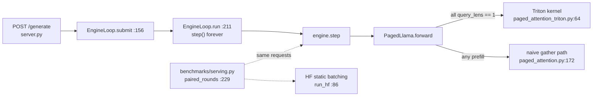
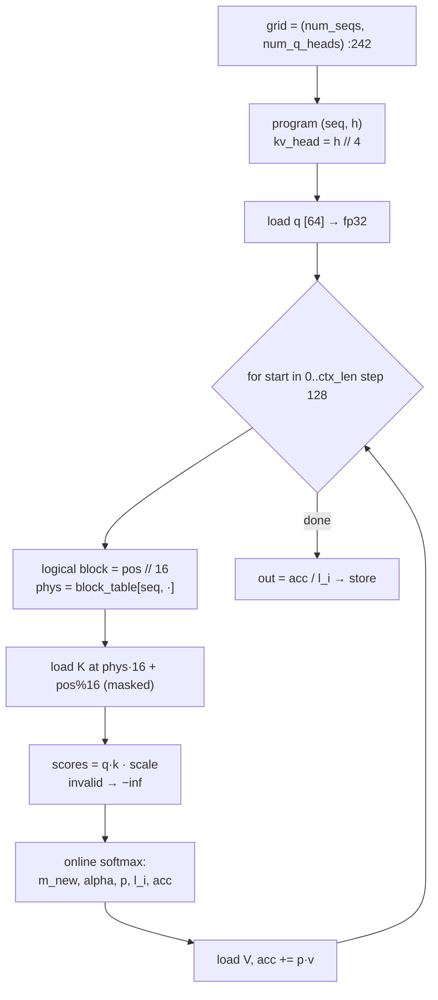
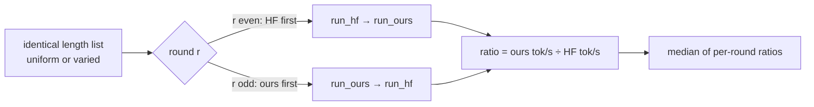
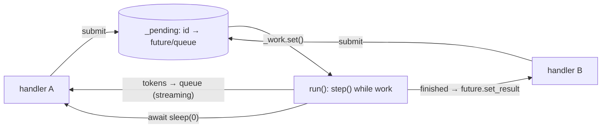

# Day 3 (Tue Nov 10): mini-vLLM III: the Triton kernel, benchmarks, server, and a mock

Part of [[Interview plan (Nov 2026)]]. Repo `vLLMmini` (branch `main`). About 6.5 h. Builds on [[Day 02 - mini-vLLM II]].

**Code, explained:** the figures, the code to read and what each snippet does are in [[#Code, explained]], right after section B.

**By tonight you can:**
- derive online softmax and explain why the fused kernel is 7.49× faster;
- defend every benchmark number: how it was measured, what it hides, and why real vLLM is 6.2× faster;
- answer every mini-vLLM question from Days 1–3 out loud.

## Schedule

| # | Time | Kind | What |
|---|---|---|---|
| 0 | 15 min | recall | Days 1–2: the slot formula, the scheduler loop, the radix cache, the 7.41× table |
| 1 | 50 min | theory | GPU basics for Triton, online softmax, FlashDecoding (A1) |
| 2 | 60 min | code | `paged_attention_triton.py` (B1) |
| 3 | 20 min | rebuild | Online softmax in NumPy (C) |
| 4 | 25 min | skim | `paged_attention.py`, `engine.py`, `model/runner.py` (B2) |
| — | lunch | | |
| 5 | 25 min | theory | Benchmarking a server honestly (A2) |
| 6 | 50 min | code | `benchmarks/serving.py` (B3) |
| 7 | 30 min | skim | `server.py`, `metrics.py`, `workloads.py`, plus README *Phase 6.5* (B4) |
| 8 | 20 min | read | README *Real vLLM: it is 6.2× faster than this* (338) and *Known limitations* (985) |
| 9 | 50 min | practice | **Self-quiz:** answer every question in sections E of Days 1–3 out loud, without notes. Mark each strong, OK or weak |
| 10 | 30 min | fix | Re-read the code and theory behind your weak answers; add them to *Weak topics* in the plan |

## A. Theory

### A1. GPU basics for Triton, and online softmax (50 min)

**Read or watch:**
- the Triton docs tutorials *"Vector Addition"* and *"Fused Softmax"* (triton-lang.org), about 25 min. Learn `program_id`, `tl.arange`, masked `tl.load`/`tl.store`, and that one program handles one tile;
- the *Flash-Decoding for long-context inference* blog post (Tri Dao et al., Oct 2023), about 10 min;
- optional video: Umar Jamil, *"Flash Attention derived and coded from first principles with Triton"*. Watch only the online-softmax derivation (about 30 min of a long video).

**Online softmax.** Process the scores in chunks, keeping a running max `m`, denominator `ℓ` and output `acc`:

```
for each chunk of scores s_j (with values v_j):
    m_new = max(m, max_j s_j)
    ℓ     = ℓ · e^(m − m_new) + Σ_j e^(s_j − m_new)
    acc   = acc · e^(m − m_new) + Σ_j e^(s_j − m_new) · v_j
    m     = m_new
output = acc / ℓ
```

This equals softmax(s)·V exactly, without storing all the scores; subtracting the max prevents overflow. You will see it
again on the CUDA day, in FlashAttention.

**Why the fused kernel is 7.49× faster:**
- **Naive:** `gather_kv` copies the scattered blocks into a new contiguous tensor (read + write all of KV), then runs attention (read KV again).
- **Fused:** each program walks the block table and reads K and V in place, with online softmax. Decode is memory-bound, so fewer bytes moved means less time.
- **Measurement:** the 7.49× is a *paired median* on attention alone (README *Phase 5*, line 385; *Why the reported speedup is a paired median*, 408).
- **Decode only, on purpose** (421): prefill stays naive. That is one reason real vLLM is faster.

### A2. Benchmarking a server (25 min)

- **TTFT** = queueing + prefill. **TPOT** = time between output tokens. **Throughput** = output tokens per second over the whole run.
- **Closed loop:** N clients, each waits for its reply before sending again. **Open loop:** requests arrive on a schedule (for example Poisson).
- **Paired rounds.** The GPU is shared, so its speed drifts. Alternate baseline and yours in pairs, take the ratio inside each pair, and report the median. Drift then cancels.
- **Your confounds** (README *Phase 6*, line 224):
  - an arrival-time bug once flattered the baseline, so the 4.4× was corrected to **3.82×**;
  - varied lengths score lower than uniform ones (249).

## B. Code

### B1. The fused kernel (60 min, deep)

`paged_attention_triton.py`:
- **64 `_paged_attention_decode_kernel`.** Find: the grid (which program handles which sequence and head), the loop over the block table, the masked loads, the online-softmax update, and how GQA maps 32 query heads onto 8 KV heads.
- 150 `DecodeMetadata`, 164 `build_decode_metadata`.
- 196 `can_use_decode_kernel`, 207 `paged_attention_decode`: when it falls back to the naive path.

README:
- *The tests were checked by breaking the kernel* (437);
- *Divergence from the naive path is 12 requests in 32, and it is fine* (452). bf16 rounding differs, so greedy tokens can flip on near-ties.

### B2. Skim (25 min)

- `paged_attention.py`: 36 `write_kv_to_cache`, 68 `gather_kv`, 172 `paged_attention` (the naive reference).
- `engine.py` 111 `step`; `model/runner.py` 81 `_run_step`.
- README *Phase 2* (642) and *The bug this phase actually found* (685).

### B3. Benchmarks (50 min, deep)

`benchmarks/serving.py`: 86 `run_hf`, 168 `run_ours`, **229 `paired_rounds`**, 263 `run_mode`. How is each arrival
generated? Where is the ratio computed?

### B4. Server (30 min, skim)

- `server.py` (FastAPI, SSE streaming), `metrics.py`, `workloads.py`.
- README *Phase 6.5* (104), especially *The first request paid 17 seconds for everyone else* (137). This is a good story.

## Code, explained

Read this **with the files open**. Each part has a small figure of the pipeline, then the exact code (copied from the repo at the commit named below, so the line numbers match), then what it does and how it hands off to the next piece.

Repo `vLLMmini`, branch `main` (`3679394`). Builds on
[[Day 01 - mini-vLLM I#Code, explained]] (slots, gather) and [[Day 02 - mini-vLLM II#Code, explained]] (the step loop).



---

### 1. Choosing the attention path, once per step

`src/mini_vllm/model/llama.py:271–273`
```python
decode_meta = None
if self.use_fused_decode and can_use_decode_kernel(query_lens, hidden.device):
    decode_meta = build_decode_metadata(block_tables, context_lens, hidden.device)
```

`src/mini_vllm/model/llama.py:292–297`
```python
if decode_meta is not None:
    out = paged_attention_decode(q, cache, index, decode_meta, self.scale)
else:
    out = paged_attention(
        q, cache, index, block_tables, query_lens, context_lens, self.scale
    )
```

`src/mini_vllm/paged_attention_triton.py:196–204`
```python
def can_use_decode_kernel(query_lens: list[int], device: torch.device) -> bool:
    """Whether this step is a pure decode step the kernel can serve.

    Every sequence must contribute exactly one query token. A mixed batch — one
    sequence prefilling alongside others decoding, which continuous batching
    produces routinely — falls back to the reference rather than being split,
    since splitting it would need the causal mask this kernel does not build.
    """
    return device.type == "cuda" and bool(query_lens) and all(q == 1 for q in query_lens)
```

- The fused kernel serves **pure decode steps only** (every request contributes exactly 1 query token). A step that mixes a prefill with decodes uses the naive path. The kernel builds no causal mask, and a lone decode token needs none: it sits at the last position, so every key is in its past.
- The padded block-table tensor (`decode_meta`) is built **once per forward pass**, not once per layer. Doing it in all 16 layers would bring back the Python and PCIe overhead the kernel exists to remove.

---

### 2. The kernel: one program per (sequence, query head)



`src/mini_vllm/paged_attention_triton.py:241–262`
```python
out = torch.empty_like(query)
grid = (num_seqs, num_q_heads)

_paged_attention_decode_kernel[grid](
    query,
    k_cache,
    v_cache,
    out,
    meta.block_tables,
    meta.context_lens,
    scale,
    query.stride(0), query.stride(1), query.stride(2),
    k_cache.stride(0), k_cache.stride(1), k_cache.stride(2), k_cache.stride(3),
    v_cache.stride(0), v_cache.stride(1), v_cache.stride(2), v_cache.stride(3),
    out.stride(0), out.stride(1), out.stride(2),
    meta.block_tables.stride(0), meta.block_tables.stride(1),
    cache.block_size,
    num_q_heads // num_kv_heads,
    HEAD_DIM=head_dim,
    BLOCK_N=128,
    num_warps=4,
)
```

- **The grid** is `(num_seqs, num_q_heads)`: 32 sequences × 32 heads = 1024 programs. Each program owns one output vector of 64 floats.
- `BLOCK_N=128`: each loop iteration handles 128 *tokens* (not 128 KV blocks). The `stride` arguments let the kernel index any tensor layout.

`src/mini_vllm/paged_attention_triton.py:83–99`
```python
seq = tl.program_id(0)
q_head = tl.program_id(1)
kv_head = q_head // num_kv_groups

ctx_len = tl.load(context_lens_ptr + seq)

offs_d = tl.arange(0, HEAD_DIM)
q = tl.load(q_ptr + seq * stride_qt + q_head * stride_qh + offs_d * stride_qd)
q = q.to(tl.float32)

# Online softmax accumulators. Running max, running denominator, and the
# value accumulator, all in float32 regardless of cache dtype — the
# reference softmaxes in float32 too, so a mismatch between them is a
# gather bug rather than a precision difference.
m_i = float("-inf")
l_i = 0.0
acc = tl.zeros([HEAD_DIM], dtype=tl.float32)
```

- `kv_head = q_head // num_kv_groups`: **GQA in one line**. With 32 query heads and 8 KV heads, groups of 4 query heads read the same K,V.
- The accumulators are float32 even though the cache is bf16, the same as the reference. So any mismatch between the two is a gather bug, not rounding.

`src/mini_vllm/paged_attention_triton.py:101–121`
```python
for start_n in range(0, ctx_len, BLOCK_N):
    offs_n = start_n + tl.arange(0, BLOCK_N)
    valid = offs_n < ctx_len

    # The paging indirection, per token: logical position -> physical slot.
    # Masked lanes load block 0 and are discarded, so the padded tail of a
    # short sequence's block table is never dereferenced.
    logical_block = offs_n // block_size
    offset_in_block = offs_n % block_size
    phys_block = tl.load(
        block_table_ptr + seq * stride_bts + logical_block * stride_btb,
        mask=valid,
        other=0,
    )

    kv_base = phys_block[:, None] * stride_kb + offset_in_block[:, None] * stride_kp
    k = tl.load(
        k_ptr + kv_base + kv_head * stride_kh + offs_d[None, :] * stride_kd,
        mask=valid[:, None],
        other=0.0,
    ).to(tl.float32)
```

- `offs_n` = the 128 token positions this iteration covers. `valid` masks positions past the context end.
- **The paging indirection, per token:** `logical_block = pos // B`, load `phys_block` from the table, address = `phys_block × stride + offset × stride`. This is Day 1's `slot_index`, vectorised. Masked lanes load block 0 and are thrown away.

`src/mini_vllm/paged_attention_triton.py:123–146`
```python
    scores = tl.sum(q[None, :] * k, axis=1) * scale
    # Out-of-context slots hold the previous tenant's KV. -inf, not 0.
    scores = tl.where(valid, scores, float("-inf"))

    m_new = tl.maximum(m_i, tl.max(scores, axis=0))
    alpha = tl.exp(m_i - m_new)
    p = tl.exp(scores - m_new)

    v_base = phys_block[:, None] * stride_vb + offset_in_block[:, None] * stride_vp
    v = tl.load(
        v_ptr + v_base + kv_head * stride_vh + offs_d[None, :] * stride_vd,
        mask=valid[:, None],
        other=0.0,
    ).to(tl.float32)

    l_i = l_i * alpha + tl.sum(p, axis=0)
    acc = acc * alpha + tl.sum(p[:, None] * v, axis=0)
    m_i = m_new

out = acc / l_i
tl.store(
    out_ptr + seq * stride_ot + q_head * stride_oh + offs_d * stride_od,
    out.to(out_ptr.dtype.element_ty),
)
```

- `scores = Σ q·k`. Invalid lanes become **−inf, not 0**: slots past `ctx_len` hold an *old* request's K. A large stale value would win the max and wreck the softmax.
- **Online softmax** (Day 6 derives it in full): `m_new` = the new running max; `alpha = e^{m_old − m_new}` rescales everything accumulated so far; `p = e^{s − m_new}`. `l_i` is the running denominator, `acc` the running weighted sum of V. At the end `acc / l_i` is the exact softmax-weighted output, and **no context-sized tensor is ever written**. The naive path's `gather_kv` materialises one per sequence per layer.

**Check yourself:** context length 300, B = 16, BLOCK_N = 128. How many loop iterations? How many lanes are masked in the last one? Which logical blocks do the *valid* lanes of the last iteration (start = 256) read? (*3 iterations; 84 masked; logical blocks 16–18.*)

---

### 3. The benchmark: like for like, paired



`benchmarks/serving.py:99–125`
```python
for offset in range(0, len(prompts), batch_size):
    batch = prompts[offset : offset + batch_size]
    wants = lengths[offset : offset + batch_size]
    # The batch runs until its slowest member is done. That is the waste.
    budget = max(wants)

    encoded = tokenizer(batch, return_tensors="pt", padding=True).to(device)
    real_lens = encoded["attention_mask"].sum(dim=1).tolist()

    timer.reset()
    with torch.inference_mode():
        hf_model.generate(
            **encoded,
            max_new_tokens=budget,
            # Forced, so throughput is not confounded by an early EOS. The
            # engine arm has no eos_token_id set, so it too runs to exactly
            # the requested length — the arms stop for the same reason.
            min_new_tokens=budget,
            do_sample=False,
            logits_processor=[timer],
            pad_token_id=tokenizer.pad_token_id,
        )
    torch.cuda.synchronize()
    finish = time.perf_counter()

    first_token = timer.step_times[0] if timer.step_times else None
    computed += len(batch) * budget
```

`benchmarks/serving.py:142–142`
```python
arrival=start,
```

- **Static batching cost:** the batch runs to `max(wants)`, its slowest member. `min_new_tokens=budget` stops an early EOS from shortening the baseline's work.
- **`arrival=start` for every request**, not when its batch begins. A request in batch 4 waited behind batches 1–3, and that wait is the HF baseline's real TTFT. Timing it from batch start made the baseline look 8× better (module docstring, confound 3).

`benchmarks/serving.py:177–186`
```python
for i, (prompt, want) in enumerate(zip(prompt_ids, lengths)):
    engine.add_request(f"r{i}", prompt, want)

torch.cuda.synchronize()
start = time.perf_counter()
results = []
while engine.scheduler.has_unfinished_requests():
    results.extend(engine.step())
torch.cuda.synchronize()
wall = time.perf_counter() - start
```

`benchmarks/serving.py:237–248`
```python
for r in range(args.repeats):
    hf_first = r % 2 == 0
    if hf_first:
        hf = run_hf(hf_model, tokenizer, prompts, lengths, args.batch_size, args.device)
        ours, _ = run_ours(model, prompt_ids, lengths, args.num_blocks, args.device)
    else:
        ours, _ = run_ours(model, prompt_ids, lengths, args.num_blocks, args.device)
        hf = run_hf(hf_model, tokenizer, prompts, lengths, args.batch_size, args.device)

    h, o = hf.summary(), ours.summary()
    ratio = o["output_throughput_tok_s"] / h["output_throughput_tok_s"]
    ratios.append(ratio)
```

- **Paired rounds:** in each round, both arms run back to back and the *ratio* is taken. The order alternates between rounds, so neither arm always gets the warmer GPU or the quieter neighbour. On a shared server the absolute tok/s drifts (the README has the same baseline at 647 and 1001 tok/s on different days), but a back-to-back ratio mostly cancels that drift.

`benchmarks/serving.py:278–284`
```python
median_ratio = statistics.median(ratios)
# The representative round is the one whose ratio is the median, so the
# detailed numbers reported belong to a single real run rather than being
# averaged across runs that saw different host load.
idx = ratios.index(median_ratio) if len(ratios) % 2 else min(
    range(len(ratios)), key=lambda i: abs(ratios[i] - median_ratio)
)
```

- Report the **median ratio**, and print the details of the round whose ratio *is* the median: a real run, not an average of runs taken under different loads.

---

### 4. The server: one loop, many waiters



`src/mini_vllm/server.py:168–182`
```python
if not self.alive:
    raise RuntimeError(LOOP_DEAD)
if request_id in self._pending:
    raise ValueError(f"request id {request_id!r} is already in flight")
future = asyncio.get_running_loop().create_future()
# Add first: if admission rejects the request, nothing has been
# registered and there is no half-submitted state to unwind.
request = self.engine.add_request(request_id, prompt_token_ids, max_new_tokens)
self._pending[request_id] = Submission(
    future=future,
    request=request,
    queue=asyncio.Queue() if stream else None,
)
self._work.set()
return self._pending[request_id]
```

- `add_request` runs **first**. If the scheduler rejects the request as too large, nothing has been registered, so there is no half-submitted state to undo. (The same "check before you mutate" idea as Day 2's admission bug.)

`src/mini_vllm/server.py:211–237`
```python
async def run(self) -> None:
    try:
        while True:
            if not self.engine.scheduler.has_unfinished_requests():
                # No await between the check and the clear, so a submit
                # cannot slip in and have its wakeup discarded here.
                self._work.clear()
                await self._work.wait()
                continue

            finished = self.engine.step()
            # Before resolving: a request that finished this iteration also
            # produced a token in it, and a streaming caller is owed that
            # token before it is told the request is done.
            self._drain_streams()
            for request in finished:
                submission = self._pending.pop(request.request_id, None)
                if submission is None:
                    continue
                if submission.queue is not None:
                    submission.queue.put_nowait(None)
                if not submission.future.done():
                    submission.future.set_result(request)
            self.num_iterations += 1
            # One yield per iteration: this is where handlers get to run,
            # so it is what lets a request join a batch already in flight.
            await asyncio.sleep(0)
```

- One asyncio task owns the engine. Each iteration: `step()`, push new tokens to streaming callers, resolve the finished ones.
- `await asyncio.sleep(0)` once per iteration is **what makes continuous batching reach HTTP**: it gives request handlers a chance to run, so a new request can join a batch already in flight.
- With no work, it sleeps on an Event. There's no `await` between the check and `clear()`, so a submit can't slip in and lose its wake-up.

`src/mini_vllm/server.py:452–458`
```python
engine.add_request("__warmup__", list(range(1, num_tokens + 1)), max_new_tokens)
while engine.scheduler.has_unfinished_requests():
    engine.step()
engine.scheduler.finished.clear()
if engine.prefix_cache is not None:
    engine.prefix_cache.clear()
engine.scheduler.stats = type(engine.scheduler.stats)()
```

- **Warm-up:** the first real request once took 17.0 s (CUDA context, cuBLAS handles, compiling the Triton kernel), against 13 ms per token once warm. A throwaway request at start-up pays that cost, and its cache entry and stats are cleared afterwards. This is the README's "the first request paid 17 seconds for everyone else" story.

## C. Rebuild it yourself (20 min)

Make random `s` (length 1000) and `V` (1000×64). Compute in chunks of 16 with the update rule, and assert it matches
`softmax(s) @ V` within 1e-6. Then remove the max subtraction and watch it overflow with scores near 1000.

## E. Questions (for today's self-quiz)

1. Explain online softmax. Why is it exact?
2. Why is the fused kernel 7.49× faster? Is decode compute- or memory-bound?
3. Why Triton and not CUDA C++? (*Faster to iterate, automatic tiling within a program, good enough for a decode kernel. CUDA gives control over shared memory and warps.*)
4. Why does the fused path disagree with the naive one on 12 of 32 requests, and why is that OK?
5. How did you make benchmark numbers trustworthy on a shared GPU?
6. Real vLLM is 6.2× faster. What would you build next, in order? (*Chunked and fused prefill, CUDA graphs, then a C++ or async scheduler.*)
7. What breaks above 16k tokens, and why? (*Prefill materialises the full score matrix.*)
8. Hostile: "A 90% hit rate and 0% time saved. Isn't the cache useless?"

## My notes and fumbles

- 
