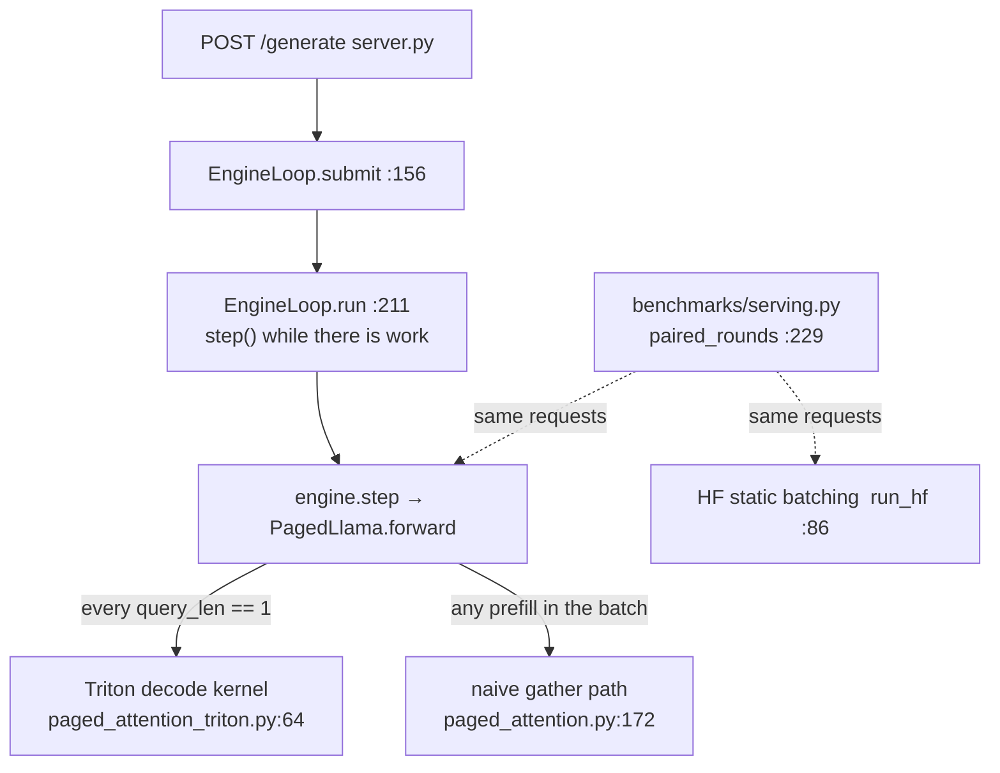
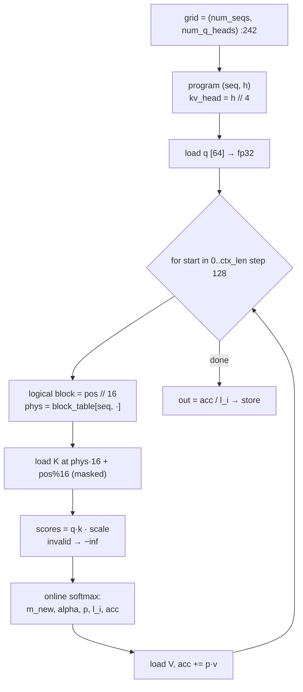
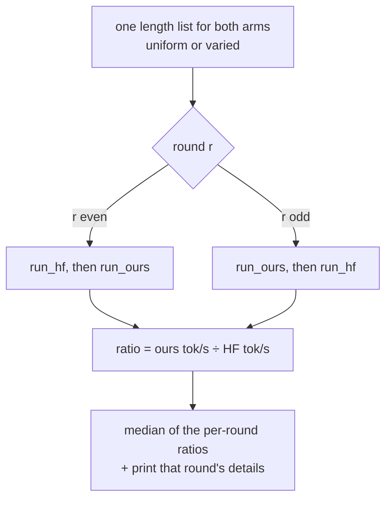
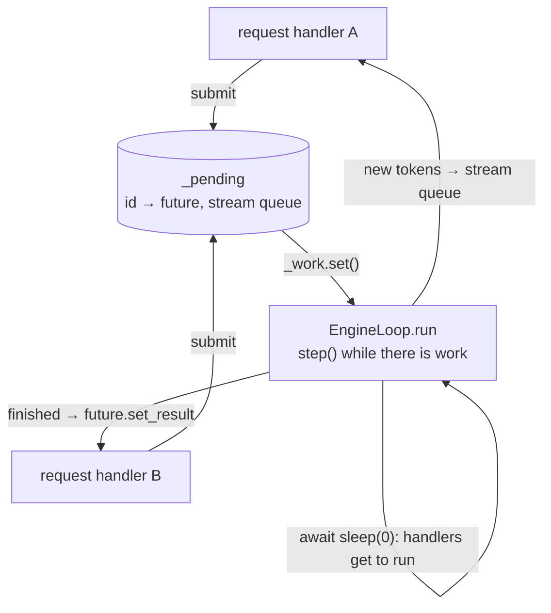

# Day 3 (Tue Nov 10): mini-vLLM III: the Triton kernel, benchmarks, server, and a mock

Part of [[Interview plan (Nov 2026)]]. Repo `vLLMmini` (branch `main`). About 6.5 h. Builds on [[Day 02 - mini-vLLM II]].

**Code, explained:** the figures, the code to read and what each snippet does are in [[#Code, explained]], right after section B.

**By tonight you can:**
- derive online softmax and explain why the fused kernel is 7.49× faster;
- defend every benchmark number: how it was measured, what it hides, and why real vLLM is 6.2× faster;
- answer every mini-vLLM question from Days 1–3 out loud.

## Schedule

| # | Time | Kind | What |
|---|---|---|---|
| 0 | 15 min | recall | Days 1–2: the slot formula, the scheduler loop, the radix cache, the 7.41× table |
| 1 | 50 min | theory | GPU basics for Triton, online softmax, FlashDecoding (A1) |
| 2 | 60 min | code | `paged_attention_triton.py` (B1) |
| 3 | 20 min | rebuild | Online softmax in NumPy (C) |
| 4 | 25 min | skim | `paged_attention.py`, `engine.py`, `model/runner.py` (B2) |
| — | lunch | | |
| 5 | 25 min | theory | Benchmarking a server honestly (A2) |
| 6 | 50 min | code | `benchmarks/serving.py` (B3) |
| 7 | 30 min | skim | `server.py`, `metrics.py`, `workloads.py`, plus README *Phase 6.5* (B4) |
| 8 | 20 min | read | README *Real vLLM: it is 6.2× faster than this* (338) and *Known limitations* (985) |
| 9 | 50 min | practice | **Self-quiz:** answer every question in sections E of Days 1–3 out loud, without notes. Mark each strong, OK or weak |
| 10 | 30 min | fix | Re-read the code and theory behind your weak answers; add them to *Weak topics* in the plan |

## A. Theory

### A1. GPU basics for Triton, and online softmax (50 min)

**Read or watch:**
- the Triton docs tutorials *"Vector Addition"* and *"Fused Softmax"* (triton-lang.org), about 25 min. Learn `program_id`, `tl.arange`, masked `tl.load`/`tl.store`, and that one program handles one tile;
- the *Flash-Decoding for long-context inference* blog post (Tri Dao et al., Oct 2023), about 10 min;
- optional video: Umar Jamil, *"Flash Attention derived and coded from first principles with Triton"*. Watch only the online-softmax derivation (about 30 min of a long video).

> [!abstract] What it says: the Triton tutorials (Vector Addition, Fused Softmax)
> **Vector addition.** A kernel is one Python function run by many **programs** at once.
> Each program asks `tl.program_id(0)` which block it owns and builds offsets `pid · BLOCK + tl.arange(0, BLOCK)`.
> It loads with a mask (`offsets < n`) so the last, partial block reads nothing out of range. The grid has `ceil(n / BLOCK)` programs.
>
> **Fused softmax.** One program handles one whole row, kept in fast on-chip memory. It loads the row once, subtracts the max, exponentiates, sums, divides and stores once.
> Masked lanes load −∞ so they add nothing. `BLOCK_SIZE` is the next power of two above the row length.
>
> **Claim to know.** The tutorial counts memory traffic. Plain PyTorch softmax reads and writes the matrix several times (one pass per operation).
> The fused kernel reads it once and writes it once, so it expects a few times the speed on large rows. Its benchmark plot shows that.
>
> **In this project.** The decode kernel uses these exact tools: `program_id`, `tl.arange`, masked `tl.load`, and −∞ for padding lanes.

> [!abstract] What it says: the Flash-Decoding blog (Oct 2023)
> **Problem.** During decode each request has one query token. FlashAttention parallelises over batch × heads only.
> With a small batch and a long context, few programs run and most of the GPU sits idle.
>
> **Key idea.** Also split the keys and values into chunks. Each chunk's partial attention runs in parallel and keeps its own max and sum (log-sum-exp).
> A small final step rescales and combines the chunks: the same maths as online softmax, done across programs instead of in one loop.
>
> **Main figure.** An animation: K and V cut into chunks, partial results computed side by side, then reduced into one output.
>
> **Claim to know.** The post reports up to 8× faster generation for very long sequences (CodeLlama-34B, contexts up to 64k).
>
> **In this project.** Your kernel is one program per (sequence, head) looping over all tiles. It has no split along the context, so it is the "before" picture.

> [!abstract] What it says: Umar Jamil's online-softmax derivation (video)
> **Key idea.** It derives online softmax step by step, starting from the plain formula.
> 1. Naive softmax can overflow, so subtract the max: three passes (find the max, sum the exponentials, divide).
> 2. Fuse the first two passes: keep a running max $m$ and a running sum $\ell$. When the max grows, multiply the old sum by $e^{m_{old} - m_{new}}$.
> 3. Apply the same correction to a running output, and the final pass disappears too. That is the FlashAttention loop.
>
> **Main picture.** A row of scores processed block by block, with $m$ and $\ell$ updated after each block.
>
> **In this project.** This is the `m`, `l`, `acc` update inside `paged_decode_attention`; it gives exactly the same result as full softmax.

**Concepts:**
- **Program and grid.** A Triton kernel runs as many programs; `tl.program_id` says which one. Here the grid is `(num_seqs, 32)`: one program per sequence and query head.
- **Masked loads.** A block always has a power-of-two size. The mask stops it reading past the context, and masked scores become −∞.
- **Paged reads in place.** Each program reads the block table and loads K and V straight from the scattered cache blocks. Nothing is copied first.
- **Online softmax.** A running max, sum and output make one pass over the context exact, whatever its length.
- **Fused vs naive.** The naive path runs many small operations per sequence and per layer; the fused path is one launch per layer. Deep dive §6 shows that most of the 7.49× comes from fewer launches.

> [!tip] Explained from scratch: [[#5. Deep dive: the GPU and Triton execution model from scratch|§5 the GPU and Triton execution model]], [[#6. Deep dive: online softmax and the fused decode kernel from scratch|§6 online softmax and the fused decode kernel]]


**Online softmax.** Process the scores in chunks, keeping a running max `m`, denominator `ℓ` and output `acc`:

```
for each chunk of scores s_j (with values v_j):
    m_new = max(m, max_j s_j)
    ℓ     = ℓ · e^(m − m_new) + Σ_j e^(s_j − m_new)
    acc   = acc · e^(m − m_new) + Σ_j e^(s_j − m_new) · v_j
    m     = m_new
output = acc / ℓ
```

This equals softmax(s)·V exactly, without storing all the scores; subtracting the max prevents overflow. You will see it again on the CUDA day, in FlashAttention.

**Why the fused kernel is 7.49× faster:**
- **Naive:** `gather_kv` copies the scattered blocks into a new contiguous tensor (read + write all of KV), then runs attention (read KV again).
- **Fused:** each program walks the block table and reads K and V in place, with online softmax. Decode is memory-bound, so fewer bytes moved means less time.
- **Measurement:** the 7.49× is a *paired median* on attention alone (README *Phase 5*, line 385; *Why the reported speedup is a paired median*, 408).
- **Decode only, on purpose** (421): prefill stays naive. That is one reason real vLLM is faster.

### A2. Benchmarking a server (25 min)

- **TTFT** = queueing + prefill. **TPOT** = time between output tokens. **Throughput** = output tokens per second over the whole run.
- **Closed loop:** N clients, each waits for its reply before sending again. **Open loop:** requests arrive on a schedule (for example Poisson).
- **Paired rounds.** The GPU is shared, so its speed drifts. Alternate baseline and yours in pairs, take the ratio inside each pair, and report the median. Drift then cancels.
- **Your confounds** (README *Phase 6*, line 224):
  - an arrival-time bug once flattered the baseline, so the 4.4× was corrected to **3.82×**;
  - varied lengths score lower than uniform ones (249).

> [!tip] Explained from scratch: [[#7. Deep dive: benchmarking a server honestly from scratch|§7 benchmarking a server honestly (paired rounds, the arrival bug)]], [[#8. Deep dive: the async server from scratch|§8 the async server]]

## B. Code

### B1. The fused kernel (60 min, deep)

`paged_attention_triton.py`:
- **64 `_paged_attention_decode_kernel`.** Find: the grid (which program handles which sequence and head), the loop over the block table, the masked loads, the online-softmax update, and how GQA maps 32 query heads onto 8 KV heads.
- 150 `DecodeMetadata`, 164 `build_decode_metadata`.
- 196 `can_use_decode_kernel`, 207 `paged_attention_decode`: when it falls back to the naive path.

README:
- *The tests were checked by breaking the kernel* (437);
- *Divergence from the naive path is 12 requests in 32, and it is fine* (452). bf16 rounding differs, so greedy tokens can flip on near-ties.

### B2. Skim (25 min)

- `paged_attention.py`: 36 `write_kv_to_cache`, 68 `gather_kv`, 172 `paged_attention` (the naive reference).
- `engine.py` 111 `step`; `model/runner.py` 81 `_run_step`.
- README *Phase 2* (642) and *The bug this phase actually found* (685).

### B3. Benchmarks (50 min, deep)

`benchmarks/serving.py`: 86 `run_hf`, 168 `run_ours`, **229 `paired_rounds`**, 263 `run_mode`. How is each arrival generated? Where is the ratio computed?

### B4. Server (30 min, skim)

- `server.py` (FastAPI, SSE streaming), `metrics.py`, `workloads.py`.
- README *Phase 6.5* (104), especially *The first request paid 17 seconds for everyone else* (137). This is a good story.

## Code, explained

Read this **with the files open**. It starts with a picture of the whole day and **the flow, step by step** (one concrete input followed through every function). Then each part has its own figure, the exact code (copied from the repo at the commit named below, so the line numbers match) and what that code does.

Repo `vLLMmini`, branch `main` (`3679394`). Builds on
[[Day 01 - mini-vLLM I#Code, explained]] (slots, gather) and [[Day 02 - mini-vLLM II#Code, explained]] (the step loop).



### The flow, step by step

One pure-decode step on the live server, with **two** running requests: request 0 has **300** tokens of context, request 1 has **40**. Block size 16.

1. **A request arrives.** The HTTP handler calls `EngineLoop.submit` (`server.py:156`). `engine.add_request` runs first, so a request that can never fit is rejected before anything is registered (`:175`). Then `_work.set()` wakes the loop.
2. **The loop steps.** `run()` (`:211`) calls `engine.step()`. The scheduler returns both requests with one token each, so `query_lens = [1, 1]`.
3. **Pick the kernel, once.** In `forward`, `can_use_decode_kernel([1, 1])` (`paged_attention_triton.py:196`) is true, so `build_decode_metadata` (`:164`) pads the two block tables into one int32 tensor `[2, 19]`. That's ceil(300/16) = 19 blocks; request 1's 3 blocks are padded with zeros. This is built **once**, then reused by all 16 layers.
4. **Each layer** writes the two new tokens' K, V, then calls `paged_attention_decode` (`:207`), which launches a grid of **(2 sequences × 32 heads) = 64 programs**.
5. **Inside program (seq 0, head 5):** `kv_head = 5 // 4 = 1`. It loops over the 300 positions in tiles of 128 (starts 0, 128, 256). Each tile looks up physical blocks through the table, loads K, masks positions ≥ 300 to −∞, updates the running max `m`, sum `l` and output `acc`, then loads V. At the end it stores `acc / l`, a 64-float vector.
6. **Back in the loop:** argmax → `update`; `_drain_streams` (`server.py:194`) pushes the new tokens to streaming clients; finished requests resolve their futures; `await asyncio.sleep(0)` lets the HTTP handlers run, so a new request can join the next step.

---

### 1. Choosing the attention path, once per step

**The same step with the real shapes** (animated; blocks are sized by their real dimensions, no values):

![[d03s-path.svg]] [[d03s-path.html|▶ Step through it]]

`src/mini_vllm/model/llama.py:271–273`
```python
decode_meta = None
if self.use_fused_decode and can_use_decode_kernel(query_lens, hidden.device):
    decode_meta = build_decode_metadata(block_tables, context_lens, hidden.device)
```
> [!info] New functions in this code
> - `.device`: where the tensor lives: `cpu` or `cuda:0` (a GPU). [[Function glossary#x.device|→ examples]]

`src/mini_vllm/model/llama.py:292–297`
```python
if decode_meta is not None:
    out = paged_attention_decode(q, cache, index, decode_meta, self.scale)
else:
    out = paged_attention(
        q, cache, index, block_tables, query_lens, context_lens, self.scale
    )
```

`src/mini_vllm/paged_attention_triton.py:196–204`
```python
def can_use_decode_kernel(query_lens: list[int], device: torch.device) -> bool:
    """Whether this step is a pure decode step the kernel can serve.

    Every sequence must contribute exactly one query token. A mixed batch — one
    sequence prefilling alongside others decoding, which continuous batching
    produces routinely — falls back to the reference rather than being split,
    since splitting it would need the causal mask this kernel does not build.
    """
    return device.type == "cuda" and bool(query_lens) and all(q == 1 for q in query_lens)
```
> [!info] New functions in this code
> - `bool(x)`: converts to True / False. On a one-element tensor, `bool(t)` reads its value. [[Function glossary#bool|→ examples]]
> - `all(xs)`: True if **every** item is true. `all(q == 1 for q in [1, 1])` = True. [[Function glossary#all|→ examples]]

- The fused kernel serves **pure decode steps only** (every request contributes exactly 1 query token). A step that mixes a prefill with decodes uses the naive path. The kernel builds no causal mask, and a lone decode token needs none: it sits at the last position, so every key is in its past.
- The padded block-table tensor (`decode_meta`) is built **once per forward pass**, not once per layer. Doing it in all 16 layers would bring back the Python and PCIe overhead the kernel exists to remove.

---

### 2. The kernel: one program per (sequence, query head)

**One program and one tile, at real sizes** (animated; blocks are sized by their real dimensions, no values):

![[d03s-grid.svg]] [[d03s-grid.html|▶ Step through it]]

![[d03s-gather.svg]] [[d03s-gather.html|▶ Step through it]]

> [!tip] Concept from scratch: [[#6. Deep dive: online softmax and the fused decode kernel from scratch|online softmax on 4 numbers, the kernel's loop on a toy block table, and where the 7.49× comes from]]

> [!tip] Concept from scratch: [[#5. Deep dive: the GPU and Triton execution model from scratch|GPUs, launches, Triton programs, masks and strides, from zero]]



`src/mini_vllm/paged_attention_triton.py:241–262`
```python
out = torch.empty_like(query)
grid = (num_seqs, num_q_heads)

_paged_attention_decode_kernel[grid](
    query,
    k_cache,
    v_cache,
    out,
    meta.block_tables,
    meta.context_lens,
    scale,
    query.stride(0), query.stride(1), query.stride(2),
    k_cache.stride(0), k_cache.stride(1), k_cache.stride(2), k_cache.stride(3),
    v_cache.stride(0), v_cache.stride(1), v_cache.stride(2), v_cache.stride(3),
    out.stride(0), out.stride(1), out.stride(2),
    meta.block_tables.stride(0), meta.block_tables.stride(1),
    cache.block_size,
    num_q_heads // num_kv_heads,
    HEAD_DIM=head_dim,
    BLOCK_N=128,
    num_warps=4,
)
```
> [!info] New functions in this code
> - `torch.empty_like(t)`: a tensor shaped like `t` **without** initialising its values (faster; every element must be written before use). [[Function glossary#torch.empty_like|→ examples]]
> - `.stride(d)`: how many elements you skip in memory to move one step along axis `d`. For a contiguous `[4, 16, 8, 64]` tensor, `stride(0)` = 16 × 8 × 64 = 8192. Kernels use strides to compute addresses. [[Function glossary#x.stride|→ examples and figure]]

- **The grid** is `(num_seqs, num_q_heads)`: 32 sequences × 32 heads = 1024 programs. Each program owns one output vector of 64 floats.
- `BLOCK_N=128`: each loop iteration handles 128 *tokens* (not 128 KV blocks). The `stride` arguments let the kernel index any tensor layout.

`src/mini_vllm/paged_attention_triton.py:83–99`
```python
seq = tl.program_id(0)
q_head = tl.program_id(1)
kv_head = q_head // num_kv_groups

ctx_len = tl.load(context_lens_ptr + seq)

offs_d = tl.arange(0, HEAD_DIM)
q = tl.load(q_ptr + seq * stride_qt + q_head * stride_qh + offs_d * stride_qd)
q = q.to(tl.float32)

# Online softmax accumulators. Running max, running denominator, and the
# value accumulator, all in float32 regardless of cache dtype — the
# reference softmaxes in float32 too, so a mismatch between them is a
# gather bug rather than a precision difference.
m_i = float("-inf")
l_i = 0.0
acc = tl.zeros([HEAD_DIM], dtype=tl.float32)
```
> [!info] New functions in this code
> - `tl.program_id(axis)`: which program (a block of GPU threads) this is, along a grid axis. With `grid = (num_seqs, num_heads)`, `program_id(0)` is the sequence and `program_id(1)` the head. [[Function glossary#tl.program_id|→ examples and figure]]
> - `tl.load(ptr + offsets, mask=m, other=0)`: reads many values from GPU memory at once (one per offset). Where `mask` is False it doesn't read and returns `other` instead, so out-of-range addresses are never touched. [[Function glossary#tl.load|→ examples and figure]]
> - `tl.arange(0, N)`: a vector `[0, 1, …, N−1]` inside a Triton program (N must be a power of two). Used to build many addresses at once. [[Function glossary#tl.arange|→ examples]]
> - `.to(dtype or device)`: converts a tensor's number type or moves it. `x.to(torch.float32)` makes a float32 copy (from bfloat16); `x.to('cuda')` moves it to the GPU. In Triton code, `.to(tl.float32)` converts a loaded value. [[Function glossary#x.to|→ examples and figure]]
> - `float(x)`: converts to a floating-point number. `float('-inf')` is minus infinity, a value smaller than every number (used to mask scores). [[Function glossary#float|→ examples]]
> - `tl.zeros([N], dtype)`: a vector of N zeros held in registers. [[Function glossary#tl.zeros|→ examples]]

- `kv_head = q_head // num_kv_groups`: **GQA in one line**. With 32 query heads and 8 KV heads, groups of 4 query heads read the same K,V.
- The accumulators are float32 even though the cache is bf16, the same as the reference. So any mismatch between the two is a gather bug, not rounding.

`src/mini_vllm/paged_attention_triton.py:101–121`
```python
for start_n in range(0, ctx_len, BLOCK_N):
    offs_n = start_n + tl.arange(0, BLOCK_N)
    valid = offs_n < ctx_len

    # The paging indirection, per token: logical position -> physical slot.
    # Masked lanes load block 0 and are discarded, so the padded tail of a
    # short sequence's block table is never dereferenced.
    logical_block = offs_n // block_size
    offset_in_block = offs_n % block_size
    phys_block = tl.load(
        block_table_ptr + seq * stride_bts + logical_block * stride_btb,
        mask=valid,
        other=0,
    )

    kv_base = phys_block[:, None] * stride_kb + offset_in_block[:, None] * stride_kp
    k = tl.load(
        k_ptr + kv_base + kv_head * stride_kh + offs_d[None, :] * stride_kd,
        mask=valid[:, None],
        other=0.0,
    ).to(tl.float32)
```
> [!info] New functions in this code
> - `range(start, stop, step)`: the integers from `start` up to (not including) `stop`. `range(0, 10, 4)` gives 0, 4, 8. `range(3)` gives 0, 1, 2. [[Function glossary#range|→ examples]]

- `offs_n` = the 128 token positions this iteration covers. `valid` masks positions past the context end.
- **The paging indirection, per token:** `logical_block = pos // B`, load `phys_block` from the table, address = `phys_block × stride + offset × stride`. This is Day 1's `slot_index`, vectorised. Masked lanes load block 0 and are thrown away.

`src/mini_vllm/paged_attention_triton.py:123–146`
```python
    scores = tl.sum(q[None, :] * k, axis=1) * scale
    # Out-of-context slots hold the previous tenant's KV. -inf, not 0.
    scores = tl.where(valid, scores, float("-inf"))

    m_new = tl.maximum(m_i, tl.max(scores, axis=0))
    alpha = tl.exp(m_i - m_new)
    p = tl.exp(scores - m_new)

    v_base = phys_block[:, None] * stride_vb + offset_in_block[:, None] * stride_vp
    v = tl.load(
        v_ptr + v_base + kv_head * stride_vh + offs_d[None, :] * stride_vd,
        mask=valid[:, None],
        other=0.0,
    ).to(tl.float32)

    l_i = l_i * alpha + tl.sum(p, axis=0)
    acc = acc * alpha + tl.sum(p[:, None] * v, axis=0)
    m_i = m_new

out = acc / l_i
tl.store(
    out_ptr + seq * stride_ot + q_head * stride_oh + offs_d * stride_od,
    out.to(out_ptr.dtype.element_ty),
)
```
> [!info] New functions in this code
> - `tl.sum(x, axis)`: adds a vector (or a 2-D block along `axis`) inside the program. [[Function glossary#tl.sum|→ examples and figure]]
> - `.sum(dim)`: adds the elements (along `dim` if given). [[Function glossary#x.sum|→ examples and figure]]
> - `tl.where(cond, a, b)`: picks `a` where `cond` is True and `b` elsewhere. `tl.where(valid, scores, -inf)` masks the slots past the context. [[Function glossary#tl.where|→ examples and figure]]
> - `query.where(condition)`: SQLAlchemy: adds a `WHERE` clause. `select(Vulnerability).where(Vulnerability.cwe_id == 89)` means `SELECT * FROM vulnerability WHERE cwe_id = 89`. `==` on a column builds SQL; it doesn't compare in Python. [[Function glossary#x.where|→ examples]]
> - `tl.maximum(a, b)`: element-wise larger of two values (like `max`, but for tensors). [[Function glossary#tl.maximum|→ examples]]
> - `tl.max(x, axis)`: the largest element (along `axis`). [[Function glossary#tl.max|→ examples]]
> - `tl.exp(x)`: e^x, element by element. [[Function glossary#tl.exp|→ examples]]
> - `tl.store(ptr + offsets, values)`: writes values to GPU memory. [[Function glossary#tl.store|→ examples]]
> - `.dtype`: the number type stored: `torch.bfloat16`, `torch.float32`, `torch.long` (64-bit integers), … [[Function glossary#x.dtype|→ examples]]

- `scores = Σ q·k`. Invalid lanes become **−inf, not 0**: slots past `ctx_len` hold an *old* request's K. A large stale value would win the max and wreck the softmax.
- **Online softmax** (Day 6 derives it in full): `m_new` = the new running max; `alpha = e^{m_old − m_new}` rescales everything accumulated so far; `p = e^{s − m_new}`. `l_i` is the running denominator, `acc` the running weighted sum of V. At the end `acc / l_i` is the exact softmax-weighted output, and **no context-sized tensor is ever written**. The naive path's `gather_kv` materialises one per sequence per layer.

**Check yourself:** context length 300, B = 16, BLOCK_N = 128. How many loop iterations? How many lanes are masked in the last one? Which logical blocks do the *valid* lanes of the last iteration (start = 256) read? (*3 iterations; 84 masked; logical blocks 16–18.*)

---

### 3. The benchmark: like for like, paired

> [!tip] Concept from scratch: [[#7. Deep dive: benchmarking a server honestly from scratch|why each benchmark rule exists, with numbers]]



`benchmarks/serving.py:99–125`
```python
for offset in range(0, len(prompts), batch_size):
    batch = prompts[offset : offset + batch_size]
    wants = lengths[offset : offset + batch_size]
    # The batch runs until its slowest member is done. That is the waste.
    budget = max(wants)

    encoded = tokenizer(batch, return_tensors="pt", padding=True).to(device)
    real_lens = encoded["attention_mask"].sum(dim=1).tolist()

    timer.reset()
    with torch.inference_mode():
        hf_model.generate(
            **encoded,
            max_new_tokens=budget,
            # Forced, so throughput is not confounded by an early EOS. The
            # engine arm has no eos_token_id set, so it too runs to exactly
            # the requested length — the arms stop for the same reason.
            min_new_tokens=budget,
            do_sample=False,
            logits_processor=[timer],
            pad_token_id=tokenizer.pad_token_id,
        )
    torch.cuda.synchronize()
    finish = time.perf_counter()

    first_token = timer.step_times[0] if timer.step_times else None
    computed += len(batch) * budget
```
> [!info] New functions in this code
> - `len(xs)`: how many items. `len([7, 8, 9])` = 3. [[Function glossary#len|→ examples]]
> - `max(xs) / max(a, b)`: the largest. `max([3, 9, 2])` = 9. With `key=f` it compares `f(x)` instead: `max(range(3), key=lambda i: s[i])` is the index of the largest `s[i]`. [[Function glossary#max|→ examples]]
> - `tokenizer(texts, return_tensors='pt', padding=True)`: a Hugging Face tokenizer, called on a list of strings: turns each into token ids and pads them to one length. Returns a dict with `input_ids` and `attention_mask` (1 = real token, 0 = padding), both `[batch, longest]` tensors. `attention_mask.sum(dim=1)` gives each prompt's real length. [[Function glossary#tokenizer|→ examples]]
> - `.tolist()`: converts a tensor to a plain Python list (copies to the CPU). [[Function glossary#x.tolist|→ examples]]
> - `torch.inference_mode()`: a `with` block in which PyTorch records no gradients: less memory and faster, for inference only. [[Function glossary#torch.inference_mode|→ examples]]
> - `.generate(**inputs, max_new_tokens=n)`: Hugging Face's built-in generation loop: runs the model repeatedly, appending tokens, until `n` new tokens (or EOS). The baseline uses it. [[Function glossary#model.generate|→ examples]]
> - `torch.cuda.synchronize()`: waits until the GPU has finished all queued work. GPU calls return immediately, so you must synchronize before reading a clock, or you'd time only the launch. [[Function glossary#torch.cuda.synchronize|→ examples]]
> - `time.perf_counter()`: a high-resolution clock in seconds, for measuring how long something took (subtract two readings). [[Function glossary#time.perf_counter|→ examples]]

`benchmarks/serving.py:142–142`
```python
arrival=start,
```

- **Static batching cost:** the batch runs to `max(wants)`, its slowest member. `min_new_tokens=budget` stops an early EOS from shortening the baseline's work.
- **`arrival=start` for every request**, not when its batch begins. A request in batch 4 waited behind batches 1–3, and that wait is the HF baseline's real TTFT. Timing it from batch start made the baseline look 8× better (module docstring, confound 3).

`benchmarks/serving.py:177–186`
```python
for i, (prompt, want) in enumerate(zip(prompt_ids, lengths)):
    engine.add_request(f"r{i}", prompt, want)

torch.cuda.synchronize()
start = time.perf_counter()
results = []
while engine.scheduler.has_unfinished_requests():
    results.extend(engine.step())
torch.cuda.synchronize()
wall = time.perf_counter() - start
```
> [!info] New functions in this code
> - `enumerate(xs)`: loops over a list and gives you each item **with its index**. `for i, x in enumerate(['a', 'b'])` gives `(0, 'a')`, then `(1, 'b')`. [[Function glossary#enumerate|→ examples]]
> - `zip(a, b)`: walks several lists **in step**, pairing their items. `zip([1, 2], ['x', 'y'])` gives `(1, 'x')`, `(2, 'y')`. [[Function glossary#zip|→ examples]]
> - `.extend(xs)`: adds **all** items of `xs` at the end. `a = [1]; a.extend([2, 3])` → `[1, 2, 3]`. [[Function glossary#list.extend|→ examples]]

`benchmarks/serving.py:237–248`
```python
for r in range(args.repeats):
    hf_first = r % 2 == 0
    if hf_first:
        hf = run_hf(hf_model, tokenizer, prompts, lengths, args.batch_size, args.device)
        ours, _ = run_ours(model, prompt_ids, lengths, args.num_blocks, args.device)
    else:
        ours, _ = run_ours(model, prompt_ids, lengths, args.num_blocks, args.device)
        hf = run_hf(hf_model, tokenizer, prompts, lengths, args.batch_size, args.device)

    h, o = hf.summary(), ours.summary()
    ratio = o["output_throughput_tok_s"] / h["output_throughput_tok_s"]
    ratios.append(ratio)
```
> [!info] New functions in this code
> - `.append(x)`: adds `x` at the end of a list. `[1].append(2)` → `[1, 2]`. [[Function glossary#list.append|→ examples]]

- **Paired rounds:** in each round, both arms run back to back and the *ratio* is taken. The order alternates between rounds, so neither arm always gets the warmer GPU or the quieter neighbour. On a shared server the absolute tok/s drifts (the README has the same baseline at 647 and 1001 tok/s on different days), but a back-to-back ratio mostly cancels that drift.

`benchmarks/serving.py:278–284`
```python
median_ratio = statistics.median(ratios)
# The representative round is the one whose ratio is the median, so the
# detailed numbers reported belong to a single real run rather than being
# averaged across runs that saw different host load.
idx = ratios.index(median_ratio) if len(ratios) % 2 else min(
    range(len(ratios)), key=lambda i: abs(ratios[i] - median_ratio)
)
```
> [!info] New functions in this code
> - `statistics.median(xs)`: the middle value after sorting. `median([7.6, 4.8, 7.5])` = 7.5. Robust to one odd round. [[Function glossary#statistics.median|→ examples]]
> - `.index(x)`: the position of the first item equal to `x`. `[5, 7].index(7)` = 1. [[Function glossary#list.index|→ examples]]
> - `min(xs) / min(a, b)`: the smallest. `min(5, 2)` = 2. [[Function glossary#min|→ examples]]
> - `abs(x)`: the absolute value. `abs(-3)` = 3. [[Function glossary#abs|→ examples]]

- Report the **median ratio**, and print the details of the round whose ratio *is* the median: a real run, not an average of runs taken under different loads.

---

### 4. The server: one loop, many waiters

**The server's data flow** (animated; blocks are sized by their real dimensions, no values):

![[d03s-server.svg]] [[d03s-server.html|▶ Step through it]]

> [!tip] Concept from scratch: [[#8. Deep dive: the async server from scratch|asyncio in five ideas and the one-loop design]]



`src/mini_vllm/server.py:168–182`
```python
if not self.alive:
    raise RuntimeError(LOOP_DEAD)
if request_id in self._pending:
    raise ValueError(f"request id {request_id!r} is already in flight")
future = asyncio.get_running_loop().create_future()
# Add first: if admission rejects the request, nothing has been
# registered and there is no half-submitted state to unwind.
request = self.engine.add_request(request_id, prompt_token_ids, max_new_tokens)
self._pending[request_id] = Submission(
    future=future,
    request=request,
    queue=asyncio.Queue() if stream else None,
)
self._work.set()
return self._pending[request_id]
```
> [!info] New functions in this code
> - `raise RuntimeError(msg)`: Python's built-in error for "something is wrong at run time". `submit` raises it when the engine loop is dead, so a handler fails fast instead of waiting forever. [[Function glossary#RuntimeError|→ examples]]
> - `raise ValueError(msg)`: Python's built-in error for "right type, wrong value". `raise` stops the function and passes the error up to the caller. The kernel wrapper raises it for a bad shape (e.g. head_dim not a power of two) instead of computing a wrong answer. [[Function glossary#ValueError|→ examples]]
> - `asyncio.get_running_loop()`: the event loop running the current async code; `.create_future()` on it makes a Future a handler can `await`. [[Function glossary#asyncio.get_running_loop|→ examples]]
> - `loop.create_future()`: makes an empty asyncio **Future**: a box that will hold a result later. `await fut` sleeps until someone calls `fut.set_result(x)` (or `fut.set_exception(e)`). The server gives each request one. [[Function glossary#x.create_future|→ examples]]
> - `asyncio.Queue()`: a queue for async code: one side `put`s items, another `await`s `get()` and sleeps until one arrives. Used to stream tokens to a client. [[Function glossary#asyncio.Queue|→ examples]]
> - `.set()`: on an `asyncio.Event`: marks it set, waking every task waiting on it. [[Function glossary#event.set|→ examples]]

- `add_request` runs **first**. If the scheduler rejects the request as too large, nothing has been registered, so there is no half-submitted state to undo. (The same "check before you mutate" idea as Day 2's admission bug.)

`src/mini_vllm/server.py:211–237`
```python
async def run(self) -> None:
    try:
        while True:
            if not self.engine.scheduler.has_unfinished_requests():
                # No await between the check and the clear, so a submit
                # cannot slip in and have its wakeup discarded here.
                self._work.clear()
                await self._work.wait()
                continue

            finished = self.engine.step()
            # Before resolving: a request that finished this iteration also
            # produced a token in it, and a streaming caller is owed that
            # token before it is told the request is done.
            self._drain_streams()
            for request in finished:
                submission = self._pending.pop(request.request_id, None)
                if submission is None:
                    continue
                if submission.queue is not None:
                    submission.queue.put_nowait(None)
                if not submission.future.done():
                    submission.future.set_result(request)
            self.num_iterations += 1
            # One yield per iteration: this is where handlers get to run,
            # so it is what lets a request join a batch already in flight.
            await asyncio.sleep(0)
```
> [!info] New functions in this code
> - `.clear()`: empties a list, dict or set. On an `asyncio.Event`, it resets the event to "not set", so the next `wait()` blocks. [[Function glossary#list.clear|→ examples]]
> - `.wait()`: on an `asyncio.Event`: `await event.wait()` sleeps until someone calls `.set()`. [[Function glossary#event.wait|→ examples]]
> - `.pop() / .pop(i) / .pop(key, default)`: removes and returns an item: on a list the last one (or index `i`); on a dict, the entry for `key` (or `default` if missing). `[0, 1, 2].pop()` returns 2. [[Function glossary#list.pop|→ examples]]
> - `.put_nowait(x)`: puts `x` into an `asyncio.Queue` immediately, without waiting. [[Function glossary#queue.put_nowait|→ examples]]
> - `.done()`: on a Future: True once it has a result (or an error). [[Function glossary#future.done|→ examples]]
> - `.set_result(x)`: on a Future: gives it its value, waking whoever is `await`ing it. [[Function glossary#future.set_result|→ examples]]
> - `asyncio.sleep(s)`: pauses this async task for `s` seconds, letting others run. `await asyncio.sleep(0)` means "give every other task a turn right now". [[Function glossary#asyncio.sleep|→ examples]]

- One asyncio task owns the engine. Each iteration: `step()`, push new tokens to streaming callers, resolve the finished ones.
- `await asyncio.sleep(0)` once per iteration is **what makes continuous batching reach HTTP**: it gives request handlers a chance to run, so a new request can join a batch already in flight.
- With no work, it sleeps on an Event. There's no `await` between the check and `clear()`, so a submit can't slip in and lose its wake-up.

`src/mini_vllm/server.py:452–458`
```python
engine.add_request("__warmup__", list(range(1, num_tokens + 1)), max_new_tokens)
while engine.scheduler.has_unfinished_requests():
    engine.step()
engine.scheduler.finished.clear()
if engine.prefix_cache is not None:
    engine.prefix_cache.clear()
engine.scheduler.stats = type(engine.scheduler.stats)()
```
> [!info] New functions in this code
> - `list(xs)`: makes a new list from any iterable. `list(reversed(range(3)))` = `[2, 1, 0]`. `list(x)` on a list makes a **copy**. [[Function glossary#list|→ examples]]
> - `type(x)`: the class of `x`. `type(x).__name__` is its class name as text. [[Function glossary#type|→ examples]]

- **Warm-up:** the first real request once took 17.0 s (CUDA context, cuBLAS handles, compiling the Triton kernel), against 13 ms per token once warm. A throwaway request at start-up pays that cost, and its cache entry and stats are cleared afterwards. This is the README's "the first request paid 17 seconds for everyone else" story.

---

### 5. Deep dive: the GPU and Triton execution model from scratch

Section 2 above reads the kernel. This section explains the machine it runs on, from zero. Order: what a GPU is → what a kernel launch is → Triton's "one program, many lanes" model → masks → strides → this kernel's grid → questions → check.

> [!important] The one sentence to hold on to
> A Triton kernel is **one small program** that the GPU runs **many copies of at once**. Each copy asks `tl.program_id` which piece of the work is its own, then works on a whole **vector of lanes** at a time.

#### 5.1 What a GPU is, for this kernel

A GPU is many small processors working side by side. The H200 that ran these numbers has **132 SMs** (streaming multiprocessors). Each SM runs hundreds of threads at once.

Two kinds of memory matter here:
- **HBM** (the GPU's main memory): 141 GB, read at about **4.8 TB/s**. The weights and the KV cache live here.
- **registers and shared memory**: tiny, inside each SM, and far faster. A program's running values (`m_i`, `l_i`, `acc`) live here.

The whole game is: **read each byte from HBM once, then do as much work as possible on it in registers.**

#### 5.2 What a kernel launch is

The CPU does not run GPU code itself. It **launches a kernel**: it sends "run this function over this grid" to the GPU. The call returns at once, and the GPU works through its queue.

Each launch costs the CPU a few microseconds (Python, PyTorch dispatch, the driver). One big kernel pays that once.
Ten thousand tiny ones pay it ten thousand times. That turns out to be the main story of the 7.49× (§6.7) and of Day 4's 0.88× (Day 4 §7).

#### 5.3 Triton's model on a tiny example

You write the code for **one program**. You launch a **grid** of programs. Each one is the same code with a different `program_id`.

Tiny example (an illustration, not from the repo): add two vectors of **10** numbers with `BLOCK = 4`.
- Grid = ⌈10 / 4⌉ = **3 programs**.
- Program `pid` handles positions `pid·4 + tl.arange(0, 4)`.
- Program 0 → 0, 1, 2, 3. Program 1 → 4, 5, 6, 7. Program 2 → 8, 9, **10, 11**.

```python
@triton.jit
def add(x_ptr, y_ptr, out_ptr, n, BLOCK: tl.constexpr):
    pid = tl.program_id(0)                 # 0, 1 or 2
    offs = pid * BLOCK + tl.arange(0, BLOCK)  # program 2: [8, 9, 10, 11]
    mask = offs < n                         # program 2: [T, T, F, F]
    x = tl.load(x_ptr + offs, mask=mask, other=0.0)
    y = tl.load(y_ptr + offs, mask=mask, other=0.0)
    tl.store(out_ptr + offs, x + y, mask=mask)
```
> [!info] New functions in this code
> - `@triton.jit
def kernel(...): ...
kernel[grid](args, BLOCK_N=128, num_warps=4)`: turns a Python function into a **GPU kernel** that Triton compiles on first use (one compile per new set of constexpr values). You launch it with square brackets: `kernel[grid](...)` runs one program per grid cell. `grid = (2, 32)` launches 64 programs. [[Function glossary#triton.jit|→ examples]]
> - `HEAD_DIM: tl.constexpr`: marks a kernel argument as a **compile-time constant**. Triton specialises the kernel for its value, so it can size vectors: `tl.arange(0, HEAD_DIM)` needs a constant (and a power of two). Changing it triggers a new compile. [[Function glossary#tl.constexpr|→ examples]]

`x + y` here adds **4 numbers in one line**. A Triton program thinks in vectors (blocks). Triton maps the lanes onto real threads for you: `num_warps=4` gives 4 × 32 = **128 threads** per program.

#### 5.4 Masks: why `mask` and `other` are everywhere

Block sizes must be powers of two (4, 128, …), but data lengths aren't. Program 2 above would read positions 10 and 11, which don't exist. `mask=offs < n` turns those lanes off:
- a masked lane **never touches memory**;
- `tl.load` returns `other` for it instead (0 here).

The decode kernel does the same at the end of a context. With `ctx_len = 300` and tiles of 128, the third tile covers positions 256–383, and **84** of its lanes (300–383) are masked.

#### 5.5 Strides: how a program finds an element

Memory is one long line of numbers. A 4-D tensor is just a rule for where each element sits. The rule is the **strides**: how far to jump for +1 along each axis.

The K cache of one layer has shape `[N, 16, 8, 64]` (blocks, slot in block, KV head, dim). Its strides are:

| axis | size | stride (elements) | why |
|---|---|---|---|
| block | N | 8,192 | one block = 16 × 8 × 64 |
| slot in block | 16 | 512 | one slot = 8 × 64 |
| KV head | 8 | 64 | one head = 64 numbers |
| dim | 64 | 1 | neighbours |

So K for physical block 7, slot 3, KV head 1, dim 0 sits at $7 \cdot 8192 + 3 \cdot 512 + 1 \cdot 64 + 0 = 58{,}944$.
The kernel receives these strides as arguments (`stride_kb`, `stride_kp`, …) and builds exactly this sum. That way it works for any layout, not just this one.

#### 5.6 This kernel's grid

![[d3-5-grid.svg]] [[d3-5-grid.html|▶ Step through it]]

`grid = (num_seqs, num_q_heads)`. One program computes **one head's output for one sequence**:
- `seq = tl.program_id(0)`, `q_head = tl.program_id(1)`;
- `kv_head = q_head // num_kv_groups`: with 32 query heads and 8 KV heads, groups of 4 share a KV head (GQA);
- its output is one vector of 64 floats.

At 32 sequences × 32 heads that is **1,024 programs**, about 8 per SM on 132 SMs. That is enough to keep the GPU busy, so the kernel doesn't split one sequence's context across programs (split-K, "FlashDecoding"). Split-K would help when there are few sequences with very long contexts: then 1 sequence × 32 heads = only 32 programs for 132 SMs.

#### 5.7 Questions people usually ask next

##### "Is a Triton program the same as a CUDA thread?"

No. A program is closer to a CUDA **thread block**: a group of threads (here 128) that Triton coordinates for you.
In CUDA you write the code for one thread and manage the block yourself (Day 5). In Triton you write vector code for the whole block.

##### "Why must `HEAD_DIM` be a power of two?"

`tl.arange(0, HEAD_DIM)` needs a power-of-two length. That's why `paged_attention_decode` checks `head_dim & (head_dim - 1)` (zero only for powers of two: 64 = `1000000₂`, 63 = `0111111₂`, and their AND is 0).

##### "Why pass strides instead of assuming a contiguous layout?"

Strides make the kernel correct for any view of a tensor (a slice or a transpose has different strides). It also means one formula serves q, K, V and the output.

##### "Why Triton and not CUDA C++?"

Faster to write and iterate. Triton handles the thread mapping inside a program, and this kernel is simple enough that hand control over shared memory and warps isn't needed. CUDA gives that control when it is needed (Days 5–6).

#### 5.8 Check your understanding

1. What does a kernel launch cost, and who pays it?
2. Vector add of 1,000 numbers with `BLOCK = 128`: how many programs? How many masked lanes in the last one?
3. What happens to a masked lane in `tl.load`?
4. Address of K for block 2, slot 15, KV head 7, dim 63 in the `[N, 16, 8, 64]` cache?
5. Which KV head does query head 13 read? Why?
6. When would split-K be worth adding?

> [!success]- Answers
> 1. A few microseconds of CPU time (Python, dispatch, driver) per launch; the GPU waits if launches come too slowly.
> 2. ⌈1000/128⌉ = 8 programs; the last covers 896–1023, so 1024 − 1000 = 24 masked lanes.
> 3. It reads nothing and returns `other` (0 by default in this kernel's K and V loads).
> 4. 2·8192 + 15·512 + 7·64 + 63 = 16384 + 7680 + 448 + 63 = **24,575** (the last element of block 2).
> 5. 13 // 4 = 3: groups of 4 query heads share one of the 8 KV heads.
> 6. With few sequences and long contexts: too few programs (e.g. 32 for 132 SMs), so splitting each context across programs fills the GPU.

#### 5.9 The five things to remember

1. **Machine:** 132 SMs; HBM is big and slow-ish (4.8 TB/s), registers are tiny and fast. Read once, compute in registers.
2. **Launches cost CPU microseconds**; thousands of tiny launches add up to milliseconds.
3. **Triton:** write one program, launch a grid; `program_id` picks the work; each line works on a vector of lanes.
4. **Masks + strides:** masks make power-of-two tiles safe at the edges; strides turn indices into addresses.
5. **This grid:** (sequences × query heads) = 1,024 programs; `kv_head = q_head // 4`; no split-K needed at this batch size.

---

### 6. Deep dive: online softmax and the fused decode kernel from scratch

Section 2 above shows the kernel's code. This section builds it from zero, on numbers small enough to check by hand.
Order: what decode attention computes → safe softmax → online softmax on 4 numbers → why it is exact → the kernel's loop on a toy block table → why −∞ and not 0 → where the 7.49× really comes from → questions → check.

> [!important] The one sentence to hold on to
> Walk the context in tiles, keeping only a running max `m`, a running sum `l` and a running weighted sum `acc`.
> Rescale the old sums by $e^{m_\text{old} - m_\text{new}}$ when the max grows. At the end, `acc / l` is exactly softmax-weighted V, and no context-sized tensor was ever written.

#### 6.1 What one decode step computes, per (sequence, head)

One new query vector `q` (64 numbers) and a context of `n` past tokens, each with a key `k_j` and a value `v_j`:
1. a **score** per past token: $s_j = (q \cdot k_j) / \sqrt{64}$;
2. **weights**: $w_j = e^{s_j} / \sum_i e^{s_i}$ (softmax);
3. **output**: $o = \sum_j w_j\, v_j$ (64 numbers).

The naive path does this literally. It first **gathers** the scattered K and V blocks into new contiguous tensors, then computes all `n` scores, then the weights, then the sum. The fused kernel never builds any of those tensors.

#### 6.2 Safe softmax: subtract the max first

$e^{1000}$ overflows (Python raises `OverflowError`; float32 already overflows past $e^{88.7}$). But softmax doesn't change if you subtract the same number from every score:

$$\frac{e^{s_j}}{\sum_i e^{s_i}} = \frac{e^{s_j - m}}{\sum_i e^{s_i - m}}$$

Pick $m = \max_j s_j$. Then every exponent is ≤ 0, and every $e^{\cdot}$ lies in (0, 1]. No overflow.

The catch: you need the max **before** you start, which means seeing every score first. Online softmax removes that need.

#### 6.3 Online softmax on 4 numbers

Scores `s = [2, 4, 1, 3]`, values `v = [[1,0], [0,1], [1,1], [2,0]]`, processed in **2 chunks of 2** (a chunk plays the role of the kernel's 128-token tile).

![[d3-6-online.svg]] [[d3-6-online.html|▶ Step through it]]

Start with $m = -\infty$, $l = 0$, $acc = [0, 0]$.

**Chunk 0** (scores 2, 4):
- new max: $m_\text{new} = \max(-\infty, 4) = 4$;
- rescale factor: $\alpha = e^{m_\text{old} - m_\text{new}} = e^{-\infty} = 0$ (nothing to rescale yet);
- $p = [e^{2-4}, e^{4-4}] = [0.135, 1]$;
- $l = 0 \cdot 0 + 1.135 = 1.135$;
- $acc = 0 + 0.135 \cdot [1,0] + 1 \cdot [0,1] = [0.135, 1.000]$.

**Chunk 1** (scores 1, 3):
- $m_\text{new} = \max(4, 3) = 4$, so $\alpha = e^{0} = 1$ (the max didn't grow);
- $p = [e^{1-4}, e^{3-4}] = [0.050, 0.368]$;
- $l = 1.135 \cdot 1 + 0.418 = 1.553$;
- $acc = [0.135, 1.000] + 0.050 \cdot [1,1] + 0.368 \cdot [2,0] = [0.921, 1.050]$.

**Finish:** $acc / l = [0.921, 1.050] / 1.553 = [0.593, 0.676]$.

Check against the plain softmax: the weights are $[0.087, 0.644, 0.032, 0.237]$ and
$0.087 \cdot [1,0] + 0.644 \cdot [0,1] + 0.032 \cdot [1,1] + 0.237 \cdot [2,0] = [0.593, 0.676]$. Identical.

#### 6.4 Why it is exact, not an approximation

Suppose the max **does** grow, from $m_\text{old}$ to $m_\text{new}$. Everything in `l` and `acc` was computed as $e^{s - m_\text{old}}$. But it should now be $e^{s - m_\text{new}}$. One multiplication fixes every old term at once:

$$e^{s - m_\text{old}} \cdot e^{m_\text{old} - m_\text{new}} = e^{s - m_\text{new}}$$

That factor is `alpha`. So after the last chunk, with $m$ = the global max:
- $l = \sum_j e^{s_j - m}$ (the softmax denominator);
- $acc = \sum_j e^{s_j - m}\, v_j$;
- $acc / l = \sum_j w_j\, v_j$ exactly.

The only memory used is one number `m`, one number `l` and one 64-vector `acc`, whatever the context length.

#### 6.5 The kernel's loop on a toy block table

**The loop at real sizes: tiles, scores, running state** (animated; blocks are sized by their real dimensions, no values):

![[d03s-tiles.svg]] [[d03s-tiles.html|▶ Step through it]]

![[d03s-scores.svg]] [[d03s-scores.html|▶ Step through it]]

![[d03s-online.svg]] [[d03s-online.html|▶ Step through it]]

The kernel runs this loop with real paging. Toy: block size **B = 4**, `ctx_len = 10`, tiles of **BLOCK_N = 8**, block table **[7, 2, 5]** (logical block 0 is physical block 7, and so on).

![[d3-6-addr.svg]] [[d3-6-addr.html|▶ Step through it]]

`src/mini_vllm/paged_attention_triton.py:101–114`
```python
for start_n in range(0, ctx_len, BLOCK_N):
    offs_n = start_n + tl.arange(0, BLOCK_N)
    valid = offs_n < ctx_len

    # The paging indirection, per token: logical position -> physical slot.
    # Masked lanes load block 0 and are discarded, so the padded tail of a
    # short sequence's block table is never dereferenced.
    logical_block = offs_n // block_size
    offset_in_block = offs_n % block_size
    phys_block = tl.load(
        block_table_ptr + seq * stride_bts + logical_block * stride_btb,
        mask=valid,
        other=0,
    )
```

Line by line, for **tile 1** (`start_n = 8`):
- `offs_n = 8 + tl.arange(0, 8)` = `[8, 9, 10, 11, 12, 13, 14, 15]`;
- `valid = offs_n < 10` = `[T, T, F, F, F, F, F, F]`;
- `logical_block = offs_n // 4` = `[2, 2, 2, 2, 3, 3, 3, 3]`, `offset_in_block = offs_n % 4` = `[0, 1, 2, 3, 0, 1, 2, 3]`;
- `phys_block = tl.load(table + logical_block, mask=valid, other=0)` = `[5, 5, 0, 0, 0, 0, 0, 0]`. The masked lanes never read the table, which matters: logical block 3 doesn't exist (the table has only 3 entries).

Slot `phys·4 + offset` for the two valid lanes = 20 and 21. This is Day 1's slot formula, done for 8 tokens at once.
In the real cache, `kv_base = phys_block · stride_kb + offset_in_block · stride_kp` = `phys·8192 + offset·512`; adding `kv_head·64 + d` gives each element's address (§5.5).

`src/mini_vllm/paged_attention_triton.py:123–129`
```python
scores = tl.sum(q[None, :] * k, axis=1) * scale
# Out-of-context slots hold the previous tenant's KV. -inf, not 0.
scores = tl.where(valid, scores, float("-inf"))

m_new = tl.maximum(m_i, tl.max(scores, axis=0))
alpha = tl.exp(m_i - m_new)
p = tl.exp(scores - m_new)
```

- `q[None, :] * k` multiplies the query (one row, `[1, 64]`) with each of the 8 key rows (`[8, 64]`). `tl.sum(…, axis=1)` adds along the 64 → **8 scores**, one per lane. `* scale` divides by √64 = 8.
- `tl.where(valid, scores, -inf)` sets the 6 masked lanes to −∞.
- `m_new`, `alpha`, `p`: exactly §6.3. $e^{-\infty} = 0$, so masked lanes get $p = 0$.

`src/mini_vllm/paged_attention_triton.py:138–142`
```python
    l_i = l_i * alpha + tl.sum(p, axis=0)
    acc = acc * alpha + tl.sum(p[:, None] * v, axis=0)
    m_i = m_new

out = acc / l_i
```

- `l_i * alpha + tl.sum(p)` and `acc * alpha + tl.sum(p[:, None] * v, axis=0)`: the §6.3 updates. `p[:, None] * v` scales each of the 8 value rows by its weight; summing over axis 0 leaves one 64-vector.
- After the last tile, `out = acc / l_i`. It is stored once: 64 numbers per program.

With the real numbers from the flow above (`ctx_len = 300`, BLOCK_N = 128) the loop runs **3 times** (starts 0, 128, 256). The last tile masks 84 lanes, and its valid lanes read logical blocks 16, 17, 18.

#### 6.6 Why −∞, and why the mask on the load too

Two layers of protection, for two different dangers:

1. **The mask on `tl.load`** stops masked lanes from reading memory at all. The slots past `ctx_len` in a sequence's last block still hold the **previous tenant's** K and V. Their values could be anything, even huge.
2. **`tl.where(valid, scores, -inf)`** stops masked lanes from **counting**. Masked loads return K = 0, so their score is 0. A score of 0 is **not** harmless:
   - Toy: real scores [2, 4] plus 2 masked lanes at score 0 → $l = 1.135 + 2e^{-4} = 1.172$ instead of 1.135. Every output weight comes out **3% too small**.
   - In a real 128-lane tile, 84 masked lanes would each add a wrong term.

Why not compute softmax normally and "multiply the bad lanes by zero afterwards"? Because a bad lane can still win the **max**. Say a stale score is 120 and the real max is 4. Then every real term is $e^{4-120} \approx 4 \times 10^{-51}$, below float32's smallest number, so it rounds to 0. Then $l = 0$ and the output is $0/0$ = NaN. With −∞ the masked lane can never be the max.

#### 6.7 Where the 7.49× really comes from

**Launches per decode step, naive vs fused** (animated; blocks are sized by their real dimensions, no values):

![[d03s-launches.svg]] [[d03s-launches.html|▶ Step through it]]

The README measured (32 requests, up to 96 new tokens each, five paired rounds): naive **379.1** tok/s in 5.58 s, fused **2,839.9** tok/s in 0.74 s.

A first guess says "decode is memory-bound, and fused moves fewer bytes". Check it with numbers:

| per decode step (≈97 steps per run) | estimate |
|---|---|
| naive step time | 5.58 s / 97 ≈ **58 ms** |
| fused step time | 0.74 s / 97 ≈ **7.6 ms** |
| reading all weights once (2.47 GB at 4.8 TB/s) | ≈ **0.5 ms** |
| reading the KV once (32 seqs × ~150 tokens × 16 layers × 2 KiB) | ≈ 160 MB ≈ **0.03 ms** |

(Step counts and context sizes are estimates; the timings are the README's.) Even several extra copies of the KV are well under a millisecond. Bytes can't explain a 50 ms difference.

**Launches can.** The naive path loops in Python over **every sequence in every layer**: 32 × 16 = 512 iterations per step. Each iteration issues about 15–20 small GPU operations (copy the block ids to the GPU, index K and V, `repeat_interleave` twice, three dtype casts, two matmuls, scale, mask, softmax, …). That's **≈ 9,000 kernel launches per step**, plus 512 host-to-device copies. At a few microseconds each, that is tens of milliseconds: the measured gap.
The fused path launches **one kernel per layer** (16 per step).

This is what the module docstring says too: the naive gather's Python loop "is the whole of the project's 2.9× deficit against the HF baseline". So say it like this: **the fused kernel removes thousands of tiny launches and the materialised gather; at these context lengths, launch overhead is the dominant cost, not HBM bytes.** Bytes start to dominate only at long contexts, where the KV read grows past the weight read.

#### 6.8 Why prefill stays on the naive path

A decode query sits at the **last** position, so every key in the context is in its past: the only mask needed is "position < `ctx_len`". A prefill has many queries, each needing its own causal cut-off. The kernel builds no causal mask, so `can_use_decode_kernel` sends any step containing a prefill to the naive path. That's one reason real vLLM is 6.6× faster on TTFT (it runs a fused, chunked prefill).

#### 6.9 Questions people usually ask next

##### "Why are `m`, `l` and `acc` float32 when the cache is bf16?"

bf16 has only 8 bits of mantissa; summing 300 terms in it would lose accuracy. The naive reference also softmaxes in float32. So if the two paths disagree, it's a gather bug, not rounding.

##### "Then why do 12 of 32 requests diverge from the naive path?"

Both are float32 inside, but they add the terms in a **different order**, and the inputs are bf16. Greedy decoding takes an argmax, and near-ties flip. The README graded all 12: the largest top-2 logit gap at a divergence was 0.125, and **6 of the 12 were exact ties** (gap 0.0000). No confident disagreement anywhere.

##### "What is FlashDecoding (split-K), and why not here?"

It splits one long context across several programs, each producing its own (m, l, acc). A second pass combines them with the same rescaling trick. It helps when there are too few (sequence, head) pairs to fill the GPU. With 1,024 programs, there are enough here.

##### "How was the kernel tested?"

By breaking it on purpose. Three silent bugs (wrong KV head, attending to the stale tail, ignoring the block table) each failed 19 of 28 tests. "Ignoring the block table" first failed only **2**: a lone sequence got blocks 0, 1, 2, …, where logical = physical. The tests now fragment the pool first.

#### 6.10 Check your understanding

1. Scores [1, 3] then [5, 0] in 2 chunks. What is `alpha` at the second chunk?
2. Why is online softmax exact?
3. `ctx_len = 130`, BLOCK_N = 128: how many iterations, and how many masked lanes in the last?
4. B = 4, table [7, 2, 5], position 6: physical slot?
5. Why must masked lanes get −∞ and not 0?
6. Why is the 7.49× mostly about launches rather than bytes, at these context lengths?
7. Why can't this kernel serve a prefill?

> [!success]- Answers
> 1. The max grows from 3 to 5, so alpha = e^(3 − 5) = e^(−2) ≈ 0.135. Old l and acc are multiplied by it.
> 2. alpha re-bases every earlier term from the old max to the new one, so at the end l and acc equal the full softmax sums with the global max.
> 3. ⌈130/128⌉ = 2 iterations; the second covers 128–255, so 256 − 130 = 126 masked lanes.
> 4. Logical block 6 // 4 = 1 → physical 2; offset 6 % 4 = 2; slot 2·4 + 2 = 10.
> 5. A score of 0 adds a wrong e^(0 − m) term to l; a large stale score can win the max and underflow every real term (0/0).
> 6. Weights take ~0.5 ms and KV ~0.03 ms per step, but the naive loop issues ~9,000 tiny launches per step; the steps differ by ~50 ms.
> 7. It has no causal mask: with many queries per sequence, each needs its own cut-off.

#### 6.11 The five things to remember

1. **Safe softmax** subtracts the max; **online softmax** keeps a running max and rescales old sums by $\alpha = e^{m_\text{old} - m_\text{new}}$.
2. **State per program:** `m`, `l`, `acc` (64 floats) in float32, whatever the context length. Output `acc / l`.
3. **Paging inside the loop:** `logical = pos // B`, `phys = table[logical]`, address from strides; masked lanes read nothing.
4. **−∞ for masked lanes**, so they never count and can never be the max.
5. **The 7.49×** is mostly ~9,000 tiny launches per step replaced by 16 kernels; decode only, prefill stays naive.

---

### 7. Deep dive: benchmarking a server honestly from scratch

Section 3 above reads `benchmarks/serving.py`. This section explains **why** each of its choices exists. Order: the four metrics → identical work → when a request "arrives" → drift and paired rounds → the median and its representative round → what the numbers still hide → questions → check.

> [!important] The one sentence to hold on to
> Give both systems **exactly the same work**, start every clock at **submission**, run the two arms **back to back** in alternating order, and report the **median of the per-round ratios**, because a shared GPU's speed drifts.

#### 7.1 The four numbers, on one request

A request arrives at t = 0, gets its first token at 0.18 s, and its 64th (last) token at 1.69 s.

| metric | definition | here |
|---|---|---|
| **TTFT** (time to first token) | first token − arrival | 0.18 s |
| **latency** | finish − arrival | 1.69 s |
| **TPOT** (time per output token) | (finish − first token) / (tokens − 1) | (1.69 − 0.18) / 63 = 24 ms |
| **throughput** (whole run) | all output tokens / wall time | — |

`src/mini_vllm/metrics.py:42–63`
```python
@property
def ttft(self) -> float | None:
    """Time to first token, seconds. None if not instrumented."""
    if self.first_token is None:
        return None
    return self.first_token - self.arrival

@property
def latency(self) -> float:
    """End-to-end latency, seconds."""
    return self.finish - self.arrival

@property
def tpot(self) -> float | None:
    """Mean time per output token after the first, seconds.

    None when we produced 0 or 1 tokens (no inter-token interval exists)
    or when first-token time was not recorded.
    """
    if self.first_token is None or self.output_tokens < 2:
        return None
    return (self.finish - self.first_token) / (self.output_tokens - 1)
```

- TPOT divides by `output_tokens - 1`: 64 tokens have 63 gaps between them. With fewer than 2 tokens there is no gap, so it returns `None`.
- Throughput counts **output** tokens only. Prompt tokens are processed in parallel during prefill and would inflate the number.
- TTFT is mostly queueing + prefill. TPOT is mostly decode speed. They answer different questions, which is why the README reports both.

#### 7.2 Rule 1: identical work

The first write-up compared a baseline forced to exactly `--max-new-tokens` against a server running varied lengths.
That's different amounts of work, so the ratio (4.4×) measured the workload as much as the system. Now both arms get the **same per-request length list**, in two modes:
- **uniform:** every request gets 128 tokens. A static batch whose members all finish together wastes nothing, so this strips out continuous batching's advantage. It's the conservative floor: **3.82×**.
- **varied:** lengths spread 0.2–1.0 × 128. Realistic, and where continuous batching should win more.

How a static batch wastes work, on a toy batch of 4 with lengths [128, 40, 90, 60]:
- the batch runs `budget = max(wants)` = 128 steps, so it **computes** 4 × 128 = 512 tokens;
- only 128 + 40 + 90 + 60 = **318** are useful;
- waste = 1 − 318/512 = **0.379**.

The real run recorded `static_batch_waste_frac = 0.265` (3,840 computed to deliver 2,824).

Why does varied score *lower* in tok/s (3.68× against 3.82×)? All 32 requests arrive at once, so wall time is set by the longest request. Shorter lengths deliver fewer tokens in about the same wall time, in **both** arms. Request throughput shows the real difference: 19.35 against 5.26 req/s.

#### 7.3 Rule 2: start every clock at submission

![[d3-7-arrival.svg]]

HF static batching runs batches one after another. A request in batch 4 waits behind batches 1–3 before its batch even starts. The first version timed each HF request from **its batch's start**, which deleted that wait. The wait is the main part of the baseline's TTFT, and exactly the cost continuous batching removes.

`benchmarks/serving.py:142–142`
```python
arrival=start,
```

Corrected, the baseline's TTFT p50 went from **24.6 ms to 2,448 ms**. The fix made the result look better for the project, which is the direction that deserves the most suspicion. It was kept because the old number was wrong.

#### 7.4 Rule 3: pair the arms, because the GPU drifts

This is a shared server. The naive arm alone measured **287, 378, 379, 379, 379** tok/s across five rounds of the same command. A neighbour's job can slow either arm at any time.

![[d3-7-paired.svg]]

The fix: in each round, run **both arms back to back** and take the **ratio** inside that round. A slowdown that hits both arms cancels in the ratio. Alternate which arm goes first, so neither always gets the warmer GPU.

`benchmarks/serving.py:237–248`
```python
for r in range(args.repeats):
    hf_first = r % 2 == 0
    if hf_first:
        hf = run_hf(hf_model, tokenizer, prompts, lengths, args.batch_size, args.device)
        ours, _ = run_ours(model, prompt_ids, lengths, args.num_blocks, args.device)
    else:
        ours, _ = run_ours(model, prompt_ids, lengths, args.num_blocks, args.device)
        hf = run_hf(hf_model, tokenizer, prompts, lengths, args.batch_size, args.device)

    h, o = hf.summary(), ours.summary()
    ratio = o["output_throughput_tok_s"] / h["output_throughput_tok_s"]
    ratios.append(ratio)
```

- `hf_first = r % 2 == 0`: rounds 0, 2, 4 run HF first; rounds 1, 3 run ours first.
- `ratio = ours tok/s ÷ HF tok/s`, one per round.

The real case: one three-round run had paired ratios **7.61, 4.76, 7.51**. Taking each arm's median separately and dividing gave **4.77×**. The paired median is **7.51×**. The middle round was disturbed, and the separate medians had mixed numbers from different machine conditions.

#### 7.5 The median, and the round it came from

`benchmarks/serving.py:278–284`
```python
median_ratio = statistics.median(ratios)
# The representative round is the one whose ratio is the median, so the
# detailed numbers reported belong to a single real run rather than being
# averaged across runs that saw different host load.
idx = ratios.index(median_ratio) if len(ratios) % 2 else min(
    range(len(ratios)), key=lambda i: abs(ratios[i] - median_ratio)
)
```

With ratios `[7.61, 4.76, 7.51]`:
- `statistics.median` sorts them, `[4.76, 7.51, 7.61]`, and takes the middle: **7.51**;
- the count is odd (3), so `ratios.index(7.51)` = **2**: round 3 is the representative round;
- with an even count the median is the average of the middle two and may match no round, so the code picks the round **closest** to it.

The detailed table (TTFT, latency, …) is printed for that **one real round**. An average across rounds would mix numbers measured under different loads, and describe a run that never happened.

Why the median and not the mean? One disturbed round (4.76) pulls the mean down to 6.63. The median ignores a single outlier.

#### 7.6 Two smaller rules

- **Synchronize before reading the clock.** GPU calls return immediately. `torch.cuda.synchronize()` (lines 96 and 121) waits until the GPU has finished, so the timer measures work, not just launching it.
- **Warm up first.** The first run pays CUDA context creation and kernel compilation (17 s on the server, §8.7). The vLLM comparison discards a warm-up round for the same reason.

#### 7.7 What the numbers still hide

- **Burst arrival:** all 32 requests arrive at t = 0. Real traffic arrives over time (open loop, e.g. Poisson), and then queueing behaves differently.
- **One machine, shared:** absolute tok/s drift ~1.5×. Quote ratios; treat absolutes as context.
- **The ceiling:** against **real vLLM 0.26.0**, measured the same paired way over HTTP, the median ratio was **0.16** (rounds 0.15, 0.15, 0.16, 0.17, 0.19): vLLM is **6.2×** faster (1 / 0.16 = 6.25). TTFT is 6.6× worse (no fused prefill) and TPOT 6.2× worse (no CUDA graphs, Python in every step).

#### 7.8 Questions people usually ask next

##### "Why ratios instead of just running each arm many times?"

Many runs average out random noise, but not **systematic drift**: if a neighbour runs for an hour, every run in that hour is slow. Pairing makes both arms see the same conditions.

##### "Is the 3.82× the kernel's speedup?"

No. The cleanest kernel number is the **7.49×** (fused vs naive, everything else identical). The 3.82× compares the whole system (paging, continuous batching, the kernel) against HF static batching. Quote each for what it measures.

##### "Why was TTFT unchanged by the kernel (0.0997 vs 0.0999 s)?"

TTFT is dominated by prefill, and the kernel only touches decode. A kernel that "improved" TTFT would suggest a measurement bug.

##### "Open loop or closed loop?"

Closed loop: N clients, each sends its next request only after its reply. Open loop: requests arrive on a schedule, whatever the server's speed. Closed loop hides overload (clients slow down with the server); open loop exposes it.
This benchmark is a single burst, closest to a closed loop with N = 32.

#### 7.9 Check your understanding

1. A request: arrival 0, first token 0.2 s, finish 2.2 s, 101 tokens. TTFT and TPOT?
2. A static batch with lengths [100, 20, 20, 20]: computed tokens, useful tokens, waste?
3. What did the arrival bug do, and which way did fixing it move the result?
4. Ratios [2.1, 3.9, 3.8, 3.7, 3.85]: the median, and the representative round?
5. Why can independent medians give 4.77× when the paired median is 7.51×?
6. Why must you synchronize before reading the clock?

> [!success]- Answers
> 1. TTFT = 0.2 s; TPOT = (2.2 − 0.2)/100 = 20 ms.
> 2. Computed 4 × 100 = 400; useful 160; waste = 1 − 160/400 = 0.6.
> 3. It timed HF requests from their batch's start, deleting their queueing time; fixing it raised the baseline's TTFT p50 from 24.6 ms to 2,448 ms, which favoured the project.
> 4. Sorted [2.1, 3.7, 3.8, 3.85, 3.9] → median 3.8; odd count, so `ratios.index(3.8)` = 2 (the third round).
> 5. The arms' separate medians can come from rounds with different machine loads; pairing cancels load inside each round.
> 6. GPU calls return before the work is done; without a sync, the timer stops early.

#### 7.10 The five things to remember

1. **Metrics:** TTFT = queueing + prefill; TPOT = (finish − first)/(n − 1); throughput = output tokens / wall time.
2. **Same work:** both arms get the same per-request lengths; uniform is the conservative floor (3.82×).
3. **Same clock:** every request arrives at t = 0 in both arms (the bug: 24.6 ms → 2,448 ms baseline TTFT).
4. **Same conditions:** back-to-back arms, alternating order, median of per-round ratios (7.51× paired vs 4.77× unpaired).
5. **Honest ceiling:** real vLLM is 6.2× faster: prefill (TTFT 6.6×) and per-step overhead (TPOT 6.2×).

---

### 8. Deep dive: the async server from scratch

Section 4 above reads `server.py`. This section builds the idea from zero. Order: the problem → asyncio in five ideas → the design (one loop, many waiters) → the loop line by line → the lost wake-up race → streaming text safely → failures and warm-up → questions → check.

> [!important] The one sentence to hold on to
> The engine is **not** made concurrent. One background coroutine calls `step()`; every HTTP handler just **waits** on its own future. A single `await asyncio.sleep(0)` per step lets new requests join the next step.

#### 8.1 The problem

Many HTTP clients send requests at any time. The engine has **one** rule: only one caller of `step()`, and `add_request` only **between** steps (the block pool and the radix tree assume it). Threads and locks would work, but they're easy to get wrong. asyncio gives a simpler answer.

#### 8.2 asyncio in five ideas

1. **Coroutine:** a function defined with `async def`. It can pause.
2. **`await`:** the pause point. The coroutine hands control back to the event loop until what it awaits is ready.
3. **Event loop:** runs **one coroutine at a time**. It switches only at an `await`, never in the middle of other code.
4. **Future:** a box that will hold a result later. `await future` sleeps until someone calls `future.set_result(x)`.
5. **Event / Queue:** an Event wakes waiters when `.set()` is called; a Queue passes items from a producer to an `await queue.get()`.

Idea 3 is the key one. A tiny experiment (plain asyncio, run to check the order): a loop does 3 "steps", and a handler B was created before step 0.

| the loop between steps | order of events |
|---|---|
| `await asyncio.sleep(0)` after each step | step 0, **B start**, step 1, step 2, B woke |
| no await | step 0, step 1, step 2, **B start**, B woke |

Without an await, B can't even start until the loop is done. That's the whole server design in one table.

#### 8.3 The design: one loop, many waiters

![[d3-8-server.svg]]

- A handler calls `submit(...)`. It gets back a `Submission` holding a **future** (and a **queue** if streaming), then awaits it.
- `EngineLoop.run` is the only caller of `engine.step()`. After each step it pushes new tokens into the stream queues, resolves the futures of finished requests, then yields with `sleep(0)`.
- At that yield, the loop runs the waiting handlers. A new handler's `submit` adds its request, and the **next** step includes it. That is continuous batching reaching HTTP.

No locks: `add_request` can only run while the engine loop is paused at an await, which is always **between** steps.

#### 8.4 `submit`, with an example

`submit("r7", [1, 2, 3], 32)`, from section 4's code:
1. loop alive? request id not already in flight? Otherwise raise;
2. `future = loop.create_future()`: an empty box;
3. `engine.add_request(...)` **first**. If the prompt is too large it raises `RequestTooLargeError` (the handler returns **413**), and nothing has been registered yet. A retry with the same id then works;
4. only after acceptance: `_pending["r7"] = Submission(future, request, queue)`;
5. `_work.set()`: wake the loop if it was idle.

Same rule as Day 2's admission bug: **check everything, then commit**.

#### 8.5 `run`, line by line

From section 4's code (`server.py:211–237`):
- **idle:** `has_unfinished_requests()` is False → `_work.clear()` → `await _work.wait()` (sleep until a submit sets it) → `continue`;
- **work:** `finished = engine.step()`;
- `_drain_streams()`, **before** resolving: a request that finished this step also produced its last token in it, and a streaming caller is owed that token first;
- for each finished request: pop it from `_pending`, put `None` (end marker) on its queue, `future.set_result(request)`;
- `await asyncio.sleep(0)`: let every waiting handler run.

`src/mini_vllm/server.py:203–209`
```python
for submission in self._pending.values():
    if submission.queue is None:
        continue
    token_ids = submission.request.output_token_ids
    for token_id in token_ids[submission.num_streamed :]:
        submission.queue.put_nowait(token_id)
    submission.num_streamed = len(token_ids)
```
> [!info] New functions in this code
> - `.values()`: all the values of a dict, without the keys. [[Function glossary#dict.values|→ examples]]

`_drain_streams` with numbers: a request's `output_token_ids` is `[5, 9, 2]` and `num_streamed` is 1. The loop pushes `9` and `2` (the slice `[1:]`), then sets `num_streamed = 3`. Next step it pushes only what's new. The engine needed no new callback API: the request's own token list is the source.

#### 8.6 The lost wake-up race, and why it can't happen here

The idle path is:

```python
if not self.engine.scheduler.has_unfinished_requests():
    self._work.clear()
    await self._work.wait()
```

Imagine an `await` sat between the check and `clear()`. Then a handler could run in that gap: it submits a request and calls `_work.set()`. The loop then resumes and calls `clear()`, **erasing that wake-up**, and waits forever with work pending. Because there is no await between the check and the clear, no handler can run in between (idea 3). The race is impossible by construction.

#### 8.7 Streaming text: a token is not a character

One token can hold **half** of a multi-byte character. "é" is 2 bytes in UTF-8, `C3 A9`. If a token ends after `C3`, decoding just that gives the replacement character `�` (U+FFFD), and the next token fixes it. Sent one token at a time, the client would see broken text.

The fix: decode the **whole output so far**, send only the new suffix, and **hold the frame back** while the decoded text still ends in `�`. The concatenated deltas then equal the non-streaming text exactly, which the tests check.

#### 8.8 Failures, hang-ups and warm-up

`src/mini_vllm/server.py:240–250`
```python
except BaseException as exc:  # noqa: BLE001 - re-raised after fan-out
    self.failure = exc
    for submission in self._pending.values():
        if submission.queue is not None:
            # A streaming caller is not awaiting the future; it is
            # awaiting the queue, and would wait there forever.
            submission.queue.put_nowait(None)
        if not submission.future.done():
            submission.future.set_exception(exc)
    self._pending.clear()
    raise
```
> [!info] New functions in this code
> - `.set_exception(exc)`: on a Future: completes it with an **error** instead of a value; whoever `await`s it gets `exc` raised. The engine loop uses it to fail every waiter when it dies, so nobody hangs. [[Function glossary#x.set_exception|→ examples]]

- **Engine loop dies:** store the error (`/health` reports it), fail **every** pending future, and unblock every stream queue with `None`. Otherwise each waiter hangs forever, which looks like a hang, not an error.
- **Client hangs up:** the streaming handler polls `is_disconnected()` after every frame and calls `cancel`, which aborts the request and frees its blocks. The first version relied on the generator being closed, and a killed `curl` left a request decoding for 12 s for nobody.
- **Warm-up** (`server.py:452–458`): the first request to a fresh server took **17.0 s** (2.72 s to the first token, then 462 ms per token). Warmed, the same request took **0.36 s** (21.7 ms, then 10.9 ms per token): 47× faster. None of it was model work: CUDA context, cuBLAS handles, Triton compiling. A throwaway request at start-up pays it, then its cache entry and stats are cleared.

The README tested the server by **breaking it**: 8 deliberate mutations. With the first version of the suite, **5 of the 8** were either missed or caught only by a hang. Tests were added, and the hangs rewritten, until each failed fast.

#### 8.9 Questions people usually ask next

##### "Isn't `step()` blocking the event loop?"

Yes, on purpose: during a step nothing else runs. Steps take milliseconds, and handlers only need to run between steps. A long-running blocking call would be a problem; a short one done in a loop with a yield is the design.

##### "Why one engine loop and not one task per request?"

Each request needs a share of the **same** forward pass. Only one caller can decide the batch. Per-request tasks would need locks around the engine and would lose batching.

##### "What happens with 1,000 concurrent clients?"

They all wait cheaply (a coroutine and a future each). The scheduler admits as many as memory allows. The rest wait in its queue. TTFT grows with the queue, but nothing breaks.

##### "Why a future and a queue?"

A buffered caller wants one final result: a future. A streaming caller wants tokens as they come: a queue, ended by a `None` sentinel.

#### 8.10 Check your understanding

1. In asyncio, when can another coroutine run?
2. What would happen to batching without `await asyncio.sleep(0)`?
3. Why does `submit` call `add_request` before registering the future?
4. `output_token_ids = [4, 4, 8, 1]`, `num_streamed = 2`: what is pushed?
5. Describe the lost wake-up race and why it can't occur.
6. Why hold back a stream frame that ends in `�`?
7. What did the warm-up fix, in numbers?

> [!success]- Answers
> 1. Only when the running coroutine reaches an `await`.
> 2. Handlers could never run while there was work, so new requests would wait for the current ones to finish: one batch at a time.
> 3. So a rejected request leaves nothing registered: no half-submitted state, and a retry with the same id works.
> 4. 8 and 1; `num_streamed` becomes 4.
> 5. If an await sat between "no work" and `clear()`, a submit's `set()` could happen in the gap and be erased; with no await there, no handler can run in between.
> 6. The token ended mid-character; the next token completes it, so sending now would show broken text.
> 7. The first request went from 17.0 s to the warm 0.36 s (TTFT 2.72 s → 21.7 ms; per token 462 → 10.9 ms).

#### 8.11 The five things to remember

1. **One caller:** one coroutine owns `step()`; handlers only wait on a future or a queue.
2. **`sleep(0)` per step** lets handlers run between steps, so new requests join the next step (continuous batching over HTTP), with no locks.
3. **Check, then commit:** `add_request` before registering, so a 413 leaves no state.
4. **No await between check and `clear()`**, so no wake-up is lost; a dead loop fails every waiter.
5. **Warm-up** moves 17 s of one-time cost (CUDA context, compiling) off the first user's request.

## C. Rebuild it yourself (20 min)

Make random `s` (length 1000) and `V` (1000×64). Compute in chunks of 16 with the update rule, and assert it matches `softmax(s) @ V` within 1e-6. Then remove the max subtraction and watch it overflow with scores near 1000.

## E. Questions (for today's self-quiz)

1. Explain online softmax. Why is it exact?
2. Why is the fused kernel 7.49× faster? Is decode compute- or memory-bound?
3. Why Triton and not CUDA C++? (*Faster to iterate, automatic tiling within a program, good enough for a decode kernel. CUDA gives control over shared memory and warps.*)
4. Why does the fused path disagree with the naive one on 12 of 32 requests, and why is that OK?
5. How did you make benchmark numbers trustworthy on a shared GPU?
6. Real vLLM is 6.2× faster. What would you build next, in order? (*Chunked and fused prefill, CUDA graphs, then a C++ or async scheduler.*)
7. What breaks above 16k tokens, and why? (*Prefill materialises the full score matrix.*)
8. Hostile: "A 90% hit rate and 0% time saved. Isn't the cache useless?"

## My notes and fumbles

- 
