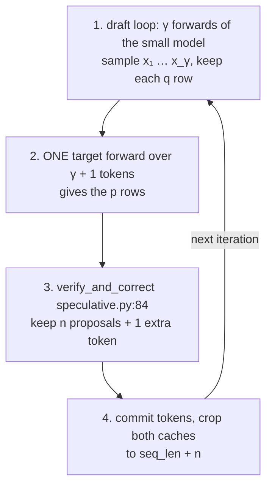
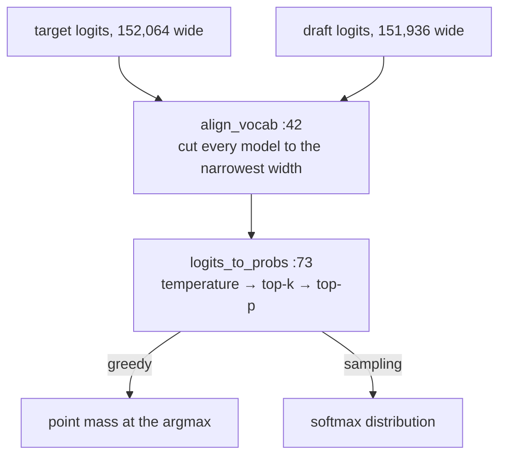
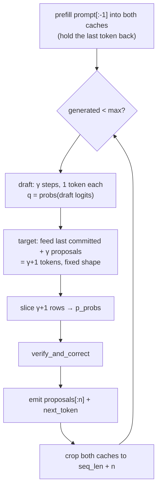
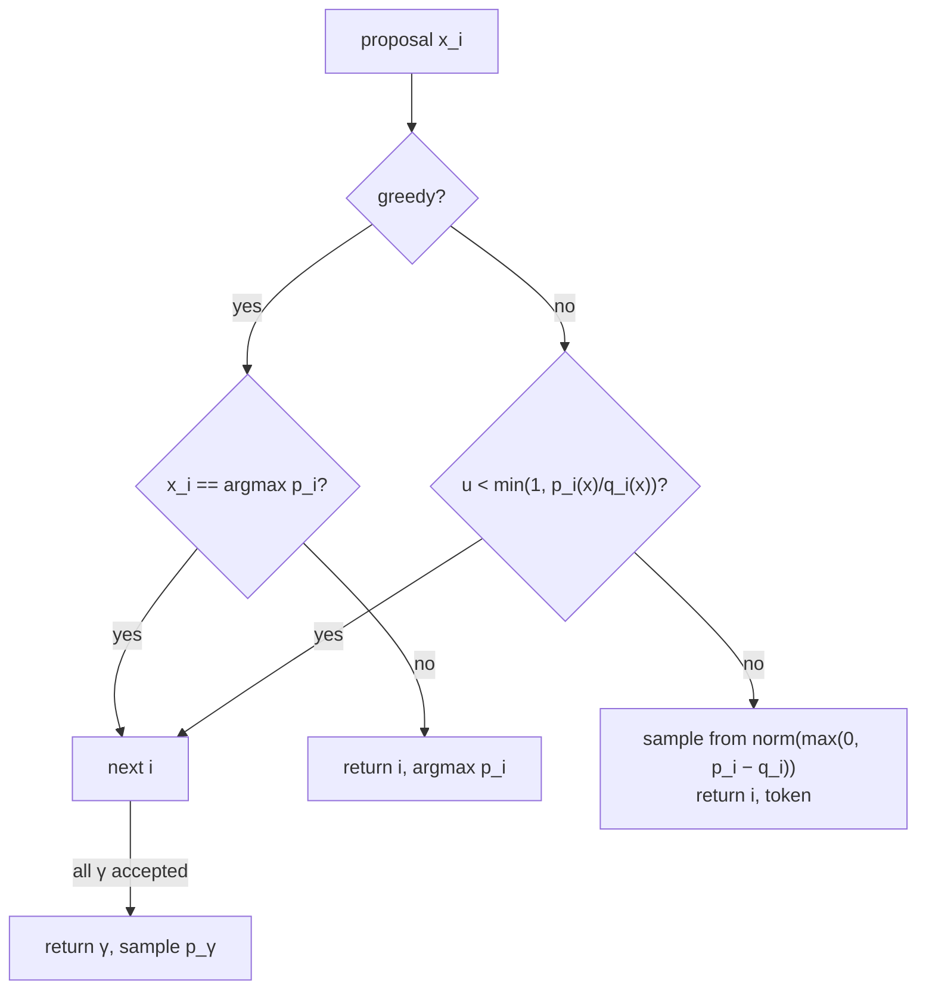
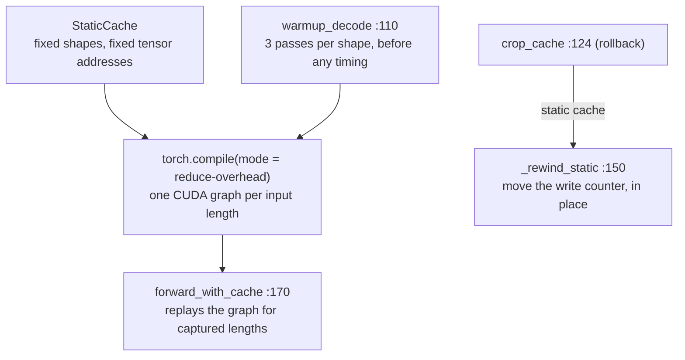

# Day 4 (Wed Nov 11): speculative decoding

Part of [[Interview plan (Nov 2026)]]. Repo `speculative_decoding` (branch `main`). About 7 h. Prep pack:
[[Speculative decoding - prep]] (diagram, numbers sheet, 60 questions).

**Code, explained:** the figures, the code to read and what each snippet does are in [[#Code, explained]], right after section B.

**Resume bullets:**
- "Accelerated LLM inference by **2.25×** using fixed-depth speculative decoding with Qwen2.5-0.5B drafting Qwen2.5-14B, reaching **2.60×** on code workloads while preserving the target distribution."
- "Performed draft-model and depth ablations across three draft models and a range of depths…"

**By tonight you can:**
- prove that speculative sampling preserves the target distribution;
- derive the expected tokens per step and the speedup formula;
- explain the 0.88× → 2.25× story with the code;
- answer "why not Medusa or EAGLE".

## Schedule

| # | Time | Kind | What |
|---|---|---|---|
| 0 | 15 min | recall | Days 1–3: online softmax, the 7.41× context story, the roofline |
| 1 | 30 min | read | The prep pack's pitch and diagram; RESULTS.md headline table |
| 2 | 75 min | theory + maths | The algorithm, the proof, the speedup formula (A1, A2) |
| 3 | 45 min | code | `sampling.py`, `verify_and_correct` (B1) |
| 4 | 75 min | rebuild | Speculative sampling in NumPy, with a Monte-Carlo proof (C) |
| — | lunch | | |
| 5 | 60 min | code | `SpeculativeDecoder.generate`, KV rollback (B2) |
| 6 | 30 min | theory | Why batch-1 decode is launch-bound; StaticCache, torch.compile, CUDA graphs (A3) |
| 7 | 40 min | code | `cache_utils.py`, `compile_utils.py` (B3) |
| 8 | 30 min | theory | Medusa, EAGLE and tree drafting: why not (A4) |
| 9 | 20 min | skim | `stats.py`, `controller.py`, `models.py`, `baseline.py` |
| 10 | 20 min | trace | The KV-rollback trace (D) |
| 11 | 40 min | practice | The questions (E), plus the prep pack's hostile follow-ups |

## A. Theory and maths

### A1. The algorithm (read: Leviathan et al. 2023, §2–3 and Appendix A; Chen et al. 2023, Algorithm 2)

**Optional extras:**
- Jay Mody's blog post *"Speculative Sampling"* (jaykmody.com): a short NumPy implementation, perfect before block 4;
- a 20-minute explainer video: search YouTube for *"Speculative Decoding: When Two LLMs are Faster than One"* (Efficient NLP channel).

> [!abstract] What it says: Leviathan, Kalman and Matias (ICML 2023), *Fast Inference from Transformers via Speculative Decoding*
> **Key idea:** a small, fast model guesses several tokens; the big model checks all of them in one parallel pass.
> A special accept/reject rule (*speculative sampling*) makes the output distribution **exactly** the big model's. Nothing is approximated.
> **Main figure:** a sentence being generated. Each line is one big-model call. Green tokens are accepted guesses, red ones rejected, blue ones the big model's corrections.
> **Claims to know:** the expected tokens per call is $(1 - \alpha^{\gamma+1})/(1 - \alpha)$, where $\alpha$ is the acceptance rate.
> The wall-time gain is that number divided by $\gamma c + 1$, with $c$ the draft-to-target cost ratio. These are your A2 formulas.
> They report about **2×–3×** faster T5-XXL (11B) decoding, with identical outputs and no retraining.
> Appendix A proves the output follows $p$, the same proof as A2.
> **In your project:** `verify_and_correct` is this rule; your 0.88× → 2.25× story is the $c$ term.

> [!abstract] What it says: Chen et al. (DeepMind, 2023), *Accelerating Large Language Model Decoding with Speculative Sampling*
> **Key idea:** the same method, found independently. Draft $K$ tokens, score them in one target pass, then use **modified rejection sampling**.
> **Algorithm 2** is the step to read. Accept a token with probability $\min(1, p/q)$. On a rejection, resample from the normalised $\max(0, p - q)$.
> **Claims to know:** Chinchilla 70B with a 4B draft decodes about **2–2.5×** faster in their distributed setup, with no change to the samples' distribution.
> They stress that the draft must be cheap **relative to** the target. Draft latency, not quality alone, sets the gain.
> **In your project:** your `residual` code is Algorithm 2's resampling line.

> [!abstract] What it says: Jay Mody, *Speculative Sampling* (blog)
> **Key idea:** the whole method in a few dozen lines of NumPy.
> It puts plain autoregressive sampling next to speculative sampling, so you can see exactly what changes.
> It is useful as a model for your block 4 rebuild: the draft loop, one target call, then the accept/resample loop.
> I haven't checked its exact model choices or timings, so don't quote numbers from it. Use the papers for numbers.

> [!abstract] What it says: the Efficient NLP video
> A visual recap of the same algorithm: draft, verify in parallel, accept or resample.
> I haven't checked its exact content; use it only for intuition, and the papers for every number or claim.

One iteration, with draft distribution `q` and target distribution `p`:
1. The draft model generates γ tokens autoregressively: `x₁ … x_γ`, each from `q(·|prefix)`.
2. The target model scores **all γ+1 positions in one forward pass**, giving `p₁ … p_{γ+1}`.
3. For i = 1 … γ: accept `x_i` with probability `min(1, p_i(x_i) / q_i(x_i))`. On the first rejection, sample a
   replacement from the **residual** `norm(max(0, p_i − q_i))` and stop.
4. If all γ are accepted, sample one **bonus** token from `p_{γ+1}`.

So each iteration yields between 1 and γ+1 tokens, for one target forward pass.

**Concepts:**
- **Draft and target.** The draft proposes $\gamma$ tokens one by one; the target checks all $\gamma + 1$ positions in **one** forward pass.
- **Lossless.** Accept with probability $\min(1, p/q)$; on rejection, resample from the leftover $\max(0, p - q)$. The output follows $p$ exactly.
- **Always progress.** Every iteration yields at least 1 token (the correction) and at most $\gamma + 1$ (all accepted plus a bonus).
- **Acceptance rate.** $\alpha = 1 - \mathrm{TV}(p, q)$: the closer the draft is to the target, the more tokens per iteration.

> [!tip] Explained from scratch: [[#5. Deep dive: speculative sampling from scratch|§5 speculative sampling]], [[#6. Deep dive: the speedup maths from scratch|§6 the speedup maths]]

### A2. The maths (75 min with A1; do it on paper)

**Proof that the output is distributed exactly as `p`** (one position):
- P(output = x) = P(draft x and accept) + P(reject) · P(residual gives x)
- = `q(x)·min(1, p(x)/q(x))` + `(1 − β) · max(0, p(x) − q(x)) / Σ_y max(0, p(y) − q(y))`
- where β = Σ_y min(p(y), q(y)) is the total acceptance probability.
- Key identity: `Σ_y max(0, p − q) = 1 − Σ_y min(p, q) = 1 − β`. So the second term is just `max(0, p(x) − q(x))`.
- Total: `min(p(x), q(x)) + max(0, p(x) − q(x)) = p(x)`. ∎

**Acceptance rate:** α = E[β] = 1 − TV(p, q), where TV is the total-variation distance. The closer the draft is to the target, the higher α.

**Expected tokens per iteration** (if each position is accepted independently with probability α):
`E[tokens] = 1 + α + α² + … + α^γ = (1 − α^{γ+1}) / (1 − α)`.

**Speedup** with cost ratio `c = (draft forward time) / (target forward time)`:
`speedup = E[tokens] / (γ·c + 1)`. You pay γ draft passes plus one target pass per iteration.

**Worked with your numbers** (per-layer times from `RESULTS.md`, around lines 88–104; take α = 0.8, γ = 4):
- E = (1 − 0.8⁵)/0.2 = **3.36** tokens per iteration.
- **Eager:** draft 24 layers × 0.82 ms = 19.7 ms; target 48 × 0.81 = 39 ms; c ≈ 0.5. Speedup = 3.36 / (4·0.5 + 1) = **1.12×**.
  With your first 7B target (28 layers) and 1.5B draft (28 layers), c ≈ 1, so speedup = 3.36 / 5 ≈ **0.67×**. That is your 0.88× story.
- **Compiled:** draft 24 × 0.098 = 2.35 ms; target 48 × 0.223 = 10.7 ms; c ≈ 0.22. Speedup = 3.36 / 1.88 ≈ **1.79×**.
- You measured **2.25×**, above the formula (1.89× with your real α). Acceptance is **bursty**, not independent: easy
  stretches (code) accept long runs (RESULTS.md).
- **Best γ:** maximise `E(γ)/(γc + 1)`. A higher α (code) favours a larger γ (8 → 2.60×). A lower α (chat) favours a
  small γ; at γ = 16, chat runs at 0.82×.

> [!tip] Explained from scratch: [[#6. Deep dive: the speedup maths from scratch|§6 the speedup maths]], [[#5. Deep dive: speculative sampling from scratch|§5 the correctness proof]]

### A3. Why decode was launch-bound (block 6, 30 min)

**Read:** the PyTorch blog *"Accelerating Generative AI with PyTorch II: GPT, Fast"* (gpt-fast). It covers the static KV cache,
`torch.compile(mode="reduce-overhead")` and speculative decoding, the same three ideas as your fix.

> [!abstract] What it says: PyTorch blog, *Accelerating Generative AI with PyTorch II: GPT, Fast* (gpt-fast, 2023)
> **Key idea:** plain PyTorch, under 1,000 lines, can decode fast if you remove CPU overhead first.
> **Main figure:** a GPU trace where the GPU sits idle between tiny kernels, because the CPU can't launch them fast enough.
> **The steps, in order:** `torch.compile` with `mode="reduce-overhead"` (CUDA graphs), a **static KV cache** so shapes never change, then int8/int4 weight quantisation, speculative decoding and tensor parallelism.
> **Claims to know:** on Llama-2-7B at batch 1, compile plus the static cache takes decoding from about **25 to about 107 tokens/s**.
> Quantisation and speculation add more on top. The lesson is that small-batch decode is **overhead-bound** before it is memory-bound.
> **In your project:** the same three ideas, StaticCache, `reduce-overhead` and a draft model, fixed your 0.88×.

**Concepts:**
- **Eager mode** launches each small kernel from Python. At batch 1, the GPU finishes each kernel faster than the CPU can launch the next, so time ≈ layers × per-layer launch cost, whatever the model width (0.81 ms per layer for 0.5B *and* 14B).
- **A StaticCache** gives fixed tensor shapes, so a compiled graph can be reused.
- **`reduce-overhead`** captures **CUDA graphs**: the whole kernel sequence is replayed with one launch.
- Because of this, the target moved to 14B, with **48 layers vs the draft's 24**: speculation pays only when `c` is small.

> [!tip] Explained from scratch: [[#7. Deep dive: launch-bound decode and CUDA graphs from scratch|§7 launch-bound decode and CUDA graphs]], [[#6. Deep dive: the speedup maths from scratch|§6 why a small c matters]]

### A4. Why not Medusa, EAGLE or tree drafting (block 8, 30 min)

Read the abstract and first figure of each:
- **Medusa** (Cai et al., 2024): extra decoding heads on the target; needs training.
- **EAGLE** (Li et al., 2024): a small draft head on the target's features; needs training.
- **Tree drafting / SpecInfer** (Miao et al., 2024): verify several candidate branches at once with a tree attention mask.

> [!abstract] What it says: Medusa (Cai et al., 2024)
> **Key idea:** no separate draft model. Extra **decoding heads** on the target's last hidden state each guess one future token (+1, +2, …).
> Their guesses form a **tree** of candidates, checked in one pass with a tree attention mask.
> **Claims to know:** the abstract reports over **2.2×** for Medusa-1 (heads trained on a frozen model) and **2.3–3.6×** for Medusa-2 (trained jointly).
> The cost: the heads must be trained, and the usual acceptance scheme isn't exactly lossless for sampling.

> [!abstract] What it says: EAGLE (Li et al., 2024)
> **Key idea:** draft at the **feature level**. A one-layer head predicts the target's next hidden feature, then reads off a token from it.
> It feeds the head the token sampled one step ahead, so the guess knows which branch was taken.
> **Claims to know:** lossless (uses the speculative-sampling rule); the abstract reports about **2.7–3.5×** lower latency on LLaMA2-Chat 70B.
> The cost: the draft head must be trained for each target model.

> [!abstract] What it says: SpecInfer (Miao et al., 2024)
> **Key idea:** use one or more small models to build a **token tree** of guesses, then verify the whole tree in one target pass.
> A tree attention mask lets every branch see only its own ancestors.
> **Claims to know:** a tree raises the chance that *some* branch matches, so more tokens are accepted per target call.
> They report gains for both distributed and CPU-offloading serving. The main cost is engine work: tree masks and branch-aware KV handling.

**Your honest answer:** these need training, or bigger engine changes for tree masks. A separate off-the-shelf draft
from the same family (shared tokenizer) needs neither, and it isolates the systems question. Tree drafting is the
listed next step (PROGRESS §7).

**Concepts:**
- **Trained drafters** (Medusa heads, the EAGLE head) live inside the target and guess better, but need training for each target.
- **Tree drafting** checks many candidate continuations at once, so more tokens are accepted per target pass.
- **Your choice:** an off-the-shelf draft from the same family (shared tokenizer) needs no training and no engine changes.

> [!tip] Explained from scratch: [[#5. Deep dive: speculative sampling from scratch|§5 the base algorithm all of these extend]], [[#6. Deep dive: the speedup maths from scratch|§6 why acceptance rate drives the gain]]

## B. Code

### B1. Sampling and verification (block 3, 45 min, deep)

- `sampling.py`:
  - 73 `logits_to_probs` (temperature, top-p);
  - **42 `align_vocab`**: Qwen 0.5B and 14B have different vocab sizes. What does it pad, and why must `p` and `q` share an index space?
  - 113 `sample_from_probs`, 131 `uniform_scalar`.
- `speculative.py` **84 `verify_and_correct`**: map it line by line to A1.
  - The greedy special case (around line 120): `p` is a point mass, so accept iff the draft equals the argmax.
  - `acceptance_prob = min(1, p/q)` (around line 129).
  - The residual is `clamp(p − q, min=0)` (around line 133), and its fallback when the residual sums to 0.

### B2. The decode loop (block 5, 60 min, deep)

`speculative.py`:
- 147 `SpeculativeDecoder`, 156 `__init__`;
- 181 `decode_shapes`: why the shapes are fixed;
- 204 `compile`;
- **246 `generate`**: the draft loop, the single verify pass over γ+1 positions, how many tokens are emitted, and the bonus token.

Tests to read alongside: `tests/test_engine_correctness.py` and `tests/test_sampling.py`. They show how "preserves the
distribution" is *tested* despite bf16 noise (the noise-floor method; see the prep pack).

### B3. Cache and compile (block 7, 40 min, deep)

- `cache_utils.py`:
  - 34 `KVCache`, 70 `CachePool`;
  - **124 `crop_cache`**, 150 `_rewind_static`: rolling back rejected draft positions;
  - 170 `forward_with_cache`.
- `compile_utils.py`: 45 `compile_decode`, 110 `warmup_decode`. Why warm-up matters for honest timing.

## Code, explained

Read this **with the files open**. It starts with a picture of the whole day and **the flow, step by step** (one concrete input followed through every function). Then each part has its own figure, the exact code (copied from the repo at the commit named below, so the line numbers match) and what that code does.

Repo `speculative_decoding`, branch `main` (`99ed1c2`), package
`src/specdec/`.

**One iteration in one picture:** the draft guesses γ tokens one at a time; the target checks all of them in one
pass; the accept/reject rule keeps a prefix and adds one token; both caches are cut back to what was kept.



### The flow, step by step

One iteration with **greedy decoding, γ = 4** and a **100-token prompt**.

1. **Prefill, holding the last token back.** Both models run over prompt tokens 0–98 (`speculative.py:321–326`). Both caches now hold **99** positions.
2. **Draft γ = 4 tokens.** `pending = cur_ids[99:]` is token 99 (the held-back token). The draft runs 1 token at a time: x₁ from token 99, then x₂, x₃, x₄ (`:341–356`). Each proposal and its `q` row are kept.
3. **One target pass over 5 tokens.** `t_len = 99`, `feed = [token 99, x₁, x₂, x₃, x₄]` (`:361–363`), so **5 rows** of logits. `lo = seq_len − 1 − t_len = 100 − 1 − 99 = 0`, so `p_probs` = rows 0–4: the target's prediction at each proposal, plus the bonus row.
4. **Accept or reject** (`verify_and_correct`, `:84`). Suppose the target's argmaxes are `[x₁, x₂, c, …]`. x₁ matches, x₂ matches, x₃ ≠ c → it returns **(2, c)**.
5. **Commit.** `emitted = [x₁, x₂, c]`, so the sequence is now 103 tokens. `keep = seq_len + n_accepted = 100 + 2 = 102`. The target cache is cropped 104 → 102, the draft cache 103 → 102 (`:388–396`).
6. **Why 102 and not 103?** Position 102 holds `c`, which neither model has computed K, V for yet. Next iteration, the target feeds `cur_ids[102:] + 4 proposals` = **5 tokens again**. The shape never changes, which is what lets each step be a captured CUDA graph.

Result: 3 tokens for one target pass. With perfect agreement you'd get 5 (4 proposals + the bonus).

---

### 1. Turning logits into the distributions p and q

**Greedy decoding as one-hot probability rows** (animated; blocks are sized by their real dimensions, no values):

![[d04s-greedy.svg]] [[d04s-greedy.html|▶ Step through it]]



`src/specdec/sampling.py:64–70`
```python
width = logits.shape[-1]
if width == vocab_size:
    return logits
if width > vocab_size:
    return logits[..., :vocab_size]
pad = logits.new_full((*logits.shape[:-1], vocab_size - width), NEG_INF)
return torch.cat([logits, pad], dim=-1)
```
> [!info] New functions in this code
> - `.shape`: the tensor's size along each axis. `x.shape == (6, 2048)` means 6 rows of 2048. [[Function glossary#x.shape|→ examples]]
> - `.new_full(shape, value)`: a tensor of `shape` filled with `value`, same dtype and device as the original. Used to pad logits with −∞. [[Function glossary#x.new_full|→ examples]]
> - `torch.cat((a, b), dim=d)`: joins tensors **along an existing axis**. `torch.cat(([1, 2], [3, 4]), dim=-1)` → `[1, 2, 3, 4]`; on `[3, 2]` tensors with `dim=-1` the result is `[3, 4]`. [[Function glossary#torch.cat|→ examples and figure]]

- The 14B target and the 0.5B draft have **different embedding widths** (152064 vs 151936) even though they share a tokenizer. The accept rule compares `p[x]` and `q[x]`, so both must index the same vocabulary. Every model's logits are cut to the **narrowest** width. Widening instead would let the target sample an id the draft can't embed, and the draft would crash with an `IndexError`.

`src/specdec/sampling.py:80–106`
```python
logits = logits.float()

if cfg.is_greedy:
    probs = torch.zeros_like(logits)
    probs.scatter_(-1, logits.argmax(dim=-1, keepdim=True), 1.0)
    return probs

logits = logits / cfg.temperature

if cfg.top_k is not None:
    k = min(cfg.top_k, logits.shape[-1])
    kth = torch.topk(logits, k, dim=-1).values[..., -1:]
    logits = logits.masked_fill(logits < kth, NEG_INF)

if cfg.top_p is not None and cfg.top_p < 1.0:
    sorted_logits, sorted_idx = torch.sort(logits, descending=True, dim=-1)
    sorted_probs = torch.softmax(sorted_logits, dim=-1)
    # Keep the minimal prefix whose cumulative mass reaches top_p. Using the
    # *exclusive* cumsum keeps the token that crosses the threshold, and the
    # top-1 token is always kept even if it alone exceeds top_p.
    exclusive_cum = sorted_probs.cumsum(dim=-1) - sorted_probs
    drop_sorted = exclusive_cum >= cfg.top_p
    drop_sorted[..., 0] = False
    drop = drop_sorted.scatter(-1, sorted_idx, drop_sorted)
    logits = logits.masked_fill(drop, NEG_INF)

return torch.softmax(logits, dim=-1)
```
> [!info] New functions in this code
> - `.float()`: a float32 copy of the tensor. [[Function glossary#x.float|→ examples]]
> - `torch.zeros_like(t)`: zeros with the same shape, dtype and device as `t`. [[Function glossary#torch.zeros_like|→ examples]]
> - `.scatter_(dim, index, value)`: writes `value` at the positions given by `index`, in place. `zeros.scatter_(-1, argmax, 1.0)` makes a one-hot vector. [[Function glossary#x.scatter_|→ examples and figure]]
> - `.argmax(dim=-1)`: the **index** of the largest value along an axis. `tensor([0.1, 2.1, 0.6]).argmax()` = 1. On logits it picks the most likely token (greedy decoding). [[Function glossary#x.argmax|→ examples and figure]]
> - `min(xs) / min(a, b)`: the smallest. `min(5, 2)` = 2. [[Function glossary#min|→ examples]]
> - `torch.topk(x, k)`: the `k` largest values (and their indices). `.values[..., -1:]` is the k-th largest, used as a cut-off. [[Function glossary#torch.topk|→ examples and figure]]
> - `.masked_fill(mask, value)`: replaces elements where `mask` is True with `value`. `scores.masked_fill(~allowed, -inf)` hides disallowed keys; `~` flips True/False. [[Function glossary#x.masked_fill|→ examples and figure]]
> - `torch.sort(x, descending=True)`: sorted values and the indices they came from. [[Function glossary#torch.sort|→ examples and figure]]
> - `.sort(key=f)`: sorts a list **in place** (by `f(x)` if given). `nodes.sort(key=lambda n: n.last_accessed)` puts the least recently used first. [[Function glossary#list.sort|→ examples]]
> - `torch.softmax(x, dim=-1)`: softmax along an axis: each row becomes positive weights that sum to 1. `softmax([0, 0])` = `[0.5, 0.5]`. [[Function glossary#torch.softmax|→ examples and figure]]
> - `.cumsum(dim)`: running total. `[0.5, 0.3, 0.2].cumsum()` = `[0.5, 0.8, 1.0]`. [[Function glossary#x.cumsum|→ examples and figure]]
> - `.scatter(dim, index, src)`: like `scatter_` but returns a new tensor: puts `src` values back at the `index` positions (undoing a sort). [[Function glossary#x.scatter|→ examples]]

- Greedy decoding is a **point mass**: probability 1 at the argmax. That makes the general rule below collapse to "accept iff the draft guessed the argmax".
- Otherwise: temperature, then top-k, then top-p, in Hugging Face's order, so the baseline matches `model.generate`. The top-p trick: an *exclusive* cumulative sum keeps the token that crosses the threshold.

---

### 2. The decode loop: `SpeculativeDecoder.generate`

**The draft and verify phases with the real models' shapes** (animated; blocks are sized by their real dimensions, no values):

![[d04s-draft.svg]] [[d04s-draft.html|▶ Step through it]]

![[d04s-verify.svg]] [[d04s-verify.html|▶ Step through it]]

> [!tip] Concept from scratch: [[#6. Deep dive: the speedup maths from scratch|tokens per iteration, the speedup formula and the two acceptance rates]]



`src/specdec/speculative.py:321–326`
```python
prefill = cur_ids[: prompt_len - 1]
if prefill.numel():
    forward_with_cache(self.target.model, target_cache, prefill, 0)
    forward_with_cache(self.draft.model, draft_cache, prefill, 0)
    n_target_fwd += 1
    n_draft_fwd += 1
```
> [!info] New functions in this code
> - `.numel()`: the total number of elements. A `[3, 4]` tensor has 12. [[Function glossary#x.numel|→ examples]]

- **Hold the last prompt token back.** Both caches start one position behind the sequence. So verification always feeds exactly *last committed token + γ proposals* = **γ+1 tokens**, every time. Fixed shapes are what make CUDA graphs possible (section 4).

`src/specdec/speculative.py:341–356`
```python
draft_tokens: list[torch.Tensor] = []
q_rows: list[torch.Tensor] = []
pos = cache_length(draft_cache)
pending = cur_ids[pos:]
for _ in range(gamma):
    logits = forward_with_cache(self.draft.model, draft_cache, pending, pos)[-1]
    n_draft_fwd += 1
    pos += int(pending.numel())
    q = logits_to_probs(align_vocab(logits, self.vocab_size), cfg)
    x = sample_from_probs(q, generator)
    draft_tokens.append(x)
    q_rows.append(q)
    pending = x.view(1)

proposals = torch.stack(draft_tokens)
q_probs = torch.stack(q_rows)
```
> [!info] New functions in this code
> - `range(start, stop, step)`: the integers from `start` up to (not including) `stop`. `range(0, 10, 4)` gives 0, 4, 8. `range(3)` gives 0, 1, 2. [[Function glossary#range|→ examples]]
> - `int(x)`: converts to an integer, dropping the fraction. `int(3.9)` = 3. [[Function glossary#int|→ examples]]
> - `.append(x)`: adds `x` at the end of a list. `[1].append(2)` → `[1, 2]`. [[Function glossary#list.append|→ examples]]
> - `.view(shape)`: reinterprets the same numbers with a new shape, **no copy**. A `[6, 2048]` tensor `.view(6, 32, 64)` reads each row of 2048 as 32 heads × 64. [[Function glossary#x.view|→ examples and figure]]
> - `torch.stack(xs)`: joins tensors along a **new** axis: four `(V,)` vectors → one `(4, V)` tensor. [[Function glossary#torch.stack|→ examples and figure]]

- The draft runs γ forward passes of 1 token each (the first may be 2 tokens after a full accept; see `decode_shapes`). It **samples** each proposal from its own `q` and keeps every `q` row for the accept test.

`src/specdec/speculative.py:361–371`
```python
t_len = cache_length(target_cache)
feed = torch.cat([cur_ids[t_len:], proposals])
logits = forward_with_cache(self.target.model, target_cache, feed, t_len)
n_target_fwd += 1
# Row j predicts the token after absolute position t_len + j. We need
# predictions for absolute positions seq_len-1 .. seq_len+gamma-1,
# giving the gamma proposal distributions plus the bonus row.
lo = seq_len - 1 - t_len
p_probs = logits_to_probs(
    align_vocab(logits[lo : lo + gamma + 1], self.vocab_size), cfg
)
```

- **One target forward over γ+1 tokens** gives γ+1 rows of logits: row j predicts the token after position `t_len + j`. Rows 0..γ−1 are `p` at each proposal; row γ is the **bonus** distribution, a free extra token if everything is accepted.

`src/specdec/speculative.py:374–376`
```python
n_accepted, next_token = verify_and_correct(
    proposals, q_probs, p_probs, cfg, generator
)
```

`src/specdec/speculative.py:388–396`
```python
emitted = torch.cat([proposals[:n_accepted], next_token.view(1)])

# --- 4. Commit, and roll the caches back to what we kept. ----------
# K/V for rejected proposals were computed for tokens that are not
# part of the sequence; they must not leak into later attention.
cur_ids = torch.cat([cur_ids, emitted])
keep = seq_len + n_accepted
crop_cache(target_cache, keep)
crop_cache(draft_cache, keep)
```

- Emit `n_accepted` proposals + 1 token, so each iteration yields **between 1 and γ+1 tokens** for one target pass.
- `keep = seq_len + n_accepted`, **not** `+ 1`: the new `next_token` has no K,V in either cache yet. It becomes the "last committed token" fed at the start of the next iteration, which is exactly what the shape trick expects.

---

### 3. The accept/reject rule: `verify_and_correct`

**Accept/reject and the residual, shape by shape** (animated; blocks are sized by their real dimensions, no values):

![[d04s-accept.svg]] [[d04s-accept.html|▶ Step through it]]

![[d04s-residual.svg]] [[d04s-residual.html|▶ Step through it]]

> [!tip] Concept from scratch: [[#5. Deep dive: speculative sampling from scratch|the rule and its proof on a 3-token vocabulary]]



`src/specdec/speculative.py:115–144`
```python
for i in range(k):
    x = draft_tokens[i]
    p_i, q_i = p_probs[i], q_probs[i]

    if cfg.is_greedy:
        # p is a point mass at argmax, so the general rule below degenerates
        # to exact agreement: accept iff the draft guessed the target's
        # argmax, else emit that argmax. Special-cased for clarity and to
        # avoid burning entropy on a coin flip whose outcome is determined.
        target_token = p_i.argmax()
        if bool(x == target_token):
            continue
        return i, target_token

    acceptance_prob = min(1.0, float(p_i[x]) / float(q_i[x]))
    if uniform_scalar(generator, p_probs.device) < acceptance_prob:
        continue

    residual = torch.clamp(p_i - q_i, min=0.0)
    total = residual.sum()
    if bool(total <= 0):
        # Unreachable in exact arithmetic: sum (p-q)_+ == 0 implies p == q,
        # which would have accepted with probability 1. Only float noise can
        # land here, and p is the right answer in that limit.
        residual, total = p_i, p_i.sum()
    return i, sample_from_probs(residual / total, generator)

# Every proposal accepted: the verification pass already gave us the target
# distribution one position further along, so we get a token for free.
return k, sample_from_probs(p_probs[k], generator)
```
> [!info] New functions in this code
> - `bool(x)`: converts to True / False. On a one-element tensor, `bool(t)` reads its value. [[Function glossary#bool|→ examples]]
> - `float(x)`: converts to a floating-point number. `float('-inf')` is minus infinity, a value smaller than every number (used to mask scores). [[Function glossary#float|→ examples]]
> - `.device`: where the tensor lives: `cpu` or `cuda:0` (a GPU). [[Function glossary#x.device|→ examples]]
> - `torch.clamp(x, min=0)`: clips values: anything below `min` becomes `min`. `clamp([-1, 2], min=0)` → `[0, 2]`. [[Function glossary#torch.clamp|→ examples]]
> - `.clamp(min=..., max=...)`: clips each element into a range. `tensor([-4, 2, 12]).clamp(0, 9)` → `[0, 2, 9]`. `copy_hits` uses `clamp(max=len - 1)` so an index never runs past the end. [[Function glossary#x.clamp|→ examples]]
> - `.sum(dim)`: adds the elements (along `dim` if given). [[Function glossary#x.sum|→ examples and figure]]
> - `sum(xs)`: adds up the items. `sum([1, 2, 3])` = 6. [[Function glossary#sum|→ examples]]

Map each line to the algorithm:
- `acceptance_prob = min(1, p(x)/q(x))`: if the target likes x at least as much as the draft did, always accept; otherwise accept with probability p/q.
- On rejection, sample from the **residual** `max(0, p − q)`, renormalised. This is the part that makes the output exactly `p`: accepted mass `min(p, q)` plus residual mass `max(0, p − q)` sums to `p(x)` (Day 4 A2 proof).
- The `total <= 0` branch only fires on floating-point noise: a zero residual means `p == q`, which would have been accepted.
- Falling out of the loop means all γ were accepted, so take the bonus token from `p_probs[k]`.

**Check yourself:** greedy, γ = 4, the target's argmaxes are `[a, b, c, d, e]` and the draft proposed `[a, b, z, d]`. What does `verify_and_correct` return, and how many tokens are emitted? (*`(2, c)`; 3 tokens: a, b, c.*)

---

### 4. Rollback and the 0.88× → 2.25× fix

**Both KV caches through one iteration, and why every call has a fixed length** (animated; blocks are sized by their real dimensions, no values):

![[d04s-crop.svg]] [[d04s-crop.html|▶ Step through it]]

![[d04s-shapes.svg]] [[d04s-shapes.html|▶ Step through it]]

> [!tip] Concept from scratch: [[#7. Deep dive: launch-bound decode and CUDA graphs from scratch|why eager batch-1 decode is launch-bound, and how CUDA graphs fix it]]



`src/specdec/cache_utils.py:137–146`
```python
if length >= cache.length:
    return
if cache.static:
    _rewind_static(cache.backend, length)
else:
    # Passing the delta as a negative number means "remove this many
    # tokens", which is the only spelling accepted across both the
    # transformers 4.x and 5.x cache APIs.
    cache.backend.crop(length - cache.length)
cache.length = length
```
> [!info] New functions in this code
> - `.crop(n)`: on a Hugging Face `DynamicCache`: drops cached positions (negative `n` = remove that many from the end). [[Function glossary#cache.crop|→ examples]]

`src/specdec/cache_utils.py:163–166`
```python
for layer in backend.layers:
    counter = getattr(layer, "cumulative_length", None)
    if counter is not None:
        counter.fill_(length)
```
> [!info] New functions in this code
> - `getattr(obj, 'name', default)`: reads an attribute by name, returning `default` if it doesn't exist. `getattr(config, 'rope_theta', 10000)` is the exact pattern behind Day 1's RoPE bug: a missing attribute silently became 10000. [[Function glossary#getattr|→ examples]]
> - `.fill_(v)`: sets every element to `v`, in place (the tensor keeps its memory address, which CUDA graphs require). [[Function glossary#x.fill_|→ examples]]

- **Rollback without erasing.** On the static cache, `crop` just moves each layer's write counter back. Stale K,V above it are harmless: the next forward overwrites them before attention reads them, and the causal mask hides anything above the query's position.
- `fill_` changes the counter **in place**. A CUDA graph is bound to the tensor addresses it recorded, so making a new tensor would silently break every captured graph.

`src/specdec/cache_utils.py:185–189`
```python
if cache.length != start_pos:
    raise ValueError(
        f"cache holds {cache.length} positions but forward starts at {start_pos}; "
        "cache and sequence have drifted out of sync"
    )
```
> [!info] New functions in this code
> - `raise ValueError(msg)`: Python's built-in error for "right type, wrong value". `raise` stops the function and passes the error up to the caller. The kernel wrapper raises it for a bad shape (e.g. head_dim not a power of two) instead of computing a wrong answer. [[Function glossary#ValueError|→ examples]]

- A guard against the most dangerous bug in this design: the cache length drifting away from the sequence. It fails loudly instead of attending to the wrong positions.

`src/specdec/compile_utils.py:87–91`
```python
model._specdec_compiled_forward = torch.compile(
    model.forward, mode=mode, fullgraph=fullgraph, dynamic=False
)
model._specdec_decode_shapes = shapes
model._specdec_compile_mode = mode
```
> [!info] New functions in this code
> - `torch.compile(fn, mode='reduce-overhead')`: compiles a function into fused GPU kernels; `reduce-overhead` also records **CUDA graphs**, so a whole step replays with one launch. [[Function glossary#torch.compile|→ examples]]
> - `re.compile(pattern)`: turns a regex pattern into a reusable object (compiled once, used many times). `_TOKEN = re.compile(r'[a-z0-9_.-]+')` matches runs of letters, digits, `_`, `.` and `-`. [[Function glossary#x.compile|→ examples]]

`src/specdec/compile_utils.py:131–139`
```python
for n in sorted(frozenset(int(s) for s in shapes)):
    # Three passes per shape: the first compiles, and cudagraph trees needs
    # a couple more before it is replaying rather than still recording.
    for _ in range(3):
        cache = cache_factory()  # acquiring from a pool already resets it
        forward_with_cache(model, cache, torch.randint(0, vocab, (prefix_len,), device=device), 0)
        forward_with_cache(model, cache, torch.randint(0, vocab, (n,), device=device), prefix_len)
        reset_cache(cache)
torch.cuda.synchronize()
```
> [!info] New functions in this code
> - `sorted(xs, key=f)`: a new list in increasing order (by `f(x)` if `key` is given). `sorted([3, 1, 2])` = `[1, 2, 3]`. [[Function glossary#sorted|→ examples]]
> - `frozenset(xs)`: an immutable set (can be a dict key or compared for equality). [[Function glossary#frozenset|→ examples]]
> - `torch.randint(low, high, shape)`: random integers in [low, high). Used to make dummy token ids for warm-up. [[Function glossary#torch.randint|→ examples]]
> - `torch.cuda.synchronize()`: waits until the GPU has finished all queued work. GPU calls return immediately, so you must synchronize before reading a clock, or you'd time only the launch. [[Function glossary#torch.cuda.synchronize|→ examples]]

- **Why it was 0.88× in eager mode:** at batch 1, each layer is a handful of tiny kernels, and Python launches them one by one. The GPU finishes each faster than the CPU can launch the next, so a step costs about *layers × launch time*, whatever the model's width. A 1.5B draft with 28 layers then costs as much as a 7B target with 28 layers, and speculation can't win.
- **The fix:** a `StaticCache` (fixed shapes and addresses) + `torch.compile(mode="reduce-overhead")`, which records each step as a CUDA graph and replays it with one launch. Then a 14B target (48 layers) against a 0.5B draft (24 layers) makes the cost ratio `c` small.
- `warmup_decode` compiles and records each shape **before** timing. Otherwise the benchmark would charge compile time to whichever arm ran first.

---

### 5. Deep dive: speculative sampling from scratch

Section 3 above reads `verify_and_correct`. This section builds the algorithm and its proof from zero, on a
vocabulary of 3 tokens. Order: why one target pass can check many tokens → the accept rule → the residual → the proof
with numbers → what goes wrong with a simpler rule → greedy as a special case → several positions in a row → the code
with real tensors → questions → check.

> [!important] The one sentence to hold on to
> Let a small model **guess** γ tokens; let the big model **check** all of them in one pass; keep each guess with
> probability $\min(1, p/q)$, and on the first rejection draw from the **residual** $\max(0, p - q)$. The output is
> then distributed **exactly** as the big model alone would produce it.

#### 5.1 Why one target pass can check γ tokens

A causal language model, fed a sequence, gives a next-token distribution at **every** position in one forward pass.
That's how training works too. Feed the target `[t99, x₁, x₂, x₃, x₄]` (the last committed token plus 4 guesses) and
it returns **5 rows**:
- row 0 = $p$(next | …t99), the target's opinion about x₁;
- row 1 = $p$(next | …t99, x₁), about x₂;
- …
- row 4 = $p$(next | …x₄): a **bonus** row, used if all 4 guesses survive.

At batch 1, a 5-token forward costs about the same as a 1-token forward (it's launch- or memory-bound, Day 4 §7). So
if most guesses are right, you get several tokens for the price of one target pass.

#### 5.2 The setup on 3 tokens

Vocabulary {A, B, C}. At one position:
- target **p** = [0.6, 0.3, 0.1];
- draft **q** = [0.3, 0.5, 0.2].

The draft over-proposes B and C, and under-proposes A.

![[d4-5-accept.svg]]

#### 5.3 The accept rule

The draft samples a token x from q. Keep it with probability

$$a(x) = \min\left(1, \frac{p(x)}{q(x)}\right)$$

- x = A: 0.6/0.3 = 2 → $a$ = **1**. The target likes A more than the draft did: always keep.
- x = B: 0.3/0.5 → $a$ = **0.6**.
- x = C: 0.1/0.2 → $a$ = **0.5**.

In code you draw a uniform number u in [0, 1) and keep x if u < a(x). For B: u = 0.42 keeps it; u = 0.75 rejects it.

#### 5.4 The residual: what to sample after a rejection

Probability that the draft proposes x **and** it is kept: $q(x) \cdot a(x) = \min(p(x), q(x))$.
- A: 0.3 · 1 = **0.3**; B: 0.5 · 0.6 = **0.3**; C: 0.2 · 0.5 = **0.1**.
- Total kept: $\beta = 0.7$. So a rejection happens 30% of the time.

Each token is now short of p by exactly $p(x) - \min(p(x), q(x)) = \max(0, p(x) - q(x))$:
- A: 0.6 − 0.3 = **0.3**; B: 0; C: 0.

That shortfall is the **residual**. It sums to 0.3, the rejection probability. On a rejection, draw from the residual
normalised: here [0.3, 0, 0] / 0.3 = [1, 0, 0], so always A.

#### 5.5 The proof, with numbers and then in general

P(output = x) = P(proposed and kept) + P(rejected) · P(residual draws x):
- A: 0.3 + 0.3 · 1 = **0.6**
- B: 0.3 + 0.3 · 0 = **0.3**
- C: 0.1 + 0.3 · 0 = **0.1**

That's exactly p. In general:

$$P(x) = \min(p, q)(x) + (1 - \beta) \cdot \frac{\max(0, p(x) - q(x))}{\sum_y \max(0, p(y) - q(y))}$$

The key identity: $\sum_y \max(0, p - q) = \sum_y (p - \min(p, q)) = 1 - \beta$. So the fraction's denominator
cancels $(1 - \beta)$, leaving

$$P(x) = \min(p(x), q(x)) + \max(0, p(x) - q(x)) = p(x). \quad \blacksquare$$

It holds for **any** q. A bad draft only lowers β (more rejections, less speed), never correctness. Also
$1 - \beta = \text{TV}(p, q)$, the total-variation distance: here $\tfrac12(0.3 + 0.2 + 0.1) = 0.3$.

#### 5.6 Break it: the "obvious" rule is wrong

Suppose that on a rejection you simply sampled from **p** instead of the residual:
- A: 0.3 + 0.3 · 0.6 = **0.48**; B: 0.3 + 0.3 · 0.3 = **0.39**; C: 0.1 + 0.3 · 0.1 = **0.13**.

Not p. The kept proposals have already supplied B and C in full, and resampling from p adds more of them. A Monte-Carlo
run (200,000 rounds, plain Python) agrees: the correct rule gives [0.600, 0.301, 0.099], the wrong one
[0.480, 0.391, 0.129].

#### 5.7 Greedy is a special case

Greedy decoding uses a **point mass**: p(argmax) = 1, everything else 0. Then:
- if x = argmax: $a = \min(1, 1/q(x)) = 1$, always keep;
- otherwise p(x) = 0, so $a = 0$, always reject, and the residual is $\max(0, p - q)$ = a point mass at the argmax.

So greedy collapses to "**keep iff the draft guessed the target's argmax; else emit the argmax**". That's the
`cfg.is_greedy` branch, which skips the coin flip.

#### 5.8 Several positions in a row

Check the proposals **in order** and stop at the first rejection:
- x₁ kept → check x₂ against row 1, which assumed x₁ was in the sequence (it is);
- x₂ rejected → draw the replacement from row 1's residual and **stop**. x₃ and x₄ were drafted after x₂, so their rows assumed a prefix that no longer exists. They are thrown away.
- all γ kept → draw one bonus token from row γ.

Each iteration therefore emits **between 1 and γ + 1** tokens for one target pass.

#### 5.9 The code with real tensors

Toy call with γ = 2, V = 3: `draft_tokens = [B, A]`, `q_probs` is `(2, 3)`, `p_probs` is `(3, 3)` (one extra row).
Row 0 of each is our example: `q_probs[0] = [0.3, 0.5, 0.2]`, `p_probs[0] = [0.6, 0.3, 0.1]`.

Walking `verify_and_correct` (section 3's code):
- `k = 2`; the shape check passes: q has k rows, p has k + 1;
- `i = 0`: `x = B`; `acceptance_prob = min(1.0, 0.3 / 0.5) = 0.6`;
  - if `uniform_scalar(...)` returns 0.42 < 0.6 → `continue` to `i = 1`;
  - if it returns 0.75 → `residual = torch.clamp(p_i - q_i, min=0.0)` = clamp([0.3, −0.2, −0.1]) = **[0.3, 0, 0]**; `total = 0.3`; return `(0, sample_from_probs([1, 0, 0]))` = **(0, A)**: 0 proposals kept, plus A;
- if both are kept, the loop ends and it returns `(2, sample_from_probs(p_probs[2]))`: 2 proposals plus the bonus.

The `total <= 0` branch handles float noise only: a zero residual means p = q, which would have been kept with
probability 1.

#### 5.10 Questions people usually ask next

##### "Does the draft have to be a smaller version of the same model?"

It must share the **tokenizer**, so that p(x) and q(x) refer to the same token. Here the 0.5B and 14B Qwen2.5 models
share it, but their logits have different widths (151,936 vs 152,064). `align_vocab` cuts both to the narrower one.
Being from the same family also makes q close to p, so β is high.

##### "Is it still exact with temperature and top-p?"

Yes, if **p and q are the processed distributions** (after temperature, top-k, top-p). The proof works for any two
distributions. That's why `logits_to_probs` is applied to both models' logits.

##### "Then why aren't greedy outputs bit-identical to the target alone?"

Running the 14B at batch width 5 instead of 1 changes its logits by exactly 0.25 in bf16 (different GEMM tiling and
summation order). Near-ties then flip the argmax. The target-only baseline even disagrees with **itself** across
three identical runs. The tests measure this noise floor and fail only on a confident disagreement.

##### "What did the project verify?"

The accept/reject kernel against synthetic distributions over 60,000 samples, plus **self-drafting**: the target drafts
for itself, so every disagreement isolates the verification logic.

#### 5.11 Check your understanding

1. p = [0.5, 0.5], q = [0.9, 0.1]. Acceptance probability for each token? β?
2. In Q1, what is the residual, and what does a rejection produce?
3. Prove that P(output = x) = p(x) in one line, using the key identity.
4. Why is "on rejection, sample from p" wrong? Give the output for p = [0.6, 0.3, 0.1], q = [0.3, 0.5, 0.2].
5. Greedy: target argmaxes [a, b, c, d, e], draft [a, z, c, d]. What is returned, and how many tokens are emitted?
6. Why are proposals after the first rejection discarded?

> [!success]- Answers
> 1. Token 0: min(1, 0.5/0.9) = 0.556; token 1: min(1, 0.5/0.1) = 1. β = min(0.5, 0.9) + min(0.5, 0.1) = 0.6.
> 2. max(0, p − q) = [0, 0.4] → normalised [0, 1]: a rejection always produces token 1.
> 3. P(x) = min(p, q)(x) + (1 − β)·max(0, p − q)(x)/(1 − β) = min(p, q)(x) + max(0, p − q)(x) = p(x).
> 4. Kept proposals already supply min(p, q); adding (1 − β)·p double-counts: [0.48, 0.39, 0.13] ≠ p.
> 5. x₂ = z ≠ b, so it returns (1, b): 2 tokens (a, b).
> 6. They were drafted after a token that has been replaced, so their target rows describe a prefix that no longer exists.

#### 5.12 The five things to remember

1. **One target pass** over the last token + γ guesses gives γ + 1 next-token rows.
2. **Keep** x with probability min(1, p/q); on the first rejection draw from **norm(max(0, p − q))** and stop; all kept → one bonus token.
3. **Proof:** kept mass min(p, q) + residual mass max(0, p − q) = p. Holds for any draft; a bad draft only costs speed.
4. **Greedy** = keep iff the guess is the target's argmax.
5. **Same tokenizer, same processing** for p and q; bf16 batch-width noise, not the algorithm, explains non-identical greedy text.

---

### 6. Deep dive: the speedup maths from scratch

The prep note's A2 gives the formulas. This section derives them on numbers, then checks them against the measured
results, including one trap in how "acceptance rate" is defined. Order: what an iteration costs → tokens per
iteration → the speedup formula → the 0.88× story in numbers → **two different acceptance rates** → choosing γ →
questions → check.

> [!important] The one sentence to hold on to
> One iteration costs **γ draft passes + 1 target pass** and yields $E = (1 - \alpha^{\gamma+1}) / (1 - \alpha)$ tokens,
> so the speedup is $E / (\gamma c + 1)$, where $c$ = draft cost ÷ target cost. Speculation pays only when $c$ is
> small **and** α (the per-position acceptance) is high.

#### 6.1 What one iteration costs

Let one target forward take $T$ and one draft forward take $cT$. One iteration does γ draft forwards and one target
forward (the γ + 1-token verify, which at batch 1 costs about one target forward):

$$\text{cost per iteration} \approx \gamma c T + T = (\gamma c + 1)\, T$$

Without speculation, each token costs $T$. So the speedup is "tokens per iteration" ÷ $(\gamma c + 1)$.

#### 6.2 Tokens per iteration, on numbers

Assume each proposal is accepted with the same probability α, independently, given that all earlier ones were. With
α = 0.8 and γ = 4, the number of accepted proposals n:

| n accepted | how | probability | tokens emitted (n + 1) |
|---|---|---|---|
| 0 | reject x₁ | 0.2 | 1 |
| 1 | keep x₁, reject x₂ | 0.8 · 0.2 = 0.16 | 2 |
| 2 | … | 0.8² · 0.2 = 0.128 | 3 |
| 3 | … | 0.8³ · 0.2 = 0.1024 | 4 |
| 4 | keep all 4 | 0.8⁴ = 0.4096 | 5 (with the bonus) |

Expected tokens = 1(0.2) + 2(0.16) + 3(0.128) + 4(0.1024) + 5(0.4096) = **3.36**.

In general, the (k+1)-th token appears exactly when the first k proposals are all kept, with probability $\alpha^k$:

$$E(\gamma) = 1 + \alpha + \alpha^2 + \dots + \alpha^\gamma = \frac{1 - \alpha^{\gamma+1}}{1 - \alpha}$$

Check: $(1 - 0.8^5)/0.2 = (1 - 0.328)/0.2 = 3.36$. As γ grows, E approaches $1/(1 - \alpha)$: 5 for α = 0.8. Extra
depth buys less and less.

#### 6.3 The speedup formula, with the project's numbers

$$\text{speedup} = \frac{E(\gamma)}{\gamma c + 1}$$

Compiled forward costs from the README: 14B target **10.72 ms**, 0.5B draft **1.69 ms**, so $c = 0.158$.

![[d4-6-speedup.svg]]

| γ | E (α = 0.8) | speedup, c = 0.158 | speedup, c = 1 |
|---|---|---|---|
| 1 | 1.80 | 1.55× | 0.90× |
| 2 | 2.44 | 1.85× | 0.81× |
| 4 | 3.36 | **2.06×** | 0.67× |
| 8 | 4.33 | 1.91× | 0.48× |
| 16 | 4.89 | 1.39× | 0.29× |

- With c = 1 (draft as expensive as target), the speedup is **below 1 for every γ**: you pay γ + 1 passes and get fewer than γ + 1 tokens.
- With c = 0.158, there is a sweet spot (γ = 4–5 here). Deeper drafting adds cost γc faster than it adds tokens.

#### 6.4 The 0.88× story, in numbers

The first correct version used a 7B target and a 1.5B draft, both **28 layers**, in eager mode. Eager decode at batch 1
costs about **0.81 ms per layer whatever the model size** (§7), so both cost ≈ 28 × 0.81 = 22.6 ms: **c ≈ 1**.

It was working: acceptance was 0.84–0.92, and target forward passes dropped **4.3×** (so ≈ 4.3 tokens per target
pass). But the cost per iteration was about γ + 1 = 5 forwards of equal cost. Speedup ≈ 4.3 / 5 = **0.86×**, close to
the measured **0.88×**. The algorithm was fine; the cost model was wrong.

The fix had two parts: make $c$ small (compile, so cost tracks model size; and pick a 48-layer target against a
24-layer draft), giving 0.88× → **2.25×**.

#### 6.5 The trap: two different "acceptance rates"

The repo's `acceptance_rate` is

$$f = \frac{\text{proposals accepted}}{\text{proposals drafted}} = \frac{\text{mean accepted per iteration}}{\gamma}$$

Proposals after a rejection count as drafted but not accepted. The formula's α is something else: the probability of
keeping **one** proposal, given that all the earlier ones were kept. They are not the same number:

$$f = \frac{\alpha + \alpha^2 + \dots + \alpha^\gamma}{\gamma}$$

So α = 0.8 at γ = 4 gives $f = (0.8 + 0.64 + 0.512 + 0.41)/4 = 0.59$, not 0.8.

The measured 0.5B numbers, with α solved from each measured f:

| γ | measured f | tokens / iteration = 1 + γf | α that fits | formula with α = f (wrong) |
|---|---|---|---|---|
| 2 | 0.913 | 2.83 | 0.941 | 2.75 |
| 4 | 0.798 | **4.19** | **0.912** | 3.35 |
| 8 | 0.681 | 6.45 | 0.914 | 3.04 |

What this shows:
- The README says the formula **under-predicts** (3.35 tokens per iteration "predicted", 4.13 measured; 1.89× vs 2.25×) and blames **bursty** acceptance. But 3.35 is what you get by plugging **f** into a formula that expects **α**. With the per-position α that matches f (0.912), the formula gives 4.19 tokens per iteration, the measured value.
- The fitted α is almost **the same at γ = 2, 4 and 8** (0.94, 0.91, 0.91). That is what independent acceptance predicts. So these numbers don't show burstiness. The gap is mostly a definition mismatch.
- With α = 0.912 and c = 0.158, the formula predicts about 2.57× at γ = 4. The measured 2.25× is lower, which is expected: a 5-token verify costs more than a 1-token forward, and non-forward work adds 1.4%.

**How to say it in an interview:** "The textbook formula needs the per-position acceptance probability. Our logged
rate counts wasted draft work, so it's lower. Converted properly, the formula matches the measured tokens per
iteration." (The project's own PROGRESS §4f found the same denominator issue in a test.)

#### 6.6 Choosing γ

The best γ maximises $E(\gamma) / (\gamma c + 1)$. It rises with α. With $c = 0.158$:

| α | best γ | speedup there |
|---|---|---|
| 0.4 | 1 | 1.21× |
| 0.6 | 2 | 1.49× |
| 0.8 | 5 | 2.06× |
| 0.912 | 8 | 2.83× |

The measured domains agree with this shape. Converting their measured f to α (same method): code ≈ **0.88**, chat
≈ **0.67**, summarisation ≈ **0.61**.
- **Code** is predictable (brackets, repeated names): best measured γ = 8 (**2.60×**).
- **Chat, summarisation:** best γ = 4 (1.42×, 1.41×). At γ = 16 they fall to **0.82×** and **0.66×**: slower than no speculation.
- Across all three domains, γ = 4 had the best mean (1.69×), so it is the default.

#### 6.7 Questions people usually ask next

##### "Why a 14B target and not 7B?"

Speedup needs a small $c$. After compiling, cost tracks model size, and 0.5B vs 14B gives c ≈ 0.16. The 48-vs-24 layer
ratio also helps whenever launches still matter.

##### "Why the 0.5B draft and not the 1.5B, which accepts more?"

The 1.5B had higher acceptance in every domain, but its cost (2.74 ms vs 1.69 ms) ate the gain. The 0.5B had the best
**throughput** in every domain (2.25× vs 2.03× at γ = 4).

##### "What happens at large batch?"

At large batch, decode becomes compute-bound: the verify of γ + 1 tokens per request is no longer nearly free. The
spare compute that speculation uses disappears, so the gain shrinks.

##### "Why measure acceptance instead of trusting the formula?"

The formula assumes a constant α. Real α varies by domain and position. Measure tokens per iteration directly; it maps
linearly to throughput.

#### 6.8 Check your understanding

1. α = 0.5, γ = 3: expected tokens per iteration?
2. With that E and c = 0.2, the speedup?
3. Why is the speedup below 1 for every γ when c = 1?
4. Reproduce the 0.88× estimate.
5. γ = 4, logged acceptance rate f = 0.5. Tokens per iteration? Is α 0.5?
6. Why does code prefer a deeper γ than chat?

> [!success]- Answers
> 1. 1 + 0.5 + 0.25 + 0.125 = 1.875.
> 2. 1.875 / (3·0.2 + 1) = 1.875 / 1.6 ≈ 1.17×.
> 3. Each iteration costs γ + 1 equal passes but yields at most γ + 1 tokens, and fewer whenever any proposal is rejected.
> 4. c ≈ 1 (28 vs 28 layers, eager, ~0.81 ms/layer each); ≈ 4.3 tokens per target pass; 4.3 / (4·1 + 1) ≈ 0.86×.
> 5. 1 + 4·0.5 = 3 tokens. No: f counts drafted-but-unchecked proposals as rejected, so α is higher (solve (α + α² + α³ + α⁴)/4 = 0.5 → α ≈ 0.74).
> 6. Higher α (≈ 0.88 vs 0.67): later proposals are still likely to survive, so extra depth keeps adding tokens.

#### 6.9 The five things to remember

1. **Cost:** γ draft passes + 1 target pass = (γc + 1) target-passes per iteration.
2. **Tokens:** E = (1 − α^(γ+1))/(1 − α), capped by 1/(1 − α); α = 0.8, γ = 4 → 3.36.
3. **Speedup** = E / (γc + 1). c ≈ 1 can never win (the 0.88× story); compiled c = 0.158 can (2.25×).
4. **Two acceptance rates:** logged f = accepted/drafted; the formula needs per-position α. f = 0.798 ↔ α ≈ 0.91 ↔ 4.19 tokens/iteration.
5. **γ** rises with α: code γ = 8 (2.60×), chat and summaries γ = 4; γ = 16 loses for chat (0.82×).

---

### 7. Deep dive: launch-bound decode and CUDA graphs from scratch

Section 4 above reads `cache_utils.py` and `compile_utils.py`. This section explains why they exist, from zero. Order:
how fast batch-1 decode *should* be → how fast eager mode actually was → what a CUDA graph is → the two rules a graph
imposes → how the repo meets them (fixed shapes, static cache, rollback in place) → the rollback on numbers →
questions → check.

> [!important] The one sentence to hold on to
> At batch 1, eager PyTorch spends its time **launching** hundreds of tiny kernels, so every model costs about
> layers × 0.81 ms whatever its size. Recording the step once as a **CUDA graph** and replaying it with one launch
> makes cost track model size again, which is what speculation needs.

#### 7.1 How fast should one decode step be?

One token through the 14B target (about 14.7B parameters, bf16) needs:
- **arithmetic:** about 2 FLOPs per parameter = 29 GFLOP. At nearly 1,000 TFLOPS that's **≈ 0.03 ms**;
- **memory:** every weight read once = 29.4 GB. At 4.8 TB/s that's **≈ 6.1 ms**.

So the floor is about 6 ms: decode at batch 1 is **memory-bound** in principle. For the 0.5B (about 1 GB of weights),
the floor is **≈ 0.2 ms**.

#### 7.2 How fast eager mode actually was

| model | layers | eager per forward | eager per layer | compiled per forward | compiled per layer |
|---|---|---|---|---|---|
| Qwen2.5-14B | 48 | 39.02 ms | **0.813** ms | 10.72 ms | 0.223 ms |
| Qwen2.5-1.5B | 28 | 22.61 ms | **0.808** ms | 2.74 ms | 0.098 ms |
| Qwen2.5-0.5B | 24 | 19.68 ms | **0.820** ms | 1.69 ms | 0.071 ms |

Read the eager per-layer column: **0.813, 0.808, 0.820**, flat across a 28× range in parameters. The 0.5B took
19.7 ms against a 0.2 ms floor: **100× slower than its memory floor**. The GPU was idle most of the time.

![[d4-7-launch.svg]] [[d4-7-launch.html|▶ Step through it]]

Why? Each layer is a handful of small kernels (norms, matmuls, RoPE, attention, activation). In eager mode Python
launches them **one by one**. At batch 1 each kernel finishes in microseconds, before the CPU has launched the next.
So step time ≈ (number of kernels) × (launch cost), and the number of kernels is set by the **number of layers**, not
their width.

That's why the draft wasn't cheap: c ≈ 1 for 28 vs 28 layers, and even the 0.5B (24 layers) vs the 14B (48) only
reached c = 19.68/39.02 ≈ 0.5.

#### 7.3 What a CUDA graph is

**One iteration to time scale, eager vs compiled** (animated; blocks are sized by their real dimensions, no values):

![[d04s-timeline.svg]] [[d04s-timeline.html|▶ Step through it]]

A CUDA graph is a **recording** of a sequence of GPU kernels, with their arguments and memory addresses. Record once;
then **replay** the whole sequence with a single launch. The CPU work per step drops from hundreds of launches to one.

`torch.compile(mode="reduce-overhead")` does two things:
1. **inductor** fuses small operations into fewer kernels;
2. it captures the step as a CUDA graph and replays it.

After compiling: 14B 39.02 → **10.72 ms** (close to its 6 ms memory floor), 0.5B 19.68 → **1.69 ms**. Now c = 1.69/10.72
= **0.158**. The baseline compiles too (43.5 → 86.2 tok/s), so the 2.25× is speculation's gain, not the compiler's.

#### 7.4 The two rules a graph imposes

A replay reuses **exactly** what was recorded:
1. **Fixed shapes.** A graph is recorded for one input length. A different length needs a different graph (or runs eager).
2. **Fixed addresses.** The kernels read and write the memory addresses that existed at recording time. A new tensor somewhere else is invisible to the replay.

Also, nothing inside the step may need the CPU to wait for the GPU (no `.item()`, no reading a length back).

#### 7.5 How the repo meets the rules

- **Fixed shapes:** every decode call has length **1** (baseline and draft steps), **2** (the first draft step after a fully accepted iteration) or **γ + 1** (verify). `compile_decode` captures exactly those. Prefill (any length) stays eager.
- **Hold the last prompt token back:** prefill feeds prompt[:-1], so every verify is "last committed token + γ proposals" = γ + 1 tokens, every time.
- **Fixed addresses:** a **StaticCache**, preallocated once and reused. Its length is tracked **host-side**, because reading it from the GPU would cost a sync each step, the very overhead being removed.
- **Rollback in place:** `_rewind_static` changes each layer's write counter with `fill_`, which keeps the tensor's address. Assigning a new tensor would silently break every recorded graph.
- **Warm-up:** `warmup_decode` runs 3 passes per shape before any timing: the first compiles (tens of seconds for 48 layers), the next ones record. Otherwise the first timed run would pay for it.
- **Cache limit:** `torch._dynamo` keeps 8 compiled variants by default; 4 models × several shapes needs more, so the repo raises it to 64. Past the limit it silently falls back to eager.

#### 7.6 Rollback on numbers

The flow at the top of the day: prompt of 100 tokens, γ = 4, x₁ and x₂ kept, x₃ rejected and replaced by c.

| moment | target cache length | draft cache length |
|---|---|---|
| after prefill (tokens 0–98) | 99 | 99 |
| draft feeds t99, x₁, x₂, x₃ (one at a time), samples x₁…x₄ | 99 | 103 |
| verify feeds [t99, x₁, x₂, x₃, x₄] | 104 | 103 |
| `keep = seq_len + n_accepted = 100 + 2` | **crop → 102** | **crop → 102** |

`src/specdec/cache_utils.py:163–166`
```python
for layer in backend.layers:
    counter = getattr(layer, "cumulative_length", None)
    if counter is not None:
        counter.fill_(length)
```

- For each of the 48 target layers, `counter.fill_(102)`: positions 102 and 103 (K, V of x₃ and x₄) stay in memory, but the counter says the cache ends at 102.
- Why is that safe? The next forward writes position 102 (the new token c) and 103 **before** attention reads them. Anything above the query's position is hidden by the causal mask.
- Why 102 and not 103? Position 102 is c, which no model has computed K, V for yet. It's fed first in the next iteration, keeping the verify at 5 tokens.

Cost: `crop_cache` took **0.169 ms** for the 14B (48 counter writes) and 0.099 ms for a 28-layer draft. All
non-forward work was **0.33 ms of a 23.6 ms iteration (1.4%)**.

The project checked rollback by **poisoning**: it filled the cache with values ±100 (far outside normal activations),
rolled back, and confirmed bit-identical results.

#### 7.7 Questions people usually ask next

##### "Why not capture prefill as a graph too?"

Prompt lengths vary, and each length would need its own graph. Prefill also runs once per request, not once per token,
so its launch overhead matters much less.

##### "Does compiling change the results?"

In principle no: the same maths. In practice, fused kernels add in a different order, so bf16 logits move slightly.
The compiled path's measured noise floor is 0.281 against eager's 0.250, and the tests use each path's own floor.

##### "Is this the same trick vLLM uses?"

Yes for decode: vLLM captures CUDA graphs for a set of batch sizes. It's one of the reasons it is 6.2× faster than
mini-vLLM (Day 3 §7.7), which re-enters Python every step.

##### "What breaks a graph silently?"

A new tensor (new address), a new input length, or a CPU–GPU sync inside the step. The first two make the step fall
back to eager (slow, but correct); the guard in `forward_with_cache` catches the cache and sequence drifting apart.

#### 7.8 Check your understanding

1. The memory floor for one 0.5B decode step, and the eager time measured?
2. Why was eager cost flat at ~0.81 ms per layer across model sizes?
3. What two things must stay fixed for a CUDA graph to replay correctly?
4. Which decode lengths are captured, and why those?
5. Why `fill_` and not `layer.cumulative_length = torch.tensor(102)`?
6. Why is it safe to leave rejected K, V in the cache?
7. In the trace, why are both caches cropped to 102?

> [!success]- Answers
> 1. ≈ 1 GB / 4.8 TB/s ≈ 0.2 ms; measured eager 19.68 ms (≈ 100× the floor).
> 2. Each layer launches a fixed handful of tiny kernels; at batch 1 the GPU finishes each before the CPU launches the next, so time ≈ kernels × launch cost.
> 3. Input shapes and memory addresses (and no CPU sync inside the step).
> 4. 1 (baseline and draft), 2 (draft after a full accept), γ + 1 (verify): the only lengths decode ever uses.
> 5. A new tensor has a new address; graphs recorded against the old counter would keep using it. `fill_` changes the value in place.
> 6. The next forward overwrites those positions before attention reads them, and the causal mask hides anything above the query.
> 7. 100 committed + 2 kept = 102 positions have K, V that belong to the sequence; the new token c (position 102) is fed next iteration.

#### 7.9 The five things to remember

1. **Floor vs reality:** 14B floor ≈ 6 ms, eager 39 ms; 0.5B floor ≈ 0.2 ms, eager 19.7 ms. Eager batch-1 is **launch-bound**.
2. **Symptom:** ~0.81 ms per layer for every model, so c ≈ layers ratio, not size ratio.
3. **CUDA graph:** record the step once, replay with one launch; needs fixed shapes and fixed addresses.
4. **Repo's answers:** shapes {1, 2, γ + 1} (hold the last prompt token back); StaticCache; host-side length; rollback = `fill_` the counter; warm up before timing.
5. **Result:** compiled 14B 10.72 ms, 0.5B 1.69 ms → c = 0.158 → **0.88× → 2.25×**, with both sides compiled.

## C. Rebuild it yourself (block 4, 75 min)

In NumPy, about 60 lines:
1. Make a random target distribution `p` and draft `q` over a vocab of 50 (for example, softmaxes of correlated logits).
2. Implement `verify(p, q, x)` exactly as in A1, with the residual.
3. **Monte-Carlo proof:** run 10⁶ single-token rounds (draft x ~ q, then verify). Show the histogram of outputs matches `p`
   (TV distance < 0.005). Then break it: use `max(p, q)` instead of the residual, and watch the TV grow.
4. Simulate full iterations with γ = 1…16 and a fixed per-position α. Plot the empirical tokens per iteration against
   `(1 − α^{γ+1})/(1 − α)`.
5. Plug in c = 0.22 and c = 0.5 and plot speedup against γ. Find the best γ for α = 0.6 and for α = 0.85.

## D. Trace (block 10, 20 min)

γ = 4, prefix length 100. Tokens 1–2 are accepted, token 3 is rejected and resampled. Write down:
- the length of the target KV cache and of the draft KV cache right after the verify pass;
- what `crop_cache` cuts each one to;
- which tokens still need their KV computed next iteration.

## E. Questions

1. Prove that speculative sampling doesn't change the output distribution.
2. Derive the expected accepted tokens. Why did you measure more than the formula predicts?
3. Your first version was 0.88×, slower than no speculation. Why, and how did you fix it?
4. Why a 14B target and not 7B? Why the 0.5B draft and not 1.5B?
5. Why does the speedup depend on the domain (code 2.25–2.60×, chat 1.42×)?
6. How do you choose γ? What happens at γ = 16 for chat?
7. Greedy outputs aren't bit-identical to the baseline. Is your implementation wrong? (*No: bf16 batch-width noise changes logits by about 0.25. Tests measure the noise floor.*)
8. Why did you cut the adaptive controller? (*Drafts didn't separate by domain, so there was nothing to switch between. Depth does matter, so a depth controller is the follow-up.*)
9. Draft and target vocab sizes differ. How do you handle it?
10. Why not Medusa or EAGLE?
11. How does this interact with batching? (*At large batch, decode becomes compute-bound and the spare compute that speculation uses disappears.*)
12. Hostile: "2.25× on one prompt set, at batch 1. Is that a real-world number?"

## My notes and fumbles

- 
