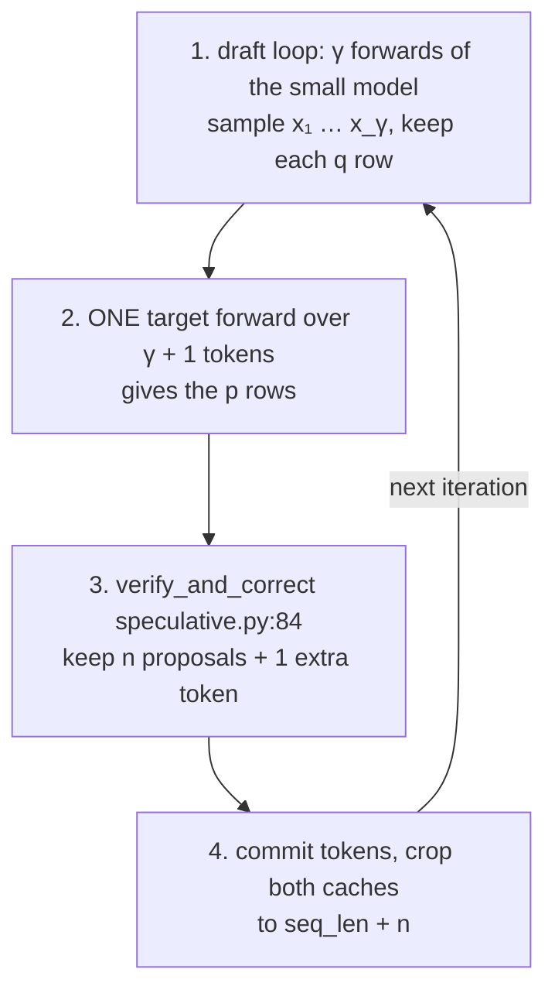
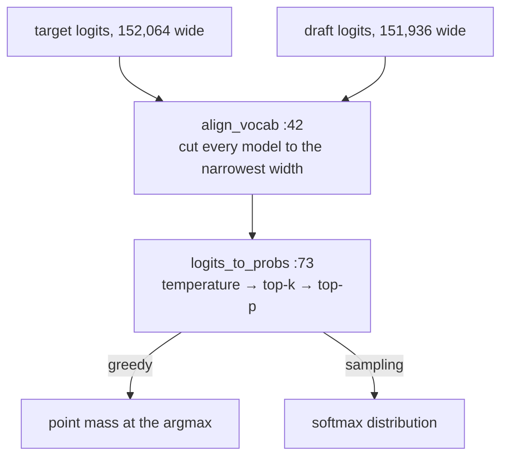
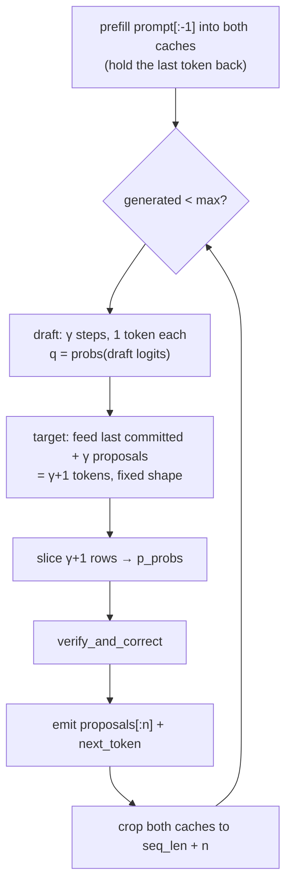
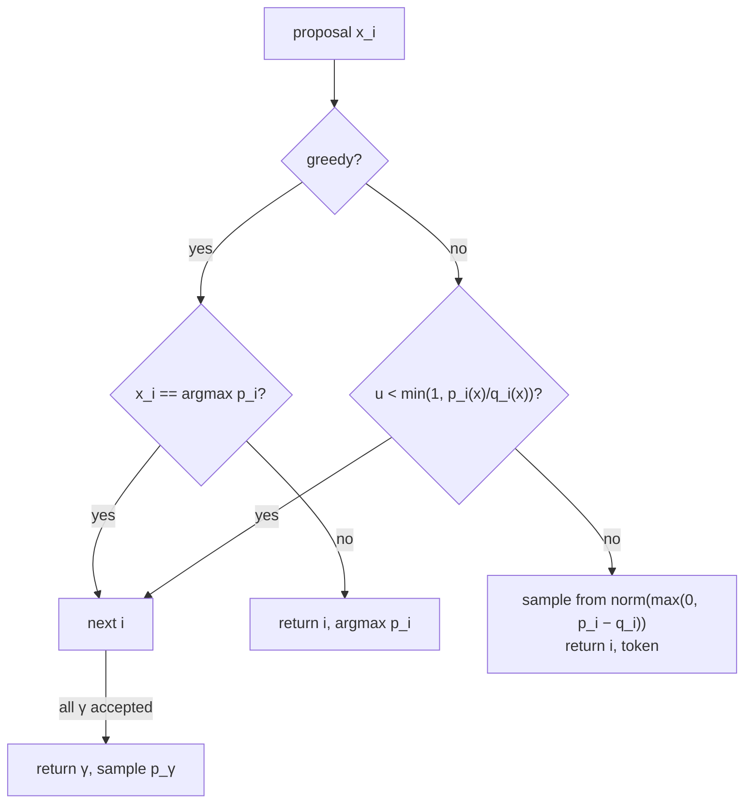
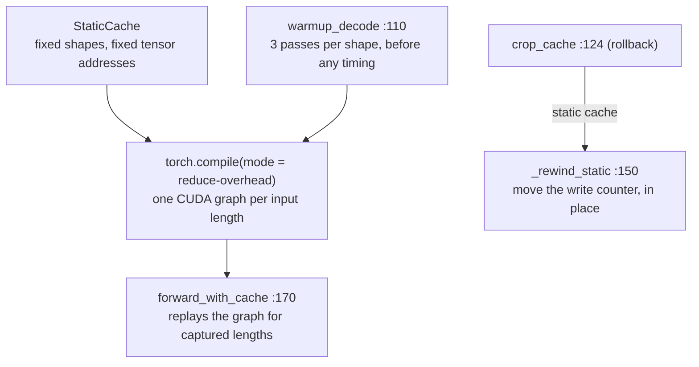

# Day 4 (Wed Nov 11): speculative decoding

Part of [[Interview plan (Nov 2026)]]. Repo `speculative_decoding` (branch `main`). About 7 h. Prep pack:
[[Speculative decoding - prep]] (diagram, numbers sheet, 60 questions).

**Code, explained:** the figures, the code to read and what each snippet does are in [[#Code, explained]], right after section B.

**Resume bullets:**
- "Accelerated LLM inference by **2.25×** using fixed-depth speculative decoding with Qwen2.5-0.5B drafting Qwen2.5-14B, reaching **2.60×** on code workloads while preserving the target distribution."
- "Performed draft-model and depth ablations across three draft models and a range of depths…"

**By tonight you can:**
- prove that speculative sampling preserves the target distribution;
- derive the expected tokens per step and the speedup formula;
- explain the 0.88× → 2.25× story with the code;
- answer "why not Medusa or EAGLE".

## Schedule

| # | Time | Kind | What |
|---|---|---|---|
| 0 | 15 min | recall | Days 1–3: online softmax, the 7.41× context story, the roofline |
| 1 | 30 min | read | The prep pack's pitch and diagram; RESULTS.md headline table |
| 2 | 75 min | theory + maths | The algorithm, the proof, the speedup formula (A1, A2) |
| 3 | 45 min | code | `sampling.py`, `verify_and_correct` (B1) |
| 4 | 75 min | rebuild | Speculative sampling in NumPy, with a Monte-Carlo proof (C) |
| — | lunch | | |
| 5 | 60 min | code | `SpeculativeDecoder.generate`, KV rollback (B2) |
| 6 | 30 min | theory | Why batch-1 decode is launch-bound; StaticCache, torch.compile, CUDA graphs (A3) |
| 7 | 40 min | code | `cache_utils.py`, `compile_utils.py` (B3) |
| 8 | 30 min | theory | Medusa, EAGLE and tree drafting: why not (A4) |
| 9 | 20 min | skim | `stats.py`, `controller.py`, `models.py`, `baseline.py` |
| 10 | 20 min | trace | The KV-rollback trace (D) |
| 11 | 40 min | practice | The questions (E), plus the prep pack's hostile follow-ups |

## A. Theory and maths

### A1. The algorithm (read: Leviathan et al. 2023, §2–3 and Appendix A; Chen et al. 2023, Algorithm 2)

**Optional extras:**
- Jay Mody's blog post *"Speculative Sampling"* (jaykmody.com): a short NumPy implementation, perfect before block 4;
- a 20-minute explainer video: search YouTube for *"Speculative Decoding: When Two LLMs are Faster than One"* (Efficient NLP channel).

One iteration, with draft distribution `q` and target distribution `p`:
1. The draft model generates γ tokens autoregressively: `x₁ … x_γ`, each from `q(·|prefix)`.
2. The target model scores **all γ+1 positions in one forward pass**, giving `p₁ … p_{γ+1}`.
3. For i = 1 … γ: accept `x_i` with probability `min(1, p_i(x_i) / q_i(x_i))`. On the first rejection, sample a
   replacement from the **residual** `norm(max(0, p_i − q_i))` and stop.
4. If all γ are accepted, sample one **bonus** token from `p_{γ+1}`.

So each iteration yields between 1 and γ+1 tokens, for one target forward pass.

### A2. The maths (75 min with A1; do it on paper)

**Proof that the output is distributed exactly as `p`** (one position):
- P(output = x) = P(draft x and accept) + P(reject) · P(residual gives x)
- = `q(x)·min(1, p(x)/q(x))` + `(1 − β) · max(0, p(x) − q(x)) / Σ_y max(0, p(y) − q(y))`
- where β = Σ_y min(p(y), q(y)) is the total acceptance probability.
- Key identity: `Σ_y max(0, p − q) = 1 − Σ_y min(p, q) = 1 − β`. So the second term is just `max(0, p(x) − q(x))`.
- Total: `min(p(x), q(x)) + max(0, p(x) − q(x)) = p(x)`. ∎

**Acceptance rate:** α = E[β] = 1 − TV(p, q), where TV is the total-variation distance. The closer the draft is to the target, the higher α.

**Expected tokens per iteration** (if each position is accepted independently with probability α):
`E[tokens] = 1 + α + α² + … + α^γ = (1 − α^{γ+1}) / (1 − α)`.

**Speedup** with cost ratio `c = (draft forward time) / (target forward time)`:
`speedup = E[tokens] / (γ·c + 1)`. You pay γ draft passes plus one target pass per iteration.

**Worked with your numbers** (per-layer times from `RESULTS.md`, around lines 88–104; take α = 0.8, γ = 4):
- E = (1 − 0.8⁵)/0.2 = **3.36** tokens per iteration.
- **Eager:** draft 24 layers × 0.82 ms = 19.7 ms; target 48 × 0.81 = 39 ms; c ≈ 0.5. Speedup = 3.36 / (4·0.5 + 1) = **1.12×**.
  With your first 7B target (28 layers) and 1.5B draft (28 layers), c ≈ 1, so speedup = 3.36 / 5 ≈ **0.67×**. That is your 0.88× story.
- **Compiled:** draft 24 × 0.098 = 2.35 ms; target 48 × 0.223 = 10.7 ms; c ≈ 0.22. Speedup = 3.36 / 1.88 ≈ **1.79×**.
- You measured **2.25×**, above the formula (1.89× with your real α). Acceptance is **bursty**, not independent: easy
  stretches (code) accept long runs (RESULTS.md).
- **Best γ:** maximise `E(γ)/(γc + 1)`. A higher α (code) favours a larger γ (8 → 2.60×). A lower α (chat) favours a
  small γ; at γ = 16, chat runs at 0.82×.

### A3. Why decode was launch-bound (block 6, 30 min)

**Read:** the PyTorch blog *"Accelerating Generative AI with PyTorch II: GPT, Fast"* (gpt-fast). It covers the static KV cache,
`torch.compile(mode="reduce-overhead")` and speculative decoding, the same three ideas as your fix.

**Concepts:**
- **Eager mode** launches each small kernel from Python. At batch 1, the GPU finishes each kernel faster than the CPU can launch the next, so time ≈ layers × per-layer launch cost, whatever the model width (0.81 ms per layer for 0.5B *and* 14B).
- **A StaticCache** gives fixed tensor shapes, so a compiled graph can be reused.
- **`reduce-overhead`** captures **CUDA graphs**: the whole kernel sequence is replayed with one launch.
- Because of this, the target moved to 14B, with **48 layers vs the draft's 24**: speculation pays only when `c` is small.

### A4. Why not Medusa, EAGLE or tree drafting (block 8, 30 min)

Read the abstract and first figure of each:
- **Medusa** (Cai et al., 2024): extra decoding heads on the target; needs training.
- **EAGLE** (Li et al., 2024): a small draft head on the target's features; needs training.
- **Tree drafting / SpecInfer** (Miao et al., 2024): verify several candidate branches at once with a tree attention mask.

**Your honest answer:** these need training, or bigger engine changes for tree masks. A separate off-the-shelf draft
from the same family (shared tokenizer) needs neither, and it isolates the systems question. Tree drafting is the
listed next step (PROGRESS §7).

## B. Code

### B1. Sampling and verification (block 3, 45 min, deep)

- `sampling.py`:
  - 73 `logits_to_probs` (temperature, top-p);
  - **42 `align_vocab`**: Qwen 0.5B and 14B have different vocab sizes. What does it pad, and why must `p` and `q` share an index space?
  - 113 `sample_from_probs`, 131 `uniform_scalar`.
- `speculative.py` **84 `verify_and_correct`**: map it line by line to A1.
  - The greedy special case (around line 120): `p` is a point mass, so accept iff the draft equals the argmax.
  - `acceptance_prob = min(1, p/q)` (around line 129).
  - The residual is `clamp(p − q, min=0)` (around line 133), and its fallback when the residual sums to 0.

### B2. The decode loop (block 5, 60 min, deep)

`speculative.py`:
- 147 `SpeculativeDecoder`, 156 `__init__`;
- 181 `decode_shapes`: why the shapes are fixed;
- 204 `compile`;
- **246 `generate`**: the draft loop, the single verify pass over γ+1 positions, how many tokens are emitted, and the bonus token.

Tests to read alongside: `tests/test_engine_correctness.py` and `tests/test_sampling.py`. They show how "preserves the
distribution" is *tested* despite bf16 noise (the noise-floor method; see the prep pack).

### B3. Cache and compile (block 7, 40 min, deep)

- `cache_utils.py`:
  - 34 `KVCache`, 70 `CachePool`;
  - **124 `crop_cache`**, 150 `_rewind_static`: rolling back rejected draft positions;
  - 170 `forward_with_cache`.
- `compile_utils.py`: 45 `compile_decode`, 110 `warmup_decode`. Why warm-up matters for honest timing.

## Code, explained

Read this **with the files open**. It starts with a picture of the whole day and **the flow, step by step** (one concrete input followed through every function). Then each part has its own figure, the exact code (copied from the repo at the commit named below, so the line numbers match) and what that code does.

Repo `speculative_decoding`, branch `main` (`99ed1c2`), package
`src/specdec/`.

**One iteration in one picture:** the draft guesses γ tokens one at a time; the target checks all of them in one
pass; the accept/reject rule keeps a prefix and adds one token; both caches are cut back to what was kept.



### The flow, step by step

One iteration with **greedy decoding, γ = 4** and a **100-token prompt**.

1. **Prefill, holding the last token back.** Both models run over prompt tokens 0–98 (`speculative.py:321–326`). Both caches now hold **99** positions.
2. **Draft γ = 4 tokens.** `pending = cur_ids[99:]` is token 99 (the held-back token). The draft runs 1 token at a time: x₁ from token 99, then x₂, x₃, x₄ (`:341–356`). Each proposal and its `q` row are kept.
3. **One target pass over 5 tokens.** `t_len = 99`, `feed = [token 99, x₁, x₂, x₃, x₄]` (`:361–363`), so **5 rows** of logits. `lo = seq_len − 1 − t_len = 100 − 1 − 99 = 0`, so `p_probs` = rows 0–4: the target's prediction at each proposal, plus the bonus row.
4. **Accept or reject** (`verify_and_correct`, `:84`). Suppose the target's argmaxes are `[x₁, x₂, c, …]`. x₁ matches, x₂ matches, x₃ ≠ c → it returns **(2, c)**.
5. **Commit.** `emitted = [x₁, x₂, c]`, so the sequence is now 103 tokens. `keep = seq_len + n_accepted = 100 + 2 = 102`. The target cache is cropped 104 → 102, the draft cache 103 → 102 (`:388–396`).
6. **Why 102 and not 103?** Position 102 holds `c`, which neither model has computed K, V for yet. Next iteration, the target feeds `cur_ids[102:] + 4 proposals` = **5 tokens again**. The shape never changes, which is what lets each step be a captured CUDA graph.

Result: 3 tokens for one target pass. With perfect agreement you'd get 5 (4 proposals + the bonus).

---

### 1. Turning logits into the distributions p and q



`src/specdec/sampling.py:64–70`
```python
width = logits.shape[-1]
if width == vocab_size:
    return logits
if width > vocab_size:
    return logits[..., :vocab_size]
pad = logits.new_full((*logits.shape[:-1], vocab_size - width), NEG_INF)
return torch.cat([logits, pad], dim=-1)
```

- The 14B target and the 0.5B draft have **different embedding widths** (152064 vs 151936) even though they share a tokenizer. The accept rule compares `p[x]` and `q[x]`, so both must index the same vocabulary. Every model's logits are cut to the **narrowest** width. Widening instead would let the target sample an id the draft can't embed, and the draft would crash with an `IndexError`.

`src/specdec/sampling.py:80–106`
```python
logits = logits.float()

if cfg.is_greedy:
    probs = torch.zeros_like(logits)
    probs.scatter_(-1, logits.argmax(dim=-1, keepdim=True), 1.0)
    return probs

logits = logits / cfg.temperature

if cfg.top_k is not None:
    k = min(cfg.top_k, logits.shape[-1])
    kth = torch.topk(logits, k, dim=-1).values[..., -1:]
    logits = logits.masked_fill(logits < kth, NEG_INF)

if cfg.top_p is not None and cfg.top_p < 1.0:
    sorted_logits, sorted_idx = torch.sort(logits, descending=True, dim=-1)
    sorted_probs = torch.softmax(sorted_logits, dim=-1)
    # Keep the minimal prefix whose cumulative mass reaches top_p. Using the
    # *exclusive* cumsum keeps the token that crosses the threshold, and the
    # top-1 token is always kept even if it alone exceeds top_p.
    exclusive_cum = sorted_probs.cumsum(dim=-1) - sorted_probs
    drop_sorted = exclusive_cum >= cfg.top_p
    drop_sorted[..., 0] = False
    drop = drop_sorted.scatter(-1, sorted_idx, drop_sorted)
    logits = logits.masked_fill(drop, NEG_INF)

return torch.softmax(logits, dim=-1)
```

- Greedy decoding is a **point mass**: probability 1 at the argmax. That makes the general rule below collapse to "accept iff the draft guessed the argmax".
- Otherwise: temperature, then top-k, then top-p, in Hugging Face's order, so the baseline matches `model.generate`. The top-p trick: an *exclusive* cumulative sum keeps the token that crosses the threshold.

---

### 2. The decode loop: `SpeculativeDecoder.generate`



`src/specdec/speculative.py:321–326`
```python
prefill = cur_ids[: prompt_len - 1]
if prefill.numel():
    forward_with_cache(self.target.model, target_cache, prefill, 0)
    forward_with_cache(self.draft.model, draft_cache, prefill, 0)
    n_target_fwd += 1
    n_draft_fwd += 1
```

- **Hold the last prompt token back.** Both caches start one position behind the sequence. So verification always feeds exactly *last committed token + γ proposals* = **γ+1 tokens**, every time. Fixed shapes are what make CUDA graphs possible (section 4).

`src/specdec/speculative.py:341–356`
```python
draft_tokens: list[torch.Tensor] = []
q_rows: list[torch.Tensor] = []
pos = cache_length(draft_cache)
pending = cur_ids[pos:]
for _ in range(gamma):
    logits = forward_with_cache(self.draft.model, draft_cache, pending, pos)[-1]
    n_draft_fwd += 1
    pos += int(pending.numel())
    q = logits_to_probs(align_vocab(logits, self.vocab_size), cfg)
    x = sample_from_probs(q, generator)
    draft_tokens.append(x)
    q_rows.append(q)
    pending = x.view(1)

proposals = torch.stack(draft_tokens)
q_probs = torch.stack(q_rows)
```

- The draft runs γ forward passes of 1 token each (the first may be 2 tokens after a full accept; see `decode_shapes`). It **samples** each proposal from its own `q` and keeps every `q` row for the accept test.

`src/specdec/speculative.py:361–371`
```python
t_len = cache_length(target_cache)
feed = torch.cat([cur_ids[t_len:], proposals])
logits = forward_with_cache(self.target.model, target_cache, feed, t_len)
n_target_fwd += 1
# Row j predicts the token after absolute position t_len + j. We need
# predictions for absolute positions seq_len-1 .. seq_len+gamma-1,
# giving the gamma proposal distributions plus the bonus row.
lo = seq_len - 1 - t_len
p_probs = logits_to_probs(
    align_vocab(logits[lo : lo + gamma + 1], self.vocab_size), cfg
)
```

- **One target forward over γ+1 tokens** gives γ+1 rows of logits: row j predicts the token after position `t_len + j`. Rows 0..γ−1 are `p` at each proposal; row γ is the **bonus** distribution, a free extra token if everything is accepted.

`src/specdec/speculative.py:374–376`
```python
n_accepted, next_token = verify_and_correct(
    proposals, q_probs, p_probs, cfg, generator
)
```

`src/specdec/speculative.py:388–396`
```python
emitted = torch.cat([proposals[:n_accepted], next_token.view(1)])

# --- 4. Commit, and roll the caches back to what we kept. ----------
# K/V for rejected proposals were computed for tokens that are not
# part of the sequence; they must not leak into later attention.
cur_ids = torch.cat([cur_ids, emitted])
keep = seq_len + n_accepted
crop_cache(target_cache, keep)
crop_cache(draft_cache, keep)
```

- Emit `n_accepted` proposals + 1 token, so each iteration yields **between 1 and γ+1 tokens** for one target pass.
- `keep = seq_len + n_accepted`, **not** `+ 1`: the new `next_token` has no K,V in either cache yet. It becomes the "last committed token" fed at the start of the next iteration, which is exactly what the shape trick expects.

---

### 3. The accept/reject rule: `verify_and_correct`



`src/specdec/speculative.py:115–144`
```python
for i in range(k):
    x = draft_tokens[i]
    p_i, q_i = p_probs[i], q_probs[i]

    if cfg.is_greedy:
        # p is a point mass at argmax, so the general rule below degenerates
        # to exact agreement: accept iff the draft guessed the target's
        # argmax, else emit that argmax. Special-cased for clarity and to
        # avoid burning entropy on a coin flip whose outcome is determined.
        target_token = p_i.argmax()
        if bool(x == target_token):
            continue
        return i, target_token

    acceptance_prob = min(1.0, float(p_i[x]) / float(q_i[x]))
    if uniform_scalar(generator, p_probs.device) < acceptance_prob:
        continue

    residual = torch.clamp(p_i - q_i, min=0.0)
    total = residual.sum()
    if bool(total <= 0):
        # Unreachable in exact arithmetic: sum (p-q)_+ == 0 implies p == q,
        # which would have accepted with probability 1. Only float noise can
        # land here, and p is the right answer in that limit.
        residual, total = p_i, p_i.sum()
    return i, sample_from_probs(residual / total, generator)

# Every proposal accepted: the verification pass already gave us the target
# distribution one position further along, so we get a token for free.
return k, sample_from_probs(p_probs[k], generator)
```

Map each line to the algorithm:
- `acceptance_prob = min(1, p(x)/q(x))`: if the target likes x at least as much as the draft did, always accept; otherwise accept with probability p/q.
- On rejection, sample from the **residual** `max(0, p − q)`, renormalised. This is the part that makes the output exactly `p`: accepted mass `min(p, q)` plus residual mass `max(0, p − q)` sums to `p(x)` (Day 4 A2 proof).
- The `total <= 0` branch only fires on floating-point noise: a zero residual means `p == q`, which would have been accepted.
- Falling out of the loop means all γ were accepted, so take the bonus token from `p_probs[k]`.

**Check yourself:** greedy, γ = 4, the target's argmaxes are `[a, b, c, d, e]` and the draft proposed `[a, b, z, d]`. What does `verify_and_correct` return, and how many tokens are emitted? (*`(2, c)`; 3 tokens: a, b, c.*)

---

### 4. Rollback and the 0.88× → 2.25× fix



`src/specdec/cache_utils.py:137–146`
```python
if length >= cache.length:
    return
if cache.static:
    _rewind_static(cache.backend, length)
else:
    # Passing the delta as a negative number means "remove this many
    # tokens", which is the only spelling accepted across both the
    # transformers 4.x and 5.x cache APIs.
    cache.backend.crop(length - cache.length)
cache.length = length
```

`src/specdec/cache_utils.py:163–166`
```python
for layer in backend.layers:
    counter = getattr(layer, "cumulative_length", None)
    if counter is not None:
        counter.fill_(length)
```

- **Rollback without erasing.** On the static cache, `crop` just moves each layer's write counter back. Stale K,V above it are harmless: the next forward overwrites them before attention reads them, and the causal mask hides anything above the query's position.
- `fill_` changes the counter **in place**. A CUDA graph is bound to the tensor addresses it recorded, so making a new tensor would silently break every captured graph.

`src/specdec/cache_utils.py:185–189`
```python
if cache.length != start_pos:
    raise ValueError(
        f"cache holds {cache.length} positions but forward starts at {start_pos}; "
        "cache and sequence have drifted out of sync"
    )
```

- A guard against the most dangerous bug in this design: the cache length drifting away from the sequence. It fails loudly instead of attending to the wrong positions.

`src/specdec/compile_utils.py:87–91`
```python
model._specdec_compiled_forward = torch.compile(
    model.forward, mode=mode, fullgraph=fullgraph, dynamic=False
)
model._specdec_decode_shapes = shapes
model._specdec_compile_mode = mode
```

`src/specdec/compile_utils.py:131–139`
```python
for n in sorted(frozenset(int(s) for s in shapes)):
    # Three passes per shape: the first compiles, and cudagraph trees needs
    # a couple more before it is replaying rather than still recording.
    for _ in range(3):
        cache = cache_factory()  # acquiring from a pool already resets it
        forward_with_cache(model, cache, torch.randint(0, vocab, (prefix_len,), device=device), 0)
        forward_with_cache(model, cache, torch.randint(0, vocab, (n,), device=device), prefix_len)
        reset_cache(cache)
torch.cuda.synchronize()
```

- **Why it was 0.88× in eager mode:** at batch 1, each layer is a handful of tiny kernels, and Python launches them one by one. The GPU finishes each faster than the CPU can launch the next, so a step costs about *layers × launch time*, whatever the model's width. A 1.5B draft with 28 layers then costs as much as a 7B target with 28 layers, and speculation can't win.
- **The fix:** a `StaticCache` (fixed shapes and addresses) + `torch.compile(mode="reduce-overhead")`, which records each step as a CUDA graph and replays it with one launch. Then a 14B target (48 layers) against a 0.5B draft (24 layers) makes the cost ratio `c` small.
- `warmup_decode` compiles and records each shape **before** timing. Otherwise the benchmark would charge compile time to whichever arm ran first.

## C. Rebuild it yourself (block 4, 75 min)

In NumPy, about 60 lines:
1. Make a random target distribution `p` and draft `q` over a vocab of 50 (for example, softmaxes of correlated logits).
2. Implement `verify(p, q, x)` exactly as in A1, with the residual.
3. **Monte-Carlo proof:** run 10⁶ single-token rounds (draft x ~ q, then verify). Show the histogram of outputs matches `p`
   (TV distance < 0.005). Then break it: use `max(p, q)` instead of the residual, and watch the TV grow.
4. Simulate full iterations with γ = 1…16 and a fixed per-position α. Plot the empirical tokens per iteration against
   `(1 − α^{γ+1})/(1 − α)`.
5. Plug in c = 0.22 and c = 0.5 and plot speedup against γ. Find the best γ for α = 0.6 and for α = 0.85.

## D. Trace (block 10, 20 min)

γ = 4, prefix length 100. Tokens 1–2 are accepted, token 3 is rejected and resampled. Write down:
- the length of the target KV cache and of the draft KV cache right after the verify pass;
- what `crop_cache` cuts each one to;
- which tokens still need their KV computed next iteration.

## E. Questions

1. Prove that speculative sampling doesn't change the output distribution.
2. Derive the expected accepted tokens. Why did you measure more than the formula predicts?
3. Your first version was 0.88×, slower than no speculation. Why, and how did you fix it?
4. Why a 14B target and not 7B? Why the 0.5B draft and not 1.5B?
5. Why does the speedup depend on the domain (code 2.25–2.60×, chat 1.42×)?
6. How do you choose γ? What happens at γ = 16 for chat?
7. Greedy outputs aren't bit-identical to the baseline. Is your implementation wrong? (*No: bf16 batch-width noise changes logits by about 0.25. Tests measure the noise floor.*)
8. Why did you cut the adaptive controller? (*Drafts didn't separate by domain, so there was nothing to switch between. Depth does matter, so a depth controller is the follow-up.*)
9. Draft and target vocab sizes differ. How do you handle it?
10. Why not Medusa or EAGLE?
11. How does this interact with batching? (*At large batch, decode becomes compute-bound and the spare compute that speculation uses disappears.*)
12. Hostile: "2.25× on one prompt set, at batch 1. Is that a real-world number?"

## My notes and fumbles

- 
