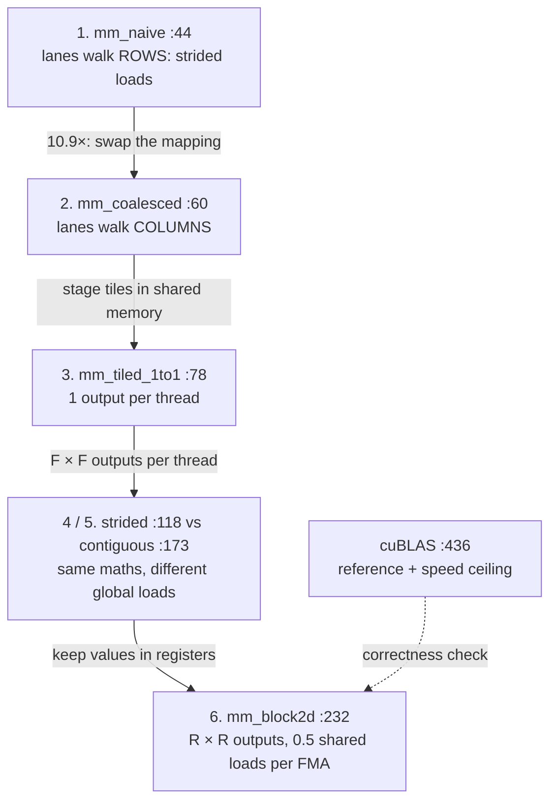
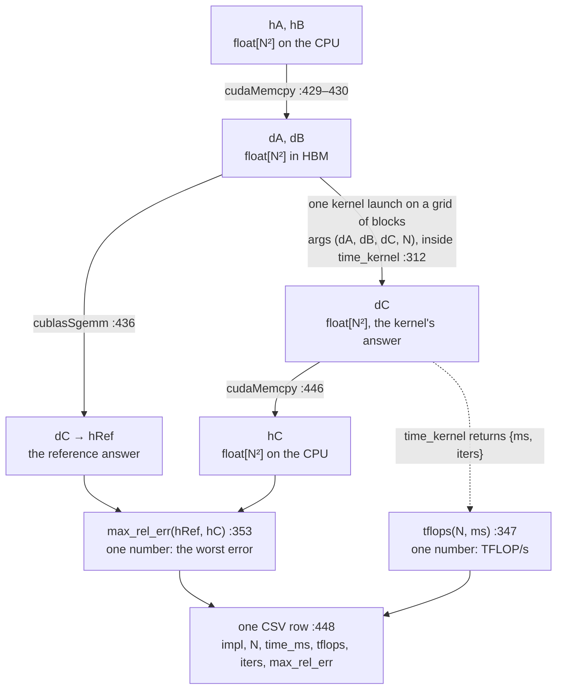
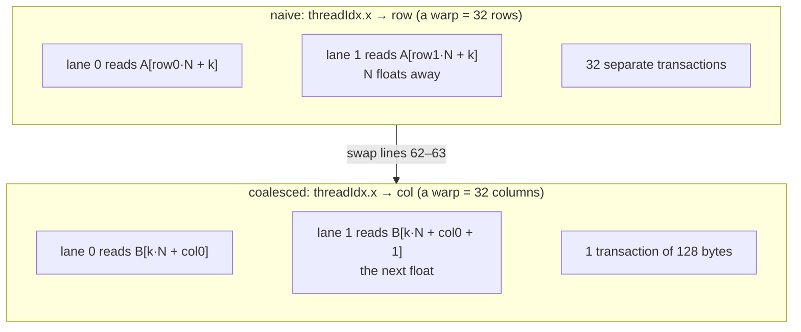
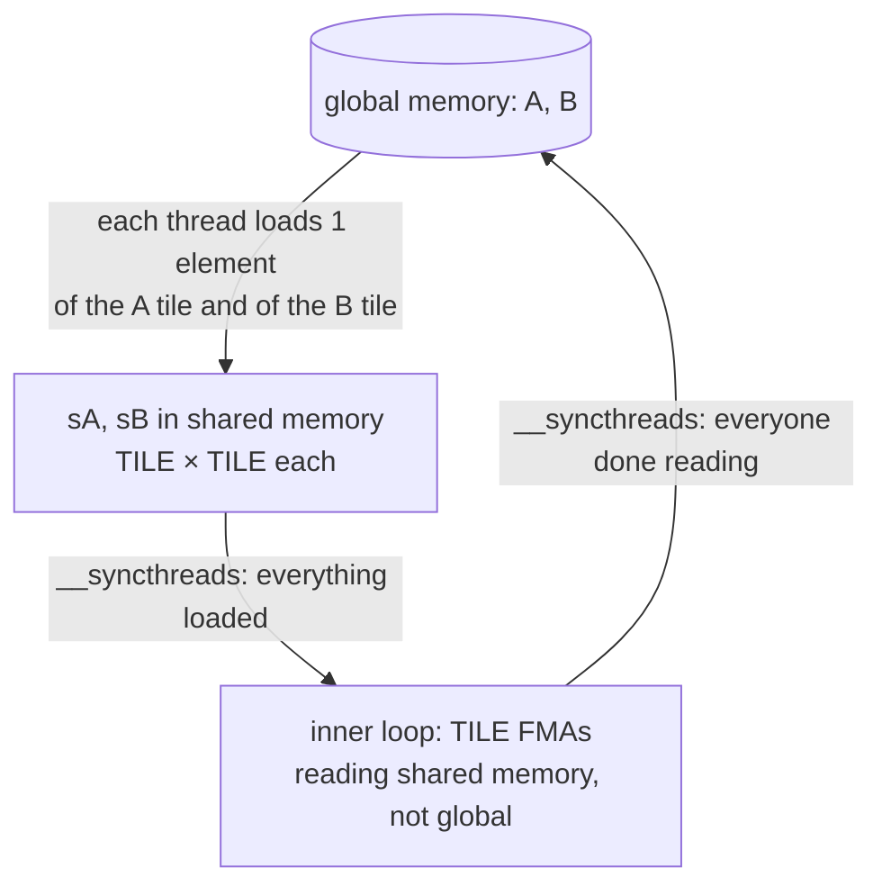
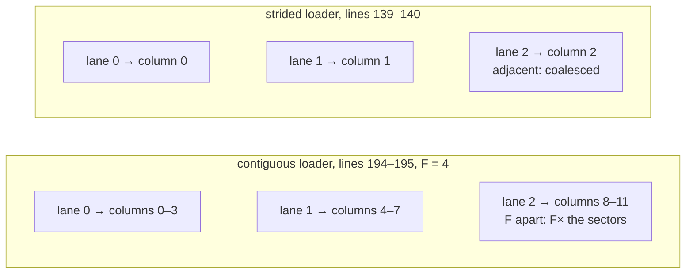
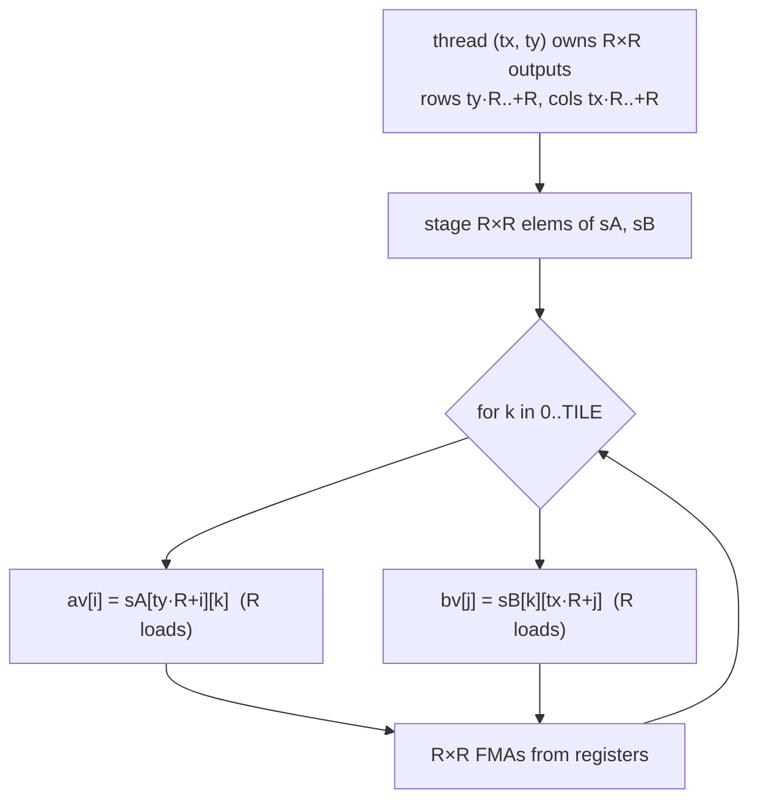

# Day 5 (Thu Nov 12): CUDA I: the GPU, and the matmul kernel chain (PA2)

Part of [[Interview plan (Nov 2026)]]. Repo `sysml` (branch `main`, one commit `16870fb`). About 7 h. Prep pack:
[[CUDA kernels - prep]] (architecture §2, decisions §3, stories §4, numbers §5, 50 questions §7).


**How this note is built:** one study guide, [[#Study guide]]. Each part goes *idea → tiny example → formula → the code → every variable with its shape → the code traced on small numbers → where the output goes next → questions → check*. Theory and code are never in separate sections.


**Resume bullet (part 1 of 2, both resumes):** "Optimized CUDA matrix multiplication through coalescing, shared-memory tiling, and
2D register blocking, achieving **51.3×** speedup over the naive GPU kernel and **48.2%** of cuBLAS performance on an H200."
Today covers this bullet. Streams, checkpointing and FlashAttention are tomorrow ([[Day 06 - CUDA II]]).

**Before you start, know two repo facts** (prep pack, "Read this first"):
- git has **one commit**, so all "history" comes from `RESULTS.md` and code comments;
- folders were renamed after the runs (`pa2_matmul/` → `matmul/`), so `SETUP.md`'s build commands fail as written.

**By tonight you can:**
- explain SMs, warps, the memory hierarchy, coalescing, bank conflicts and occupancy;
- say which thread computes which output, and the global loads per output, for every kernel;
- derive 51.3× and 48.2% from the CSV, and say what each is measured against;
- write a shared-memory tiled matmul from scratch.

## Schedule

| # | Time | Kind | What |
|---|---|---|---|
| 0 | 15 min | recall | Day 4: the speedup formula, why decode was launch-bound |
| 1 | 20 min | read | Prep pack §1 pitch and §2 diagram (the PA2 line only) |
| 2 | 30 min | guide | [[#Part 1. The whole pipeline in shapes]] |
| 3 | 75 min | guide | [[#Part 2. The execution model and the index line (mm_naive)]] and [[#Part 3. Coalescing (mm_naive to mm_coalesced)]] |
| 4 | 60 min | guide | [[#Part 4. Shared-memory tiling (mm_tiled_1to1)]] |
| — | lunch | | |
| 5 | 60 min | guide | [[#Part 5. Several outputs per thread (strided vs contiguous tiles)]] and [[#Part 6. 2D register blocking (mm_block2d)]] |
| 6 | 30 min | guide | [[#Part 7. The harness (reference, timing, check)]] |
| 7 | 30 min | guide | [[#Part 8. The roofline and the headline numbers]] |
| 8 | 60 min | rebuild | A tiled matmul, and a load counter (C) |
| 9 | 20 min | trace | Thread → output mapping by hand (D) |
| 10 | 40 min | practice | The questions (E) and the prep pack's §7 "Matmul" set |

Optional outside reading is listed in [[#Sources, and what they say]]. The guide does not need it.

## Study guide

Read this **with the file open**: repo `sysml`, `matmul/matmul_bench.cu` (one commit, `16870fb`). Every code block is copied from that commit, so the line numbers match.

**The chain, and the one question behind each step:** *where does each operand come from, and how many times?*



**Two running examples, used in every part.**

1. **The toy** (small enough to compute by hand): N = 4.

$$A = \begin{bmatrix}1&2&0&1\\0&1&2&1\\2&0&1&0\\1&1&0&2\end{bmatrix}\quad B = \begin{bmatrix}1&0&2&1\\2&1&0&0\\0&1&1&2\\1&2&0&1\end{bmatrix}\quad C = A \cdot B = \begin{bmatrix}6&4&2&2\\3&5&2&5\\2&1&5&4\\5&5&2&3\end{bmatrix}$$

   Every part follows the thread that computes **C[0][3] = 2** (or the patch that holds it).

2. **The real run:** N = 32768 on the H200. Every part follows block (bx = 2, by = 1) and one thread in it.

**How each code block is explained.** After each block you get three things, always in this order:
- **Variables and shapes:** every name in the code, its shape, what it holds, and its value in the two examples;
- **Traced:** the code run line by line on the toy, showing each value change;
- **Where the output goes:** which function or line uses the result next.

---

### Part 1. The whole pipeline in shapes

> [!important] The one sentence to hold on to
> Three flat arrays of N² floats live on the GPU (`dA`, `dB`, `dC`); every kernel reads `dA` and `dB`, writes `dC`, and
> `dC` is then copied back and compared with the cuBLAS answer.

#### 1.1 A matrix is one flat array

The code never has a 2-D matrix. Each N × N matrix is **one array of N² floats**, stored row after row (**row-major**).
Element (i, j) sits at index `i * N + j`.

Toy, N = 4: `A[1][2]` sits at index 1 · 4 + 2 = **6**.

| index | 0 | 1 | 2 | 3 | 4 | 5 | 6 | 7 | 8 | … | 15 |
|---|---|---|---|---|---|---|---|---|---|---|---|
| flat A | 1 | 2 | 0 | 1 | 0 | 1 | **2** | 1 | 2 | … | 2 |
| (i, j) | (0,0) | (0,1) | (0,2) | (0,3) | (1,0) | (1,1) | **(1,2)** | (1,3) | (2,0) | … | (3,3) |

Two facts follow, and the whole day uses them:
- moving **along a row** (j + 1) moves **1 float** in memory;
- moving **down a column** (i + 1) moves **N floats** in memory.

#### 1.2 The code: allocate, fill, upload

`matmul/matmul_bench.cu:408–430`
```cpp
for (int N : sizes) {
    size_t elems = (size_t)N * N;
    size_t bytes = elems * sizeof(float);
    ...
    float* hA = (float*)malloc(bytes);
    float* hB = (float*)malloc(bytes);
    float* hC = (float*)malloc(bytes);
    float* hRef = (float*)malloc(bytes);
    ...
    for (size_t i = 0; i < elems; ++i) {
        hA[i] = (float)((i * 1103515245u + 12345u) % 1000) / 1000.0f - 0.5f;
        hB[i] = (float)((i * 1664525u + 1013904223u) % 1000) / 1000.0f - 0.5f;
    }

    float *dA, *dB, *dC;
    CUDA_CHECK(cudaMalloc(&dA, bytes));
    CUDA_CHECK(cudaMalloc(&dB, bytes));
    CUDA_CHECK(cudaMalloc(&dC, bytes));
    CUDA_CHECK(cudaMemcpy(dA, hA, bytes, cudaMemcpyHostToDevice));
    CUDA_CHECK(cudaMemcpy(dB, hB, bytes, cudaMemcpyHostToDevice));
```

**Variables and shapes**

| name | shape | what it holds | toy (N = 4) | real (N = 32768) |
|---|---|---|---|---|
| `N` | scalar | matrix side | 4 | 32,768 |
| `elems` | scalar | floats per matrix, N² | 16 | 1,073,741,824 |
| `bytes` | scalar | 4 · elems | 64 B | 4.29 GB |
| `hA`, `hB` | float[N²], CPU | the inputs, row-major | the flat arrays above | values in [−0.5, 0.499] |
| `hC` | float[N²], CPU | a kernel's answer, copied back | | |
| `hRef` | float[N²], CPU | the cuBLAS answer (the reference) | | |
| `dA`, `dB` | float[N²], GPU | copies of `hA`, `hB` in HBM | | 4.29 GB each |
| `dC` | float[N²], GPU | the output; every kernel overwrites it | | 4.29 GB |

`h` means host (CPU), `d` means device (GPU). The fill is a cheap pseudo-random formula: `(i · constant) mod 1000` gives 0…999; ÷ 1000 − 0.5 gives a float in [−0.5, 0.499].

#### 1.3 The code: launch one kernel

`matmul/matmul_bench.cu:454–455, 460, 479–482`
```cpp
dim3 b32(32, 32);
dim3 g32((N + 31) / 32, (N + 31) / 32);
...
record("gpu_naive", time_kernel([&]{ mm_naive<<<g32,b32>>>(dA,dB,dC,N); }, 1, iters, budget));
...
{   // TILE = 64, R = 4 -> 16x16 threads, 16 outputs each
    dim3 gb((N + 63) / 64, (N + 63) / 64);
    dim3 bb(16, 16);
    record("block2d_t64r4", time_kernel([&]{ mm_block2d<64,4><<<gb,bb>>>(dA,dB,dC,N); }, 1, iters, budget));
```

`kernel<<<grid, block>>>(args)` starts `grid.x · grid.y` blocks, each with `block.x · block.y` threads. `(N + 31) / 32` is "N ÷ 32, rounded up".

**Shapes of every launch at N = 32768** (outputs per block must tile the 32768 × 32768 matrix C):

| kernel | grid (blocks) | block (threads) | outputs per thread | outputs per block |
|---|---|---|---|---|
| `mm_naive`, `mm_coalesced` | 1024 × 1024 | 32 × 32 | 1 | 32 × 32 |
| `mm_tiled_1to1<32>` | 1024 × 1024 | 32 × 32 | 1 | 32 × 32 |
| `mm_tiled_strided<64,32>`, `mm_tiled_contiguous<64,32>` | 512 × 512 | 32 × 32 | 2 × 2 | 64 × 64 |
| `mm_block2d<64,2>` | 512 × 512 | 32 × 32 | 2 × 2 | 64 × 64 |
| `mm_block2d<64,4>` | 512 × 512 | 16 × 16 | 4 × 4 | 64 × 64 |

Check the first row: 1024 · 32 = 32,768 outputs per side. ✓ Check the last: 512 · 16 · 4 = 32,768. ✓

#### 1.4 Where everything goes



So one kernel run turns **two arrays of N² floats into one array of N² floats**, and the harness turns that into **two numbers**: a time and an error. Parts 2–6 are about the kernel box. Part 7 is about the two numbers. Part 8 turns the time into the resume's 51.3× and 48.2%.

#### 1.5 Check your understanding

1. At N = 4, which flat index holds `B[2][3]`? What value is there in the toy?
2. How many bytes is one matrix at N = 32768?
3. `mm_block2d<64,4>` launches a 512 × 512 grid of 16 × 16 blocks. How many threads is that in total? How many outputs does each own?
4. Which array holds the cuBLAS answer, and which holds a kernel's answer, on the CPU?

> [!success]- Answers
> 1. 2 · 4 + 3 = 11; the toy's flat B is `[1,0,2,1, 2,1,0,0, 0,1,1,2, 1,2,0,1]`, so index 11 holds **2**.
> 2. 32768² × 4 B = 4.29 GB.
> 3. 512² × 256 = 67,108,864 threads, 16 outputs each (67,108,864 × 16 = 32768²).
> 4. `hRef` (cuBLAS) and `hC` (the kernel).

---

### Part 2. The execution model and the index line (mm_naive)

Every kernel today is read with one question: *which thread does what, and where does its data come from?* This part builds the model, then reads the first kernel with it.

> [!important] The one sentence to hold on to
> A kernel launch is a **grid of blocks**; each block runs on one **SM**; the SM issues instructions for **32 threads
> at a time (a warp)**; each thread finds its own piece of work from `blockIdx`, `blockDim` and `threadIdx`.

#### 2.1 Why a GPU?

A CPU core runs one thread very fast. A GPU runs **thousands of simple threads** at once. The H200 has **132 SMs**
(streaming multiprocessors). Each SM has **128 FP32 lanes**. So it can do 132 × 128 = **16,896** float operations
per clock.

Matrix multiplication fits this well. Each of the N² outputs `C[row][col]` is independent. So we give each output
(or a small patch of outputs) to one thread.

#### 2.2 Grid → block → warp → thread

![[d5-6-hierarchy.svg]] [[d5-6-hierarchy.html|▶ Step through it]]

Four levels, from the top:
- **grid:** everything one launch runs. `mm_naive` at N = 32768 with 32 × 32 blocks has a grid of 1024 × 1024 blocks.
- **block:** a group of threads that runs on **one** SM. Its threads can share fast **shared memory** and wait for each other with `__syncthreads()`.
- **warp:** 32 consecutive threads of a block. They issue **the same instruction together**. This matters for memory: the 32 loads of one warp instruction are served together.
- **thread (lane):** one instance of the kernel code, with its own registers.

Which threads form a warp? Threads are numbered with `threadIdx.x` varying fastest. In a 32 × 32 block, warp 0 is
`threadIdx.y = 0, threadIdx.x = 0…31`; warp 1 is `threadIdx.y = 1`; and so on. **A warp = one value of `threadIdx.y`,
all 32 values of `threadIdx.x`.** Every coalescing argument today uses this fact.

**Who owns which part of C, at real size** (animated; blocks are sized by their real dimensions, no values):

![[d05s-grid.svg]] [[d05s-grid.html|▶ Step through it]]

#### 2.3 The memory ladder

| level | where | size (H200) | speed |
|---|---|---|---|
| registers | per thread | 65,536 × 4 B per SM | fastest, ~1 cycle |
| shared memory | per block, on the SM | up to 228 KB per SM | ~20–30 cycles |
| L2 cache | whole chip | about 50 MB | slower |
| HBM (global) | off the chip | 141 GB, 4.8 TB/s | ~hundreds of cycles |

Each optimisation today moves the hot data **one rung up** this ladder:
- coalescing makes each HBM transaction carry 32 useful floats instead of 1;
- tiling moves reuse from HBM into shared memory;
- register blocking moves reuse from shared memory into registers.

#### 2.4 The code: the whole naive kernel

`matmul/matmul_bench.cu:44–54`
```cpp
__global__ void mm_naive(const float* A, const float* B, float* C, int N)
{
    int row = blockIdx.x * blockDim.x + threadIdx.x;
    int col = blockIdx.y * blockDim.y + threadIdx.y;
    if (row >= N || col >= N) return;

    float acc = 0.0f;
    for (int k = 0; k < N; ++k)
        acc = fmaf(A[(size_t)row * N + k], B[(size_t)k * N + col], acc);
    C[(size_t)row * N + col] = acc;
}
```
> [!info] New functions in this code
> - `__global__ void kernel(...)`: marks a function as a **kernel**: it runs on the GPU and is started from the CPU with `kernel<<<grid, block>>>(args)`. Every thread of the launch runs the same body. [[Function glossary#CUDA global|→ examples]]
> - `blockIdx.x / .y / .z`: this block's position **inside the grid**. With 32 × 32 blocks at N = 32768, `blockIdx.x` goes 0…1023. [[Function glossary#blockIdx|→ examples]]
> - `blockDim.x / .y`: the block's size along each axis (32 for a 32 × 32 block). So `blockIdx.x * blockDim.x + threadIdx.x` is the global index: `2 · 32 + 5 = 69`. [[Function glossary#blockDim|→ examples]]
> - `threadIdx.x / .y / .z`: this thread's position **inside its block**. In a 32 × 32 block, `threadIdx.x` and `threadIdx.y` each go 0…31. A warp = 32 consecutive `threadIdx.x` with one `threadIdx.y`. [[Function glossary#threadIdx|→ examples]]
> - `fmaf(a, b, c)`: fused multiply-add on floats: `a · b + c` in one instruction with one rounding. `fmaf(2.f, 3.f, 1.f)` = 7. Counts as 2 FLOPs. [[Function glossary#fmaf|→ examples]]
> - `(size_t)row * N`: an unsigned 64-bit integer type. Casting before multiplying keeps `row · N` from overflowing 32-bit `int` (2.1 × 10⁹) for big N. [[Function glossary#size_t|→ examples]]

**Variables and shapes**

| name | shape | what it holds | toy: the thread for C[0][3] | real: block (2, 1), thread (5, 3) |
|---|---|---|---|---|
| `A`, `B` | float[N²], HBM | `dA`, `dB` from Part 1 (read only) | 16 floats each | 1.07 × 10⁹ floats each |
| `C` | float[N²], HBM | `dC` (written) | 16 floats | 1.07 × 10⁹ floats |
| `blockIdx.x / .y` | 2 ints | which block | | (2, 1) |
| `blockDim.x / .y` | 2 ints | block size | | (32, 32) |
| `threadIdx.x / .y` | 2 ints | which thread in the block | | (5, 3) |
| `row` | int | the output row this thread owns | 0 | 2 · 32 + 5 = **69** |
| `col` | int | the output column this thread owns | 3 | 1 · 32 + 3 = **35** |
| `k` | int, 0…N−1 | position along row `row` of A and column `col` of B | 0, 1, 2, 3 | 0 … 32,767 |
| `acc` | **one float, in a register** | the running sum for `C[row][col]` | 0 → … → 2 | |

So one thread reads **1 × N** floats of A (a row), **N × 1** floats of B (a column), and produces **1 float**.

**The index line, with the real numbers.**

Take block `(blockIdx.x, blockIdx.y) = (2, 1)` and thread `(threadIdx.x, threadIdx.y) = (5, 3)`:
- `row = 2 · 32 + 5 = 69`;
- `col = 1 · 32 + 3 = 35`.

So this thread computes `C[69][35]`. Its warp is `threadIdx.y = 3` with `threadIdx.x = 0…31`. Those 32 threads have
rows **64…95** and the same column 35. That one fact makes the naive kernel slow (Part 3).

**Traced on the toy.** The thread with `row = 0`, `col = 3`. Row 0 of A is `[1, 2, 0, 1]`; column 3 of B is `[1, 0, 2, 1]`.

| k | `A[row*N + k]` | value | `B[k*N + col]` | value | `acc = a·b + acc` |
|---|---|---|---|---|---|
| start | | | | | 0 |
| 0 | A[0] | 1 | B[3] | 1 | 1 · 1 + 0 = **1** |
| 1 | A[1] | 2 | B[7] | 0 | 2 · 0 + 1 = **1** |
| 2 | A[2] | 0 | B[11] | 2 | 0 · 2 + 1 = **1** |
| 3 | A[3] | 1 | B[15] | 1 | 1 · 1 + 1 = **2** |

Then `C[row*N + col] = C[3] = 2`. ✓ (C[0][3] = 2 in the toy.)

Look at the two index columns. The A index moves **1 float per step** (0, 1, 2, 3: along a row). The B index moves **N floats per step** (3, 7, 11, 15: down a column). That is Part 1's row-major fact, seen in code.

Three details of the code:
- `fmaf(a, b, c)` = `a · b + c` in **one** instruction (fused multiply-add). It counts as 2 FLOPs.
- `(size_t)row * N`: the cast makes the index 64-bit. At N = 32768, `row · N + k` reaches 32768² ≈ 1.07 × 10⁹, half the 32-bit `int` limit (2.1 × 10⁹). Any N above 46,340 would overflow without the cast.
- `if (row >= N || col >= N) return;` guards threads that fall past the edge when N isn't a multiple of 32.

**Where the output goes.** `acc` → `C[row*N + col]`, one float of `dC`. After all N² threads finish, `dC` is complete. `record` (`:445`) copies it to `hC` and `max_rel_err` compares it with `hRef` (Part 7). The time goes to `tflops` (Part 8).

#### 2.5 Questions people usually ask next

##### "Why 32 threads per warp?"

It's the hardware's issue width on NVIDIA GPUs: one instruction is sent to 32 lanes at once. You can't change it.
Everything else (block sizes, tile widths) is chosen as a multiple of 32 so warps are full.

##### "What happens when threads of a warp take different branches?"

**Divergence.** The warp runs both paths one after the other, with the inactive lanes masked off. The edge guards
here (`if (row >= N …) return;`) only diverge in the last block, so they cost almost nothing.

##### "What does `__syncthreads()` do exactly?"

It is a barrier for **one block**: no thread passes it until every thread of the block reaches it. It can't sync
across blocks. That's why kernels are written so that blocks never need each other's results.

##### "Why not one huge block?"

A block must fit on one SM: at most 1,024 threads, and its registers and shared memory must fit. Many medium blocks
also let the GPU spread work across all 132 SMs.

#### 2.6 Check your understanding

1. What runs on one SM: a grid, a block or a warp?
2. In a 32 × 32 block, which threads form warp 3?
3. Naive kernel, block (0, 4), thread (7, 2): which output does it compute?
4. Why is `(size_t)` needed in `(size_t)row * N`?
5. Toy: the naive thread for C[1][0]. Which A indices and B indices does it read, and what is `acc` after each step?

> [!success]- Answers
> 1. A block (and all its warps). A grid spreads over all SMs.
> 2. `threadIdx.y = 3`, `threadIdx.x = 0…31` (threads 96–127 in flat order).
> 3. `row = 0 · 32 + 7 = 7`, `col = 4 · 32 + 2 = 130` → `C[7][130]`.
> 4. `row · N` reaches 1.07 × 10⁹ at N = 32768 and would pass the `int` limit (2.1 × 10⁹) for N > 46,340; 64-bit arithmetic can't overflow.
> 5. A indices 4, 5, 6, 7 (values 0, 1, 2, 1); B indices 0, 4, 8, 12 (values 1, 2, 0, 1). `acc`: 0 → 2 → 2 → **3** = C[1][0]. ✓

#### 2.7 The five things to remember

1. **Hierarchy:** grid of blocks → a block on one SM → warps of 32 lanes running one instruction together.
2. **A warp = one `threadIdx.y`, all `threadIdx.x`.** Coalescing depends on what consecutive `threadIdx.x` touch.
3. **Index line:** `blockIdx · blockDim + threadIdx`; e.g. `2 · 32 + 5 = 69`.
4. **Memory ladder:** registers → shared → L2 → HBM; each optimisation moves reuse one rung up.
5. **One naive thread:** reads a 1 × N row of A and an N × 1 column of B, keeps one float `acc` in a register, writes one float of C.

---

### Part 3. Coalescing (mm_naive to mm_coalesced)

Two swapped lines gave **10.9×**. This part explains why.

> [!important] The one sentence to hold on to
> HBM is read in whole **lines** (128 bytes = 32 floats); when the 32 lanes of a warp read **32 neighbouring floats**,
> one line serves them all (**coalesced**); when their addresses are far apart, each lane needs its own line.

#### 3.1 How global memory is fetched

You never load one float from HBM. The memory system moves fixed chunks: **32-byte sectors**, grouped into
**128-byte lines**. One line holds 32 floats.

A warp issues one load instruction for all 32 lanes at once. The hardware looks at the 32 addresses and fetches
**every line they touch**:
- 32 consecutive floats → **1 line** → every fetched byte is used;
- 32 floats each N apart → **32 lines** → 1 useful float per line, 31 wasted.

#### 3.2 A toy you can count

Shrink everything: an 8 × 8 matrix, a "warp" of 8 lanes, and a "line" of 8 floats. The matrix is stored row after
row, so `address = row · 8 + col`. Each row is exactly one line.

![[d5-7-coalescing.svg]] [[d5-7-coalescing.html|▶ Step through it]]

**Naive (lane → row):** lane r reads `A[r·8 + k]`. At k = 0 the addresses are **0, 8, 16, …, 56**. That's one float
from each of the 8 rows, so **8 lines** for 8 floats.

**Coalesced (lane → column):** lane c reads `B[k·8 + c]`. At k = 0 the addresses are **0, 1, …, 7**: one line.

Same number of floats, **8× fewer line fetches**. With a real warp of 32 lanes the ratio can reach 32×.

#### 3.3 The counting rule

For one warp load:

$$\text{lines fetched} = \#\{\lfloor \text{address}_\ell \cdot 4 / 128 \rfloor : \ell = 0 \ldots 31\}$$

that is, the number of distinct 128-byte lines among the 32 lane addresses. Three cases cover today:

| pattern across the 32 lanes | lines | example |
|---|---|---|
| consecutive floats | 1 | `B[k*N + col]` with `col` from `threadIdx.x` |
| the **same** address | 1 (a broadcast) | `A[row*N + k]` when `row` is equal for all lanes |
| N floats apart | 32 | `A[row*N + k]` with `row` from `threadIdx.x` |

#### 3.4 The code: the two-line diff

**One thread's walk, then one warp's 32 addresses** (animated; blocks are sized by their real dimensions, no values):

![[d05s-naive.svg]] [[d05s-naive.html|▶ Step through it]]

![[d05s-warp.svg]] [[d05s-warp.html|▶ Step through it]]



The naive kernel's index lines (`:46–47`), from Part 2:
```cpp
int row = blockIdx.x * blockDim.x + threadIdx.x;   // x → ROW
int col = blockIdx.y * blockDim.y + threadIdx.y;
```

`matmul/matmul_bench.cu:60–70`
```cpp
__global__ void mm_coalesced(const float* A, const float* B, float* C, int N)
{
    int col = blockIdx.x * blockDim.x + threadIdx.x;
    int row = blockIdx.y * blockDim.y + threadIdx.y;
    if (row >= N || col >= N) return;

    float acc = 0.0f;
    for (int k = 0; k < N; ++k)
        acc = fmaf(A[(size_t)row * N + k], B[(size_t)k * N + col], acc);
    C[(size_t)row * N + col] = acc;
}
```

Only lines 62–63 changed: `col` now comes from `threadIdx.x`. The loop and the store are identical.

**Variables and shapes: one whole warp.** A warp is one `threadIdx.y` and all 32 `threadIdx.x` (Part 2). Take block (2, 1), `threadIdx.y = 3`, N = 32768. Each cell below is "what the 32 lanes hold".

| | `mm_naive` | `mm_coalesced` |
|---|---|---|
| `row` across the 32 lanes | 64, 65, …, 95 (**differs**) | 35, 35, …, 35 (same) |
| `col` across the 32 lanes | 35, 35, …, 35 (same) | 64, 65, …, 95 (**differs**) |
| A index `row*N + k` at k = 0 | 2,097,152 · 2,129,920 · … · 3,112,960 | 1,146,880 for all |
| → gap between lanes | **32,768 floats** (131 KB) | 0 (broadcast) |
| B index `k*N + col` at k = 0 | 35 for all | 64, 65, …, 95 |
| → gap between lanes | 0 (broadcast) | **1 float** |
| C index `row*N + col` | 32,768 floats apart | 1 float apart |
| lines fetched per step k | 32 (A) + 1 (B) = **33** | 1 (A) + 1 (B) = **2** |

The shapes each thread reads did not change: still a 1 × N row of A and an N × 1 column of B. What changed is the **shape a warp reads at one step**: naive reads a 32 × 1 **column** piece of A (32 lines); coalesced reads a 1 × 32 **row** piece of B (1 line).

**Traced on the toy** (a "warp" of 4 lanes, a "line" of 4 floats = one row of the matrix; lanes own C[0…3][3] in naive and C[3][0…3] in coalesced; step k = 0):

| lane | naive: A index, B index | coalesced: A index, B index |
|---|---|---|
| 0 | A[0], B[3] | A[12], B[0] |
| 1 | A[4], B[3] | A[12], B[1] |
| 2 | A[8], B[3] | A[12], B[2] |
| 3 | A[12], B[3] | A[12], B[3] |
| lines touched | A: rows 0, 1, 2, 3 = **4**; B: **1** | A: **1**; B: row 0 = **1** |

5 lines against 2, for the same 8 floats.

#### 3.5 The real kernels, one warp at a time

Recall (Part 2): a warp = 32 consecutive `threadIdx.x`, one `threadIdx.y`.

**`mm_naive`** (`row` from `threadIdx.x`): the warp holds rows 64…95 and one column, 35.
- `A[row*N + k]`: 32 addresses N floats apart → **32 lines**.
- `B[k*N + col]`: all lanes read the same address → **1 line** (broadcast).
- per step k: **33 lines** for 64 useful floats.

**`mm_coalesced`** (`col` from `threadIdx.x`): the warp holds one row and columns 64…95.
- `A[row*N + k]`: the same address for all → **1 line**.
- `B[k*N + col]`: 32 consecutive floats → **1 line**.
- per step k: **2 lines**.

That's 33 / 2 = 16.5× fewer line requests. The measured gain is **10.9×** (140.5 s → 12.9 s at N = 32768). Why less?
The naive warp's 32 lines at step k are the **same lines** it needs at steps k + 1 … k + 31 (the next floats of the
same 32 rows). Some of them survive in the L1 cache, which softens the penalty.

Both kernels still read **2N floats from global memory per output** (one row of A, one column of B). Coalescing
makes each fetch efficient; it doesn't create **reuse**. Tiling (Part 4) does.

**Where the output goes.** Nothing changes downstream: each thread still writes one float `acc` to `C[row*N + col]`, and `dC` goes to the same check (Part 7). Only the time changes: 140,486 ms → 12,927 ms. The next part attacks the remaining waste: 2N global loads per output.

#### 3.6 Questions people usually ask next

##### "Is coalescing about threads or about warps?"

About **warps**. The hardware merges the addresses of one warp's load instruction. Two threads in different warps
reading neighbouring floats don't help each other (except through the cache).

##### "Does the naive kernel's B load cost 32 lines too?"

No. All 32 lanes have the same `col` and `k`, so they read **one** address. The hardware fetches it once and
broadcasts it. Only the A load (and the C store) are scattered.

##### "How would you see this in a profiler?"

Nsight Compute reports **sectors per request** for global loads. Coalesced float loads show 4 sectors (128 B) per
request; the naive A load would show close to 32. The project never ran `ncu` (it needs root on this server), so the
argument here is by hand, checked against the measured times.

##### "Why not just make the naive kernel read A transposed?"

That is the same fix in another form: whatever index varies with `threadIdx.x` must move along **contiguous**
memory. Swapping the row/column mapping is the cheapest way to get there.

#### 3.7 Check your understanding

1. How many floats are in one 128-byte line?
2. Toy (8-lane warp, 8-float lines, 8 × 8 matrix): lanes read `A[r·8 + 3]` for r = 0…7. How many lines?
3. In `mm_naive`, why is the B load cheap but the A load expensive?
4. Per step k, how many lines does each kernel's warp request? What ratio does that predict, and what was measured?
5. `mm_coalesced`, block (2, 1), `threadIdx.y = 3`, k = 5: which B indices do lanes 0 and 1 read?

> [!success]- Answers
> 1. 32 (128 / 4).
> 2. Addresses 3, 11, 19, …, 59: one per row → 8 lines.
> 3. All lanes share `col`, so `B[k*N + col]` is one address (broadcast); `row` differs per lane, so `A[row*N + k]` is 32 addresses N apart.
> 4. Naive 33, coalesced 2 → 16.5× predicted; 10.9× measured (L1 hits soften the naive case).
> 5. `5 · 32768 + 64 = 163,904` and `163,905`: neighbours, so one line.

#### 3.8 The five things to remember

1. **Unit of fetch:** 128-byte lines (32 floats); a warp's load costs the number of distinct lines it touches.
2. **Coalesced:** consecutive `threadIdx.x` → consecutive addresses → 1 line per warp load.
3. **Broadcast:** all lanes on one address → 1 line too.
4. **Naive vs coalesced:** 33 vs 2 lines per step; measured **10.9×** (140.5 s → 12.9 s).
5. **The diff:** only which of `row`/`col` comes from `threadIdx.x`. Each thread's own reads (1 × N of A, N × 1 of B) are unchanged.

---

### Part 4. Shared-memory tiling (mm_tiled_1to1)

Coalescing made each fetch efficient. It did not remove any fetch. This part is about **reuse**.

> [!important] The one sentence to hold on to
> Every element of A is needed by a whole row of outputs, and every element of B by a whole column; **tiling** loads it
> from HBM once per tile and reuses it from shared memory, and **register blocking** reuses it again from registers.

#### 4.1 Where the reuse is

In C = A · B, the element `A[i][k]` is used by **every** output in row i: `C[i][0]`, `C[i][1]`, …, `C[i][N−1]`. That's
N uses. Likewise `B[k][j]` is used by every output in column j.

The naive and coalesced kernels fetch each element **once per use**: 2N floats per output, 2N³ float loads in total.
At N = 32768 that's 7.0 × 10¹³ loads for 3.5 × 10¹³ FMAs. The hardware caches catch some of it, but by luck, not by
design.

#### 4.2 A 4 × 4 toy with TILE = 2

![[d5-8-tiling.svg]] [[d5-8-tiling.html|▶ Step through it]]

C is cut into 2 × 2 tiles, one per block (4 blocks). The block owning C's top-left tile needs rows 0–1 of A and
columns 0–1 of B. It walks along them in **two steps**:
1. **t = 0:** load A's tile (rows 0–1, cols 0–1) and B's tile (rows 0–1, cols 0–1) into shared memory. Each of the 4 threads does 2 FMAs.
2. **t = 1:** load the next tiles (A cols 2–3, B rows 2–3). 2 more FMAs each. Now every output has its 4 terms.

Count global loads:
- naive: 16 outputs × (4 + 4) = **128** loads;
- tiled: 4 blocks × 2 steps × (4 + 4) = **64** loads.

Each loaded float served **2** threads (TILE = 2), so loads halved.

#### 4.3 The formula

Per output, loads fall from 2N to:

$$\text{global loads per output} = \frac{2N}{\text{TILE}}$$

| | per output, N = 32768 | arithmetic intensity |
|---|---|---|
| no tiling | 65,536 floats | 2 FLOP / 8 B = 0.25 FLOP/B |
| TILE = 32 | 2,048 floats | 32 / 4 = 8 FLOP/B |
| TILE = 64 | 1,024 floats | 64 / 4 = 16 FLOP/B |

(Arithmetic intensity = FLOPs per byte read from HBM. Each output needs 2N FLOPs and reads 4 · 2N / TILE bytes, so
intensity = TILE / 4. Section 9 uses this.)

#### 4.4 The code: the tiled kernel

**Tiles marching along K, then the reuse inside one tile** (animated; blocks are sized by their real dimensions, no values):

![[d05s-march.svg]] [[d05s-march.html|▶ Step through it]]

![[d05s-reuse.svg]] [[d05s-reuse.html|▶ Step through it]]



`matmul/matmul_bench.cu:77–101`
```cpp
template<int TILE>
__global__ void mm_tiled_1to1(const float* A, const float* B, float* C, int N)
{
    __shared__ float sA[TILE][TILE];
    __shared__ float sB[TILE][TILE];

    const int tx = threadIdx.x, ty = threadIdx.y;
    const int row = blockIdx.y * TILE + ty;
    const int col = blockIdx.x * TILE + tx;

    float acc = 0.0f;
    for (int t = 0; t < (N + TILE - 1) / TILE; ++t) {
        int aCol = t * TILE + tx;
        int bRow = t * TILE + ty;
        sA[ty][tx] = (row < N && aCol < N) ? A[(size_t)row * N + aCol] : 0.0f;
        sB[ty][tx] = (bRow < N && col < N) ? B[(size_t)bRow * N + col] : 0.0f;
        __syncthreads();

        #pragma unroll
        for (int k = 0; k < TILE; ++k)
            acc = fmaf(sA[ty][k], sB[k][tx], acc);
        __syncthreads();
    }
    if (row < N && col < N) C[(size_t)row * N + col] = acc;
}
```
> [!info] New functions in this code
> - `template<int TILE> __global__ void k(...)`: makes the kernel generic over a **compile-time** number. `mm_tiled_1to1<32>` and `<64>` are compiled separately, so `TILE` can size static arrays and loops can be fully unrolled. [[Function glossary#template|→ examples]]
> - `__shared__ float sA[TILE][TILE];`: puts an array in the SM's **shared memory**: on-chip, fast, visible to all threads of the block, gone when the block ends. Two 64 × 64 float tiles = 32 KB. [[Function glossary#CUDA shared|→ examples]]
> - `__syncthreads()`: a barrier for **one block**: no thread continues until every thread of the block has arrived. Used before reading a shared tile (everyone has written it) and before overwriting it (everyone has read it). [[Function glossary#CUDA syncthreads|→ examples]]
> - `#pragma unroll
for (int k = 0; k < TILE; ++k) ...`: asks the compiler to copy the loop body once per iteration (no loop counter, no branch). With a compile-time trip count like `TILE` or `R`, small arrays such as `reg[R][R]` can then live in registers. [[Function glossary#pragma unroll|→ examples]]

**Variables and shapes**

| name | shape | what it holds | toy: TILE = 2, block (1, 0), thread (1, 0) | real: TILE = 32, block (2, 1), thread (3, 5) |
|---|---|---|---|---|
| `sA` | float[TILE][TILE], **shared memory**, one per block | the current tile of A: rows of this block, columns `t·TILE … t·TILE + TILE − 1` | 2 × 2 | 32 × 32 = 4 KB |
| `sB` | float[TILE][TILE], shared | the current tile of B: rows `t·TILE …`, columns of this block | 2 × 2 | 32 × 32 = 4 KB |
| `tx`, `ty` | ints | thread position in the block | (1, 0) | (3, 5) |
| `row`, `col` | ints | the one output this thread owns | 0 · 2 + 0 = 0, 1 · 2 + 1 = **3** | 1 · 32 + 5 = **37**, 2 · 32 + 3 = **67** |
| `t` | int, 0 … N/TILE − 1 | which tile along K | 0, 1 | 0 … 1023 |
| `aCol` | int | the A column this thread loads in step t | t · 2 + 1 | t · 32 + 3 |
| `bRow` | int | the B row this thread loads in step t | t · 2 + 0 | t · 32 + 5 |
| `k` | int, 0 … TILE − 1 | position **inside** the tile | 0, 1 | 0 … 31 |
| `acc` | one float, register | the running sum for `C[row][col]` | 0 → … → 2 | |

The shapes tell the story. In the naive kernel a thread read 1 × N of A and N × 1 of B **from HBM**. Now the **block** reads a TILE × TILE piece of each from HBM per step, and the thread reads `sA[ty][0…TILE−1]` (1 × TILE) and `sB[0…TILE−1][tx]` (TILE × 1) **from shared memory**.

**Traced on the toy.** N = 4, TILE = 2, so 2 steps. Block (bx = 1, by = 0) owns C[0…1][2…3]. Its thread (tx = 1, ty = 0) owns `C[0][3]`.

*Step t = 0, the load (lines 89–92).* Each of the 4 threads writes one cell of each tile:

| thread (tx, ty) | `sA[ty][tx] = A[row][t·2 + tx]` | `sB[ty][tx] = B[t·2 + ty][col]` |
|---|---|---|
| (0, 0) | sA[0][0] = A[0][0] = 1 | sB[0][0] = B[0][2] = 2 |
| **(1, 0)** | **sA[0][1] = A[0][1] = 2** | **sB[0][1] = B[0][3] = 1** |
| (0, 1) | sA[1][0] = A[1][0] = 0 | sB[1][0] = B[1][2] = 0 |
| (1, 1) | sA[1][1] = A[1][1] = 1 | sB[1][1] = B[1][3] = 0 |

After `__syncthreads()` the block holds:

$$sA = \begin{bmatrix}1&2\\0&1\end{bmatrix}\ (A\text{ rows }0\text{–}1,\ \text{cols }0\text{–}1)\qquad sB = \begin{bmatrix}2&1\\0&0\end{bmatrix}\ (B\text{ rows }0\text{–}1,\ \text{cols }2\text{–}3)$$

*Step t = 0, the inner loop (line 97), thread (1, 0):*

| k | `sA[ty][k]` | `sB[k][tx]` | `acc` |
|---|---|---|---|
| start | | | 0 |
| 0 | sA[0][0] = 1 | sB[0][1] = 1 | 1 · 1 + 0 = **1** |
| 1 | sA[0][1] = 2 | sB[1][1] = 0 | 2 · 0 + 1 = **1** |

Note `sA[0][0] = 1` was loaded by thread (0, 0), not by this thread. That is why the first barrier is needed.

*Step t = 1.* The tiles are overwritten with the next pieces:

$$sA = \begin{bmatrix}0&1\\2&1\end{bmatrix}\ (A\text{ rows }0\text{–}1,\ \text{cols }2\text{–}3)\qquad sB = \begin{bmatrix}1&2\\0&1\end{bmatrix}\ (B\text{ rows }2\text{–}3,\ \text{cols }2\text{–}3)$$

| k | `sA[ty][k]` | `sB[k][tx]` | `acc` |
|---|---|---|---|
| 0 | sA[0][0] = 0 | sB[0][1] = 2 | 0 · 2 + 1 = **1** |
| 1 | sA[0][1] = 1 | sB[1][1] = 1 | 1 · 1 + 1 = **2** |

`acc = 2` → `C[0·4 + 3] = 2`. ✓ Compare with Part 2's trace: the same four products (1·1, 2·0, 0·2, 1·1) in the same order. Only **where the operands were read from** changed.

Count the HBM loads for this block: 2 steps × (4 + 4) = 16 floats for 4 outputs = **4 per output**. Naive needs 2N = 8 per output. The formula 2N / TILE = 8 / 2 = 4. ✓

#### 4.5 The same code with the real numbers

`mm_tiled_1to1<32>`, block (bx = 2, by = 1), thread (tx = 3, ty = 5):

```cpp
const int row = blockIdx.y * TILE + ty;   // 1·32 + 5 = 37
const int col = blockIdx.x * TILE + tx;   // 2·32 + 3 = 67
```

This thread computes `C[37][67]`. In step `t`:

```cpp
int aCol = t * TILE + tx;   // t = 0: 3      t = 1: 35
int bRow = t * TILE + ty;   // t = 0: 5      t = 1: 37
sA[ty][tx] = A[row * N + aCol];   // t = 0: A[37][3]  → sA[5][3]
sB[ty][tx] = B[bRow * N + col];   // t = 0: B[5][67]  → sB[5][3]
__syncthreads();
for (int k = 0; k < TILE; ++k) acc = fmaf(sA[ty][k], sB[k][tx], acc);
__syncthreads();
```

- **The load:** each of the 1,024 threads loads **one** element of each tile. Together they fill both 32 × 32 tiles. The loads are coalesced: lanes 0–31 (tx) read neighbouring columns.
- **First barrier:** the inner loop reads `sA[5][k]` for all k, including elements other threads loaded. Nobody may start until all are in.
- **The inner loop:** 32 FMAs, all from shared memory. `sA[ty][k]` is the same address for the whole warp (one `ty`), so it broadcasts. `sB[k][tx]` is 32 neighbouring words, no conflict.
- **Second barrier:** without it, a fast thread could start step t + 1 and overwrite `sA` while a slow thread is still reading step t. That race shows up only sometimes, which makes it nasty.
- **Out-of-range loads become 0** (the `? … : 0.0f` in the real code), so the extra zeros add nothing to the sum.

#### 4.6 The new bottleneck: shared memory, and what a bank is

Look at the inner loop again: **every FMA reads two floats from shared memory**. Shared memory is fast, but not free.
An SM serves about **32 four-byte words per clock** (32 banks), while it can do **128 FMAs per clock**. With 2 reads
per FMA, the SM can feed only 16 FMAs per clock: **1/8 of its peak**.

1/8 of 66.9 TFLOP/s is about **8.4 TFLOP/s**. The 1-to-1 kernel measures **8.6**. It sits right at this ceiling. The
fix has to cut **shared reads per FMA**.

**Banks.** Shared memory is split into **32 banks**. Word address `a` (in 4-byte words) is in bank `a mod 32`. In one warp instruction:
- 32 lanes reading 32 **different banks**: served in one go;
- all lanes reading the **same address**: one read, broadcast (no conflict);
- two lanes reading **different addresses in the same bank**: they wait in turn (a **bank conflict**).

Check the inner loop of `mm_tiled_1to1<32>` for one warp (one `ty`, `tx` = 0…31): `sA[ty][k]` is one address (broadcast); `sB[k][tx]` is word `k·32 + tx`, bank `tx`: 32 different banks. **No conflicts.** The kernel is slow only because of the *number* of reads.

**Where the output goes.** Same as before: `acc` → one float of `dC` → the check. The step gain is 12,927 → 8,148 ms (**1.59×**). The next two parts cut the shared reads per FMA.

#### 4.7 Check your understanding

1. How many outputs use `A[i][k]`?
2. Toy: 4 × 4 matmul, TILE = 2. Naive vs tiled global loads?
3. Global loads per output at N = 32768, TILE = 64?
4. Why are there two `__syncthreads()` per step? What breaks without each?
5. Why does the 1-to-1 kernel top out near 8 TFLOP/s?
6. Toy, block (1, 0), thread (1, **1**): which output does it own? Trace `acc` over both steps using the `sA`, `sB` matrices above.

> [!success]- Answers
> 1. N: the whole row i of C.
> 2. 128 vs 64.
> 3. 2 · 32768 / 64 = 1,024.
> 4. The first stops reads before the tile is complete; the second stops the next step's writes before everyone has finished reading. Without them you get wrong values or a sometimes-wrong race.
> 5. It needs 2 shared reads per FMA; an SM serves ~32 words per clock but can do 128 FMAs, so it runs at ~1/8 of peak ≈ 8.4 TFLOP/s.
> 6. `C[1][3]`. t = 0: sA[1][0]·sB[0][1] = 0·1 → 0; sA[1][1]·sB[1][1] = 1·0 → 0. t = 1: 2·2 → 4; 1·1 → **5** = C[1][3]. ✓

#### 4.8 The five things to remember

1. **Reuse exists:** each A element serves a whole output row; each B element a whole column.
2. **Tiling:** global loads per output 2N → 2N / TILE; intensity TILE / 4 FLOP/B.
3. **Shapes:** the block stages two TILE × TILE tiles in shared memory; a thread reads a 1 × TILE row of `sA` and a TILE × 1 column of `sB`.
4. **Two barriers per step:** one before reading the tile, one before overwriting it.
5. **New limit:** 2 shared reads per FMA caps the 1-to-1 kernel at ~8.4 TFLOP/s (measured 8.6).

---

### Part 5. Several outputs per thread (strided vs contiguous tiles)

> [!important] The one sentence to hold on to
> Make the tile bigger than the block (TILE = BLK × F), so each thread owns **F × F outputs** and loads **F × F elements**
> of each tile; *which* F × F elements it loads decides whether the global loads coalesce.

#### 5.1 The idea, on the toy

Toy: TILE = 4, BLK = 2, so F = 2. A 2 × 2 block of threads must fill a 4 × 4 tile, so each thread loads 2 × 2 = 4 cells. There are two natural ways to share out the 16 cells. Each cell below shows the `tx` of the thread that loads it (row 0 of the tile, `ty = 0`):

| tile column | 0 | 1 | 2 | 3 |
|---|---|---|---|---|
| **strided** `c = tx + u·BLK` | tx 0 | tx 1 | tx 0 | tx 1 |
| **contiguous** `c = tx·F + u` | tx 0 | tx 0 | tx 1 | tx 1 |

- Strided: in one instruction (fixed u), lanes 0 and 1 read columns 0 and 1: **neighbours**.
- Contiguous: lanes 0 and 1 read columns 0 and 2: **F apart**.

#### 5.2 The code

**The two loaders, one warp instruction at a time** (animated; blocks are sized by their real dimensions, no values):

![[d05s-loaders.svg]] [[d05s-loaders.html|▶ Step through it]]



The setup (`:120–132`):
```cpp
constexpr int F = TILE / BLK;
__shared__ float sA[TILE][TILE];
__shared__ float sB[TILE][TILE];

const int tx = threadIdx.x, ty = threadIdx.y;
const int row0 = blockIdx.y * TILE;
const int col0 = blockIdx.x * TILE;

float acc[F][F];        // then zeroed by two unrolled loops
```

The load and the compute:

`matmul/matmul_bench.cu:134–158`
```cpp
for (int t = 0; t < (N + TILE - 1) / TILE; ++t) {
    #pragma unroll
    for (int s = 0; s < F; ++s) {
        #pragma unroll
        for (int u = 0; u < F; ++u) {
            int r = ty + s * BLK;           // strided within the tile
            int c = tx + u * BLK;
            int aR = row0 + r,      aC = t * TILE + c;
            int bR = t * TILE + r,  bC = col0 + c;
            sA[r][c] = (aR < N && aC < N) ? A[(size_t)aR * N + aC] : 0.0f;
            sB[r][c] = (bR < N && bC < N) ? B[(size_t)bR * N + bC] : 0.0f;
        }
    }
    __syncthreads();

    #pragma unroll
    for (int k = 0; k < TILE; ++k) {
        #pragma unroll
        for (int i = 0; i < F; ++i) {
            float a = sA[ty + i * BLK][k];
            #pragma unroll
            for (int j = 0; j < F; ++j)
                acc[i][j] = fmaf(a, sB[k][tx + j * BLK], acc[i][j]);
        }
    }
```

The contiguous twin changes only two lines of the loader (and the matching indices in the compute and the store):

`matmul/matmul_bench.cu:194–195`
```cpp
int r = ty * F + s;             // contiguous run per thread
int c = tx * F + u;
```

**Variables and shapes**

| name | shape | what it holds | toy: TILE = 4, BLK = 2 | real: `<64, 32>`, block (2, 1), thread (3, 5) |
|---|---|---|---|---|
| `F` | compile-time int | TILE / BLK: outputs per thread per axis | 2 | 2 |
| `sA`, `sB` | float[TILE][TILE], shared | the current tiles | 4 × 4 | 64 × 64 = 16 KB each |
| `row0`, `col0` | ints | top-left output of this **block** | | 64, 128 |
| `acc` | **float[F][F], registers** | the running sums of this thread's F × F outputs | 2 × 2 | 2 × 2 |
| `s`, `u` | ints, 0 … F − 1 | which of the thread's F × F load slots | | |
| `r`, `c` | ints, 0 … TILE − 1 | the tile cell this slot fills | see below | see below |
| `aR`, `aC` | ints | where that cell comes from in A: row `row0 + r`, column `t·TILE + c` | | |
| `bR`, `bC` | ints | where it comes from in B: row `t·TILE + r`, column `col0 + c` | | |
| `a` | one float, register | `sA[..][k]`, reused for F FMAs | | |

**Traced: which cells one thread loads and owns.** Real sizes, thread (tx = 3, ty = 5):

| slot (s, u) | strided: `r = ty + s·32`, `c = tx + u·32` | contiguous: `r = ty·2 + s`, `c = tx·2 + u` |
|---|---|---|
| (0, 0) | (5, 3) | (10, 6) |
| (0, 1) | (5, 35) | (10, 7) |
| (1, 0) | (37, 3) | (11, 6) |
| (1, 1) | (37, 35) | (11, 7) |

The same cells are the outputs it owns (add `row0`, `col0`): strided owns C[69][131], C[69][163], C[101][131], C[101][163], four **scattered** outputs; contiguous owns C[74…75][134…135], a **2 × 2 patch**.

**Traced: one warp instruction** (`ty` fixed, lanes `tx` = 0…31, slot u = 0):

| | strided | contiguous |
|---|---|---|
| columns the 32 lanes load | 0, 1, 2, …, 31 | 0, 2, 4, …, 62 |
| floats spanned | 32 | 64 |
| lines (128 B) | **1** | **2**, half of each unused |

**Traced: the compute, for one k.** With F = 2 the thread does:

```
a = sA[row_0][k];  acc[0][0] += a · sB[k][col_0];  acc[0][1] += a · sB[k][col_1];
a = sA[row_1][k];  acc[1][0] += a · sB[k][col_0];  acc[1][1] += a · sB[k][col_1];
```

As written, that is 2 reads of `sA` + 4 reads of `sB` = **6 shared reads for 4 FMAs = 1.5 per FMA**, against 2 in the 1-to-1 kernel. The source keeps only the A value in a register and names `sB[k][…]` again for each row i. The compiler may reuse those B values itself (nothing writes shared memory in between), which would give 4 reads for 4 FMAs; the project never inspected the assembly for this. Part 6 writes the reuse of both operands out in the source, and raises it from 2 × 2 to 4 × 4.

#### 5.3 Strided vs contiguous, measured

Kernels 4 and 5 load a TILE × TILE tile with a 32 × 32 block, so each thread loads F × F = 2 × 2 elements
(TILE = 64, F = 2). They differ only in **which** elements.

- **Strided** (`c = tx + u·BLK`): for u = 0, lanes 0…31 load columns **0…31**; for u = 1, columns **32…63**. Each instruction: 32 consecutive floats = **1 line**.
- **Contiguous** (`c = tx·F + u`): for u = 0, lanes load columns **0, 2, 4, …, 62**; for u = 1, columns 1, 3, …, 63. Each instruction spans 64 floats = **2 lines**, half of each unused.

So the contiguous loader requests twice the lines per instruction. Measured: **3,790 vs 3,635 ms**, only 4% slower.
The second instruction (u = 1) reads the other half of the same two lines, which is usually still in L1. Loading is
also a small part of these kernels' time. The pair is a clean **controlled experiment**: same maths, same shared
memory, same occupancy; only the access pattern differs.

**Where the output goes.** After the last tile, the F × F values of `acc` are written to C (`:162–169`): `C[(row0 + ty + i·BLK)·N + col0 + tx + j·BLK] = acc[i][j]`. Then `dC` goes to the same check. Step gain over the 1-to-1 tile: 8,148 → 3,635 ms (**2.24×**).

#### 5.4 Check your understanding

1. `mm_tiled_strided<64,32>`: how many threads per block, how many outputs per thread, how big is `sA`?
2. Contiguous loader, F = 2: which columns do lanes 0–3 load for u = 0?
3. Why is the contiguous loader only 4% slower, not 2×?
4. Shared reads per FMA in these kernels with F = 2? With F = 4?
5. Why is this pair called a controlled experiment?

> [!success]- Answers
> 1. 1,024 threads, 2 × 2 = 4 outputs, 64 × 64 floats = 16 KB.
> 2. Columns 0, 2, 4, 6.
> 3. The u = 1 load hits the same lines, usually still in L1, and loading is a small share of the kernel's time.
> 4. Counting the source as written: (F + F²) / F² = 1 + 1/F: 1.5 for F = 2, 1.25 for F = 4.
> 5. Same arithmetic, same shared footprint, same occupancy; only the two loader lines (the global access pattern) differ.

#### 5.5 The five things to remember

1. **TILE = BLK × F:** each thread owns F × F outputs in `acc[F][F]` (registers) and loads F × F cells of each tile.
2. **Strided loader:** `c = tx + u·BLK` → lanes adjacent → 1 line per warp instruction.
3. **Contiguous loader:** `c = tx·F + u` → lanes F apart → F lines per instruction.
4. **Measured:** 3,635 vs 3,790 ms, only 4% apart, but a clean controlled pair.
5. **Shared reads per FMA, as written:** 1 + 1/F = 1.5 at F = 2 (the source holds A in a register and re-reads B).

---

### Part 6. 2D register blocking (mm_block2d)

> [!important] The one sentence to hold on to
> Each thread owns an **R × R patch** of C; per k it loads a **column of R values of A** and a **row of R values of B**
> into registers and does all **R × R products** from them: 2R shared reads for R² FMAs.

#### 6.1 The idea: an outer product per k

![[d5-9-regblock.svg]] [[d5-9-regblock.html|▶ Step through it]]

Give each thread an **R × R patch** of outputs. For each k:
1. read R values of A, `av[i] = sA[ty·R + i][k]`, into registers;
2. read R values of B, `bv[j] = sB[k][tx·R + j]`, into registers;
3. do all R × R FMAs: `reg[i][j] += av[i] · bv[j]`.

Each `av[i]` is used R times (once per j) and each `bv[j]` R times. Shared reads per FMA:

$$\frac{2R}{R^2} = \frac{2}{R} \qquad R = 4: \ \frac{8}{16} = 0.5$$

That's 4× less shared traffic than the 1-to-1 kernel's 2. The same counting gives a ceiling of about **33.5 TFLOP/s**
(Part 8). The kernel measures **25.7**.

In shapes: `av` is **R × 1**, `bv` is **1 × R**, and `reg += av · bv` is an **R × R** outer product. Toy numbers: `av = [1, 0]`, `bv = [2, 1]` gives

$$\begin{bmatrix}1\\0\end{bmatrix}\begin{bmatrix}2&1\end{bmatrix} = \begin{bmatrix}2&1\\0&0\end{bmatrix}$$

4 products from 4 loaded values.

#### 6.2 The code

**One k step of mm_block2d in registers** (animated; blocks are sized by their real dimensions, no values):

![[d05s-regblock.svg]] [[d05s-regblock.html|▶ Step through it]]



Which outputs (`:237–241`):
```cpp
const int tx = threadIdx.x, ty = threadIdx.y;
const int rowBase = blockIdx.y * TILE + ty * R;
const int colBase = blockIdx.x * TILE + tx * R;

float reg[R][R];        // then zeroed by two unrolled loops
```

The load (`:247–260`):
```cpp
for (int t = 0; t < (N + TILE - 1) / TILE; ++t) {
    const int kOff = t * TILE;
    #pragma unroll
    for (int i = 0; i < R; ++i) {
        #pragma unroll
        for (int j = 0; j < R; ++j) {
            int sr = ty * R + i, sc = tx * R + j;
            int aR = rowBase + i, aC = kOff + sc;
            int bR = kOff + sr,   bC = colBase + j;
            sA[sr][sc] = (aR < N && aC < N) ? A[(size_t)aR * N + aC] : 0.0f;
            sB[sr][sc] = (bR < N && bC < N) ? B[(size_t)bR * N + bC] : 0.0f;
        }
    }
    __syncthreads();
```

The compute:

`matmul/matmul_bench.cu:262–273`
```cpp
for (int k = 0; k < TILE; ++k) {
    float av[R], bv[R];
    #pragma unroll
    for (int i = 0; i < R; ++i) av[i] = sA[ty * R + i][k];
    #pragma unroll
    for (int j = 0; j < R; ++j) bv[j] = sB[k][tx * R + j];
    #pragma unroll
    for (int i = 0; i < R; ++i)
        #pragma unroll
        for (int j = 0; j < R; ++j)
            reg[i][j] = fmaf(av[i], bv[j], reg[i][j]);
}
```

The store (`:277–286`):
```cpp
for (int i = 0; i < R; ++i) {
    int r = rowBase + i;
    if (r >= N) continue;
    for (int j = 0; j < R; ++j) {
        int c = colBase + j;
        if (c < N) C[(size_t)r * N + c] = reg[i][j];
    }
}
```

**Variables and shapes**

| name | shape | what it holds | toy: `<4, 2>`, block (0, 0), thread (1, 0) | real: `<64, 4>`, block (2, 1), thread (3, 5) |
|---|---|---|---|---|
| block | TILE/R × TILE/R threads | | 2 × 2 = 4 threads | 16 × 16 = 256 threads |
| `sA`, `sB` | float[TILE][TILE], shared | the current tiles | 4 × 4 | 64 × 64 = 16 KB each |
| `rowBase`, `colBase` | ints | top-left output of this **thread** | 0 · 4 + 0 · 2 = 0, 0 · 4 + 1 · 2 = **2** | 1 · 64 + 5 · 4 = **84**, 2 · 64 + 3 · 4 = **140** |
| `reg` | **float[R][R], registers** | running sums for C[rowBase … +R−1][colBase … +R−1] | 2 × 2 → C[0…1][2…3] | 4 × 4 → C[84…87][140…143] |
| `kOff` | int | first K index of tile t | 0 | t · 64 |
| `sr`, `sc` | ints | the tile cell this thread fills: rows `ty·R + i`, columns `tx·R + j` | rows 0…1, cols 2…3 | rows 20…23, cols 12…15 |
| `aR`, `aC` | ints | source in A: row `rowBase + i`, column `kOff + sc` | | A[84…87][t·64 + 12…15] |
| `bR`, `bC` | ints | source in B: row `kOff + sr`, column `colBase + j` | | B[t·64 + 20…23][140…143] |
| `av` | **float[R], registers** | a column piece of `sA`: `sA[ty·R + i][k]` | 2 values | `sA[20…23][k]` |
| `bv` | **float[R], registers** | a row piece of `sB`: `sB[k][tx·R + j]` | 2 values | `sB[k][12…15]` |

**Traced on the toy.** N = 4, TILE = 4, R = 2: one block of 2 × 2 threads, one tile step (t = 0). Thread (tx = 1, ty = 0) owns C[0…1][2…3].

*The load.* This thread fills 4 cells of each tile:

| (i, j) | `sr`, `sc` | `sA[sr][sc] = A[rowBase+i][sc]` | `sB[sr][sc] = B[sr][colBase+j]` |
|---|---|---|---|
| (0, 0) | 0, 2 | A[0][2] = 0 | B[0][2] = 2 |
| (0, 1) | 0, 3 | A[0][3] = 1 | B[0][3] = 1 |
| (1, 0) | 1, 2 | A[1][2] = 2 | B[1][2] = 0 |
| (1, 1) | 1, 3 | A[1][3] = 1 | B[1][3] = 0 |

The other three threads fill the rest. With one tile covering the whole toy, after the barrier `sA` = A and `sB` = B.

*The compute.* `av[i] = sA[0 + i][k]` (rows 0–1 of column k of A); `bv[j] = sB[k][2 + j]` (columns 2–3 of row k of B):

| k | `av` (R × 1) | `bv` (1 × R) | `av · bv` | `reg` after |
|---|---|---|---|---|
| start | | | | [[0, 0], [0, 0]] |
| 0 | [1, 0] | [2, 1] | [[2, 1], [0, 0]] | [[2, 1], [0, 0]] |
| 1 | [2, 1] | [0, 0] | [[0, 0], [0, 0]] | [[2, 1], [0, 0]] |
| 2 | [0, 2] | [1, 2] | [[0, 0], [2, 4]] | [[2, 1], [2, 4]] |
| 3 | [1, 1] | [0, 1] | [[0, 1], [0, 1]] | **[[2, 2], [2, 5]]** |

*The store.* `reg` → C[0][2] = 2, C[0][3] = 2, C[1][2] = 2, C[1][3] = 5. ✓ (Compare the toy's C: rows 0–1, columns 2–3 are [[2, 2], [2, 5]].) `reg[0][1]` is C[0][3] = 2, the same value Parts 2 and 4 traced.

Count the shared reads: 4 values of k × (2 + 2) = 16 reads for 16 FMAs = **1 per FMA** at R = 2. At R = 4: 8 reads for 16 FMAs = **0.5**.

**The same thread at real size, start to finish.**

Follow **one thread** of the final kernel, `mm_block2d<64, 4>`, at N = 32768. TILE = 64 and R = 4, so each block
has 64/4 × 64/4 = **16 × 16 = 256 threads**, and each thread owns a **4 × 4 patch of C**.

1. **Which outputs?** Block (bx = 2, by = 1), thread (tx = 3, ty = 5): `rowBase = 1·64 + 5·4 = 84`, `colBase = 2·64 + 3·4 = 140` (`matmul_bench.cu:238–239`). It computes C rows **84–87**, columns **140–143**.
2. **Loop over K in tiles of 64:** N / 64 = **512** iterations (`:247`).
3. **Load:** the thread copies 4 × 4 = 16 elements of the A tile and 16 of the B tile into shared memory (`:250–258`). Then `__syncthreads()`: nobody reads until the whole 64 × 64 tile is in.
4. **Compute:** for each k in 0..63, load `av[4] = sA[20..23][k]` and `bv[4] = sB[k][12..15]` into registers, then do **16 FMAs** into `reg[4][4]` (`:262–273`). That's 8 shared loads for 16 FMAs.
5. `__syncthreads()` again, so no thread overwrites the tile while another is still reading it. Then the next tile.
6. **Write:** after 512 tiles, the 16 results go to C (`:277–286`).
7. **Check:** each thread did 512 × 64 × 16 = 524,288 FMAs = 16 outputs × 32,768 terms. ✓
8. **On the host:** `time_kernel` (`:312`) times it with CUDA events, and the result is compared with cuBLAS on the first 4M elements (`:445–448`).

Three notes on the code:
- Per `k`: load **R** values of A and **R** of B into registers, then do **R × R** FMAs. With R = 4 that's 8 shared loads for 16 FMAs, **0.5 loads per FMA**, against 2 for the 1-to-1 tile. That's the 3.0× over the 1-to-1 kernel.
- `reg[R][R]` uses many registers per thread (62 for R = 4), so fewer threads fit per SM (50% occupancy). It's still faster, because each thread does much more useful work per byte moved. **Occupancy is not the goal; throughput is.**
- Known cost (prep pack decision 7): its loader uses the *contiguous* pattern (`sc = tx·R + j`), so global loads are stride-R. That's one reason it stops at 48% of cuBLAS.

#### 6.3 Occupancy: the price of registers

**Occupancy** = active warps on an SM ÷ the maximum the SM can hold (64 warps = 2,048 threads). More warps let the
SM hide memory waits: while one warp waits for a load, another computes.

Three things cap it: registers, shared memory and threads per block. The project's numbers (from `cuobjdump`):

**`mm_block2d<64, 4>`:** 256 threads per block, 62 registers per thread.
1. Registers are given out in chunks, so 62 rounds up to **64** per thread.
2. Per block: 64 × 256 = **16,384** registers.
3. The SM has 65,536: 65,536 / 16,384 = **4 blocks**.
4. 4 × 256 = 1,024 threads = 32 warps → 32 / 64 = **50%**.

**`mm_block2d<64, 2>`:** 1,024 threads per block, 40 registers.
1. Per block: 40 × 1,024 = 40,960 registers.
2. 65,536 / 40,960 = 1.6 → **1 block** fits.
3. 1,024 threads → **50%** again.

Both are 50%, yet R = 4 is 1.56× faster (2,737 vs 4,263 ms at N = 32768). **Occupancy is a means, not the goal.**
More work per thread can beat more threads.

#### 6.4 The measured ladder at N = 32768

| kernel | time | TFLOP/s | step gain | what changed |
|---|---|---|---|---|
| naive | 140,486 ms | 0.50 | | lanes walk rows |
| coalesced | 12,927 ms | 5.44 | **10.9×** | lanes walk columns |
| tiled 1-to-1, T = 32 | 8,148 ms | 8.64 | 1.59× | shared-memory reuse |
| tiled strided, T = 64, F = 2 | 3,635 ms | 19.36 | 2.24× | 4 outputs per thread |
| block2d, T = 64, R = 2 | 4,263 ms | 16.51 | | (slower than strided) |
| block2d, T = 64, R = 4 | 2,737 ms | 25.71 | **1.33×** over strided | 16 outputs per thread |
| cuBLAS | 1,318 ms | 53.37 | | the ceiling |

Headline numbers: 140,486 / 2,737 = **51.3×** over naive; 25.71 / 53.37 = **48.2%** of cuBLAS. Over the 1-to-1
tile, register blocking is 8,148 / 2,737 = **3.0×**.

**Where the output goes.** `reg[R][R]` → R × R floats of `dC` → `record` → `max_rel_err` against `hRef` (Part 7). Its time, 2,736.6 ms, is the number the resume's 51.3× and 48.2% are built from (Part 8).

#### 6.5 Questions people usually ask next

##### "Why not make TILE huge?"

Shared memory is limited (two 64 × 64 float tiles are already 32 KB per block), and a bigger tile means fewer blocks
per SM. Past a point, the bottleneck has already moved to shared memory, so a bigger tile buys little. Registers
are the next lever.

##### "Why is R = 2 slower than the strided F = 2 kernel?"

Both give each thread 4 outputs. R = 2 uses a 1,024-thread block (only 1 block per SM) and the contiguous loader
(stride-2 global loads, Part 5). Its reuse isn't larger than the strided kernel's. Only R = 4 cuts shared reads per FMA
enough to win.

##### "Are there bank conflicts in `mm_block2d`?"

Yes, by a hand count. With 16 × 16 threads, one warp spans two values of `ty`. The two `av` addresses are 4 rows
(256 words) apart, so the **same bank**: a 2-way conflict. The `bv` addresses `k·64 + 4·tx + j` repeat banks every 8
lanes: also 2-way. That's one more reason it stops at 48% of cuBLAS.

##### "What does cuBLAS do that this doesn't?"

Wide vector loads (`LDS.128`, `LDG.128`: 4 floats per instruction), double buffering (load the next tile while
computing on this one), warp-level tiling, and bigger register blocks. All attack the same two limits.

#### 6.6 Check your understanding

1. Shared reads per FMA for R = 8?
2. `mm_block2d<64, 4>`, block (0, 3), thread (1, 2): which rows and columns? Which cells of `sA` does it read in the compute loop?
3. Toy trace: what are `av` and `bv` for thread (tx = 0, ty = 1) at k = 2? Which outputs does that thread own?
4. A kernel uses 128 registers per thread and 256-thread blocks. How many blocks fit on an SM (registers only)? What's the occupancy?
5. Why can lower occupancy still be faster?
6. Why is `block2d<64,2>` slower than the strided kernel, although both give 4 outputs per thread?

> [!success]- Answers
> 1. 2 / 8 = 0.25.
> 2. Rows 3·64 + 2·4 = 200…203; columns 0·64 + 1·4 = 4…7. It reads `sA[8…11][k]` for every k.
> 3. It owns C[2…3][0…1]. `av = sA[2…3][2] = [1, 0]`, `bv = sB[2][0…1] = [0, 1]`.
> 4. 128 × 256 = 32,768 registers per block → 65,536 / 32,768 = 2 blocks = 512 threads = 16 warps → 25%.
> 5. Each thread does more useful work per byte loaded (register reuse), so fewer threads keep the arithmetic units busy.
> 6. R = 2 uses a 1,024-thread block (1 block per SM) and the contiguous loader; its reuse is no larger than the strided kernel's.

#### 6.7 The five things to remember

1. **Shapes:** `av` is R × 1 (a column piece of `sA`), `bv` is 1 × R (a row piece of `sB`), `reg` is R × R; per k, `reg += av · bv`.
2. **Shared reads per FMA:** 2 / R; R = 4 gives 0.5, against 2 for the 1-to-1 tile.
3. **Thread → outputs:** `rowBase = by·TILE + ty·R`, `colBase = bx·TILE + tx·R`; e.g. (2, 1), (3, 5) → C[84…87][140…143].
4. **Occupancy:** 62 → 64 registers per thread → 4 blocks per SM → 50%; it is a tool, not the target.
5. **Result:** 25.7 TFLOP/s; **51.3×** naive, **3.0×** the 1-to-1 tile, 1.33× the strided tile, **48.2%** of cuBLAS.

---

### Part 7. The harness (reference, timing, check)

The kernels produce `dC`. This part follows `dC` and the clock until they become one CSV row.

> [!important] The one sentence to hold on to
> cuBLAS runs first and its output is the reference; every kernel is timed with GPU events (once, or ten times if that
> fits 30 s) and its first 4M outputs are compared with the reference.

#### 7.1 The reference: cuBLAS, and the column-major trick

`matmul/matmul_bench.cu:432–440`
```cpp
// ── cuBLAS first: it becomes the correctness reference for the rest.
// cuBLAS is column-major; computing B*A in its layout yields row-major A*B.
const float alpha = 1.0f, beta = 0.0f;
auto cublas_launch = [&] {
    cublasSgemm(handle, CUBLAS_OP_N, CUBLAS_OP_N, N, N, N,
                &alpha, dB, N, dA, N, &beta, dC, N);
};
Timing tb = time_kernel(cublas_launch, 2, iters, budget);
CUDA_CHECK(cudaMemcpy(hRef, dC, bytes, cudaMemcpyDeviceToHost));
```
> [!info] New functions in this code
> - `cublasSgemm(h, opA, opB, m, n, k, &alpha, A, lda, B, ldb, &beta, C, ldc)`: NVIDIA's single-precision matmul: C = α·op(A)·op(B) + β·C, with matrices in **column-major** order. Passing (B, A) instead of (A, B) gives a row-major A·B for free. [[Function glossary#cublasSgemm|→ examples]]
> - `CUDA_CHECK(call)`: a macro defined in this file: runs a CUDA call and, if it returns an error, prints the file, line and message and exits. Without it, CUDA errors are silent until something later fails. [[Function glossary#CUDA_CHECK|→ examples]]
> - `cudaMemcpy(dst, src, bytes, kind)`: copies memory between CPU and GPU. `kind` is `cudaMemcpyHostToDevice` (upload) or `cudaMemcpyDeviceToHost` (download). It waits until the copy is done. [[Function glossary#cudaMemcpy|→ examples]]

**The trick on a 2 × 2 example.** Let A = [[1, 2], [3, 4]] and B = [[5, 6], [7, 8]]. We want A · B = [[19, 22], [43, 50]].

| step | what happens | value |
|---|---|---|
| our buffer for A (row-major) | | `[1, 2, 3, 4]` |
| cuBLAS reads it column-major | it sees Aᵀ | [[1, 3], [2, 4]] |
| our buffer for B | | `[5, 6, 7, 8]` |
| cuBLAS reads it column-major | it sees Bᵀ | [[5, 7], [6, 8]] |
| we ask for "B · A" | cuBLAS computes Bᵀ · Aᵀ = (A · B)ᵀ | [[19, 43], [22, 50]] |
| cuBLAS writes it column-major | buffer | `[19, 22, 43, 50]` |
| we read the buffer row-major | | [[19, 22], [43, 50]] = A · B ✓ |

So passing `(dB, dA)` instead of `(dA, dB)` gives the row-major product with no copy and no transpose.

**Variables and shapes**

| name | shape | what it holds |
|---|---|---|
| `dB, N, dA, N` | two float[N²] with leading dimension N | the operands, in swapped order |
| `alpha`, `beta` | scalars 1.0, 0.0 | C = 1 · op(A) · op(B) + 0 · C |
| `dC` | float[N²], GPU | the cuBLAS product |
| `tb` | `Timing {ms, iters}` | 1,318.48 ms, 10 iterations at N = 32768 |
| `hRef` | float[N²], CPU | a copy of `dC`: the reference |

**Where the output goes.** `hRef` → `max_rel_err(…, hRef, hC)` for every later kernel (7.3). `tb.ms` → `tflops` → the cuBLAS CSV row, the "48.2% of" number (Part 8).

#### 7.2 Timing: `time_kernel`

The start of the function (`:312–319`) creates two events, runs `warmup` untimed launches and waits for them (`cudaDeviceSynchronize`). Then:

`matmul/matmul_bench.cu:321–344`
```cpp
// One timed iteration first, so a slow kernel doesn't commit to ten of them.
CUDA_CHECK(cudaEventRecord(beg));
launch();
CUDA_CHECK(cudaEventRecord(end));
CUDA_CHECK(cudaEventSynchronize(end));
float first = 0.f;
CUDA_CHECK(cudaEventElapsedTime(&first, beg, end));

int extra = 0;
double total = first;
if (first / 1000.0 * iters < budget_s) {
    extra = iters - 1;
    CUDA_CHECK(cudaEventRecord(beg));
    for (int i = 0; i < extra; ++i) launch();
    CUDA_CHECK(cudaEventRecord(end));
    CUDA_CHECK(cudaEventSynchronize(end));
    float rest = 0.f;
    CUDA_CHECK(cudaEventElapsedTime(&rest, beg, end));
    total += rest;
}

CUDA_CHECK(cudaEventDestroy(beg));
CUDA_CHECK(cudaEventDestroy(end));
return { total / (1 + extra), 1 + extra };
```
> [!info] New functions in this code
> - `cudaEventRecord(ev)`: queues the event; it gets a timestamp when the GPU reaches it (not when the CPU calls this). [[Function glossary#cudaEventRecord|→ examples]]
> - `cudaEventSynchronize(ev)`: makes the CPU wait until the GPU has reached the event. Needed before reading the elapsed time. [[Function glossary#cudaEventSynchronize|→ examples]]
> - `cudaEventElapsedTime(&ms, beg, end)`: milliseconds of GPU time between two recorded events. Kernel-only timing: no Python, no copies. [[Function glossary#cudaEventElapsedTime|→ examples]]
> - `cudaEventDestroy(ev)`: frees an event. [[Function glossary#cudaEventDestroy|→ examples]]

**Variables and shapes** (all scalars)

| name | what it holds | `gpu_naive`, N = 32768 | `block2d_t64r4`, N = 32768 |
|---|---|---|---|
| `launch` | a lambda that launches one kernel | `mm_naive<<<g32,b32>>>(…)` | `mm_block2d<64,4><<<gb,bb>>>(…)` |
| `iters` | wanted repetitions | 10 | 10 |
| `budget_s` | time budget | 30 s | 30 s |
| `first` | ms of the first timed run | 140,486 | ≈ 2,737 |
| the test `first/1000 · iters < budget_s` | | 1,405 s < 30? **no** | 27.4 s < 30? **yes** |
| `extra` | further runs | 0 | 9 |
| `total` | ms summed | 140,486 | first + rest |
| returns `{total / (1 + extra), 1 + extra}` | mean ms, n | {140,486, **1**} | {2,736.6, **10**} |

The CSV's `iters` column confirms it: at N = 32768 only cuBLAS and `block2d_t64r4` have 10; every other kernel has **n = 1** (the strided kernel: 3.63 s × 10 = 36 s > 30).

- CUDA events time on the GPU's own clock, so the number is kernel time only: no host code, no copies.
- A 140 s run has negligible launch noise, but say "n = 1" if asked.

**Where the output goes.** The `Timing` goes straight into `record(name, t)` (7.3), which prints `t.ms`, `tflops(N, t.ms)` and `t.iters`.

#### 7.3 The check: `record` and `max_rel_err`

`matmul/matmul_bench.cu:445–448`
```cpp
auto record = [&](const char* name, Timing t) {
    CUDA_CHECK(cudaMemcpy(hC, dC, bytes, cudaMemcpyDeviceToHost));
    double err = max_rel_err((int)std::min(elems, (size_t)4000000), hRef, hC);
    fprintf(out, "%s,%d,%.4f,%.4f,%d,%.3e,\n", name, N, t.ms, tflops(N, t.ms), t.iters, err);
```
> [!info] New functions in this code
> - `std::min(a, b)`: the smaller of two values (C++). `std::min(elems, (size_t)4000000)` caps the check at 4M elements; both arguments must have the same type, hence the cast. [[Function glossary#std::min|→ examples]]
> - `fprintf(stream, fmt, ...)`: C's formatted print to a file or `stderr`/`stdout`. `fprintf(out, "%s,%d\n", name, N)` writes one CSV line. [[Function glossary#fprintf|→ examples]]

`matmul/matmul_bench.cu:353–363`
```cpp
static double max_rel_err(int n, const float* ref, const float* got)
{
    double worst = 0.0;
    for (int i = 0; i < n; ++i) {
        double r = std::fabs((double)ref[i]);
        double d = std::fabs((double)ref[i] - (double)got[i]);
        double e = d / (r > 1.0 ? r : 1.0);
        if (e > worst) worst = e;
    }
    return worst;
}
```

**Variables and shapes**

| name | shape | what it holds | at N = 32768 |
|---|---|---|---|
| `dC` → `hC` | float[N²] GPU → CPU | the kernel's whole answer | 4.29 GB copied |
| `n` | scalar | how many elements are compared: `min(elems, 4000000)` | **4,000,000** of 1.07 × 10⁹ |
| `ref`, `got` | float[n] views of `hRef`, `hC` | the first n elements | the first ~122 rows |
| `r` | double | \|ref[i]\| | |
| `d` | double | \|ref[i] − got[i]\| | |
| `e` | double | d ÷ max(r, 1): relative for big values, absolute for small ones | |
| `worst` | double | the largest `e` so far; the return value | 4.48 × 10⁻⁵ |

**Traced on three dummy values.** `ref = [2.0, 0.5, −4.0]`, `got = [2.0, 0.5001, −4.002]`:

| i | r | d | max(r, 1) | e | worst |
|---|---|---|---|---|---|
| 0 | 2.0 | 0 | 2.0 | 0 | 0 |
| 1 | 0.5 | 0.0001 | **1.0** | 1 × 10⁻⁴ | 1 × 10⁻⁴ |
| 2 | 4.0 | 0.002 | 4.0 | 5 × 10⁻⁴ | **5 × 10⁻⁴** |

Three things to know before you say "bit-exact":
- Only the **first 4M elements** are compared: the whole matrix up to N = 2048, about 122 rows at N = 32768. The comment at `:352` says "sampled over the whole matrix"; the code doesn't do that.
- Up to N = 16384 the CSV shows `0.000e+00` for every GPU kernel; at N = 32768 it shows **4.48 × 10⁻⁵** for all of them. So at the headline size the outputs are *not* bit-equal to cuBLAS. Why the error is exactly 0 below that, and the same for every kernel above, is not documented in the repo.
- `cpu_naive_matmul` (`:292`) is measured only up to N = 4096 and extrapolated as N³ beyond. Never quote the 42,783× CPU number.

**Where the output goes.** `err`, `t.ms`, `tflops(N, t.ms)` and `t.iters` become one line of `results/pa2_matmul.csv` (`:448`), for example `block2d_t64r4,32768,2736.6118,25.7138,10,4.480e-05,`. Part 8 reads those lines.

#### 7.4 Check your understanding

1. Why does asking cuBLAS for B · A give row-major A · B?
2. `first` = 3,635 ms, `iters` = 10, budget 30 s. What does `time_kernel` return for n?
3. `ref = [0.2, 10.0]`, `got = [0.21, 10.5]`: what does `max_rel_err` return?
4. At N = 32768, what fraction of C does the check cover?

> [!success]- Answers
> 1. A row-major buffer read column-major is the transpose; Bᵀ · Aᵀ = (A · B)ᵀ, and written column-major that is A · B in row-major.
> 2. 36.35 s > 30, so `extra = 0`: n = 1.
> 3. e₀ = 0.01 / 1 = 0.01; e₁ = 0.5 / 10 = 0.05 → **0.05**.
> 4. 4,000,000 / 1.07 × 10⁹ ≈ 0.37% (the first ~122 rows).

#### 7.5 The five things to remember

1. **Reference first:** cuBLAS's output `hRef` is what every kernel is compared with.
2. **Column-major trick:** pass (B, A); Bᵀ · Aᵀ = (A · B)ᵀ; no copies.
3. **Timing:** CUDA events; one run, then nine more only if ten fit in 30 s → n = 1 for most kernels at N = 32768.
4. **Check:** `max_rel_err` = max of |ref − got| / max(|ref|, 1) over the **first 4M elements** only.
5. **Output:** one CSV row per kernel and size: time, TFLOP/s, n, error.

---

### Part 8. The roofline and the headline numbers

Interviewers ask "how far are you from peak, and why?" The roofline answers it with two numbers about the GPU and one about the kernel.

> [!important] The one sentence to hold on to
> A kernel can't beat **peak FLOP/s**, and it can't beat **bytes per second × FLOPs per byte**; whichever is lower is
> its ceiling, and the gap between the ceiling and the measured speed says what else is limiting it.

#### 8.1 Two limits

Every kernel does arithmetic and moves data. So two things can cap it:
- **compute:** the GPU can do at most P FLOP/s;
- **memory:** it can read at most B bytes/s, and the kernel does I FLOPs per byte read (its **arithmetic intensity**), so at most I × B FLOP/s.

$$\text{attainable FLOP/s} = \min(P,\ I \times B)$$

The **ridge** is where the two meet: $I^* = P / B$. Below it a kernel is **memory-bound**; above it, **compute-bound**.

#### 8.2 A toy GPU

Say P = 10 TFLOP/s and B = 1 TB/s. Ridge = 10 / 1 = **10 FLOP/B**.
- Kernel X does 2 FLOPs per byte: min(10, 2 × 1) = **2 TFLOP/s**. Memory-bound. A faster ALU wouldn't help; less traffic would.
- Kernel Y does 40 FLOPs per byte: min(10, 40) = **10 TFLOP/s**. Compute-bound. Less traffic wouldn't help.

#### 8.3 The H200's numbers, and the code that computes peak

**Peak FP32** = SMs × lanes × FLOPs per FMA × clock:

$$132 \times 128 \times 2 \times 1.98\ \text{GHz} = 66.9\ \text{TFLOP/s}$$

**HBM bandwidth** = 4.8 TB/s. **Ridge** = 66.9 / 4.8 ≈ **13.9 FLOP/B**.

**Arithmetic intensity** of matmul kernels (Part 4): one FMA = 2 FLOPs.
- no reuse: 2 floats (8 B) per FMA → 2 / 8 = **0.25 FLOP/B**;
- tiled: TILE / 4 → T = 32: **8**; T = 64: **16**.

The harness computes the same peak itself and writes it as the CSV's second line:

`matmul/matmul_bench.cu:385–392`
```cpp
cudaDeviceProp prop;
CUDA_CHECK(cudaGetDeviceProperties(&prop, 0));
// cudaDeviceProp::clockRate was removed in CUDA 13; query the attribute.
int clock_khz = 0;
CUDA_CHECK(cudaDeviceGetAttribute(&clock_khz, cudaDevAttrClockRate, 0));
// FP32 FMA peak: 128 FP32 lanes/SM on sm_80/86/90, 2 flops per FMA.
double peak = (double)prop.multiProcessorCount * 128.0 * 2.0
              * ((double)clock_khz * 1e3) / 1e12;
```

| name | what it holds | value on the H200 |
|---|---|---|
| `prop.multiProcessorCount` | SMs | 132 |
| `128.0` | FP32 lanes per SM (a constant in the code, not queried) | 128 |
| `2.0` | FLOPs per FMA | 2 |
| `clock_khz` | clock in kHz | 1,980,000 |
| `peak` | TFLOP/s | 132 · 128 · 2 · 1.98 × 10⁹ / 10¹² = **66.9082** (CSV line 2) |

#### 8.4 Placing each kernel

**Intensity as shapes, and the dots on the roofline** (animated; blocks are sized by their real dimensions, no values):

![[d05s-intensity.svg]] [[d05s-intensity.html|▶ Step through it]]

![[d5-10-roofline.svg]]

| kernel | intensity | HBM ceiling | measured | what that says |
|---|---|---|---|---|
| naive | 0.25 | min(66.9, 1.2) = 1.2 | 0.50 | memory-bound, and wasting lines (Part 3) |
| tiled 1-to-1 (T = 32) | 8 | 38.4 | 8.64 | far under its HBM roof: something else limits |
| block2d R = 4 (T = 64) | 16 | 66.9 | 25.71 | past the ridge: no longer HBM-bound |
| cuBLAS | higher | 66.9 | 53.37 | 80% of peak |

The 1-to-1 kernel could reach 38 TFLOP/s if only HBM mattered. It reaches 8.6. That gap is the clue for 8.5 below.

(These intensities are the textbook counts. Caches add reuse the formula ignores; that's why the coalesced kernel,
also "0.25", measures 5.4 TFLOP/s, above the 1.2 line. Use the roofline for direction, not for exact predictions.)

#### 8.5 A second roof: shared memory

Once tiles live in shared memory, its bandwidth is the next limit. Estimate it the same way:
- an SM's shared memory serves **32 words of 4 bytes per clock** = 128 B/clock;
- 132 SMs × 128 B × 1.98 GHz = **33.5 TB/s**.

Now the "intensity" is FLOPs per byte read **from shared memory**:
- 1-to-1: 2 shared reads (8 B) per FMA (2 FLOPs) → 0.25 FLOP/B → 0.25 × 33.5 = **8.4 TFLOP/s**. Measured **8.6**: right at it.
- block2d R = 4: 0.5 reads (2 B) per FMA → 1 FLOP/B → **33.5 TFLOP/s**. Measured 25.7: under it, with 2-way bank conflicts (Part 6) and other overheads taking the rest.

This is the story for "why did register blocking help so much?": it attacked the roof the kernel was actually
pressing against.

#### 8.6 Deriving the headline numbers, with the code

`matmul/matmul_bench.cu:347–350`
```cpp
static double tflops(int N, double ms)
{
    return (2.0 * (double)N * N * N) / (ms * 1e-3) / 1e12;
}
```

| step | expression | `block2d_t64r4`, N = 32768, ms = 2,736.6118 |
|---|---|---|
| FLOPs | `2.0 * N * N * N` | 7.0369 × 10¹³ |
| seconds | `ms * 1e-3` | 2.7366118 |
| FLOP/s | FLOPs ÷ seconds | 2.5714 × 10¹³ |
| TFLOP/s | ÷ `1e12` | **25.71** (CSV: 25.7138) |

**FLOPs** for an N × N matmul: N² outputs × N terms × 2 FLOPs = $2N^3$. At N = 32768:

$$2 \times 32768^3 = 7.04 \times 10^{13}\ \text{FLOPs}$$

- block2d: 7.04e13 / 2.7366 s = **25.7 TFLOP/s**; cuBLAS: 7.04e13 / 1.3185 s = **53.4 TFLOP/s**.
- **48.2%** = 25.71 / 53.37 (equivalently 1,318.5 / 2,736.6 ms).
- **51.3×** = 140,486 / 2,736.6 ms, against the deliberately uncoalesced naive kernel. Against the coalesced one it's 12,927 / 2,736.6 = **4.7×**. Say both.
- **% of peak:** 25.7 / 66.9 = 38.4% for the project, 53.4 / 66.9 = 80% for cuBLAS.

Both are FP32 SGEMM on CUDA cores (no tensor cores, no TF32), so the comparison is fair.

**Where the output goes.** These two ratios are the resume bullet: "**51.3×** speedup over the naive GPU kernel and **48.2%** of cuBLAS performance on an H200".

#### 8.7 Questions people usually ask next

##### "Is your kernel compute-bound?"

By the HBM roofline, yes: intensity 16 is past the ridge of 14. But it runs at 38% of peak, so it isn't limited by
the FMA units either. The binding limits are shared-memory traffic and instruction overheads, the "second roof".

##### "Where does 4.8 TB/s come from?"

It's the H200's HBM3e spec bandwidth. Measured copy bandwidth is usually somewhat lower, so real ceilings sit a bit
under the drawn line.

##### "How would you get closer to cuBLAS?"

Raise reuse further (bigger register blocks, warp tiling), cut instruction count (128-bit vector loads), hide latency
(double-buffered tiles, `cp.async`), and fix the stride-R global loader and the 2-way bank conflicts.

##### "Why 2N³ and not N³?"

Each term is one multiply and one add. An FMA does both, so N³ FMAs = 2N³ FLOPs. Everyone (cuBLAS, papers) counts
this way.

#### 8.8 Check your understanding

1. Write the roofline formula. What is the ridge?
2. Toy GPU P = 20 TFLOP/s, B = 2 TB/s. A kernel with intensity 4: ceiling? Bound by what?
3. Compute the H200's FP32 peak from its parts.
4. What is the intensity of a tiled matmul with TILE = 32? Its HBM ceiling?
5. Why does the 1-to-1 kernel reach only 8.6 TFLOP/s?
6. Derive 51.3× and 48.2% from the times. What is 51.3× measured against?

> [!success]- Answers
> 1. min(P, I × B); ridge I* = P / B.
> 2. min(20, 4 × 2) = 8 TFLOP/s, memory-bound (ridge is 10).
> 3. 132 × 128 × 2 × 1.98 GHz = 66.9 TFLOP/s.
> 4. 32 / 4 = 8 FLOP/B; 8 × 4.8 = 38.4 TFLOP/s.
> 5. Shared memory: 2 reads per FMA × 33.5 TB/s roof → ~8.4 TFLOP/s.
> 6. 140,486 / 2,736.6 = 51.3× (vs the uncoalesced naive kernel; 4.7× vs coalesced); 1,318.5 / 2,736.6 = 48.2% of cuBLAS.

#### 8.9 The five things to remember

1. **Roofline:** attainable = min(peak, intensity × bandwidth); ridge = peak / bandwidth ≈ 14 FLOP/B on the H200.
2. **Peak:** 132 × 128 × 2 × 1.98 GHz = **66.9 TFLOP/s** FP32.
3. **Intensity:** 0.25 FLOP/B without reuse; TILE / 4 with tiling (8 at 32, 16 at 64).
4. **Second roof:** shared memory ≈ 33.5 TB/s; 2 reads per FMA → 8.4 TFLOP/s (1-to-1 measured 8.6); 0.5 reads → 33.5.
5. **Headline:** 2N³ = 7.04e13 FLOPs; **51.3×** vs naive (4.7× vs coalesced), **48.2%** of cuBLAS, 38% of peak.

## Sources, and what they say

Optional. The study guide above is complete without these. Pick one main source if you want a second explanation.

- Simon Boehm, *"How to Optimize a CUDA Matmul Kernel for cuBLAS-like Performance: a Worklog"* (siboehm.com, 2022). **This is your project's exact path**: naive → coalescing → shared-memory tiles → 1D then 2D blocktiling. Read kernels 1–5. About 45 min.
- NVIDIA *CUDA C++ Programming Guide*: §5 "Programming Model" (grids, blocks, threads) and the "Shared Memory" part of §5.3 "Memory Hierarchy" (banks). About 30 min, skimmed.
- Optional video: the CUDA MODE lecture series (YouTube, "GPU MODE"), lecture 1 or 2 for the execution model.

> [!abstract] What it says: Simon Boehm, *How to Optimize a CUDA Matmul Kernel for cuBLAS-like Performance* (2022)
> **Key idea:** start from the simplest SGEMM kernel and fix one bottleneck at a time, measuring after each step.
> **Main figure:** a table of kernels with their speed as a share of cuBLAS: naive → coalescing → shared-memory tiling → 1D blocktiling → 2D blocktiling → vectorised loads → autotuning → warptiling.
> **Claims to know** (FP32, 4092×4092 on an RTX A6000, roughly): naive is about **1%** of cuBLAS, coalescing about **8%**, shared-memory tiling about **13%**.
> 1D blocktiling reaches about **37%**, 2D blocktiling about **69%**, and the final warptiled kernel over **90%**.
> His lesson: after coalescing, the limit moves from global memory to **shared-memory traffic**. More results per thread, held in registers, is what breaks it.
> **In your project:** your kernels follow kernels 1–5 exactly; your 2D block kernel at 48.2% of cuBLAS on an H200 sits where his kernel 5 sits.

> [!abstract] What it says: NVIDIA *CUDA C++ Programming Guide*, Programming Model and Memory Hierarchy
> **Key idea:** you write one function for one thread. A launch runs it on a **grid of blocks**, each block a group of threads that can share memory and sync.
> **Main figures:** a grid of blocks, each block a grid of threads (`blockIdx`, `threadIdx`); and the memory picture.
> In that picture, each thread has registers, each block has **shared memory**, and all blocks see **global memory**.
> **Claims to know:** a block holds at most **1,024 threads**; blocks must be independent and may run in any order.
> Shared memory is split into **32 banks** of 4-byte words; lanes hitting the same bank at different addresses wait in turn.
> **In your project:** every kernel's index line (`blockIdx.y * blockDim.y + threadIdx.y`) is the guide's model in one line.

> [!abstract] What it says: the GPU MODE lectures (video)
> A lecture-style tour of the CUDA execution model: grids, blocks, warps, memory and a first kernel.
> I haven't checked which lecture covers what, so use it for intuition and the guide or Boehm for facts and numbers.

## C. Rebuild it yourself (block 8, 60 min)

1. **On paper or in a `.cu` file**, write `tiled_matmul<TILE>` from scratch (about 40 lines): shared tiles of A and B, the two `__syncthreads`, boundary guards. Compile it with `nvcc` on the server (compiling needs no GPU). Running it needs one: **ask Claude to check GPU availability first**, and pin with `CUDA_VISIBLE_DEVICES`.
2. **In Python (no GPU, about 40 lines)**, write a load counter. For N = 1024 and each strategy (naive, tiled T = 32, tiled T = 64 with R = 4), count:
   - global float loads per output;
   - for one warp's shared-memory reads in the inner loop, the bank of each lane (`addr mod 32`) and the worst conflict degree.

   Then check: does the padding trick (row stride T+1) remove the conflict for column-wise reads?

## D. Trace (block 9, 20 min)

`mm_block2d<64,4>`: block size 16×16 = 256 threads, tile 64×64.
- Which outputs does thread (tx = 3, ty = 5) of block (bx = 2, by = 1) compute? Use the mapping in the code (thread → `ty*R+i`, `tx*R+j`, prep pack decision 7).
- How many floats does the block load from global memory per K-tile? How many FMAs does each thread do per K-tile?
- Shared loads per FMA, with and without register blocking.

## E. Questions

1. Walk me through your four optimisations. What did each one fix, and by how much? (*Quote the chain: 10.9× coalescing; tiling 1.6×; register blocking 3.0× over the 1-to-1 tile, but only 1.33× over the strided tile.*)
2. What is memory coalescing? Show it with your naive vs coalesced kernels.
3. What is a bank conflict? When does a shared-memory read *not* conflict?
4. Why does register blocking help when it lowers occupancy?
5. Why are you at 48% of cuBLAS and not 90%? (*Vectorised `LDS.128`/`LDG.128` loads, double buffering, warp tiling, uncoalesced stride-R loads inherited from the quiz kernel.*)
6. Is 48.2% against tensor cores? (*No. Both are FP32 SGEMM on CUDA cores, default math mode, no TF32.*)
7. How did you check correctness? What does your check *not* cover?
8. Is 51.3× a fair number? (*Against a deliberately uncoalesced naive kernel. Against coalesced naive it's 4.7×.*)
9. What is the roofline? Where is your kernel on it?
10. Why n = 1 timings at N = 32768, and why do you trust them? (*A 140 s run has negligible launch noise; the ratio is 50–51× from N = 2048 up.*)
11. Hostile: "Why write matmul at all when cuBLAS exists?"

## My notes and fumbles

- 
