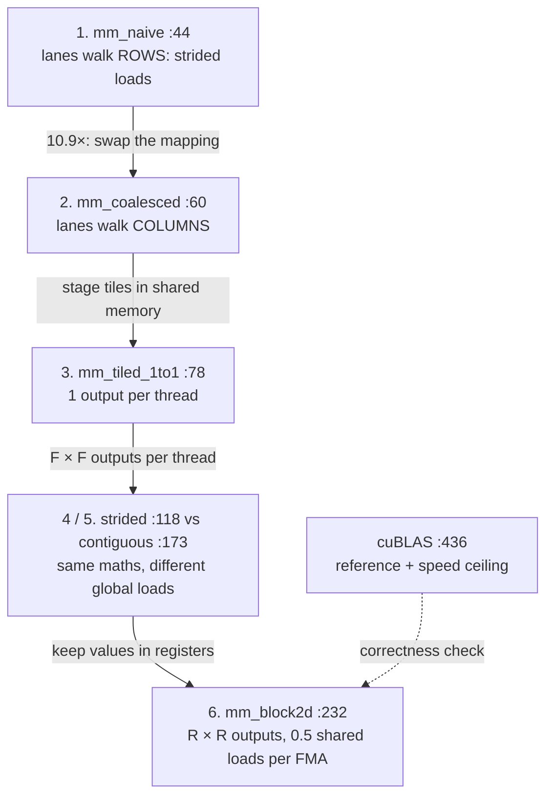
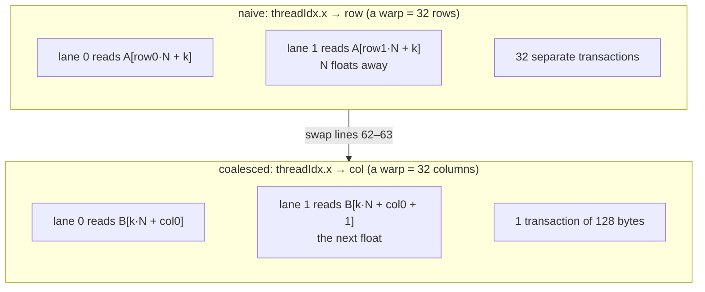
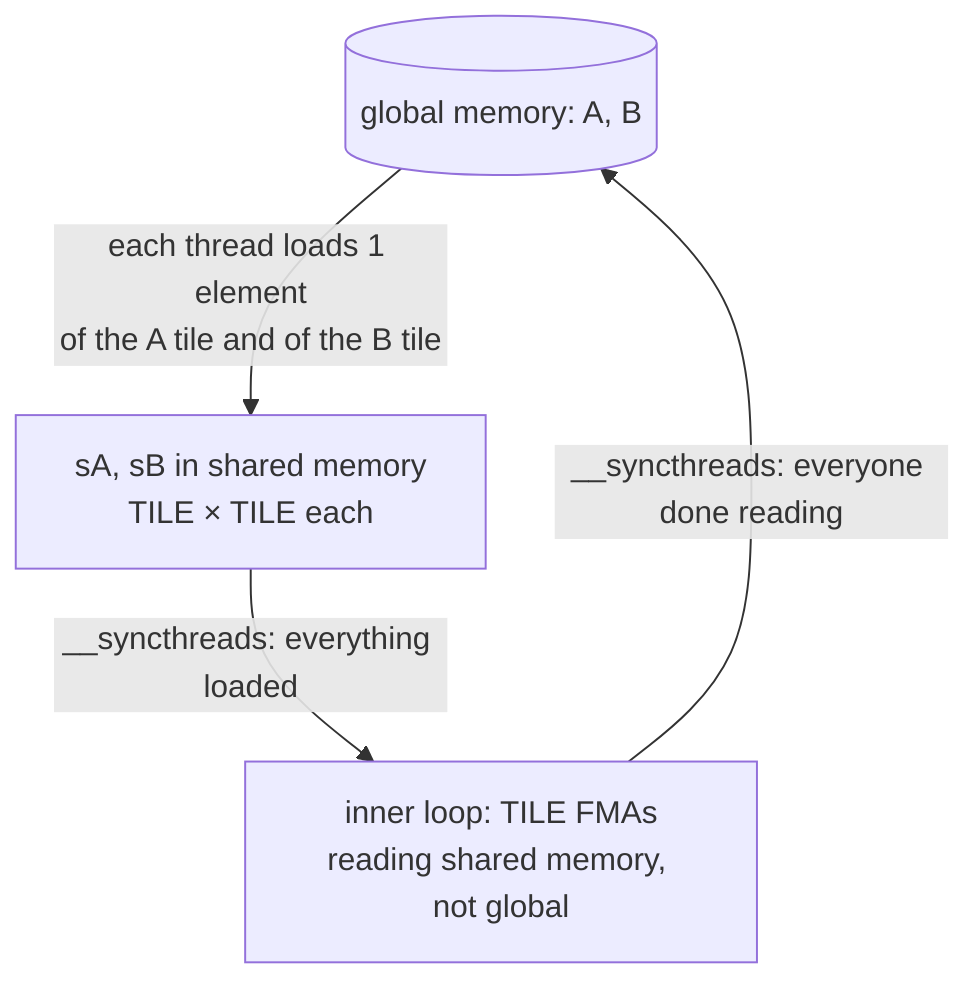
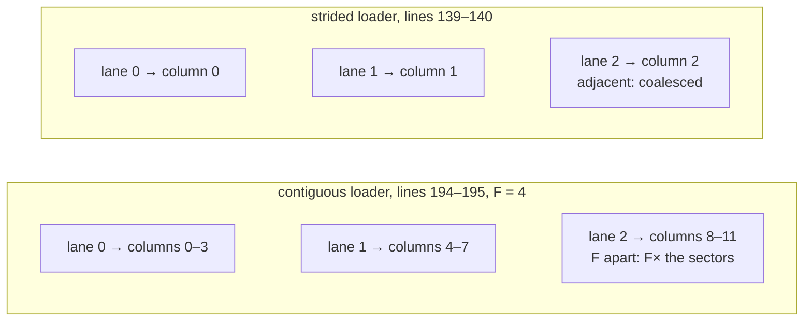
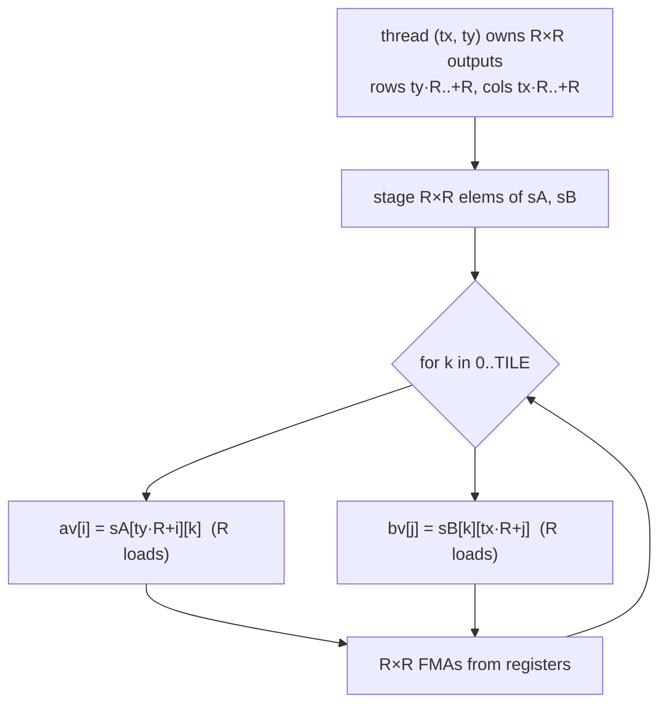

# Day 5 (Thu Nov 12): CUDA I: the GPU, and the matmul kernel chain (PA2)

Part of [[Interview plan (Nov 2026)]]. Repo `sysml` (branch `main`, one commit `16870fb`). About 7 h. Prep pack:
[[CUDA kernels - prep]] (architecture §2, decisions §3, stories §4, numbers §5, 50 questions §7).

**Code, explained:** the figures, the code to read and what each snippet does are in [[#Code, explained]], right after section B.

**Resume bullet (part 1 of 2, both resumes):** "Optimized CUDA matrix multiplication through coalescing, shared-memory tiling, and
2D register blocking, achieving **51.3×** speedup over the naive GPU kernel and **48.2%** of cuBLAS performance on an H200."
Today covers this bullet. Streams, checkpointing and FlashAttention are tomorrow ([[Day 06 - CUDA II]]).

**Before you start, know two repo facts** (prep pack, "Read this first"):
- git has **one commit**, so all "history" comes from `RESULTS.md` and code comments;
- folders were renamed after the runs (`pa2_matmul/` → `matmul/`), so `SETUP.md`'s build commands fail as written.

**By tonight you can:**
- explain SMs, warps, the memory hierarchy, coalescing, bank conflicts and occupancy;
- say which thread computes which output, and the global loads per output, for every kernel;
- derive 51.3× and 48.2% from the CSV, and say what each is measured against;
- write a shared-memory tiled matmul from scratch.

## Schedule

| # | Time | Kind | What |
|---|---|---|---|
| 0 | 15 min | recall | Day 4: the speedup formula, why decode was launch-bound |
| 1 | 20 min | read | Prep pack §1 pitch and §2 diagram (the PA2 line only) |
| 2 | 75 min | theory | The GPU execution and memory model (A1) |
| 3 | 30 min | maths | Matmul arithmetic intensity, the roofline, peak FLOP/s (A2) |
| 4 | 60 min | code | Kernels 1–3: naive → coalesced → tiled 1-to-1 (B1) |
| — | lunch | | |
| 5 | 60 min | code | Kernels 4–6: strided vs contiguous tiles, 2D register blocking (B2) |
| 6 | 30 min | code | The harness: cuBLAS reference, timing budget, the correctness check (B3) |
| 7 | 60 min | rebuild | A tiled matmul, and a load counter (C) |
| 8 | 20 min | trace | Thread → output mapping by hand (D) |
| 9 | 40 min | practice | The questions (E) and the prep pack's §7 "Matmul" set |

## A. Theory

### A1. The GPU model (block 2, 75 min)

**Read or watch (pick one main source):**
- Simon Boehm, *"How to Optimize a CUDA Matmul Kernel for cuBLAS-like Performance: a Worklog"* (siboehm.com, 2022). **This is your project's exact path**: naive → coalescing → shared-memory tiles → 1D then 2D blocktiling. Read kernels 1–5. About 45 min.
- NVIDIA *CUDA C++ Programming Guide*: §5 "Programming Model" (grids, blocks, threads) and the "Shared Memory" part of §5.3 "Memory Hierarchy" (banks). About 30 min, skimmed.
- Optional video: the CUDA MODE lecture series (YouTube, "GPU MODE"), lecture 1 or 2 for the execution model.

**Concepts:**
- **SM → block → warp → thread.** An H200 has **132 SMs**. A block runs on one SM and is split into **warps of 32** threads that issue one instruction together. Per SM: at most 2048 threads, 64K registers, up to 228 KB shared memory.
- **Memory hierarchy, fastest to slowest:** registers → shared memory (per block, on-chip) → L1/L2 → HBM (global). Shared memory is about 100× faster than HBM.
- **Coalescing.** When the 32 threads of a warp read 32 consecutive floats, the hardware merges them into a few 128-byte transactions. If consecutive threads read addresses N floats apart, each needs its own transaction.
- **Shared-memory banks.** 32 banks of 4 bytes. Word address `a` is in bank `a mod 32`. Two lanes of a warp hitting the same bank at different addresses serialise (a **bank conflict**). Same address = broadcast, no conflict.
- **Occupancy** = active warps per SM / the maximum (64). It's limited by registers per thread, shared memory per block and threads per block. More occupancy hides latency, but it isn't the goal in itself: register blocking *lowers* occupancy and still wins.

### A2. Maths (block 3, 30 min, on paper)

- **FLOPs** for an N×N matmul = **2N³** (one multiply plus one add per term). At N = 32768: 2 × 32768³ = **7.04 × 10¹³**.
- **Your best kernel:** 2.7366 s → 7.04e13 / 2.7366 = **25.7 TFLOP/s**. cuBLAS: **53.37 TFLOP/s**. Ratio = **48.2%**.
- **Naive:** 140.486 s. Ratio 140,486 / 2,736.6 = **51.3×** (prep pack §5).
- **FP32 peak** = 132 SMs × 128 FP32 lanes × 2 (FMA) × 1.98 GHz = **66.9 TFLOP/s**. You reach 38.4% of peak; cuBLAS reaches 80%.
- **Arithmetic intensity** (FLOPs per byte from HBM):
  - naive, no reuse: each FMA loads 2 floats = 8 B for 2 FLOPs → **0.25 FLOP/B**;
  - tiled with tile T: each loaded element is reused T times → about **T/4 FLOP/B** (T = 32 → 8; T = 64 → 16).
- **Roofline ridge** = peak FLOP/s ÷ HBM bandwidth = 66.9 TFLOP/s ÷ 4.8 TB/s ≈ **14 FLOP/B**. Below it you are memory-bound. So tiling with T ≥ 64 moves the bottleneck from HBM to **shared memory**. Register blocking then attacks the shared-memory bottleneck: each value loaded into a register feeds R FMAs.

## B. Code

### B1. Kernels 1–3 (block 4, 60 min, deep)

`matmul/matmul_bench.cu`. For each kernel, write in your notebook: which output element(s) a thread computes, its global loads per output, and whether a warp's loads coalesce.
- **44 `mm_naive`**: deliberately *uncoalesced* (the assignment defines it this way). Which index varies fastest across a warp?
- **60 `mm_coalesced`**: the same maths with the thread → (row, col) mapping swapped so a warp reads consecutive addresses. **10.9×** from this alone.
- **78 `mm_tiled_1to1<TILE>`**: stage a TILE×TILE tile of A and of B in shared memory, `__syncthreads`, accumulate, repeat. One thread per output.

### B2. Kernels 4–6 (block 5, 60 min, deep)

- **118 `mm_tiled_strided<TILE,BLK>`** and **173 `mm_tiled_contiguous<TILE,BLK>`**: a *controlled pair*. Same arithmetic, same shared footprint; only the global access pattern differs (comments around lines 103–116). Each thread computes several outputs. What does the strided one get right that the contiguous one doesn't?
- **232 `mm_block2d<TILE,R>`**: 2D register blocking. Each thread computes an **R×R** block of outputs, keeping a column of A and a row of B in registers. Find the inner loop and count shared loads per FMA.
- **Occupancy** (prep pack decision 8, from `cuobjdump`): `block2d<64,2>` = 1024 threads × 40 regs, 1 block per SM, 50%; `block2d<64,4>` = 256 threads × 62 regs, 4 blocks, 50%. Lower occupancy, yet faster.

### B3. The harness (block 6, 30 min, deep)

- **312 `time_kernel`**: CUDA events; one timed iteration first, ten only if they fit in a 30 s budget (321–340). So at N = 32768 most kernels have **n = 1**.
- **433–437**: cuBLAS is called as `B·A` in column-major to get row-major `A·B`. Why does that trick work?
- **353 `max_rel_err`** and **447**: the check covers only the first **4M elements** (the whole matrix only up to N = 2048). The comment at 352 says "sampled over the whole matrix"; the code doesn't do that. Know this before you say "bit-exact".
- **292 `cpu_naive_matmul`**: measured up to N = 4096, extrapolated as N³ beyond. Never quote the 42,783× CPU number.

Then read `RESULTS.md`'s PA2 section and the CSV `results/pa2_matmul.csv`.

## Code, explained

Read this **with the files open**. It starts with a picture of the whole day and **the flow, step by step** (one concrete input followed through every function). Then each part has its own figure, the exact code (copied from the repo at the commit named below, so the line numbers match) and what that code does.

Repo `sysml`, `matmul/matmul_bench.cu` (one commit, `16870fb`).

**The chain, and the one question behind each step:** *where does each operand come from, and how many times?*



### The flow, step by step

> [!tip] Concept from scratch: [[#6. Deep dive: the GPU execution model from scratch|the GPU execution model and occupancy from scratch (§6)]]

Follow **one thread** of the final kernel, `mm_block2d<64, 4>`, at N = 32768. TILE = 64 and R = 4, so each block
has 64/4 × 64/4 = **16 × 16 = 256 threads**, and each thread owns a **4 × 4 patch of C**.

1. **Which outputs?** Block (bx = 2, by = 1), thread (tx = 3, ty = 5): `rowBase = 1·64 + 5·4 = 84`, `colBase = 2·64 + 3·4 = 140` (`matmul_bench.cu:238–239`). It computes C rows **84–87**, columns **140–143**.
2. **Loop over K in tiles of 64:** N / 64 = **512** iterations (`:247`).
3. **Load:** the thread copies 4 × 4 = 16 elements of the A tile and 16 of the B tile into shared memory (`:250–258`). Then `__syncthreads()`: nobody reads until the whole 64 × 64 tile is in.
4. **Compute:** for each k in 0..63, load `av[4] = sA[20..23][k]` and `bv[4] = sB[k][12..15]` into registers, then do **16 FMAs** into `reg[4][4]` (`:262–273`). That's 8 shared loads for 16 FMAs.
5. `__syncthreads()` again, so no thread overwrites the tile while another is still reading it. Then the next tile.
6. **Write:** after 512 tiles, the 16 results go to C (`:277–286`).
7. **Check:** each thread did 512 × 64 × 16 = 524,288 FMAs = 16 outputs × 32,768 terms. ✓
8. **On the host:** `time_kernel` (`:312`) times it with CUDA events, and the result is compared with cuBLAS on the first 4M elements (`:445–448`).

Reading rule for every kernel: write down (1) which output `C[row][col]` thread (tx, ty) owns, (2) for one warp
(32 consecutive `threadIdx.x`), whether its 32 loads hit 32 consecutive addresses (**coalesced**: one 128-byte
transaction) or 32 scattered ones (**uncoalesced**: up to 32 transactions).

---

### 1. Naive vs coalesced: the same maths, a transposed mapping

> [!tip] Concept from scratch: [[#7. Deep dive: memory coalescing from scratch|memory coalescing from scratch (§7)]]



`matmul/matmul_bench.cu:44–54`
```cpp
__global__ void mm_naive(const float* A, const float* B, float* C, int N)
{
    int row = blockIdx.x * blockDim.x + threadIdx.x;
    int col = blockIdx.y * blockDim.y + threadIdx.y;
    if (row >= N || col >= N) return;

    float acc = 0.0f;
    for (int k = 0; k < N; ++k)
        acc = fmaf(A[(size_t)row * N + k], B[(size_t)k * N + col], acc);
    C[(size_t)row * N + col] = acc;
}
```
> [!info] New functions in this code
> - `__global__ void kernel(...)`: marks a function as a **kernel**: it runs on the GPU and is started from the CPU with `kernel<<<grid, block>>>(args)`. Every thread of the launch runs the same body. [[Function glossary#CUDA global|→ examples]]
> - `blockIdx.x / .y / .z`: this block's position **inside the grid**. With 32 × 32 blocks at N = 32768, `blockIdx.x` goes 0…1023. [[Function glossary#blockIdx|→ examples]]
> - `blockDim.x / .y`: the block's size along each axis (32 for a 32 × 32 block). So `blockIdx.x * blockDim.x + threadIdx.x` is the global index: `2 · 32 + 5 = 69`. [[Function glossary#blockDim|→ examples]]
> - `threadIdx.x / .y / .z`: this thread's position **inside its block**. In a 32 × 32 block, `threadIdx.x` and `threadIdx.y` each go 0…31. A warp = 32 consecutive `threadIdx.x` with one `threadIdx.y`. [[Function glossary#threadIdx|→ examples]]
> - `fmaf(a, b, c)`: fused multiply-add on floats: `a · b + c` in one instruction with one rounding. `fmaf(2.f, 3.f, 1.f)` = 7. Counts as 2 FLOPs. [[Function glossary#fmaf|→ examples]]
> - `(size_t)row * N`: an unsigned 64-bit integer type. Casting before multiplying keeps `row · N` from overflowing 32-bit `int` (2.1 × 10⁹) for big N. [[Function glossary#size_t|→ examples]]

- `row` comes from `threadIdx.x`. So the 32 lanes of a warp have **32 consecutive rows** and the same `col`.
- `A[row*N + k]`: lane addresses are **N floats apart**, so 32 separate transactions per load. `B[k*N + col]`: all lanes read the same address (a broadcast, cheap). `C` stores are also N apart.

`matmul/matmul_bench.cu:60–70`
```cpp
__global__ void mm_coalesced(const float* A, const float* B, float* C, int N)
{
    int col = blockIdx.x * blockDim.x + threadIdx.x;
    int row = blockIdx.y * blockDim.y + threadIdx.y;
    if (row >= N || col >= N) return;

    float acc = 0.0f;
    for (int k = 0; k < N; ++k)
        acc = fmaf(A[(size_t)row * N + k], B[(size_t)k * N + col], acc);
    C[(size_t)row * N + col] = acc;
}
```

- Only lines 62–63 changed: `col` now comes from `threadIdx.x`. Now `B[k*N + col]` is **32 consecutive floats** = one transaction, `A[row*N + k]` is a broadcast, and `C` stores coalesce. Same arithmetic, **10.9× faster**. That's the whole lesson of coalescing in one diff.
- Both kernels still read `2N` floats from global memory per output: no reuse at all.

---

### 2. Shared-memory tiling: load once, use TILE times

> [!tip] Concept from scratch: [[#8. Deep dive: tiling and register blocking from scratch|tiling and reuse from scratch (§8)]]



`matmul/matmul_bench.cu:77–101`
```cpp
template<int TILE>
__global__ void mm_tiled_1to1(const float* A, const float* B, float* C, int N)
{
    __shared__ float sA[TILE][TILE];
    __shared__ float sB[TILE][TILE];

    const int tx = threadIdx.x, ty = threadIdx.y;
    const int row = blockIdx.y * TILE + ty;
    const int col = blockIdx.x * TILE + tx;

    float acc = 0.0f;
    for (int t = 0; t < (N + TILE - 1) / TILE; ++t) {
        int aCol = t * TILE + tx;
        int bRow = t * TILE + ty;
        sA[ty][tx] = (row < N && aCol < N) ? A[(size_t)row * N + aCol] : 0.0f;
        sB[ty][tx] = (bRow < N && col < N) ? B[(size_t)bRow * N + col] : 0.0f;
        __syncthreads();

        #pragma unroll
        for (int k = 0; k < TILE; ++k)
            acc = fmaf(sA[ty][k], sB[k][tx], acc);
        __syncthreads();
    }
    if (row < N && col < N) C[(size_t)row * N + col] = acc;
}
```
> [!info] New functions in this code
> - `template<int TILE> __global__ void k(...)`: makes the kernel generic over a **compile-time** number. `mm_tiled_1to1<32>` and `<64>` are compiled separately, so `TILE` can size static arrays and loops can be fully unrolled. [[Function glossary#template|→ examples]]
> - `__shared__ float sA[TILE][TILE];`: puts an array in the SM's **shared memory**: on-chip, fast, visible to all threads of the block, gone when the block ends. Two 64 × 64 float tiles = 32 KB. [[Function glossary#CUDA shared|→ examples]]
> - `__syncthreads()`: a barrier for **one block**: no thread continues until every thread of the block has arrived. Used before reading a shared tile (everyone has written it) and before overwriting it (everyone has read it). [[Function glossary#CUDA syncthreads|→ examples]]
> - `#pragma unroll
for (int k = 0; k < TILE; ++k) ...`: asks the compiler to copy the loop body once per iteration (no loop counter, no branch). With a compile-time trip count like `TILE` or `R`, small arrays such as `reg[R][R]` can then live in registers. [[Function glossary#pragma unroll|→ examples]]

- The block computes one TILE × TILE patch of C. For each `t`, every thread loads **one** element of the A tile and **one** of the B tile (lines 91–92). Out-of-range elements become 0, so N needn't be a multiple of TILE.
- **First `__syncthreads`:** nobody reads a tile until every thread has written its element.
- **Second `__syncthreads`:** nobody overwrites the tile for the next `t` while a slower thread is still reading it. Remove it and you get a race that only shows up sometimes.
- Global loads per output fall from `2N` to `2N/TILE`. But now **every FMA reads two floats from shared memory**, so shared-memory bandwidth becomes the limit. That's what register blocking attacks.

---

### 3. More outputs per thread: strided vs contiguous

> [!tip] Concept from scratch: [[#7. Deep dive: memory coalescing from scratch|strided vs contiguous loaders, counted (§7.5)]]



`matmul/matmul_bench.cu:134–158`
```cpp
for (int t = 0; t < (N + TILE - 1) / TILE; ++t) {
    #pragma unroll
    for (int s = 0; s < F; ++s) {
        #pragma unroll
        for (int u = 0; u < F; ++u) {
            int r = ty + s * BLK;           // strided within the tile
            int c = tx + u * BLK;
            int aR = row0 + r,      aC = t * TILE + c;
            int bR = t * TILE + r,  bC = col0 + c;
            sA[r][c] = (aR < N && aC < N) ? A[(size_t)aR * N + aC] : 0.0f;
            sB[r][c] = (bR < N && bC < N) ? B[(size_t)bR * N + bC] : 0.0f;
        }
    }
    __syncthreads();

    #pragma unroll
    for (int k = 0; k < TILE; ++k) {
        #pragma unroll
        for (int i = 0; i < F; ++i) {
            float a = sA[ty + i * BLK][k];
            #pragma unroll
            for (int j = 0; j < F; ++j)
                acc[i][j] = fmaf(a, sB[k][tx + j * BLK], acc[i][j]);
        }
    }
```

- TILE = BLK × F: each thread owns **F × F outputs** (`acc[F][F]` lives in registers).
- **Loading (lines 139–140):** lane `tx` loads column `tx + u·BLK`. For fixed `u`, the warp's lanes are adjacent, so loads are coalesced.
- **Compute (lines 150–156):** one `a = sA[...][k]` feeds F FMAs (it's reused across `j`). Shared reads per FMA drop below 2.

`matmul/matmul_bench.cu:194–195`
```cpp
int r = ty * F + s;             // contiguous run per thread
int c = tx * F + u;
```

- The *contiguous* twin changes only these two lines: lane `tx` loads columns `tx·F + u`, so adjacent lanes are F floats apart and each warp load touches F times as many memory sectors. The arithmetic, shared footprint and occupancy are identical. It's a **controlled experiment** for the access pattern alone.

---

### 4. 2D register blocking: the final kernel

> [!tip] Concept from scratch: [[#8. Deep dive: tiling and register blocking from scratch|register blocking from scratch (§8.6)]]



`matmul/matmul_bench.cu:237–240`
```cpp
const int tx = threadIdx.x, ty = threadIdx.y;
const int rowBase = blockIdx.y * TILE + ty * R;
const int colBase = blockIdx.x * TILE + tx * R;

```

`matmul/matmul_bench.cu:262–273`
```cpp
for (int k = 0; k < TILE; ++k) {
    float av[R], bv[R];
    #pragma unroll
    for (int i = 0; i < R; ++i) av[i] = sA[ty * R + i][k];
    #pragma unroll
    for (int j = 0; j < R; ++j) bv[j] = sB[k][tx * R + j];
    #pragma unroll
    for (int i = 0; i < R; ++i)
        #pragma unroll
        for (int j = 0; j < R; ++j)
            reg[i][j] = fmaf(av[i], bv[j], reg[i][j]);
}
```

- Per `k`: load **R** values of A and **R** of B into registers, then do **R × R** FMAs. With R = 4 that's 8 shared loads for 16 FMAs, **0.5 loads per FMA**, against 2 for the 1-to-1 tile. That's the 3.0× over the 1-to-1 kernel.
- `reg[R][R]` uses many registers per thread (62 for R = 4), so fewer threads fit per SM (50% occupancy). It's still faster, because each thread does much more useful work per byte moved. **Occupancy is not the goal; throughput is.**
- Known cost (prep pack decision 7): its loader uses the *contiguous* pattern (`sc = tx·R + j`), so global loads are stride-R. That's one reason it stops at 48% of cuBLAS.

**Check yourself:** `mm_block2d<64,4>`, block (bx = 2, by = 1), thread (tx = 3, ty = 5). Which output rows and columns does it own? (*Rows 64 + 20 … 64 + 23 = 84–87; columns 128 + 12 … 128 + 15 = 140–143.*)

---

### 5. The harness: reference, timing, check

> [!tip] Concept from scratch: [[#9. Deep dive: the roofline and the headline numbers from scratch|the roofline and the headline numbers from scratch (§9)]]

`matmul/matmul_bench.cu:432–440`
```cpp
// ── cuBLAS first: it becomes the correctness reference for the rest.
// cuBLAS is column-major; computing B*A in its layout yields row-major A*B.
const float alpha = 1.0f, beta = 0.0f;
auto cublas_launch = [&] {
    cublasSgemm(handle, CUBLAS_OP_N, CUBLAS_OP_N, N, N, N,
                &alpha, dB, N, dA, N, &beta, dC, N);
};
Timing tb = time_kernel(cublas_launch, 2, iters, budget);
CUDA_CHECK(cudaMemcpy(hRef, dC, bytes, cudaMemcpyDeviceToHost));
```
> [!info] New functions in this code
> - `cublasSgemm(h, opA, opB, m, n, k, &alpha, A, lda, B, ldb, &beta, C, ldc)`: NVIDIA's single-precision matmul: C = α·op(A)·op(B) + β·C, with matrices in **column-major** order. Passing (B, A) instead of (A, B) gives a row-major A·B for free. [[Function glossary#cublasSgemm|→ examples]]
> - `CUDA_CHECK(call)`: a macro defined in this file: runs a CUDA call and, if it returns an error, prints the file, line and message and exits. Without it, CUDA errors are silent until something later fails. [[Function glossary#CUDA_CHECK|→ examples]]
> - `cudaMemcpy(dst, src, bytes, kind)`: copies memory between CPU and GPU. `kind` is `cudaMemcpyHostToDevice` (upload) or `cudaMemcpyDeviceToHost` (download). It waits until the copy is done. [[Function glossary#cudaMemcpy|→ examples]]

- cuBLAS is column-major. A row-major matrix read as column-major is its transpose, so asking cuBLAS for `B·A` returns `(Bᵀ·Aᵀ)ᵀ = A·B` laid out row-major. No copies needed.
- cuBLAS runs **first**, and its output `hRef` becomes the reference every kernel is checked against.

`matmul/matmul_bench.cu:321–344`
```cpp
// One timed iteration first, so a slow kernel doesn't commit to ten of them.
CUDA_CHECK(cudaEventRecord(beg));
launch();
CUDA_CHECK(cudaEventRecord(end));
CUDA_CHECK(cudaEventSynchronize(end));
float first = 0.f;
CUDA_CHECK(cudaEventElapsedTime(&first, beg, end));

int extra = 0;
double total = first;
if (first / 1000.0 * iters < budget_s) {
    extra = iters - 1;
    CUDA_CHECK(cudaEventRecord(beg));
    for (int i = 0; i < extra; ++i) launch();
    CUDA_CHECK(cudaEventRecord(end));
    CUDA_CHECK(cudaEventSynchronize(end));
    float rest = 0.f;
    CUDA_CHECK(cudaEventElapsedTime(&rest, beg, end));
    total += rest;
}

CUDA_CHECK(cudaEventDestroy(beg));
CUDA_CHECK(cudaEventDestroy(end));
return { total / (1 + extra), 1 + extra };
```
> [!info] New functions in this code
> - `cudaEventRecord(ev)`: queues the event; it gets a timestamp when the GPU reaches it (not when the CPU calls this). [[Function glossary#cudaEventRecord|→ examples]]
> - `cudaEventSynchronize(ev)`: makes the CPU wait until the GPU has reached the event. Needed before reading the elapsed time. [[Function glossary#cudaEventSynchronize|→ examples]]
> - `cudaEventElapsedTime(&ms, beg, end)`: milliseconds of GPU time between two recorded events. Kernel-only timing: no Python, no copies. [[Function glossary#cudaEventElapsedTime|→ examples]]
> - `cudaEventDestroy(ev)`: frees an event. [[Function glossary#cudaEventDestroy|→ examples]]

- CUDA events time on the GPU's own clock. **One timed run first**; ten more only if they fit the 30 s budget. So slow kernels at N = 32768 have `iters = 1` (the CSV's `iters` column). A 140 s run has negligible noise, but say "n = 1" if asked.

`matmul/matmul_bench.cu:445–448`
```cpp
auto record = [&](const char* name, Timing t) {
    CUDA_CHECK(cudaMemcpy(hC, dC, bytes, cudaMemcpyDeviceToHost));
    double err = max_rel_err((int)std::min(elems, (size_t)4000000), hRef, hC);
    fprintf(out, "%s,%d,%.4f,%.4f,%d,%.3e,\n", name, N, t.ms, tflops(N, t.ms), t.iters, err);
```
> [!info] New functions in this code
> - `std::min(a, b)`: the smaller of two values (C++). `std::min(elems, (size_t)4000000)` caps the check at 4M elements; both arguments must have the same type, hence the cast. [[Function glossary#std::min|→ examples]]
> - `fprintf(stream, fmt, ...)`: C's formatted print to a file or `stderr`/`stdout`. `fprintf(out, "%s,%d\n", name, N)` writes one CSV line. [[Function glossary#fprintf|→ examples]]

- `std::min(elems, 4000000)`: only the **first 4M elements** are compared. That's the whole matrix up to N = 2048, and only the first ~122 rows at N = 32768. Know this before you say "bit-exact".

---

### 6. Deep dive: the GPU execution model from scratch

Every kernel today is read with one question: *which thread does what, and where does its data come from?* This
section builds the model that question needs. Order: why a GPU → grid, block, warp, thread → the memory ladder →
the index line in code → occupancy with real numbers → questions → check.

> [!important] The one sentence to hold on to
> A kernel launch is a **grid of blocks**; each block runs on one **SM**; the SM issues instructions for **32 threads
> at a time (a warp)**; each thread finds its own piece of work from `blockIdx`, `blockDim` and `threadIdx`.

#### 6.1 Why a GPU?

A CPU core runs one thread very fast. A GPU runs **thousands of simple threads** at once. The H200 has **132 SMs**
(streaming multiprocessors). Each SM has **128 FP32 lanes**. So it can do 132 × 128 = **16,896** float operations
per clock.

Matrix multiplication fits this well. Each of the N² outputs `C[row][col]` is independent. So we give each output
(or a small patch of outputs) to one thread.

#### 6.2 Grid → block → warp → thread

![[d5-6-hierarchy.svg]]

Four levels, from the top:
- **grid:** everything one launch runs. `mm_naive` at N = 32768 with 32 × 32 blocks has a grid of 1024 × 1024 blocks.
- **block:** a group of threads that runs on **one** SM. Its threads can share fast **shared memory** and wait for each other with `__syncthreads()`.
- **warp:** 32 consecutive threads of a block. They issue **the same instruction together**. This matters for memory: the 32 loads of one warp instruction are served together.
- **thread (lane):** one instance of the kernel code, with its own registers.

Which threads form a warp? Threads are numbered with `threadIdx.x` varying fastest. In a 32 × 32 block, warp 0 is
`threadIdx.y = 0, threadIdx.x = 0…31`; warp 1 is `threadIdx.y = 1`; and so on. **A warp = one value of `threadIdx.y`,
all 32 values of `threadIdx.x`.** Every coalescing argument today uses this fact.

#### 6.3 The memory ladder

| level | where | size (H200) | speed |
|---|---|---|---|
| registers | per thread | 65,536 × 4 B per SM | fastest, ~1 cycle |
| shared memory | per block, on the SM | up to 228 KB per SM | ~20–30 cycles |
| L2 cache | whole chip | about 50 MB | slower |
| HBM (global) | off the chip | 141 GB, 4.8 TB/s | ~hundreds of cycles |

Each optimisation today moves the hot data **one rung up** this ladder:
- coalescing makes each HBM transaction carry 32 useful floats instead of 1;
- tiling moves reuse from HBM into shared memory;
- register blocking moves reuse from shared memory into registers.

#### 6.4 The index line, with real numbers

`mm_naive` launches blocks of 32 × 32 threads.

```cpp
int row = blockIdx.x * blockDim.x + threadIdx.x;   // naive: x picks the ROW
int col = blockIdx.y * blockDim.y + threadIdx.y;
```

Take block `(blockIdx.x, blockIdx.y) = (2, 1)` and thread `(threadIdx.x, threadIdx.y) = (5, 3)`:
- `row = 2 · 32 + 5 = 69`;
- `col = 1 · 32 + 3 = 35`.

So this thread computes `C[69][35]`. Its warp is `threadIdx.y = 3` with `threadIdx.x = 0…31`. Those 32 threads have
rows **64…95** and the same column 35. That one fact makes the naive kernel slow (§7).

```cpp
for (int k = 0; k < N; ++k)
    acc = fmaf(A[(size_t)row * N + k], B[(size_t)k * N + col], acc);
```

- `fmaf(a, b, c)` = `a · b + c` in **one** instruction (fused multiply-add). It counts as 2 FLOPs.
- `(size_t)row * N`: the cast makes the index 64-bit. At N = 32768, `row · N + k` reaches 32768² ≈ 1.07 × 10⁹, half the 32-bit `int` limit (2.1 × 10⁹). Any N above 46,340 would overflow without the cast.
- `if (row >= N || col >= N) return;` guards threads that fall past the edge when N isn't a multiple of 32.

#### 6.5 Occupancy, with real numbers

**Occupancy** = active warps on an SM ÷ the maximum the SM can hold (64 warps = 2,048 threads). More warps let the
SM hide memory waits: while one warp waits for a load, another computes.

Three things cap it: registers, shared memory and threads per block. The project's numbers (from `cuobjdump`):

**`mm_block2d<64, 4>`:** 256 threads per block, 62 registers per thread.
1. Registers are given out in chunks, so 62 rounds up to **64** per thread.
2. Per block: 64 × 256 = **16,384** registers.
3. The SM has 65,536: 65,536 / 16,384 = **4 blocks**.
4. 4 × 256 = 1,024 threads = 32 warps → 32 / 64 = **50%**.

**`mm_block2d<64, 2>`:** 1,024 threads per block, 40 registers.
1. Per block: 40 × 1,024 = 40,960 registers.
2. 65,536 / 40,960 = 1.6 → **1 block** fits.
3. 1,024 threads → **50%** again.

Both are 50%, yet R = 4 is 1.56× faster (2,737 vs 4,263 ms at N = 32768). **Occupancy is a means, not the goal.**
More work per thread can beat more threads.

#### 6.6 Questions people usually ask next

##### "Why 32 threads per warp?"

It's the hardware's issue width on NVIDIA GPUs: one instruction is sent to 32 lanes at once. You can't change it.
Everything else (block sizes, tile widths) is chosen as a multiple of 32 so warps are full.

##### "What happens when threads of a warp take different branches?"

**Divergence.** The warp runs both paths one after the other, with the inactive lanes masked off. The edge guards
here (`if (row >= N …) return;`) only diverge in the last block, so they cost almost nothing.

##### "What does `__syncthreads()` do exactly?"

It is a barrier for **one block**: no thread passes it until every thread of the block reaches it. It can't sync
across blocks. That's why kernels are written so that blocks never need each other's results.

##### "Why not one huge block?"

A block must fit on one SM: at most 1,024 threads, and its registers and shared memory must fit. Many medium blocks
also let the GPU spread work across all 132 SMs.

#### 6.7 Check your understanding

1. What runs on one SM: a grid, a block or a warp?
2. In a 32 × 32 block, which threads form warp 3?
3. Naive kernel, block (0, 4), thread (7, 2): which output does it compute?
4. Why is `(size_t)` needed in `(size_t)row * N`?
5. A kernel uses 128 registers per thread and 256-thread blocks. How many blocks fit on an SM (registers only)? What's the occupancy?
6. Why can lower occupancy still be faster?

> [!success]- Answers
> 1. A block (and all its warps). A grid spreads over all SMs.
> 2. `threadIdx.y = 3`, `threadIdx.x = 0…31` (threads 96–127 in flat order).
> 3. `row = 0 · 32 + 7 = 7`, `col = 4 · 32 + 2 = 130` → `C[7][130]`.
> 4. `row · N` reaches 1.07 × 10⁹ at N = 32768 and would pass the `int` limit (2.1 × 10⁹) for N > 46,340; 64-bit arithmetic can't overflow.
> 5. 128 × 256 = 32,768 registers per block → 65,536 / 32,768 = 2 blocks = 512 threads = 16 warps → 25%.
> 6. Each thread does more useful work per byte loaded (register reuse), so fewer threads keep the arithmetic units busy.

#### 6.8 The five things to remember

1. **Hierarchy:** grid of blocks → a block on one SM → warps of 32 lanes running one instruction together.
2. **A warp = one `threadIdx.y`, all `threadIdx.x`.** Coalescing depends on what consecutive `threadIdx.x` touch.
3. **Index line:** `blockIdx · blockDim + threadIdx`; e.g. `2 · 32 + 5 = 69`.
4. **Memory ladder:** registers → shared → L2 → HBM; each optimisation moves reuse one rung up.
5. **Occupancy:** limited by registers (62 → 64 per thread → 4 blocks → 50%); it is a tool, not the target.

---

### 7. Deep dive: memory coalescing from scratch

Section 1 above shows the two-line diff that gave **10.9×**. This section explains why two swapped lines matter so
much. Order: how memory is fetched → a toy you can count by hand → the counting rule → the real kernels → the
strided vs contiguous loaders → questions → check.

> [!important] The one sentence to hold on to
> HBM is read in whole **lines** (128 bytes = 32 floats); when the 32 lanes of a warp read **32 neighbouring floats**,
> one line serves them all (**coalesced**); when their addresses are far apart, each lane needs its own line.

#### 7.1 How global memory is fetched

You never load one float from HBM. The memory system moves fixed chunks: **32-byte sectors**, grouped into
**128-byte lines**. One line holds 32 floats.

A warp issues one load instruction for all 32 lanes at once. The hardware looks at the 32 addresses and fetches
**every line they touch**:
- 32 consecutive floats → **1 line** → every fetched byte is used;
- 32 floats each N apart → **32 lines** → 1 useful float per line, 31 wasted.

#### 7.2 A toy you can count

Shrink everything: an 8 × 8 matrix, a "warp" of 8 lanes, and a "line" of 8 floats. The matrix is stored row after
row, so `address = row · 8 + col`. Each row is exactly one line.

![[d5-7-coalescing.svg]]

**Naive (lane → row):** lane r reads `A[r·8 + k]`. At k = 0 the addresses are **0, 8, 16, …, 56**. That's one float
from each of the 8 rows, so **8 lines** for 8 floats.

**Coalesced (lane → column):** lane c reads `B[k·8 + c]`. At k = 0 the addresses are **0, 1, …, 7**: one line.

Same number of floats, **8× fewer line fetches**. With a real warp of 32 lanes the ratio can reach 32×.

#### 7.3 The counting rule

For one warp load:

$$\text{lines fetched} = \#\{\lfloor \text{address}_\ell \cdot 4 / 128 \rfloor : \ell = 0 \ldots 31\}$$

that is, the number of distinct 128-byte lines among the 32 lane addresses. Three cases cover today:

| pattern across the 32 lanes | lines | example |
|---|---|---|
| consecutive floats | 1 | `B[k*N + col]` with `col` from `threadIdx.x` |
| the **same** address | 1 (a broadcast) | `A[row*N + k]` when `row` is equal for all lanes |
| N floats apart | 32 | `A[row*N + k]` with `row` from `threadIdx.x` |

#### 7.4 The real kernels, one warp at a time

Recall (§6.2): a warp = 32 consecutive `threadIdx.x`, one `threadIdx.y`.

**`mm_naive`** (`row` from `threadIdx.x`): the warp holds rows 64…95 and one column, 35.
- `A[row*N + k]`: 32 addresses N floats apart → **32 lines**.
- `B[k*N + col]`: all lanes read the same address → **1 line** (broadcast).
- per step k: **33 lines** for 64 useful floats.

**`mm_coalesced`** (`col` from `threadIdx.x`): the warp holds one row and columns 64…95.
- `A[row*N + k]`: the same address for all → **1 line**.
- `B[k*N + col]`: 32 consecutive floats → **1 line**.
- per step k: **2 lines**.

That's 33 / 2 = 16.5× fewer line requests. The measured gain is **10.9×** (140.5 s → 12.9 s at N = 32768). Why less?
The naive warp's 32 lines at step k are the **same lines** it needs at steps k + 1 … k + 31 (the next floats of the
same 32 rows). Some of them survive in the L1 cache, which softens the penalty.

Both kernels still read **2N floats from global memory per output** (one row of A, one column of B). Coalescing
makes each fetch efficient; it doesn't create **reuse**. Tiling (§8) does.

#### 7.5 The strided vs contiguous loaders

Kernels 4 and 5 load a TILE × TILE tile with a 32 × 32 block, so each thread loads F × F = 2 × 2 elements
(TILE = 64, F = 2). They differ only in **which** elements.

- **Strided** (`c = tx + u·BLK`): for u = 0, lanes 0…31 load columns **0…31**; for u = 1, columns **32…63**. Each instruction: 32 consecutive floats = **1 line**.
- **Contiguous** (`c = tx·F + u`): for u = 0, lanes load columns **0, 2, 4, …, 62**; for u = 1, columns 1, 3, …, 63. Each instruction spans 64 floats = **2 lines**, half of each unused.

So the contiguous loader requests twice the lines per instruction. Measured: **3,790 vs 3,635 ms**, only 4% slower.
The second instruction (u = 1) reads the other half of the same two lines, which is usually still in L1. Loading is
also a small part of these kernels' time. The pair is a clean **controlled experiment**: same maths, same shared
memory, same occupancy; only the access pattern differs.

#### 7.6 Questions people usually ask next

##### "Is coalescing about threads or about warps?"

About **warps**. The hardware merges the addresses of one warp's load instruction. Two threads in different warps
reading neighbouring floats don't help each other (except through the cache).

##### "Does the naive kernel's B load cost 32 lines too?"

No. All 32 lanes have the same `col` and `k`, so they read **one** address. The hardware fetches it once and
broadcasts it. Only the A load (and the C store) are scattered.

##### "How would you see this in a profiler?"

Nsight Compute reports **sectors per request** for global loads. Coalesced float loads show 4 sectors (128 B) per
request; the naive A load would show close to 32. The project never ran `ncu` (it needs root on this server), so the
argument here is by hand, checked against the measured times.

##### "Why not just make the naive kernel read A transposed?"

That is the same fix in another form: whatever index varies with `threadIdx.x` must move along **contiguous**
memory. Swapping the row/column mapping is the cheapest way to get there.

#### 7.7 Check your understanding

1. How many floats are in one 128-byte line?
2. Toy (8-lane warp, 8-float lines, 8 × 8 matrix): lanes read `A[r·8 + 3]` for r = 0…7. How many lines?
3. In `mm_naive`, why is the B load cheap but the A load expensive?
4. Per step k, how many lines does each kernel's warp request? What ratio does that predict, and what was measured?
5. Contiguous loader, F = 2: which columns do lanes 0–3 load for u = 0?
6. Why is the contiguous loader only 4% slower, not 2×?

> [!success]- Answers
> 1. 32 (128 / 4).
> 2. Addresses 3, 11, 19, …, 59: one per row → 8 lines.
> 3. All lanes share `col`, so `B[k*N + col]` is one address (broadcast); `row` differs per lane, so `A[row*N + k]` is 32 addresses N apart.
> 4. Naive 33, coalesced 2 → 16.5× predicted; 10.9× measured (L1 hits soften the naive case).
> 5. Columns 0, 2, 4, 6.
> 6. The u = 1 load hits the same lines, usually still in L1, and loading is a small share of the kernel's time.

#### 7.8 The five things to remember

1. **Unit of fetch:** 128-byte lines (32 floats); a warp's load costs the number of distinct lines it touches.
2. **Coalesced:** consecutive `threadIdx.x` → consecutive addresses → 1 line per warp load.
3. **Broadcast:** all lanes on one address → 1 line too.
4. **Naive vs coalesced:** 33 vs 2 lines per step; measured **10.9×** (140.5 s → 12.9 s).
5. **Strided vs contiguous:** 1 vs 2 lines per instruction; only 4% apart in time, but a clean controlled pair.

---

### 8. Deep dive: tiling and register blocking from scratch

Sections 2–4 above walk the tiled kernels. This section explains the one idea behind all of them: **reuse**. Order:
where the reuse is → a 4 × 4 toy → the formula → the tiled code with real values → the new bottleneck → register
blocking → the measured ladder → questions → check.

> [!important] The one sentence to hold on to
> Every element of A is needed by a whole row of outputs, and every element of B by a whole column; **tiling** loads it
> from HBM once per tile and reuses it from shared memory, and **register blocking** reuses it again from registers.

#### 8.1 Where the reuse is

In C = A · B, the element `A[i][k]` is used by **every** output in row i: `C[i][0]`, `C[i][1]`, …, `C[i][N−1]`. That's
N uses. Likewise `B[k][j]` is used by every output in column j.

The naive and coalesced kernels fetch each element **once per use**: 2N floats per output, 2N³ float loads in total.
At N = 32768 that's 7.0 × 10¹³ loads for 3.5 × 10¹³ FMAs. The hardware caches catch some of it, but by luck, not by
design.

#### 8.2 A 4 × 4 toy with TILE = 2

![[d5-8-tiling.svg]]

C is cut into 2 × 2 tiles, one per block (4 blocks). The block owning C's top-left tile needs rows 0–1 of A and
columns 0–1 of B. It walks along them in **two steps**:
1. **t = 0:** load A's tile (rows 0–1, cols 0–1) and B's tile (rows 0–1, cols 0–1) into shared memory. Each of the 4 threads does 2 FMAs.
2. **t = 1:** load the next tiles (A cols 2–3, B rows 2–3). 2 more FMAs each. Now every output has its 4 terms.

Count global loads:
- naive: 16 outputs × (4 + 4) = **128** loads;
- tiled: 4 blocks × 2 steps × (4 + 4) = **64** loads.

Each loaded float served **2** threads (TILE = 2), so loads halved.

#### 8.3 The formula

Per output, loads fall from 2N to:

$$\text{global loads per output} = \frac{2N}{\text{TILE}}$$

| | per output, N = 32768 | arithmetic intensity |
|---|---|---|
| no tiling | 65,536 floats | 2 FLOP / 8 B = 0.25 FLOP/B |
| TILE = 32 | 2,048 floats | 32 / 4 = 8 FLOP/B |
| TILE = 64 | 1,024 floats | 64 / 4 = 16 FLOP/B |

(Arithmetic intensity = FLOPs per byte read from HBM. Each output needs 2N FLOPs and reads 4 · 2N / TILE bytes, so
intensity = TILE / 4. Section 9 uses this.)

#### 8.4 The tiled kernel, line by line, with real values

`mm_tiled_1to1<32>`, block (bx = 2, by = 1), thread (tx = 3, ty = 5):

```cpp
const int row = blockIdx.y * TILE + ty;   // 1·32 + 5 = 37
const int col = blockIdx.x * TILE + tx;   // 2·32 + 3 = 67
```

This thread computes `C[37][67]`. In step `t`:

```cpp
int aCol = t * TILE + tx;   // t = 0: 3      t = 1: 35
int bRow = t * TILE + ty;   // t = 0: 5      t = 1: 37
sA[ty][tx] = A[row * N + aCol];   // t = 0: A[37][3]  → sA[5][3]
sB[ty][tx] = B[bRow * N + col];   // t = 0: B[5][67]  → sB[5][3]
__syncthreads();
for (int k = 0; k < TILE; ++k) acc = fmaf(sA[ty][k], sB[k][tx], acc);
__syncthreads();
```

- **The load:** each of the 1,024 threads loads **one** element of each tile. Together they fill both 32 × 32 tiles. The loads are coalesced: lanes 0–31 (tx) read neighbouring columns.
- **First barrier:** the inner loop reads `sA[5][k]` for all k, including elements other threads loaded. Nobody may start until all are in.
- **The inner loop:** 32 FMAs, all from shared memory. `sA[ty][k]` is the same address for the whole warp (one `ty`), so it broadcasts. `sB[k][tx]` is 32 neighbouring words, no conflict.
- **Second barrier:** without it, a fast thread could start step t + 1 and overwrite `sA` while a slow thread is still reading step t. That race shows up only sometimes, which makes it nasty.
- **Out-of-range loads become 0** (the `? … : 0.0f` in the real code), so the extra zeros add nothing to the sum.

#### 8.5 The new bottleneck: shared memory

Look at the inner loop again: **every FMA reads two floats from shared memory**. Shared memory is fast, but not free.
An SM serves about **32 four-byte words per clock** (32 banks), while it can do **128 FMAs per clock**. With 2 reads
per FMA, the SM can feed only 16 FMAs per clock: **1/8 of its peak**.

1/8 of 66.9 TFLOP/s is about **8.4 TFLOP/s**. The 1-to-1 kernel measures **8.6**. It sits right at this ceiling. The
fix has to cut **shared reads per FMA**.

#### 8.6 Register blocking: reuse inside one thread

![[d5-9-regblock.svg]]

Give each thread an **R × R patch** of outputs. For each k:
1. read R values of A, `av[i] = sA[ty·R + i][k]`, into registers;
2. read R values of B, `bv[j] = sB[k][tx·R + j]`, into registers;
3. do all R × R FMAs: `reg[i][j] += av[i] · bv[j]`.

Each `av[i]` is used R times (once per j) and each `bv[j]` R times. Shared reads per FMA:

$$\frac{2R}{R^2} = \frac{2}{R} \qquad R = 4: \ \frac{8}{16} = 0.5$$

That's 4× less shared traffic than the 1-to-1 kernel's 2. The same counting gives a ceiling of about **33.5 TFLOP/s**
(§9). The kernel measures **25.7**.

**Trace** (`mm_block2d<64, 4>`, block (2, 1), thread (3, 5)):
- `rowBase = 1·64 + 5·4 = 84`, `colBase = 2·64 + 3·4 = 140`;
- it owns `C[84…87][140…143]`, 16 outputs in `reg[4][4]`;
- per K-tile: 64 values of k × 16 FMAs = 1,024 FMAs; over 512 tiles, 524,288 = 16 outputs × 32,768 terms. ✓

The price: 16 accumulators + 8 operands + addresses = **62 registers**, so only 4 blocks fit per SM (50%
occupancy, §6.5). It still wins.

#### 8.7 The measured ladder at N = 32768

| kernel | time | TFLOP/s | step gain | what changed |
|---|---|---|---|---|
| naive | 140,486 ms | 0.50 | | lanes walk rows |
| coalesced | 12,927 ms | 5.44 | **10.9×** | lanes walk columns |
| tiled 1-to-1, T = 32 | 8,148 ms | 8.64 | 1.59× | shared-memory reuse |
| tiled strided, T = 64, F = 2 | 3,635 ms | 19.36 | 2.24× | 4 outputs per thread |
| block2d, T = 64, R = 2 | 4,263 ms | 16.51 | | (slower than strided) |
| block2d, T = 64, R = 4 | 2,737 ms | 25.71 | **1.33×** over strided | 16 outputs per thread |
| cuBLAS | 1,318 ms | 53.37 | | the ceiling |

Headline numbers: 140,486 / 2,737 = **51.3×** over naive; 25.71 / 53.37 = **48.2%** of cuBLAS. Over the 1-to-1
tile, register blocking is 8,148 / 2,737 = **3.0×**.

#### 8.8 Questions people usually ask next

##### "Why not make TILE huge?"

Shared memory is limited (two 64 × 64 float tiles are already 32 KB per block), and a bigger tile means fewer blocks
per SM. Past a point, the bottleneck has already moved to shared memory, so a bigger tile buys little. Registers
are the next lever.

##### "Why is R = 2 slower than the strided F = 2 kernel?"

Both give each thread 4 outputs. R = 2 uses a 1,024-thread block (only 1 block per SM) and the contiguous loader
(stride-2 global loads, §7.5). Its reuse isn't larger than the strided kernel's. Only R = 4 cuts shared reads per FMA
enough to win.

##### "Are there bank conflicts in `mm_block2d`?"

Yes, by a hand count. With 16 × 16 threads, one warp spans two values of `ty`. The two `av` addresses are 4 rows
(256 words) apart, so the **same bank**: a 2-way conflict. The `bv` addresses `k·64 + 4·tx + j` repeat banks every 8
lanes: also 2-way. That's one more reason it stops at 48% of cuBLAS.

##### "What does cuBLAS do that this doesn't?"

Wide vector loads (`LDS.128`, `LDG.128`: 4 floats per instruction), double buffering (load the next tile while
computing on this one), warp-level tiling, and bigger register blocks. All attack the same two limits.

#### 8.9 Check your understanding

1. How many outputs use `A[i][k]`?
2. Toy: 4 × 4 matmul, TILE = 2. Naive vs tiled global loads?
3. Global loads per output at N = 32768, TILE = 64?
4. Why are there two `__syncthreads()` per step? What breaks without each?
5. Why does the 1-to-1 kernel top out near 8 TFLOP/s?
6. Shared reads per FMA for R = 8?
7. `mm_block2d<64, 4>`, block (0, 3), thread (1, 2): which rows and columns?

> [!success]- Answers
> 1. N: the whole row i of C.
> 2. 128 vs 64.
> 3. 2 · 32768 / 64 = 1,024.
> 4. The first stops reads before the tile is complete; the second stops the next step's writes before everyone has finished reading. Without them you get wrong values or a sometimes-wrong race.
> 5. It needs 2 shared reads per FMA; an SM serves ~32 words per clock but can do 128 FMAs, so it runs at ~1/8 of peak ≈ 8.4 TFLOP/s.
> 6. 2 / 8 = 0.25.
> 7. rows 3·64 + 2·4 = 200…203; columns 0·64 + 1·4 = 4…7.

#### 8.10 The five things to remember

1. **Reuse exists:** each A element serves a whole output row; each B element a whole column.
2. **Tiling:** global loads per output 2N → 2N / TILE; intensity TILE / 4 FLOP/B.
3. **Two barriers per step:** one before reading the tile, one before overwriting it.
4. **New limit:** 2 shared reads per FMA caps the 1-to-1 kernel at ~8.4 TFLOP/s (measured 8.6).
5. **Register blocking:** R × R outputs per thread, 2 / R shared reads per FMA; R = 4 gives 25.7 TFLOP/s, 51.3× naive, 48.2% of cuBLAS.

---

### 9. Deep dive: the roofline and the headline numbers from scratch

Interviewers ask "how far are you from peak, and why?" The roofline answers it with two numbers about the GPU and
one about the kernel. Order: two limits → a toy GPU → the H200's real numbers → placing each kernel → a second
roof for shared memory → deriving 51.3× and 48.2% → questions → check.

> [!important] The one sentence to hold on to
> A kernel can't beat **peak FLOP/s**, and it can't beat **bytes per second × FLOPs per byte**; whichever is lower is
> its ceiling, and the gap between the ceiling and the measured speed says what else is limiting it.

#### 9.1 Two limits

Every kernel does arithmetic and moves data. So two things can cap it:
- **compute:** the GPU can do at most P FLOP/s;
- **memory:** it can read at most B bytes/s, and the kernel does I FLOPs per byte read (its **arithmetic intensity**), so at most I × B FLOP/s.

$$\text{attainable FLOP/s} = \min(P,\ I \times B)$$

The **ridge** is where the two meet: $I^* = P / B$. Below it a kernel is **memory-bound**; above it, **compute-bound**.

#### 9.2 A toy GPU

Say P = 10 TFLOP/s and B = 1 TB/s. Ridge = 10 / 1 = **10 FLOP/B**.
- Kernel X does 2 FLOPs per byte: min(10, 2 × 1) = **2 TFLOP/s**. Memory-bound. A faster ALU wouldn't help; less traffic would.
- Kernel Y does 40 FLOPs per byte: min(10, 40) = **10 TFLOP/s**. Compute-bound. Less traffic wouldn't help.

#### 9.3 The H200's numbers

**Peak FP32** = SMs × lanes × FLOPs per FMA × clock:

$$132 \times 128 \times 2 \times 1.98\ \text{GHz} = 66.9\ \text{TFLOP/s}$$

**HBM bandwidth** = 4.8 TB/s. **Ridge** = 66.9 / 4.8 ≈ **13.9 FLOP/B**.

**Arithmetic intensity** of matmul kernels (§8.3): one FMA = 2 FLOPs.
- no reuse: 2 floats (8 B) per FMA → 2 / 8 = **0.25 FLOP/B**;
- tiled: TILE / 4 → T = 32: **8**; T = 64: **16**.

#### 9.4 Placing each kernel

![[d5-10-roofline.svg]]

| kernel | intensity | HBM ceiling | measured | what that says |
|---|---|---|---|---|
| naive | 0.25 | min(66.9, 1.2) = 1.2 | 0.50 | memory-bound, and wasting lines (§7) |
| tiled 1-to-1 (T = 32) | 8 | 38.4 | 8.64 | far under its HBM roof: something else limits |
| block2d R = 4 (T = 64) | 16 | 66.9 | 25.71 | past the ridge: no longer HBM-bound |
| cuBLAS | higher | 66.9 | 53.37 | 80% of peak |

The 1-to-1 kernel could reach 38 TFLOP/s if only HBM mattered. It reaches 8.6. That gap is the clue for §9.5.

(These intensities are the textbook counts. Caches add reuse the formula ignores; that's why the coalesced kernel,
also "0.25", measures 5.4 TFLOP/s, above the 1.2 line. Use the roofline for direction, not for exact predictions.)

#### 9.5 A second roof: shared memory

Once tiles live in shared memory, its bandwidth is the next limit. Estimate it the same way:
- an SM's shared memory serves **32 words of 4 bytes per clock** = 128 B/clock;
- 132 SMs × 128 B × 1.98 GHz = **33.5 TB/s**.

Now the "intensity" is FLOPs per byte read **from shared memory**:
- 1-to-1: 2 shared reads (8 B) per FMA (2 FLOPs) → 0.25 FLOP/B → 0.25 × 33.5 = **8.4 TFLOP/s**. Measured **8.6**: right at it.
- block2d R = 4: 0.5 reads (2 B) per FMA → 1 FLOP/B → **33.5 TFLOP/s**. Measured 25.7: under it, with 2-way bank conflicts (§8.8) and other overheads taking the rest.

This is the story for "why did register blocking help so much?": it attacked the roof the kernel was actually
pressing against.

#### 9.6 Deriving the headline numbers

**FLOPs** for an N × N matmul: N² outputs × N terms × 2 FLOPs = $2N^3$. At N = 32768:

$$2 \times 32768^3 = 7.04 \times 10^{13}\ \text{FLOPs}$$

- block2d: 7.04e13 / 2.7366 s = **25.7 TFLOP/s**; cuBLAS: 7.04e13 / 1.3185 s = **53.4 TFLOP/s**.
- **48.2%** = 25.71 / 53.37 (equivalently 1,318.5 / 2,736.6 ms).
- **51.3×** = 140,486 / 2,736.6 ms, against the deliberately uncoalesced naive kernel. Against the coalesced one it's 12,927 / 2,736.6 = **4.7×**. Say both.
- **% of peak:** 25.7 / 66.9 = 38.4% for the project, 53.4 / 66.9 = 80% for cuBLAS.

Both are FP32 SGEMM on CUDA cores (no tensor cores, no TF32), so the comparison is fair.

#### 9.7 Questions people usually ask next

##### "Is your kernel compute-bound?"

By the HBM roofline, yes: intensity 16 is past the ridge of 14. But it runs at 38% of peak, so it isn't limited by
the FMA units either. The binding limits are shared-memory traffic and instruction overheads, the "second roof".

##### "Where does 4.8 TB/s come from?"

It's the H200's HBM3e spec bandwidth. Measured copy bandwidth is usually somewhat lower, so real ceilings sit a bit
under the drawn line.

##### "How would you get closer to cuBLAS?"

Raise reuse further (bigger register blocks, warp tiling), cut instruction count (128-bit vector loads), hide latency
(double-buffered tiles, `cp.async`), and fix the stride-R global loader and the 2-way bank conflicts.

##### "Why 2N³ and not N³?"

Each term is one multiply and one add. An FMA does both, so N³ FMAs = 2N³ FLOPs. Everyone (cuBLAS, papers) counts
this way.

#### 9.8 Check your understanding

1. Write the roofline formula. What is the ridge?
2. Toy GPU P = 20 TFLOP/s, B = 2 TB/s. A kernel with intensity 4: ceiling? Bound by what?
3. Compute the H200's FP32 peak from its parts.
4. What is the intensity of a tiled matmul with TILE = 32? Its HBM ceiling?
5. Why does the 1-to-1 kernel reach only 8.6 TFLOP/s?
6. Derive 51.3× and 48.2% from the times. What is 51.3× measured against?

> [!success]- Answers
> 1. min(P, I × B); ridge I* = P / B.
> 2. min(20, 4 × 2) = 8 TFLOP/s, memory-bound (ridge is 10).
> 3. 132 × 128 × 2 × 1.98 GHz = 66.9 TFLOP/s.
> 4. 32 / 4 = 8 FLOP/B; 8 × 4.8 = 38.4 TFLOP/s.
> 5. Shared memory: 2 reads per FMA × 33.5 TB/s roof → ~8.4 TFLOP/s.
> 6. 140,486 / 2,736.6 = 51.3× (vs the uncoalesced naive kernel; 4.7× vs coalesced); 1,318.5 / 2,736.6 = 48.2% of cuBLAS.

#### 9.9 The five things to remember

1. **Roofline:** attainable = min(peak, intensity × bandwidth); ridge = peak / bandwidth ≈ 14 FLOP/B on the H200.
2. **Peak:** 132 × 128 × 2 × 1.98 GHz = **66.9 TFLOP/s** FP32.
3. **Intensity:** 0.25 FLOP/B without reuse; TILE / 4 with tiling (8 at 32, 16 at 64).
4. **Second roof:** shared memory ≈ 33.5 TB/s; 2 reads per FMA → 8.4 TFLOP/s (1-to-1 measured 8.6); 0.5 reads → 33.5.
5. **Headline:** 2N³ = 7.04e13 FLOPs; **51.3×** vs naive (4.7× vs coalesced), **48.2%** of cuBLAS, 38% of peak.

## C. Rebuild it yourself (block 7, 60 min)

1. **On paper or in a `.cu` file**, write `tiled_matmul<TILE>` from scratch (about 40 lines): shared tiles of A and B, the two `__syncthreads`, boundary guards. Compile it with `nvcc` on the server (compiling needs no GPU). Running it needs one: **ask Claude to check GPU availability first**, and pin with `CUDA_VISIBLE_DEVICES`.
2. **In Python (no GPU, about 40 lines)**, write a load counter. For N = 1024 and each strategy (naive, tiled T = 32, tiled T = 64 with R = 4), count:
   - global float loads per output;
   - for one warp's shared-memory reads in the inner loop, the bank of each lane (`addr mod 32`) and the worst conflict degree.

   Then check: does the padding trick (row stride T+1) remove the conflict for column-wise reads?

## D. Trace (block 8, 20 min)

`mm_block2d<64,4>`: block size 16×16 = 256 threads, tile 64×64.
- Which outputs does thread (tx = 3, ty = 5) of block (bx = 2, by = 1) compute? Use the mapping in the code (thread → `ty*R+i`, `tx*R+j`, prep pack decision 7).
- How many floats does the block load from global memory per K-tile? How many FMAs does each thread do per K-tile?
- Shared loads per FMA, with and without register blocking.

## E. Questions

1. Walk me through your four optimisations. What did each one fix, and by how much? (*Quote the chain: 10.9× coalescing; tiling 1.6×; register blocking 3.0× over the 1-to-1 tile, but only 1.33× over the strided tile.*)
2. What is memory coalescing? Show it with your naive vs coalesced kernels.
3. What is a bank conflict? When does a shared-memory read *not* conflict?
4. Why does register blocking help when it lowers occupancy?
5. Why are you at 48% of cuBLAS and not 90%? (*Vectorised `LDS.128`/`LDG.128` loads, double buffering, warp tiling, uncoalesced stride-R loads inherited from the quiz kernel.*)
6. Is 48.2% against tensor cores? (*No. Both are FP32 SGEMM on CUDA cores, default math mode, no TF32.*)
7. How did you check correctness? What does your check *not* cover?
8. Is 51.3× a fair number? (*Against a deliberately uncoalesced naive kernel. Against coalesced naive it's 4.7×.*)
9. What is the roofline? Where is your kernel on it?
10. Why n = 1 timings at N = 32768, and why do you trust them? (*A 140 s run has negligible launch noise; the ratio is 50–51× from N = 2048 up.*)
11. Hostile: "Why write matmul at all when cuBLAS exists?"

## My notes and fumbles

- 
