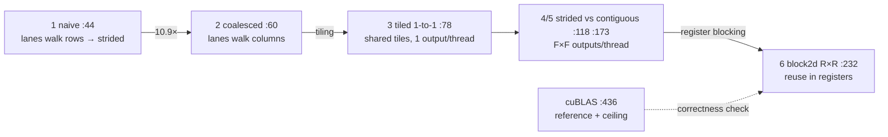
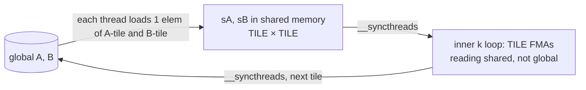
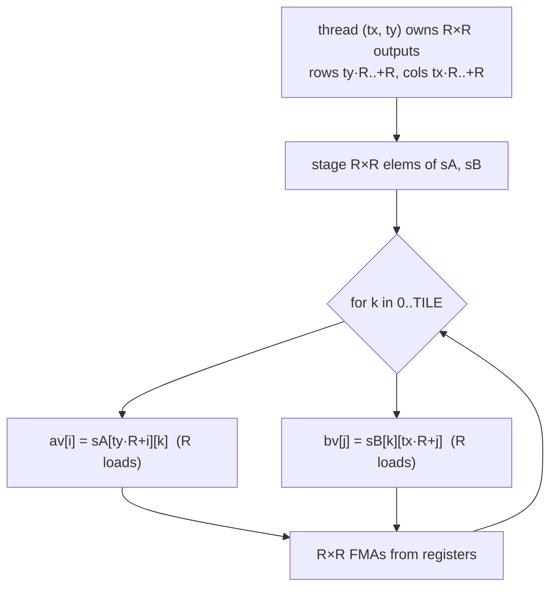

# Day 5 (Thu Nov 12): CUDA I: the GPU, and the matmul kernel chain (PA2)

Part of [[Interview plan (Nov 2026)]]. Repo `sysml` (branch `main`, one commit `16870fb`). About 7 h. Prep pack:
[[CUDA kernels - prep]] (architecture §2, decisions §3, stories §4, numbers §5, 50 questions §7).

**Code, explained:** the figures, the code to read and what each snippet does are in [[#Code, explained]], right after section B.

**Resume bullet (part 1 of 2, both resumes):** "Optimized CUDA matrix multiplication through coalescing, shared-memory tiling, and
2D register blocking, achieving **51.3×** speedup over the naive GPU kernel and **48.2%** of cuBLAS performance on an H200."
Today covers this bullet. Streams, checkpointing and FlashAttention are tomorrow ([[Day 06 - CUDA II]]).

**Before you start, know two repo facts** (prep pack, "Read this first"):
- git has **one commit**, so all "history" comes from `RESULTS.md` and code comments;
- folders were renamed after the runs (`pa2_matmul/` → `matmul/`), so `SETUP.md`'s build commands fail as written.

**By tonight you can:**
- explain SMs, warps, the memory hierarchy, coalescing, bank conflicts and occupancy;
- say which thread computes which output, and the global loads per output, for every kernel;
- derive 51.3× and 48.2% from the CSV, and say what each is measured against;
- write a shared-memory tiled matmul from scratch.

## Schedule

| # | Time | Kind | What |
|---|---|---|---|
| 0 | 15 min | recall | Day 4: the speedup formula, why decode was launch-bound |
| 1 | 20 min | read | Prep pack §1 pitch and §2 diagram (the PA2 line only) |
| 2 | 75 min | theory | The GPU execution and memory model (A1) |
| 3 | 30 min | maths | Matmul arithmetic intensity, the roofline, peak FLOP/s (A2) |
| 4 | 60 min | code | Kernels 1–3: naive → coalesced → tiled 1-to-1 (B1) |
| — | lunch | | |
| 5 | 60 min | code | Kernels 4–6: strided vs contiguous tiles, 2D register blocking (B2) |
| 6 | 30 min | code | The harness: cuBLAS reference, timing budget, the correctness check (B3) |
| 7 | 60 min | rebuild | A tiled matmul, and a load counter (C) |
| 8 | 20 min | trace | Thread → output mapping by hand (D) |
| 9 | 40 min | practice | The questions (E) and the prep pack's §7 "Matmul" set |

## A. Theory

### A1. The GPU model (block 2, 75 min)

**Read or watch (pick one main source):**
- Simon Boehm, *"How to Optimize a CUDA Matmul Kernel for cuBLAS-like Performance: a Worklog"* (siboehm.com, 2022). **This is your project's exact path**: naive → coalescing → shared-memory tiles → 1D then 2D blocktiling. Read kernels 1–5. About 45 min.
- NVIDIA *CUDA C++ Programming Guide*: §5 "Programming Model" (grids, blocks, threads) and the "Shared Memory" part of §5.3 "Memory Hierarchy" (banks). About 30 min, skimmed.
- Optional video: the CUDA MODE lecture series (YouTube, "GPU MODE"), lecture 1 or 2 for the execution model.

**Concepts:**
- **SM → block → warp → thread.** An H200 has **132 SMs**. A block runs on one SM and is split into **warps of 32** threads that issue one instruction together. Per SM: at most 2048 threads, 64K registers, up to 228 KB shared memory.
- **Memory hierarchy, fastest to slowest:** registers → shared memory (per block, on-chip) → L1/L2 → HBM (global). Shared memory is about 100× faster than HBM.
- **Coalescing.** When the 32 threads of a warp read 32 consecutive floats, the hardware merges them into a few 128-byte transactions. If consecutive threads read addresses N floats apart, each needs its own transaction.
- **Shared-memory banks.** 32 banks of 4 bytes. Word address `a` is in bank `a mod 32`. Two lanes of a warp hitting the same bank at different addresses serialise (a **bank conflict**). Same address = broadcast, no conflict.
- **Occupancy** = active warps per SM / the maximum (64). It's limited by registers per thread, shared memory per block and threads per block. More occupancy hides latency, but it isn't the goal in itself: register blocking *lowers* occupancy and still wins.

### A2. Maths (block 3, 30 min, on paper)

- **FLOPs** for an N×N matmul = **2N³** (one multiply plus one add per term). At N = 32768: 2 × 32768³ = **7.04 × 10¹³**.
- **Your best kernel:** 2.7366 s → 7.04e13 / 2.7366 = **25.7 TFLOP/s**. cuBLAS: **53.37 TFLOP/s**. Ratio = **48.2%**.
- **Naive:** 140.486 s. Ratio 140,486 / 2,736.6 = **51.3×** (prep pack §5).
- **FP32 peak** = 132 SMs × 128 FP32 lanes × 2 (FMA) × 1.98 GHz = **66.9 TFLOP/s**. You reach 38.4% of peak; cuBLAS reaches 80%.
- **Arithmetic intensity** (FLOPs per byte from HBM):
  - naive, no reuse: each FMA loads 2 floats = 8 B for 2 FLOPs → **0.25 FLOP/B**;
  - tiled with tile T: each loaded element is reused T times → about **T/4 FLOP/B** (T = 32 → 8; T = 64 → 16).
- **Roofline ridge** = peak FLOP/s ÷ HBM bandwidth = 66.9 TFLOP/s ÷ 4.8 TB/s ≈ **14 FLOP/B**. Below it you are memory-bound. So tiling with T ≥ 64 moves the bottleneck from HBM to **shared memory**. Register blocking then attacks the shared-memory bottleneck: each value loaded into a register feeds R FMAs.

## B. Code

### B1. Kernels 1–3 (block 4, 60 min, deep)

`matmul/matmul_bench.cu`. For each kernel, write in your notebook: which output element(s) a thread computes, its global loads per output, and whether a warp's loads coalesce.
- **44 `mm_naive`**: deliberately *uncoalesced* (the assignment defines it this way). Which index varies fastest across a warp?
- **60 `mm_coalesced`**: the same maths with the thread → (row, col) mapping swapped so a warp reads consecutive addresses. **10.9×** from this alone.
- **78 `mm_tiled_1to1<TILE>`**: stage a TILE×TILE tile of A and of B in shared memory, `__syncthreads`, accumulate, repeat. One thread per output.

### B2. Kernels 4–6 (block 5, 60 min, deep)

- **118 `mm_tiled_strided<TILE,BLK>`** and **173 `mm_tiled_contiguous<TILE,BLK>`**: a *controlled pair*. Same arithmetic, same shared footprint; only the global access pattern differs (comments around lines 103–116). Each thread computes several outputs. What does the strided one get right that the contiguous one doesn't?
- **232 `mm_block2d<TILE,R>`**: 2D register blocking. Each thread computes an **R×R** block of outputs, keeping a column of A and a row of B in registers. Find the inner loop and count shared loads per FMA.
- **Occupancy** (prep pack decision 8, from `cuobjdump`): `block2d<64,2>` = 1024 threads × 40 regs, 1 block per SM, 50%; `block2d<64,4>` = 256 threads × 62 regs, 4 blocks, 50%. Lower occupancy, yet faster.

### B3. The harness (block 6, 30 min, deep)

- **312 `time_kernel`**: CUDA events; one timed iteration first, ten only if they fit in a 30 s budget (321–340). So at N = 32768 most kernels have **n = 1**.
- **433–437**: cuBLAS is called as `B·A` in column-major to get row-major `A·B`. Why does that trick work?
- **353 `max_rel_err`** and **447**: the check covers only the first **4M elements** (the whole matrix only up to N = 2048). The comment at 352 says "sampled over the whole matrix"; the code doesn't do that. Know this before you say "bit-exact".
- **292 `cpu_naive_matmul`**: measured up to N = 4096, extrapolated as N³ beyond. Never quote the 42,783× CPU number.

Then read `RESULTS.md`'s PA2 section and the CSV `results/pa2_matmul.csv`.

## Code, explained

Read this **with the files open**. Each part has a small figure of the pipeline, then the exact code (copied from the repo at the commit named below, so the line numbers match), then what it does and how it hands off to the next piece.

Repo `sysml`, `matmul/matmul_bench.cu` (one commit, `16870fb`).

**The chain, and the one question behind each step:** *where does each operand come from, and how many times?*



Reading rule for every kernel: write down (1) which output `C[row][col]` thread (tx, ty) owns, (2) for one warp
(32 consecutive `threadIdx.x`), whether its 32 loads hit 32 consecutive addresses (**coalesced**: one 128-byte
transaction) or 32 scattered ones (**uncoalesced**: up to 32 transactions).

---

### 1. Naive vs coalesced: the same maths, a transposed mapping

`matmul/matmul_bench.cu:44–54`
```cpp
__global__ void mm_naive(const float* A, const float* B, float* C, int N)
{
    int row = blockIdx.x * blockDim.x + threadIdx.x;
    int col = blockIdx.y * blockDim.y + threadIdx.y;
    if (row >= N || col >= N) return;

    float acc = 0.0f;
    for (int k = 0; k < N; ++k)
        acc = fmaf(A[(size_t)row * N + k], B[(size_t)k * N + col], acc);
    C[(size_t)row * N + col] = acc;
}
```

- `row` comes from `threadIdx.x`. So the 32 lanes of a warp have **32 consecutive rows** and the same `col`.
- `A[row*N + k]`: lane addresses are **N floats apart**, so 32 separate transactions per load. `B[k*N + col]`: all lanes read the same address (a broadcast, cheap). `C` stores are also N apart.

`matmul/matmul_bench.cu:60–70`
```cpp
__global__ void mm_coalesced(const float* A, const float* B, float* C, int N)
{
    int col = blockIdx.x * blockDim.x + threadIdx.x;
    int row = blockIdx.y * blockDim.y + threadIdx.y;
    if (row >= N || col >= N) return;

    float acc = 0.0f;
    for (int k = 0; k < N; ++k)
        acc = fmaf(A[(size_t)row * N + k], B[(size_t)k * N + col], acc);
    C[(size_t)row * N + col] = acc;
}
```

- Only lines 62–63 changed: `col` now comes from `threadIdx.x`. Now `B[k*N + col]` is **32 consecutive floats** = one transaction, `A[row*N + k]` is a broadcast, and `C` stores coalesce. Same arithmetic, **10.9× faster**. That's the whole lesson of coalescing in one diff.
- Both kernels still read `2N` floats from global memory per output: no reuse at all.

---

### 2. Shared-memory tiling: load once, use TILE times



`matmul/matmul_bench.cu:77–101`
```cpp
template<int TILE>
__global__ void mm_tiled_1to1(const float* A, const float* B, float* C, int N)
{
    __shared__ float sA[TILE][TILE];
    __shared__ float sB[TILE][TILE];

    const int tx = threadIdx.x, ty = threadIdx.y;
    const int row = blockIdx.y * TILE + ty;
    const int col = blockIdx.x * TILE + tx;

    float acc = 0.0f;
    for (int t = 0; t < (N + TILE - 1) / TILE; ++t) {
        int aCol = t * TILE + tx;
        int bRow = t * TILE + ty;
        sA[ty][tx] = (row < N && aCol < N) ? A[(size_t)row * N + aCol] : 0.0f;
        sB[ty][tx] = (bRow < N && col < N) ? B[(size_t)bRow * N + col] : 0.0f;
        __syncthreads();

        #pragma unroll
        for (int k = 0; k < TILE; ++k)
            acc = fmaf(sA[ty][k], sB[k][tx], acc);
        __syncthreads();
    }
    if (row < N && col < N) C[(size_t)row * N + col] = acc;
}
```

- The block computes one TILE × TILE patch of C. For each `t`, every thread loads **one** element of the A tile and **one** of the B tile (lines 91–92). Out-of-range elements become 0, so N needn't be a multiple of TILE.
- **First `__syncthreads`:** nobody reads a tile until every thread has written its element.
- **Second `__syncthreads`:** nobody overwrites the tile for the next `t` while a slower thread is still reading it. Remove it and you get a race that only shows up sometimes.
- Global loads per output fall from `2N` to `2N/TILE`. But now **every FMA reads two floats from shared memory**, so shared-memory bandwidth becomes the limit. That's what register blocking attacks.

---

### 3. More outputs per thread: strided vs contiguous

`matmul/matmul_bench.cu:134–158`
```cpp
for (int t = 0; t < (N + TILE - 1) / TILE; ++t) {
    #pragma unroll
    for (int s = 0; s < F; ++s) {
        #pragma unroll
        for (int u = 0; u < F; ++u) {
            int r = ty + s * BLK;           // strided within the tile
            int c = tx + u * BLK;
            int aR = row0 + r,      aC = t * TILE + c;
            int bR = t * TILE + r,  bC = col0 + c;
            sA[r][c] = (aR < N && aC < N) ? A[(size_t)aR * N + aC] : 0.0f;
            sB[r][c] = (bR < N && bC < N) ? B[(size_t)bR * N + bC] : 0.0f;
        }
    }
    __syncthreads();

    #pragma unroll
    for (int k = 0; k < TILE; ++k) {
        #pragma unroll
        for (int i = 0; i < F; ++i) {
            float a = sA[ty + i * BLK][k];
            #pragma unroll
            for (int j = 0; j < F; ++j)
                acc[i][j] = fmaf(a, sB[k][tx + j * BLK], acc[i][j]);
        }
    }
```

- TILE = BLK × F: each thread owns **F × F outputs** (`acc[F][F]` lives in registers).
- **Loading (lines 139–140):** lane `tx` loads column `tx + u·BLK`. For fixed `u`, the warp's lanes are adjacent, so loads are coalesced.
- **Compute (lines 150–156):** one `a = sA[...][k]` feeds F FMAs (it's reused across `j`). Shared reads per FMA drop below 2.

`matmul/matmul_bench.cu:194–195`
```cpp
int r = ty * F + s;             // contiguous run per thread
int c = tx * F + u;
```

- The *contiguous* twin changes only these two lines: lane `tx` loads columns `tx·F + u`, so adjacent lanes are F floats apart and each warp load touches F times as many memory sectors. The arithmetic, shared footprint and occupancy are identical. It's a **controlled experiment** for the access pattern alone.

---

### 4. 2D register blocking: the final kernel



`matmul/matmul_bench.cu:237–240`
```cpp
const int tx = threadIdx.x, ty = threadIdx.y;
const int rowBase = blockIdx.y * TILE + ty * R;
const int colBase = blockIdx.x * TILE + tx * R;

```

`matmul/matmul_bench.cu:262–273`
```cpp
for (int k = 0; k < TILE; ++k) {
    float av[R], bv[R];
    #pragma unroll
    for (int i = 0; i < R; ++i) av[i] = sA[ty * R + i][k];
    #pragma unroll
    for (int j = 0; j < R; ++j) bv[j] = sB[k][tx * R + j];
    #pragma unroll
    for (int i = 0; i < R; ++i)
        #pragma unroll
        for (int j = 0; j < R; ++j)
            reg[i][j] = fmaf(av[i], bv[j], reg[i][j]);
}
```

- Per `k`: load **R** values of A and **R** of B into registers, then do **R × R** FMAs. With R = 4 that's 8 shared loads for 16 FMAs, **0.5 loads per FMA**, against 2 for the 1-to-1 tile. That's the 3.0× over the 1-to-1 kernel.
- `reg[R][R]` uses many registers per thread (62 for R = 4), so fewer threads fit per SM (50% occupancy). It's still faster, because each thread does much more useful work per byte moved. **Occupancy is not the goal; throughput is.**
- Known cost (prep pack decision 7): its loader uses the *contiguous* pattern (`sc = tx·R + j`), so global loads are stride-R. That's one reason it stops at 48% of cuBLAS.

**Check yourself:** `mm_block2d<64,4>`, block (bx = 2, by = 1), thread (tx = 3, ty = 5). Which output rows and columns does it own? (*Rows 64 + 20 … 64 + 23 = 84–87; columns 128 + 12 … 128 + 15 = 140–143.*)

---

### 5. The harness: reference, timing, check

`matmul/matmul_bench.cu:432–440`
```cpp
// ── cuBLAS first: it becomes the correctness reference for the rest.
// cuBLAS is column-major; computing B*A in its layout yields row-major A*B.
const float alpha = 1.0f, beta = 0.0f;
auto cublas_launch = [&] {
    cublasSgemm(handle, CUBLAS_OP_N, CUBLAS_OP_N, N, N, N,
                &alpha, dB, N, dA, N, &beta, dC, N);
};
Timing tb = time_kernel(cublas_launch, 2, iters, budget);
CUDA_CHECK(cudaMemcpy(hRef, dC, bytes, cudaMemcpyDeviceToHost));
```

- cuBLAS is column-major. A row-major matrix read as column-major is its transpose, so asking cuBLAS for `B·A` returns `(Bᵀ·Aᵀ)ᵀ = A·B` laid out row-major. No copies needed.
- cuBLAS runs **first**, and its output `hRef` becomes the reference every kernel is checked against.

`matmul/matmul_bench.cu:321–344`
```cpp
// One timed iteration first, so a slow kernel doesn't commit to ten of them.
CUDA_CHECK(cudaEventRecord(beg));
launch();
CUDA_CHECK(cudaEventRecord(end));
CUDA_CHECK(cudaEventSynchronize(end));
float first = 0.f;
CUDA_CHECK(cudaEventElapsedTime(&first, beg, end));

int extra = 0;
double total = first;
if (first / 1000.0 * iters < budget_s) {
    extra = iters - 1;
    CUDA_CHECK(cudaEventRecord(beg));
    for (int i = 0; i < extra; ++i) launch();
    CUDA_CHECK(cudaEventRecord(end));
    CUDA_CHECK(cudaEventSynchronize(end));
    float rest = 0.f;
    CUDA_CHECK(cudaEventElapsedTime(&rest, beg, end));
    total += rest;
}

CUDA_CHECK(cudaEventDestroy(beg));
CUDA_CHECK(cudaEventDestroy(end));
return { total / (1 + extra), 1 + extra };
```

- CUDA events time on the GPU's own clock. **One timed run first**; ten more only if they fit the 30 s budget. So slow kernels at N = 32768 have `iters = 1` (the CSV's `iters` column). A 140 s run has negligible noise, but say "n = 1" if asked.

`matmul/matmul_bench.cu:445–448`
```cpp
auto record = [&](const char* name, Timing t) {
    CUDA_CHECK(cudaMemcpy(hC, dC, bytes, cudaMemcpyDeviceToHost));
    double err = max_rel_err((int)std::min(elems, (size_t)4000000), hRef, hC);
    fprintf(out, "%s,%d,%.4f,%.4f,%d,%.3e,\n", name, N, t.ms, tflops(N, t.ms), t.iters, err);
```

- `std::min(elems, 4000000)`: only the **first 4M elements** are compared. That's the whole matrix up to N = 2048, and only the first ~122 rows at N = 32768. Know this before you say "bit-exact".

## C. Rebuild it yourself (block 7, 60 min)

1. **On paper or in a `.cu` file**, write `tiled_matmul<TILE>` from scratch (about 40 lines): shared tiles of A and B, the two `__syncthreads`, boundary guards. Compile it with `nvcc` on the server (compiling needs no GPU). Running it needs one: **ask Claude to check GPU availability first**, and pin with `CUDA_VISIBLE_DEVICES`.
2. **In Python (no GPU, about 40 lines)**, write a load counter. For N = 1024 and each strategy (naive, tiled T = 32, tiled T = 64 with R = 4), count:
   - global float loads per output;
   - for one warp's shared-memory reads in the inner loop, the bank of each lane (`addr mod 32`) and the worst conflict degree.

   Then check: does the padding trick (row stride T+1) remove the conflict for column-wise reads?

## D. Trace (block 8, 20 min)

`mm_block2d<64,4>`: block size 16×16 = 256 threads, tile 64×64.
- Which outputs does thread (tx = 3, ty = 5) of block (bx = 2, by = 1) compute? Use the mapping in the code (thread → `ty*R+i`, `tx*R+j`, prep pack decision 7).
- How many floats does the block load from global memory per K-tile? How many FMAs does each thread do per K-tile?
- Shared loads per FMA, with and without register blocking.

## E. Questions

1. Walk me through your four optimisations. What did each one fix, and by how much? (*Quote the chain: 10.9× coalescing; tiling 1.6×; register blocking 3.0× over the 1-to-1 tile, but only 1.33× over the strided tile.*)
2. What is memory coalescing? Show it with your naive vs coalesced kernels.
3. What is a bank conflict? When does a shared-memory read *not* conflict?
4. Why does register blocking help when it lowers occupancy?
5. Why are you at 48% of cuBLAS and not 90%? (*Vectorised `LDS.128`/`LDG.128` loads, double buffering, warp tiling, uncoalesced stride-R loads inherited from the quiz kernel.*)
6. Is 48.2% against tensor cores? (*No. Both are FP32 SGEMM on CUDA cores, default math mode, no TF32.*)
7. How did you check correctness? What does your check *not* cover?
8. Is 51.3× a fair number? (*Against a deliberately uncoalesced naive kernel. Against coalesced naive it's 4.7×.*)
9. What is the roofline? Where is your kernel on it?
10. Why n = 1 timings at N = 32768, and why do you trust them? (*A 140 s run has negligible launch noise; the ratio is 50–51× from N = 2048 up.*)
11. Hostile: "Why write matmul at all when cuBLAS exists?"

## My notes and fumbles

- 
