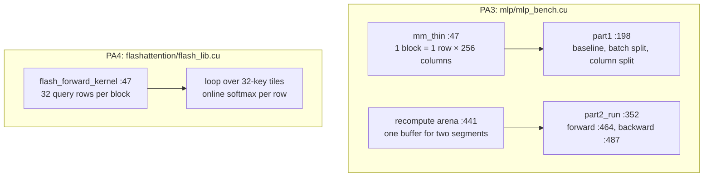
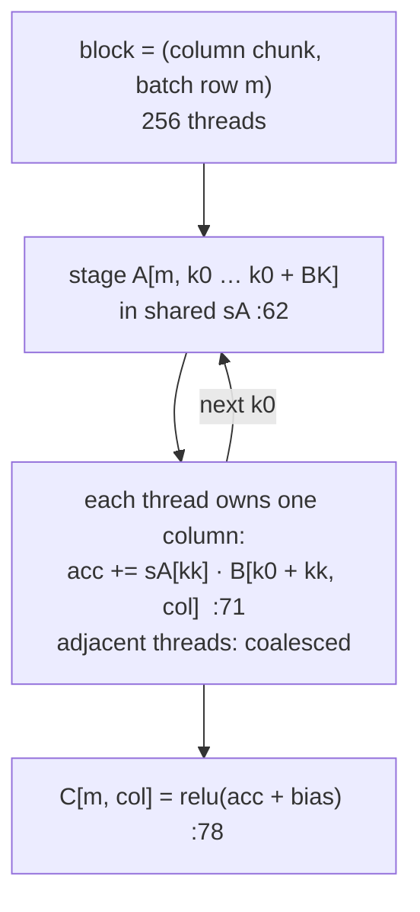
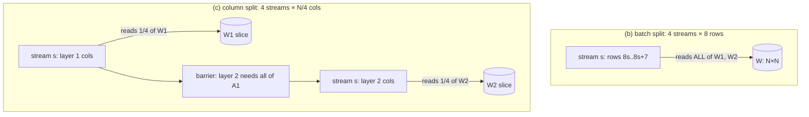
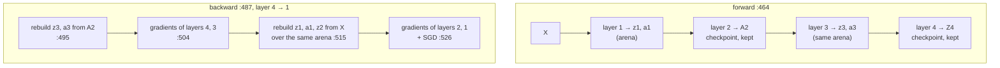
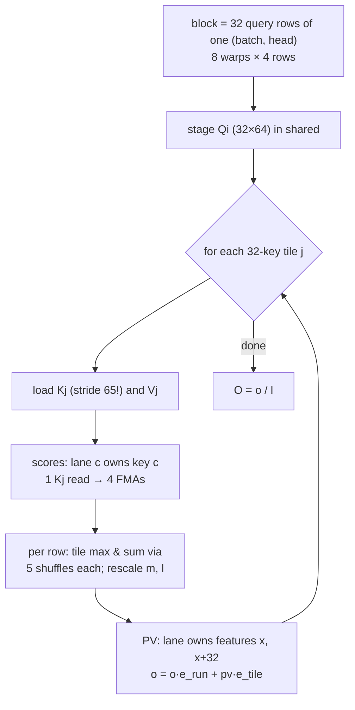

# Day 6 (Fri Nov 13): CUDA II: streams, checkpointing (PA3) and FlashAttention (PA4)

Part of [[Interview plan (Nov 2026)]]. Repo `sysml` (branch `main`). About 7 h. Builds on [[Day 05 - CUDA I]]. Prep pack:
[[CUDA kernels - prep]] (stories S1–S6 are today's).

**Code, explained:** the figures, the code to read and what each snippet does are in [[#Code, explained]], right after section B.

**Resume bullet (part 2 of 2):** "Accelerated MLP inference **1.73×** using column-wise CUDA stream parallelism at large dimensions, while
reducing peak activation memory **13.3%** through gradient checkpointing."

**Fix the wording before you defend it** (prep pack §5, "Honest resume wording"):
- **13.3% is the whole training footprint** (962 → 834 MiB). **Activation memory fell 32%** (400 → 272 MiB).
- **1.73× is at width 32K only** (1.02× at 16K, slower below), against your own kernel, and its mechanism is likely cache locality, not concurrency.
- The two numbers come from **different workloads**: a 2-layer forward pass (1.73×) and a 4-layer training step (13.3%).
- Suggested wording: "Sped up a batch-32 MLP forward pass 1.73× at width 32K by partitioning output columns across 4 CUDA streams (batch splitting never helped). Implemented gradient checkpointing for a 4-layer MLP, cutting activation memory 32% (13.3% of total training memory) for a 26% slower backward pass."

**By tonight you can:**
- explain streams and when they overlap, and why the batch split never helped;
- explain checkpointing, the shared recompute arena and the 0 MB bug;
- derive online softmax and explain FlashAttention's tiling;
- tell the bank-conflict story (7.0×) and the shared-memory-roofline story.

## Schedule

| # | Time | Kind | What |
|---|---|---|---|
| 0 | 15 min | recall | Day 5: coalescing, banks, the 51.3× and 48.2% maths |
| 1 | 30 min | theory | CUDA streams and concurrency (A1) |
| 2 | 60 min | code | Part 1: `mm_thin`, baseline, batch split, column split (B1) |
| 3 | 25 min | theory | Gradient checkpointing (A2) |
| 4 | 50 min | code | Part 2: the training step, the arena, peak memory (B2) |
| — | lunch | | |
| 5 | 60 min | theory + maths | FlashAttention and online softmax (A3) |
| 6 | 60 min | code | `flash_lib.cu`: the kernel, phase by phase (B3) |
| 7 | 15 min | skim | `kvcache/` (PA1, never run) and the lab quizzes (`prob2/`, `prob3/`) |
| 8 | 45 min | rebuild | Online-softmax attention in NumPy (C) |
| 9 | 15 min | trace | The bank-conflict arithmetic (D) |
| 10 | 45 min | practice | The questions (E), plus prep pack §8 "It didn't work" |

## A. Theory

### A1. Streams (block 1, 30 min)

**Read:** NVIDIA blog *"How to Overlap Data Transfers in CUDA C/C++"* (Mark Harris), and the "Streams" part of the
CUDA Programming Guide (§6.2.8 "Asynchronous Concurrent Execution").

> [!abstract] What it says: Mark Harris, *How to Overlap Data Transfers in CUDA C/C++* (NVIDIA blog)
> **Key idea:** copies and kernels can run at the same time only if they sit in **different non-default streams** and the host memory is **pinned** (page-locked).
> **Main figure:** timelines of copy-in, kernel and copy-out. Run one after another they form a long chain; split into chunks across streams they overlap like a pipeline.
> **Claims to know:** the legacy default stream waits for all other work, so using it breaks the overlap.
> `cudaMemcpyAsync` from pageable memory is not truly asynchronous. How much overlaps depends on the GPU's **copy engines** (one for one direction at a time, or two for both).
> The order in which you issue the calls mattered on older GPUs with a single hardware queue.
> **In your project:** your streams overlapped kernels, not copies. The blog's condition still applies: overlap only helps when something is idle.

> [!abstract] What it says: CUDA Programming Guide, *Asynchronous Concurrent Execution*
> **Key idea:** the guide lists what can run concurrently: host code with device work, copies with kernels, and kernels with kernels (on capable GPUs).
> Within one stream, work runs in order; across streams, order is only what events and syncs impose.
> **Claims to know:** concurrent kernels need **free resources**. A kernel that already fills every SM leaves nothing for a second stream.
> Some calls (for example a device-wide sync or work on the legacy default stream) synchronise implicitly and kill overlap.
> **In your project:** that is why the batch split didn't help and the column split's 1.73× is more likely L2 locality.

**Concepts:**

- A **stream** is an ordered queue of work. Kernels in different streams *may* run concurrently, but only if the GPU has spare SMs.
- **When streams help:** small kernels that leave SMs idle, or overlapping copies with compute.
- **When they don't:** a single kernel already fills all 132 SMs. Then extra streams add launches and host syncs.
- **Your case** (story S6): with batch 32, a **batch split** gives each stream 8 rows, but each stream still reads all of W1 and W2 (N² floats vs 32·N for X). So it multiplies weight traffic and launches. A **column split** gives each stream a quarter of W. At N = 32768 the baseline already launches about 4 waves of blocks, so the 1.73× is most likely **locality** (each stream's W slice stays in L2), not concurrency. Prep pack exercise 2 has the one experiment that would settle it.

> [!tip] Explained from scratch: [[#5. Deep dive: CUDA streams from scratch|§5 CUDA streams]]

### A2. Gradient checkpointing (block 3, 25 min)

**Read:** Chen et al., *"Training Deep Nets with Sublinear Memory Cost"* (2016), §1–3. Or the PyTorch docs for `torch.utils.checkpoint` (10 min).

> [!abstract] What it says: Chen, Xu, Zhang and Guestrin (2016), *Training Deep Nets with Sublinear Memory Cost*
> **Key idea:** store activations only at a few **checkpoints**, and recompute the rest during backward.
> With $n$ layers split into $\sqrt{n}$ segments, activation memory falls from $O(n)$ to $O(\sqrt{n})$, for about one extra forward pass.
> **Main figure:** a computation graph where some nodes are kept and others are dropped and rebuilt, with memory shared between the rebuilt pieces.
> **Claims to know:** the abstract's example is a 1,000-layer residual network whose training memory falls from **48 GB to 7 GB**, for about **30% more time**.
> Applying the idea recursively reaches $O(\log n)$ memory, at a higher compute cost.
> **In your project:** your +26.1% backward time matches the "about one extra forward" cost; your arena reuse is the paper's memory-sharing idea.

> [!abstract] What it says: PyTorch docs, `torch.utils.checkpoint`
> **Key idea:** wrap a function; its inner activations are not saved, and it is re-run during backward.
> **Claims to know:** the RNG state is saved by default, so dropout gives the same mask when recomputed.
> There is a reentrant and a non-reentrant version; current docs recommend passing `use_reentrant=False`.
> Recomputed work costs one extra forward per checkpointed segment, the same trade as your C++ version.

**Concepts:**

- Backward needs every layer's activations. **Checkpointing** keeps only a few (the checkpoints), and recomputes the rest from the nearest checkpoint during backward.
- Cost: one extra forward pass over each segment. Your measurement: **+35.5 ms on a 136 ms backward (+26.1%)**. That equals the recomputed forward FLOPs (prep pack §5).
- **Your checkpoints are A2 and Z4** (assignment-prescribed). Z4 is the output MSE needs, and A2 splits the network into two 2-layer segments.
- **The key trick** (story S3): backward runs layer 4 → 1. So segment B (Z3, A3) is fully consumed before segment A (Z1, A1, Z2) is rebuilt. One arena of `max(2·n3, 2·n1+n2)` floats serves both. Separate buffers per recomputed tensor save **nothing**, which was the first version's 0 MB result.

> [!tip] Explained from scratch: [[#6. Deep dive: gradient checkpointing from scratch|§6 gradient checkpointing]]

### A3. FlashAttention (block 5, 60 min)

**Read:** Dao et al., *FlashAttention* (2022), §1–3.1 (Algorithm 1). Optional: the FlashAttention-2 paper's §3.1 (the work-partitioning change).
**Video:** Umar Jamil, *"Flash Attention derived and coded from first principles"* (YouTube). Watch the online-softmax part.

> [!abstract] What it says: Dao et al. (2022), *FlashAttention: Fast and Memory-Efficient Exact Attention with IO-Awareness*
> **Key idea:** attention is slow because of **memory traffic**, not FLOPs. So compute it in tiles that stay in on-chip SRAM, and never write the $N \times N$ score matrix to HBM.
> It uses **online softmax** to combine tiles exactly, and **recomputes** the scores in backward instead of storing them.
> **Main figure:** left, the memory pyramid (fast, small SRAM; slower, larger HBM; much slower CPU DRAM); centre, the tiling loops over K/V blocks and Q blocks; right, a time bar where the fused kernel beats PyTorch attention on GPT-2 by several times.
> **Claims to know:** memory is **linear** in sequence length, not quadratic; the result is **exact**, not an approximation.
> They report about **3×** faster GPT-2 training (1K tokens) and about **15%** faster BERT-large than the MLPerf 1.1 record.
> **In your project:** your kernel does the same thing; its win is memory (no 34.4 GB score matrix), even though it is 1.5× slower than PyTorch at 8K.

> [!abstract] What it says: FlashAttention-2 (Dao, 2023), §3.1
> **Key idea:** keep the same algorithm, but split the work better across thread blocks and warps, and cut non-matmul FLOPs.
> It parallelises over the **sequence** as well as batch and heads, and splits **Q** (not K) across the warps of a block, which avoids sharing partial results through shared memory.
> **Claims to know:** about **2×** faster than FlashAttention-1, reaching roughly **50–73%** of the A100's peak matmul throughput.
> **In your project:** this is the "what would you do next" answer for your kernel's speed gap.

> [!abstract] What it says: Umar Jamil's video
> A from-first-principles derivation of online softmax and the FlashAttention loops, then code.
> I haven't checked its exact content; use it for the derivation, and the paper for every number.

**Online softmax, derive on paper.** Keep for each query row a running max `m`, a running sum `l`, and an output accumulator `o`.
For a new tile of scores `s`:
- `m_new = max(m, max(s))`;
- `l_new = l·e^{m − m_new} + Σ e^{s − m_new}`;
- `o_new = o·e^{m − m_new} + Σ e^{s − m_new} · v`;
- at the end, output = `o / l`.

This equals the exact softmax, because every term was rescaled to the same final max.

**Why it matters:** standard attention writes the N×N score matrix to HBM. At N = 8192, B = 8, 16 heads, that is
8·16·8192²·4 B = **34.4 GB**. That's why your PyTorch baseline is batch-chunked. FlashAttention keeps scores in shared memory and never writes them out.
Its value is **memory, not raw speed**: your kernel is 1.5× slower than PyTorch's explicit path at 8K (prep pack §8).

**Concepts:**
- **IO-aware.** At long sequence lengths attention is limited by HBM traffic; keep tiles in shared memory and never write the score matrix.
- **Online softmax.** A running max, sum and output, rescaled tile by tile, give exactly the full softmax.
- **Recompute in backward.** Storing scores is $O(N^2)$; recomputing them from Q, K, V is cheaper than reading them back.
- **Memory, not speed, in your kernel.** No 34.4 GB score matrix at N = 8192, but 1.5× slower than PyTorch's explicit path.

> [!tip] Explained from scratch: [[#7. Deep dive: online softmax and FlashAttention from scratch|§7 online softmax and FlashAttention]], [[#8. Deep dive: shared-memory bank conflicts from scratch|§8 bank conflicts in your kernel]]

## B. Code

### B1. Part 1: streams (block 2, 60 min, deep)

`mlp/mlp_bench.cu`:
- **47 `mm_thin<BN,BK>`**: one block = one batch row × 256 output columns (comment at 37–45). Why not square tiles at B = 32? (*Square tiles waste 24 of every 32 rows once the batch is split 4 ways.*)
- **198 `part1`**: the 2-layer forward pass, B = 32, N = 32 … 32768.
  - **254** baseline: 2 launches per iteration, no host sync;
  - **262** batch split over 4 streams;
  - **280** column split: each stream owns a quarter of the output columns. There's a host barrier between the layers, because layer 2 needs all of A1 (276–278, 289);
  - **301** `measure`: 3 warm-up, 20 timed iterations.
- Note: the stream variants call `cudaStreamSynchronize` inside the timed loop (273, 289, 298); the baseline doesn't. **Part 1 has no correctness check**, and the column split is wrong for N ≤ 512 (not at 32768).

### B2. Part 2: checkpointing (block 4, 50 min, deep)

- **352 `part2_run`**: a 4-layer MLP training step, run 100 times.
- 396–404: weights scaled by `1/sqrt(fan_in)` (story S4: otherwise NaN, and the checksum check is useless).
- 411–420: the activation buffers. **441–462: the recompute arena.**
- **464** forward; **487** backward, with `mm_tiled` (90), `mm_tiled_AT` (109) and `mm_tiled_BT` (128). Why is backward 3.4× the forward instead of about 2×? (*The transposed-operand kernels load uncoalesced.*)
- 513: the ordering constraint (every use of z3/a3 before the segment-A rebuild).
- **548**: peak memory = the `cudaMemGetInfo` delta after all buffers are allocated. Why is that a fair "peak" here? (*Everything is a `cudaMalloc` made in advance, so footprint = peak.*)
- **572**: equality check = the sum of W4 after the SGD steps.

### B3. FlashAttention (block 6, 60 min, deep)

Follow prep pack §2 "End-to-end trace at N = 8192" side by side with `flashattention/flash_lib.cu`:
- **189 `flash_attention_forward`** (host): rejects D > 128; Tr = Tc = 256; shared memory 28,800 B; grid `(Tr=256, NH=16, B=8)` = 32,768 blocks of 256 threads.
- **47 `flash_forward_kernel`**: the block owns 32 query rows; warp `w` owns rows `4w … 4w+3`.
  - **55**: the K tile's row stride is **D+1 = 65**. Today's key line.
  - 81–85: stage Q. **98**: loop over KV tiles; 103–110: load K (stride 65) and V.
  - **118–126 scores**: lane `c` owns key `c`; one `Kj` read feeds 4 FMAs (4 query rows).
  - **130–152 online softmax**: tile max and sum via 5 `__shfl_xor_sync` steps each; rescale factors.
  - **157–172 PV**: lane owns features `x` and `x+32`. 175–183: divide by `l` and write O.
- `bench_attention.py`: 46 `custom_flash` (ctypes into the `.so`), 58 `pytorch_standard`, 77 `pytorch_fused`, 140–143 the batch chunking.

## Code, explained

Read this **with the files open**. It starts with a picture of the whole day and **the flow, step by step** (one concrete input followed through every function). Then each part has its own figure, the exact code (copied from the repo at the commit named below, so the line numbers match) and what that code does.

Repo `sysml` (`16870fb`): `mlp/mlp_bench.cu` (PA3) and
`flashattention/flash_lib.cu` (PA4). Builds on [[Day 05 - CUDA I#Study guide]].



### The flow, step by step

**A. One checkpointed training step** (`part2_run`, `mlp_bench.cu:352`):
1. **Forward** (`:464`): layers 1–2 write `z1, a1, z2` into the arena; `A2` is kept (a checkpoint). Layers 3–4 write `z3, a3` into the **same arena**, overwriting segment A; `Z4` is kept.
2. **Backward** starts at layer 4 (`:487`): rebuild `z3, a3` from the `A2` checkpoint (`:495–497`), then compute the layer-4 and layer-3 gradients (`:504–511`).
3. **Line 513:** `z3, a3` are dead now, so rebuild `z1, a1, z2` from `X` over the same arena (`:515–519`).
4. Layer-2 and layer-1 gradients, then SGD on every weight and bias (`:526–543`).

**B. One FlashAttention block** at N = 8192, B = 8, 16 heads, D = 64:
1. **Launch** (`flash_lib.cu:194–212`): grid (256, 16, 8); 32 × 8 = 256 threads per block; 28,800 bytes of shared memory.
2. **Ownership:** block (qt = 10, h = 3, b = 0) owns query rows 320–351. Warp 2 owns rows 328–331 (`r0 = 2 × 4 = 8`, `:72`).
3. Stage `Qi` (`:81–85`). Then for each of the **256 key tiles**: load `Kj` (row stride 65) and `Vj` (`:103–110`).
4. **Scores:** lane c computes 4 dot products, one per row, over 64 features (`:118–126`).
5. **Softmax bookkeeping, per row:** shuffle-reduce the max and the sum across the warp, write `p` into `S`, then update `m`, `l` and the rescale factors `e_run`, `e_tile` (`:130–152`).
6. **PV:** lane x accumulates features x and x + 32 over the 32 keys, for 4 rows, and rescales `o` (`:157–172`).
7. After all 256 tiles: `O = o / l` (`:175–183`).

---

### 1. The thin GEMM every stream variant uses



`mlp/mlp_bench.cu:53–79`
```cpp
__shared__ float sA[BK];

const int m   = blockIdx.y;
const int col = blockIdx.x * BN + threadIdx.x;
if (m >= M) return;

float acc = 0.0f;
for (int k0 = 0; k0 < K; k0 += BK) {
    // Stage this row-slice of A cooperatively.
    for (int t = threadIdx.x; t < BK; t += BN) {
        int k = k0 + t;
        sA[t] = (k < K) ? A[(size_t)m * K + k] : 0.0f;
    }
    __syncthreads();

    if (col < N) {
        int kmax = (K - k0 < BK) ? (K - k0) : BK;
        for (int kk = 0; kk < kmax; ++kk)
            acc = fmaf(sA[kk], B[(size_t)(k0 + kk) * N + col], acc);
    }
    __syncthreads();
}

if (col < N) {
    float v = acc + (bias ? bias[col] : 0.0f);
    C[(size_t)m * N + col] = relu ? (v > 0.0f ? v : 0.0f) : v;
}
```
> [!info] New functions in this code
> - `__shared__ float sA[TILE][TILE];`: puts an array in the SM's **shared memory**: on-chip, fast, visible to all threads of the block, gone when the block ends. Two 64 × 64 float tiles = 32 KB. [[Function glossary#CUDA shared|→ examples]]
> - `blockIdx.x / .y / .z`: this block's position **inside the grid**. With 32 × 32 blocks at N = 32768, `blockIdx.x` goes 0…1023. [[Function glossary#blockIdx|→ examples]]
> - `threadIdx.x / .y / .z`: this thread's position **inside its block**. In a 32 × 32 block, `threadIdx.x` and `threadIdx.y` each go 0…31. A warp = 32 consecutive `threadIdx.x` with one `threadIdx.y`. [[Function glossary#threadIdx|→ examples]]
> - `(size_t)row * N`: an unsigned 64-bit integer type. Casting before multiplying keeps `row · N` from overflowing 32-bit `int` (2.1 × 10⁹) for big N. [[Function glossary#size_t|→ examples]]
> - `__syncthreads()`: a barrier for **one block**: no thread continues until every thread of the block has arrived. Used before reading a shared tile (everyone has written it) and before overwriting it (everyone has read it). [[Function glossary#CUDA syncthreads|→ examples]]
> - `fmaf(a, b, c)`: fused multiply-add on floats: `a · b + c` in one instruction with one rounding. `fmaf(2.f, 3.f, 1.f)` = 7. Counts as 2 FLOPs. [[Function glossary#fmaf|→ examples]]

- One block per (batch row `m`, 256-column chunk). The block stages a `BK`-long slice of row `m` of A in shared memory (lines 62–65), then each thread walks down one column of B.
- `B[(k0+kk)*N + col]`: adjacent threads, adjacent columns, so **coalesced**. But each of the 32 row-blocks re-reads the same column slice of W from global memory. Reuse of W across the batch depends entirely on the L1/L2 caches. Keep that in mind for section 2.

---

### 2. Streams: batch split vs column split

> [!tip] Concept from scratch: [[#5. Deep dive: CUDA streams from scratch|CUDA streams and waves from scratch (§5)]]



`mlp/mlp_bench.cu:254–257`
```cpp
auto baseline = [&] {
    mm_thin<BN,BK><<<grd, blk>>>(X,  W1, b1, A1, B, N, N, 1);
    mm_thin<BN,BK><<<grd, blk>>>(A1, W2, b2, Y,  B, N, N, 0);
};
```
> [!info] New functions in this code
> - `kernel<<<grid, block, shared_bytes, stream>>>(args)`: CUDA's launch syntax. `grid` and `block` are sizes (int or `dim3`); `shared_bytes` is the dynamic shared memory per block; `stream` is the queue to launch into (default stream if omitted). [[Function glossary#CUDA kernel launch|→ examples]]

`mlp/mlp_bench.cu:262–273`
```cpp
auto streamed = [&] {
    for (int s = 0; s < NS; ++s) {
        int r0 = s * chunk;
        int rows = (r0 + chunk <= B) ? chunk : (B - r0);
        if (rows <= 0) continue;
        dim3 g((N + BN - 1) / BN, rows);
        mm_thin<BN,BK><<<g, blk, 0, st[s]>>>(X  + (size_t)r0 * N, W1, b1,
                                             A1 + (size_t)r0 * N, rows, N, N, 1);
        mm_thin<BN,BK><<<g, blk, 0, st[s]>>>(A1 + (size_t)r0 * N, W2, b2,
                                             Y  + (size_t)r0 * N, rows, N, N, 0);
    }
    for (int s = 0; s < NS; ++s) cudaStreamSynchronize(st[s]);
```
> [!info] New functions in this code
> - `dim3 grid(x, y, z)`: a 3-number size for grids and blocks; missing numbers are 1. `dim3 grd((N + 255) / 256, 32)` = 128 × 32 blocks at N = 32768. [[Function glossary#dim3|→ examples]]
> - `cudaStreamSynchronize(s)`: the CPU waits until everything queued in stream `s` has finished. [[Function glossary#cudaStreamSynchronize|→ examples]]

- **Batch split:** each stream gets 8 rows, but each still multiplies by the **whole** W1 and W2 (`W1` is passed unchanged). W is N² floats while X is only 32·N, so weight traffic dominates and the split multiplies it, and it launches 4× as many kernels. It never helped: up to 4× slower.

`mlp/mlp_bench.cu:280–299`
```cpp
auto streamed_col = [&] {
    for (int s = 0; s < NS; ++s) {
        int c0 = s * cchunk;
        int cols = (c0 + cchunk <= N) ? cchunk : (N - c0);
        if (cols <= 0) continue;
        dim3 g((cols + BN - 1) / BN, B);
        mm_thin<BN,BK><<<g, blk, 0, st[s]>>>(X, W1 + c0, b1 + c0,
                                             A1 + c0, B, N, N, 1);
    }
    for (int s = 0; s < NS; ++s) cudaStreamSynchronize(st[s]);
    for (int s = 0; s < NS; ++s) {
        int c0 = s * cchunk;
        int cols = (c0 + cchunk <= N) ? cchunk : (N - c0);
        if (cols <= 0) continue;
        dim3 g((cols + BN - 1) / BN, B);
        mm_thin<BN,BK><<<g, blk, 0, st[s]>>>(A1, W2 + c0, b2 + c0,
                                             Y + c0, B, N, N, 0);
    }
    for (int s = 0; s < NS; ++s) cudaStreamSynchronize(st[s]);
};
```

- **Column split:** stream `s` gets `W1 + c0`, a quarter of the columns. Each stream touches only its own slice of W, which is far more likely to stay in L2 between its 32 row-blocks.
- Layer 2 needs **all** of A1, so there's a full sync between the layers (line 289).
- 1.73× at N = 32768 only. The baseline already launches about 4 waves of blocks at that size, so the GPU was full. The gain is most likely **cache locality**, not streams running concurrently. Say so.
- The stream variants call `cudaStreamSynchronize` inside the timed loop; the baseline doesn't. At small N that host round-trip is part of why they look slower.

---

### 3. Gradient checkpointing: one arena, two segments

> [!tip] Concept from scratch: [[#6. Deep dive: gradient checkpointing from scratch|gradient checkpointing from scratch (§6)]]



`mlp/mlp_bench.cu:411–420`
```cpp
float *Z1=nullptr,*A1=nullptr,*Z2=nullptr,*A2=nullptr,*Z3=nullptr,*A3=nullptr,*Z4=nullptr;
CUDA_CHECK(cudaMalloc(&A2, n2 * sizeof(float)));   // checkpoint
CUDA_CHECK(cudaMalloc(&Z4, n4 * sizeof(float)));   // checkpoint
if (!checkpointed) {
    CUDA_CHECK(cudaMalloc(&Z1, n1 * sizeof(float)));
    CUDA_CHECK(cudaMalloc(&A1, n1 * sizeof(float)));
    CUDA_CHECK(cudaMalloc(&Z2, n2 * sizeof(float)));
    CUDA_CHECK(cudaMalloc(&Z3, n3 * sizeof(float)));
    CUDA_CHECK(cudaMalloc(&A3, n3 * sizeof(float)));
}
```
> [!info] New functions in this code
> - `CUDA_CHECK(call)`: a macro defined in this file: runs a CUDA call and, if it returns an error, prints the file, line and message and exits. Without it, CUDA errors are silent until something later fails. [[Function glossary#CUDA_CHECK|→ examples]]
> - `cudaMalloc(&ptr, bytes)`: allocates GPU global memory. `cudaMalloc(&A2, n2 * sizeof(float))` reserves 64 MiB for a 4096 × 4096 float tensor. [[Function glossary#cudaMalloc|→ examples]]
> - `sizeof(float)`: size of a type in bytes: `sizeof(float)` = 4, `sizeof(double)` = 8. [[Function glossary#sizeof|→ examples]]

- Both modes keep the two checkpoints, `A2` and `Z4`. Only the baseline also keeps `Z1, A1, Z2, Z3, A3`. That is the entire memory difference.

`mlp/mlp_bench.cu:453–462`
```cpp
float *arena = nullptr;
float *rZ1=nullptr,*rA1=nullptr,*rZ2=nullptr,*rZ3=nullptr,*rA3=nullptr;
if (checkpointed) {
    size_t segA = 2 * n1 + n2;
    size_t segB = 2 * n3;
    size_t arena_floats = segA > segB ? segA : segB;
    CUDA_CHECK(cudaMalloc(&arena, arena_floats * sizeof(float)));
    rZ1 = arena;  rA1 = rZ1 + n1;  rZ2 = rA1 + n1;   // segment A layout
    rZ3 = arena;  rA3 = rZ3 + n3;                    // segment B, aliased
}
```

- **The trick:** segment B (`Z3, A3`) and segment A (`Z1, A1, Z2`) are never needed at the same time, so both live in **one** arena of `max(2·n3, 2·n1 + n2)` floats. Note `rZ3 = arena` and `rZ1 = arena`: they alias. The first version gave each recomputed tensor its own permanent buffer and saved **0 MB** (story S3).

`mlp/mlp_bench.cu:493–501`
```cpp
if (checkpointed) {
    // segment B, from the A2 checkpoint
    mm_tiled<<<g2(Nb,H3), dim3(TS,TS)>>>(A2, W3, rZ3, Nb, H2, H3);
    k_add_bias_relu<<<g1(n3),256>>>(rZ3, b3, Nb, H3, 0);
    k_relu_into<<<g1(n3),256>>>(rZ3, rA3, n3);
    z3 = rZ3; a3 = rA3;
} else {
    z3 = Z3; a3 = A3;
}
```

`mlp/mlp_bench.cu:513–523`
```cpp
// z3 / a3 are dead from here on: rebuild segment A over the same arena.
if (checkpointed) {
    mm_tiled<<<g2(Nb,H1), dim3(TS,TS)>>>(X, W1, rZ1, Nb, IN, H1);
    k_add_bias_relu<<<g1(n1),256>>>(rZ1, b1, Nb, H1, 0);
    k_relu_into<<<g1(n1),256>>>(rZ1, rA1, n1);
    mm_tiled<<<g2(Nb,H2), dim3(TS,TS)>>>(rA1, W2, rZ2, Nb, H1, H2);
    k_add_bias_relu<<<g1(n2),256>>>(rZ2, b2, Nb, H2, 0);
    z1 = rZ1; a1 = rA1; z2 = rZ2;
} else {
    z1 = Z1; a1 = A1; z2 = Z2;
}
```

- Backward first rebuilds segment B from the `A2` checkpoint, uses `z3, a3` for the layer 4 and 3 gradients, and **only then** rebuilds segment A over the same memory. Any use of `z3` after line 513 would read garbage. The comment states the ordering rule.
- The cost is those two extra mini-forwards: +35.5 ms on a 136 ms backward (+26%).

`mlp/mlp_bench.cu:548–550`
```cpp
CUDA_CHECK(cudaDeviceSynchronize());
CUDA_CHECK(cudaMemGetInfo(&free_after, &total));
peak = free_before - free_after;
```
> [!info] New functions in this code
> - `cudaDeviceSynchronize()`: the CPU waits until **all** GPU work in all streams has finished. [[Function glossary#cudaDeviceSynchronize|→ examples]]
> - `cudaMemGetInfo(&free, &total)`: free and total GPU memory in bytes. Calling it before and after allocating gives the bytes a program holds: 962 vs 834 MiB here. [[Function glossary#cudaMemGetInfo|→ examples]]

- Memory = how much free memory dropped after **everything** is allocated (including the arena). Every buffer is a `cudaMalloc` made up front, so footprint = peak. 962 → 834 MiB is the **whole training step** (−13.3%); the activations alone fell 400 → 272 MiB (−32%).

---

### 4. FlashAttention: tiles, warps, online softmax

> [!tip] Concept from scratch: [[#8. Deep dive: shared-memory bank conflicts from scratch|bank conflicts and the stride-65 fix from scratch (§8)]]

> [!tip] Concept from scratch: [[#7. Deep dive: online softmax and FlashAttention from scratch|online softmax and FlashAttention from scratch (§7)]]



`flashattention/flash_lib.cu:55–61`
```cpp
const int KS = D + 1;             // padded Kj row stride, see header

extern __shared__ float smem[];
float* Qi = smem;
float* Kj = Qi + BR * D;
float* Vj = Kj + BC * KS;
float* S  = Vj + BC * D;          // BR * BC
```
> [!info] New functions in this code
> - `extern __shared__ float smem[];`: **dynamic** shared memory: its size isn't fixed in the code but given at launch (`<<<grid, block, 28800>>>`). The kernel carves it into Qi, Kj, Vj, S by pointer offsets. [[Function glossary#CUDA extern shared|→ examples]]

- Shared memory = `Qi | Kj | Vj | S`. **`KS = D + 1 = 65`** is the row stride of `Kj`. This one line is the 7.0× story.

`flashattention/flash_lib.cu:118–126`
```cpp
if (lane < kv_len) {
    const float* kptr = Kj + lane * KS;
    for (int x = 0; x < D; ++x) {
        const float kv = kptr[x];
        #pragma unroll
        for (int r = 0; r < RPW; ++r)
            a[r] = fmaf(Qi[(r0 + r) * D + x], kv, a[r]);
    }
}
```
> [!info] New functions in this code
> - `#pragma unroll
for (int k = 0; k < TILE; ++k) ...`: asks the compiler to copy the loop body once per iteration (no loop counter, no branch). With a compile-time trip count like `TILE` or `R`, small arrays such as `reg[R][R]` can then live in registers. [[Function glossary#pragma unroll|→ examples]]

- Score phase: lane `c` owns key `c`, so at a fixed feature `x` the 32 lanes read `Kj[c·KS + x]`. With stride 64, the bank is `(c·64 + x) mod 32 = x mod 32`: **all 32 lanes on one bank, a 32-way conflict**. With stride 65 the bank is `(c + x) mod 32`, all different. 2377 → 339 ms.
- `x` is the outer loop, so one `kv` load feeds **4 FMAs** (4 query rows per warp). The `Qi` reads are the same address for all lanes, so they broadcast. Moving from 1 to 4 rows per warp gave 339 → 160 ms (story S2).

`flashattention/flash_lib.cu:130–152`
```cpp
for (int r = 0; r < RPW; ++r) {
    float s = (lane < kv_len) ? a[r] * softmax_scale : -INFINITY;

    float m_tile = s;
    #pragma unroll
    for (int off = 16; off > 0; off >>= 1)
        m_tile = fmaxf(m_tile, __shfl_xor_sync(0xffffffff, m_tile, off));

    float p = (lane < kv_len) ? __expf(s - m_tile) : 0.0f;

    float l_tile = p;
    #pragma unroll
    for (int off = 16; off > 0; off >>= 1)
        l_tile += __shfl_xor_sync(0xffffffff, l_tile, off);

    S[(r0 + r) * BC + lane] = p;

    const float m_new = fmaxf(m_run[r], m_tile);
    e_run[r]  = __expf(m_run[r] - m_new);   // 0 on the first tile
    e_tile[r] = __expf(m_tile   - m_new);
    l_run[r]  = e_run[r] * l_run[r] + e_tile[r] * l_tile;
    m_run[r]  = m_new;
}
```
> [!info] New functions in this code
> - `INFINITY / -INFINITY`: the float infinity constants. `m_run = -INFINITY` starts the running max below every score. [[Function glossary#INFINITY|→ examples]]
> - `fmaxf(a, b)`: the larger of two floats. `fmaxf(2.f, 3.f)` = 3; `fmaxf(-INFINITY, 1.f)` = 1. [[Function glossary#fmaxf|→ examples]]
> - `__shfl_xor_sync(mask, v, off)`: returns `v` from lane `lane XOR off` of the same warp, register to register. With off = 16, 8, 4, 2, 1 and `fmaxf`, every lane ends with the warp's max in 5 steps. `mask = 0xffffffff` = all 32 lanes take part. [[Function glossary#CUDA shfl_xor_sync|→ examples]]
> - `__expf(x)`: a fast, slightly less precise hardware e^x for floats. `__expf(0.f)` = 1, `__expf(-INFINITY)` = 0. [[Function glossary#CUDA expf|→ examples]]

- For each of the warp's 4 rows: the tile max needs a reduction across 32 lanes. `__shfl_xor_sync` with offsets 16, 8, 4, 2, 1 swaps registers between lanes, giving the max in **5 steps with no shared memory**. The sum is reduced the same way.
- `p = e^{s − m_tile}` is written to the warp's own rows of `S`. Then the running state updates: `m_new = max(m_run, m_tile)`, `e_run = e^{m_run − m_new}` rescales the old sum and output, and `e_tile = e^{m_tile − m_new}` rescales this tile's.
- On the first tile `m_run = −∞`, so `e_run = 0`, which correctly discards the empty initial state.

`flashattention/flash_lib.cu:158–172`
```cpp
for (int x = lane; x < D; x += WARP, ++jj) {
    float pv[RPW];
    #pragma unroll
    for (int r = 0; r < RPW; ++r) pv[r] = 0.0f;

    for (int c = 0; c < kv_len; ++c) {
        const float vv = Vj[c * D + x];
        #pragma unroll
        for (int r = 0; r < RPW; ++r)
            pv[r] = fmaf(S[(r0 + r) * BC + c], vv, pv[r]);
    }
    #pragma unroll
    for (int r = 0; r < RPW; ++r)
        o_acc[r][jj] = o_acc[r][jj] * e_run[r] + pv[r] * e_tile[r];
}
```

- PV phase: now lane `x` owns **feature** `x` (and `x + 32`). `Vj[c·D + x]` with adjacent `x` hits adjacent banks, so no padding is needed here.
- `o = o·e_run + pv·e_tile` is the online-softmax update for the output. Divide by `l_run` once at the very end (lines 175–183).
- `__syncwarp()` (line 153), not `__syncthreads()`: each warp reads only its own rows of `S`, so only lanes within one warp need to agree.

**Check yourself:** with stride 64, which bank do lanes 0, 1 and 31 hit at `x = 5`? With stride 65? (*64: all bank 5. 65: banks 5, 6 and 4.*)

---

### 5. Deep dive: CUDA streams from scratch

Section 2 above walks the three Part 1 variants. This section explains what a stream can and can't do, so you can
defend the 1.73× honestly. Order: what a stream is → a toy timeline → when overlap is possible → the code with real
values → why the batch split lost and the column split won → questions → check.

> [!important] The one sentence to hold on to
> A stream is an **ordered queue** of GPU work; kernels in different streams **may** run at the same time, but only if
> the GPU has **idle SMs** to give them, and a kernel that already fills all 132 SMs leaves nothing to share.

#### 5.1 What a stream is

The host (CPU) doesn't run kernels. It **enqueues** them, and the GPU drains the queue. A **stream** is one such
queue:
- work in **one** stream runs in order: kernel 2 starts after kernel 1 ends;
- work in **different** streams has no ordering, so the GPU may overlap it;
- without a stream argument, a launch goes to the **default stream**.

Launch syntax: `kernel<<<grid, block, shared_bytes, stream>>>(args)`. The 4th argument picks the queue.

#### 5.2 A toy timeline

![[d6-5-streams.svg]]

**Case A:** four kernels, each with only enough blocks to fill **30** of the 132 SMs. In one stream they run back
to back: 4 time units. In four streams the GPU runs them side by side on different SMs: about **1** unit.

**Case B:** four kernels, each with enough blocks for **4 full waves** over all 132 SMs. There are no idle SMs, so
the second kernel's blocks just wait behind the first's. Four streams finish no sooner than one, and the extra
launches and syncs make it a little later.

#### 5.3 When overlap is possible: count the waves

A **wave** = the number of blocks the whole GPU holds at once. For `mm_thin` (256 threads per block, up to 2,048
threads per SM): up to **8 blocks per SM**, so 132 × 8 = **1,056 blocks** per wave.

| width N | baseline grid | blocks | waves | idle SMs to share? |
|---|---|---|---|---|
| 1,024 | 4 × 32 | 128 | 0.12 | yes, most of the GPU |
| 32,768 | 128 × 32 | 4,096 | 3.9 | no |

At small N there is room for overlap, but each kernel takes only microseconds, so launch and sync costs dominate.
At large N the GPU is already full. Either way, **concurrency** has little to give here.

#### 5.4 The code, with real values

**Baseline:** two launches on the default stream, grid `((N + 255) / 256, 32)`. At N = 32768: 128 column chunks × 32
batch rows = 4,096 blocks.

**Batch split** (`chunk = (32 + 3) / 4 = 8`). For stream s = 2:
- `r0 = 2 · 8 = 16`, `rows = 8`;
- grid `(128, 8)` = 1,024 blocks;
- inputs `X + 16·N`, outputs `A1 + 16·N`: rows 16–23;
- but `W1` and `W2` are passed **whole**. Each stream multiplies its 8 rows by all of W.

**Column split** (`cchunk = 32768 / 4 = 8192`). For stream s = 1:
- `c0 = 8192`, `cols = 8192`;
- grid `(8192 / 256, 32)` = `(32, 32)` = 1,024 blocks;
- `W1 + c0`, `b1 + c0`, `A1 + c0`: columns 8,192–16,383 of the output, read from that quarter of W1;
- then `cudaStreamSynchronize` on all four, because layer 2 needs **all** of A1; then the same for layer 2.

#### 5.5 Why the batch split lost and the column split won

**Bytes:** one weight matrix at N = 32768 is N² × 4 B = **4.29 GB**. The activations are tiny by comparison (32 × N
× 4 B = 4.2 MB). So time is about **how many times W is read from HBM**. Reading both W1 and W2 once takes at least
2 × 4.29 GB / 4.8 TB/s = **1.8 ms**; the baseline takes 44.4 ms, so W is being re-read many times.

**Batch split:** each stream re-reads all of W for only 8 rows. More passes over W, 4× the launches, plus host syncs.
Slower everywhere: 52.3 vs 44.4 ms at N = 32768.

**Column split, the likely mechanism (not profiled):** blocks are usually dispatched in `blockIdx.x`-first order.
- The baseline grid is 128 column chunks wide. One wave of 1,056 blocks covers all 128 chunks for only ~8 batch rows, so every wave sweeps the **whole** of W (4.3 GB, far bigger than the ~50 MB L2). W is streamed from HBM about 4 times per layer.
- Each column-split kernel is 32 chunks wide and 1,024 blocks big: **one wave**. All 32 batch rows of a column chunk run together, so they can share that chunk's W reads through L2.

That's **locality**, not concurrency. It fits the data: the gain appears only where the baseline needs several
waves (N = 32768: 1.73×; N = 16384: 1.02×; below, slower).

| N | baseline | batch split | column split |
|---|---|---|---|
| 32 | 0.0069 ms | 0.0278 ms (4.1× slower) | 0.0339 ms (4.9× slower) |
| 1,024 | 0.099 ms | 0.120 ms | 0.125 ms |
| 16,384 | 6.29 ms | 6.85 ms | 6.19 ms (1.02×) |
| 32,768 | 44.43 ms | 52.28 ms | **25.65 ms (1.73×)** |

#### 5.6 Questions people usually ask next

##### "Can you prove the 1.73× is not concurrency?"

Not from this data. One experiment would settle it: run the **same four column-split kernels on one stream**, one
after another. If it's still about 1.7× faster than the baseline, the gain is locality. If it drops to 1×, the
streams' overlap mattered.

##### "Why are the stream variants slower at small N?"

Each split kernel is tiny, so fixed costs dominate: 4× (or 8×) the launches, and `cudaStreamSynchronize` calls inside
the timed loop. The baseline has no host sync inside its loop at all.

##### "When would streams clearly help?"

Overlapping a **copy** with compute (`cudaMemcpyAsync` on one stream while a kernel runs on another), or running
several small independent kernels that each leave SMs idle.

##### "Is the column split correct?"

At N = 32768, yes: each stream computes its own columns from the full A1 after the barrier. Part 1 has no
correctness check, though, and the prep pack notes the split is wrong for N ≤ 512. Say so if asked.

#### 5.7 Check your understanding

1. Two kernels in the same stream: can they overlap? In different streams?
2. What does the 4th launch argument in `<<<g, blk, 0, st[s]>>>` mean?
3. How many `mm_thin` blocks fit in one wave on the H200? How many waves does the baseline need at N = 32768?
4. Batch split, stream s = 3: which rows, and how much of W1 does it read?
5. Column split, stream s = 3: which output columns? How many blocks per kernel?
6. Why is the barrier between layer 1 and layer 2 needed?
7. What one experiment separates locality from concurrency?

> [!success]- Answers
> 1. Same stream: no, they run in order. Different streams: they may, if SMs are free.
> 2. The stream (queue) to launch into; the 0 is the dynamic shared memory size.
> 3. 132 × 8 = 1,056; 4,096 / 1,056 ≈ 3.9 waves.
> 4. Rows 24–31; all of W1 (and W2).
> 5. Columns 24,576–32,767; (8192 / 256) × 32 = 1,024 blocks.
> 6. Every layer-2 output column needs the whole A1 row, which all four streams produce.
> 7. Run the four column chunks one after another on one stream and compare with the baseline.

#### 5.8 The five things to remember

1. **Stream** = ordered queue; different streams may overlap only on **idle SMs**.
2. **Waves:** 1,056 `mm_thin` blocks per wave; the baseline at 32K needs ~3.9, so the GPU is already full.
3. **Batch split:** every stream reads all of W → more traffic and launches → never faster (4.1× slower at width 32).
4. **Column split:** 1.73× at N = 32768 only; each kernel fits one wave, so W chunks are shared via L2: **locality**, most likely.
5. **Honest wording:** "1.73× at width 32K from partitioning columns across 4 streams; likely cache locality, not concurrency."

---

### 6. Deep dive: gradient checkpointing from scratch

Section 3 above walks the arena code. This section builds checkpointing from the reason backward needs memory at
all. Order: what backward needs → the trade → this project's plan → the arena, with real sizes → the cost → the
code ordering rule → questions → check.

> [!important] The one sentence to hold on to
> Keep only a few activations (**checkpoints**) during the forward pass and **recompute** the rest from the nearest
> checkpoint during backward: less memory, one extra forward pass of compute.

#### 6.1 What backward needs

Take one layer: `Z = A_prev · W + b`, then `A = ReLU(Z)`. Its gradients need two saved tensors:
- **`Z`**, for the ReLU derivative: the gradient passes where Z > 0 and is zeroed elsewhere (`k_relu_deriv(z3, dZ3)`);
- **`A_prev`**, for the weight gradient: `dW = A_prevᵀ · dZ` (`mm_tiled_AT(a3, dZ4, dW4)`).

Backward runs **last layer first**. So the forward pass must keep every layer's Z and A until backward reaches that
layer. For deep or wide networks, these activations dominate memory.

#### 6.2 The trade, on a toy

A chain of 16 layers, each activation one unit of memory.
- **Keep all:** 16 units.
- **Checkpoint every 4th layer:** keep 4 checkpoints. During backward, rebuild one 4-layer segment at a time from its checkpoint: 4 more units at most. Peak = 4 + 4 = **8 units**.
- **Cost:** each segment is recomputed once, so about **one extra forward pass**.

In general, n layers with checkpoints every √n layers need about 2√n units instead of n (Chen et al., 2016).

#### 6.3 This project's plan

A 4-layer MLP training step (the assignment fixes the checkpoints):

```
Z1 = X·W1 + b1,  A1 = ReLU(Z1)
Z2 = A1·W2 + b2, A2 = ReLU(Z2)     ← checkpoint
Z3 = A2·W3 + b3, A3 = ReLU(Z3)
Z4 = A3·W4 + b4                    ← checkpoint (the MSE loss needs it)
```

Two **segments** get rebuilt in backward:
- **segment B** (layer 3): `Z3, A3`, from `A2`;
- **segment A** (layers 1–2): `Z1, A1, Z2`, from `X`.

#### 6.4 The arena, with real sizes

Config N4096: batch 4096, widths 1024 → 4096 → 4096 → 4096 → 1024. One 4096 × 4096 float tensor = 4096² × 4 B
= **64 MiB**; `Z4` (4096 × 1024) = **16 MiB**.

![[d6-6-ckpt.svg]]

- **Baseline:** Z1, A1, Z2, A2, Z3, A3 at 64 each + Z4 at 16 = **400 MiB**.
- **Checkpointed:** A2 (64) + Z4 (16) + one **arena** for the recomputed segments.

The key fact: backward finishes with segment B **before** it needs segment A. So the two are never alive together,
and one buffer can hold either:

$$\text{arena} = \max(\underbrace{2 n_3}_{Z_3,A_3} = 128,\ \underbrace{2 n_1 + n_2}_{Z_1,A_1,Z_2} = 192) = 192\ \text{MiB}$$

Checkpointed total: 64 + 16 + 192 = **272 MiB**. Activations fall **400 → 272 MiB (−32%)**.

The whole training step (weights, gradients, everything) measured **962 → 834 MiB**: the same 128 MiB saved, which
is **13.3%** of the total. That's the resume number; say which denominator it uses.

**The 0 MB bug** (story S3): the first version gave each recomputed tensor its **own** permanent buffer. Five
buffers of 64 MiB = 320, + A2 + Z4 = 400 MiB again: exactly the baseline. Recomputing saves nothing unless the
recomputed tensors **share** memory.

#### 6.5 The cost: one extra forward, almost exactly

Backward recomputes layers 1, 2 and 3. Their FLOPs, as a share of the forward pass:

$$\frac{1024 \cdot 4096 + 4096 \cdot 4096 + 4096 \cdot 4096}{1024 \cdot 4096 + 2 \cdot 4096^2 + 4096 \cdot 1024} = \frac{9}{10}$$

Forward takes 39.5 ms, so the prediction is 0.9 × 39.5 = **35.5 ms**. Measured: backward **136.1 → 171.7 ms, +35.5
ms (+26%)**. The extra time is exactly the recomputed forward work.

#### 6.6 The code ordering rule, line by line

```cpp
rZ1 = arena;  rA1 = rZ1 + n1;  rZ2 = rA1 + n1;   // segment A layout
rZ3 = arena;  rA3 = rZ3 + n3;                    // segment B, aliased
```

- `rZ1` and `rZ3` are the **same address**. Writing one overwrites the other. That is the point.

Backward, in order:
1. **Rebuild segment B** from `A2`: `mm_tiled(A2, W3, rZ3)`, bias + ReLU into `rA3`.
2. **Layer 4 and 3 gradients** use `rZ3`, `rA3` (`k_relu_deriv(z3, dZ3)`, `mm_tiled_AT(a3, dZ4, dW4)`).
3. **Line 513:** from here, z3 and a3 are dead. **Rebuild segment A** from `X` over the same arena: `rZ1`, `rA1`, `rZ2`.
4. Layer 2 and 1 gradients, then SGD.

Any read of `z3` after step 3 would get segment A's numbers: silently wrong gradients, no crash. The code comment
states the rule because nothing else enforces it.

**How memory is measured:** `cudaMemGetInfo` before allocating and after **everything** is allocated (arena
included). Every buffer is a `cudaMalloc` made up front, so this difference is the true peak.

**How correctness is checked:** both modes run 100 SGD steps from the same seed; the sums of W4 match to 10 digits
(−379.7093289 at N4096).

#### 6.7 Questions people usually ask next

##### "Why checkpoint A2 and Z4, not other tensors?"

Z4 is the output the loss needs first in backward. A2 splits the network into two segments, and it is also the
input that layer 3's weight gradient needs. Both are fixed by the assignment.

##### "Is 13.3% 'peak activation memory'?"

No. 13.3% is of the **whole** training footprint (962 MiB). Activations alone fell 32% (400 → 272). Say the 32%
first, then the 13.3%.

##### "Why is backward 3.4× the forward instead of about 2×?"

Backward does two matmuls per layer, roughly 2× the FLOPs. The extra comes from the transposed-operand kernels
(`mm_tiled_AT`, `mm_tiled_BT`), whose global loads are uncoalesced.

##### "How does PyTorch do this?"

`torch.utils.checkpoint` wraps a segment: forward runs it under `no_grad`, keeps the inputs, and backward reruns it to
rebuild the activations. The caching allocator reuses the freed memory, which plays the role of the arena.

#### 6.8 Check your understanding

1. Which two saved tensors does one layer's backward need, and why each?
2. 16 layers, checkpoint every 4: peak memory in units? Extra compute?
3. In N4096, what's in the arena during the layer-4 gradient? During the layer-1 gradient?
4. Compute the arena size and the checkpointed activation total.
5. Why did the first version save 0 MB?
6. Predict the backward overhead from the forward time.
7. What goes wrong if a line after 513 reads `z3`?

> [!success]- Answers
> 1. Z (the ReLU mask) and the layer's input A_prev (for dW = A_prevᵀ · dZ).
> 2. 4 checkpoints + 4 rebuilt = 8 units; about one extra forward pass.
> 3. Segment B (Z3, A3); later segment A (Z1, A1, Z2).
> 4. max(128, 192) = 192 MiB; 64 + 16 + 192 = 272 MiB.
> 5. Five separate recompute buffers held as much as the baseline (400 MiB); only a shared arena saves memory.
> 6. 0.9 × 39.5 = 35.5 ms; measured +35.5 ms.
> 7. It reads segment A's data (the arena was overwritten): silently wrong gradients.

#### 6.9 The five things to remember

1. **Why memory:** backward needs each layer's Z and input; it runs last layer first, so all are kept.
2. **Checkpointing:** keep a few, recompute segments in backward; ~2√n memory for one extra forward.
3. **The arena:** segments B and A are never alive together → one buffer of max(128, 192) = 192 MiB.
4. **Numbers:** activations 400 → 272 MiB (−32%); whole step 962 → 834 MiB (−13.3%); backward +35.5 ms (+26%) = 0.9 forward.
5. **The bug lesson:** recomputation saves nothing unless recomputed tensors share memory, and the order of use must be enforced by hand.

---

### 7. Deep dive: online softmax and FlashAttention from scratch

Section 4 above walks `flash_lib.cu` phase by phase. This section builds the algorithm from the problem it solves.
Order: why the score matrix is the problem → safe softmax → online softmax on a toy → why it's exact → how the
kernel splits the work → warp shuffles → the code with real indices → the measured story → questions → check.

> [!important] The one sentence to hold on to
> Walk over the keys **one tile at a time**, keeping per query row a running max `m`, a running sum `l` and a running
> output `o`, and **rescale** the old state whenever a larger max appears; at the end `o / l` is exactly softmax(QKᵀ)V,
> and the N × N score matrix never exists.

#### 7.1 The problem: the score matrix

Attention for one head: `O = softmax(Q Kᵀ / √D) V`. The scores `Q Kᵀ` form an **N × N** matrix per (batch, head).
At the benchmark size (B = 8, 16 heads, N = 8192, float32):

$$8 \times 16 \times 8192^2 \times 4\ \text{B} = 34.4\ \text{GB}$$

That's why the PyTorch baseline has to process the batch in chunks at 8K. Writing and reading 34 GB of scores also
costs HBM bandwidth. FlashAttention computes the same O while keeping scores in **on-chip shared memory**, one small
tile at a time.

#### 7.2 Safe softmax first

$\text{softmax}(s)_i = e^{s_i} / \sum_j e^{s_j}$. With big scores, $e^{s}$ overflows. So everyone subtracts the
max first:

$$\text{softmax}(s)_i = \frac{e^{s_i - m}}{\sum_j e^{s_j - m}}, \qquad m = \max_j s_j$$

Same result (the $e^{-m}$ cancels), and every exponent is ≤ 0. The catch: you need the max of the **whole row**
before you start. Online softmax removes that catch.

#### 7.3 Online softmax on a toy

One query row, 4 keys, in 2 tiles of 2. Scores s = [2, 1 | 3, 0], values (one feature) v = [1, 3 | 2, 0].

![[d6-7-online-softmax.svg]]

**Tile 1** (s = [2, 1]): its max is 2. p = [e⁰, e⁻¹] = [1, 0.368]. Sum 1.368. Σ p·v = 1·1 + 0.368·3 = 2.104. The
state starts empty (m = −∞), so it becomes m = 2, l = 1.368, o = 2.104.

**Tile 2** (s = [3, 0]): its max is 3, bigger than 2. p = [1, e⁻³] = [1, 0.050]. Sum 1.050. Σ p·v = 2.000.
- new max 3; the old state was computed against max 2, so scale it by $e^{2-3} = 0.368$;
- l = 0.368 · 1.368 + 1 · 1.050 = **1.553**;
- o = 0.368 · 2.104 + 1 · 2.000 = **2.774**.

**Answer:** o / l = 2.774 / 1.553 = **1.786**. The exact softmax of [2, 1, 3, 0] is [0.237, 0.087, 0.644, 0.032],
and 0.237·1 + 0.087·3 + 0.644·2 + 0.032·0 = **1.786**. Same.

#### 7.4 Why it's exact

Claim: after any number of tiles, with m = the max so far,

$$l = \sum_{\text{seen } j} e^{s_j - m}, \qquad o = \sum_{\text{seen } j} e^{s_j - m}\, v_j$$

- It holds after the first tile (that's how l and o are built).
- A new tile with max $m_t$: the new max is $m' = \max(m, m_t)$. Multiplying the old sums by $e^{m - m'}$ turns every $e^{s_j - m}$ into $e^{s_j - m'}$. The tile's own terms, computed against $m_t$, are multiplied by $e^{m_t - m'}$. Now every term uses $m'$, so the claim holds again.

At the end, o / l = Σ e^{s_j − m} v_j / Σ e^{s_j − m} = softmax(s) · v. Exactly, not approximately.

#### 7.5 How the kernel splits the work

`flash_forward_kernel` at N = 8192, D = 64:
- **grid** `(Tr, NH, B) = (256, 16, 8)` = 32,768 blocks. A block owns **32 query rows** of one (batch, head).
- **block** `(32, 8)` = 8 warps of 32 lanes. Warp w owns rows **4w … 4w + 3** (RPW = 4 rows per warp).
- **shared memory** = Qi (32 × 64) + Kj (32 × 65) + Vj (32 × 64) + S (32 × 32) floats = (2,048 + 2,080 + 2,048 + 1,024) × 4 B = **28,800 B**.
- **loop** over Tc = 256 key tiles of 32 keys.

Inside one tile, the lanes change roles:
- **score phase:** lane c owns **key c**. It computes the 4 dot products (one per row of its warp) of Q with key c over 64 features.
- **softmax phase:** per row, the warp needs the max and the sum over its 32 lanes → warp shuffles (§7.6).
- **PV phase:** lane x owns **features x and x + 32** of the output, and sums over the 32 keys.

#### 7.6 Warp shuffles: a reduction with no shared memory

![[d6-8-shuffle.svg]]

`__shfl_xor_sync(mask, v, off)` returns the value `v` held by lane `lane XOR off`. Each lane swaps with a partner
and keeps the max:

```cpp
for (int off = 16; off > 0; off >>= 1)
    m_tile = fmaxf(m_tile, __shfl_xor_sync(0xffffffff, m_tile, off));
```

With 32 lanes: offsets 16, 8, 4, 2, 1 → **5 steps**, and then **every** lane holds the max. The sum works the same
way with `+=`. Registers move lane to lane directly; no shared memory, no `__syncthreads()`.

#### 7.7 The code, with real indices

Block (qt = 10, h = 3, b = 0), warp w = 2, lane 7:
- `base = (b · NH + h) · N · D = (0 · 16 + 3) · 8192 · 64 = 1,572,864`: where head 3's Q, K, V start;
- `r0 = w · RPW = 8`, `qbase = qt · 32 = 320`: this warp's rows are **328–331**;
- score phase: lane 7 owns key `j · 32 + 7` of tile j; it computes `a[r] = Σ_x Qi[(8 + r)·64 + x] · Kj[7·65 + x]` for r = 0…3;
- softmax: `s = a[r] · (1/√64) = a[r] / 8`; tile max and sum by shuffles; `p` written to `S[(8 + r)·32 + 7]`;
- state update, exactly §7.3: `m_new = max(m_run, m_tile)`, `e_run = exp(m_run − m_new)`, `e_tile = exp(m_tile − m_new)`, `l_run = e_run · l_run + e_tile · l_tile`;
- PV: lane 7 sums `S[row][c] · Vj[c·64 + 7]` over c, and the same for feature 39; then `o = o · e_run + pv · e_tile`;
- after 256 tiles: `O[row][7] = o / l_run`.

**First tile:** `m_run = −∞`, so `e_run = exp(−∞) = 0`. That correctly wipes the empty initial `l` and `o` (both 0
anyway). Seeding m with **NaN** instead would poison everything: story S5's `cudaMemset(0xFF)` bug, because the
bytes 0xFFFFFFFF are a NaN, not −∞.

#### 7.8 The measured story

| version (N = 8192) | time | change |
|---|---|---|
| quiz layout: grid (B, NH), 1 warp per block | 3,358 ms | 128 blocks on 132 SMs |
| grid (Tr, NH, B), 1 row per warp | 2,377 ms | 32,768 blocks (1.4×) |
| pad Kj stride to D + 1 = 65 | 339 ms | bank conflicts gone (**7.0×**, §8) |
| 4 query rows per warp | **160 ms** | 1 Kj load feeds 4 FMAs (2.1×) |
| PyTorch explicit (cuBLAS) | 105 ms | |
| PyTorch fused SDPA | 63 ms | |

The kernel is **not faster** than PyTorch (1.5× slower than explicit). Its win is memory: no 34 GB score tensor, and
max error vs PyTorch of 6.7 × 10⁻⁷.

#### 7.9 Questions people usually ask next

##### "Why is your kernel slower than PyTorch's explicit path?"

PyTorch's two big matmuls run in cuBLAS, which is register-blocked far more aggressively. This kernel reads both
operands of both matmuls from shared memory and uses no tensor cores, so it is bound by shared-memory bandwidth.

##### "What did FlashAttention-2 change?"

It parallelises over query blocks (as this kernel's grid already does), cuts non-matmul work, and splits work
between warps so they don't need to share partial results. This kernel's grid change (3,358 → 2,377 ms) is that idea.

##### "Why divide by l only at the end?"

Dividing every tile would cost a division per element per tile and then need undoing at the next rescale. Keeping o
unnormalised and dividing once is cheaper and just as exact.

##### "What about the backward pass?"

FlashAttention's backward recomputes the scores tile by tile from Q, K, V (plus the saved m and l), instead of storing
them. Checkpointing again (§6). This project only implemented the forward.

#### 7.10 Check your understanding

1. How big is the score matrix at B = 8, 16 heads, N = 8192, float32?
2. Why subtract the max in softmax?
3. Redo the toy with tiles in the other order ([3, 0] then [2, 1]). What are e_run and e_tile for the second tile?
4. Why does the rescale make online softmax exact?
5. How many shuffle steps does a 32-lane max take? Why no `__syncthreads()`?
6. Block (qt = 5, h = 0, b = 1), warp 7: which query rows? What is `base`?
7. Is your kernel faster than PyTorch? What does it save?

> [!success]- Answers
> 1. 8 · 16 · 8192² · 4 B = 34.4 GB.
> 2. To keep exponents ≤ 0, so e^s can't overflow; the e^{−m} cancels.
> 3. The max stays 3, so e_run = e^{3−3} = 1 and e_tile = e^{2−3} = 0.368. Final l = 1.553, o = 2.774, o / l = 1.786 again.
> 4. Every old term e^{s−m} is multiplied by e^{m−m'}, so all terms end up relative to the same final max.
> 5. 5 (offsets 16, 8, 4, 2, 1). Shuffles move registers within one warp, which runs in lock-step; no other warp is involved.
> 6. Rows 5·32 + 28 … +31 = 188–191; base = (1·16 + 0) · 8192 · 64 = 8,388,608.
> 7. No: 160 ms vs 105 (explicit) and 63 (fused). It saves memory: no N × N score tensor.

#### 7.11 The five things to remember

1. **Problem:** the score matrix is N² per head: 34.4 GB at the benchmark size.
2. **Online softmax:** running m, l, o; rescale old state by e^{m−m'}; output o / l. Exact, by induction.
3. **Kernel layout:** block = 32 query rows; warp = 4 rows; lane = a key (scores) or a feature (PV); 28,800 B shared.
4. **Shuffles:** 5 `__shfl_xor_sync` steps give every lane the warp's max or sum, with no shared memory.
5. **Numbers:** 3,358 → 2,377 → 339 → 160 ms; 1.5× slower than PyTorch explicit, but no score tensor.

---

### 8. Deep dive: shared-memory bank conflicts from scratch

The single line `const int KS = D + 1;` made the FlashAttention kernel **7.0×** faster. This section explains why.
Order: what banks are → a toy with 8 banks → the rule and its one exception → the score loop with stride 64 and 65
→ checking every other access in the kernel → questions → check.

> [!important] The one sentence to hold on to
> Shared memory is split into **32 banks**; word address `a` lives in bank `a mod 32`; if two lanes of a warp hit the
> **same bank at different addresses**, their reads are served one after another.

#### 8.1 What banks are

Shared memory can serve 32 words (4 bytes each) per clock, but only if they come from **32 different banks**.
Consecutive words go to consecutive banks:
- word 0 → bank 0, word 1 → bank 1, …, word 31 → bank 31;
- word 32 → bank 0 again, word 33 → bank 1, and so on.

So `bank(a) = a mod 32`.

#### 8.2 A toy with 8 banks

Use 8 banks and 8 lanes. A 2-D array `T[8][8]` stored row after row: `T[r][c]` is word `8r + c`, bank `(8r + c) mod 8
= c`.

- **Read a row** (lane ℓ reads `T[0][ℓ]`): banks 0, 1, …, 7. All different → **1 cycle**.
- **Read a column** (lane ℓ reads `T[ℓ][0]`): words 0, 8, 16, …, 56 → banks all **0**. Eight different addresses in one bank → **8 cycles** (an 8-way conflict).
- **Pad the row to 9** (`T[r][c]` is word `9r + c`): the column read hits words 0, 9, 18, … → banks 0, 1, 2, …, 7. **1 cycle** again.

The padding column is never read. It only shifts each row by one bank.

#### 8.3 The rule, and the one exception

$$\text{conflict degree} = \max_{\text{bank}} \#\{\text{distinct addresses in that bank}\}$$

A degree-k conflict makes the access take k cycles.

**Exception: broadcast.** If several lanes read the **same address**, it's served once and broadcast. So "all 32
lanes read `Qi[row·64 + x]`" costs 1 cycle, not 32.

#### 8.4 The score loop: stride 64 vs 65

![[d6-9-banks.svg]]

In the score phase, lane c owns key c and walks over features x. At a fixed x, lane c reads `Kj[c · stride + x]`.

**Stride 64 (= D):** bank = (64c + x) mod 32 = **x mod 32** for every c, because 64 is a multiple of 32. At x = 5:
lanes 0, 1, 2, …, 31 → banks 5, 5, 5, …, 5. 32 different addresses in one bank → **32-way conflict**. Every one of
the 64 feature steps costs 32 cycles instead of 1.

**Stride 65 (= D + 1):** bank = (65c + x) mod 32 = **(c + x) mod 32**. At x = 5: lanes 0, 1, 2, …, 31 → banks
5, 6, 7, …, 31, 0, …, 4. All different → **no conflict**.

Measured: **2,377 → 339 ms (7.0×)** from that one line. Not 32×, because the kernel has other work, and the
conflict was in the hottest loop but not the only cost.

#### 8.5 Checking every other access in the kernel

A padding fix in one place can break another. Go through each shared access with the warp's 32 lanes:

| access | addresses across the warp | conflict? |
|---|---|---|
| store `Kj[r·65 + x]` (`idx = tid`, x = idx mod 64) | r fixed, x consecutive → consecutive words | none |
| score read `Kj[c·65 + x]` | (c + x) mod 32, all different | none (was 32-way) |
| `Qi[(r0 + r)·64 + x]` | same address for all lanes | broadcast |
| `S[(r0 + r)·32 + lane]` store | consecutive | none |
| PV read `Vj[c·64 + x]`, lane owns x | consecutive x | none, so V needs no padding |
| PV read `S[(r0 + r)·32 + c]` | same address for all lanes | broadcast |

Correctness is unchanged: the store and the load use the **same** stride 65, so every element is found where it
was put.

#### 8.6 Questions people usually ask next

##### "Why didn't the V tile need padding?"

In the PV phase, lanes own **features** (x varies across the warp), so `Vj[c·64 + x]` is a row read: consecutive
banks. Only the K tile is read down a column (key varies across the warp).

##### "Is padding the only fix?"

No. **Swizzling** stores element (r, c) at column `c XOR f(r)`, so rows land in different banks without wasting a
column. CUTLASS and modern kernels use it, since padding breaks the alignment that wide vector loads need. Padding is
the simplest fix and costs 32 floats here.

##### "Why was the 1-row-per-warp kernel still slow after the fix?"

At 1 row per warp, the score loop does 2 shared loads per FMA (a K value and a Q value). That pinned it to the
shared-memory roof (~8 TFLOP/s; measured 6.5). Four rows per warp let one `Kj` load feed 4 FMAs: 339 → 160 ms
(story S2).

##### "How would you find a conflict without a profiler?"

Exactly as here: for the hot loop, write lane ℓ's address, take `mod 32`, and look for repeats. Nsight Compute would
report "shared memory bank conflicts" directly, but it needed root on this server.

#### 8.7 Check your understanding

1. Which bank holds word 100?
2. Toy (8 banks): with a row length of 8, what is the conflict degree of a column read? With 9?
3. With stride 64, which bank do lanes 0, 1 and 31 hit at x = 5? With stride 65?
4. Why is reading `Qi[row·64 + x]` from all 32 lanes not a conflict?
5. Does the padding break the store loop `Kj[r·65 + x] = K[g]`? Why not?
6. Stride 66: what's the conflict degree of the score read?

> [!success]- Answers
> 1. 100 mod 32 = 4.
> 2. 8-way; with 9, none (banks 0–7).
> 3. Stride 64: bank 5 for all three. Stride 65: banks 5, 6 and 4.
> 4. They read the same address, which is broadcast in one cycle.
> 5. No: a warp's 32 consecutive `idx` share r and have consecutive x, so 32 consecutive words; and the read uses the same stride.
> 6. bank = (66c + x) mod 32 = (2c + x) mod 32: lanes c and c + 16 collide → 2-way.

#### 8.8 The five things to remember

1. **Banks:** 32 banks of 4 bytes; word a → bank a mod 32.
2. **Conflict:** same bank, different addresses → served serially; same address → broadcast, free.
3. **The bug:** lane = key, stride 64 → every lane on bank x mod 32 → 32-way conflict in the hottest loop.
4. **The fix:** stride D + 1 = 65 → bank (c + x) mod 32 → conflict-free; **2,377 → 339 ms (7.0×)**.
5. **Check all accesses:** K store, Q/S broadcasts and the V reads stay conflict-free; same stride for store and load keeps it correct.

## C. Rebuild it yourself (block 8, 45 min)

In NumPy, about 50 lines:
1. `attention(Q, K, V)` the standard way (full score matrix, softmax, multiply).
2. `flash_attention(Q, K, V, Bc=32)`: loop over key tiles, keeping `m`, `l`, `o` per query row exactly as in A3. Never build the N×N matrix.
3. Check `np.allclose` for N = 1000 (not a multiple of 32, so you need the tail tile).
4. Break it on purpose: drop the `e^{m − m_new}` rescale of `o` and watch the error. Then seed `m` with 0 instead of −∞ on a row whose scores are all very negative. (Story S5 has the real NaN bug: `cudaMemset(0xFF)` is NaN, not −∞.)

## D. Trace (block 9, 15 min)

32 banks, 4-byte words, bank = `address mod 32`. In the score loop, lane `c` reads `Kj[c*stride + x]` for a fixed `x`.
- With stride 64: list the banks for lanes 0, 1, 2, 31. What is the conflict degree?
- With stride 65: the same. Why does padding by one fix it?
- Why doesn't the same stride break correctness? (*Store and load use the same stride.*)
- Result to quote: 2377 → 339 ms, **7.0×** from one line.

## E. Questions

1. What is a CUDA stream? When do two streams actually run at the same time?
2. Why did the batch split never help? Why did the column split help only at 32K?
3. Can you prove the 1.73× comes from concurrency? (*No. The evidence points to locality; here's the experiment.*)
4. Explain gradient checkpointing. What did you checkpoint, and why those tensors?
5. Your first checkpointing version saved 0 MB. Why? (*Story S3.*)
6. Is 13.3% "peak activation memory"? (*No: 13.3% total, 32% activations. Say it first.*)
7. How did you show checkpointing didn't change training? (*Weight checksums match to 10 digits.*)
8. Derive online softmax. Why is it exact?
9. What does FlashAttention save: time or memory? Is your kernel faster than PyTorch? (*No: 160 vs 105 ms explicit, 63 ms fused.*)
10. Tell me about the bank conflict. (*Story S1: 7.0×.*)
11. After the padding fix, what capped the kernel? (*Story S2: the shared-memory roofline; register blocking over 4 query rows, 339 → 160 ms.*)
12. Why ctypes and not a PyTorch extension? What did that cost you?
13. Hostile: "You never ran the profiler. How do you know any of this?" (*ncu needed root. Occupancy is theoretical, from the occupancy API. Bank and roofline reasoning are by hand, and the measured times match them.*)

## My notes and fumbles

- 
