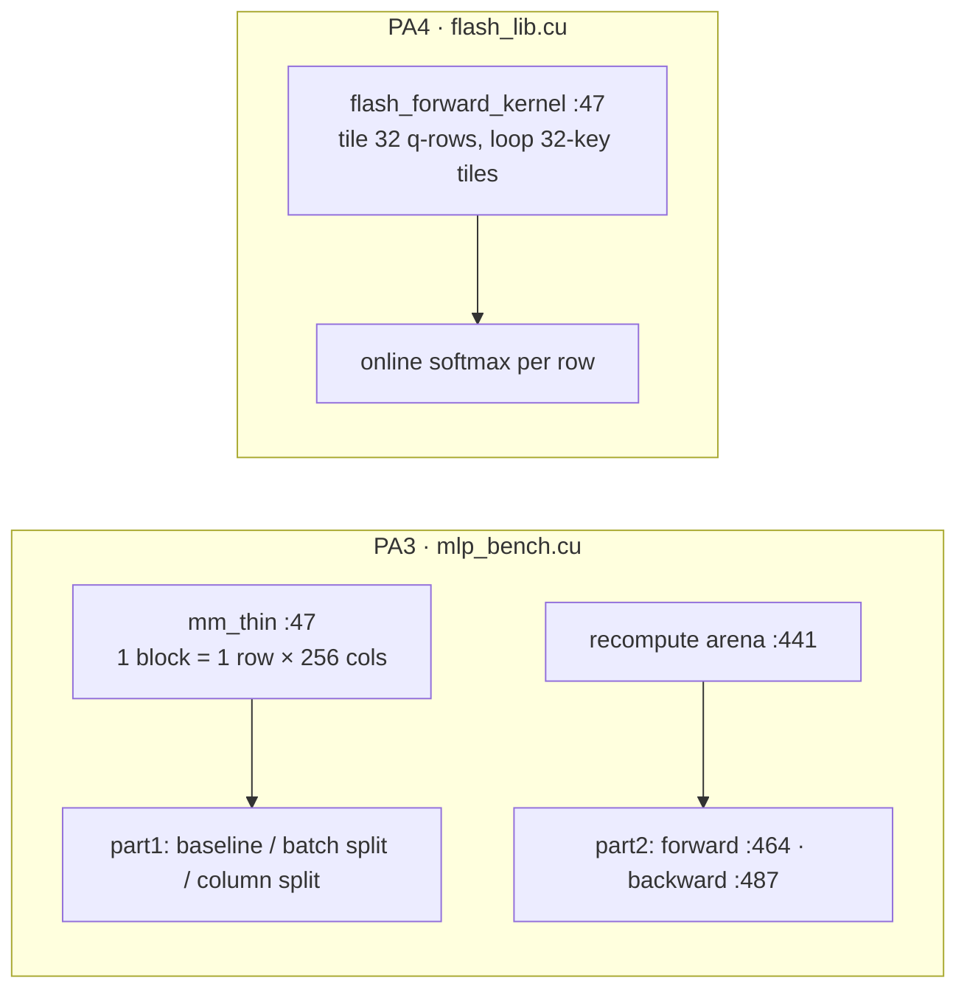
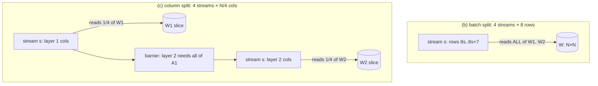
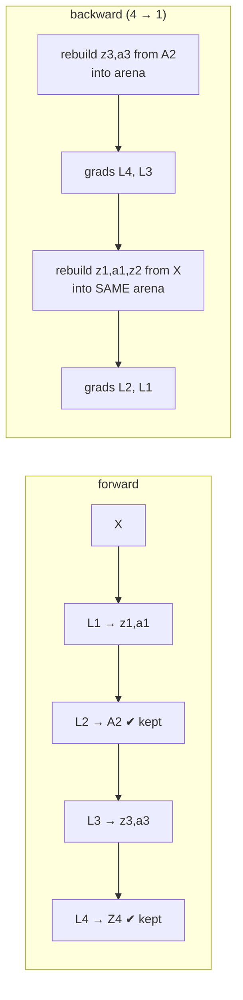
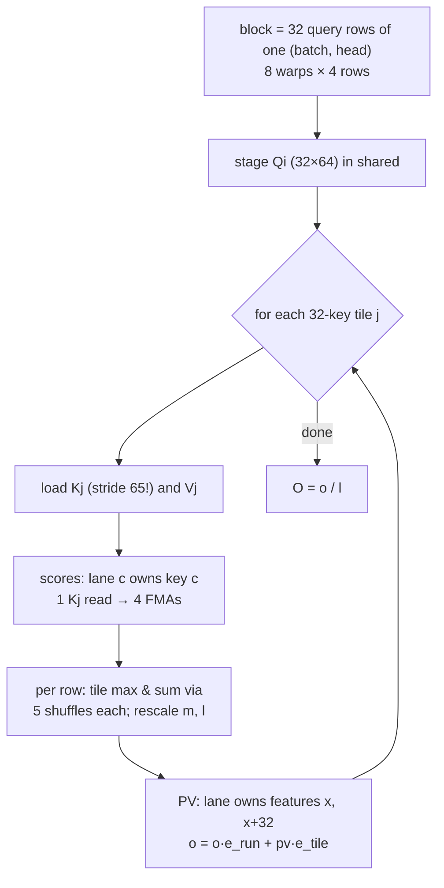

# Day 6 (Fri Nov 13): CUDA II: streams, checkpointing (PA3) and FlashAttention (PA4)

Part of [[Interview plan (Nov 2026)]]. Repo `sysml` (branch `main`). About 7 h. Builds on [[Day 05 - CUDA I]]. Prep pack:
[[CUDA kernels - prep]] (stories S1–S6 are today's).

**Code, explained:** the figures, the code to read and what each snippet does are in [[#Code, explained]], right after section B.

**Resume bullet (part 2 of 2):** "Accelerated MLP inference **1.73×** using column-wise CUDA stream parallelism at large dimensions, while
reducing peak activation memory **13.3%** through gradient checkpointing."

**Fix the wording before you defend it** (prep pack §5, "Honest resume wording"):
- **13.3% is the whole training footprint** (962 → 834 MiB). **Activation memory fell 32%** (400 → 272 MiB).
- **1.73× is at width 32K only** (1.02× at 16K, slower below), against your own kernel, and its mechanism is likely cache locality, not concurrency.
- The two numbers come from **different workloads**: a 2-layer forward pass (1.73×) and a 4-layer training step (13.3%).
- Suggested wording: "Sped up a batch-32 MLP forward pass 1.73× at width 32K by partitioning output columns across 4 CUDA streams (batch splitting never helped). Implemented gradient checkpointing for a 4-layer MLP, cutting activation memory 32% (13.3% of total training memory) for a 26% slower backward pass."

**By tonight you can:**
- explain streams and when they overlap, and why the batch split never helped;
- explain checkpointing, the shared recompute arena and the 0 MB bug;
- derive online softmax and explain FlashAttention's tiling;
- tell the bank-conflict story (7.0×) and the shared-memory-roofline story.

## Schedule

| # | Time | Kind | What |
|---|---|---|---|
| 0 | 15 min | recall | Day 5: coalescing, banks, the 51.3× and 48.2% maths |
| 1 | 30 min | theory | CUDA streams and concurrency (A1) |
| 2 | 60 min | code | Part 1: `mm_thin`, baseline, batch split, column split (B1) |
| 3 | 25 min | theory | Gradient checkpointing (A2) |
| 4 | 50 min | code | Part 2: the training step, the arena, peak memory (B2) |
| — | lunch | | |
| 5 | 60 min | theory + maths | FlashAttention and online softmax (A3) |
| 6 | 60 min | code | `flash_lib.cu`: the kernel, phase by phase (B3) |
| 7 | 15 min | skim | `kvcache/` (PA1, never run) and the lab quizzes (`prob2/`, `prob3/`) |
| 8 | 45 min | rebuild | Online-softmax attention in NumPy (C) |
| 9 | 15 min | trace | The bank-conflict arithmetic (D) |
| 10 | 45 min | practice | The questions (E), plus prep pack §8 "It didn't work" |

## A. Theory

### A1. Streams (block 1, 30 min)

**Read:** NVIDIA blog *"How to Overlap Data Transfers in CUDA C/C++"* (Mark Harris), and the "Streams" part of the
CUDA Programming Guide (§6.2.8 "Asynchronous Concurrent Execution").

- A **stream** is an ordered queue of work. Kernels in different streams *may* run concurrently, but only if the GPU has spare SMs.
- **When streams help:** small kernels that leave SMs idle, or overlapping copies with compute.
- **When they don't:** a single kernel already fills all 132 SMs. Then extra streams add launches and host syncs.
- **Your case** (story S6): with batch 32, a **batch split** gives each stream 8 rows, but each stream still reads all of W1 and W2 (N² floats vs 32·N for X). So it multiplies weight traffic and launches. A **column split** gives each stream a quarter of W. At N = 32768 the baseline already launches about 4 waves of blocks, so the 1.73× is most likely **locality** (each stream's W slice stays in L2), not concurrency. Prep pack exercise 2 has the one experiment that would settle it.

### A2. Gradient checkpointing (block 3, 25 min)

**Read:** Chen et al., *"Training Deep Nets with Sublinear Memory Cost"* (2016), §1–3. Or the PyTorch docs for `torch.utils.checkpoint` (10 min).

- Backward needs every layer's activations. **Checkpointing** keeps only a few (the checkpoints), and recomputes the rest from the nearest checkpoint during backward.
- Cost: one extra forward pass over each segment. Your measurement: **+35.5 ms on a 136 ms backward (+26.1%)**. That equals the recomputed forward FLOPs (prep pack §5).
- **Your checkpoints are A2 and Z4** (assignment-prescribed). Z4 is the output MSE needs, and A2 splits the network into two 2-layer segments.
- **The key trick** (story S3): backward runs layer 4 → 1. So segment B (Z3, A3) is fully consumed before segment A (Z1, A1, Z2) is rebuilt. One arena of `max(2·n3, 2·n1+n2)` floats serves both. Separate buffers per recomputed tensor save **nothing**, which was the first version's 0 MB result.

### A3. FlashAttention (block 5, 60 min)

**Read:** Dao et al., *FlashAttention* (2022), §1–3.1 (Algorithm 1). Optional: the FlashAttention-2 paper's §3.1 (the work-partitioning change).
**Video:** Umar Jamil, *"Flash Attention derived and coded from first principles"* (YouTube). Watch the online-softmax part.

**Online softmax, derive on paper.** Keep for each query row a running max `m`, a running sum `l`, and an output accumulator `o`.
For a new tile of scores `s`:
- `m_new = max(m, max(s))`;
- `l_new = l·e^{m − m_new} + Σ e^{s − m_new}`;
- `o_new = o·e^{m − m_new} + Σ e^{s − m_new} · v`;
- at the end, output = `o / l`.

This equals the exact softmax, because every term was rescaled to the same final max.

**Why it matters:** standard attention writes the N×N score matrix to HBM. At N = 8192, B = 8, 16 heads, that is
8·16·8192²·4 B = **34.4 GB**. That's why your PyTorch baseline is batch-chunked. FlashAttention keeps scores in shared memory and never writes them out.
Its value is **memory, not raw speed**: your kernel is 1.5× slower than PyTorch's explicit path at 8K (prep pack §8).

## B. Code

### B1. Part 1: streams (block 2, 60 min, deep)

`mlp/mlp_bench.cu`:
- **47 `mm_thin<BN,BK>`**: one block = one batch row × 256 output columns (comment at 37–45). Why not square tiles at B = 32? (*Square tiles waste 24 of every 32 rows once the batch is split 4 ways.*)
- **198 `part1`**: the 2-layer forward pass, B = 32, N = 32 … 32768.
  - **254** baseline: 2 launches per iteration, no host sync;
  - **262** batch split over 4 streams;
  - **280** column split: each stream owns a quarter of the output columns. There's a host barrier between the layers, because layer 2 needs all of A1 (276–278, 289);
  - **301** `measure`: 3 warm-up, 20 timed iterations.
- Note: the stream variants call `cudaStreamSynchronize` inside the timed loop (273, 289, 298); the baseline doesn't. **Part 1 has no correctness check**, and the column split is wrong for N ≤ 512 (not at 32768).

### B2. Part 2: checkpointing (block 4, 50 min, deep)

- **352 `part2_run`**: a 4-layer MLP training step, run 100 times.
- 396–404: weights scaled by `1/sqrt(fan_in)` (story S4: otherwise NaN, and the checksum check is useless).
- 411–420: the activation buffers. **441–462: the recompute arena.**
- **464** forward; **487** backward, with `mm_tiled` (90), `mm_tiled_AT` (109) and `mm_tiled_BT` (128). Why is backward 3.4× the forward instead of about 2×? (*The transposed-operand kernels load uncoalesced.*)
- 513: the ordering constraint (every use of z3/a3 before the segment-A rebuild).
- **548**: peak memory = the `cudaMemGetInfo` delta after all buffers are allocated. Why is that a fair "peak" here? (*Everything is a `cudaMalloc` made in advance, so footprint = peak.*)
- **572**: equality check = the sum of W4 after the SGD steps.

### B3. FlashAttention (block 6, 60 min, deep)

Follow prep pack §2 "End-to-end trace at N = 8192" side by side with `flashattention/flash_lib.cu`:
- **189 `flash_attention_forward`** (host): rejects D > 128; Tr = Tc = 256; shared memory 28,800 B; grid `(Tr=256, NH=16, B=8)` = 32,768 blocks of 256 threads.
- **47 `flash_forward_kernel`**: the block owns 32 query rows; warp `w` owns rows `4w … 4w+3`.
  - **55**: the K tile's row stride is **D+1 = 65**. Today's key line.
  - 81–85: stage Q. **98**: loop over KV tiles; 103–110: load K (stride 65) and V.
  - **118–126 scores**: lane `c` owns key `c`; one `Kj` read feeds 4 FMAs (4 query rows).
  - **130–152 online softmax**: tile max and sum via 5 `__shfl_xor_sync` steps each; rescale factors.
  - **157–172 PV**: lane owns features `x` and `x+32`. 175–183: divide by `l` and write O.
- `bench_attention.py`: 46 `custom_flash` (ctypes into the `.so`), 58 `pytorch_standard`, 77 `pytorch_fused`, 140–143 the batch chunking.

## Code, explained

Read this **with the files open**. Each part has a small figure of the pipeline, then the exact code (copied from the repo at the commit named below, so the line numbers match), then what it does and how it hands off to the next piece.

Repo `sysml` (`16870fb`): `mlp/mlp_bench.cu` (PA3) and
`flashattention/flash_lib.cu` (PA4). Builds on [[Day 05 - CUDA I#Code, explained]].



---

### 1. The thin GEMM every stream variant uses

`mlp/mlp_bench.cu:53–79`
```cpp
__shared__ float sA[BK];

const int m   = blockIdx.y;
const int col = blockIdx.x * BN + threadIdx.x;
if (m >= M) return;

float acc = 0.0f;
for (int k0 = 0; k0 < K; k0 += BK) {
    // Stage this row-slice of A cooperatively.
    for (int t = threadIdx.x; t < BK; t += BN) {
        int k = k0 + t;
        sA[t] = (k < K) ? A[(size_t)m * K + k] : 0.0f;
    }
    __syncthreads();

    if (col < N) {
        int kmax = (K - k0 < BK) ? (K - k0) : BK;
        for (int kk = 0; kk < kmax; ++kk)
            acc = fmaf(sA[kk], B[(size_t)(k0 + kk) * N + col], acc);
    }
    __syncthreads();
}

if (col < N) {
    float v = acc + (bias ? bias[col] : 0.0f);
    C[(size_t)m * N + col] = relu ? (v > 0.0f ? v : 0.0f) : v;
}
```

- One block per (batch row `m`, 256-column chunk). The block stages a `BK`-long slice of row `m` of A in shared memory (lines 62–65), then each thread walks down one column of B.
- `B[(k0+kk)*N + col]`: adjacent threads, adjacent columns, so **coalesced**. But each of the 32 row-blocks re-reads the same column slice of W from global memory. Reuse of W across the batch depends entirely on the L1/L2 caches. Keep that in mind for section 2.

---

### 2. Streams: batch split vs column split



`mlp/mlp_bench.cu:254–257`
```cpp
auto baseline = [&] {
    mm_thin<BN,BK><<<grd, blk>>>(X,  W1, b1, A1, B, N, N, 1);
    mm_thin<BN,BK><<<grd, blk>>>(A1, W2, b2, Y,  B, N, N, 0);
};
```

`mlp/mlp_bench.cu:262–273`
```cpp
auto streamed = [&] {
    for (int s = 0; s < NS; ++s) {
        int r0 = s * chunk;
        int rows = (r0 + chunk <= B) ? chunk : (B - r0);
        if (rows <= 0) continue;
        dim3 g((N + BN - 1) / BN, rows);
        mm_thin<BN,BK><<<g, blk, 0, st[s]>>>(X  + (size_t)r0 * N, W1, b1,
                                             A1 + (size_t)r0 * N, rows, N, N, 1);
        mm_thin<BN,BK><<<g, blk, 0, st[s]>>>(A1 + (size_t)r0 * N, W2, b2,
                                             Y  + (size_t)r0 * N, rows, N, N, 0);
    }
    for (int s = 0; s < NS; ++s) cudaStreamSynchronize(st[s]);
```

- **Batch split:** each stream gets 8 rows, but each still multiplies by the **whole** W1 and W2 (`W1` is passed unchanged). W is N² floats while X is only 32·N, so weight traffic dominates and the split multiplies it, and it launches 4× as many kernels. It never helped: up to 4× slower.

`mlp/mlp_bench.cu:280–299`
```cpp
auto streamed_col = [&] {
    for (int s = 0; s < NS; ++s) {
        int c0 = s * cchunk;
        int cols = (c0 + cchunk <= N) ? cchunk : (N - c0);
        if (cols <= 0) continue;
        dim3 g((cols + BN - 1) / BN, B);
        mm_thin<BN,BK><<<g, blk, 0, st[s]>>>(X, W1 + c0, b1 + c0,
                                             A1 + c0, B, N, N, 1);
    }
    for (int s = 0; s < NS; ++s) cudaStreamSynchronize(st[s]);
    for (int s = 0; s < NS; ++s) {
        int c0 = s * cchunk;
        int cols = (c0 + cchunk <= N) ? cchunk : (N - c0);
        if (cols <= 0) continue;
        dim3 g((cols + BN - 1) / BN, B);
        mm_thin<BN,BK><<<g, blk, 0, st[s]>>>(A1, W2 + c0, b2 + c0,
                                             Y + c0, B, N, N, 0);
    }
    for (int s = 0; s < NS; ++s) cudaStreamSynchronize(st[s]);
};
```

- **Column split:** stream `s` gets `W1 + c0`, a quarter of the columns. Each stream touches only its own slice of W, which is far more likely to stay in L2 between its 32 row-blocks.
- Layer 2 needs **all** of A1, so there's a full sync between the layers (line 289).
- 1.73× at N = 32768 only. The baseline already launches about 4 waves of blocks at that size, so the GPU was full. The gain is most likely **cache locality**, not streams running concurrently. Say so.
- The stream variants call `cudaStreamSynchronize` inside the timed loop; the baseline doesn't. At small N that host round-trip is part of why they look slower.

---

### 3. Gradient checkpointing: one arena, two segments



`mlp/mlp_bench.cu:411–420`
```cpp
float *Z1=nullptr,*A1=nullptr,*Z2=nullptr,*A2=nullptr,*Z3=nullptr,*A3=nullptr,*Z4=nullptr;
CUDA_CHECK(cudaMalloc(&A2, n2 * sizeof(float)));   // checkpoint
CUDA_CHECK(cudaMalloc(&Z4, n4 * sizeof(float)));   // checkpoint
if (!checkpointed) {
    CUDA_CHECK(cudaMalloc(&Z1, n1 * sizeof(float)));
    CUDA_CHECK(cudaMalloc(&A1, n1 * sizeof(float)));
    CUDA_CHECK(cudaMalloc(&Z2, n2 * sizeof(float)));
    CUDA_CHECK(cudaMalloc(&Z3, n3 * sizeof(float)));
    CUDA_CHECK(cudaMalloc(&A3, n3 * sizeof(float)));
}
```

- Both modes keep the two checkpoints, `A2` and `Z4`. Only the baseline also keeps `Z1, A1, Z2, Z3, A3`. That is the entire memory difference.

`mlp/mlp_bench.cu:453–462`
```cpp
float *arena = nullptr;
float *rZ1=nullptr,*rA1=nullptr,*rZ2=nullptr,*rZ3=nullptr,*rA3=nullptr;
if (checkpointed) {
    size_t segA = 2 * n1 + n2;
    size_t segB = 2 * n3;
    size_t arena_floats = segA > segB ? segA : segB;
    CUDA_CHECK(cudaMalloc(&arena, arena_floats * sizeof(float)));
    rZ1 = arena;  rA1 = rZ1 + n1;  rZ2 = rA1 + n1;   // segment A layout
    rZ3 = arena;  rA3 = rZ3 + n3;                    // segment B, aliased
}
```

- **The trick:** segment B (`Z3, A3`) and segment A (`Z1, A1, Z2`) are never needed at the same time, so both live in **one** arena of `max(2·n3, 2·n1 + n2)` floats. Note `rZ3 = arena` and `rZ1 = arena`: they alias. The first version gave each recomputed tensor its own permanent buffer and saved **0 MB** (story S3).

`mlp/mlp_bench.cu:493–501`
```cpp
if (checkpointed) {
    // segment B, from the A2 checkpoint
    mm_tiled<<<g2(Nb,H3), dim3(TS,TS)>>>(A2, W3, rZ3, Nb, H2, H3);
    k_add_bias_relu<<<g1(n3),256>>>(rZ3, b3, Nb, H3, 0);
    k_relu_into<<<g1(n3),256>>>(rZ3, rA3, n3);
    z3 = rZ3; a3 = rA3;
} else {
    z3 = Z3; a3 = A3;
}
```

`mlp/mlp_bench.cu:513–523`
```cpp
// z3 / a3 are dead from here on: rebuild segment A over the same arena.
if (checkpointed) {
    mm_tiled<<<g2(Nb,H1), dim3(TS,TS)>>>(X, W1, rZ1, Nb, IN, H1);
    k_add_bias_relu<<<g1(n1),256>>>(rZ1, b1, Nb, H1, 0);
    k_relu_into<<<g1(n1),256>>>(rZ1, rA1, n1);
    mm_tiled<<<g2(Nb,H2), dim3(TS,TS)>>>(rA1, W2, rZ2, Nb, H1, H2);
    k_add_bias_relu<<<g1(n2),256>>>(rZ2, b2, Nb, H2, 0);
    z1 = rZ1; a1 = rA1; z2 = rZ2;
} else {
    z1 = Z1; a1 = A1; z2 = Z2;
}
```

- Backward first rebuilds segment B from the `A2` checkpoint, uses `z3, a3` for the layer 4 and 3 gradients, and **only then** rebuilds segment A over the same memory. Any use of `z3` after line 513 would read garbage. The comment states the ordering rule.
- The cost is those two extra mini-forwards: +35.5 ms on a 136 ms backward (+26%).

`mlp/mlp_bench.cu:548–550`
```cpp
CUDA_CHECK(cudaDeviceSynchronize());
CUDA_CHECK(cudaMemGetInfo(&free_after, &total));
peak = free_before - free_after;
```

- Memory = how much free memory dropped after **everything** is allocated (including the arena). Every buffer is a `cudaMalloc` made up front, so footprint = peak. 962 → 834 MiB is the **whole training step** (−13.3%); the activations alone fell 400 → 272 MiB (−32%).

---

### 4. FlashAttention: tiles, warps, online softmax



`flashattention/flash_lib.cu:55–61`
```cpp
const int KS = D + 1;             // padded Kj row stride, see header

extern __shared__ float smem[];
float* Qi = smem;
float* Kj = Qi + BR * D;
float* Vj = Kj + BC * KS;
float* S  = Vj + BC * D;          // BR * BC
```

- Shared memory = `Qi | Kj | Vj | S`. **`KS = D + 1 = 65`** is the row stride of `Kj`. This one line is the 7.0× story.

`flashattention/flash_lib.cu:118–126`
```cpp
if (lane < kv_len) {
    const float* kptr = Kj + lane * KS;
    for (int x = 0; x < D; ++x) {
        const float kv = kptr[x];
        #pragma unroll
        for (int r = 0; r < RPW; ++r)
            a[r] = fmaf(Qi[(r0 + r) * D + x], kv, a[r]);
    }
}
```

- Score phase: lane `c` owns key `c`, so at a fixed feature `x` the 32 lanes read `Kj[c·KS + x]`. With stride 64, the bank is `(c·64 + x) mod 32 = x mod 32`: **all 32 lanes on one bank, a 32-way conflict**. With stride 65 the bank is `(c + x) mod 32`, all different. 2377 → 339 ms.
- `x` is the outer loop, so one `kv` load feeds **4 FMAs** (4 query rows per warp). The `Qi` reads are the same address for all lanes, so they broadcast. Moving from 1 to 4 rows per warp gave 339 → 160 ms (story S2).

`flashattention/flash_lib.cu:130–152`
```cpp
for (int r = 0; r < RPW; ++r) {
    float s = (lane < kv_len) ? a[r] * softmax_scale : -INFINITY;

    float m_tile = s;
    #pragma unroll
    for (int off = 16; off > 0; off >>= 1)
        m_tile = fmaxf(m_tile, __shfl_xor_sync(0xffffffff, m_tile, off));

    float p = (lane < kv_len) ? __expf(s - m_tile) : 0.0f;

    float l_tile = p;
    #pragma unroll
    for (int off = 16; off > 0; off >>= 1)
        l_tile += __shfl_xor_sync(0xffffffff, l_tile, off);

    S[(r0 + r) * BC + lane] = p;

    const float m_new = fmaxf(m_run[r], m_tile);
    e_run[r]  = __expf(m_run[r] - m_new);   // 0 on the first tile
    e_tile[r] = __expf(m_tile   - m_new);
    l_run[r]  = e_run[r] * l_run[r] + e_tile[r] * l_tile;
    m_run[r]  = m_new;
}
```

- For each of the warp's 4 rows: the tile max needs a reduction across 32 lanes. `__shfl_xor_sync` with offsets 16, 8, 4, 2, 1 swaps registers between lanes, giving the max in **5 steps with no shared memory**. The sum is reduced the same way.
- `p = e^{s − m_tile}` is written to the warp's own rows of `S`. Then the running state updates: `m_new = max(m_run, m_tile)`, `e_run = e^{m_run − m_new}` rescales the old sum and output, and `e_tile = e^{m_tile − m_new}` rescales this tile's.
- On the first tile `m_run = −∞`, so `e_run = 0`, which correctly discards the empty initial state.

`flashattention/flash_lib.cu:158–172`
```cpp
for (int x = lane; x < D; x += WARP, ++jj) {
    float pv[RPW];
    #pragma unroll
    for (int r = 0; r < RPW; ++r) pv[r] = 0.0f;

    for (int c = 0; c < kv_len; ++c) {
        const float vv = Vj[c * D + x];
        #pragma unroll
        for (int r = 0; r < RPW; ++r)
            pv[r] = fmaf(S[(r0 + r) * BC + c], vv, pv[r]);
    }
    #pragma unroll
    for (int r = 0; r < RPW; ++r)
        o_acc[r][jj] = o_acc[r][jj] * e_run[r] + pv[r] * e_tile[r];
}
```

- PV phase: now lane `x` owns **feature** `x` (and `x + 32`). `Vj[c·D + x]` with adjacent `x` hits adjacent banks, so no padding is needed here.
- `o = o·e_run + pv·e_tile` is the online-softmax update for the output. Divide by `l_run` once at the very end (lines 175–183).
- `__syncwarp()` (line 153), not `__syncthreads()`: each warp reads only its own rows of `S`, so only lanes within one warp need to agree.

**Check yourself:** with stride 64, which bank do lanes 0, 1 and 31 hit at `x = 5`? With stride 65? (*64: all bank 5. 65: banks 5, 6 and 4.*)

## C. Rebuild it yourself (block 8, 45 min)

In NumPy, about 50 lines:
1. `attention(Q, K, V)` the standard way (full score matrix, softmax, multiply).
2. `flash_attention(Q, K, V, Bc=32)`: loop over key tiles, keeping `m`, `l`, `o` per query row exactly as in A3. Never build the N×N matrix.
3. Check `np.allclose` for N = 1000 (not a multiple of 32, so you need the tail tile).
4. Break it on purpose: drop the `e^{m − m_new}` rescale of `o` and watch the error. Then seed `m` with 0 instead of −∞ on a row whose scores are all very negative. (Story S5 has the real NaN bug: `cudaMemset(0xFF)` is NaN, not −∞.)

## D. Trace (block 9, 15 min)

32 banks, 4-byte words, bank = `address mod 32`. In the score loop, lane `c` reads `Kj[c*stride + x]` for a fixed `x`.
- With stride 64: list the banks for lanes 0, 1, 2, 31. What is the conflict degree?
- With stride 65: the same. Why does padding by one fix it?
- Why doesn't the same stride break correctness? (*Store and load use the same stride.*)
- Result to quote: 2377 → 339 ms, **7.0×** from one line.

## E. Questions

1. What is a CUDA stream? When do two streams actually run at the same time?
2. Why did the batch split never help? Why did the column split help only at 32K?
3. Can you prove the 1.73× comes from concurrency? (*No. The evidence points to locality; here's the experiment.*)
4. Explain gradient checkpointing. What did you checkpoint, and why those tensors?
5. Your first checkpointing version saved 0 MB. Why? (*Story S3.*)
6. Is 13.3% "peak activation memory"? (*No: 13.3% total, 32% activations. Say it first.*)
7. How did you show checkpointing didn't change training? (*Weight checksums match to 10 digits.*)
8. Derive online softmax. Why is it exact?
9. What does FlashAttention save: time or memory? Is your kernel faster than PyTorch? (*No: 160 vs 105 ms explicit, 63 ms fused.*)
10. Tell me about the bank conflict. (*Story S1: 7.0×.*)
11. After the padding fix, what capped the kernel? (*Story S2: the shared-memory roofline; register blocking over 4 query rows, 339 → 160 ms.*)
12. Why ctypes and not a PyTorch extension? What did that cost you?
13. Hostile: "You never ran the profiler. How do you know any of this?" (*ncu needed root. Occupancy is theoretical, from the occupancy API. Bank and roofline reasoning are by hand, and the measured times match them.*)

## My notes and fumbles

- 
