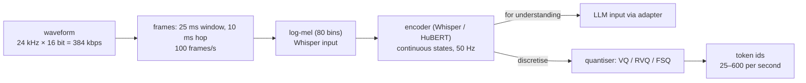
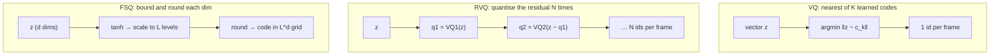
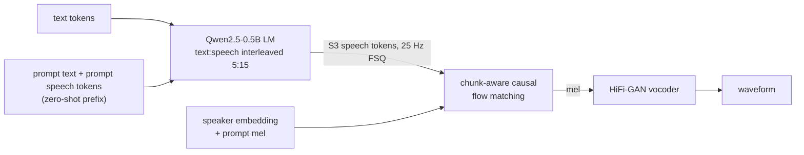
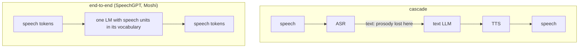

# Day 7 (Sat Nov 14): the seminar, and speech basics

Part of [[Interview plan (Nov 2026)]]. **No code today.** About 6.5 h. Prep pack: [[Seminar - prep]] (concept map §2,
field numbers §5.2, claims to fix §5.3, 50 questions §7). This day also sets up tomorrow ([[Day 08 - CosyVoice]]).

**Code, explained:** the figures, the code to read and what each snippet does are in [[#Code, explained]], right after section B.

**Sources:**
- your report, `/data/jayavardhan/mtp/qwen/report/Seminar Report.docx` ("Speech in Large Language Models and Controlled Text-to-Speech", CS694, May 2026);
- the prep pack (written from `interview_materials/seminar/INTERVIEW_PREP.md`);
- your seminar notes and `SprintSeminar.md` (talk script). **They are no longer at `vaults/personal/` on the server.** If they live on your PC, use them there; the prep pack quotes the parts that matter.

**Resume bullets (both resumes):**
- "Studied the shift from cascaded pipelines to natively multimodal architectures for speech in LLMs, covering tokenization (VQ, FSQ, WavTokenizer), unified frameworks (SpeechGPT), and generation systems (CosyVoice)."
- "Analyzed trade-offs between compression and fidelity in speech tokenization, and between modular vs. end-to-end system design for latency, coherence, and multilingual scalability."

**Three things to settle first** (prep pack, "Read these first"):
1. Your slides and report contradict each other in places (WavTokenizer "rich semantic content", CosyVoice "emotion-aware" tokens, Spark-TTS's layers). Use the **report's** version. The full list is in §5.3.
2. It was a **reading project**: no experiments. Say so early. Keep CosyVoice LoRA results out of seminar answers.
3. "Natively multimodal" fits only SpeechGPT; CosyVoice is a TTS system with an LLM inside.

**By tonight you can:**
- explain how audio becomes features and tokens, with the bitrate arithmetic;
- explain VQ, RVQ and FSQ, and codebook collapse;
- tell the lineage: VQ-VAE → EnCodec → WavTokenizer; HuBERT → SpeechGPT; S3 → CosyVoice 1/2/3; Spark-TTS;
- argue cascaded vs end-to-end with numbers (latency, error propagation, paralinguistics);
- draw CosyVoice 2's pipeline, ready for tomorrow.

## Schedule

| # | Time | Kind | What |
|---|---|---|---|
| 0 | 15 min | recall | Day 6: online softmax, the bank-conflict story |
| 1 | 30 min | read | Prep pack §1 pitches and §2.1 concept map |
| 2 | 45 min | theory | Audio basics: sampling, frames, log-mel, the Whisper encoder (A1) |
| 3 | 75 min | theory + maths | Quantisers and codecs: VQ, RVQ, FSQ, bitrates (A2) |
| — | lunch | | |
| 4 | 45 min | theory | Semantic vs acoustic tokens; WavTokenizer; SpeechGPT (A3) |
| 5 | 60 min | theory | CosyVoice 1 → 2 → 3, and Spark-TTS (A4) |
| 6 | 30 min | theory | Cascaded vs end-to-end (A5) |
| 7 | 45 min | rebuild | A toy VQ and FSQ in NumPy (C) |
| 8 | 20 min | trace | One utterance through three designs (D) |
| 9 | 45 min | practice | The questions (E), plus prep pack §8 "I didn't do that" |

## A. Theory

### A1. Audio basics (block 2, 45 min)

**Read:** the Whisper paper (Radford et al., 2022), §2.1–2.3 only. **Watch** (optional): Hugging Face Audio Course, Unit 1 ("Working with audio data"), about 30 min.
- **Sampling:** 16 kHz = 16,000 samples per second. 24 kHz × 16-bit = **384 kbps** raw.
- **Frames and hops:** a 25 ms window every 10 ms → **100 frames/s**. Each frame → an STFT → a magnitude spectrum.
- **Log-mel:** project the spectrum onto 80 (or 128) mel filters, take the log. This is Whisper's input.
- **Whisper encoder:** two strided convolutions halve the rate to 50 Hz, then transformer layers. 30 s of audio → 1500 encoder states.

### A2. Quantisers and bitrates (block 3, 75 min)

**Read:** your report ch. 2–3. Then FSQ (Mentzer et al., 2023), §1–3, about 20 min. For RVQ: the SoundStream paper (Zeghidour et al., 2021), §3.2.
- **VQ:** replace a vector by its nearest of K learned codes. The risk is **codebook collapse**: only a few codes get used. Training tricks: k-means init, EMA updates, dead-code restarts.
- **RVQ:** quantise, subtract, quantise the residual again, N times. **N tokens per frame**: the flattened sequence grows **linearly** in N, while the number of code combinations grows as K^N. (Your slide 5 says "exponentially larger sequences": wrong.)
- **FSQ:** bound each dimension (tanh), round it to L levels. Codes = Π levels. No codebook to learn, so no collapse. CosyVoice 2's tokens: 6,561 = 3⁸ codes.
- **Bitrate = frames/s × codebooks × log2(codebook size).** Do these on paper (prep pack §5.2):
  - EnCodec 6 kbps: 75 × 8 × 10 = 6,000 bps;
  - WavTokenizer: 75 × 12 = 900 bps; the hop is 24,000/75 = 320 samples;
  - CosyVoice 2: 25 × log2(6,561) = 25 × 12.68 ≈ 317 bps;
  - compression vs raw: 384 / 0.9 ≈ 427×.
- **Sequence-length cost:** 6,000 EnCodec tokens vs 250 S3 v2 tokens for 10 s = **24× longer**, so about **576×** the attention FLOPs. An AR model must emit at least the token rate per second to be real-time.

### A3. Semantic vs acoustic tokens (block 4, 45 min)

**Read:** your report §3.4 (WavTokenizer) and ch. 4 (SpeechGPT). Skim the SpeechGPT paper (Zhang et al., 2023), §2–3.
- **Acoustic tokens** are trained to rebuild the waveform (EnCodec, DAC, WavTokenizer). They keep voice and detail but align poorly with text.
- **Semantic tokens** keep content. Self-supervised: HuBERT features + k-means (SpeechGPT's 1,000 units). Supervised by ASR: CosyVoice's S3 tokens (a VQ inserted after 6 Conformer encoder layers; 4,096 codes).
- **WavTokenizer:** one codebook, 40 or 75 tokens/s. The report says it lacks the ASR-like understanding of supervised semantic tokens. Use that version.
- **SpeechGPT:** speech units added to LLaMA-13B's vocabulary; "chain of modality" (transcribe to text first, answer in text, then speak). The only truly unified model in your seminar.

### A4. The CosyVoice line and Spark-TTS (block 5, 60 min)

**Read:** your report ch. 5–7. Skim the CosyVoice 2 paper (Du et al., Dec 2024), §2 and its Figure 1.
- **CosyVoice 1:** text → LM → S3 tokens (50 Hz) → conditional flow matching → mel → HiFi-GAN. Voice comes from an x-vector speaker embedding plus a prompt mel, **not** from the tokens.
- **CosyVoice 2:** FSQ tokens at **25 Hz**; the LM is **Qwen2.5-0.5B**; text and speech interleaved **5:15** for streaming; chunk-aware causal flow matching. **This is the model you fine-tuned tomorrow.**
- **CosyVoice 3:** a multi-task tokenizer, 1M hours, 9 languages, a 1.5B LM, DiffRO.
- **Spark-TTS:** BiCodec = fixed global tokens (voice) + 50 Hz semantic tokens. Qwen2.5-0.5B with attribute chain-of-thought. The semantic stream averages wav2vec 2.0 layers 11, 14 and 16 (not the ASR middle-layer trick).

### A5. Cascaded vs end-to-end (block 6, 30 min)

Report §1.1 and ch. 8. Prep pack §5.2 "Latency anchors" and "Error propagation".
- **Cascade (ASR → LLM → TTS):** modular, debuggable, reuses text LLMs and data. Latencies add up. Prosody and emotion are lost at the ASR step. Errors propagate: at 10% WER, a 20-word question is fully right only 0.9²⁰ ≈ **12%** of the time (an independence sketch).
- **Anchors:** humans leave about 200 ms between turns. The cascaded ChatGPT Voice Mode averaged 2.8–5.4 s; GPT-4o 320 ms (vendor numbers); Moshi about 200 ms.
- **End-to-end:** lower latency and keeps paralinguistics, but needs paired speech data and is harder to debug. The text–speech gap your M.Tech project studies starts here (don't go into the thesis).

## Code, explained

Read this **with the files open**. Each part has a small figure of the pipeline, then the exact code (copied from the repo at the commit named below, so the line numbers match), then what it does and how it hands off to the next piece.

The seminar was a reading project, so there is **no code of
yours** today. Instead: one figure per pipeline, plus a few **illustrative** NumPy snippets (written for this note,
not from any repo) that make the quantisers concrete. Numbers come from [[Seminar - prep]] §5.2.

---

### 1. Audio → features → tokens



- **Continuous** features feed understanding (speech in, text out). **Discrete** tokens let an LM *generate* speech the way it generates text.
- The **token rate** sets the sequence length: 10 s at 25 Hz = 250 tokens; at 600/s (EnCodec 6 kbps) = 6,000 tokens. That's 24× longer and ~576× the attention FLOPs.

---

### 2. Three quantisers



*Illustration (not your code):*
```python
import numpy as np
z = np.random.randn(8)                        # one frame's 8-d latent

# VQ: one learned codebook of K codes
codebook = np.random.randn(1024, 8)
vq_id = np.argmin(((codebook - z) ** 2).sum(1))        # 1 token, 10 bits

# RVQ: N codebooks, each quantises what the previous ones missed
books, residual, ids = [np.random.randn(1024, 8) for _ in range(4)], z.copy(), []
for cb in books:
    k = np.argmin(((cb - residual) ** 2).sum(1))
    ids.append(k); residual -= cb[k]                    # 4 tokens per frame, 40 bits

# FSQ: no codebook to learn; L levels per dimension
L = 3
fsq = np.round(np.tanh(z) * (L // 2))                   # each dim in {-1, 0, 1}
# 3^8 = 6,561 codes: CosyVoice 2's codebook size
```

- **VQ** can **collapse**: most inputs pick a few codes and the rest never train.
- **RVQ** gives N tokens per frame, so the flattened sequence grows **linearly** in N (not exponentially; your slide 5 is wrong there).
- **FSQ** can't collapse: every grid point is reachable by construction.
- **Bitrate = frames/s × codebooks × log2(K)**. WavTokenizer 75 × 1 × 12 = 900 bps; CosyVoice 2 25 × log2(6561) ≈ 317 bps.

---

### 3. CosyVoice 2: text in, speech out



- The S3 tokens come from an ASR-trained tokenizer, so they carry **content** (and some prosody). The **voice** comes from the speaker embedding and the prompt mel, which feed the **flow model**, not the LM (the CosyVoice 2 LM's `forward` never reads the speaker embedding; see [[Day 08 - CosyVoice#Code, explained]] §3). This is why your Day 8 LoRA adapts only the LM: it teaches the LM which S3 tokens Hindi and Telugu text should produce.

---

### 4. Cascade vs end-to-end



- Cascade: modular, debuggable, reuses text LLMs. Latencies **add**, errors **compound** (10% WER → a 20-word question is fully right only 0.9²⁰ ≈ 12% of the time), and emotion is lost at the ASR step.
- End-to-end: lower latency and keeps paralinguistics, but needs paired speech data and is harder to debug.

*Illustration: the bitrate helper from today's rebuild:*
```python
from math import log2
def bitrate(fps, n_codebooks, K):
    return fps * n_codebooks * log2(K)          # bits per second
assert bitrate(75, 8, 1024) == 6000             # EnCodec 6 kbps
assert bitrate(75, 1, 4096) == 900              # WavTokenizer
print(round(bitrate(25, 1, 6561)))              # CosyVoice 2 ≈ 317
```

## C. Rebuild it yourself (block 7, 45 min)

In NumPy, about 60 lines:
1. **VQ:** 2,000 random 8-d vectors, a codebook of K = 64 initialised from 64 data points. Run 10 k-means steps. Print how many codes are used. Then initialise the codebook far from the data and watch it **collapse**.
2. **FSQ:** `tanh`, scale to L = 5 levels per dim, round. Count used codes (out of 5⁸). Note that every code is reachable by construction.
3. **Bitrate helper:** `bitrate(fps, n_codebooks, K)`. Check the four worked examples in A2.

## D. Trace (block 8, 20 min)

Prep pack §2.3: one 10-second user turn (about 25 words) through a cascade, SpeechGPT and CosyVoice 2.
For each: the token count at each stage, where the voice comes from, and the first point where the reply could start playing.

## E. Questions

1. Give the 60-second pitch of your seminar.
2. VQ vs RVQ vs FSQ: what problem does each solve, and what does each cost?
3. What is codebook collapse, and why can't FSQ collapse?
4. Compute WavTokenizer's bitrate. How much smaller than raw PCM is it?
5. Semantic vs acoustic tokens: which would you use for an LLM, and why?
6. Why does CosyVoice 2 use 25 Hz tokens? What do you lose at a lower rate?
7. Where does the speaker's voice come from in CosyVoice? (*Speaker embedding and prompt mel, not the S3 tokens.*)
8. Cascaded vs end-to-end: give the latency and error-propagation argument with numbers.
9. What is "chain of modality" in SpeechGPT? Why text first?
10. Your resume says "natively multimodal". Which of your systems actually are?
11. Did you run any experiments for the seminar? (*No. It was a reading project; the hands-on work is CosyVoice LoRA.*)
12. Hostile: "Your slides say WavTokenizer keeps rich semantic content. Your report says it doesn't. Which is it?"

## My notes and fumbles

- 
