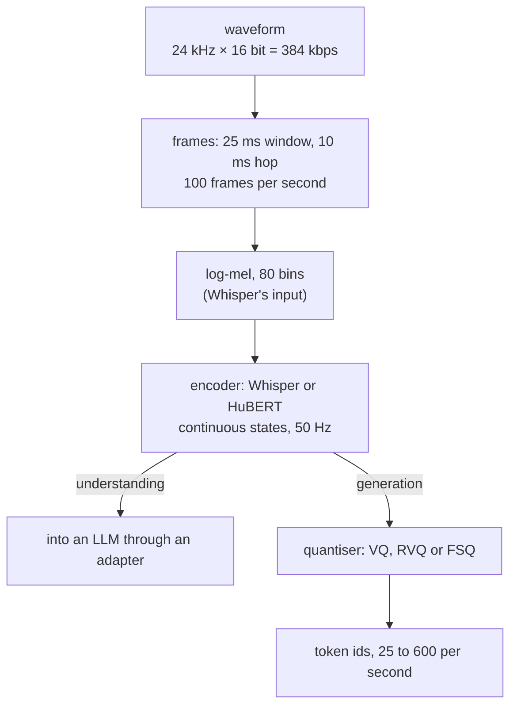
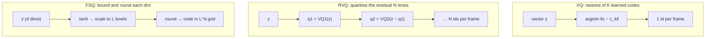
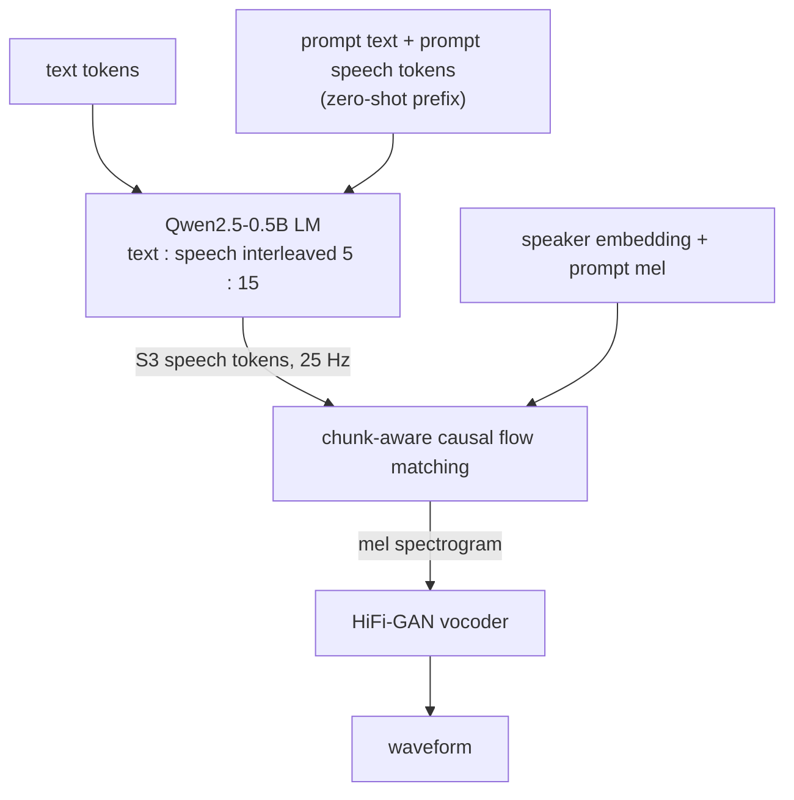
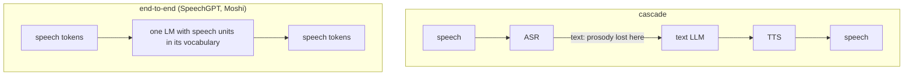

# Day 7 (Sat Nov 14): the seminar, and speech basics

Part of [[Interview plan (Nov 2026)]]. **No code today.** About 6.5 h. Prep pack: [[Seminar - prep]] (concept map §2,
field numbers §5.2, claims to fix §5.3, 50 questions §7). This day also sets up tomorrow ([[Day 08 - CosyVoice]]).

**Code, explained:** the figures, the code to read and what each snippet does are in [[#Code, explained]], right after section B.

**Sources:**
- your report, `/data/jayavardhan/mtp/qwen/report/Seminar Report.docx` ("Speech in Large Language Models and Controlled Text-to-Speech", CS694, May 2026);
- the prep pack (written from `interview_materials/seminar/INTERVIEW_PREP.md`);
- your seminar notes and `SprintSeminar.md` (talk script). **They are no longer at `vaults/personal/` on the server.** If they live on your PC, use them there; the prep pack quotes the parts that matter.

**Resume bullets (both resumes):**
- "Studied the shift from cascaded pipelines to natively multimodal architectures for speech in LLMs, covering tokenization (VQ, FSQ, WavTokenizer), unified frameworks (SpeechGPT), and generation systems (CosyVoice)."
- "Analyzed trade-offs between compression and fidelity in speech tokenization, and between modular vs. end-to-end system design for latency, coherence, and multilingual scalability."

**Three things to settle first** (prep pack, "Read these first"):
1. Your slides and report contradict each other in places (WavTokenizer "rich semantic content", CosyVoice "emotion-aware" tokens, Spark-TTS's layers). Use the **report's** version. The full list is in §5.3.
2. It was a **reading project**: no experiments. Say so early. Keep CosyVoice LoRA results out of seminar answers.
3. "Natively multimodal" fits only SpeechGPT; CosyVoice is a TTS system with an LLM inside.

**By tonight you can:**
- explain how audio becomes features and tokens, with the bitrate arithmetic;
- explain VQ, RVQ and FSQ, and codebook collapse;
- tell the lineage: VQ-VAE → EnCodec → WavTokenizer; HuBERT → SpeechGPT; S3 → CosyVoice 1/2/3; Spark-TTS;
- argue cascaded vs end-to-end with numbers (latency, error propagation, paralinguistics);
- draw CosyVoice 2's pipeline, ready for tomorrow.

## Schedule

| # | Time | Kind | What |
|---|---|---|---|
| 0 | 15 min | recall | Day 6: online softmax, the bank-conflict story |
| 1 | 30 min | read | Prep pack §1 pitches and §2.1 concept map |
| 2 | 45 min | theory | Audio basics: sampling, frames, log-mel, the Whisper encoder (A1) |
| 3 | 75 min | theory + maths | Quantisers and codecs: VQ, RVQ, FSQ, bitrates (A2) |
| — | lunch | | |
| 4 | 45 min | theory | Semantic vs acoustic tokens; WavTokenizer; SpeechGPT (A3) |
| 5 | 60 min | theory | CosyVoice 1 → 2 → 3, and Spark-TTS (A4) |
| 6 | 30 min | theory | Cascaded vs end-to-end (A5) |
| 7 | 45 min | rebuild | A toy VQ and FSQ in NumPy (C) |
| 8 | 20 min | trace | One utterance through three designs (D) |
| 9 | 45 min | practice | The questions (E), plus prep pack §8 "I didn't do that" |

## A. Theory

### A1. Audio basics (block 2, 45 min)

**Read:** the Whisper paper (Radford et al., 2022), §2.1–2.3 only. **Watch** (optional): Hugging Face Audio Course, Unit 1 ("Working with audio data"), about 30 min.
- **Sampling:** 16 kHz = 16,000 samples per second. 24 kHz × 16-bit = **384 kbps** raw.
- **Frames and hops:** a 25 ms window every 10 ms → **100 frames/s**. Each frame → an STFT → a magnitude spectrum.
- **Log-mel:** project the spectrum onto 80 (or 128) mel filters, take the log. This is Whisper's input.
- **Whisper encoder:** two strided convolutions halve the rate to 50 Hz, then transformer layers. 30 s of audio → 1500 encoder states.

### A2. Quantisers and bitrates (block 3, 75 min)

**Read:** your report ch. 2–3. Then FSQ (Mentzer et al., 2023), §1–3, about 20 min. For RVQ: the SoundStream paper (Zeghidour et al., 2021), §3.2.
- **VQ:** replace a vector by its nearest of K learned codes. The risk is **codebook collapse**: only a few codes get used. Training tricks: k-means init, EMA updates, dead-code restarts.
- **RVQ:** quantise, subtract, quantise the residual again, N times. **N tokens per frame**: the flattened sequence grows **linearly** in N, while the number of code combinations grows as K^N. (Your slide 5 says "exponentially larger sequences": wrong.)
- **FSQ:** bound each dimension (tanh), round it to L levels. Codes = Π levels. No codebook to learn, so no collapse. CosyVoice 2's tokens: 6,561 = 3⁸ codes.
- **Bitrate = frames/s × codebooks × log2(codebook size).** Do these on paper (prep pack §5.2):
  - EnCodec 6 kbps: 75 × 8 × 10 = 6,000 bps;
  - WavTokenizer: 75 × 12 = 900 bps; the hop is 24,000/75 = 320 samples;
  - CosyVoice 2: 25 × log2(6,561) = 25 × 12.68 ≈ 317 bps;
  - compression vs raw: 384 / 0.9 ≈ 427×.
- **Sequence-length cost:** 6,000 EnCodec tokens vs 250 S3 v2 tokens for 10 s = **24× longer**, so about **576×** the attention FLOPs. An AR model must emit at least the token rate per second to be real-time.

### A3. Semantic vs acoustic tokens (block 4, 45 min)

**Read:** your report §3.4 (WavTokenizer) and ch. 4 (SpeechGPT). Skim the SpeechGPT paper (Zhang et al., 2023), §2–3.
- **Acoustic tokens** are trained to rebuild the waveform (EnCodec, DAC, WavTokenizer). They keep voice and detail but align poorly with text.
- **Semantic tokens** keep content. Self-supervised: HuBERT features + k-means (SpeechGPT's 1,000 units). Supervised by ASR: CosyVoice's S3 tokens (a VQ inserted after 6 Conformer encoder layers; 4,096 codes).
- **WavTokenizer:** one codebook, 40 or 75 tokens/s. The report says it lacks the ASR-like understanding of supervised semantic tokens. Use that version.
- **SpeechGPT:** speech units added to LLaMA-13B's vocabulary; "chain of modality" (transcribe to text first, answer in text, then speak). The only truly unified model in your seminar.

### A4. The CosyVoice line and Spark-TTS (block 5, 60 min)

**Read:** your report ch. 5–7. Skim the CosyVoice 2 paper (Du et al., Dec 2024), §2 and its Figure 1.
- **CosyVoice 1:** text → LM → S3 tokens (50 Hz) → conditional flow matching → mel → HiFi-GAN. Voice comes from an x-vector speaker embedding plus a prompt mel, **not** from the tokens.
- **CosyVoice 2:** FSQ tokens at **25 Hz**; the LM is **Qwen2.5-0.5B**; text and speech interleaved **5:15** for streaming; chunk-aware causal flow matching. **This is the model you fine-tuned tomorrow.**
- **CosyVoice 3:** a multi-task tokenizer, 1M hours, 9 languages, a 1.5B LM, DiffRO.
- **Spark-TTS:** BiCodec = fixed global tokens (voice) + 50 Hz semantic tokens. Qwen2.5-0.5B with attribute chain-of-thought. The semantic stream averages wav2vec 2.0 layers 11, 14 and 16 (not the ASR middle-layer trick).

### A5. Cascaded vs end-to-end (block 6, 30 min)

Report §1.1 and ch. 8. Prep pack §5.2 "Latency anchors" and "Error propagation".
- **Cascade (ASR → LLM → TTS):** modular, debuggable, reuses text LLMs and data. Latencies add up. Prosody and emotion are lost at the ASR step. Errors propagate: at 10% WER, a 20-word question is fully right only 0.9²⁰ ≈ **12%** of the time (an independence sketch).
- **Anchors:** humans leave about 200 ms between turns. The cascaded ChatGPT Voice Mode averaged 2.8–5.4 s; GPT-4o 320 ms (vendor numbers); Moshi about 200 ms.
- **End-to-end:** lower latency and keeps paralinguistics, but needs paired speech data and is harder to debug. The text–speech gap your M.Tech project studies starts here (don't go into the thesis).

## Code, explained

Read this **with the files open**. It starts with a picture of the whole day and **the flow, step by step** (one concrete input followed through every function). Then each part has its own figure, the exact code (copied from the repo at the commit named below, so the line numbers match) and what that code does.

The seminar was a reading project, so there is **no code of
yours** today. Instead: one figure per pipeline, plus a few **illustrative** NumPy snippets (written for this note,
not from any repo) that make the quantisers concrete. Numbers come from [[Seminar - prep]] §5.2.

---

### 1. Audio → features → tokens

> [!tip] Concept from scratch: [[#5. Deep dive: from waveform to log-mel to tokens, from scratch|samples, frames, log-mel and token rates from scratch (§5)]]



### The flow, step by step

Follow **10 seconds of speech** through each representation, then back out of CosyVoice 2.

1. **Raw audio:** 24,000 samples/s × 10 s = **240,000 samples** (384 kbps).
2. **Frames:** a 10 ms hop gives **1,000 frames**, each turned into 80 log-mel values.
3. **Encoder states:** Whisper's convolutions halve the rate to 50 Hz → **500 vectors**.
4. **Tokens**, depending on the quantiser:
   - EnCodec at 6 kbps: 75 frames/s × 8 codebooks = 600 tokens/s → **6,000 tokens**;
   - WavTokenizer: 75 tokens/s → **750 tokens**;
   - CosyVoice 2's S3 tokenizer: 25 tokens/s → **250 tokens**.
5. **Why it matters:** an LM attending over 6,000 tokens does (6000/250)² ≈ **576×** the attention work of one over 250.
6. **Back out (TTS):** text tokens → the CosyVoice 2 LM generates **250 S3 tokens** → flow matching turns them into a mel spectrogram (using the speaker embedding and prompt mel for the voice) → HiFi-GAN turns the mel into **240,000 samples** again.

- **Continuous** features feed understanding (speech in, text out). **Discrete** tokens let an LM *generate* speech the way it generates text.
- The **token rate** sets the sequence length: 10 s at 25 Hz = 250 tokens; at 600/s (EnCodec 6 kbps) = 6,000 tokens. That's 24× longer and ~576× the attention FLOPs.

---

### 2. Three quantisers

> [!tip] Concept from scratch: [[#6. Deep dive: VQ, RVQ and FSQ, from scratch|VQ, RVQ and FSQ worked on one vector (§6)]]



*Illustration (not your code):*
```python
import numpy as np
z = np.random.randn(8)                        # one frame's 8-d latent

# VQ: one learned codebook of K codes
codebook = np.random.randn(1024, 8)
vq_id = np.argmin(((codebook - z) ** 2).sum(1))        # 1 token, 10 bits

# RVQ: N codebooks, each quantises what the previous ones missed
books, residual, ids = [np.random.randn(1024, 8) for _ in range(4)], z.copy(), []
for cb in books:
    k = np.argmin(((cb - residual) ** 2).sum(1))
    ids.append(k); residual -= cb[k]                    # 4 tokens per frame, 40 bits

# FSQ: no codebook to learn; L levels per dimension
L = 3
fsq = np.round(np.tanh(z) * (L // 2))                   # each dim in {-1, 0, 1}
# 3^8 = 6,561 codes: CosyVoice 2's codebook size
```
> [!info] New functions in this code
> - `np.random.randn(d0, d1, ...)`: an array of the given shape filled with random numbers from a standard normal distribution (mean 0, spread 1). `np.random.randn(1024, 8)` is 1,024 random 8-d codes. [[Function glossary#np.random.randn|→ examples]]
> - `np.argmin(a)`: the **index** of the smallest element. `np.argmin([0.05, 1.45, 3.65, 2.25])` = 0. With `axis=` it works per row or column. [[Function glossary#np.argmin|→ examples]]
> - `.argmin(axis)`: the **index** of the smallest value (per row with `axis=1`). `np.array([[0.40, 0.38, 0.90]]).argmin(axis=1)` → `[1]`. Twin of `.argmax`. [[Function glossary#x.argmin|→ examples]]
> - `.sum(dim)`: adds the elements (along `dim` if given). [[Function glossary#x.sum|→ examples and figure]]
> - `range(start, stop, step)`: the integers from `start` up to (not including) `stop`. `range(0, 10, 4)` gives 0, 4, 8. `range(3)` gives 0, 1, 2. [[Function glossary#range|→ examples]]
> - `.copy()`: a new, independent copy of an array (or list/dict). Changing the copy leaves the original alone: `residual = z.copy(); residual -= c` doesn't change `z`. [[Function glossary#x.copy|→ examples]]
> - `.append(x)`: adds `x` at the end of a list. `[1].append(2)` → `[1, 2]`. [[Function glossary#list.append|→ examples]]
> - `np.round(a)`: rounds every element to the nearest integer (still floats). `np.round([0.716, 0.197])` → `[1., 0.]`. Halves go to the nearest **even** number: 0.5 → 0, 1.5 → 2. [[Function glossary#np.round|→ examples]]
> - `np.tanh(a)`: hyperbolic tangent of every element: squashes any number into (−1, 1). `tanh(0.9)` = 0.716, `tanh(0.2)` = 0.197, `tanh(5)` ≈ 0.9999. [[Function glossary#np.tanh|→ examples]]

- **VQ** can **collapse**: most inputs pick a few codes and the rest never train.
- **RVQ** gives N tokens per frame, so the flattened sequence grows **linearly** in N (not exponentially; your slide 5 is wrong there).
- **FSQ** can't collapse: every grid point is reachable by construction.
- **Bitrate = frames/s × codebooks × log2(K)**. WavTokenizer 75 × 1 × 12 = 900 bps; CosyVoice 2 25 × log2(6561) ≈ 317 bps.

---

### 3. CosyVoice 2: text in, speech out



- The S3 tokens come from an ASR-trained tokenizer, so they carry **content** (and some prosody). The **voice** comes from the speaker embedding and the prompt mel, which feed the **flow model**, not the LM (the CosyVoice 2 LM's `forward` never reads the speaker embedding; see [[Day 08 - CosyVoice#Code, explained]] §3). This is why your Day 8 LoRA adapts only the LM: it teaches the LM which S3 tokens Hindi and Telugu text should produce.

---

### 4. Cascade vs end-to-end

> [!tip] Concept from scratch: [[#7. Deep dive: cascade vs end-to-end, and CosyVoice 2's streaming, from scratch|latency, error compounding and CosyVoice 2 streaming (§7)]]



- Cascade: modular, debuggable, reuses text LLMs. Latencies **add**, errors **compound** (10% WER → a 20-word question is fully right only 0.9²⁰ ≈ 12% of the time), and emotion is lost at the ASR step.
- End-to-end: lower latency and keeps paralinguistics, but needs paired speech data and is harder to debug.

*Illustration: the bitrate helper from today's rebuild:*
```python
from math import log2
def bitrate(fps, n_codebooks, K):
    return fps * n_codebooks * log2(K)          # bits per second
assert bitrate(75, 8, 1024) == 6000             # EnCodec 6 kbps
assert bitrate(75, 1, 4096) == 900              # WavTokenizer
print(round(bitrate(25, 1, 6561)))              # CosyVoice 2 ≈ 317
```
> [!info] New functions in this code
> - `log2(x)  (from math import log2)`: logarithm base 2: how many bits a choice among x options needs. `log2(1024)` = 10.0, `log2(6561)` = 12.68. [[Function glossary#log2|→ examples]]
> - `print(x)`: writes text to the output. `print(f'{0.5:.2f}x')` prints `0.50x`; `:.2f` = 2 decimals. [[Function glossary#print|→ examples]]
> - `round(x, n)`: rounds to `n` decimal places. `round(0.7183, 1)` = 0.7. [[Function glossary#round|→ examples]]

---

### 5. Deep dive: from waveform to log-mel to tokens, from scratch

Section 1 above shows the pipeline as boxes. This section builds each box from zero, on numbers you can check by
hand. Order: what a sample is → why we cut audio into frames → what an FFT gives → why mel and why log → the
encoder's rate → token rates and sequence cost → questions → check.

> [!important] The one sentence to hold on to
> Audio is a long list of pressure readings; we cut it into overlapping 25 ms frames every 10 ms, describe each
> frame by how much energy sits in 80 pitch bands (log-mel), and an encoder turns those 100 frames per second into
> 50 vectors per second, which a quantiser can turn into tokens.

#### 5.1 What a sample is

A microphone measures air pressure many times per second. Each measurement is one **sample**: one number.
- **Sample rate:** how many samples per second. Whisper uses 16 kHz = 16,000 samples per second. Codecs often use 24 kHz.
- **Bit depth:** how many bits store each sample. 16-bit gives 65,536 levels.
- **Raw bitrate** = rate × bits = 24,000 × 16 = **384,000 bits/s** (384 kbps).

So 10 seconds at 24 kHz is **240,000 numbers**. No transformer can attend over that, so we compress.

Why 16 kHz is enough for speech: a sample rate of $f_s$ can represent pitches up to $f_s / 2$ (the **Nyquist**
limit). 16 kHz covers up to 8 kHz, which holds nearly all of speech's content. Music needs more (44.1 kHz).

#### 5.2 Frames: why cut the audio into short windows?

Speech changes fast: one vowel lasts maybe 50–200 ms. Over a **short** window, though, the sound is roughly steady.
So we describe the audio one short window at a time.

| quantity | value at 16 kHz | why |
|---|---|---|
| window length | 25 ms = 0.025 × 16,000 = **400 samples** | long enough to see a few pitch periods |
| hop (step between windows) | 10 ms = **160 samples** | fine enough to follow fast changes |
| frames per second | 1 / 0.010 = **100** | one frame every hop |
| overlap of neighbours | 25 − 10 = **15 ms** | no sound falls between frames |

For 10 s of audio: **1,000 frames**.

![[d07-1-frames.svg]]

#### 5.3 What the FFT gives you

Each 400-sample frame goes through an **FFT** (fast Fourier transform). It answers: *how much of each pitch is in
this frame?*

- A 400-point FFT gives 400 / 2 + 1 = **201 frequency bins**.
- The bins are $f_s / N$ = 16,000 / 400 = **40 Hz** apart: 0 Hz, 40 Hz, 80 Hz, …, 8,000 Hz.
- We keep the **magnitude** (how loud each pitch is) and drop the phase. Squared magnitude = power.

So one frame becomes 201 non-negative numbers. That's the **spectrum** of the frame. A stack of spectra over time is
a **spectrogram**.

#### 5.4 Why mel, and why log?

Two facts about hearing shape the next two steps.

**1. The ear hears pitch on a stretched scale.** The step from 100 Hz to 200 Hz sounds large. The step from 7,000 Hz to
7,100 Hz sounds tiny. The **mel scale** models this. One common formula:

$$\text{mel}(f) = 2595 \cdot \log_{10}\!\left(1 + \frac{f}{700}\right)$$

- mel(1,000 Hz) = 2595 · log₁₀(1 + 1000/700) = **1,000**;
- mel(8,000 Hz) = **2,840**.

Place 80 triangle filters **evenly in mel** from 0 to 2,840. Converted back to Hz, they are narrow at low pitch and
wide at high pitch. With this formula, 28 of the 80 filter centres sit below 1 kHz. Each filter adds up the power of
the FFT bins under its triangle. So **201 bins → 80 numbers**. (Whisper's filterbank uses a slightly different mel
formula, but the shape is the same.)

**2. The ear hears loudness on a log scale.** Power values span a huge range: 0.001 to 1,000 is a factor of a million.
Taking $\log_{10}$ turns that into −3 … 3. Small values stay visible next to big ones, and the network gets numbers of
similar size.

**Result:** one frame = **80 log-mel values**. 10 s = a **[1,000, 80]** matrix. That's Whisper's input.

#### 5.5 The encoder: 100 frames/s → 50 vectors/s

Whisper's encoder starts with two 1-D convolutions. The second has **stride 2**: it outputs one vector for every two
input frames. So the rate halves: 100 → **50 vectors per second**.

| stage | rate | 10 s of audio | 30 s (Whisper's window) |
|---|---|---|---|
| samples at 16 kHz | 16,000 /s | 160,000 | 480,000 |
| log-mel frames | 100 /s | 1,000 × 80 | 3,000 × 80 |
| encoder states | 50 /s | **500** vectors | **1,500** vectors |

These states are **continuous** vectors. For **understanding** (speech in, text out), an adapter can feed them to an
LLM directly. For **generation**, an LM needs a finite vocabulary to predict from, so a **quantiser** turns each
vector into one or more **token ids** (section 6 below).

#### 5.6 Token rate sets the sequence length

How many tokens represent 10 s of speech depends on the tokeniser:

![[d07-3-token-rates.svg]]

- **EnCodec at 6 kbps:** 75 frames/s × 8 codebooks = 600 tokens/s → **6,000** tokens.
- **CosyVoice 2's S3:** 25 tokens/s → **250** tokens.

Attention compares every token with every other one, so its work grows with the **square** of the length:

$$\frac{\text{attention}(6{,}000)}{\text{attention}(250)} = \left(\frac{6{,}000}{250}\right)^2 = 24^2 = 576$$

The MLP work and the KV cache grow linearly: 24×. And a streaming model must **produce** at least the token rate per
second to keep up with real time: 25 tokens/s is easy, 600 tokens/s from one flat stream is not.

#### 5.7 Questions people usually ask next

##### "Why 25 ms and 10 ms? Are they magic?"

No. They're a long-standing ASR convention. The window must be long enough to contain a few pitch periods (a 100 Hz
voice repeats every 10 ms), but short enough that the sound is roughly steady inside it. The hop is smaller than the
window so that no event is missed between frames.

##### "Why throw away the phase?"

The ear is much less sensitive to phase than to magnitude, and magnitude is easier for models to learn from. The cost
appears at the **output**: to rebuild a waveform from a mel spectrogram you must invent a phase. That's the
**vocoder's** job (HiFi-GAN in CosyVoice).

##### "Why 80 mel bins? Whisper v3 uses 128."

More bins keep more detail of the spectrum, at a slightly bigger input. 80 is the classic choice; Whisper large-v3
moved to 128. The pipeline is the same.

##### "Isn't a log-mel spectrogram already a compressed audio file?"

It's smaller (80 numbers per 10 ms instead of 160 samples), but it's still continuous floats and it loses the phase.
A **codec** like EnCodec is trained to rebuild the waveform itself from discrete tokens, which is a different goal.

#### 5.8 Check your understanding

1. What is the raw bitrate of 16 kHz, 16-bit mono audio?
2. A 25 ms window at 24 kHz holds how many samples? With a 10 ms hop, how many frames are in 3 s?
3. A 400-point FFT at 16 kHz: how many bins, how far apart?
4. Why are mel filters wide at high frequencies?
5. Why take the log?
6. 20 s of speech: how many Whisper encoder states?
7. 10 s as EnCodec 6 kbps tokens vs CosyVoice 2 tokens: how much more attention work?

> [!success]- Answers
> 1. 16,000 × 16 = 256,000 bits/s = 256 kbps.
> 2. 0.025 × 24,000 = 600 samples. 3 s / 0.010 s = 300 frames.
> 3. 201 bins, 16,000 / 400 = 40 Hz apart.
> 4. The filters are evenly spaced on the mel scale, which squeezes high pitches together (as the ear does), so in Hz they spread out.
> 5. Power spans many orders of magnitude; the log compresses it to a small, even range, closer to how loudness is heard.
> 6. 20 s × 50 per second = 1,000 states.
> 7. (6,000 / 250)² = 24² = 576×.

#### 5.9 The five things to remember

1. **Samples:** 24 kHz × 16 bit = 384 kbps; 10 s = 240,000 numbers.
2. **Frames:** 25 ms window, 10 ms hop → 100 frames/s, overlapping by 15 ms.
3. **Log-mel:** FFT (201 bins, 40 Hz apart at 16 kHz) → 80 mel filters → log; a [frames, 80] matrix.
4. **Encoder:** a stride-2 convolution halves the rate to 50 vectors/s (30 s → 1,500).
5. **Token rate is the cost knob:** 6,000 vs 250 tokens for 10 s = 24× longer = 576× the attention.

---

### 6. Deep dive: VQ, RVQ and FSQ, from scratch

Section 2 above gives the three quantisers as boxes and a NumPy sketch. This section works each one on a single 2-d
vector, so every number can be checked by hand. Order: why quantise → VQ → codebook collapse → RVQ → FSQ →
bitrate → the sketch's code line by line → questions → check.

> [!important] The one sentence to hold on to
> A quantiser replaces a continuous vector by an **id** from a finite set: VQ picks the nearest learned code, RVQ
> repeats that on the leftover error, and FSQ simply squashes and rounds each dimension, so it has no codebook that
> can collapse.

#### 6.1 Why quantise at all?

An LM generates text by choosing **one of V tokens** at each step (a softmax over a vocabulary). To generate speech
the same way, speech must also become **ids from a finite vocabulary**. The encoder gives continuous vectors, so we
need a rule that maps each vector to an id, and a table that maps each id back to a vector. That rule is a
**quantiser**.

#### 6.2 VQ: the nearest of K codes

**Idea:** keep a **codebook** of K vectors $c_0, …, c_{K-1}$. Replace the input $z$ by the closest one, and output its
index:

$$k^* = \arg\min_k \lVert z - c_k \rVert^2$$

**Tiny example.** $z = (0.9, 0.2)$; a codebook of K = 4 codes: $c_0 = (1, 0)$, $c_1 = (0, 1)$, $c_2 = (-1, 0)$,
$c_3 = (0, -1)$.

| code | $z - c_k$ | squared distance |
|---|---|---|
| $c_0 = (1, 0)$ | (−0.1, 0.2) | 0.01 + 0.04 = **0.05** |
| $c_1 = (0, 1)$ | (0.9, −0.8) | 0.81 + 0.64 = 1.45 |
| $c_2 = (−1, 0)$ | (1.9, 0.2) | 3.61 + 0.04 = 3.65 |
| $c_3 = (0, −1)$ | (0.9, 1.2) | 0.81 + 1.44 = 2.25 |

So the token is **0**, and the decoder will see $c_0 = (1, 0)$. The leftover error is $(−0.1, 0.2)$.

![[d07-2-quantisers.svg]]

**How the codebook is learned:** codes are moved towards the inputs that chose them (like k-means), either by a loss
term or by an exponential moving average. The encoder can't get a gradient through `argmin`, so training copies the
decoder's gradient straight past the quantiser (the **straight-through estimator**).

#### 6.3 Codebook collapse

Codes only move if some input **chooses** them. A code that's never nearest never moves, so it stays useless forever.

**Tiny example in 1-d.** Data points 0.1, 0.3, 0.5, 0.9. Codes at 0.4, 5.0 and −6.0.
- Every point is nearest to 0.4, so all four pick code 0.
- Code 0 moves to their mean, 0.45. Codes 1 and 2 never move.
- Result: **1 of 3 codes used**. The "vocabulary" is effectively one token, and nothing separates the four points.

In a real codec with K = 1,024, collapse means a few hundred codes do all the work and bits are wasted. The usual
fixes: initialise the codes from data (k-means), EMA updates, and **restarting dead codes** at random inputs.

#### 6.4 RVQ: quantise what's left, again

One codebook of 1,024 codes gives only 10 bits per frame, which can't capture a waveform's detail. **Residual VQ**
stacks codebooks: each one quantises the error the previous ones left.

Continue the example. Stage 1 gave $c_0 = (1, 0)$ and the residual $r = z - c_0 = (−0.1, 0.2)$. Stage 2 has its own,
**smaller-scale** codebook: (0.25, 0), (0, 0.25), (−0.25, 0), (0, −0.25).

| stage-2 code | $r - c$ | squared distance |
|---|---|---|
| (0.25, 0) | (−0.35, 0.2) | 0.1625 |
| (0, 0.25) | (−0.1, −0.05) | **0.0125** |
| (−0.25, 0) | (0.15, 0.2) | 0.0625 |
| (0, −0.25) | (−0.1, 0.45) | 0.2125 |

Stage 2 picks id **1**. The reconstruction is $c_0 + (0, 0.25) = (1, 0.25)$, and the squared error drops from
**0.05 to 0.0125**.

- **Tokens per frame:** one per stage. EnCodec at 6 kbps uses 8 stages: **8 tokens per frame**.
- **Combinations:** $K^N$. With K = 1,024 and N = 8 that's $2^{80}$ possible frames, but the **sequence** is only 8× longer. Length grows **linearly** in N, not exponentially. (Your slide 5 says "exponentially larger sequences": wrong; the report has it right.)

#### 6.5 FSQ: no codebook at all

**Finite scalar quantisation** (Mentzer et al., 2023) skips learning codes. For each dimension separately:
1. **bound** it: $\tanh$ maps any number into (−1, 1);
2. **scale** to the number of levels: with L = 3 levels, multiply by ⌊L/2⌋ = 1;
3. **round** to the nearest integer: each dimension becomes −1, 0 or 1.

**Same example**, $z = (0.9, 0.2)$, L = 3:

| dim | $z$ | $\tanh(z)$ | × 1 | round |
|---|---|---|---|---|
| 1 | 0.9 | 0.716 | 0.716 | **1** |
| 2 | 0.2 | 0.197 | 0.197 | **0** |

The code is (1, 0). As one id: shift each digit to 0…2 and read it in base 3: $(1+1)·3 + (0+1) = $ **7** (of
$3^2 = 9$ codes).

- **Codebook size** = $L^d$. CosyVoice 2 uses L = 3 on d = 8 dimensions: $3^8$ = **6,561** codes.
- **No collapse:** every grid point is a valid code by construction, and nothing has to "move" to become usable.
- **Gradient:** round has zero gradient, so FSQ also uses the straight-through trick.

#### 6.6 Bitrate, the universal check

$$\text{bitrate} = \text{frames/s} \times \text{codebooks per frame} \times \log_2(\text{codebook size})$$

| tokeniser | frames/s | books | $\log_2 K$ | bitrate |
|---|---|---|---|---|
| EnCodec 6 kbps | 75 | 8 | log₂ 1,024 = 10 | 75 × 8 × 10 = **6,000 bps** |
| WavTokenizer | 75 | 1 | log₂ 4,096 = 12 | 75 × 12 = **900 bps** |
| CosyVoice 2 S3 | 25 | 1 | log₂ 6,561 = 12.68 | 25 × 12.68 ≈ **317 bps** |

Against raw 24 kHz PCM (384 kbps), WavTokenizer is 384 / 0.9 ≈ **427×** smaller. WavTokenizer's hop is 24,000 / 75 =
**320 samples** per token.

#### 6.7 The sketch in section 2, line by line

Section 2's NumPy illustration uses an 8-d vector and 1,024 codes. On our 2-d example, the same lines do this:

```python
z = np.array([0.9, 0.2])
codebook = np.array([[1, 0], [0, 1], [-1, 0], [0, -1]])
((codebook - z) ** 2).sum(1)      # [0.05, 1.45, 3.65, 2.25]: one squared distance per code
np.argmin(...)                    # 0: the index of the smallest
residual = z - codebook[0]        # [-0.1, 0.2]: what RVQ's next stage must code
np.round(np.tanh(z) * (3 // 2))   # [1., 0.]: FSQ with L = 3
```
> [!info] New functions in this code
> - `np.array(xs)`: turns a Python list into a NumPy array, so maths applies to every element at once. `np.array([0.9, 0.2]) * 2` → `[1.8, 0.4]`. [[Function glossary#np.array|→ examples]]

- `codebook - z` **broadcasts**: z (shape [2]) is subtracted from every row of the [4, 2] codebook.
- `.sum(1)` adds along axis 1 (the two coordinates), leaving one number per code: shape [4].
- In the RVQ loop, `residual -= cb[k]` updates the leftover after each stage, exactly as in the stage-2 table above.

#### 6.8 Questions people usually ask next

##### "If FSQ can't collapse, why does anyone still use VQ?"

A learned codebook can place codes where the data actually is, which can be more efficient at the same size. FSQ's
grid is fixed, so it relies on the encoder to spread its outputs over the grid. In practice FSQ matches VQ quality
with far less tuning, which is why CosyVoice 2 switched to it.

##### "Why does RVQ need smaller codes at later stages?"

The residual is smaller than the original vector (0.22 long vs 0.92 here). Codes the size of the original would
overshoot. Training learns this scale automatically; I set it by hand in the example.

##### "What does 'semantic' vs 'acoustic' token mean in these terms?"

It's about what the quantiser was trained to keep. **Acoustic** tokens (EnCodec, WavTokenizer) are trained to rebuild
the waveform, so they keep the voice. **Semantic** tokens (HuBERT k-means, CosyVoice's S3) are trained for content:
S3 puts a quantiser inside an ASR encoder, so its tokens keep what was said, and the voice must come from elsewhere.

##### "Is 317 bps really enough for speech?"

For **content**, yes: text is under 100 bps. CosyVoice 2 adds the voice and detail later (speaker embedding, prompt
mel, flow matching), so the tokens don't have to carry them.

#### 6.9 Check your understanding

1. $z = (0.1, 0.8)$ with the 4-code codebook above: which code wins, and what are the squared distances?
2. Why can't a never-chosen VQ code recover by itself?
3. RVQ with 4 stages of 1,024 codes at 50 frames/s: tokens per second and bitrate?
4. FSQ with L = 5 on 4 dimensions: how many codes? How many bits per token?
5. Compute $z = (0.9, 0.2)$'s FSQ code with L = 5 (scale by 2).
6. Why does RVQ's sequence grow linearly, not exponentially?

> [!success]- Answers
> 1. $c_1 = (0, 1)$: distances $c_0$: 0.81 + 0.64 = 1.45; $c_1$: 0.01 + 0.04 = **0.05**; $c_2$: 1.21 + 0.64 = 1.85; $c_3$: 0.01 + 3.24 = 3.25.
> 2. Codes are updated only from the inputs assigned to them; with none, it gets no update (no gradient, no EMA). It needs a restart.
> 3. 4 × 50 = 200 tokens/s; 200 × 10 = 2,000 bps.
> 4. $5^4$ = 625 codes; log₂ 625 ≈ 9.29 bits.
> 5. tanh(0.9) × 2 = 1.43 → 1; tanh(0.2) × 2 = 0.39 → 0. Code (1, 0); as an id in base 5: (1+2)·5 + (0+2) = 17.
> 6. Each stage adds one token per frame: N stages → N tokens. The number of *combinations* is $K^N$, but nobody enumerates them.

#### 6.10 The five things to remember

1. **Why:** an LM can only predict from a finite vocabulary, so speech vectors must become ids.
2. **VQ:** nearest of K learned codes; risk = **collapse** (unused codes never move); fixes = k-means init, EMA, dead-code restarts.
3. **RVQ:** quantise the residual again; N stages = N tokens per frame; length is **linear** in N.
4. **FSQ:** tanh, scale, round per dimension; $L^d$ codes (3⁸ = 6,561 in CosyVoice 2); can't collapse.
5. **Bitrate** = frames/s × books × log₂ K: EnCodec 6,000, WavTokenizer 900, CosyVoice 2 ≈ 317 bps.

---

### 7. Deep dive: cascade vs end-to-end, and CosyVoice 2's streaming, from scratch

Section 4 above lists the trade-offs. This section puts numbers on them. Order: the two designs → latency adds up →
errors compound → what a cascade throws away → how CosyVoice 2's 5 : 15 interleave starts speaking early → the
bitrate helper line by line → questions → check.

> [!important] The one sentence to hold on to
> A cascade (ASR → text LLM → TTS) is easy to build and debug, but its waits **add up**, its errors **compound**, and
> the tone of voice is lost at the ASR step; an end-to-end model keeps speech as tokens throughout, at the cost of
> needing paired speech data and being harder to inspect.

#### 7.1 The two designs

- **Cascade:** speech → ASR → **text** → text LLM → **text** → TTS → speech. Three separate models joined by plain text.
- **End-to-end:** one model whose vocabulary includes speech units (SpeechGPT; Moshi). Speech in, speech out, with no text bottleneck required.

CosyVoice 2 is neither: it's a **TTS system** (text in, speech out) with an LLM inside. In a cascade it would be the
last box.

#### 7.2 Latency adds up

In a cascade, each stage waits for the one before it. Take these **illustrative** stage costs (prep pack exercise 5;
not measurements):

| stage | ms | why it waits |
|---|---|---|
| detect end of speech | 500 | must be sure the user stopped talking |
| ASR finalise | 100 | the final transcript |
| LLM first token | 300 | prefill the prompt |
| first clause (10 tokens × 30 ms) | 300 | TTS needs a phrase to say |
| TTS first audio chunk | 200 | synthesise the first piece |
| **total to first audio** | **1,400** | |

![[d07-4-cascade.svg]]

Humans leave about **200 ms** between turns. 1,400 ms is 7× that. For scale, OpenAI reported the old cascaded Voice
Mode at 2.8 s (GPT-3.5) and 5.4 s (GPT-4), and GPT-4o at about 320 ms on average (vendor numbers, quote them as such).

The two biggest cuts: a smarter end-of-turn detector (or starting the LLM on a partial transcript), and **streaming
TTS** that starts after a few text tokens (section 7.5).

#### 7.3 Errors compound

ASR makes **hard decisions**: a misheard name stays misheard, and the LLM can't recover it. A rough independence
sketch: if each word is right with probability 1 − WER, a whole question of n words is right with probability
$(1 - \text{WER})^n$.

| ASR WER | 15 words | 20 words |
|---|---|---|
| 5% | 0.95¹⁵ = 46% | 0.95²⁰ = **36%** |
| 8% | 0.92¹⁵ = **29%** | 0.92²⁰ = 19% |
| 10% | 0.90¹⁵ = 21% | 0.90²⁰ = **12%** |

Errors aren't really independent, and many hit harmless words, so treat this as a sketch of the argument, not a
measurement.

#### 7.4 What a cascade throws away

Text keeps **what** was said. It drops **how**: tone, sarcasm, hesitation, laughter, emphasis. "Great, just great"
said angrily and said happily give the same transcript, so the LLM answers both the same way, and the TTS reads the
reply without knowing the mood. No speed-up fixes this; only a representation that keeps paralinguistic information
can.

#### 7.5 CosyVoice 2: starting to speak before the text is finished

The CosyVoice 2 LM reads text and writes speech tokens **interleaved**: 5 text tokens, then 15 speech tokens, then
the next 5 text, and so on.

- 15 speech tokens at 25 Hz = 15 / 25 = **0.6 s of audio** per block.
- So after only **5 text tokens** arrive, the first 0.6 s of speech can be generated, turned into mel by the flow model and played, while the next block is made.
- The full 10 s reply is 250 speech tokens, about 17 blocks.

Why 15 and not 40? Speech needs roughly 7 speech tokens per text token at 25 Hz (a rough figure from the prep pack).
15 speech tokens cover about 15 / 7 ≈ 2.1 text tokens, fewer than the 5 just read, so the text stays **ahead** of the
speech. At 5 : 40, the speech would cover about 5.7 text tokens per block, more than it has seen: the model would have
to say words it hasn't read yet. Day 8 §7 shows how the training sequence is built with this ratio.

#### 7.6 The bitrate helper, line by line

Section 4's rebuild snippet:

```python
from math import log2
def bitrate(fps, n_codebooks, K):
    return fps * n_codebooks * log2(K)          # bits per second
assert bitrate(75, 8, 1024) == 6000             # EnCodec 6 kbps
assert bitrate(75, 1, 4096) == 900              # WavTokenizer
print(round(bitrate(25, 1, 6561)))              # CosyVoice 2 ≈ 317
```

| call | fps × books | log₂ K | result |
|---|---|---|---|
| `bitrate(75, 8, 1024)` | 600 | 10.0 | 6,000.0 |
| `bitrate(75, 1, 4096)` | 75 | 12.0 | 900.0 |
| `bitrate(25, 1, 6561)` | 25 | 12.68 | 316.99 → `round` → 317 |

- `log2(K)` is the number of bits one token carries: a choice among K options needs log₂ K bits.
- `assert` stops the program if the condition is false, so the two known bitrates act as tests.
- The asserts compare floats with `==`; that works here only because log₂ 1,024 and log₂ 4,096 are exact powers of two.

#### 7.7 Questions people usually ask next

##### "Isn't SpeechGPT end-to-end? Why is its latency close to a cascade's?"

It's one model, but its "chain of modality" writes the question's **text**, then the answer's text, and only then the
answer's speech units. Writing text first costs nearly as much time as a cascade.

##### "Does end-to-end always win?"

On latency and paralinguistics, usually. But it needs large amounts of paired speech data, is harder to debug (no
readable transcript in the middle), and can't directly reuse the best text LLMs. Many products still run cascades.

##### "Where does the voice come from in CosyVoice?"

Not from the S3 tokens, which carry content. The **speaker embedding** and the **prompt mel** condition the flow
model. That's why your Day 8 LoRA adapts only the LM.

#### 7.8 Check your understanding

1. Add up the illustrative cascade latency. Which two stages would you attack first?
2. At 8% WER, how often is a 15-word question fully correct, under independence?
3. Name two things a transcript loses.
4. How much audio does one CosyVoice 2 block of 15 speech tokens produce?
5. Why would a 5 : 40 interleave go wrong?
6. Why is SpeechGPT's latency close to a cascade's?

> [!success]- Answers
> 1. 500 + 100 + 300 + 300 + 200 = 1,400 ms. The end-of-speech wait, and the first clause plus TTS (use streaming TTS).
> 2. 0.92¹⁵ ≈ 29%.
> 3. Any two of tone, emotion, sarcasm, hesitation, laughter, emphasis.
> 4. 15 / 25 = 0.6 s.
> 5. Each block's speech would cover about 40 / 7 ≈ 5.7 text tokens, more than the 5 it has read, so speech runs ahead of the text.
> 6. It writes the text of the question and answer before the speech units (chain of modality).

#### 7.9 The five things to remember

1. **Cascade:** ASR → text LLM → TTS; modular and debuggable.
2. **Latency adds:** the illustrative stages sum to 1,400 ms vs a ~200 ms human gap.
3. **Errors compound:** (1 − WER)ⁿ; 10% WER, 20 words → 12% fully right (a sketch).
4. **Tone is lost at ASR;** only a speech-aware representation keeps it.
5. **CosyVoice 2 streams:** 5 text : 15 speech tokens; each block = 0.6 s of audio, so it can start speaking after 5 text tokens.

## C. Rebuild it yourself (block 7, 45 min)

In NumPy, about 60 lines:
1. **VQ:** 2,000 random 8-d vectors, a codebook of K = 64 initialised from 64 data points. Run 10 k-means steps. Print how many codes are used. Then initialise the codebook far from the data and watch it **collapse**.
2. **FSQ:** `tanh`, scale to L = 5 levels per dim, round. Count used codes (out of 5⁸). Note that every code is reachable by construction.
3. **Bitrate helper:** `bitrate(fps, n_codebooks, K)`. Check the four worked examples in A2.

## D. Trace (block 8, 20 min)

Prep pack §2.3: one 10-second user turn (about 25 words) through a cascade, SpeechGPT and CosyVoice 2.
For each: the token count at each stage, where the voice comes from, and the first point where the reply could start playing.

## E. Questions

1. Give the 60-second pitch of your seminar.
2. VQ vs RVQ vs FSQ: what problem does each solve, and what does each cost?
3. What is codebook collapse, and why can't FSQ collapse?
4. Compute WavTokenizer's bitrate. How much smaller than raw PCM is it?
5. Semantic vs acoustic tokens: which would you use for an LLM, and why?
6. Why does CosyVoice 2 use 25 Hz tokens? What do you lose at a lower rate?
7. Where does the speaker's voice come from in CosyVoice? (*Speaker embedding and prompt mel, not the S3 tokens.*)
8. Cascaded vs end-to-end: give the latency and error-propagation argument with numbers.
9. What is "chain of modality" in SpeechGPT? Why text first?
10. Your resume says "natively multimodal". Which of your systems actually are?
11. Did you run any experiments for the seminar? (*No. It was a reading project; the hands-on work is CosyVoice LoRA.*)
12. Hostile: "Your slides say WavTokenizer keeps rich semantic content. Your report says it doesn't. Which is it?"

## My notes and fumbles

- 
