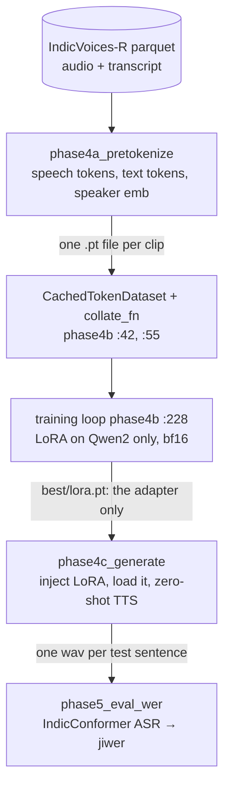
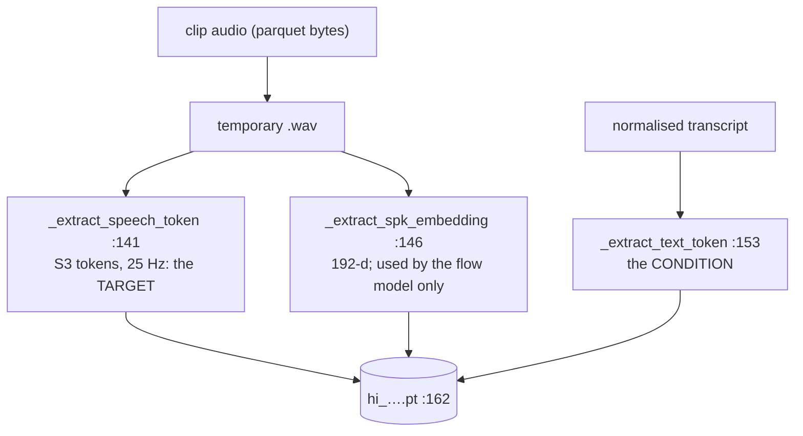
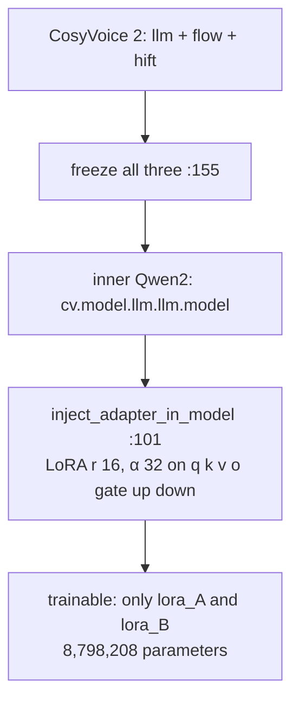
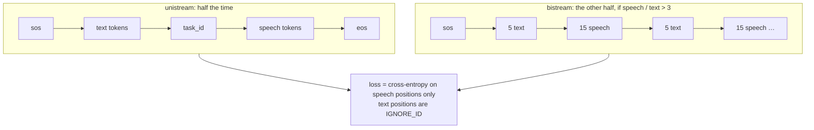
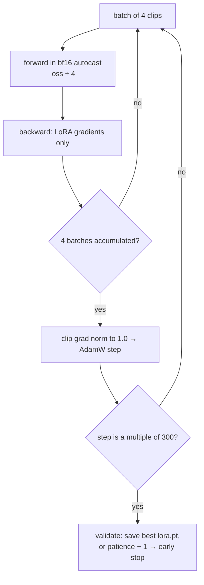
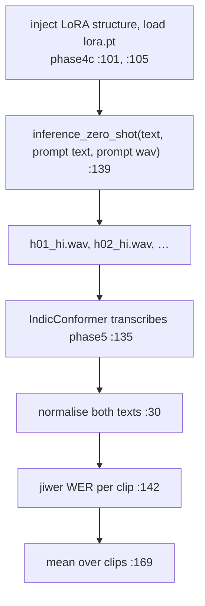

# Day 8 (Sun Nov 15): CosyVoice Indic LoRA

Part of [[Interview plan (Nov 2026)]]. Repo `/data/jayavardhan/cosyvoice_rnd` (branch `main`). Data and checkpoints in
`/mnt/warm_storage/jayavardhan/cosy/` (`phase2`, `phase3`, `phase4`, `phase4_te`, `phase4_multi`, `phase4_cv3_*`). About 7 h.
Builds on [[Day 07 - Seminar and speech basics]] (the CosyVoice 2 pipeline). Project note: [[CosyVoice Indic LoRA (R&D)]].

**Code, explained:** the figures, the code to read and what each snippet does are in [[#Code, explained]], right after section B.

**There is no prep pack for this project yet.** This note is written from the code and training logs. The upstream
`cosyvoice/` package is Alibaba's code, not yours: skim it only. Your code is `scripts/`.

**Resume bullets (both resumes):**
- "Adapted CosyVoice 2 to Hindi and Telugu via LoRA fine-tuning on its Qwen2 LLM component (**9M params, 1.36%** of the base model, 17 MB), trained on **35 hours** of speech across **4 H200 GPUs** with BF16 precision."
- "Trained a single adapter jointly on Hindi and Telugu with strong results and **no catastrophic forgetting**."
- "Reduced Hindi WER from **1.99** in the zero-shot setting to **0.11** after LoRA adaptation."

**What the repo and logs show, and what to fix:**
- **9M / 1.36% is right.** The training log (`phase4_multi/checkpoints/training.log`) reports `trainable_params 8,798,208` of `647,972,675` = **1.358%**, at r = 16, α = 32. The denominator is the **whole CosyVoice 2** (LLM + flow + vocoder, `phase4b_train_lora.py:172-177`); against the 0.5B Qwen alone it is ~1.8%.
- **"Across 4 H200 GPUs" is not data-parallel training.** `phase4b_train_lora.py` has no DDP; its docstring runs it on one GPU (`CUDA_VISIBLE_DEVICES=4`). The GPUs ran **separate jobs in parallel** (Hindi, Telugu, joint; CV2 and CV3) and **parallel generation** (`generate_all_parallel.sh`). Say "trained on H200s, running the Hindi, Telugu and joint adapters as parallel single-GPU jobs". The old plan's "DDP" block is dropped.
- **WER 1.99 → 0.11: the result CSVs are not on the server.** `compile_results.py` reads `data/phase5_outputs/wer_*_all.csv`, and `data/` is missing from the repo and from `cosy/`. **Find the R&D presentation or those CSVs before Day 15** and check the numbers, the test set and how WER was averaged.
- **WER above 1 needs explaining** (see A3): it means the zero-shot model produced many *inserted* words. Say it before they ask.

**By tonight you can:**
- explain LoRA and compute 8,798,208 by hand;
- walk one Hindi clip from audio to the training loss;
- explain WER, why it can exceed 1, and how "no catastrophic forgetting" was tested;
- give honest answers on the multi-GPU claim and the missing WER files.

## Schedule

| # | Time | Kind | What |
|---|---|---|---|
| 0 | 15 min | recall | Day 7: the CosyVoice 2 pipeline, 25 Hz tokens, bitrates |
| 1 | 20 min | read | README "5-Day R&D Strategy"; the project note; the five phases (below) |
| 2 | 45 min | theory + maths | LoRA (A1) |
| 3 | 30 min | skim | Upstream CosyVoice: `cli/cosyvoice.py` → `cli/model.py` → `llm/llm.py` (class and method names) |
| 4 | 45 min | code | `phase4a_pretokenize.py` (B1) |
| — | lunch | | |
| 5 | 75 min | code | `phase4b_train_lora.py` (B2) |
| 6 | 30 min | theory | BF16 vs FP16; catastrophic forgetting; ASR-based evaluation (A2, A3) |
| 7 | 45 min | code | `phase4c_generate.py`, `phase5_eval_wer.py` (B3) |
| 8 | 30 min | skim | Phases 1–3: baseline, codec benchmark, the distillation attempt (B4) |
| 9 | 45 min | rebuild | A LoRA layer from scratch, and a WER function (C) |
| 10 | 20 min | trace | One clip through pretokenize → loss; the parameter count (D) |
| 11 | 40 min | practice | The questions (E) |

**The five phases** (README; project note):
1. Baseline: zero-shot CosyVoice on Hindi (`step1_run_hindi_baseline.py`).
2. Benchmark neural codecs on Indic audio (`phase2_codec_benchmark.py`).
3. Try distilling mHuBERT-147 semantics into WavTokenizer (`phase3_*`). An attempt; know how it ended.
4. LoRA fine-tune the CosyVoice 2 LLM: pretokenize (4a), train (4b), generate (4c).
5. Evaluate with IndicConformer ASR WER (`phase5_eval_wer.py`).

**Data:** AI4Bharat IndicVoices-R, 18 h Hindi + 17 h Telugu = 35 h (14,662 clips) (project note).

## A. Theory

### A1. LoRA (block 2, 45 min)

**Read:** Hu et al., *LoRA* (2021), §1, §4 (method) and §7.1–7.2 (which weights, what rank). About 35 min.
**Optional:** Sebastian Raschka's blog post *"Practical Tips for Finetuning LLMs Using LoRA"*.

> [!abstract] What it says: LoRA (Hu et al., 2021), §1, §4, §7.1–7.2
> - **Problem (§1):** full fine-tuning of a huge model (GPT-3, 175B) needs a full copy of the weights per task. Storing and serving those copies is the bottleneck.
> - **Idea (§4):** keep W frozen and learn its update as a product of two thin matrices, ΔW = BA, with rank r much smaller than the width. A starts random (Gaussian), B starts at zero, and the update is scaled by α/r.
> - **No extra latency:** after training, BA can be added into W, so inference costs exactly what the base model costs.
> - **Headline numbers:** on GPT-3 175B, about 10,000× fewer trainable parameters and about 3× less GPU memory than full fine-tuning, at similar quality.
> - **§7.1, which weights:** with a fixed parameter budget, adapting both W_q and W_v beat spending it all on one matrix.
> - **§7.2, which rank:** very small ranks (even r = 1 for W_q and W_v) already work well. The useful update seems to live in a tiny subspace.
> - **Main figure (Figure 1):** the frozen W on one path, A then B on a side path, and the two outputs added.
> - **For this project:** you used r = 16 on all seven projections, not just q and v; the parameter formula below is §4's.

> [!abstract] What it says: Raschka, "Practical Tips for Finetuning LLMs Using LoRA"
> - **Format:** many small experiments fine-tuning a 7B model with LoRA, changing one setting at a time.
> - **Consistency:** repeating a run gave nearly the same scores, despite GPU randomness.
> - **QLoRA:** 4-bit base weights save a lot of memory, at the cost of slower training.
> - **Which layers:** LoRA on all linear layers, not only q and v, helped, but it adds parameters and memory.
> - **r and α:** a common rule of thumb is α = 2r; your α = 32 with r = 16 follows it. A very large r can overfit.
> - **Epochs:** more passes over a small, fixed dataset can make results worse.
> - **For this project:** it backs your "all seven projections, α = 2r" choices.

**Concepts:**

- Freeze `W` (d_out × d_in). Learn `ΔW = B·A`, with `A` (r × d_in) and `B` (d_out × r). Output = `Wx + (α/r)·BAx`.
- `B` starts at zero, so training starts exactly from the base model.
- Parameters per adapted matrix = `r·(d_in + d_out)`.
- **Your config:** r = 16, α = 32 (scale 2), dropout 0.05, on **all seven** projections: q, k, v, o, gate, up, down (`phase4b_train_lora.py:101-107`).

**Compute 8,798,208 by hand** (Qwen2.5-0.5B: 24 layers, hidden 896, MLP 4864, 2 KV heads × 64 = 128):
- q: 16·(896+896) = 28,672; o: 28,672; k: 16·(896+128) = 16,384; v: 16,384;
- gate: 16·(896+4864) = 92,160; up: 92,160; down: 92,160;
- per layer = 366,592; × 24 layers = **8,798,208**. ✓
- In bf16 that's 8.8M × 2 B ≈ **17.6 MB**, the "17 MB" on resume 5.

> [!tip] Explained from scratch: [[#6. Deep dive: LoRA from scratch, down to 8,798,208|§6 LoRA]]


### A2. BF16 and forgetting (block 6, first 15 min)

- **BF16** keeps FP32's 8 exponent bits (same range) and has only 7 mantissa bits. FP16 has 5 exponent bits, so it needs loss scaling to avoid underflow. BF16 doesn't. Your training uses `torch.autocast(..., dtype=torch.bfloat16)` (`phase4b_train_lora.py:235`).
- **Catastrophic forgetting:** fine-tuning on new data degrades old skills. LoRA limits it, because the base weights never change and the adapter is small. **How you tested it:** look at `generate_crosslingual_parallel.sh` and `compile_results.py`, and write down which languages and conditions were scored with the adapter on. If no base-language (English or Chinese) score with the adapter exists, say "no forgetting on the languages I tested".

> [!tip] Explained from scratch: [[#7. Deep dive: the TTS training loss, from scratch|§7 the training step (bf16 in 7.6)]]


### A3. Evaluating TTS with ASR (block 6, last 15 min)

- **WER = (S + D + I) / N**: substitutions, deletions and insertions over the number of reference words.
- **It can exceed 1**, because insertions are unbounded. A zero-shot model reading Hindi it doesn't know can babble long, wrong speech, which the ASR transcribes as many extra words. So **1.99 means "mostly garbage, much longer than the reference"**, not a bug.
- Your ASR judge is **AI4Bharat IndicConformer** (`phase5_eval_wer.py:40`), with Hindi text normalisation (`:30`) and `jiwer` (`:111`). The reported WER is the **mean of per-clip WERs** (`:169`), not a corpus WER, so a few babbling clips can pull the mean above 1.
- The ASR has its own error rate on *real* Hindi speech. That floor bounds how low TTS WER can go.

> [!tip] Explained from scratch: [[#8. Deep dive: WER from scratch, and why 1.99 is possible|§8 WER]]

## B. Code

### B1. Pretokenize (block 4, 45 min, deep)

`scripts/phase4a_pretokenize.py` (204 lines). It caches `(text tokens, speech tokens, speaker embedding)` per clip, so training never runs the frozen tokenisers.
- 46 `main`; 80 the CosyVoice frontend;
- **141 `_extract_speech_token`**: the S3 speech tokens (25 Hz FSQ, Day 7);
- **146 `_extract_spk_embedding`**: the speaker embedding. It's cached, but the CosyVoice 2 LLM's loss never reads it; the flow model uses it at synthesis;
- **153 `_extract_text_token`**: from the normalised transcript (152);
- 166–172: what's written to the cache and the manifest.

### B2. Train (block 5, 75 min, deep)

`scripts/phase4b_train_lora.py` (307 lines):
- 42 `CachedTokenDataset`; **55 `collate_fn`**: pads speech tokens and keeps true lengths (68–84). Why do lengths matter for the loss?
- **96 `apply_lora_to_qwen`**: `inject_adapter_in_model`, not `get_peft_model`. Why? (*Keeps the original class, so CosyVoice's hard-coded `self.llm.model.model.embed_tokens` path still works; docstring 97–98.*)
- 156: the flow-matching model and the HiFT vocoder are frozen. **Only the LLM gets adapters.**
- 168–178: apply LoRA, log the trainable count.
- 198: AdamW, lr 2e-4, weight decay 0.01. 235–240: bf16 autocast, gradient accumulation (batch 4 × accum 4 = 16).
- 253–283: validation every 300 steps, keep the best, early stopping after 4 non-improving checks, and a time budget (`--hours-budget`).
- Which loss is it? It comes from CosyVoice's `Qwen2LM.forward` (`out["loss"]`, 237): next-token cross-entropy on the **speech tokens**, conditioned on text and speaker. Confirm in `cosyvoice/llm/llm.py`.

### B3. Generate and evaluate (block 7, 45 min, deep)

- `phase4c_generate.py` (176): 39 apply LoRA again; **52 `load_lora_weights`** (only the adapter tensors are saved, so `lora.pt` is small); 139 `cv.inference_zero_shot` with a prompt wav and prompt text (the voice to clone).
- `phase5_eval_wer.py` (179): 40 IndicConformer; 30 normalisation; 111–142 per-clip WER and CER; 167 aggregation per label.

### B4. Phases 1–3 (block 8, 30 min, skim)

`step1_run_hindi_baseline.py`, `phase2_codec_benchmark.py` (533), `phase3_prepare_data.py`, `phase3_train_codec.py` (397), `compile_results.py`.
For each, write one line: what question did it answer, and what was the answer? For phase 3, the logs are in
`cosy/phase3/checkpoints*/training.log` (runs `lam05`, `lam10`, `v2`). Why did you move from codec work to LoRA on the LLM?

## Code, explained

Read this **with the files open**. It starts with a picture of the whole day and **the flow, step by step** (one concrete input followed through every function). Then each part has its own figure, the exact code (copied from the repo at the commit named below, so the line numbers match) and what that code does.

Repo `/data/jayavardhan/cosyvoice_rnd` (`0bb4e20`). Your code is `scripts/`;
`cosyvoice/` is Alibaba's upstream package (one function from it is here because your loss comes from it).



### The flow, step by step

Follow **one Hindi clip**: 4 seconds of audio with a transcript of about 20 text tokens.

1. **Pretokenize** (`phase4a_pretokenize.py:140–169`): the audio becomes **100 S3 speech tokens** (25 Hz × 4 s), the transcript becomes ~20 text tokens, and a 192-d speaker embedding is extracted. All three are saved in one `.pt` file.
2. **Batch** (`phase4b_train_lora.py:66–89`): 4 clips are padded to the longest, and the true lengths are kept.
3. **Build the sequence** (upstream `Qwen2LM.forward` → `prepare_lm_input_target`, `cosyvoice/llm/llm.py:318–343`):
   - half the time (unistream): `[sos, 20 text, task_id, 100 speech]` = 122 inputs;
   - the other half (bistream): text and speech interleaved 5 : 15.
4. **Targets:** `IGNORE_ID` for the first 21 positions (sos + text), then the 100 speech tokens and `eos`. So the loss is cross-entropy on **101 positions**: given the text, predict each next speech token (`llm.py:400–405`).
5. **Backward:** the loss is divided by 4 (gradient accumulation), and only the LoRA `A`/`B` matrices get gradients. Every 4 batches: clip the gradient norm to 1.0, AdamW step (`phase4b:235–250`).
6. **Every 300 steps:** validate; on a new best, save only the trainable tensors to `best/lora.pt` (`:267–278`).
7. **Inference** (`phase4c_generate.py`): rebuild the LoRA structure, copy in `lora.pt`, call `inference_zero_shot(text, prompt text, prompt wav)` → a wav.
8. **Score** (`phase5_eval_wer.py`): IndicConformer transcribes the wav, both texts are normalised, `jiwer` gives this clip's WER, and the report averages over clips.

---

### 1. Pretokenize once, so training never runs the frozen tokenisers



`scripts/phase4a_pretokenize.py:140–169`
```python
try:
    tok_ret = fe._extract_speech_token(tmp_path)
    speech_tokens = tok_ret[0] if isinstance(tok_ret, tuple) else tok_ret
    if speech_tokens.dim() == 2:
        speech_tokens = speech_tokens.squeeze(0)

    spk_ret = fe._extract_spk_embedding(tmp_path)
    spk_emb = spk_ret[0] if isinstance(spk_ret, tuple) else spk_ret
    if spk_emb.dim() == 2:
        spk_emb = spk_emb.squeeze(0)

    # Also pre-tokenize text using CV's tokenizer
    text = str(row["normalized"]).strip()
    text_tok_ret = fe._extract_text_token(text)
    text_tokens = text_tok_ret[0] if isinstance(text_tok_ret, tuple) else text_tok_ret
    if text_tokens.dim() == 2:
        text_tokens = text_tokens.squeeze(0)
finally:
    Path(tmp_path).unlink(missing_ok=True)

duration = float(row["duration"])

torch.save({
    "id": cid,
    "text": text,
    "text_tokens": text_tokens.cpu().to(torch.long),
    "speech_tokens": speech_tokens.cpu().to(torch.long),
    "spk_emb": spk_emb.cpu().to(torch.float32),
    "duration_s": duration,
}, cache_path)
```
> [!info] New functions in this code
> - `isinstance(x, T)`: True if `x` is of type `T`. `isinstance(out, tuple)` checks whether a layer returned a tuple. [[Function glossary#isinstance|→ examples]]
> - `.dim()`: the number of axes (dimensions). A `[1, 100]` tensor has `dim()` = 2; after `.squeeze(0)` it's 1. [[Function glossary#x.dim|→ examples]]
> - `.squeeze(d)`: removes axis `d` if its size is 1 (the opposite of `unsqueeze`). `[1, 100]` → `.squeeze(0)` → `[100]`. Without `d` it removes every size-1 axis. [[Function glossary#x.squeeze|→ examples]]
> - `str(x)`: converts anything to its text form. `str(89)` → `'89'`. `find_weakness` uses `str(term)` so a number or a string both work. [[Function glossary#str|→ examples]]
> - `.strip()`: removes spaces (and newlines) from both ends of a string. `'  CWE-89 '.strip()` → `'CWE-89'`. [[Function glossary#x.strip|→ examples]]
> - `Path('a') / 'b'`: pathlib's file path object; `/` joins parts: `Path('ckpt') / 'best' / 'lora.pt'` → `ckpt/best/lora.pt`. Has methods like `.exists()`, `.mkdir()`, `.unlink()`. [[Function glossary#Path|→ examples]]
> - `path.unlink(missing_ok=True)`: deletes the file; `missing_ok=True` means no error if it's already gone. [[Function glossary#x.unlink|→ examples]]
> - `float(x)`: converts to a floating-point number. `float('-inf')` is minus infinity, a value smaller than every number (used to mask scores). [[Function glossary#float|→ examples]]
> - `torch.save(obj, path)`: writes a tensor, or a dict of tensors, to a file (Python pickle format). `torch.load(path)` reads it back. Saved tensors keep their dtype: float32 stays 4 bytes each. [[Function glossary#torch.save|→ examples]]
> - `.cpu()`: a copy of the tensor in CPU memory (no-op if it's already there). Needed before saving or converting to NumPy. [[Function glossary#x.cpu|→ examples]]
> - `.to(dtype or device)`: converts a tensor's number type or moves it. `x.to(torch.float32)` makes a float32 copy (from bfloat16); `x.to('cuda')` moves it to the GPU. In Triton code, `.to(tl.float32)` converts a loaded value. [[Function glossary#x.to|→ examples and figure]]

- For each clip, CosyVoice's own frontend gives three things: **S3 speech tokens** (25 Hz, the training *target*), the **text tokens** (the *condition*), and a **speaker embedding**.
- Note: the CosyVoice 2 LLM's `forward` (section 3) never reads the speaker embedding; it's used by the flow model at synthesis time. It's cached here because the batch format carries it, not because the LoRA loss uses it.
- Skip if the cache file exists (line 126), so an interrupted run resumes.

---

### 2. Batching and LoRA injection

> [!tip] Concept from scratch: [[#6. Deep dive: LoRA from scratch, down to 8,798,208|LoRA from scratch, down to 8,798,208 (§6)]]



`scripts/phase4b_train_lora.py:66–89`
```python
B = len(items)
text_lens = [it["text_tokens"].shape[-1] for it in items]
speech_lens = [it["speech_tokens"].shape[-1] for it in items]
L_text = max(text_lens)
L_speech = max(speech_lens)

text_token = torch.zeros(B, L_text, dtype=torch.long)
speech_token = torch.zeros(B, L_speech, dtype=torch.long)
for i, it in enumerate(items):
    t = it["text_tokens"].to(torch.long)
    s = it["speech_tokens"].to(torch.long)
    text_token[i, :t.shape[-1]] = t
    speech_token[i, :s.shape[-1]] = s

return {
    "text_token": text_token,
    "text_token_len": torch.tensor(text_lens, dtype=torch.int32),
    "speech_token": speech_token,
    "speech_token_len": torch.tensor(speech_lens, dtype=torch.int32),
    "embedding": torch.stack([it["spk_emb"].to(torch.float32) for it in items], dim=0),
    # CV3-only keys; harmless for CV2 (its forward only reads what it needs)
    "instruct_token": torch.zeros(B, 0, dtype=torch.long),
    "instruct_token_len": torch.zeros(B, dtype=torch.int32),
}
```
> [!info] New functions in this code
> - `len(xs)`: how many items. `len([7, 8, 9])` = 3. [[Function glossary#len|→ examples]]
> - `.shape`: the tensor's size along each axis. `x.shape == (6, 2048)` means 6 rows of 2048. [[Function glossary#x.shape|→ examples]]
> - `max(xs) / max(a, b)`: the largest. `max([3, 9, 2])` = 9. With `key=f` it compares `f(x)` instead: `max(range(3), key=lambda i: s[i])` is the index of the largest `s[i]`. [[Function glossary#max|→ examples]]
> - `torch.zeros(shape, dtype, device)`: a tensor of the given shape filled with 0. `torch.zeros((2, 3))` → a 2 × 3 grid of zeros. The KV cache is pre-allocated this way. [[Function glossary#torch.zeros|→ examples]]
> - `enumerate(xs)`: loops over a list and gives you each item **with its index**. `for i, x in enumerate(['a', 'b'])` gives `(0, 'a')`, then `(1, 'b')`. [[Function glossary#enumerate|→ examples]]
> - `torch.tensor(data, dtype=...)`: makes a new tensor from a Python list or number. `torch.tensor([5, 12, 30], dtype=torch.int32)` stores the true lengths of a batch. [[Function glossary#torch.tensor|→ examples]]
> - `torch.stack(xs)`: joins tensors along a **new** axis: four `(V,)` vectors → one `(4, V)` tensor. [[Function glossary#torch.stack|→ examples and figure]]

- Pad text and speech tokens to the longest in the batch, and pass the **true lengths**. Upstream unpads with them, so padding never enters the loss.

`scripts/phase4b_train_lora.py:155–169`
```python
# ---- Freeze EVERYTHING (llm + flow + hift) ----
for sub in (cv.model.llm, cv.model.flow, cv.model.hift):
    for p in sub.parameters():
        p.requires_grad = False

# ---- Apply LoRA only to the inner Qwen2ForCausalLM ----
# Both CV2 and CV3 have cv.model.llm.llm.model as the inner Qwen2ForCausalLM
# (CV3 just inherits from Qwen2LM with extra forward logic). Detect by class name.
cv_version = "cv3" if "CosyVoice3" in type(cv.model.llm).__name__ else "cv2"
inner_qwen = cv.model.llm.llm.model
log({"event": "cv_version_detected", "cv_version": cv_version,
     "llm_class": type(cv.model.llm).__name__})

lora_qwen = apply_lora_to_qwen(inner_qwen, args.lora_r, args.lora_alpha, args.lora_dropout)
cv.model.llm.llm.model = lora_qwen
```
> [!info] New functions in this code
> - `.parameters()`: yields every learnable tensor of a module. `sum(p.numel() for p in layer.parameters())` counts them; `nn.Linear(896, 16, bias=False)` has 14,336. [[Function glossary#x.parameters|→ examples]]
> - `type(x)`: the class of `x`. `type(x).__name__` is its class name as text. [[Function glossary#type|→ examples]]

`scripts/phase4b_train_lora.py:101–108`
```python
config = LoraConfig(
    r=r,
    lora_alpha=alpha,
    lora_dropout=dropout,
    target_modules=["q_proj", "k_proj", "v_proj", "o_proj",
                    "gate_proj", "up_proj", "down_proj"],
    bias="none",
)
```
> [!info] New functions in this code
> - `LoraConfig(r=16, lora_alpha=32, lora_dropout=0.05, target_modules=[...], bias='none')`: PEFT's description of the adapters: rank r, scale α (applied as α/r), dropout on the adapter's input, which `nn.Linear` names to wrap, and whether to train biases. [[Function glossary#LoraConfig|→ examples]]

- **Freeze everything** (LLM, flow, vocoder), then inject LoRA adapters into all seven projections of the inner Qwen2. `inject_adapter_in_model` marks only the new A and B matrices as trainable.
- `inject_adapter_in_model` instead of `get_peft_model`: it keeps the original module classes, so CosyVoice's hard-coded attribute paths (`self.llm.model.model.embed_tokens`) still resolve.

`scripts/phase4b_train_lora.py:172–181`
```python
def all_params():
    for sub in (cv.model.llm, cv.model.flow, cv.model.hift):
        yield from sub.parameters()

n_trainable = sum(p.numel() for p in all_params() if p.requires_grad)
n_total     = sum(p.numel() for p in all_params())
log({"event": "lora_applied",
     "trainable_params": n_trainable,
     "total_params": n_total,
     "trainable_pct": round(100 * n_trainable / n_total, 3)})
```
> [!info] New functions in this code
> - `sum(xs)`: adds up the items. `sum([1, 2, 3])` = 6. [[Function glossary#sum|→ examples]]
> - `.numel()`: the total number of elements. A `[3, 4]` tensor has 12. [[Function glossary#x.numel|→ examples]]
> - `round(x, n)`: rounds to `n` decimal places. `round(0.7183, 1)` = 0.7. [[Function glossary#round|→ examples]]

- `n_total` sums **LLM + flow + vocoder**. So 8,798,208 / 647,972,675 = 1.36% is the adapter's share of **all of CosyVoice 2**, not of the 0.5B Qwen alone (against Qwen's ~494M it would be ~1.8%). Say "1.36% of the full CosyVoice 2 model".

---

### 3. What the loss actually is (upstream `Qwen2LM`)

> [!tip] Concept from scratch: [[#7. Deep dive: the TTS training loss, from scratch|the training sequence and loss on a toy clip (§7)]]



`cosyvoice/llm/llm.py:341–343`
```python
else:
    this_lm_target = torch.tensor([IGNORE_ID] * (1 + instruct_token_len[i] + text_token_len[i]) + speech_token[i].tolist() + [self.eos_token])
    this_lm_input = torch.concat([sos_emb.squeeze(dim=0), instruct_token_emb[i], text_token_emb[i], task_id_emb.squeeze(dim=0), speech_token_emb[i]], dim=0)
```
> [!info] New functions in this code
> - `.tolist()`: converts a tensor to a plain Python list (copies to the CPU). [[Function glossary#x.tolist|→ examples]]
> - `torch.concat(tensors, dim=0)`: another name for `torch.cat`: joins tensors along an existing axis. `[sos (1)], [text (20)], [task (1)], [speech (100)]` along dim 0 → 122 rows. [[Function glossary#torch.concat|→ examples]]

`cosyvoice/llm/llm.py:318–331`
```python
if random.random() < 0.5 and speech_token_len[i] / text_token_len[i] > self.mix_ratio[1] / self.mix_ratio[0]:
    this_lm_target, this_lm_input = [IGNORE_ID], [sos_emb.squeeze(dim=0)]
    this_lm_target += [IGNORE_ID] * instruct_token_len[i]
    this_lm_input.append(instruct_token_emb[i])
    for j in range(((text_token_len[i] + 1) / self.mix_ratio[0]).ceil().int().item()):
        this_text_token = text_token[i][j * self.mix_ratio[0]: (j + 1) * self.mix_ratio[0]].tolist()
        this_speech_token = speech_token[i][j * self.mix_ratio[1]: (j + 1) * self.mix_ratio[1]].tolist()
        if len(this_text_token) == self.mix_ratio[0]:
            assert len(this_speech_token) == self.mix_ratio[1]
            this_lm_target += [IGNORE_ID] * (self.mix_ratio[0] - 1)
            this_lm_target += this_speech_token
            this_lm_target.append(self.fill_token)
            this_lm_input.append(text_token_emb[i][j * self.mix_ratio[0]: (j + 1) * self.mix_ratio[0]])
            this_lm_input.append(speech_token_emb[i][j * self.mix_ratio[1]: (j + 1) * self.mix_ratio[1]])
```
> [!info] New functions in this code
> - `random.random()`: a random float in [0, 1). `random.random() < 0.5` is a fair coin flip: upstream uses it to choose bistream or unistream per clip. [[Function glossary#random.random|→ examples]]
> - `.append(x)`: adds `x` at the end of a list. `[1].append(2)` → `[1, 2]`. [[Function glossary#list.append|→ examples]]
> - `range(start, stop, step)`: the integers from `start` up to (not including) `stop`. `range(0, 10, 4)` gives 0, 4, 8. `range(3)` gives 0, 1, 2. [[Function glossary#range|→ examples]]
> - `.ceil()`: rounds every element **up** to a whole number. `tensor(1.6).ceil()` → `tensor(2.)`. Upstream uses it to count 5-token text chunks: ⌈(7 + 1) / 5⌉ = 2. [[Function glossary#x.ceil|→ examples]]
> - `.int()`: converts to 32-bit integers (dropping any fraction). `tensor(2.).int()` → `tensor(2, dtype=torch.int32)`. [[Function glossary#x.int|→ examples]]
> - `.item()`: the Python number inside a one-element tensor. [[Function glossary#x.item|→ examples]]

`cosyvoice/llm/llm.py:400–405`
```python
# 4. run lm forward
lm_output, lm_output_mask = self.llm(lm_input, lm_input_len.to(device))
logits = self.llm_decoder(lm_output)
loss = self.criterion_ce(logits, lm_target.to(device))
acc = th_accuracy(logits.view(-1, self.llm_decoder.out_features), lm_target, ignore_label=IGNORE_ID)
return {'loss': loss, 'acc': acc}
```
> [!info] New functions in this code
> - `.view(shape)`: reinterprets the same numbers with a new shape, **no copy**. A `[6, 2048]` tensor `.view(6, 32, 64)` reads each row of 2048 as 32 heads × 64. [[Function glossary#x.view|→ examples and figure]]

- The input is `[sos, text…, task_id, speech…]`. The **target** is `IGNORE_ID` for every text position and the next speech token (then `eos`) for every speech position. So the model is trained to **predict speech tokens given the text**: next-token cross-entropy, label-smoothed.
- Half the time the sequence is **interleaved 5 text : 15 speech**. That's the streaming mode (Day 7): the model learns to start speaking before all the text has arrived.
- Your LoRA therefore learns *which S3 tokens Hindi/Telugu text should produce*. The voice and the rendering stay with the frozen flow model and vocoder.

---

### 4. The training loop



`scripts/phase4b_train_lora.py:235–250`
```python
with torch.autocast(device_type="cuda", dtype=torch.bfloat16):
    out = cv.model.llm(batch, DEVICE)
    loss = out["loss"] if isinstance(out, dict) else out
    loss = loss / args.grad_accum

loss.backward()
accum += 1

if accum >= args.grad_accum:
    torch.nn.utils.clip_grad_norm_(
        [p for p in cv.model.llm.parameters() if p.requires_grad],
        max_norm=1.0,
    )
    opt.step()
    opt.zero_grad()
    accum = 0
```
> [!info] New functions in this code
> - `with torch.autocast(device_type='cuda', dtype=torch.bfloat16):`: inside this block, matrix multiplies and similar ops run in the lower precision (bf16 here); the parameters themselves stay in their own dtype (float32). [[Function glossary#torch.autocast|→ examples]]
> - `.backward()`: computes the gradient of a scalar (the loss) with respect to every tensor that requires grad, and **adds** it into each one's `.grad`. Adding (not overwriting) is what makes gradient accumulation work. [[Function glossary#x.backward|→ examples]]
> - `torch.nn.utils.clip_grad_norm_(params, max_norm)`: treats all the gradients as one long vector; if its length is above `max_norm`, scales every gradient down so the length equals `max_norm`. A gradient (3, 4), length 5, with max_norm 1 → (0.6, 0.8). Returns the length before clipping. [[Function glossary#torch.nn.utils.clip_grad_norm_|→ examples]]
> - `opt.zero_grad()`: clears the gradients of the optimiser's parameters (sets them to None), so the next `backward` starts from zero. [[Function glossary#x.zero_grad|→ examples]]

- **bf16 autocast:** the forward runs in bfloat16, which has FP32's exponent range, so no loss scaler is needed (FP16 would need one).
- **Gradient accumulation:** divide the loss by `grad_accum` and step once every 4 batches. Batch 4 × 4 = an effective batch of 16 clips.
- **Clip the gradient norm to 1.0** over the LoRA parameters only.

`scripts/phase4b_train_lora.py:267–288`
```python
if val_loss < best_val:
    best_val = val_loss
    patience_left = args.early_stop_patience   # reset
    save_dir = args.ckpt_dir / "best"
    save_dir.mkdir(parents=True, exist_ok=True)
    lora_state = {n: p.detach().cpu()
                  for n, p in cv.model.llm.named_parameters()
                  if p.requires_grad}
    torch.save(lora_state, save_dir / "lora.pt")
    log({"event": "saved_best", "step": step,
         "val_loss": val_loss, "path": str(save_dir),
         "n_params_saved": len(lora_state)})
else:
    patience_left -= 1
    log({"event": "patience", "step": step,
         "patience_left": patience_left,
         "best_val": best_val, "current_val": val_loss})
    if patience_left <= 0:
        log({"event": "early_stop", "step": step,
             "best_val": best_val})
        early_stopped = True
        break
```
> [!info] New functions in this code
> - `path.mkdir(parents=True, exist_ok=True)`: creates the folder, including missing parent folders; `exist_ok=True` means no error if it already exists. [[Function glossary#x.mkdir|→ examples]]
> - `.named_parameters()`: like `.parameters()` but yields `(name, tensor)` pairs, e.g. `('layers.0.self_attn.q_proj.lora_A.default.weight', tensor)`. Used to save and reload tensors by name. [[Function glossary#x.named_parameters|→ examples]]

- Validate every 300 optimiser steps. On a new best, save **only** the trainable tensors (`requires_grad`), so `lora.pt` holds just the adapter (~17 MB in bf16). After 4 checks without improvement, stop early. A wall-clock budget (`--hours-budget`) also bounds the run.
- This is **one process on one GPU**: no `torch.distributed` anywhere. The 4 H200s ran separate jobs (Hindi, Telugu, joint) at the same time.

---

### 5. Generate and score

> [!tip] Concept from scratch: [[#8. Deep dive: WER from scratch, and why 1.99 is possible|WER by hand, and why 1.99 is possible (§8)]]



`scripts/phase4c_generate.py:59–68`
```python
own_state = dict(cv.model.llm.named_parameters())
loaded = 0
skipped = []
for name, tensor in state.items():
    if name in own_state and own_state[name].shape == tensor.shape:
        own_state[name].data.copy_(tensor.to(own_state[name].device))
        loaded += 1
    else:
        skipped.append(name)
return loaded, skipped
```
> [!info] New functions in this code
> - `dict(pairs)`: builds a dictionary. `dict(model.named_parameters())` maps each parameter name to its tensor, for lookup by name. [[Function glossary#dict|→ examples]]
> - `.items()`: a dict's `(key, value)` pairs, for looping over both. [[Function glossary#dict.items|→ examples]]
> - `.copy_(src)`: copies `src`'s values **into** an existing tensor, in place (same shape required). Loading LoRA weights uses it so the model keeps its own tensors. [[Function glossary#x.copy_|→ examples]]
> - `.device`: where the tensor lives: `cpu` or `cuda:0` (a GPU). [[Function glossary#x.device|→ examples]]

- Rebuild the same LoRA structure, then copy in the saved tensors by name, checking shapes. `skipped` would reveal a rank or target-module mismatch between training and inference.

`scripts/phase4c_generate.py:139–141`
```python
chunks = list(cv.inference_zero_shot(
    text, effective_prompt, args.prompt_wav, stream=False,
))
```
> [!info] New functions in this code
> - `list(xs)`: makes a new list from any iterable. `list(reversed(range(3)))` = `[2, 1, 0]`. `list(x)` on a list makes a **copy**. [[Function glossary#list|→ examples]]

- **Zero-shot synthesis:** the text plus a prompt wav and its transcript. The prompt supplies the voice to clone.

`scripts/phase5_eval_wer.py:138–145`
```python
for sid, cat, ref, hyp in zip(ids, cats, refs, hyps):
    ref_n = normalize_hindi(ref)
    hyp_n = normalize_hindi(hyp)
    try:
        w = wer(ref_n, hyp_n)
        c = cer(ref_n, hyp_n)
    except ValueError:
        w, c = 1.0, 1.0
```
> [!info] New functions in this code
> - `zip(a, b)`: walks several lists **in step**, pairing their items. `zip([1, 2], ['x', 'y'])` gives `(1, 'x')`, `(2, 'y')`. [[Function glossary#zip|→ examples]]
> - `jiwer.wer(reference, hypothesis)`: word error rate: (substitutions + deletions + insertions) / reference words. `wer('the cat sat down', 'the bat sat')` = 0.5. Can exceed 1. [[Function glossary#wer|→ examples]]
> - `jiwer.cer(reference, hypothesis)`: the same as WER but on characters: `cer('abc', 'abd')` = 1/3. [[Function glossary#cer|→ examples]]

`scripts/phase5_eval_wer.py:166–169`
```python
df = pd.DataFrame(all_rows)
for label in df["label"].unique():
    sub = df[df["label"] == label]
    print(f"{label:<20} {len(sub):>4} {sub['wer'].mean():>6.3f} {sub['cer'].mean():>6.3f}")
```
> [!info] New functions in this code
> - `pd.DataFrame(rows)`: a pandas table; from a list of dicts, each dict becomes a row and each key a column. `df['wer'].mean()` averages a column. [[Function glossary#x.DataFrame|→ examples]]
> - `series.unique()`: the distinct values of a pandas column, in order of first appearance. `df['label'].unique()` lists each system once. [[Function glossary#x.unique|→ examples]]
> - `print(x)`: writes text to the output. `print(f'{0.5:.2f}x')` prints `0.50x`; `:.2f` = 2 decimals. [[Function glossary#print|→ examples]]
> - `.mean(dim, keepdim=True)`: the average along an axis. On `[3, 8]` with `dim=-1` it averages each row's 8 numbers → `[3]`, or `[3, 1]` with `keepdim=True` (keeps the axis so the result broadcasts back over the row). [[Function glossary#x.mean|→ examples and figure]]

- IndicConformer transcribes each generated wav. Both reference and hypothesis are normalised (whitespace, punctuation, the danda `।`), then `jiwer` computes per-clip WER.
- **The reported WER is the mean of per-clip WERs** (line 169), not one corpus-level WER. A few babbling clips with WER ≫ 1 (many inserted words) can pull the mean to 1.99. Say this when you explain "WER above 1".

**Check yourself:** a reference of 4 words; the hypothesis has 1 substitution and 6 inserted words. What's the clip's WER? (*(1 + 0 + 6) / 4 = 1.75.*)

---

### 6. Deep dive: LoRA from scratch, down to 8,798,208

Section 2 above injects LoRA with one library call. This section builds it from zero. Order: why not fine-tune
everything → the low-rank idea on a 4-number example → the formula with α and r → why B starts at zero → the full
count for Qwen2.5-0.5B → what the code does, line by line → saving only the adapter → questions → check.

> [!important] The one sentence to hold on to
> Keep every original weight frozen, and learn for each chosen matrix a small correction $\Delta W = B A$ made of two
> thin matrices (rank r = 16), so you train 1.36% of CosyVoice 2's parameters and start exactly from the base model.

#### 6.1 Why not fine-tune everything?

Full fine-tuning updates all ~494M Qwen weights. That costs:
- **memory:** AdamW keeps two extra numbers per trained weight (its moment estimates), plus the gradient;
- **storage:** each language adapter would be a full 1 GB copy of the model;
- **risk:** changing every weight on 35 hours of Indic speech can damage what the model already knew (catastrophic forgetting).

The LoRA paper's observation: the **change** a fine-tune makes to a weight matrix tends to have low "rank", meaning it
can be written with far fewer numbers than the matrix itself.

#### 6.2 Low rank on a tiny example

A rank-1 matrix is one column times one row. With $d = 4$ and $r = 1$:

$$B = \begin{bmatrix}0.2\\0\\-0.1\\0\end{bmatrix},\quad A = \begin{bmatrix}0.5 & 0 & 0 & 0.5\end{bmatrix},\quad BA = \begin{bmatrix}0.1&0&0&0.1\\0&0&0&0\\-0.05&0&0&-0.05\\0&0&0&0\end{bmatrix}$$

$BA$ is a full 4 × 4 matrix (16 numbers), but it's built from only **4 + 4 = 8** trained numbers. At real sizes the
saving is huge: a 896 × 896 matrix has 802,816 numbers, and rank 16 needs 16 · (896 + 896) = **28,672** (3.6%).

**You never build $BA$.** Apply it to an input $x$ right to left, which is cheap:

| step | computation | value for $x = (1, 2, 0, 1)$ |
|---|---|---|
| 1 | $A x$ (a dot product, size r) | 0.5·1 + 0·2 + 0·0 + 0.5·1 = **1.0** |
| 2 | $B (A x)$ (size d) | (0.2, 0, −0.1, 0) |
| 3 | × α / r (here α = 2, r = 1) | **(0.4, 0, −0.2, 0)** |

The layer's output is $W x$ plus that correction.

#### 6.3 The formula

$$h = W x + \frac{\alpha}{r}\, B A x$$

| symbol | shape (q_proj) | meaning |
|---|---|---|
| $x$ | [896] | the layer's input |
| $W$ | [896 × 896] | the original weight, **frozen** |
| $A$ | [r × d_in] = [16 × 896] | "down" projection, trained; random init |
| $B$ | [d_out × r] = [896 × 16] | "up" projection, trained; **starts at zero** |
| $r$ | 16 | the rank: how many directions the correction may use |
| $\alpha$ | 32 | a fixed scale; the correction is multiplied by α / r = **2** |

![[d08-1-lora.svg]]

**Why α / r?** If you change r, the scale keeps the update's size roughly the same, so the learning rate doesn't have
to be retuned. **Why B = 0 at the start?** Then $BAx = 0$, so the adapted model is **exactly** the base model at step
0. Training begins from known-good behaviour, and only moves away as far as the data pushes it. (A is random, not
zero: if both were zero, neither would ever get a gradient.)

#### 6.4 The full count: 8,798,208

Qwen2.5-0.5B: 24 layers, hidden size 896, MLP size 4,864, and 2 KV heads × 64 = 128 for k and v (grouped-query
attention, as on Day 1). Per adapted matrix, LoRA adds $r\,(d_{in} + d_{out})$:

| projection | $d_{in} \to d_{out}$ | 16 · ($d_{in} + d_{out}$) |
|---|---|---|
| q_proj | 896 → 896 | 28,672 |
| k_proj | 896 → 128 | 16,384 |
| v_proj | 896 → 128 | 16,384 |
| o_proj | 896 → 896 | 28,672 |
| gate_proj | 896 → 4,864 | 92,160 |
| up_proj | 896 → 4,864 | 92,160 |
| down_proj | 4,864 → 896 | 92,160 |
| **per layer** | | **366,592** |
| **× 24 layers** | | **8,798,208** ✓ |

The training log confirms it: `trainable_params 8798208` of `total_params 647972675` = **1.358%**. That denominator
is **all of CosyVoice 2** (LLM + flow + vocoder). Against Qwen2.5-0.5B alone (494,032,768 parameters), it's 1.78%.

Each adapted matrix has two tensors (A and B): 24 × 7 × 2 = **336 tensors**. The log's `n_params_saved: 336` is
exactly that.

#### 6.5 The code, line by line (`phase4b_train_lora.py`)

**Freeze everything** (`:155–158`): every parameter of `cv.model.llm`, `cv.model.flow` and `cv.model.hift` gets
`requires_grad = False`. Nothing can change yet.

**Inject** (`apply_lora_to_qwen`, `:96–112`):
- `LoraConfig(r=16, lora_alpha=32, lora_dropout=0.05, target_modules=[…7 names…], bias="none")` describes the adapters.
- `inject_adapter_in_model(config, qwen2_model)` walks the model, finds every `nn.Linear` whose name ends in one of the 7 targets (7 × 24 = 168 layers), and wraps each so it computes $Wx + 2·B(A(\text{dropout}(x)))$. The new A and B are created with `requires_grad = True`; the original W stays frozen.
- Why `inject_adapter_in_model` and not `get_peft_model`? `get_peft_model` wraps the whole model in a new class, which would break CosyVoice's hard-coded paths such as `self.llm.model.model.embed_tokens`. Injecting in place keeps the original classes.

**Count** (`:172–181`): `sum(p.numel() for p in all_params() if p.requires_grad)` adds up the sizes of the trainable
tensors: 8,798,208.

**Optimise** (`:196–199`): `AdamW` receives **only** the trainable tensors, lr 2e-4, weight decay 0.01. So the optimiser
state is also tiny: two moments for 8.8M numbers, not 494M.

**Save** (`:272–275`): `{n: p.detach().cpu() for n, p in cv.model.llm.named_parameters() if p.requires_grad}` keeps
just the 336 adapter tensors. **Load** (`phase4c_generate.py:52–68`): inject the same structure, then copy each saved
tensor into the parameter with the same name; a shape or name mismatch lands in `skipped`.

#### 6.6 How big is `lora.pt`, really?

The resume says "17 MB". That's 8,798,208 × **2 bytes** (bf16) = 17.6 MB. But the file on disk,
`cosy/phase4/checkpoints/best/lora.pt`, is **35,284,758 bytes**: 8,798,208 × **4 bytes** (float32) = 35.19 MB, plus a
little pickle overhead. Why? `torch.autocast` runs the **maths** in bf16, but the **parameters** stay float32, and
`p.detach().cpu()` saves them as they are. Either say "35 MB as saved (fp32), 17.6 MB if stored in bf16", or convert
before quoting.

#### 6.7 Questions people usually ask next

##### "Why r = 16 and all seven projections?"

The config doesn't document a reason, so say it's a common choice. The LoRA paper found small ranks often enough, and
later work (QLoRA, practitioners' sweeps) found adapting **all** linear layers, MLP included, usually beats adapting
only q and v. For a new language, the MLP (where much of the model's knowledge sits) likely matters.

##### "Does LoRA slow down inference?"

Not if you **merge**: compute $W' = W + 2BA$ once and use $W'$ as an ordinary weight. The extra cost vanishes. Keeping
it separate (as `phase4c` does) costs two thin matrix multiplies per layer and lets you swap adapters.

##### "Why not adapt the flow model or the vocoder?"

The LM decides **which speech tokens** to produce for a text, which is the language-specific part. The flow model and
vocoder turn tokens into sound for any language, and the voice comes from the speaker embedding and prompt. So the LM
is where Hindi and Telugu were missing.

##### "Are the speech embedding and the output layer trained?"

No. `speech_embedding` and `llm_decoder` belong to `cv.model.llm` and were frozen; LoRA wraps only the inner Qwen's 7
projections. The adapter must work with the existing speech-token vocabulary.

#### 6.8 Check your understanding

1. Give the LoRA formula and say which parts are trained.
2. Why does B start at zero, and why not A too?
3. How many trainable numbers does LoRA r = 8 add to one 896 → 4,864 projection?
4. Recompute one Qwen2.5-0.5B layer's LoRA count at r = 16.
5. What is the 647,972,675 in the log, and what's the percentage against Qwen alone?
6. Why is `lora.pt` 35 MB and not 17 MB?
7. Why `inject_adapter_in_model` rather than `get_peft_model`?

> [!success]- Answers
> 1. $h = Wx + (\alpha/r) BAx$; only A and B are trained, W is frozen.
> 2. So the adapted model equals the base model at step 0. If A were zero too, the gradients of both would be zero and nothing would learn.
> 3. 8 · (896 + 4,864) = 46,080.
> 4. 2 · 28,672 + 2 · 16,384 + 3 · 92,160 = 366,592.
> 5. All of CosyVoice 2 (LLM + flow + vocoder). Against Qwen's 494,032,768: 8,798,208 / 494,032,768 = 1.78%.
> 6. The parameters are float32 (autocast changes only the compute precision), so 8,798,208 × 4 bytes ≈ 35.2 MB.
> 7. It modifies the model in place and keeps the original classes, so CosyVoice's hard-coded attribute paths still work.

#### 6.9 The five things to remember

1. **Formula:** $h = Wx + \frac{\alpha}{r} BAx$, W frozen, A [r × d_in] random, B [d_out × r] zero.
2. **Cost:** $r(d_{in} + d_{out})$ per matrix: 366,592 per layer, **8,798,208** in total (24 × 7 × 2 = 336 tensors).
3. **Percentages:** 1.36% of all of CosyVoice 2; 1.78% of Qwen2.5-0.5B alone.
4. **Code:** freeze all → inject in place (keeps CosyVoice's paths) → AdamW on adapters only → save only `requires_grad` tensors.
5. **Size honesty:** saved in fp32 = 35 MB; the "17 MB" is the bf16 size.

---

### 7. Deep dive: the TTS training loss, from scratch

Section 3 above shows `prepare_lm_input_target` and the loss call. This section builds both on a toy clip you can
follow cell by cell. Order: next-token prediction → the unistream sequence → IGNORE_ID → the bistream (5 : 15)
sequence → cross-entropy on real numbers → what one optimiser step does (bf16, accumulation, clipping) → what the
training log shows → questions → check.

> [!important] The one sentence to hold on to
> The LM reads `[sos, text, task_id, speech]` and at every position predicts the **next** token, but only the speech
> positions (and `eos`) are graded: text positions get the target −1 (IGNORE_ID), so the loss is "given this text,
> how well do you predict its speech tokens?"

#### 7.1 Next-token prediction, for speech

A text LM learns $p(\text{next token} \mid \text{all previous tokens})$. CosyVoice 2's LM does the same over a sequence
that **mixes** text and speech tokens. At inference, you give it the text and it generates speech tokens one by one,
until it emits `eos`. Training must therefore teach: *after this text, these speech tokens come, in this order, and
then the end.*

#### 7.2 The unistream sequence on a toy clip

Take a clip with **3 text tokens** (t1 t2 t3) and **4 speech tokens** (s1 … s4). Upstream builds (`llm.py:341–342`):

- **input** = `[sos, t1, t2, t3, task_id, s1, s2, s3, s4]`: 9 positions;
- **target** = `[−1, −1, −1, −1, s1, s2, s3, s4, eos]`: also 9.

![[d08-2-sequence.svg]]

Read it column by column. Position 4 holds `task_id` (a special "now start speaking" token); its target is **s1**. Position
8 holds s4; its target is **eos**. Positions 0–3 (sos and the text) have target −1.

| | count for the toy | for the 4-second Hindi clip (20 text, 100 speech) |
|---|---|---|
| inputs | 1 + 3 + 1 + 4 = 9 | 1 + 20 + 1 + 100 = 122 |
| ignored targets (−1) | 1 + 3 = 4 | 1 + 20 = 21 |
| **graded positions** | 4 + 1 (eos) = **5** | 100 + 1 = **101** |

#### 7.3 IGNORE_ID: why the text isn't graded

`IGNORE_ID = −1` (`cosyvoice/utils/common.py:26`). The loss skips every position whose target is −1. Why not grade the
text too?
- The text is **given** at inference; the model never has to generate it.
- The output layer `llm_decoder` only has **6,564 speech classes** (6,561 codes + eos + 2 special tokens, `llm.py:281`), so it can't even name a text token.

The padding added to make a batch rectangular also gets −1 (`pad_sequence(..., padding_value=IGNORE_ID)`), so padding
never counts either. That's why `collate_fn` passes the **true lengths**: upstream cuts each clip back to its real
length (`unpad_sequence`) before building the sequence.

#### 7.4 The bistream sequence: 5 text, 15 speech, repeat

Half the time (`random.random() < 0.5`, `llm.py:318`), and only if the clip has more than 15 / 5 = 3 speech tokens per
text token, the sequence is **interleaved** instead. This is the streaming mode from Day 7 §7.5.

The loop runs ⌈(text length + 1) / 5⌉ times (`:322`). Each pass takes the next 5 text tokens and the next 15 speech
tokens. Example: **7 text tokens, 40 speech tokens** (ratio 5.7 > 3, so bistream is allowed); ⌈8 / 5⌉ = 2 passes.

| pass | text chunk | inputs added | targets added |
|---|---|---|---|
| 0 (full chunk) | t1–t5 | t1–t5, then s1–s15 | −1 ×4, **s1**, s2–s15, **fill** |
| 1 (last, short) | t6, t7 | t6, t7, task_id, s16–s40 | −1 ×2, **s16**, s17–s40, **eos** |

Plus the leading `sos` (target −1): inputs 1 + 20 + 28 = **49**, targets **49**, graded **42**.

What each special target teaches:
- at the **5th text token** of a full chunk, the target is the chunk's first speech token: "after 5 words, start speaking";
- at the **15th speech token**, the target is **fill** (`fill_token = 6,563`, `:277`): "I've said this chunk; give me the next 5 text tokens";
- in the last chunk, `task_id` marks "no more text is coming", and the final target is **eos**.

At inference in streaming mode, the server feeds 5 text tokens, lets the model generate until it emits **fill**,
then feeds the next 5. That's how speech starts after only 5 text tokens.

#### 7.5 Cross-entropy on real numbers

At each graded position, the LM outputs 6,564 **logits** (scores). Softmax turns them into probabilities, and the loss
is $-\log p(\text{correct token})$. Toy with 3 classes, logits (2.0, 0.5, −1.0), correct class 0:

| | class 0 | class 1 | class 2 |
|---|---|---|---|
| $e^{\text{logit}}$ | 7.389 | 1.649 | 0.368 |
| ÷ sum 9.406 | **0.786** | 0.175 | 0.039 |

Loss = −ln 0.786 = **0.241**. A confident right answer gives a loss near 0; a confident wrong one, a large loss.

The batch loss sums this over all graded positions and divides by **how many there are** (`normalize_length=True`,
`label_smoothing_loss.py`): an average per speech token. The repo's CosyVoice 2 example config sets
`lsm_weight: 0` (`examples/libritts/cosyvoice2/conf/cosyvoice2.yaml:28`), so it's plain cross-entropy, not
label-smoothed (the pretrained model's own `cosyvoice2.yaml` isn't on the server to confirm).

**A scale to judge losses against:** guessing uniformly over 6,564 classes gives ln 6,564 = **8.79**.

#### 7.6 One optimiser step (`phase4b_train_lora.py:235–250`)

```python
with torch.autocast(device_type="cuda", dtype=torch.bfloat16):
    out = cv.model.llm(batch, DEVICE)        # builds the sequences above, returns {'loss', 'acc'}
    loss = out["loss"] / args.grad_accum     # e.g. 4.6 / 4 = 1.15
loss.backward()                              # adds this batch's gradients into A.grad, B.grad
...
torch.nn.utils.clip_grad_norm_(trainable, max_norm=1.0)   # every 4th batch
opt.step(); opt.zero_grad()
```

- **bf16 autocast:** the matrix multiplies run in bfloat16, which has float32's 8 exponent bits (range up to 3.4 × 10³⁸) but only 7 mantissa bits. FP16 has 5 exponent bits: its largest number is 65,504 and gradients below about 6 × 10⁻⁸ become 0, so FP16 needs a loss scaler. BF16 doesn't. The parameters themselves stay float32.
- **Gradient accumulation:** gradients **add up** across `backward()` calls until `zero_grad()`. Dividing each of 4 losses by 4 and summing their gradients gives the gradient of their **average**: an effective batch of 4 × 4 = **16 clips**. (A subtlety: each batch's loss is already averaged over its own token count, so this is an average of 4 per-batch averages, not an exact per-token average over all 16 clips.)
- **Clipping:** if the gradient vector is longer than 1.0, scale it down to length 1.0. A gradient (3, 4) has length 5 and becomes (0.6, 0.8). This stops one bad batch from making a huge step.

#### 7.7 What the training log shows (joint Hindi + Telugu run)

From `cosy/phase4_multi/checkpoints/training.log`:

| event | step | loss |
|---|---|---|
| start | 0 | 5.89 (train) |
| first validation | 300 | 4.574 |
| best (saved) | 3,600 | **4.418** |
| early stop (4 checks without improvement) | 4,800 | |

- 4,800 steps × 16 clips = 76,800 clips ≈ **5.2 passes** over the 14,662 training clips, in about **41 minutes**.
- A loss of 4.418 means $e^{4.418}$ ≈ **83**: on average, the model is as unsure as choosing among ~83 equally likely speech tokens, against 6,564 for a blind guess. Speech tokens are much less predictable than text tokens, so per-token losses around 4 are normal; compare runs, not absolute values.
- `val_every` was **300** in this run (the script's default is 500).

#### 7.8 Questions people usually ask next

##### "Where does the speaker embedding go in this loss?"

Nowhere. Qwen2LM's `forward` never reads `batch['embedding']`. The voice is the flow model's job at synthesis time.
The LM learns content (which tokens follow this text), conditioned only on the text and previous speech tokens.

##### "Why train on both unistream and bistream?"

So one model works in both modes: offline (all text known) and streaming (text arriving in chunks). The coin flip per
clip mixes them.

##### "Why is the loss per token and not per clip?"

With `normalize_length=True`, a long clip contributes more tokens but each token weighs the same. Per-clip averaging
would let short clips dominate.

#### 7.9 Check your understanding

1. Build the unistream input and target for 2 text tokens and 3 speech tokens. How many positions are graded?
2. Why are text positions given −1?
3. When is a clip allowed to use the bistream layout?
4. In the bistream layout, what is the target at the 15th speech token of a full chunk, and what does it teach?
5. Logits (1, 1, 1) and correct class 2: what's the loss?
6. Batch 4, accumulation 4: how many clips per optimiser step, and why divide the loss by 4?
7. What does a validation loss of 4.418 mean in "number of choices"?

> [!success]- Answers
> 1. Input `[sos, t1, t2, task, s1, s2, s3]`; target `[−1, −1, −1, s1, s2, s3, eos]`; 3 + 1 = 4 graded.
> 2. The text is given, not generated, and the output layer only has speech classes; padding is also −1.
> 3. With probability 0.5, and only if speech length / text length > 15 / 5 = 3.
> 4. The fill token (6,563): it teaches the model to ask for the next 5 text tokens.
> 5. Each probability is 1/3, so −ln(1/3) = ln 3 ≈ 1.10.
> 6. 16; dividing by 4 makes the summed gradients equal the gradient of the average loss.
> 7. $e^{4.418}$ ≈ 83 equally likely choices, against 6,564 for a uniform guess (loss 8.79).

#### 7.10 The five things to remember

1. **Sequence:** `[sos, text, task_id, speech]` → targets `[−1 …, speech…, eos]`: predict speech given text.
2. **IGNORE_ID = −1** removes text and padding from the loss; the output layer has 6,564 speech classes.
3. **Bistream:** 5 text : 15 speech blocks; the targets teach "start after 5 words", "fill = need more text", "eos at the end".
4. **Loss:** plain cross-entropy (smoothing 0 in the repo config), averaged per speech token; uniform guess = 8.79.
5. **Step:** bf16 autocast (fp32 parameters), loss ÷ 4 over 4 batches = 16 clips, clip to norm 1.0, AdamW; the joint run's best val loss was 4.418 at step 3,600.

---

### 8. Deep dive: WER from scratch, and why 1.99 is possible

Section 5 above scores each generated clip with `jiwer`. This section builds WER by hand. Order: what WER measures →
edit operations → the dynamic-programming table on a 4-word example → why WER can exceed 1 → per-clip mean vs corpus
WER → normalisation → what the code does, line by line → what WER can't tell you → questions → check.

> [!important] The one sentence to hold on to
> WER is the fewest word edits (substitutions + deletions + insertions) that turn the reference into the hypothesis,
> divided by the number of reference words; insertions have no limit, so a babbling clip can score far above 1.

#### 8.1 What it measures here

To grade **TTS**, you can't compare waveforms to a reference: many correct readings exist. Instead, an **ASR** model
(IndicConformer) transcribes the generated audio, and you ask: *does the transcript match the text we asked it to
say?* So TTS WER measures **intelligibility**: can a listener (here, an ASR) recover the words?

#### 8.2 Three edit operations

Turning the reference into the hypothesis uses three kinds of edits:
- **S, substitution:** a word replaced (cat → bat);
- **D, deletion:** a reference word missing;
- **I, insertion:** an extra word that isn't in the reference.

$$\text{WER} = \frac{S + D + I}{N}, \qquad N = \text{number of reference words}$$

#### 8.3 The table, on a 4-word example

Reference "the cat sat down" (N = 4), hypothesis "the bat sat". Fill a table where **D[i][j] = the fewest edits that
turn the first i reference words into the first j hypothesis words**:
- row 0 and column 0 are 0, 1, 2, …: turning i words into nothing takes i deletions (and nothing into j words takes j insertions);
- every other cell is the cheapest of three moves:

$$D[i][j] = \min\big(\underbrace{D[i-1][j] + 1}_{\text{delete}},\ \underbrace{D[i][j-1] + 1}_{\text{insert}},\ \underbrace{D[i-1][j-1] + [\text{ref}_i \ne \text{hyp}_j]}_{\text{match or substitute}}\big)$$

![[d08-3-wer-dp.svg]]

Three cells by hand:
- **D[1][1]** ("the" vs "the"): diagonal 0 + 0 (words match) = **0**.
- **D[2][2]** ("cat" vs "bat"): min(up 1 + 1, left 1 + 1, diagonal 0 + 1) = **1**: a substitution.
- **D[4][3]** ("down" vs nothing left): min(up D[3][3] + 1 = 2, left D[4][2] + 1 = 4, diagonal D[3][2] + 1 = 3) = **2**.

The bottom-right cell is 2 (S = 1, D = 1). **WER = 2 / 4 = 0.50.**

#### 8.4 Why WER can exceed 1

Substitutions and deletions are capped at N (you can't miss more words than exist). **Insertions are not.** A
reference of 4 words, transcribed as 10 words of which one is a substitution and six are extra:

$$\text{WER} = \frac{1 + 0 + 6}{4} = 1.75$$

That's what a zero-shot model does on a language it doesn't know: it produces long, wrong speech, and the ASR writes
down many extra words. So the resume's **1.99** zero-shot Hindi WER means "mostly garbage, much longer than the
reference", not a bug. Say this before the interviewer asks.

#### 8.5 Mean of per-clip WERs vs corpus WER

`phase5_eval_wer.py` computes a WER **per clip**, then averages them (`sub['wer'].mean()`, line 169). That is not the
same as pooling all edits:

| clip | reference words | edits | clip WER |
|---|---|---|---|
| A | 10 | 1 | 0.10 |
| B | 2 | 8 (insertions) | 4.00 |
| **mean of clip WERs** | | | (0.10 + 4.00) / 2 = **2.05** |
| **corpus WER** | 12 | 9 | 9 / 12 = **0.75** |

One short babbling clip pulls the mean far up. When you quote 1.99 → 0.11, say "mean per-clip WER". The result CSVs
aren't on the server, so you can't recompute the corpus WER today.

#### 8.6 Normalisation

`normalize_hindi` (`:30–37`) does two things before scoring:
1. collapse runs of whitespace to one space and strip the ends: `"नमस्ते   दुनिया "` → `"नमस्ते दुनिया"`;
2. delete punctuation the ASR never outputs, including the Devanagari **danda** `।`: `"नमस्ते दुनिया।"` → `"नमस्ते दुनिया"`.

Without step 2, every sentence ending in `।` would carry a free substitution (`दुनिया।` ≠ `दुनिया`), adding up to 1 / N
to every clip's WER.

#### 8.7 The code, line by line (`phase5_eval_wer.py:138–145`)

```python
for sid, cat, ref, hyp in zip(ids, cats, refs, hyps):
    ref_n = normalize_hindi(ref)          # "the cat sat down."  → "the cat sat down"
    hyp_n = normalize_hindi(hyp)          # "the bat sat"
    try:
        w = wer(ref_n, hyp_n)             # jiwer: (S + D + I) / N = 0.5
        c = cer(ref_n, hyp_n)             # the same on characters
    except ValueError:
        w, c = 1.0, 1.0                   # jiwer refuses an empty reference
```

- `zip` walks the four lists together: clip id, category, reference text, ASR transcript.
- `jiwer.wer` splits both strings on spaces and runs the table above. `cer` does the same on characters, which is kinder to Hindi's long compound words.
- The `except` branch gives a failed comparison WER 1.0, not a crash. Know that it exists: such clips are scored 1.0 whatever the audio was.
- Each row (with `wer` and `cer` rounded to 4 places) goes to the CSV; `df[df["label"] == label]["wer"].mean()` gives the reported number per system.

#### 8.8 What WER can't tell you

- **Voice similarity:** a perfectly intelligible clip in the wrong voice scores WER 0. That needs speaker similarity (SIM), cosine of speaker embeddings.
- **Naturalness:** robotic but clear speech scores well. That needs MOS (human ratings) or a MOS predictor.
- **The ASR's own errors:** IndicConformer mishears some *real* Hindi too. Its WER on ground-truth audio is a floor your TTS can't beat. Measuring it on the test set's real recordings is the honest baseline.

#### 8.9 Questions people usually ask next

##### "Is a lower WER always better TTS?"

Only for intelligibility. A model that reads very slowly and flatly can win on WER and lose on naturalness. Report WER
alongside SIM and MOS if you have them; say plainly if you don't.

##### "Why use an ASR model at all, instead of people?"

It's cheap, repeatable and fast across hundreds of clips and several systems. Human listening tests are the gold
standard but cost time and money.

##### "Why CER as well as WER?"

Word boundaries in Hindi transcripts vary (compounds, spacing), so one small slip can count as a whole wrong word. CER
is less sensitive to that.

#### 8.10 Check your understanding

1. Reference "a b c", hypothesis "a c d e": compute S, D, I and WER.
2. Fill D[3][3] for "the cat sat down" vs "the bat sat".
3. Why can WER exceed 1, but not because of deletions?
4. Two clips: 5 words with 0 errors, 1 word with 3 insertions. Mean per-clip WER vs corpus WER?
5. What does removing `।` protect against?
6. Name two qualities WER doesn't measure.

> [!success]- Answers
> 1. The minimum is 3 edits, e.g. a = a, b deleted, c = c, d and e inserted (S = 0, D = 1, I = 2), so WER = 3 / 3 = **1.0**. Other alignments tie (b → c, c → d, insert e: S = 2, I = 1); none does it in 2, because the hypothesis has an extra word *and* "b" has no partner.
> 2. min(up D[2][3] + 1 = 3, left D[3][2] + 1 = 3, diagonal D[2][2] + 0 = 1, since sat = sat) = 1.
> 3. Insertions are unbounded; deletions can't exceed N.
> 4. Mean = (0 + 3) / 2 = 1.5; corpus = 3 / 6 = 0.5.
> 5. A free substitution on every sentence-final word, since the ASR never outputs `।`.
> 6. Any two of voice similarity, naturalness/prosody, and anything the ASR itself gets wrong.

#### 8.11 The five things to remember

1. **WER = (S + D + I) / N**, computed by a dynamic-programming table (delete, insert, match/substitute).
2. **Can exceed 1:** insertions are unbounded; 1.99 = long, wrong babble.
3. **Your number is a mean of per-clip WERs** (line 169), which short bad clips inflate; corpus WER can differ a lot.
4. **Normalise first:** whitespace and punctuation, including the danda `।`.
5. **WER = intelligibility only;** voice needs SIM, naturalness needs MOS, and the ASR's own error sets a floor.

## C. Rebuild it yourself (block 9, 45 min)

1. **LoRA in PyTorch, about 30 lines:** `class LoRALinear(nn.Module)` wrapping a frozen `nn.Linear`, with `A` (Kaiming init), `B` (zeros), scale α/r and dropout. Check that at init the output equals the base layer's exactly. Count trainable parameters for one Qwen2.5-0.5B layer: you should get 366,592.
2. **Merge:** write `merge()` that folds `W + (α/r)·BA` into the weight. Check the merged layer gives the same output. (This is why LoRA adds no inference latency.)
3. **WER, about 20 lines:** word-level Levenshtein distance returning S, D and I. Make a case where WER > 1 (reference 3 words, hypothesis 8 wrong words).

## D. Trace (block 10, 20 min)

1. One Hindi clip, 4 s long, with a 12-word transcript: how many speech tokens at 25 Hz? What three things does pretokenize cache for it?
2. What does the LLM see as input and as target during training? Which parameters get gradients?
3. Batch 4 × accumulation 4: how many clips per optimiser step?
4. Redo the 8,798,208 count without looking.

## E. Questions

1. Give the 60-second pitch: problem, approach, result.
2. Why LoRA on the LLM, and not on the flow-matching model or the vocoder?
3. Explain LoRA. What do r and α do? Why initialise B to zero?
4. Compute the trainable parameter count.
5. Why r = 16 and all seven projections? (*Not documented beyond the config; give the LoRA paper's reasoning and say "reconstructed".*)
6. Your resume says 4 H200s. Was it distributed training? (*No: parallel single-GPU jobs. Say it plainly.*)
7. Why BF16 and not FP16?
8. What is WER? How can it be 1.99?
9. How did you test for catastrophic forgetting?
10. One adapter for Hindi and Telugu: why not two? What did joint training cost or gain?
11. Why did the codec and distillation work (phases 2–3) not make it into the final system?
12. Hostile: "Your WER is computed by another model. How do you know it measures speech quality?" (*It measures intelligibility only; the ASR's own error floor; voice similarity and naturalness need SIM or MOS, which you didn't run, unless the presentation says otherwise.*)

## My notes and fumbles

- 
