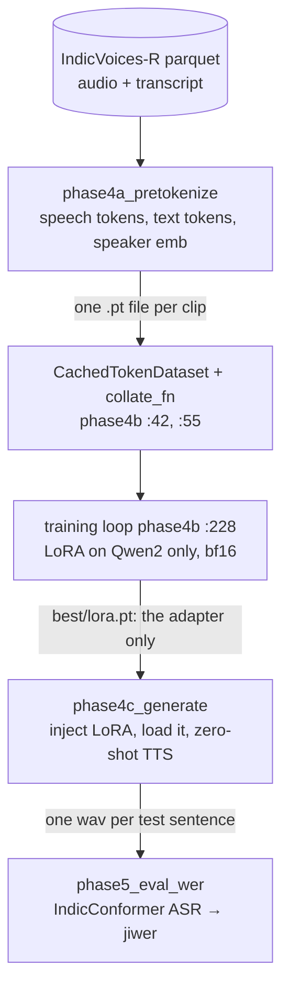
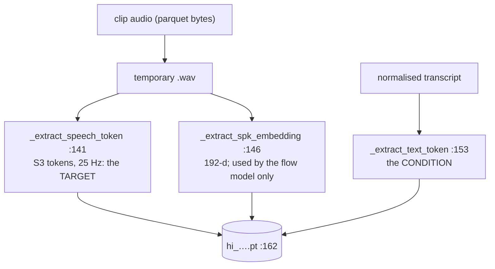
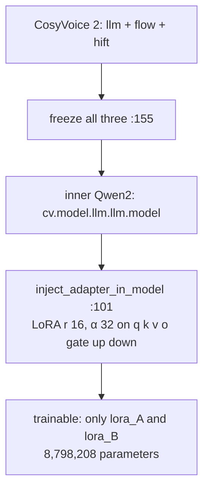
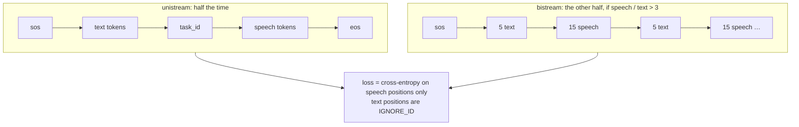
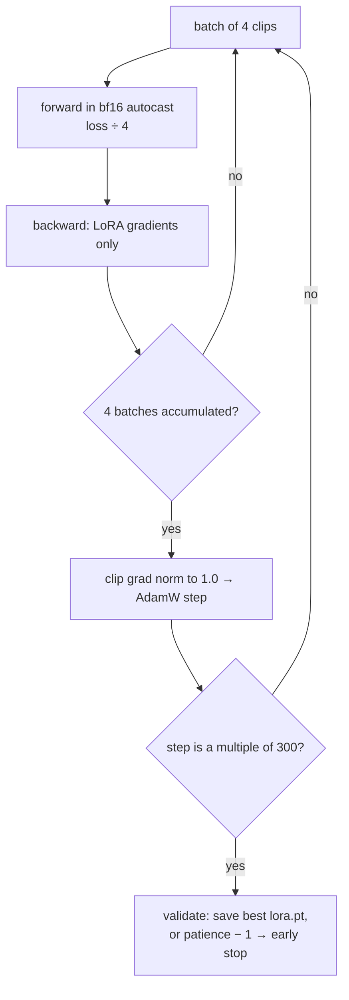
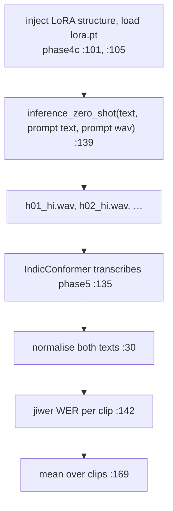

# Day 8 (Sun Nov 15): CosyVoice Indic LoRA

Part of [[Interview plan (Nov 2026)]]. Repo `/data/jayavardhan/cosyvoice_rnd` (branch `main`). Data and checkpoints in
`/mnt/warm_storage/jayavardhan/cosy/` (`phase2`, `phase3`, `phase4`, `phase4_te`, `phase4_multi`, `phase4_cv3_*`). About 7 h.
Builds on [[Day 07 - Seminar and speech basics]] (the CosyVoice 2 pipeline). Project note: [[CosyVoice Indic LoRA (R&D)]].

**Code, explained:** the figures, the code to read and what each snippet does are in [[#Code, explained]], right after section B.

**There is no prep pack for this project yet.** This note is written from the code and training logs. The upstream
`cosyvoice/` package is Alibaba's code, not yours: skim it only. Your code is `scripts/`.

**Resume bullets (both resumes):**
- "Adapted CosyVoice 2 to Hindi and Telugu via LoRA fine-tuning on its Qwen2 LLM component (**9M params, 1.36%** of the base model, 17 MB), trained on **35 hours** of speech across **4 H200 GPUs** with BF16 precision."
- "Trained a single adapter jointly on Hindi and Telugu with strong results and **no catastrophic forgetting**."
- "Reduced Hindi WER from **1.99** in the zero-shot setting to **0.11** after LoRA adaptation."

**What the repo and logs show, and what to fix:**
- **9M / 1.36% is right.** The training log (`phase4_multi/checkpoints/training.log`) reports `trainable_params 8,798,208` of `647,972,675` = **1.358%**, at r = 16, α = 32. The denominator is the **whole CosyVoice 2** (LLM + flow + vocoder, `phase4b_train_lora.py:172-177`); against the 0.5B Qwen alone it is ~1.8%.
- **"Across 4 H200 GPUs" is not data-parallel training.** `phase4b_train_lora.py` has no DDP; its docstring runs it on one GPU (`CUDA_VISIBLE_DEVICES=4`). The GPUs ran **separate jobs in parallel** (Hindi, Telugu, joint; CV2 and CV3) and **parallel generation** (`generate_all_parallel.sh`). Say "trained on H200s, running the Hindi, Telugu and joint adapters as parallel single-GPU jobs". The old plan's "DDP" block is dropped.
- **WER 1.99 → 0.11: the result CSVs are not on the server.** `compile_results.py` reads `data/phase5_outputs/wer_*_all.csv`, and `data/` is missing from the repo and from `cosy/`. **Find the R&D presentation or those CSVs before Day 15** and check the numbers, the test set and how WER was averaged.
- **WER above 1 needs explaining** (see A3): it means the zero-shot model produced many *inserted* words. Say it before they ask.

**By tonight you can:**
- explain LoRA and compute 8,798,208 by hand;
- walk one Hindi clip from audio to the training loss;
- explain WER, why it can exceed 1, and how "no catastrophic forgetting" was tested;
- give honest answers on the multi-GPU claim and the missing WER files.

## Schedule

| # | Time | Kind | What |
|---|---|---|---|
| 0 | 15 min | recall | Day 7: the CosyVoice 2 pipeline, 25 Hz tokens, bitrates |
| 1 | 20 min | read | README "5-Day R&D Strategy"; the project note; the five phases (below) |
| 2 | 45 min | theory + maths | LoRA (A1) |
| 3 | 30 min | skim | Upstream CosyVoice: `cli/cosyvoice.py` → `cli/model.py` → `llm/llm.py` (class and method names) |
| 4 | 45 min | code | `phase4a_pretokenize.py` (B1) |
| — | lunch | | |
| 5 | 75 min | code | `phase4b_train_lora.py` (B2) |
| 6 | 30 min | theory | BF16 vs FP16; catastrophic forgetting; ASR-based evaluation (A2, A3) |
| 7 | 45 min | code | `phase4c_generate.py`, `phase5_eval_wer.py` (B3) |
| 8 | 30 min | skim | Phases 1–3: baseline, codec benchmark, the distillation attempt (B4) |
| 9 | 45 min | rebuild | A LoRA layer from scratch, and a WER function (C) |
| 10 | 20 min | trace | One clip through pretokenize → loss; the parameter count (D) |
| 11 | 40 min | practice | The questions (E) |

**The five phases** (README; project note):
1. Baseline: zero-shot CosyVoice on Hindi (`step1_run_hindi_baseline.py`).
2. Benchmark neural codecs on Indic audio (`phase2_codec_benchmark.py`).
3. Try distilling mHuBERT-147 semantics into WavTokenizer (`phase3_*`). An attempt; know how it ended.
4. LoRA fine-tune the CosyVoice 2 LLM: pretokenize (4a), train (4b), generate (4c).
5. Evaluate with IndicConformer ASR WER (`phase5_eval_wer.py`).

**Data:** AI4Bharat IndicVoices-R, 18 h Hindi + 17 h Telugu = 35 h (14,662 clips) (project note).

## A. Theory

### A1. LoRA (block 2, 45 min)

**Read:** Hu et al., *LoRA* (2021), §1, §4 (method) and §7.1–7.2 (which weights, what rank). About 35 min.
**Optional:** Sebastian Raschka's blog post *"Practical Tips for Finetuning LLMs Using LoRA"*.
- Freeze `W` (d_out × d_in). Learn `ΔW = B·A`, with `A` (r × d_in) and `B` (d_out × r). Output = `Wx + (α/r)·BAx`.
- `B` starts at zero, so training starts exactly from the base model.
- Parameters per adapted matrix = `r·(d_in + d_out)`.
- **Your config:** r = 16, α = 32 (scale 2), dropout 0.05, on **all seven** projections: q, k, v, o, gate, up, down (`phase4b_train_lora.py:101-107`).

**Compute 8,798,208 by hand** (Qwen2.5-0.5B: 24 layers, hidden 896, MLP 4864, 2 KV heads × 64 = 128):
- q: 16·(896+896) = 28,672; o: 28,672; k: 16·(896+128) = 16,384; v: 16,384;
- gate: 16·(896+4864) = 92,160; up: 92,160; down: 92,160;
- per layer = 366,592; × 24 layers = **8,798,208**. ✓
- In bf16 that's 8.8M × 2 B ≈ **17.6 MB**, the "17 MB" on resume 5.

### A2. BF16 and forgetting (block 6, first 15 min)

- **BF16** keeps FP32's 8 exponent bits (same range) and has only 7 mantissa bits. FP16 has 5 exponent bits, so it needs loss scaling to avoid underflow. BF16 doesn't. Your training uses `torch.autocast(..., dtype=torch.bfloat16)` (`phase4b_train_lora.py:235`).
- **Catastrophic forgetting:** fine-tuning on new data degrades old skills. LoRA limits it, because the base weights never change and the adapter is small. **How you tested it:** look at `generate_crosslingual_parallel.sh` and `compile_results.py`, and write down which languages and conditions were scored with the adapter on. If no base-language (English or Chinese) score with the adapter exists, say "no forgetting on the languages I tested".

### A3. Evaluating TTS with ASR (block 6, last 15 min)

- **WER = (S + D + I) / N**: substitutions, deletions and insertions over the number of reference words.
- **It can exceed 1**, because insertions are unbounded. A zero-shot model reading Hindi it doesn't know can babble long, wrong speech, which the ASR transcribes as many extra words. So **1.99 means "mostly garbage, much longer than the reference"**, not a bug.
- Your ASR judge is **AI4Bharat IndicConformer** (`phase5_eval_wer.py:40`), with Hindi text normalisation (`:30`) and `jiwer` (`:111`). The reported WER is the **mean of per-clip WERs** (`:169`), not a corpus WER, so a few babbling clips can pull the mean above 1.
- The ASR has its own error rate on *real* Hindi speech. That floor bounds how low TTS WER can go.

## B. Code

### B1. Pretokenize (block 4, 45 min, deep)

`scripts/phase4a_pretokenize.py` (204 lines). It caches `(text tokens, speech tokens, speaker embedding)` per clip, so training never runs the frozen tokenisers.
- 46 `main`; 80 the CosyVoice frontend;
- **141 `_extract_speech_token`**: the S3 speech tokens (25 Hz FSQ, Day 7);
- **146 `_extract_spk_embedding`**: the speaker embedding. It's cached, but the CosyVoice 2 LLM's loss never reads it; the flow model uses it at synthesis;
- **153 `_extract_text_token`**: from the normalised transcript (152);
- 166–172: what's written to the cache and the manifest.

### B2. Train (block 5, 75 min, deep)

`scripts/phase4b_train_lora.py` (307 lines):
- 42 `CachedTokenDataset`; **55 `collate_fn`**: pads speech tokens and keeps true lengths (68–84). Why do lengths matter for the loss?
- **96 `apply_lora_to_qwen`**: `inject_adapter_in_model`, not `get_peft_model`. Why? (*Keeps the original class, so CosyVoice's hard-coded `self.llm.model.model.embed_tokens` path still works; docstring 97–98.*)
- 156: the flow-matching model and the HiFT vocoder are frozen. **Only the LLM gets adapters.**
- 168–178: apply LoRA, log the trainable count.
- 198: AdamW, lr 2e-4, weight decay 0.01. 235–240: bf16 autocast, gradient accumulation (batch 4 × accum 4 = 16).
- 253–283: validation every 300 steps, keep the best, early stopping after 4 non-improving checks, and a time budget (`--hours-budget`).
- Which loss is it? It comes from CosyVoice's `Qwen2LM.forward` (`out["loss"]`, 237): next-token cross-entropy on the **speech tokens**, conditioned on text and speaker. Confirm in `cosyvoice/llm/llm.py`.

### B3. Generate and evaluate (block 7, 45 min, deep)

- `phase4c_generate.py` (176): 39 apply LoRA again; **52 `load_lora_weights`** (only the adapter tensors are saved, so `lora.pt` is small); 139 `cv.inference_zero_shot` with a prompt wav and prompt text (the voice to clone).
- `phase5_eval_wer.py` (179): 40 IndicConformer; 30 normalisation; 111–142 per-clip WER and CER; 167 aggregation per label.

### B4. Phases 1–3 (block 8, 30 min, skim)

`step1_run_hindi_baseline.py`, `phase2_codec_benchmark.py` (533), `phase3_prepare_data.py`, `phase3_train_codec.py` (397), `compile_results.py`.
For each, write one line: what question did it answer, and what was the answer? For phase 3, the logs are in
`cosy/phase3/checkpoints*/training.log` (runs `lam05`, `lam10`, `v2`). Why did you move from codec work to LoRA on the LLM?

## Code, explained

Read this **with the files open**. It starts with a picture of the whole day and **the flow, step by step** (one concrete input followed through every function). Then each part has its own figure, the exact code (copied from the repo at the commit named below, so the line numbers match) and what that code does.

Repo `/data/jayavardhan/cosyvoice_rnd` (`0bb4e20`). Your code is `scripts/`;
`cosyvoice/` is Alibaba's upstream package (one function from it is here because your loss comes from it).



### The flow, step by step

Follow **one Hindi clip**: 4 seconds of audio with a transcript of about 20 text tokens.

1. **Pretokenize** (`phase4a_pretokenize.py:140–169`): the audio becomes **100 S3 speech tokens** (25 Hz × 4 s), the transcript becomes ~20 text tokens, and a 192-d speaker embedding is extracted. All three are saved in one `.pt` file.
2. **Batch** (`phase4b_train_lora.py:66–89`): 4 clips are padded to the longest, and the true lengths are kept.
3. **Build the sequence** (upstream `Qwen2LM.forward` → `prepare_lm_input_target`, `cosyvoice/llm/llm.py:318–343`):
   - half the time (unistream): `[sos, 20 text, task_id, 100 speech]` = 122 inputs;
   - the other half (bistream): text and speech interleaved 5 : 15.
4. **Targets:** `IGNORE_ID` for the first 21 positions (sos + text), then the 100 speech tokens and `eos`. So the loss is cross-entropy on **101 positions**: given the text, predict each next speech token (`llm.py:400–405`).
5. **Backward:** the loss is divided by 4 (gradient accumulation), and only the LoRA `A`/`B` matrices get gradients. Every 4 batches: clip the gradient norm to 1.0, AdamW step (`phase4b:235–250`).
6. **Every 300 steps:** validate; on a new best, save only the trainable tensors to `best/lora.pt` (`:267–278`).
7. **Inference** (`phase4c_generate.py`): rebuild the LoRA structure, copy in `lora.pt`, call `inference_zero_shot(text, prompt text, prompt wav)` → a wav.
8. **Score** (`phase5_eval_wer.py`): IndicConformer transcribes the wav, both texts are normalised, `jiwer` gives this clip's WER, and the report averages over clips.

---

### 1. Pretokenize once, so training never runs the frozen tokenisers



`scripts/phase4a_pretokenize.py:140–169`
```python
try:
    tok_ret = fe._extract_speech_token(tmp_path)
    speech_tokens = tok_ret[0] if isinstance(tok_ret, tuple) else tok_ret
    if speech_tokens.dim() == 2:
        speech_tokens = speech_tokens.squeeze(0)

    spk_ret = fe._extract_spk_embedding(tmp_path)
    spk_emb = spk_ret[0] if isinstance(spk_ret, tuple) else spk_ret
    if spk_emb.dim() == 2:
        spk_emb = spk_emb.squeeze(0)

    # Also pre-tokenize text using CV's tokenizer
    text = str(row["normalized"]).strip()
    text_tok_ret = fe._extract_text_token(text)
    text_tokens = text_tok_ret[0] if isinstance(text_tok_ret, tuple) else text_tok_ret
    if text_tokens.dim() == 2:
        text_tokens = text_tokens.squeeze(0)
finally:
    Path(tmp_path).unlink(missing_ok=True)

duration = float(row["duration"])

torch.save({
    "id": cid,
    "text": text,
    "text_tokens": text_tokens.cpu().to(torch.long),
    "speech_tokens": speech_tokens.cpu().to(torch.long),
    "spk_emb": spk_emb.cpu().to(torch.float32),
    "duration_s": duration,
}, cache_path)
```

- For each clip, CosyVoice's own frontend gives three things: **S3 speech tokens** (25 Hz, the training *target*), the **text tokens** (the *condition*), and a **speaker embedding**.
- Note: the CosyVoice 2 LLM's `forward` (section 3) never reads the speaker embedding; it's used by the flow model at synthesis time. It's cached here because the batch format carries it, not because the LoRA loss uses it.
- Skip if the cache file exists (line 126), so an interrupted run resumes.

---

### 2. Batching and LoRA injection



`scripts/phase4b_train_lora.py:66–89`
```python
B = len(items)
text_lens = [it["text_tokens"].shape[-1] for it in items]
speech_lens = [it["speech_tokens"].shape[-1] for it in items]
L_text = max(text_lens)
L_speech = max(speech_lens)

text_token = torch.zeros(B, L_text, dtype=torch.long)
speech_token = torch.zeros(B, L_speech, dtype=torch.long)
for i, it in enumerate(items):
    t = it["text_tokens"].to(torch.long)
    s = it["speech_tokens"].to(torch.long)
    text_token[i, :t.shape[-1]] = t
    speech_token[i, :s.shape[-1]] = s

return {
    "text_token": text_token,
    "text_token_len": torch.tensor(text_lens, dtype=torch.int32),
    "speech_token": speech_token,
    "speech_token_len": torch.tensor(speech_lens, dtype=torch.int32),
    "embedding": torch.stack([it["spk_emb"].to(torch.float32) for it in items], dim=0),
    # CV3-only keys; harmless for CV2 (its forward only reads what it needs)
    "instruct_token": torch.zeros(B, 0, dtype=torch.long),
    "instruct_token_len": torch.zeros(B, dtype=torch.int32),
}
```

- Pad text and speech tokens to the longest in the batch, and pass the **true lengths**. Upstream unpads with them, so padding never enters the loss.

`scripts/phase4b_train_lora.py:155–169`
```python
# ---- Freeze EVERYTHING (llm + flow + hift) ----
for sub in (cv.model.llm, cv.model.flow, cv.model.hift):
    for p in sub.parameters():
        p.requires_grad = False

# ---- Apply LoRA only to the inner Qwen2ForCausalLM ----
# Both CV2 and CV3 have cv.model.llm.llm.model as the inner Qwen2ForCausalLM
# (CV3 just inherits from Qwen2LM with extra forward logic). Detect by class name.
cv_version = "cv3" if "CosyVoice3" in type(cv.model.llm).__name__ else "cv2"
inner_qwen = cv.model.llm.llm.model
log({"event": "cv_version_detected", "cv_version": cv_version,
     "llm_class": type(cv.model.llm).__name__})

lora_qwen = apply_lora_to_qwen(inner_qwen, args.lora_r, args.lora_alpha, args.lora_dropout)
cv.model.llm.llm.model = lora_qwen
```

`scripts/phase4b_train_lora.py:101–108`
```python
config = LoraConfig(
    r=r,
    lora_alpha=alpha,
    lora_dropout=dropout,
    target_modules=["q_proj", "k_proj", "v_proj", "o_proj",
                    "gate_proj", "up_proj", "down_proj"],
    bias="none",
)
```

- **Freeze everything** (LLM, flow, vocoder), then inject LoRA adapters into all seven projections of the inner Qwen2. `inject_adapter_in_model` marks only the new A and B matrices as trainable.
- `inject_adapter_in_model` instead of `get_peft_model`: it keeps the original module classes, so CosyVoice's hard-coded attribute paths (`self.llm.model.model.embed_tokens`) still resolve.

`scripts/phase4b_train_lora.py:172–181`
```python
def all_params():
    for sub in (cv.model.llm, cv.model.flow, cv.model.hift):
        yield from sub.parameters()

n_trainable = sum(p.numel() for p in all_params() if p.requires_grad)
n_total     = sum(p.numel() for p in all_params())
log({"event": "lora_applied",
     "trainable_params": n_trainable,
     "total_params": n_total,
     "trainable_pct": round(100 * n_trainable / n_total, 3)})
```

- `n_total` sums **LLM + flow + vocoder**. So 8,798,208 / 647,972,675 = 1.36% is the adapter's share of **all of CosyVoice 2**, not of the 0.5B Qwen alone (against Qwen's ~494M it would be ~1.8%). Say "1.36% of the full CosyVoice 2 model".

---

### 3. What the loss actually is (upstream `Qwen2LM`)



`cosyvoice/llm/llm.py:341–343`
```python
else:
    this_lm_target = torch.tensor([IGNORE_ID] * (1 + instruct_token_len[i] + text_token_len[i]) + speech_token[i].tolist() + [self.eos_token])
    this_lm_input = torch.concat([sos_emb.squeeze(dim=0), instruct_token_emb[i], text_token_emb[i], task_id_emb.squeeze(dim=0), speech_token_emb[i]], dim=0)
```

`cosyvoice/llm/llm.py:318–331`
```python
if random.random() < 0.5 and speech_token_len[i] / text_token_len[i] > self.mix_ratio[1] / self.mix_ratio[0]:
    this_lm_target, this_lm_input = [IGNORE_ID], [sos_emb.squeeze(dim=0)]
    this_lm_target += [IGNORE_ID] * instruct_token_len[i]
    this_lm_input.append(instruct_token_emb[i])
    for j in range(((text_token_len[i] + 1) / self.mix_ratio[0]).ceil().int().item()):
        this_text_token = text_token[i][j * self.mix_ratio[0]: (j + 1) * self.mix_ratio[0]].tolist()
        this_speech_token = speech_token[i][j * self.mix_ratio[1]: (j + 1) * self.mix_ratio[1]].tolist()
        if len(this_text_token) == self.mix_ratio[0]:
            assert len(this_speech_token) == self.mix_ratio[1]
            this_lm_target += [IGNORE_ID] * (self.mix_ratio[0] - 1)
            this_lm_target += this_speech_token
            this_lm_target.append(self.fill_token)
            this_lm_input.append(text_token_emb[i][j * self.mix_ratio[0]: (j + 1) * self.mix_ratio[0]])
            this_lm_input.append(speech_token_emb[i][j * self.mix_ratio[1]: (j + 1) * self.mix_ratio[1]])
```

`cosyvoice/llm/llm.py:400–405`
```python
# 4. run lm forward
lm_output, lm_output_mask = self.llm(lm_input, lm_input_len.to(device))
logits = self.llm_decoder(lm_output)
loss = self.criterion_ce(logits, lm_target.to(device))
acc = th_accuracy(logits.view(-1, self.llm_decoder.out_features), lm_target, ignore_label=IGNORE_ID)
return {'loss': loss, 'acc': acc}
```

- The input is `[sos, text…, task_id, speech…]`. The **target** is `IGNORE_ID` for every text position and the next speech token (then `eos`) for every speech position. So the model is trained to **predict speech tokens given the text**: next-token cross-entropy, label-smoothed.
- Half the time the sequence is **interleaved 5 text : 15 speech**. That's the streaming mode (Day 7): the model learns to start speaking before all the text has arrived.
- Your LoRA therefore learns *which S3 tokens Hindi/Telugu text should produce*. The voice and the rendering stay with the frozen flow model and vocoder.

---

### 4. The training loop



`scripts/phase4b_train_lora.py:235–250`
```python
with torch.autocast(device_type="cuda", dtype=torch.bfloat16):
    out = cv.model.llm(batch, DEVICE)
    loss = out["loss"] if isinstance(out, dict) else out
    loss = loss / args.grad_accum

loss.backward()
accum += 1

if accum >= args.grad_accum:
    torch.nn.utils.clip_grad_norm_(
        [p for p in cv.model.llm.parameters() if p.requires_grad],
        max_norm=1.0,
    )
    opt.step()
    opt.zero_grad()
    accum = 0
```

- **bf16 autocast:** the forward runs in bfloat16, which has FP32's exponent range, so no loss scaler is needed (FP16 would need one).
- **Gradient accumulation:** divide the loss by `grad_accum` and step once every 4 batches. Batch 4 × 4 = an effective batch of 16 clips.
- **Clip the gradient norm to 1.0** over the LoRA parameters only.

`scripts/phase4b_train_lora.py:267–288`
```python
if val_loss < best_val:
    best_val = val_loss
    patience_left = args.early_stop_patience   # reset
    save_dir = args.ckpt_dir / "best"
    save_dir.mkdir(parents=True, exist_ok=True)
    lora_state = {n: p.detach().cpu()
                  for n, p in cv.model.llm.named_parameters()
                  if p.requires_grad}
    torch.save(lora_state, save_dir / "lora.pt")
    log({"event": "saved_best", "step": step,
         "val_loss": val_loss, "path": str(save_dir),
         "n_params_saved": len(lora_state)})
else:
    patience_left -= 1
    log({"event": "patience", "step": step,
         "patience_left": patience_left,
         "best_val": best_val, "current_val": val_loss})
    if patience_left <= 0:
        log({"event": "early_stop", "step": step,
             "best_val": best_val})
        early_stopped = True
        break
```

- Validate every 300 optimiser steps. On a new best, save **only** the trainable tensors (`requires_grad`), so `lora.pt` holds just the adapter (~17 MB in bf16). After 4 checks without improvement, stop early. A wall-clock budget (`--hours-budget`) also bounds the run.
- This is **one process on one GPU**: no `torch.distributed` anywhere. The 4 H200s ran separate jobs (Hindi, Telugu, joint) at the same time.

---

### 5. Generate and score



`scripts/phase4c_generate.py:59–68`
```python
own_state = dict(cv.model.llm.named_parameters())
loaded = 0
skipped = []
for name, tensor in state.items():
    if name in own_state and own_state[name].shape == tensor.shape:
        own_state[name].data.copy_(tensor.to(own_state[name].device))
        loaded += 1
    else:
        skipped.append(name)
return loaded, skipped
```

- Rebuild the same LoRA structure, then copy in the saved tensors by name, checking shapes. `skipped` would reveal a rank or target-module mismatch between training and inference.

`scripts/phase4c_generate.py:139–141`
```python
chunks = list(cv.inference_zero_shot(
    text, effective_prompt, args.prompt_wav, stream=False,
))
```

- **Zero-shot synthesis:** the text plus a prompt wav and its transcript. The prompt supplies the voice to clone.

`scripts/phase5_eval_wer.py:138–145`
```python
for sid, cat, ref, hyp in zip(ids, cats, refs, hyps):
    ref_n = normalize_hindi(ref)
    hyp_n = normalize_hindi(hyp)
    try:
        w = wer(ref_n, hyp_n)
        c = cer(ref_n, hyp_n)
    except ValueError:
        w, c = 1.0, 1.0
```

`scripts/phase5_eval_wer.py:166–169`
```python
df = pd.DataFrame(all_rows)
for label in df["label"].unique():
    sub = df[df["label"] == label]
    print(f"{label:<20} {len(sub):>4} {sub['wer'].mean():>6.3f} {sub['cer'].mean():>6.3f}")
```

- IndicConformer transcribes each generated wav. Both reference and hypothesis are normalised (whitespace, punctuation, the danda `।`), then `jiwer` computes per-clip WER.
- **The reported WER is the mean of per-clip WERs** (line 169), not one corpus-level WER. A few babbling clips with WER ≫ 1 (many inserted words) can pull the mean to 1.99. Say this when you explain "WER above 1".

**Check yourself:** a reference of 4 words; the hypothesis has 1 substitution and 6 inserted words. What's the clip's WER? (*(1 + 0 + 6) / 4 = 1.75.*)

## C. Rebuild it yourself (block 9, 45 min)

1. **LoRA in PyTorch, about 30 lines:** `class LoRALinear(nn.Module)` wrapping a frozen `nn.Linear`, with `A` (Kaiming init), `B` (zeros), scale α/r and dropout. Check that at init the output equals the base layer's exactly. Count trainable parameters for one Qwen2.5-0.5B layer: you should get 366,592.
2. **Merge:** write `merge()` that folds `W + (α/r)·BA` into the weight. Check the merged layer gives the same output. (This is why LoRA adds no inference latency.)
3. **WER, about 20 lines:** word-level Levenshtein distance returning S, D and I. Make a case where WER > 1 (reference 3 words, hypothesis 8 wrong words).

## D. Trace (block 10, 20 min)

1. One Hindi clip, 4 s long, with a 12-word transcript: how many speech tokens at 25 Hz? What three things does pretokenize cache for it?
2. What does the LLM see as input and as target during training? Which parameters get gradients?
3. Batch 4 × accumulation 4: how many clips per optimiser step?
4. Redo the 8,798,208 count without looking.

## E. Questions

1. Give the 60-second pitch: problem, approach, result.
2. Why LoRA on the LLM, and not on the flow-matching model or the vocoder?
3. Explain LoRA. What do r and α do? Why initialise B to zero?
4. Compute the trainable parameter count.
5. Why r = 16 and all seven projections? (*Not documented beyond the config; give the LoRA paper's reasoning and say "reconstructed".*)
6. Your resume says 4 H200s. Was it distributed training? (*No: parallel single-GPU jobs. Say it plainly.*)
7. Why BF16 and not FP16?
8. What is WER? How can it be 1.99?
9. How did you test for catastrophic forgetting?
10. One adapter for Hindi and Telugu: why not two? What did joint training cost or gain?
11. Why did the codec and distillation work (phases 2–3) not make it into the final system?
12. Hostile: "Your WER is computed by another model. How do you know it measures speech quality?" (*It measures intelligibility only; the ASR's own error floor; voice similarity and naturalness need SIM or MOS, which you didn't run, unless the presentation says otherwise.*)

## My notes and fumbles

- 
