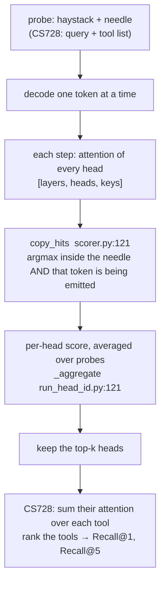
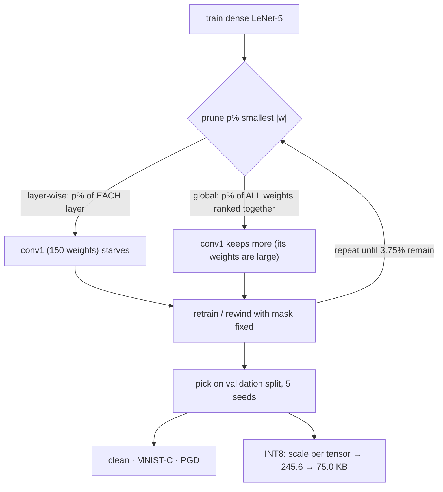

# Day 9 (Mon Nov 16): CS728 tool retrieval, and LeNet-5 compression

Part of [[Interview plan (Nov 2026)]]. Two course projects, half a day each. About 7 h.

**Code, explained:** the figures, the code to read and what each snippet does are in [[#Code, explained]], right after section B.

> [!warning] Your code is not on the server yet
> The plan asked you to copy the CS728 and LeNet-5 code and reports into
> `/data/jayavardhan/projects/interview_materials/{cs728,lenet}/`. As of Nov 10 neither folder exists, and there is
> no prep pack. **Copy them before Day 9.** Until then the code blocks (B1, B2) below are a reading checklist, not line
> numbers. Tell Claude when they're copied; it can then add line numbers and write a prep pack the evening before.
> Until then, use `LongContext_RAG/heads/` as the worked example for retrieval heads (it implements the same score).

**Resume bullets (resume 4):**
- CS728: "Improved zero-shot tool retrieval by identifying the top 10 retrieval-specialized attention heads via a **Hit Count** strategy, increasing **Recall@1 from 1.3% to 40.7%** and **Recall@5 from 25.5% to 66.9%**."
- CS728: "Mitigated the "lost-in-the-middle" effect by selectively aggregating retrieval-specialized heads across **32 heads and 3 layers**, improving retrieval without fine-tuning."
- LeNet-5: "Compressed LeNet-5 to **3.75% of weights** via iterative magnitude pruning, retaining **98.52%** clean accuracy and **69.83%** MNIST-C accuracy, selected only on a held-out validation split across **5 seeds**."
- LeNet-5: "Diagnosed a **7× larger corruption loss** under layer-wise pruning (**3.89 pp** on MNIST-C) traced to a starved conv1 layer; global pruning at matched sparsity closed the gap to **0.13 pp (p = 0.83)**, a **3.76 pp** gain."
- LeNet-5: "Improved PGD robustness from **51.98% to 82.18%** through iterative magnitude pruning, while reducing model size **3.28×** (245.6 KB to 75.0 KB) via INT8 quantization, at a cost of just **0.17 pp** clean accuracy."

**Check before you defend (from the bullets alone):**
- "Recall@1 1.3%" is the baseline: what was it? (Plain full attention? A random head? An embedding retriever?) You need its exact definition.
- "32 heads and 3 layers" reads oddly. Was it 32 heads *per layer* over 3 layers, or 32 heads in total? Fix the wording from your report.
- 245.6 KB / 75.0 KB = **3.27×**, not 3.28×. A float32 → int8 change alone is 4×; the gap is the scales, biases and any unquantised layers. Know which.
- "Improved PGD robustness through pruning": state the attack (ε, steps, norm) and whether the gain survives a stronger attack. A large jump from pruning alone can be **gradient masking**. Expect this hostile question.

**By tonight you can:**
- explain retrieval heads, Hit Count selection and Recall@k, and "lost in the middle";
- explain iterative magnitude pruning, global vs layer-wise, and the starved-conv1 diagnosis;
- explain PGD, INT8 quantisation and the p = 0.83 test;
- say each resume number with its setup.

## Schedule

| # | Time | Kind | What |
|---|---|---|---|
| 0 | 15 min | recall | Day 8: LoRA, the 8.8M count, WER > 1 |
| 1 | 60 min | theory | Retrieval heads, lost in the middle, Recall@k (A1) |
| 2 | 30 min | code | Worked example: `LongContext_RAG/heads/scorer.py` (B0) |
| 3 | 60 min | code | Your CS728 code (B1) |
| 4 | 30 min | practice | CS728 trace and questions (D1, E1) |
| — | lunch | | |
| 5 | 60 min | theory | Pruning, the lottery ticket, MNIST-C, PGD, INT8 (A2) |
| 6 | 75 min | code | Your LeNet-5 code (B2) |
| 7 | 45 min | rebuild | Magnitude pruning on a tiny MLP (C) |
| 8 | 45 min | practice | LeNet trace and questions (D2, E2) |

## A. Theory

### A1. Retrieval heads (block 1, 60 min)

**Read:**
- Wu et al., *"Retrieval Head Mechanistically Explains Long-Context Factuality"* (2024): §1–3. The retrieval score: a head "hits" at a decode step when its attention argmax lands on the context token being copied. About 30 min.
- Liu et al., *"Lost in the Middle"* (2023): §1–2 and Figure 1 (the U-shaped accuracy vs position curve). About 15 min.

**Concepts:**
- A few heads (under 5%) do most of the copying from long context. They are sparse, universal across tasks and present in base models.
- **Hit Count selection:** run probe queries, count per head how often its top attention lands on the correct item, keep the top-k heads.
- **Using heads as a retriever:** for a query, sum the selected heads' attention mass over each tool's description, and rank tools by it. No training.
- **Recall@k:** the fraction of queries whose correct tool is in the top k. Recall@1 = top-1 accuracy.
- **Lost in the middle:** models use information at the start and end of the context best. Aggregating heads that attend by content rather than position flattens the U curve.

### A2. Compression and robustness (block 5, 60 min)

**Read:**
- Frankle & Carbin, *"The Lottery Ticket Hypothesis"* (2019), §1–2 (iterative magnitude pruning with rewinding). About 20 min.
- Han et al., *"Learning both Weights and Connections"* (2015), §3 (prune, retrain, repeat). About 10 min.
- Madry et al., *"Towards Deep Learning Models Resistant to Adversarial Attacks"* (2018), §2 (the PGD attack). About 15 min.
- Skim: Mu & Gilmer, *MNIST-C* (2019), the list of 15 corruptions.

**Concepts:**
- **Iterative magnitude pruning (IMP):** train → remove the smallest-magnitude p% of weights → retrain (or rewind) → repeat. 3.75% remaining = 96.25% sparsity.
- **Layer-wise vs global:** layer-wise prunes the same fraction from every layer; global ranks all weights together. LeNet's **conv1 has very few weights** (6 filters × 5×5 = 150 + biases), so a uniform fraction strips it to almost nothing ("starved"). Global pruning keeps more of conv1, because its weights are large.
- **The p = 0.83:** a statistical test across 5 seeds says global pruning's corruption accuracy is not significantly different from the dense model's. Know which test (paired t-test?) and what p = 0.83 means: *no evidence of a difference*, not proof of equality.
- **PGD:** iterated gradient steps on the input, each projected back into an ε-ball. Robust accuracy = accuracy under that attack.
- **INT8 post-training quantisation:** map each tensor's float range onto 256 levels with a scale (and zero-point). 4× smaller weights, small accuracy loss.

## B. Code

### B0. Worked example (block 2, 30 min)

`/data/jayavardhan/projects/LongContext_RAG/heads/` implements the Wu et al. score:
- `scorer.py` docstring (1–14): a hit = attention argmax on the needle token being generated;
- **40 `RetrievalScorer`**, **121 `copy_hits`**;
- `capture.py` 20 `AttentionCapture`: how attention is read out per head;
- `run_head_id.py` 121 `_aggregate`: from per-instance hits to a ranked head list.

### B1. Your CS728 code (block 3, 60 min): fill in line numbers once copied

Find and trace: the probe set for Hit Count; the per-head hit counter; top-10 selection; the head-based scorer over tool descriptions; the Recall@1/@5 evaluation; the baseline behind "1.3%"; the layers chosen and why.

### B2. Your LeNet-5 code (block 6, 75 min): fill in line numbers once copied

Find and trace: the LeNet-5 definition; the IMP loop (per-round rate, rewind or fine-tune); layer-wise vs global masks; model selection on the validation split; the MNIST-C evaluation; the PGD attack (ε, steps, step size); INT8 quantisation and the size calculation; the 5-seed statistics.

## Code, explained

Read this **with the files open**. It starts with a picture of the whole day and **the flow, step by step** (one concrete input followed through every function). Then each part has its own figure, the exact code (copied from the repo at the commit named below, so the line numbers match) and what that code does.

> [!warning] Your CS728 and LeNet-5 code is not on the server
> Sections 1–2 read a **worked example**: your own `LongContext_RAG/heads/` (branch `main`, `bfb2ec9`), which scores
> retrieval heads the way Wu et al. do. It's the same idea as CS728's Hit Count. Section 3 gives the pruning pipeline
> as a figure. Once the course code is copied to `interview_materials/`, ask Claude to add its snippets here.



### The flow, step by step

One probe through the scorer (illustrative numbers). The haystack is 2,000 tokens; the needle "The secret code is
4721" sits at positions 500–507; the model answers "4721".

1. **Prefill** everything except the last prompt token (`scorer.py:74`). Then decode one token at a time, so each step's attention is a clean `[layers, heads, keys]` tensor (`:83–101`).
2. **The step that emits "47":** for every head at once, take the argmax over keys (`copy_hits`, `:138`).
   - Head (layer 14, head 3) points at position 505, which is inside the needle, and the token there is "47": a **hit**.
   - Head (layer 2, head 9) points at position 3, outside the needle: **no hit**.
3. **Coverage:** `covered` marks which needle positions each head copied (`:98–101`). Score = covered positions ÷ needle length (`:106`).
4. **Over many probes:** `_aggregate` averages the scores and computes copy-precision (hits ÷ steps where the emitted token was in the needle) (`run_head_id.py:129–142`). Rank the heads; keep the top k.
5. **CS728's version:** a probe = a query whose correct tool is known; a hit = the head's top attention lands on that tool's description. Keep the 10 heads with the most hits. At test time, sum those heads' attention over each tool's tokens and rank the tools. Recall@1 = the share of queries whose correct tool ranks first.

---

### 1. Catching a head in the act of copying

`heads/scorer.py:121–143`
```python
def copy_hits(
    attn: torch.Tensor,
    prompt_ids: torch.Tensor,
    generated_token: int,
    needle_start: int,
    needle_end: int,
) -> tuple[torch.Tensor, torch.Tensor]:
    """Which heads were caught copying `generated_token` out of the needle?

    A hit needs both halves of the rule: the head's attention argmax lands
    *inside* the needle span, and the token sitting at that position *is* the
    token being emitted. Attending to the needle while generating something else
    is not retrieval, and emitting a needle token while attending elsewhere is
    not retrieval either.

    Returns (argmax_index, hit_mask), both [layers, heads].
    """
    j = attn.argmax(dim=-1)
    in_span = (j >= needle_start) & (j < needle_end)
    # Positions past the prompt are freshly generated tokens; they can never be
    # in the needle span, so clamping only keeps the gather in bounds.
    tok_at_j = prompt_ids[j.clamp(max=prompt_ids.numel() - 1)]
    return j, in_span & (tok_at_j == generated_token)
```

- A head scores a **hit** at a decode step only if **both** hold: its attention argmax `j` is *inside* the needle, **and** the token at `j` is the token being generated. Attending to the needle while emitting something else isn't retrieval, and nor is emitting a needle token while looking elsewhere.
- All of this runs on `[layers, heads]` tensors at once: one `argmax` over keys, then two boolean masks.

`heads/scorer.py:83–101`
```python
cur = ids[:, -1:]
generated: list[int] = []
for _ in range(self.max_new_tokens):
    with self.capture.recording():
        out = self.model(input_ids=cur, past_key_values=cache, use_cache=True)
    attn = self.capture.stack()  # [layers, heads, keys]
    nxt = int(out.logits[0, -1].argmax())
    if nxt in self.eos_ids:
        break
    generated.append(nxt)
    if nxt in needle_tokens:
        copyable_steps += 1

    j, hit = copy_hits(attn, prompt_ids, nxt, ns, ne)
    hit_steps += hit.to(torch.int32)
    rel = (j - ns).clamp(0, klen - 1)
    covered |= torch.zeros_like(covered).scatter_(
        2, rel.unsqueeze(-1), hit.unsqueeze(-1)
    )
```

- The prompt is prefilled first, then tokens are generated **one at a time** so each step's attention is a clean `[layers, heads, keys]` row.
- `covered` marks which needle *positions* each head has copied. A head's score = covered positions / needle length (`|g_h| / |k|` in the paper).

---

### 2. From instance scores to a head ranking

`heads/run_head_id.py:129–142`
```python
n = len(results)
mean = [[total[l][h] / n for h in range(n_heads)] for l in range(n_layers)]

# Copy-precision, micro-averaged: of every decode step across the sweep where
# the emitted token was in the needle, how often did this head's argmax point
# at it? Unlike |g_h|/|k| this does not depend on how much of the needle the
# answer happens to cover, so needles whose answer is a short span are not
# penalised. Micro rather than macro so an instance with one copy step cannot
# swing the average.
copyable = sum(r.copyable_steps for r in results)
precision = [
    [(hits[l][h] / copyable if copyable else 0.0) for h in range(n_heads)]
    for l in range(n_layers)
]
```

- Average the per-instance scores over all probes, giving one number per (layer, head).
- **Copy-precision** (micro-averaged): over every step where the emitted token was in the needle, how often did this head point at it? Unlike the coverage score, it doesn't depend on how much of the needle the answer happens to use.

**How CS728's Hit Count maps onto this:** a probe = a query whose correct tool is known; a "hit" = the head's top attention lands on the correct tool's description; count hits per head, keep the **top 10**. At test time, rank tools by the summed attention of those 10 heads over each tool's tokens. Recall@k = the share of queries whose correct tool ranks in the top k.

**Check yourself:** 4 heads, 3 probes. Hits per head: H1 = 3, H2 = 0, H3 = 2, H4 = 3. With top-2 selection, which heads are kept? Then for one query the kept heads put attention mass `[0.1, 0.6, 0.3]` and `[0.2, 0.5, 0.3]` on tools A, B, C, and B is correct. Is it a Recall@1 hit? (*H1 and H4; summed mass [0.3, 1.1, 0.6], so B ranks first: yes.*)

---

### 3. LeNet-5 compression: the pipeline



*Illustration (not your code), the core of global magnitude pruning:*
```python
import torch
def global_masks(model, keep_frac):
    ws = [p for n, p in model.named_parameters() if n.endswith("weight")]
    allw = torch.cat([w.detach().abs().flatten() for w in ws])
    thresh = allw.kthvalue(int((1 - keep_frac) * allw.numel())).values   # one threshold for all layers
    return [(w.detach().abs() > thresh).float() for w in ws]
# layer-wise would compute `thresh` separately inside each layer instead
```

- **The diagnosis, in one sentence:** layer-wise pruning removes the same *fraction* from every layer, so conv1, which holds very few weights, is cut to almost nothing and the network loses its first feature detectors. That hurts corrupted inputs (MNIST-C) most. Global pruning ranks all weights together and leaves conv1 more.
- **INT8 arithmetic to check:** 245.6 / 75.0 = 3.27×. Pure float32 → int8 would be 4×; the gap is scales, biases and any layers left in float.

## C. Rebuild it yourself (block 7, 45 min)

In PyTorch, on MNIST (CPU is enough), about 80 lines:
1. Train a small MLP or LeNet-5 for 2 epochs.
2. Implement `prune(model, rate, scope="global" | "layer")` with masks applied after every optimiser step.
3. Run 5 rounds of 20% pruning each (0.8⁵ = 33% left). Print per-layer remaining weights for both scopes. Watch the smallest layer under layer-wise pruning.
4. Bonus: a 10-step PGD at ε = 0.1 (L∞) on 1,000 test images.

## D. Traces

**D1 (CS728).** 20 tools in a prompt, one query, 3 selected heads. Given each head's attention mass per tool (make up numbers), compute the ranking, then Recall@1 and Recall@5 for that query.

**D2 (LeNet).** Count LeNet-5's weights per layer (conv1, conv2, fc1, fc2, fc3). At 3.75% kept overall, how many weights does conv1 keep under layer-wise pruning? Under global pruning, could it keep more? Why?

## E. Questions

**E1. CS728**
1. What is a retrieval head? How did you find them?
2. Why does using heads beat the baseline so much at Recall@1 (1.3% → 40.7%)? What was the baseline?
3. What is "lost in the middle", and how did head aggregation help?
4. Why top 10 heads? What happens with 5 or 50?
5. Hostile: "40.7% Recall@1 is still low. Would you ship this over a trained retriever?"

**E2. LeNet-5**
1. Explain iterative magnitude pruning. Why iterative and not one-shot?
2. What was the starved-conv1 problem, and how did you find it?
3. What does p = 0.83 mean? Which test did you run?
4. Why does pruning raise PGD robustness? Could it be gradient masking? How would you check? (*A stronger or transfer attack; a black-box attack; check that loss rises with ε.*)
5. INT8: why 3.28× and not 4×?
6. "Selected only on a held-out validation split": why does that matter?

## My notes and fumbles

- 
