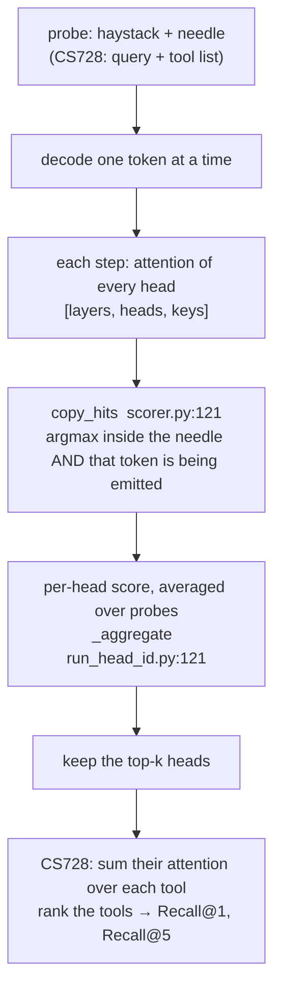
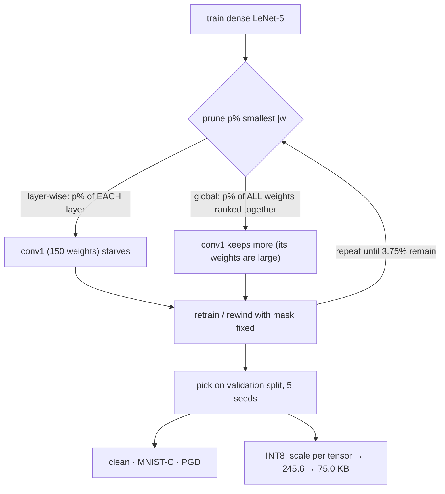

# Day 9 (Mon Nov 16): CS728 tool retrieval, and LeNet-5 compression

Part of [[Interview plan (Nov 2026)]]. Two course projects, half a day each. About 7 h.

**Code, explained:** the figures, the code to read and what each snippet does are in [[#Code, explained]], right after section B.

> [!warning] Your code is not on the server yet
> The plan asked you to copy the CS728 and LeNet-5 code and reports into
> `/data/jayavardhan/projects/interview_materials/{cs728,lenet}/`. As of Nov 10 neither folder exists, and there is
> no prep pack. **Copy them before Day 9.** Until then the code blocks (B1, B2) below are a reading checklist, not line
> numbers. Tell Claude when they're copied; it can then add line numbers and write a prep pack the evening before.
> Until then, use `LongContext_RAG/heads/` as the worked example for retrieval heads (it implements the same score).

**Resume bullets (resume 4):**
- CS728: "Improved zero-shot tool retrieval by identifying the top 10 retrieval-specialized attention heads via a **Hit Count** strategy, increasing **Recall@1 from 1.3% to 40.7%** and **Recall@5 from 25.5% to 66.9%**."
- CS728: "Mitigated the "lost-in-the-middle" effect by selectively aggregating retrieval-specialized heads across **32 heads and 3 layers**, improving retrieval without fine-tuning."
- LeNet-5: "Compressed LeNet-5 to **3.75% of weights** via iterative magnitude pruning, retaining **98.52%** clean accuracy and **69.83%** MNIST-C accuracy, selected only on a held-out validation split across **5 seeds**."
- LeNet-5: "Diagnosed a **7× larger corruption loss** under layer-wise pruning (**3.89 pp** on MNIST-C) traced to a starved conv1 layer; global pruning at matched sparsity closed the gap to **0.13 pp (p = 0.83)**, a **3.76 pp** gain."
- LeNet-5: "Improved PGD robustness from **51.98% to 82.18%** through iterative magnitude pruning, while reducing model size **3.28×** (245.6 KB to 75.0 KB) via INT8 quantization, at a cost of just **0.17 pp** clean accuracy."

**Check before you defend (from the bullets alone):**
- "Recall@1 1.3%" is the baseline: what was it? (Plain full attention? A random head? An embedding retriever?) You need its exact definition.
- "32 heads and 3 layers" reads oddly. Was it 32 heads *per layer* over 3 layers, or 32 heads in total? Fix the wording from your report.
- 245.6 KB / 75.0 KB = **3.27×**, not 3.28×. A float32 → int8 change alone is 4×; the gap is the scales, biases and any unquantised layers. Know which.
- "Improved PGD robustness through pruning": state the attack (ε, steps, norm) and whether the gain survives a stronger attack. A large jump from pruning alone can be **gradient masking**. Expect this hostile question.

**By tonight you can:**
- explain retrieval heads, Hit Count selection and Recall@k, and "lost in the middle";
- explain iterative magnitude pruning, global vs layer-wise, and the starved-conv1 diagnosis;
- explain PGD, INT8 quantisation and the p = 0.83 test;
- say each resume number with its setup.

## Schedule

| # | Time | Kind | What |
|---|---|---|---|
| 0 | 15 min | recall | Day 8: LoRA, the 8.8M count, WER > 1 |
| 1 | 60 min | theory | Retrieval heads, lost in the middle, Recall@k (A1) |
| 2 | 30 min | code | Worked example: `LongContext_RAG/heads/scorer.py` (B0) |
| 3 | 60 min | code | Your CS728 code (B1) |
| 4 | 30 min | practice | CS728 trace and questions (D1, E1) |
| — | lunch | | |
| 5 | 60 min | theory | Pruning, the lottery ticket, MNIST-C, PGD, INT8 (A2) |
| 6 | 75 min | code | Your LeNet-5 code (B2) |
| 7 | 45 min | rebuild | Magnitude pruning on a tiny MLP (C) |
| 8 | 45 min | practice | LeNet trace and questions (D2, E2) |

## A. Theory

### A1. Retrieval heads (block 1, 60 min)

**Read:**
- Wu et al., *"Retrieval Head Mechanistically Explains Long-Context Factuality"* (2024): §1–3. The retrieval score: a head "hits" at a decode step when its attention argmax lands on the context token being copied. About 30 min.
- Liu et al., *"Lost in the Middle"* (2023): §1–2 and Figure 1 (the U-shaped accuracy vs position curve). About 15 min.

**Concepts:**
- A few heads (under 5%) do most of the copying from long context. They are sparse, universal across tasks and present in base models.
- **Hit Count selection:** run probe queries, count per head how often its top attention lands on the correct item, keep the top-k heads.
- **Using heads as a retriever:** for a query, sum the selected heads' attention mass over each tool's description, and rank tools by it. No training.
- **Recall@k:** the fraction of queries whose correct tool is in the top k. Recall@1 = top-1 accuracy.
- **Lost in the middle:** models use information at the start and end of the context best. Aggregating heads that attend by content rather than position flattens the U curve.

### A2. Compression and robustness (block 5, 60 min)

**Read:**
- Frankle & Carbin, *"The Lottery Ticket Hypothesis"* (2019), §1–2 (iterative magnitude pruning with rewinding). About 20 min.
- Han et al., *"Learning both Weights and Connections"* (2015), §3 (prune, retrain, repeat). About 10 min.
- Madry et al., *"Towards Deep Learning Models Resistant to Adversarial Attacks"* (2018), §2 (the PGD attack). About 15 min.
- Skim: Mu & Gilmer, *MNIST-C* (2019), the list of 15 corruptions.

**Concepts:**
- **Iterative magnitude pruning (IMP):** train → remove the smallest-magnitude p% of weights → retrain (or rewind) → repeat. 3.75% remaining = 96.25% sparsity.
- **Layer-wise vs global:** layer-wise prunes the same fraction from every layer; global ranks all weights together. LeNet's **conv1 has very few weights** (6 filters × 5×5 = 150 + biases), so a uniform fraction strips it to almost nothing ("starved"). Global pruning keeps more of conv1, because its weights are large.
- **The p = 0.83:** a statistical test across 5 seeds says global pruning's corruption accuracy is not significantly different from the dense model's. Know which test (paired t-test?) and what p = 0.83 means: *no evidence of a difference*, not proof of equality.
- **PGD:** iterated gradient steps on the input, each projected back into an ε-ball. Robust accuracy = accuracy under that attack.
- **INT8 post-training quantisation:** map each tensor's float range onto 256 levels with a scale (and zero-point). 4× smaller weights, small accuracy loss.

## B. Code

### B0. Worked example (block 2, 30 min)

`/data/jayavardhan/projects/LongContext_RAG/heads/` implements the Wu et al. score:
- `scorer.py` docstring (1–14): a hit = attention argmax on the needle token being generated;
- **40 `RetrievalScorer`**, **121 `copy_hits`**;
- `capture.py` 20 `AttentionCapture`: how attention is read out per head;
- `run_head_id.py` 121 `_aggregate`: from per-instance hits to a ranked head list.

### B1. Your CS728 code (block 3, 60 min): fill in line numbers once copied

Find and trace: the probe set for Hit Count; the per-head hit counter; top-10 selection; the head-based scorer over tool descriptions; the Recall@1/@5 evaluation; the baseline behind "1.3%"; the layers chosen and why.

### B2. Your LeNet-5 code (block 6, 75 min): fill in line numbers once copied

Find and trace: the LeNet-5 definition; the IMP loop (per-round rate, rewind or fine-tune); layer-wise vs global masks; model selection on the validation split; the MNIST-C evaluation; the PGD attack (ε, steps, step size); INT8 quantisation and the size calculation; the 5-seed statistics.

## Code, explained

Read this **with the files open**. It starts with a picture of the whole day and **the flow, step by step** (one concrete input followed through every function). Then each part has its own figure, the exact code (copied from the repo at the commit named below, so the line numbers match) and what that code does.

> [!warning] Your CS728 and LeNet-5 code is not on the server
> Sections 1–2 read a **worked example**: your own `LongContext_RAG/heads/` (branch `main`, `bfb2ec9`), which scores
> retrieval heads the way Wu et al. do. It's the same idea as CS728's Hit Count. Section 3 gives the pruning pipeline
> as a figure. Once the course code is copied to `interview_materials/`, ask Claude to add its snippets here.



### The flow, step by step

One probe through the scorer (illustrative numbers). The haystack is 2,000 tokens; the needle "The secret code is
4721" sits at positions 500–507; the model answers "4721".

1. **Prefill** everything except the last prompt token (`scorer.py:74`). Then decode one token at a time, so each step's attention is a clean `[layers, heads, keys]` tensor (`:83–101`).
2. **The step that emits "47":** for every head at once, take the argmax over keys (`copy_hits`, `:138`).
   - Head (layer 14, head 3) points at position 505, which is inside the needle, and the token there is "47": a **hit**.
   - Head (layer 2, head 9) points at position 3, outside the needle: **no hit**.
3. **Coverage:** `covered` marks which needle positions each head copied (`:98–101`). Score = covered positions ÷ needle length (`:106`).
4. **Over many probes:** `_aggregate` averages the scores and computes copy-precision (hits ÷ steps where the emitted token was in the needle) (`run_head_id.py:129–142`). Rank the heads; keep the top k.
5. **CS728's version:** a probe = a query whose correct tool is known; a hit = the head's top attention lands on that tool's description. Keep the 10 heads with the most hits. At test time, sum those heads' attention over each tool's tokens and rank the tools. Recall@1 = the share of queries whose correct tool ranks first.

---

### 1. Catching a head in the act of copying

> [!tip] Concept from scratch: [[#4. Deep dive: retrieval heads, Hit Count and Recall@k, from scratch|retrieval heads, Hit Count and Recall@k from scratch (§4)]]

`heads/scorer.py:121–143`
```python
def copy_hits(
    attn: torch.Tensor,
    prompt_ids: torch.Tensor,
    generated_token: int,
    needle_start: int,
    needle_end: int,
) -> tuple[torch.Tensor, torch.Tensor]:
    """Which heads were caught copying `generated_token` out of the needle?

    A hit needs both halves of the rule: the head's attention argmax lands
    *inside* the needle span, and the token sitting at that position *is* the
    token being emitted. Attending to the needle while generating something else
    is not retrieval, and emitting a needle token while attending elsewhere is
    not retrieval either.

    Returns (argmax_index, hit_mask), both [layers, heads].
    """
    j = attn.argmax(dim=-1)
    in_span = (j >= needle_start) & (j < needle_end)
    # Positions past the prompt are freshly generated tokens; they can never be
    # in the needle span, so clamping only keeps the gather in bounds.
    tok_at_j = prompt_ids[j.clamp(max=prompt_ids.numel() - 1)]
    return j, in_span & (tok_at_j == generated_token)
```
> [!info] New functions in this code
> - `.argmax(dim=-1)`: the **index** of the largest value along an axis. `tensor([0.1, 2.1, 0.6]).argmax()` = 1. On logits it picks the most likely token (greedy decoding). [[Function glossary#x.argmax|→ examples and figure]]
> - `.clamp(min=..., max=...)`: clips each element into a range. `tensor([-4, 2, 12]).clamp(0, 9)` → `[0, 2, 9]`. `copy_hits` uses `clamp(max=len - 1)` so an index never runs past the end. [[Function glossary#x.clamp|→ examples]]
> - `.numel()`: the total number of elements. A `[3, 4]` tensor has 12. [[Function glossary#x.numel|→ examples]]

- A head scores a **hit** at a decode step only if **both** hold: its attention argmax `j` is *inside* the needle, **and** the token at `j` is the token being generated. Attending to the needle while emitting something else isn't retrieval, and nor is emitting a needle token while looking elsewhere.
- All of this runs on `[layers, heads]` tensors at once: one `argmax` over keys, then two boolean masks.

`heads/scorer.py:83–101`
```python
cur = ids[:, -1:]
generated: list[int] = []
for _ in range(self.max_new_tokens):
    with self.capture.recording():
        out = self.model(input_ids=cur, past_key_values=cache, use_cache=True)
    attn = self.capture.stack()  # [layers, heads, keys]
    nxt = int(out.logits[0, -1].argmax())
    if nxt in self.eos_ids:
        break
    generated.append(nxt)
    if nxt in needle_tokens:
        copyable_steps += 1

    j, hit = copy_hits(attn, prompt_ids, nxt, ns, ne)
    hit_steps += hit.to(torch.int32)
    rel = (j - ns).clamp(0, klen - 1)
    covered |= torch.zeros_like(covered).scatter_(
        2, rel.unsqueeze(-1), hit.unsqueeze(-1)
    )
```
> [!info] New functions in this code
> - `range(start, stop, step)`: the integers from `start` up to (not including) `stop`. `range(0, 10, 4)` gives 0, 4, 8. `range(3)` gives 0, 1, 2. [[Function glossary#range|→ examples]]
> - `int(x)`: converts to an integer, dropping the fraction. `int(3.9)` = 3. [[Function glossary#int|→ examples]]
> - `.append(x)`: adds `x` at the end of a list. `[1].append(2)` → `[1, 2]`. [[Function glossary#list.append|→ examples]]
> - `.to(dtype or device)`: converts a tensor's number type or moves it. `x.to(torch.float32)` makes a float32 copy (from bfloat16); `x.to('cuda')` moves it to the GPU. In Triton code, `.to(tl.float32)` converts a loaded value. [[Function glossary#x.to|→ examples and figure]]
> - `torch.zeros_like(t)`: zeros with the same shape, dtype and device as `t`. [[Function glossary#torch.zeros_like|→ examples]]
> - `.scatter_(dim, index, value)`: writes `value` at the positions given by `index`, in place. `zeros.scatter_(-1, argmax, 1.0)` makes a one-hot vector. [[Function glossary#x.scatter_|→ examples and figure]]
> - `.unsqueeze(d)`: inserts a new axis of size 1 at position `d`. A `[3]` tensor → `.unsqueeze(1)` → `[3, 1]` (a column); `.unsqueeze(0)` → `[1, 3]` (a row). Needed so tensors broadcast against each other. [[Function glossary#x.unsqueeze|→ examples and figure]]

- The prompt is prefilled first, then tokens are generated **one at a time** so each step's attention is a clean `[layers, heads, keys]` row.
- `covered` marks which needle *positions* each head has copied. A head's score = covered positions / needle length (`|g_h| / |k|` in the paper).

---

### 2. From instance scores to a head ranking

`heads/run_head_id.py:129–142`
```python
n = len(results)
mean = [[total[l][h] / n for h in range(n_heads)] for l in range(n_layers)]

# Copy-precision, micro-averaged: of every decode step across the sweep where
# the emitted token was in the needle, how often did this head's argmax point
# at it? Unlike |g_h|/|k| this does not depend on how much of the needle the
# answer happens to cover, so needles whose answer is a short span are not
# penalised. Micro rather than macro so an instance with one copy step cannot
# swing the average.
copyable = sum(r.copyable_steps for r in results)
precision = [
    [(hits[l][h] / copyable if copyable else 0.0) for h in range(n_heads)]
    for l in range(n_layers)
]
```
> [!info] New functions in this code
> - `len(xs)`: how many items. `len([7, 8, 9])` = 3. [[Function glossary#len|→ examples]]
> - `sum(xs)`: adds up the items. `sum([1, 2, 3])` = 6. [[Function glossary#sum|→ examples]]

- Average the per-instance scores over all probes, giving one number per (layer, head).
- **Copy-precision** (micro-averaged): over every step where the emitted token was in the needle, how often did this head point at it? Unlike the coverage score, it doesn't depend on how much of the needle the answer happens to use.

**How CS728's Hit Count maps onto this:** a probe = a query whose correct tool is known; a "hit" = the head's top attention lands on the correct tool's description; count hits per head, keep the **top 10**. At test time, rank tools by the summed attention of those 10 heads over each tool's tokens. Recall@k = the share of queries whose correct tool ranks in the top k.

**Check yourself:** 4 heads, 3 probes. Hits per head: H1 = 3, H2 = 0, H3 = 2, H4 = 3. With top-2 selection, which heads are kept? Then for one query the kept heads put attention mass `[0.1, 0.6, 0.3]` and `[0.2, 0.5, 0.3]` on tools A, B, C, and B is correct. Is it a Recall@1 hit? (*H1 and H4; summed mass [0.3, 1.1, 0.6], so B ranks first: yes.*)

---

### 3. LeNet-5 compression: the pipeline

> [!tip] Concept from scratch: [[#7. Deep dive: INT8 quantisation from scratch, and why 3.27× not 4×|INT8 quantisation, and why 3.27× (§7)]]

> [!tip] Concept from scratch: [[#6. Deep dive: PGD adversarial attacks from scratch|PGD attacks and gradient masking (§6)]]

> [!tip] Concept from scratch: [[#5. Deep dive: magnitude pruning, layer-wise vs global, from scratch|pruning, layer-wise vs global (§5)]]



*Illustration (not your code), the core of global magnitude pruning:*
```python
import torch
def global_masks(model, keep_frac):
    ws = [p for n, p in model.named_parameters() if n.endswith("weight")]
    allw = torch.cat([w.detach().abs().flatten() for w in ws])
    thresh = allw.kthvalue(int((1 - keep_frac) * allw.numel())).values   # one threshold for all layers
    return [(w.detach().abs() > thresh).float() for w in ws]
# layer-wise would compute `thresh` separately inside each layer instead
```
> [!info] New functions in this code
> - `.named_parameters()`: like `.parameters()` but yields `(name, tensor)` pairs, e.g. `('layers.0.self_attn.q_proj.lora_A.default.weight', tensor)`. Used to save and reload tensors by name. [[Function glossary#x.named_parameters|→ examples]]
> - `s.endswith(suffix)`: True if the string ends with `suffix`. `'conv1.weight'.endswith('weight')` → True; `'conv1.bias'` → False. [[Function glossary#x.endswith|→ examples]]
> - `torch.cat((a, b), dim=d)`: joins tensors **along an existing axis**. `torch.cat(([1, 2], [3, 4]), dim=-1)` → `[1, 2, 3, 4]`; on `[3, 2]` tensors with `dim=-1` the result is `[3, 4]`. [[Function glossary#torch.cat|→ examples and figure]]
> - `.abs()`: absolute value of every element: `tensor([-0.8, 0.1]).abs()` → `[0.8, 0.1]`. Magnitude pruning ranks weights by it. [[Function glossary#x.abs|→ examples]]
> - `.flatten()`: the same numbers as one 1-d tensor. A conv1 weight `[6, 1, 5, 5]` → `.flatten()` → `[150]`. [[Function glossary#x.flatten|→ examples]]
> - `.kthvalue(k)`: the k-th **smallest** value (and its index), counting from 1. `tensor([0.9, 0.1, 0.5, 0.3]).kthvalue(2).values` → 0.3. Used to find a pruning threshold. [[Function glossary#x.kthvalue|→ examples]]
> - `.float()`: a float32 copy of the tensor. [[Function glossary#x.float|→ examples]]

- **The diagnosis, in one sentence:** layer-wise pruning removes the same *fraction* from every layer, so conv1, which holds very few weights, is cut to almost nothing and the network loses its first feature detectors. That hurts corrupted inputs (MNIST-C) most. Global pruning ranks all weights together and leaves conv1 more.
- **INT8 arithmetic to check:** 245.6 / 75.0 = 3.27×. Pure float32 → int8 would be 4×; the gap is scales, biases and any layers left in float.

---

### 4. Deep dive: retrieval heads, Hit Count and Recall@k, from scratch

Sections 1–2 above walk `scorer.py` and `_aggregate`. This section builds the idea on a 10-token prompt and 4 heads,
so you can compute every tensor by hand. Order: what a head "looks at" → the copy rule → `copy_hits` line by line →
coverage across steps → copy-precision → how CS728 turns heads into a tool retriever → Recall@k and lost in the
middle → why attention is captured only at decode → questions → check.

> [!important] The one sentence to hold on to
> A retrieval head is one that, while the model writes a fact it read earlier, puts its **largest attention weight on
> exactly that token in the context**; count how often each head does this on probe questions, keep the best few, and
> their attention becomes a training-free retriever.

#### 4.1 What a head "looks at"

At every decode step, each attention head produces a row of weights over all previous positions, summing to 1 (Day 1
§5). The position with the **largest** weight (the argmax) is where that head is "looking" most. Llama-3.1-8B has 32
layers × 32 heads = **1,024** such rows per step.

#### 4.2 The copy rule

Wu et al. call a head **retrieval** if it copies: when the model emits token $w$, the head's argmax position $j$
holds that very token, inside the passage being retrieved (the **needle**). Both halves are needed:
- argmax inside the needle, but a different token → it's attending, not copying;
- the right token, but the argmax elsewhere → the model got the token some other way.

**Toy probe.** Prompt of 10 tokens; the needle is positions 4–7, "code is 47 21". The model is answering and now
emits "47".

![[d09-1-copy-hit.svg]]

| head | argmax $j$ | inside 4–7? | token at $j$ | = "47"? | hit? |
|---|---|---|---|---|---|
| L0 H0 | 0 | no | "Note" | no | no |
| L0 H1 | 6 | yes | "47" | yes | **yes** |
| L1 H0 | 7 | yes | "21" | no | no |
| L1 H1 | 6 | yes | "47" | yes | **yes** |

#### 4.3 `copy_hits`, line by line (`scorer.py:121–143`)

Use token ids `prompt_ids = [11, 12, 13, 14, 15, 16, 47, 21, 17, 18]` (so id 47 is "47" and id 21 is "21"), needle
start 4, end 8 (exclusive), and `attn` of shape [2 layers, 2 heads, 10 keys] with the rows above.

```python
j = attn.argmax(dim=-1)                                  # [[0, 6], [7, 6]]            shape [2, 2]
in_span = (j >= needle_start) & (j < needle_end)         # [[F, T], [T, T]]
tok_at_j = prompt_ids[j.clamp(max=prompt_ids.numel() - 1)]   # [[11, 47], [21, 47]]
return j, in_span & (tok_at_j == generated_token)        # hit = [[F, T], [F, T]]
```

- `argmax(dim=-1)` reduces the **keys** axis: one position per (layer, head). All 1,024 heads are handled at once.
- `&` combines two boolean tensors element by element.
- `prompt_ids[j...]` is **gather by index**: a [2, 2] tensor of positions becomes a [2, 2] tensor of the tokens at those positions.
- Why the `clamp`? During decoding the keys include freshly generated tokens, beyond the prompt. An argmax there would index past the end of `prompt_ids`. Clamping keeps the lookup in bounds, and such positions are outside the needle anyway, so `in_span` is already False.

#### 4.4 Coverage over the whole answer (`scorer.py:83–106`)

The model emits several tokens. Each step's hits mark which **needle positions** each head has copied, in `covered`
of shape [layers, heads, needle_len]:

```python
rel = (j - ns).clamp(0, klen - 1)                        # needle-relative position: [[0, 2], [3, 2]]
covered |= torch.zeros_like(covered).scatter_(2, rel.unsqueeze(-1), hit.unsqueeze(-1))
```

`scatter_` writes each head's `hit` value at index `rel` along the needle axis; `|=` keeps every position ever
copied. (L0 H0's `rel` was clamped from −4 to 0, but its hit is False, so nothing is marked.)

Second step: the model emits "21". Say the argmaxes are L0 H0 → 9, L0 H1 → 7, L1 H0 → 7, L1 H1 → 6.

| head | step "47" | step "21" | needle positions covered | score = covered / 4 |
|---|---|---|---|---|
| L0 H0 | miss | miss (9 is outside) | none | **0.00** |
| L0 H1 | hit at 6 | hit at 7 | {6, 7} | **0.50** |
| L1 H0 | miss | hit at 7 | {7} | 0.25 |
| L1 H1 | hit at 6 | miss ("47" ≠ "21") | {6} | 0.25 |

Notice the ceiling: the answer copies only 2 of the 4 needle tokens ("code is" isn't repeated), so **no head can score
above 0.5** on this probe.

#### 4.5 Copy-precision, the fairer score (`run_head_id.py:129–142`)

To remove that ceiling, `_aggregate` also computes, over **all** probes:

$$\text{precision}_h = \frac{\text{decode steps where head } h \text{ hit}}{\text{decode steps whose emitted token was in the needle}}$$

On our probe, both steps were "copyable" (47 and 21 are in the needle), so the denominator is 2: L0 H1 = 2/2 = **1.0**,
L1 H0 = 1/2, L1 H1 = 1/2, L0 H0 = 0. It's **micro-averaged** (steps are pooled across probes before dividing), so a
probe with a single copy step can't swing the result.

#### 4.6 From scores to a retriever: CS728's Hit Count

CS728's task: a prompt lists many **tools** (name + description); given a query, find the right tool.
1. **Probe:** run queries whose correct tool is known. A **hit** for a head = its top attention lands on the correct tool's description.
2. **Select:** count hits per head; keep the **top 10** heads.
3. **Retrieve:** for a new query, sum the selected heads' attention **mass** over each tool's tokens; rank tools by that sum. No training at all.

**Tiny example.** 4 heads, 3 probes. Hits: H1 = 3, H2 = 0, H3 = 2, H4 = 3. Keep the top 2: **H1, H4**. A new query,
tools A, B, C; B is correct.

| | A | B | C |
|---|---|---|---|
| H1's mass | 0.1 | 0.6 | 0.3 |
| H4's mass | 0.2 | 0.5 | 0.3 |
| **sum** | 0.3 | **1.1** | 0.6 |

B ranks first: a Recall@1 hit.

#### 4.7 Recall@k and lost in the middle

**Recall@k** = the share of queries whose correct tool is among the top k. Recall@1 = top-1 accuracy. With 4 queries
whose correct tools rank 1, 3, 1 and 7: Recall@1 = 2/4 = **50%**, Recall@5 = 3/4 = **75%**.

Your resume: Recall@1 1.3% → 40.7%, Recall@5 25.5% → 66.9%. Know exactly what the 1.3% baseline was (it isn't in any
file on the server).

**Lost in the middle** (Liu et al., 2023): models use information at the **start** and **end** of a long context best
and the middle worst (a U-shaped curve). Heads chosen because they **copy by content** are less tied to position, so
summing them over each tool can help tools in the middle of the list.

#### 4.8 Why attention is read only at decode steps

`capture.py`'s docstring explains: fast attention kernels (SDPA, FlashAttention) never store the weight matrix, so
weights are only visible on the slow "eager" path. An eager **prefill** over T = 8,192 tokens would build a
[32 heads, T, T] matrix per layer: 32 × 8,192² × 2 bytes ≈ **4 GiB per layer**. A **decode** step has one query, so the
matrix is only [32, 1, T] ≈ 0.5 MB. So the scorer prefills all but the last prompt token with SDPA (`scorer.py:74`),
then feeds that last token and every new token one at a time under eager attention, with a forward hook copying out
each layer's weights.

#### 4.9 Questions people usually ask next

##### "Why argmax and not the total attention on the needle?"

The argmax tests a sharp claim: *this head is pointing at the token being copied*. Total mass would also reward heads
that spread attention vaguely over the needle. CS728's retrieval step does use mass (summed over a tool), because it
needs a score for every tool, not a yes/no.

##### "Why do so few heads do this?"

Wu et al. found under 5% of heads are retrieval heads, consistently across model families and tasks, and present
already in base models. Most heads do other jobs (position tracking, syntax, attending to the first token).

##### "Would you ship 40.7% Recall@1 over a trained retriever?"

Not as the only retriever. Its strength is needing no training data and no extra model. A practical design is to use
it to **re-rank** a shortlist from a cheap embedding retriever, or as a feature. Say that honestly.

#### 4.10 Check your understanding

1. State the two conditions for a hit.
2. In the table in §4.2, why is L1 H0 not a hit?
3. What do `argmax(dim=-1)` and `clamp(max=...)` do in `copy_hits`, and why is the clamp needed?
4. After the two steps in §4.4, what are the four heads' coverage scores and copy-precisions?
5. Why can no head score above 0.5 on that probe?
6. Queries' correct tools rank 2, 1, 6, 1, 4: Recall@1 and Recall@5?
7. Why prefill with SDPA but decode with eager attention?

> [!success]- Answers
> 1. The head's argmax position lies inside the needle, and the token there equals the token being emitted.
> 2. Its argmax (7, "21") is inside the needle, but the emitted token is "47".
> 3. `argmax` picks, per (layer, head), the key position with the largest weight. `clamp` caps positions at the prompt's last index, because decode-time keys include generated tokens past the prompt; those can't be in the needle anyway.
> 4. Scores 0, 0.5, 0.25, 0.25; precisions 0, 1.0, 0.5, 0.5 (L0 H0, L0 H1, L1 H0, L1 H1).
> 5. The answer copies only 2 of the needle's 4 tokens.
> 6. Recall@1 = 2/5 = 40%; Recall@5 = 4/5 = 80% (only the rank-6 query misses).
> 7. Only eager attention exposes the weights; an eager prefill would build a [heads, T, T] matrix (~4 GiB per layer at 8k), while a decode step's matrix is [heads, 1, T].

#### 4.11 The five things to remember

1. **Copy rule:** argmax inside the needle **and** that token is being emitted.
2. **Vectorised:** `argmax` over keys, two boolean masks, a gather by index; all 1,024 heads at once.
3. **Two scores:** coverage (copied needle positions ÷ needle length, capped by how much the answer copies) and micro-averaged copy-precision.
4. **CS728:** count hits per head → keep the top 10 → sum their attention per tool → rank; no training. Recall@1 1.3% → 40.7%.
5. **Capture cheaply:** SDPA prefill, eager only for 1-token decode steps, hooks read [heads, 1, T].

---

### 5. Deep dive: magnitude pruning, layer-wise vs global, from scratch

Section 3 above gives the pipeline and a 6-line sketch. This section builds pruning from zero on 16 weights, then on
LeNet-5's real layer sizes. Order: what pruning is → masks → one-shot vs iterative → layer-wise vs global on a toy →
LeNet-5's counts and the starved conv1 → the sketch line by line → what p = 0.83 means → questions → check.

> [!important] The one sentence to hold on to
> Pruning sets the smallest-magnitude weights to zero and keeps them zero with a mask; if you remove the same
> **fraction from every layer**, a tiny layer like LeNet's conv1 (150 weights) is cut to almost nothing, while ranking
> **all weights together** lets it keep the large weights it needs.

#### 5.1 What pruning is

A trained network has many weights close to zero that barely affect the output. **Magnitude pruning** assumes small
$|w|$ means unimportant: remove the smallest ones, keep the rest. "3.75% of weights remain" means **96.25% sparsity**.

#### 5.2 Masks

Each weight tensor $W$ gets a 0/1 **mask** $M$ of the same shape. The network uses $W \odot M$ (element-wise product).

| | $w_1$ | $w_2$ | $w_3$ | $w_4$ |
|---|---|---|---|---|
| $W$ | 0.9 | −0.8 | 0.7 | 0.1 |
| $M$ | 1 | 1 | 1 | 0 |
| $W \odot M$ | 0.9 | −0.8 | 0.7 | **0** |

During retraining, the mask is reapplied after every optimiser step, so a pruned weight can't grow back.

#### 5.3 One-shot vs iterative

Removing 96% of weights at once usually breaks the network. **Iterative magnitude pruning (IMP)** removes a fraction
per round and retrains (or **rewinds** the surviving weights to their early values, as in the lottery-ticket paper)
between rounds:

$$\text{remaining after } n \text{ rounds} = (1 - p)^n$$

At p = 20% per round: 0.8¹⁴ = 4.4%, 0.8¹⁵ = **3.5%**. Reaching 3.75% takes about 15 rounds. (Your exact per-round rate
is in your code; check it.)

#### 5.4 Layer-wise vs global, on 16 weights

Two layers. Layer 1 is small, with **large** weights; layer 2 is big, with small ones. Keep **25%** (4 of 16).

- **Layer 1:** 0.9, −0.8, 0.7, 0.1
- **Layer 2:** 0.3, −0.05, 0.2, 0.02, −0.25, 0.15, 0.01, −0.4, 0.12, 0.06, −0.03, 0.35

**Layer-wise** = keep the top 25% *of each layer*: layer 1 keeps 1 of 4 (0.9); layer 2 keeps 3 of 12 (−0.4, 0.35, 0.3).

**Global** = rank all 16 together and keep the 4 largest |w|: 0.9, −0.8, 0.7, −0.4. Layer 1 keeps **3**, layer 2 keeps 1.

![[d09-2-pruning.svg]]

Layer-wise pruning forces the same fraction everywhere, regardless of how important each layer's weights are. Global
pruning lets layers with large weights keep more.

#### 5.5 LeNet-5: where the weights are

Classic LeNet-5 (your variant may differ slightly; check your code):

| layer | shape | weights | share of all weights | kept at 3.75%, layer-wise |
|---|---|---|---|---|
| conv1 | 6 filters × 1 × 5 × 5 | **150** | 0.24% | 150 × 0.0375 ≈ **6** |
| conv2 | 16 × 6 × 5 × 5 | 2,400 | 3.9% | 90 |
| fc1 | 400 → 120 | 48,000 | 78.1% | 1,800 |
| fc2 | 120 → 84 | 10,080 | 16.4% | 378 |
| fc3 | 84 → 10 | 840 | 1.4% | 32 |
| **total** | | **61,470** (+ 236 biases) | | |

Layer-wise pruning leaves conv1 about **6 weights**: one per 25-weight filter, roughly. conv1 is the first feature
detector (edges, strokes). With almost nothing left, the network loses robustness first: clean digits may still pass,
but **corrupted** ones (MNIST-C: noise, blur, fog…) fail. That's your "starved conv1" diagnosis: layer-wise lost
**3.89 pp** on MNIST-C, 7× the dense model's gap; global pruning at the same sparsity closed it to 0.13 pp.

As a size check: 61,706 float32 parameters × 4 bytes = 246,824 bytes ≈ 246.8 kB (241.0 KiB). The resume's 245.6 KB is
close to that; the exact figure depends on your variant and how the file was measured.

#### 5.6 The sketch in section 3, line by line

```python
ws = [p for n, p in model.named_parameters() if n.endswith("weight")]   # weight tensors only, no biases
allw = torch.cat([w.detach().abs().flatten() for w in ws])              # every |w| in one long vector
thresh = allw.kthvalue(int((1 - keep_frac) * allw.numel())).values      # one threshold for all layers
return [(w.detach().abs() > thresh).float() for w in ws]                # one 0/1 mask per layer
```

On the 16-weight toy with `keep_frac = 0.25`:
- `allw` = the 16 magnitudes; `allw.numel()` = 16; `int(0.75 × 16)` = **12**.
- `kthvalue(12)` = the 12th smallest magnitude = **0.35**.
- `> 0.35` keeps 0.9, 0.8, 0.7, 0.4: exactly 4 weights (0.35 itself is not kept, being equal, not greater).
- `.float()` turns True/False into 1.0/0.0, ready to multiply.
- `named_parameters()` yields (name, tensor) pairs such as `("conv1.weight", …)`; `.endswith("weight")` skips biases. `detach()` takes the values without tracking gradients.

For **layer-wise**, the threshold would be computed inside the loop, once per `w`.

#### 5.7 What "p = 0.83" means

You compared global-pruned and dense models' MNIST-C accuracy over **5 seeds**. A **paired** test looks at the
per-seed differences. Toy differences (pp): 0.30, −0.30, 0.20, −0.30, 0.25.

| quantity | value |
|---|---|
| mean difference | 0.03 |
| standard deviation | 0.303 |
| $t = \bar d / (s / \sqrt{5})$ | 0.03 / 0.136 = **0.22** |
| two-sided p (t-distribution, 4 degrees of freedom) | **0.84** |

A p-value is the chance of seeing a difference at least this large **if there were truly no difference**. p = 0.84
means the data are entirely consistent with "no difference". It is **not** proof that the two are equal: with 5
seeds, the test can't detect small gaps. Say "no significant difference (p = 0.83, paired test over 5 seeds)" and know
which test you actually ran.

#### 5.8 Questions people usually ask next

##### "Why prune at all if the model is already small?"

LeNet-5 is a teaching case. The point is the method and the finding (layer-wise vs global, robustness), which carry
over to big networks.

##### "Does 96% sparsity make it 25× faster?"

Not by itself. Dense hardware still multiplies the zeros. Speed needs sparse kernels or structured pruning (whole
channels or filters). Unstructured sparsity mainly saves storage, if you store it in a sparse format.

##### "Why select the model on a validation split?"

If you pick the best round or seed by **test** accuracy, the test number is no longer an unbiased estimate. Choosing
on validation keeps the test set honest.

##### "Is magnitude really the best importance score?"

It's the simplest and works well. Alternatives use gradients or the loss change (e.g. SNIP, movement pruning), at more
cost.

#### 5.9 Check your understanding

1. What does a mask do, and when is it reapplied?
2. With 25% removed per round, how many rounds reach under 5% remaining?
3. In the 16-weight toy, keep 50% (8 weights): what do layer-wise and global each keep in layer 1?
4. Why is conv1 starved under layer-wise pruning but not under global pruning?
5. In the sketch, what is `kthvalue` asked for when 61,470 weights are pruned to 3.75%?
6. What does p = 0.83 tell you, and what doesn't it?

> [!success]- Answers
> 1. It zeroes pruned weights in the forward pass; it's reapplied after every optimiser step so they stay zero.
> 2. 0.75ⁿ < 0.05 → n = 11 (0.75¹⁰ = 5.6%, 0.75¹¹ = 4.2%).
> 3. Layer-wise: 2 of 4 (0.9, −0.8). Global: the 8 largest |w| are 0.9, 0.8, 0.7, 0.4, 0.35, 0.3, 0.25, 0.2 → layer 1 keeps 3.
> 4. It has only 150 weights, so a uniform fraction leaves ~6; but its weights are relatively large, so a single global threshold keeps more of them.
> 5. The ⌊0.9625 × 61,470⌋ = 59,164th smallest magnitude.
> 6. No evidence of a difference between global-pruned and dense corruption accuracy; it does not prove they're equal, especially with only 5 seeds.

#### 5.10 The five things to remember

1. **Magnitude pruning:** zero the smallest |w|, keep them zero with a mask; IMP repeats prune → retrain/rewind.
2. **(1 − p)ⁿ:** 20% per round → ~15 rounds to 3.75%.
3. **Layer-wise vs global:** same fraction per layer vs one threshold for all; global lets large-weight layers keep more.
4. **LeNet's conv1 = 150 weights (0.24%):** layer-wise leaves ~6; that starves the first feature detectors and hurts MNIST-C (3.89 pp → 0.13 pp with global).
5. **p = 0.83:** no detectable difference over 5 seeds, not proof of equality.

---

### 6. Deep dive: PGD adversarial attacks from scratch

Your resume says pruning raised PGD robustness from 51.98% to 82.18%. This section builds the attack from zero on a
2-number input, so every step can be checked by hand. Order: what an adversarial example is → the ε-ball → FGSM → PGD
step by step → why a linear model is easy to analyse → the attack in code → gradient masking, the hostile question →
questions → check.

> [!important] The one sentence to hold on to
> PGD repeatedly nudges the input a small step in the direction that **increases the loss** (the sign of its
> gradient), then clips it back so no pixel moves more than ε; robust accuracy is the accuracy that survives this.

#### 6.1 What an adversarial example is

Take an image the model classifies correctly. Change each pixel by a tiny amount, too little for a person to notice,
chosen to push the model towards a wrong answer. If the prediction flips, that image is an **adversarial example**.
Robust accuracy = the share of test images whose prediction does **not** flip under the attack.

#### 6.2 The ε-ball (L∞)

"No pixel moves more than ε" is a box around the original input $x_0$:

$$\lVert x - x_0 \rVert_\infty \le \varepsilon \iff x_0 - \varepsilon \le x \le x_0 + \varepsilon \text{ for every pixel}$$

For MNIST (pixels in [0, 1]), common choices are ε = 0.1 to 0.3. Pixels must also stay inside [0, 1].

#### 6.3 One step: FGSM

The **fast gradient sign method** takes one step of size ε in the direction that raises the loss fastest per pixel:

$$x = x_0 + \varepsilon \cdot \text{sign}\big(\nabla_x \mathcal{L}(x_0, y)\big)$$

`sign` turns each gradient entry into −1, 0 or +1, so every pixel moves by exactly ε in its harmful direction.

#### 6.4 PGD: many small steps, projected back

**Projected gradient descent** (Madry et al.) repeats smaller steps of size α and, after each one, **projects** back
into the box (clips each pixel to $[x_0 - ε, x_0 + ε]$ and to [0, 1]):

$$x_{t+1} = \text{clip}_{x_0, \varepsilon}\Big(x_t + \alpha \cdot \text{sign}\big(\nabla_x \mathcal{L}(x_t, y)\big)\Big)$$

Many small steps can follow a curved loss surface that a single FGSM step would overshoot.

**Toy.** A linear classifier on 2 inputs: score $s = 2x_1 - x_2$; class "positive" if $s > 0$. Start $x_0 = (0.3, 0.2)$:
$s = 0.4$, correct. The loss rises as $s$ falls, so the gradient's sign is $\text{sign}(-w) = (-1, +1)$: lower $x_1$,
raise $x_2$. Step α = 0.04.

**With ε = 0.15:**

| step | before clipping | after clipping to [0.15, 0.45] × [0.05, 0.35] | score $s$ |
|---|---|---|---|
| 0 | | (0.30, 0.20) | 0.40 |
| 1 | (0.26, 0.24) | (0.26, 0.24) | 0.28 |
| 2 | (0.22, 0.28) | (0.22, 0.28) | 0.16 |
| 3 | (0.18, 0.32) | (0.18, 0.32) | 0.04 |
| 4 | (0.14, 0.36) | **(0.15, 0.35)** | **−0.05** → fooled |

**With ε = 0.1**, the box is [0.2, 0.4] × [0.1, 0.3]; step 3's (0.18, 0.32) is clipped to **(0.20, 0.30)** and stays
there: $s$ = 0.10, still correct.

![[d09-3-pgd.svg]]

#### 6.5 Why the linear case is easy

For a linear score $s = w \cdot x$, the worst point in the box is a corner, and the score drops by exactly:

$$\Delta s = \varepsilon \lVert w \rVert_1 = \varepsilon (|2| + |-1|) = 3\varepsilon$$

So it's fooled once $0.4 - 3\varepsilon < 0$, i.e. **ε > 0.133**. That matches the table: 0.1 survives, 0.15 doesn't.
It also shows why high-dimensional inputs are fragile: with 784 pixels, many tiny changes add up ($\lVert w \rVert_1$
grows with dimension).

#### 6.6 PGD in code (illustration, not your code)

```python
def pgd(model, x0, y, eps=0.1, alpha=0.01, steps=40):
    x = x0.clone().detach()
    for _ in range(steps):
        x.requires_grad_(True)
        loss = F.cross_entropy(model(x), y)
        grad, = torch.autograd.grad(loss, x)                    # d loss / d input, same shape as x
        x = x.detach() + alpha * grad.sign()                    # one signed step uphill
        x = torch.min(torch.max(x, x0 - eps), x0 + eps)         # project into the eps-box
        x = x.clamp(0, 1)                                       # stay a valid image
    return x
```
> [!info] New functions in this code
> - `.clone()`: a copy of a tensor with its own memory. `x0.clone().detach()` starts the attack from a copy, so `x0` stays untouched. [[Function glossary#x.clone|→ examples]]
> - `.requires_grad_(True)`: turns on gradient tracking for this tensor, in place. PGD sets it on the **input** so `autograd.grad` can return d loss / d input. [[Function glossary#x.requires_grad_|→ examples]]
> - `F.cross_entropy(logits, target)`: softmax + negative log-probability of the correct class, averaged over the batch. Logits `[[2.0, 0.5, -1.0]]`, target `[0]` → 0.2413. [[Function glossary#F.cross_entropy|→ examples]]
> - `torch.autograd.grad(output, inputs)`: returns the gradient of `output` with respect to `inputs` (a tuple), without touching any `.grad` fields. For s = 2x₁ − x₂: d(−s)/dx = (−2, 1). [[Function glossary#torch.autograd.grad|→ examples]]
> - `.sign()`: −1, 0 or +1 for each element by its sign. `tensor([-2., 1., 0.]).sign()` → `[-1., 1., 0.]`. PGD steps by α · grad.sign(). [[Function glossary#x.sign|→ examples]]
> - `torch.min(a, b)`: element-wise smaller of two tensors (with one tensor and no `b`, the smallest element). Paired with `torch.max` it clips into a box. [[Function glossary#torch.min|→ examples]]
> - `.min(axis)`: the smallest value (per row with `axis=1`). `np.array([[0.70, inf, 1.0]]).min(axis=1)` → `[0.70]`. [[Function glossary#x.min|→ examples]]
> - `torch.max(a, b)`: element-wise larger of two tensors (with one tensor and no `b`, the largest element). `torch.max(x, x0 - eps)` raises anything below the box's floor. [[Function glossary#torch.max|→ examples]]

- `torch.autograd.grad(loss, x)` asks for the gradient with respect to the **input**, not the weights.
- `grad.sign()` gives −1/0/+1 per pixel, like the (−1, +1) in the toy.
- `torch.min(torch.max(x, x0 - eps), x0 + eps)` is the projection: the same clipping as the table's third column.
- Many implementations also start from a **random point** inside the box, which makes the attack stronger.

#### 6.7 The hostile question: gradient masking

"Pruning alone raised robust accuracy from 52% to 82%. Isn't that suspicious?" It might be **gradient masking**: the
model isn't more robust, but its gradients have become less useful (flat, noisy or saturated), so a gradient-based
attack fails to find adversarial examples that still exist.

How to check (Athalye et al., 2018, list similar tests):
1. **Increase ε:** at a large enough ε, accuracy must fall to near 0. If it doesn't, the attack is broken.
2. **More steps and random restarts:** accuracy should keep falling, then level off.
3. **Transfer attack:** craft examples on the dense model and test the pruned one. If those work better than direct PGD, the pruned model's gradients are misleading.
4. **A gradient-free attack** (e.g. Square Attack) or AutoAttack.

Unless you ran these, say: "PGD at ε = …, … steps; I didn't rule out gradient masking, and here is how I would."

#### 6.8 Questions people usually ask next

##### "Why the sign of the gradient, not the gradient itself?"

Under an L∞ budget, every pixel may move up to ε independently. The way to change the loss most is to push **every**
pixel the full allowed amount in its helpful direction. That's the sign.

##### "Why could pruning genuinely help robustness?"

A sparser model has fewer weights, so a smaller $\lVert w \rVert_1$ in the linear picture, and fewer paths for tiny
input changes to add up. Some papers report modest gains. A 30-point jump still deserves the checks above.

##### "Is this the same PGD as in optimisation?"

Yes: projected gradient descent is a general method (take a gradient step, project back onto the allowed set). Here
it **ascends** the loss over the input.

#### 6.9 Check your understanding

1. Write the PGD update and say what each part does.
2. In the toy, why is the step direction (−1, +1)?
3. Redo the toy with ε = 0.12: is the model fooled? (Use the linear formula.)
4. How does FGSM differ from PGD?
5. Give two signs that a robustness gain is gradient masking.
6. What does `torch.min(torch.max(x, x0 - eps), x0 + eps)` do?

> [!success]- Answers
> 1. $x_{t+1} = \text{clip}(x_t + \alpha\,\text{sign}(\nabla_x \mathcal{L}))$: step uphill on the loss, then project back into the ε-box and [0, 1].
> 2. The loss rises as $s = 2x_1 - x_2$ falls; lowering $x_1$ and raising $x_2$ lowers $s$: sign(−w) = (−1, +1).
> 3. Worst case 0.4 − 3 × 0.12 = 0.04 > 0: not fooled.
> 4. FGSM is one step of size ε; PGD is many steps of size α with projection after each (often from a random start).
> 5. Accuracy doesn't fall to ~0 as ε grows; transfer or gradient-free attacks succeed where PGD fails; more steps/restarts keep finding new examples.
> 6. Clips each element of x into $[x_0 - ε, x_0 + ε]$: the L∞ projection.

#### 6.10 The five things to remember

1. **Goal:** the worst input within $\lVert x - x_0 \rVert_\infty \le \varepsilon$; robust accuracy = what survives.
2. **FGSM:** one step ε · sign(∇ₓL). **PGD:** many α-steps, each projected back into the box and [0, 1].
3. **Linear intuition:** the score can drop by ε‖w‖₁; toy fooled once ε > 0.133.
4. **Report the setup:** norm, ε, step size, steps, restarts.
5. **Gradient masking:** check with larger ε, more steps, transfer and gradient-free attacks before claiming robustness.

---

### 7. Deep dive: INT8 quantisation from scratch, and why 3.27× not 4×

Your resume says INT8 shrank LeNet-5 from 245.6 KB to 75.0 KB at a cost of 0.17 pp clean accuracy. This section
builds weight quantisation from zero on 4 numbers. Order: why fewer bits → symmetric quantisation step by step → the
error bound → affine (zero-point) quantisation → per-tensor vs per-channel → where 3.27× comes from → questions →
check.

> [!important] The one sentence to hold on to
> Store each weight as an 8-bit integer $q = \text{round}(w / s)$ with one float **scale** $s$ per tensor, and read it
> back as $q \cdot s$; that's 4× smaller than float32 for the weights, with an error of at most $s/2$ per weight.

#### 7.1 Why fewer bits?

A float32 weight takes 4 bytes. An int8 takes 1. For a network whose weights are roughly bell-shaped around zero, 256
evenly spaced levels are usually enough to keep accuracy. Smaller weights also mean less memory traffic, which is
what limits speed on most hardware.

#### 7.2 Symmetric quantisation, on 4 numbers

Weights $w$ = (0.40, −1.30, 0.07, 0.95).

**Step 1, the scale.** Map the largest magnitude onto 127:

$$s = \frac{\max |w|}{127} = \frac{1.30}{127} = 0.010236$$

**Step 2, quantise:** $q = \text{round}(w / s)$, clipped to [−127, 127].

| $w$ | $w / s$ | $q$ (stored, 1 byte) | $q \cdot s$ (read back) | error |
|---|---|---|---|---|
| 0.40 | 39.08 | **39** | 0.3992 | 0.0008 |
| −1.30 | −127.00 | **−127** | −1.3000 | 0.0000 |
| 0.07 | 6.84 | **7** | 0.0717 | −0.0017 |
| 0.95 | 92.81 | **93** | 0.9520 | −0.0020 |

![[d09-4-int8.svg]]

**Step 3, store** the four int8 values (4 bytes) plus one float32 scale (4 bytes).

#### 7.3 The error bound

Rounding moves a number by at most half a step, so every weight's error is at most

$$\frac{s}{2} = \frac{0.010236}{2} = 0.0051$$

All four errors above are below that. The bound depends on the **largest** weight: one outlier of 13.0 would make $s$
ten times bigger and every other weight's error ten times larger. That's why outliers matter in quantisation.

#### 7.4 Affine quantisation: a zero point

Activations after ReLU are all ≥ 0; symmetric quantisation would waste the negative half of the range. **Affine**
quantisation maps $[\min, \max]$ onto 0…255 with a **zero point** $z$:

$$q = \text{round}(x / s) + z, \qquad x \approx (q - z)\, s$$

Range [−0.5, 1.5]: $s = 2 / 255 = 0.00784$, $z = \text{round}(0.5 / s) = \text{round}(63.75) = 64$. Then 0.0 → 64, and
1.0 → round(127.5) + 64 = 192 → read back as (192 − 64) × 0.00784 = 1.004.

#### 7.5 Per-tensor vs per-channel

- **Per tensor:** one scale for the whole weight tensor. Simplest; a single outlier channel hurts everyone.
- **Per channel:** one scale per output channel (per filter in a conv). A few more floats, usually better accuracy. PyTorch's default for conv and linear weights in its quantisation tools is per-channel.

Know which your code used.

#### 7.6 Where 3.27× (not 4×) comes from

$$\frac{245.6}{75.0} = 3.27 \qquad\text{(the resume rounds to 3.28)}$$

If every byte were float32 weights turned into int8, the file would be 245.6 / 4 = **61.4 KB**. The extra ~13.6 KB is
the usual suspects:
- **scales and zero points** (one or more floats per tensor or channel);
- **biases**, often kept in float32 or int32;
- any layers left in float (often the first or last layer, for accuracy);
- **file overhead:** a saved PyTorch file stores tensor names and metadata, which is a larger share of a tiny model.

For LeNet-5 the weights are 61,470 numbers; biases are only 236, so biases alone can't explain 13.6 KB. Open your
saved file and list its tensors and dtypes to give the exact breakdown.

#### 7.7 Questions people usually ask next

##### "Post-training quantisation or quantisation-aware training?"

**PTQ** quantises a trained model, using a small calibration set to pick activation ranges. **QAT** simulates the
rounding during training (straight-through gradient, as in FSQ on Day 7), so the weights adapt. PTQ is enough for
LeNet at 8 bits (your 0.17 pp loss shows it); QAT matters more at 4 bits.

##### "Does INT8 make it faster?"

Only if the arithmetic runs in int8 (int8 kernels on CPU or GPU). If you dequantise back to float before computing,
you save storage and memory traffic but not arithmetic.

##### "Why 127 and not 128?"

int8 holds −128…127. Using ±127 keeps the range symmetric, so 0 maps exactly to 0 and $-w$ maps to $-q$.

#### 7.8 Check your understanding

1. Weights (0.2, −0.5, 0.35): compute the scale, the int8 values and the read-back values.
2. What is the maximum error per weight, in terms of $s$?
3. Why can one outlier weight hurt every other weight?
4. Range [0, 6] (ReLU6) with affine 8-bit quantisation: $s$ and $z$?
5. Why is 245.6 → 75.0 KB only 3.27×?
6. Does storing weights in int8 alone make inference faster?

> [!success]- Answers
> 1. $s$ = 0.5 / 127 = 0.003937. q = round(50.8) = 51, −127, round(88.9) = 89. Read back: 0.2008, −0.5000, 0.3504.
> 2. $s / 2$.
> 3. The scale is set by the largest magnitude; a bigger $s$ means coarser steps and bigger rounding errors for everyone.
> 4. $s$ = 6 / 255 = 0.02353; $z$ = 0 (the minimum is 0).
> 5. Scales, biases, any float layers and file metadata don't shrink 4×; pure weights would give 61.4 KB.
> 6. No: it saves memory; speed needs int8 arithmetic kernels.

#### 7.9 The five things to remember

1. **Symmetric:** $s = \max|w| / 127$, $q = \text{round}(w/s)$, read back $q \cdot s$.
2. **Error ≤ s/2;** outliers inflate $s$ for the whole tensor.
3. **Affine** adds a zero point for one-sided ranges: $x \approx (q - z)s$.
4. **Per-channel** scales usually beat per-tensor at almost no cost.
5. **3.27×, not 4×:** scales, biases, float layers and file overhead; 0.17 pp accuracy cost.

## C. Rebuild it yourself (block 7, 45 min)

In PyTorch, on MNIST (CPU is enough), about 80 lines:
1. Train a small MLP or LeNet-5 for 2 epochs.
2. Implement `prune(model, rate, scope="global" | "layer")` with masks applied after every optimiser step.
3. Run 5 rounds of 20% pruning each (0.8⁵ = 33% left). Print per-layer remaining weights for both scopes. Watch the smallest layer under layer-wise pruning.
4. Bonus: a 10-step PGD at ε = 0.1 (L∞) on 1,000 test images.

## D. Traces

**D1 (CS728).** 20 tools in a prompt, one query, 3 selected heads. Given each head's attention mass per tool (make up numbers), compute the ranking, then Recall@1 and Recall@5 for that query.

**D2 (LeNet).** Count LeNet-5's weights per layer (conv1, conv2, fc1, fc2, fc3). At 3.75% kept overall, how many weights does conv1 keep under layer-wise pruning? Under global pruning, could it keep more? Why?

## E. Questions

**E1. CS728**
1. What is a retrieval head? How did you find them?
2. Why does using heads beat the baseline so much at Recall@1 (1.3% → 40.7%)? What was the baseline?
3. What is "lost in the middle", and how did head aggregation help?
4. Why top 10 heads? What happens with 5 or 50?
5. Hostile: "40.7% Recall@1 is still low. Would you ship this over a trained retriever?"

**E2. LeNet-5**
1. Explain iterative magnitude pruning. Why iterative and not one-shot?
2. What was the starved-conv1 problem, and how did you find it?
3. What does p = 0.83 mean? Which test did you run?
4. Why does pruning raise PGD robustness? Could it be gradient masking? How would you check? (*A stronger or transfer attack; a black-box attack; check that loss rises with ε.*)
5. INT8: why 3.28× and not 4×?
6. "Selected only on a held-out validation split": why does that matter?

## My notes and fumbles

- 
