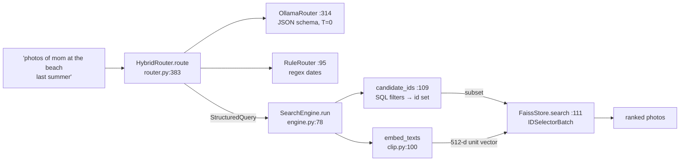

# Day 10 (Tue Nov 17): Photo-Seek I: retrieval and the query parser

Part of [[Interview plan (Nov 2026)]]. Repo `photo_seek`, **branch `upgrade-2026-10`** (HEAD `aa5d476`; `main` is the old scaffold).
Read it with `git show upgrade-2026-10:<path>` or a separate worktree; don't switch the repo's branch. About 7 h.
Prep pack: [[Photo-Seek - prep]] (diagram and Trace 1 in §2, stories 4.4–4.5, numbers §5).

**Code, explained:** the figures, the code to read and what each snippet does are in [[#Code, explained]], right after section B.

**Resume bullet (part 2 of 2, both resumes):** "Engineered an on-device multimodal retrieval engine combining **FAISS vector search, CLIP embeddings**, and
**LLM-based query routing** to translate natural-language queries into structured, **fully offline** photo search."
Faces (part 1) are tomorrow ([[Day 11 - Photo-Seek II and emotion steering]]).

**Wording to fix** (prep pack §5.1, §5.4):
- "**on-device**": everything was measured on the shared H200 server. Say "local" or "self-hosted".
- "**LLM-based query routing**": the LLM *parses* the query into filters; it doesn't route between backends. Say "LLM query parsing".
- "fully offline" holds at the process level (an audit hook saw 6 socket events, all to 127.0.0.1), not at the OS level.
- **84% counts queries, not fields:** on 84 of 100 hand-written queries all four filters (people, date_from, date_to, place) were right at once.
- **The env is broken** (`import numpy` fails with `libmkl_gf_lp64.so.3`), so no number can be re-run today. Last recorded tests: 156 passed (the README says 157).

**By tonight you can:**
- explain CLIP's contrastive training and why text and images share one space;
- choose between FAISS Flat, IVF, HNSW and PQ, and defend Flat here;
- trace "photos of mom at the beach last summer" from the parser to the results;
- defend R@1 39.4 and 84% vs 58%, with their setups.

## Schedule

| # | Time | Kind | What |
|---|---|---|---|
| 0 | 15 min | recall | Day 9: retrieval heads, Recall@k, IMP |
| 1 | 30 min | read | Prep pack "Read these first", §1 pitch, §2 diagram |
| 2 | 50 min | theory | CLIP (A1) |
| 3 | 40 min | code | `embed/clip.py`, `embed/base.py` (B1) |
| 4 | 40 min | theory | FAISS index types (A2) |
| 5 | 30 min | code | `index/faiss_store.py` (B2) |
| — | lunch | | |
| 6 | 25 min | theory | Structured LLM output; Ollama (A3) |
| 7 | 90 min | code | `search/query.py`, `search/router.py`, `search/engine.py` (B3) |
| 8 | 30 min | skim | Ingest, catalog, config, CLI, eval scripts (B4) |
| 9 | 45 min | rebuild | A tiny CLIP + FAISS search with a SQL prefilter (C) |
| 10 | 20 min | trace | Trace 1, by hand (D) |
| 11 | 40 min | practice | The questions (E) |

## A. Theory

### A1. CLIP (block 2, 50 min)

**Read:** Radford et al., *CLIP* (2021), §2.1–2.3 and Figure 1. About 35 min. **Optional:** OpenAI's CLIP blog post.
- Two encoders (image ViT, text transformer). For a batch of N pairs, the N×N cosine-similarity matrix is trained with a **symmetric cross-entropy**: each image should pick its own caption and vice versa. That InfoNCE loss pulls matching pairs together in one shared space.
- **Zero-shot retrieval:** embed the query text, take cosine similarity against all image embeddings, rank.
- Your model: **open_clip ViT-B-32, `laion2b_s34b_b79k`**, 512-d. You didn't train it; R@1 39.4 on COCO-5k is off-the-shelf CLIP and should sit near open_clip's published number.

### A2. FAISS (block 4, 40 min)

**Read:** the FAISS wiki page *"Guidelines to choose an index"* (github.com/facebookresearch/faiss/wiki). About 20 min. Optional: the Pinecone *"Faiss: The Missing Manual"* chapters on IVF and HNSW.
- **Flat (exact):** brute-force inner product. O(N·d) per query. At 5k–100k vectors it takes milliseconds.
- **IVF:** k-means into lists; probe `nprobe` lists. Approximate; needs training.
- **HNSW:** a layered proximity graph. Fast and high recall; more memory.
- **PQ:** compress vectors into codes. Saves memory, loses accuracy.
- **Your choice:** `IndexIDMap2(IndexFlatIP)`, inner product on unit vectors = cosine. Exact, needs no training, supports deletes by ID, and is fast enough for one person's library. **Prefiltering:** `IDSelectorBatch(candidates)` makes FAISS score only the IDs the SQL filters allow.

### A3. Structured output (block 6, 25 min)

**Read:** the Ollama docs on **structured outputs** (`format` = a JSON schema). 10 min.
- The schema constrains decoding, so the model can only emit valid JSON of that shape. Values can still be wrong (story 4.5: dates).
- Ollama is a local server (`127.0.0.1:11534` here) running `qwen2.5:7b` (4.4 GB quantised). Temperature 0, 200 tokens max.
- **Why hybrid:** the LLM is better at people (97 vs 83) and places (95 vs 85); the rules are better at dates (87 vs 82). So the rules' dates win whenever the rules match a date phrase.

## B. Code

### B1. CLIP wrapper (block 3, 40 min, deep)

- `src/photoseek/embed/clip.py`: **64 `embed_images`** (batching, normalisation), **100 `embed_texts`**.
- `embed/base.py`: the `Protocol` pattern. Why a Protocol and not an abstract base class? (*Structural typing: tests can pass a fake embedder without inheriting.*)

### B2. The index (block 5, 30 min, deep)

`index/faiss_store.py` (184 lines): **81 `add`**, **111 `search`** (the `IDSelectorBatch` prefilter), 147 `save` (write a temp file, then rename, for atomicity).

### B3. Parser and engine (block 7, 90 min, deep)

- `search/query.py`: `StructuredQuery`; 82 `from_dict` (bad dates become `None`).
- `search/router.py` (452 lines):
  - **81 `RuleRouter`**: 95 `route`, **114 `_extract_dates`**, 175 `_season_year` ("last summer" in November = this year);
  - **250 `OllamaRouter`**: 261 the JSON schema, 314 `route`, 332 the fallback to rules, 339 `_generate` (today's date goes into the prompt);
  - **366 `HybridRouter`**: 383 `route`, **386** rule dates override the LLM's;
  - 391 `build_router`; 424 `_extract_json`.
- `search/engine.py` (225 lines):
  - **78 `run`**; 84–90: an unknown place moves into the CLIP text (story 4.4);
  - **109 `candidate_ids`**: the SQL; 127–130: `date_to` + 1 day with `<`, because `taken_at` has a time part;
  - **150 `resolve_people`**: names → identity IDs, following `merged_into`; one `EXISTS` per person (all must appear);
  - 178 `_ensure_models` (lazy load); 192 `_place_known`; 207 `_hydrate`.

### B4. Skim (block 8, 30 min)

`config.py` (119 `Config.load`: YAML merged key by key), `catalog/db.py` (57 `Catalog`, SQLite WAL at 83; tables: photos, faces, identities, embeddings, corrections), `ingest/scanner.py` (89 `scan`, 50 BLAKE2b hash, 119 skip by path + mtime, 112 `min_bytes`), `ingest/exif.py` (53), `cli.py` (315 `main`).
Eval scripts, metric code only: `eval/retrieval.py`, `eval/router.py`, `eval/offline.py`.

## Code, explained

Read this **with the files open**. Each part has a small figure of the pipeline, then the exact code (copied from the repo at the commit named below, so the line numbers match), then what it does and how it hands off to the next piece.

Repo `photo_seek`, branch **`upgrade-2026-10`** (`aa5d476`); read it with
`git show upgrade-2026-10:<path>`. Paths below are under `src/photoseek/`.



---

### 1. Parsing: the LLM for words, the rules for dates

`src/photoseek/search/router.py:314–337` (`upgrade-2026-10`)
```python
def route(self, query: str, *, limit: int | None = None) -> StructuredQuery:
    self.last_fallback, self.last_error = False, None
    try:
        raw = self._generate(query)
        parsed = _extract_json(raw)
        if parsed is None:
            raise ValueError(f"no JSON object in model output: {raw[:200]!r}")

        parsed["raw"] = query.strip()
        parsed["limit"] = limit or self.config.top_k
        structured = StructuredQuery.from_dict(parsed)

        # A model that returns nothing usable is worse than the rules.
        if structured.is_empty:
            raise ValueError("model returned an empty query")

        return structured

    except Exception as exc:  # noqa: BLE001 - any failure means fall back
        if not self.config.fallback_to_rule:
            raise
        self.last_fallback, self.last_error = True, str(exc)
        log.warning("LLM router failed (%s); falling back to rule router", exc)
        return self._fallback.route(query, limit=limit)
```

- The LLM call returns JSON constrained by a schema. **Any** failure (bad JSON, empty result, timeout, server down) falls back to the rule router, and `last_fallback` records that it happened. The UI never breaks because Ollama did.
- `is_empty` counts as a failure: a model that returns nothing usable is worse than the rules.

`src/photoseek/search/router.py:114–123` (`upgrade-2026-10`)
```python
def _extract_dates(self, text: str) -> tuple[str, date | None, date | None]:
    lowered = text.lower()

    # "last summer", "this winter"
    for season, (start_m, end_m) in _SEASONS.items():
        match = re.search(rf"\b(last|this|past)\s+{season}\b", lowered)
        if match:
            year = self._season_year(end_m, previous=match.group(1) in ("last", "past"))
            start, end = _season_range(season, year)
            return _cut(text, match.span()), start, end
```

`src/photoseek/search/router.py:183–186` (`upgrade-2026-10`)
```python
year = self.today.year
if previous and self.today.month <= end_month:
    year -= 1
return year
```

- "last summer" = the most recent **completed** summer. Asked in November 2026: `today.month (11) <= 8` is false, so the year stays 2026 → June 1 – Aug 31, 2026. Asked in July 2026, it would be 2025.
- The match is cut out of the text (`_cut`), so "last summer" doesn't also end up in the CLIP query.

`src/photoseek/search/router.py:383–388` (`upgrade-2026-10`)
```python
def route(self, query: str, *, limit: int | None = None) -> StructuredQuery:
    structured = self.llm.route(query, limit=limit)
    ruled = self.rules.route(query, limit=limit)
    if ruled.date_from or ruled.date_to:
        structured.date_from, structured.date_to = ruled.date_from, ruled.date_to
    return structured
```

- **The hybrid in four lines:** run both; if the rules found a date, their dates overwrite the LLM's. The LLM was better at people and places (97 / 95 vs 83 / 85) but worse at relative dates (82 vs 87). The hybrid got all four filters right on 84% of queries, against 73% (LLM) and 58% (rules).

---

### 2. Executing: filters first, then vectors

`src/photoseek/search/engine.py:84–107` (`upgrade-2026-10`)
```python
if structured.place and not self._place_known(structured.place):
    text = structured.text
    if structured.place.lower() not in text.lower():
        text = f"{text} {structured.place}".strip()
    structured = replace(structured, text=text, place=None)
    self.last.query = structured
    self.last.place_as_text = True

candidates = self.candidate_ids(structured)
self.last.n_candidates = None if candidates is None else len(candidates)
if candidates is not None and not candidates:
    return []

if not structured.text.strip():
    # A pure-filter query ("photos of mom last summer") has nothing to
    # rank semantically, so it is not forced through the index.
    return self._hydrate([(pid, 0.0) for pid in self._by_date(candidates)][
        : structured.limit
    ])

self._ensure_models()
[vector] = self.embedder.embed_texts([structured.text])
hits = self.store.search(vector, structured.limit, subset=candidates)
return self._hydrate([(hit.id, hit.score) for hit in hits])
```

- **Place fallback (lines 84–90):** if no photo has that place label (nothing is reverse-geocoded), "beach" moves into the CLIP text instead of filtering everything out (story 4.4).
- **`None` vs `set()`:** `None` = no filters, search everything; an empty set = filters matched nothing, return nothing.
- A pure-filter query ("photos of mom last summer") has no text to rank by, so it skips CLIP and sorts by date.

`src/photoseek/search/engine.py:124–148` (`upgrade-2026-10`)
```python
if structured.date_from:
    clauses.append("p.taken_at >= ?")
    params.append(structured.date_from.isoformat())
if structured.date_to:
    # taken_at carries a time, so "<= 2025-08-31" would drop that day.
    clauses.append("p.taken_at < ?")
    params.append((structured.date_to + timedelta(days=1)).isoformat())
if structured.place:
    clauses.append("p.place LIKE ?")
    params.append(f"%{structured.place}%")

if structured.people:
    resolved = self.resolve_people(structured.people)
    self.last.unknown_people = [name for name, iid in resolved.items() if iid is None]
    if self.last.unknown_people:
        log.info("unknown people in query: %s", self.last.unknown_people)
        return set()
    for identity_id in dict.fromkeys(resolved.values()):
        clauses.append(
            "EXISTS (SELECT 1 FROM faces f WHERE f.photo_id = p.id AND f.identity_id = ?)"
        )
        params.append(identity_id)

sql = "SELECT p.id FROM photos p WHERE " + " AND ".join(clauses)
return {row["id"] for row in self.catalog.conn.execute(sql, params)}
```

- Dates: `taken_at < date_to + 1 day`, because `taken_at` has a time part. `<= '2026-08-31'` would drop photos taken on Aug 31 after midnight.
- People: one `EXISTS (… faces f WHERE f.identity_id = ?)` clause **per person**, AND-ed together, so all named people must be in the photo. An unknown name returns `set()` instead of being ignored, so a typo shows up as "no results" rather than silently widening the search.
- Every value is a `?` parameter: no SQL injection from query text.

---

### 3. The vector side: CLIP + FAISS

`src/photoseek/embed/clip.py:105–114` (`upgrade-2026-10`)
```python
out: list[Vector] = []
batch_size = max(1, self.config.batch_size) * 8  # text is cheap
for start in range(0, len(texts), batch_size):
    tokens = self._tokenizer(list(texts[start:start + batch_size])).to(self.device)
    with torch.inference_mode():
        features = self._model.encode_text(tokens).float()
        if self.config.normalize:
            features = torch.nn.functional.normalize(features, dim=-1)
    out.extend(features.cpu().numpy())
return out
```

- Text goes through CLIP's **text** encoder into the same 512-d space as the images, then gets L2-normalised. For unit vectors, inner product = cosine similarity.

`src/photoseek/index/faiss_store.py:131–145` (`upgrade-2026-10`)
```python
params = None
if subset is not None:
    subset_ids = np.fromiter(subset, dtype="int64")
    if subset_ids.size == 0:
        return []
    k = min(k, int(subset_ids.size))
    params = faiss.SearchParameters(sel=faiss.IDSelectorBatch(subset_ids))

k = min(k, int(self._index.ntotal))
scores, found = self._index.search(q, k, params=params)
return [
    SearchHit(id=int(i), score=float(s))
    for i, s in zip(found[0], scores[0])
    if i != -1
]
```

- **Pre-filtering:** `IDSelectorBatch(subset)` tells the flat index to score **only** the allowed ids. Post-filtering (take the top k, then drop disallowed ones) could return fewer than k, or nothing, when the filter is strict.
- `k = min(k, len(subset))`, and FAISS pads with id −1 when it has fewer hits, which line 144 drops.

`src/photoseek/index/faiss_store.py:96–99` (`upgrade-2026-10`)
```python
self._ensure_index()
if self._index.ntotal:
    self.remove(id_arr)
self._index.add_with_ids(vecs, id_arr)
```

- Re-adding an id first removes the old vector (`IndexIDMap2` supports deletion by id), so re-embedding a photo can't leave a stale duplicate.

**Check yourself:** "photos of Anna and Ravi in June 2025" with Anna known and Ravi unknown. What does `candidate_ids` return, and does CLIP run? (*An empty set; no, `run` returns `[]` at line 94–95, and `unknown_people` is reported.*)

## C. Rebuild it yourself (block 9, 45 min)

About 70 lines; a CPU is enough:
1. Load `open_clip` ViT-B-32 (or any small CLIP from Hugging Face). Embed 50 local images and 5 text queries; L2-normalise.
2. Build `faiss.IndexIDMap2(faiss.IndexFlatIP(512))`, add the images with your own integer IDs.
3. Put fake metadata in SQLite (date, place). Write `search(text, date_from, date_to)` that gets the candidate IDs by SQL, then searches FAISS with `IDSelectorBatch` via `SearchParameters`.
4. Check that an empty candidate set returns nothing, and that cosine scores match `img @ txt.T`.

## D. Trace (block 10, 20 min)

Do prep pack §2 Trace 1 from memory on paper: `photoseek search "photos of mom at the beach last summer" --router hybrid`, today = 2026-11-05.
Write: what the LLM returns; what the rules return for "last summer"; which dates win; what happens to "beach"; the SQL; what happens if nobody is named "mom".

## E. Questions

1. Explain CLIP's training objective. Why can text search images at all?
2. Why FAISS Flat and not HNSW or IVF? At what library size would you switch?
3. How do metadata filters combine with vector search? Pre- or post-filtering, and why?
4. What does the LLM do in your system? Why isn't "routing" the right word?
5. Why a hybrid parser? Give the per-field numbers.
6. How did you measure 84%? What is the 95% confidence interval at n = 100? (*About ±7–9 points.*)
7. Did you design the hybrid after seeing the gold-set results? (*Answer truthfully; the hybrid commit predates the eval commit, but no doc says what you looked at.*)
8. How do you know it's fully offline? (*Audit hook plus `ss` sampling; process level.*)
9. R@1 39.4 on COCO: is that your contribution? (*No: zero-shot CLIP. Your contribution is the system around it.*)
10. "A dog on the beach" once returned nothing. Why? (*Story 4.4.*)
11. Hostile: "On-device, but every number is from an H200?"

## My notes and fumbles

- 
