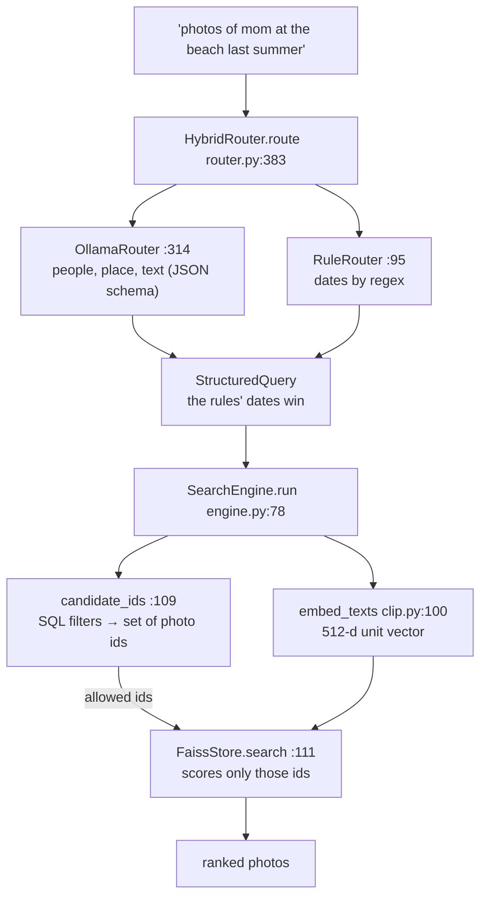
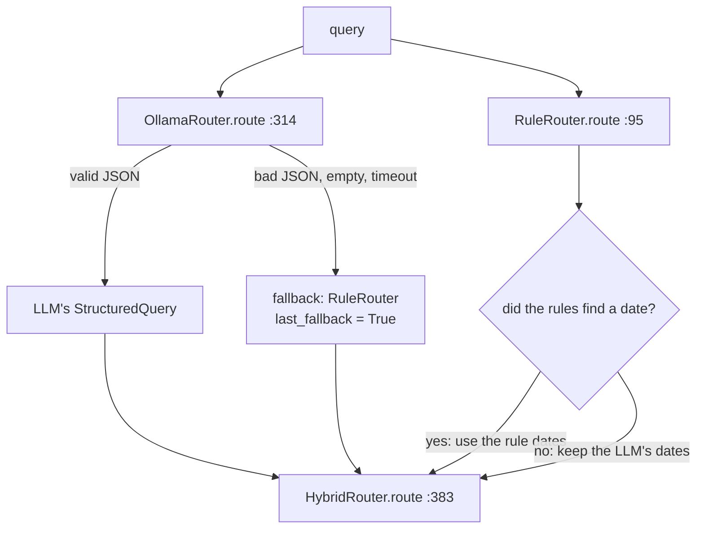
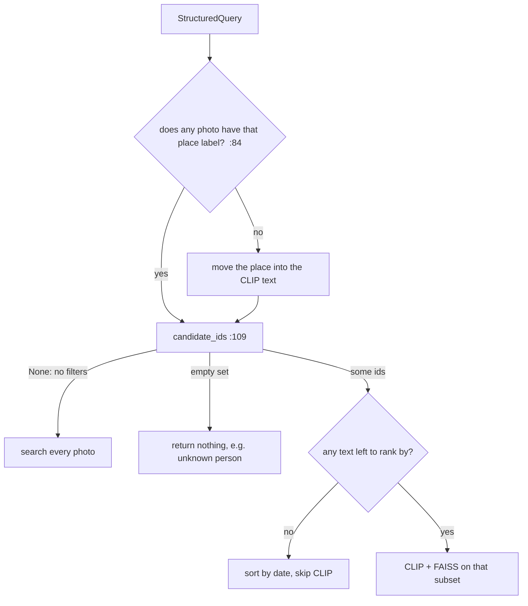
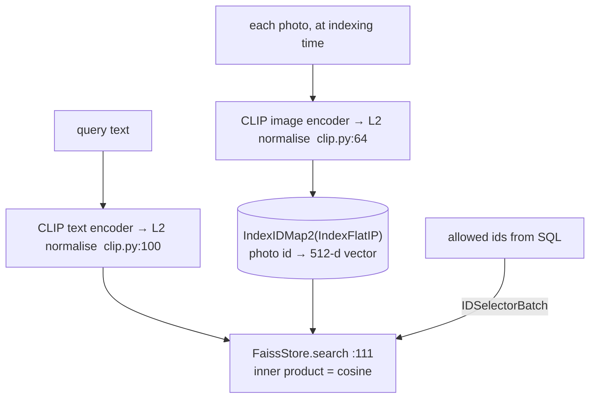

# Day 10 (Tue Nov 17): Photo-Seek I: retrieval and the query parser

Part of [[Interview plan (Nov 2026)]]. Repo `photo_seek`, **branch `upgrade-2026-10`** (HEAD `aa5d476`; `main` is the old scaffold).
Read it with `git show upgrade-2026-10:<path>` or a separate worktree; don't switch the repo's branch. About 7 h.
Prep pack: [[Photo-Seek - prep]] (diagram and Trace 1 in §2, stories 4.4–4.5, numbers §5).

**Code, explained:** the figures, the code to read and what each snippet does are in [[#Code, explained]], right after section B.

**Resume bullet (part 2 of 2, both resumes):** "Engineered an on-device multimodal retrieval engine combining **FAISS vector search, CLIP embeddings**, and **LLM-based query routing** to translate natural-language queries into structured, **fully offline** photo search."
Faces (part 1) are tomorrow ([[Day 11 - Photo-Seek II and emotion steering]]).

**Wording to fix** (prep pack §5.1, §5.4):
- "**on-device**": everything was measured on the shared H200 server. Say "local" or "self-hosted".
- "**LLM-based query routing**": the LLM *parses* the query into filters; it doesn't route between backends. Say "LLM query parsing".
- "fully offline" holds at the process level (an audit hook saw 6 socket events, all to 127.0.0.1), not at the OS level.
- **84% counts queries, not fields:** on 84 of 100 hand-written queries all four filters (people, date_from, date_to, place) were right at once.
- **The env is broken** (`import numpy` fails with `libmkl_gf_lp64.so.3`), so no number can be re-run today. Last recorded tests: 156 passed (the README says 157).

**By tonight you can:**
- explain CLIP's contrastive training and why text and images share one space;
- choose between FAISS Flat, IVF, HNSW and PQ, and defend Flat here;
- trace "photos of mom at the beach last summer" from the parser to the results;
- defend R@1 39.4 and 84% vs 58%, with their setups.

## Schedule

| # | Time | Kind | What |
|---|---|---|---|
| 0 | 15 min | recall | Day 9: retrieval heads, Recall@k, IMP |
| 1 | 30 min | read | Prep pack "Read these first", §1 pitch, §2 diagram |
| 2 | 50 min | theory | CLIP (A1) |
| 3 | 40 min | code | `embed/clip.py`, `embed/base.py` (B1) |
| 4 | 40 min | theory | FAISS index types (A2) |
| 5 | 30 min | code | `index/faiss_store.py` (B2) |
| — | lunch | | |
| 6 | 25 min | theory | Structured LLM output; Ollama (A3) |
| 7 | 90 min | code | `search/query.py`, `search/router.py`, `search/engine.py` (B3) |
| 8 | 30 min | skim | Ingest, catalog, config, CLI, eval scripts (B4) |
| 9 | 45 min | rebuild | A tiny CLIP + FAISS search with a SQL prefilter (C) |
| 10 | 20 min | trace | Trace 1, by hand (D) |
| 11 | 40 min | practice | The questions (E) |

## Block notes (added 2026-11-14)

Each block of the schedule now has its own note in `Days/Day 10/`. They **add to** the sections below; nothing here was removed. Work through them in order. Labels used in them: **[code]** read in the repo, **[doc]** a README / result / prep-pack number, **[lib]** library behaviour, **[mine]** Claude's reasoning, **[ran]** produced by running your code on 2026-11-14.

| # | Block | Note | What it adds to this note |
|---|---|---|---|
| 0 | Recall | [[D10-00 Recall]] | six Day 9 questions with folded answers |
| 1 | Overview | [[D10-01 Overview]] | the problem, why local, two pipelines, architecture figure, who made what |
| 2 | CLIP theory | [[D10-02 CLIP theory]] | why two encoders, both loss directions, temperature table, limitations, training vs inference |
| 3 | CLIP code | [[D10-03 CLIP code]] | `load`, preprocessing, tokenisation, `embed_images` slot trace, dtypes, the Protocol pattern |
| 4 | FAISS theory | [[D10-04 FAISS theory]] | HNSW walk, PQ with numbers, trade-off table, 1 M and 100 M |
| 5 | FAISS code | [[D10-05 FAISS code]] | `add`, `remove`, `save`, five-vector trace, how the id selector works |
| 6 | Structured output | [[D10-06 Ollama and structured output]] | serving process, JSON, what the schema does not constrain, three real outputs |
| 7 | Parser code | [[D10-07a Query parser code]] | `from_dict`, `RuleRouter.route`, the nine date patterns, `_generate`, fallback table |
| 7 | Engine code | [[D10-07b Search engine code]] | the real engine run on a toy catalog, `resolve_people`, `_ensure_models`, `_hydrate` |
| 8 | Skim | [[D10-08 Skim map]] | one line per function in eight files |
| 9 | Rebuild | [[D10-09 Rebuild]] | a four-step exercise, standard library only (`exercises/day10_tiny_search.py`) |
| 10 | Trace | [[D10-10 Trace and failures]] | the 15-step trace and six "what if" cases |
| 11 | Practice | [[D10-11 Interview questions]] | 30 questions with folded answers and follow-ups |

## A. Theory

### A1. CLIP (block 2, 50 min)

**Read:** Radford et al., *CLIP* (2021), §2.1–2.3 and Figure 1. About 35 min. **Optional:** OpenAI's CLIP blog post.

> [!abstract] What it says: the CLIP paper (Radford et al., 2021)
> **Key idea:** learn images from plain captions, not fixed labels. Text on the web is free supervision.
> **Data (§2.2):** a new set of about 400 million (image, text) pairs collected from the internet.
> **Method (§2.3):** predicting the exact caption word by word learned slowly. Predicting a bag of words was about 3× faster. Just asking "which caption goes with which image" (contrastive) was about 4× faster again.
> **Figure 1, in words:** (1) an image encoder and a text encoder fill an N×N grid of similarities; the diagonal pairs are the true matches. (2) Class names become captions like "a photo of a dog". (3) A new image is labelled by its most similar caption.
> **Loss:** cross-entropy over each row (image → texts) plus each column (text → images), with a learned temperature.
> **Numbers people quote:** zero-shot ImageNet accuracy matches the original ResNet-50, without using its 1.28M labelled images.
> **In this project:** you use the same idea in reverse: one text query against all image vectors. The open_clip checkpoint `laion2b_s34b_b79k` is CLIP retrained on the public LAION-2B data.

> [!abstract] What it says: OpenAI's CLIP blog post (optional)
> **Key idea:** the same model as the paper, told for a general reader, with an interactive set of examples.
> **Main claims:** zero-shot CLIP is more robust than ImageNet-trained models when the image style shifts (sketches, renditions, adversarial photos).
> **Limits it admits:** weak at abstract or systematic tasks such as counting objects, and at very fine-grained classes.
> It also notes that results depend on how the text prompt is worded ("prompt engineering").
> **In this project:** your queries are free text, so wording matters too; "a photo of …" style phrasing can help.

**Concepts:**

- Two encoders (image ViT, text transformer). For a batch of N pairs, the N×N cosine-similarity matrix is trained with a **symmetric cross-entropy**: each image should pick its own caption and vice versa. That InfoNCE loss pulls matching pairs together in one shared space.
- **Zero-shot retrieval:** embed the query text, take cosine similarity against all image embeddings, rank.
- Your model: **open_clip ViT-B-32, `laion2b_s34b_b79k`**, 512-d. You didn't train it; R@1 39.4 on COCO-5k is off-the-shelf CLIP and should sit near open_clip's published number.

> [!tip] Explained from scratch: [[#4. Deep dive: CLIP and cosine similarity from scratch|§4 CLIP and cosine similarity]]


### A2. FAISS (block 4, 40 min)

**Read:** the FAISS wiki page *"Guidelines to choose an index"* (github.com/facebookresearch/faiss/wiki). About 20 min. Optional: the Pinecone *"Faiss: The Missing Manual"* chapters on IVF and HNSW.

> [!abstract] What it says: FAISS wiki, "Guidelines to choose an index"
> **Key idea:** pick the index by answering a few questions in order: how many searches, exact or approximate, how much memory, how many vectors.
> **Exact results needed →** a Flat index. It is the only kind that guarantees the true nearest neighbours.
> **Memory no concern →** HNSW (a graph; fast, high recall, but uses the most memory).
> **Memory tight →** compress with PQ codes, trading accuracy for size.
> **Many vectors →** IVF: cluster into K lists and search only a few; the page suggests K between about $4\sqrt{N}$ and $16\sqrt{N}$.
> **IVF needs training** on sample vectors (k-means); Flat needs none.
> **Custom IDs:** wrap an index in `IndexIDMap` (or `IndexIDMap2`) to add vectors with your own IDs.
> **In this project:** one person's library is thousands of vectors, so exact Flat search is already milliseconds. Exactness also makes the eval numbers clean.

> [!abstract] What it says: Pinecone, "Faiss: The Missing Manual" (optional, IVF and HNSW chapters)
> **IVF chapter:** the space is cut into Voronoi cells around k-means centroids. A query searches its nearest `nprobe` cells.
> Raising `nprobe` raises recall and cost; a true neighbour just across a cell edge is the classic miss.
> **HNSW chapter:** a stack of graphs, sparse on top and dense at the bottom. Search greedily walks down the layers.
> Its knobs are `M` (links per node), `efConstruction` (build effort) and `efSearch` (search effort). More of each means better recall, more memory or time.
> **In this project:** neither is needed at this size; they are the answer to "what changes at 100 million photos?".

**Concepts:**

- **Flat (exact):** brute-force inner product. O(N·d) per query. At 5k–100k vectors it takes milliseconds.
- **IVF:** k-means into lists; probe `nprobe` lists. Approximate; needs training.
- **HNSW:** a layered proximity graph. Fast and high recall; more memory.
- **PQ:** compress vectors into codes. Saves memory, loses accuracy.
- **Your choice:** `IndexIDMap2(IndexFlatIP)`, inner product on unit vectors = cosine. Exact, needs no training, supports deletes by ID, and is fast enough for one person's library. **Prefiltering:** `IDSelectorBatch(candidates)` makes FAISS score only the IDs the SQL filters allow.

> [!tip] Explained from scratch: [[#5. Deep dive: FAISS indexes and pre-filtering from scratch|§5 FAISS and pre-filtering]]


### A3. Structured output (block 6, 25 min)

**Read:** the Ollama docs on **structured outputs** (`format` = a JSON schema). 10 min.

> [!abstract] What it says: Ollama docs, structured outputs
> **Key idea:** pass `format` either as `"json"` or as a full JSON schema, and the reply is forced into that shape.
> **How it is forced:** during decoding, tokens that would break the schema are not allowed. So the output always parses.
> **Typical use:** build the schema from a Pydantic model (`Model.model_json_schema()`), then validate the reply with the same model.
> **Tips it gives:** also describe the expected JSON in the prompt, and use temperature 0 for steadier answers.
> **What it does not do:** it guarantees the *shape*, not the *truth*. A field can be valid JSON and still wrong.
> **In this project:** the schema keeps the parser from crashing; the wrong-date failures (story 4.5) are why the rules still own dates.

**Concepts:**

- The schema constrains decoding, so the model can only emit valid JSON of that shape. Values can still be wrong (story 4.5: dates).
- Ollama is a local server (`127.0.0.1:11534` here) running `qwen2.5:7b` (4.4 GB quantised). Temperature 0, 200 tokens max.
- **Why hybrid:** the LLM is better at people (97 vs 83) and places (95 vs 85); the rules are better at dates (87 vs 82). So the rules' dates win whenever the rules match a date phrase.

> [!tip] Explained from scratch: [[#6. Deep dive: turning a sentence into filters from scratch|§6 sentence → filters]]

## B. Code

### B1. CLIP wrapper (block 3, 40 min, deep)

- `src/photoseek/embed/clip.py`: **64 `embed_images`** (batching, normalisation), **100 `embed_texts`**.
- `embed/base.py`: the `Protocol` pattern. Why a Protocol and not an abstract base class? (*Structural typing: tests can pass a fake embedder without inheriting.*)

### B2. The index (block 5, 30 min, deep)

`index/faiss_store.py` (184 lines): **81 `add`**, **111 `search`** (the `IDSelectorBatch` prefilter), 147 `save` (write a temp file, then rename, for atomicity).

### B3. Parser and engine (block 7, 90 min, deep)

- `search/query.py`: `StructuredQuery`; 82 `from_dict` (bad dates become `None`).
- `search/router.py` (452 lines):
  - **81 `RuleRouter`**: 95 `route`, **114 `_extract_dates`**, 175 `_season_year` ("last summer" in November = this year);
  - **250 `OllamaRouter`**: 261 the JSON schema, 314 `route`, 332 the fallback to rules, 339 `_generate` (today's date goes into the prompt);
  - **366 `HybridRouter`**: 383 `route`, **386** rule dates override the LLM's;
  - 391 `build_router`; 424 `_extract_json`.
- `search/engine.py` (225 lines):
  - **78 `run`**; 84–90: an unknown place moves into the CLIP text (story 4.4);
  - **109 `candidate_ids`**: the SQL; 127–130: `date_to` + 1 day with `<`, because `taken_at` has a time part;
  - **150 `resolve_people`**: names → identity IDs, following `merged_into`; one `EXISTS` per person (all must appear);
  - 178 `_ensure_models` (lazy load); 192 `_place_known`; 207 `_hydrate`.

### B4. Skim (block 8, 30 min)

`config.py` (119 `Config.load`: YAML merged key by key), `catalog/db.py` (57 `Catalog`, SQLite WAL at 83; tables: photos, faces, identities, embeddings, corrections), `ingest/scanner.py` (89 `scan`, 50 BLAKE2b hash, 119 skip by path + mtime, 112 `min_bytes`), `ingest/exif.py` (53), `cli.py` (315 `main`).
Eval scripts, metric code only: `eval/retrieval.py`, `eval/router.py`, `eval/offline.py`.

## Code, explained

Read this **with the files open**. It starts with a picture of the whole day and **the flow, step by step** (one concrete input followed through every function). Then each part has its own figure, the exact code (copied from the repo at the commit named below, so the line numbers match) and what that code does.

Repo `photo_seek`, branch **`upgrade-2026-10`** (`aa5d476`); read it with
`git show upgrade-2026-10:<path>`. Paths below are under `src/photoseek/`.



### The flow, step by step

The query **"photos of mom at the beach last summer"**, asked on **2026-11-05**, with `--router hybrid`.

1. **LLM parse** (`OllamaRouter.route`, `router.py:314`): Ollama returns schema-constrained JSON: `people = ["mom"]`, `place = "beach"`, `text = ""`, plus its own guess at the dates. Any failure here would fall back to the rules (`:332`).
2. **Rule parse** (`RuleRouter.route`, `:95`): `_extract_dates` matches "last summer" (`:118–123`). `_season_year`: November > August, so the year stays 2026 → **2026-06-01 to 2026-08-31** (`:183–186`).
3. **Merge** (`:386`): the rules found a date, so their dates replace the LLM's.
4. **Place check** (`engine.py:84–90`): no photo has the place label "beach" (nothing is reverse-geocoded), so "beach" moves into the CLIP text: `text = "beach"`, `place = None`.
5. **SQL filters** (`candidate_ids`, `:109`): `taken_at >= '2026-06-01' AND taken_at < '2026-09-01' AND EXISTS (a face of identity "mom")`. Say that gives photos **{12, 40, 77}**. If nobody is named "mom", it returns an empty set and the search stops with no results.
6. **Embed the text:** CLIP's text encoder turns "beach" into a 512-d unit vector (`clip.py:105–114`).
7. **Vector search on the subset** (`faiss_store.py:131–145`): `IDSelectorBatch({12, 40, 77})` makes FAISS score only those three photos, by cosine similarity.
8. **Hydrate** (`engine.py:207`): join the hits back to their paths and the people in them.

---

### 1. Parsing: the LLM for words, the rules for dates

> [!tip] Concept from scratch: [[#6. Deep dive: turning a sentence into filters from scratch|regex dates, half-open ranges, schema-constrained decoding and how the 84% was measured]]



`src/photoseek/search/router.py:314–337` (`upgrade-2026-10`)
```python
def route(self, query: str, *, limit: int | None = None) -> StructuredQuery:
    self.last_fallback, self.last_error = False, None
    try:
        raw = self._generate(query)
        parsed = _extract_json(raw)
        if parsed is None:
            raise ValueError(f"no JSON object in model output: {raw[:200]!r}")

        parsed["raw"] = query.strip()
        parsed["limit"] = limit or self.config.top_k
        structured = StructuredQuery.from_dict(parsed)

        # A model that returns nothing usable is worse than the rules.
        if structured.is_empty:
            raise ValueError("model returned an empty query")

        return structured

    except Exception as exc:  # noqa: BLE001 - any failure means fall back
        if not self.config.fallback_to_rule:
            raise
        self.last_fallback, self.last_error = True, str(exc)
        log.warning("LLM router failed (%s); falling back to rule router", exc)
        return self._fallback.route(query, limit=limit)
```
> [!info] New functions in this code
> - `raise ValueError(msg)`: Python's built-in error for "right type, wrong value". `raise` stops the function and passes the error up to the caller. The kernel wrapper raises it for a bad shape (e.g. head_dim not a power of two) instead of computing a wrong answer. [[Function glossary#ValueError|→ examples]]
> - `.strip()`: removes spaces (and newlines) from both ends of a string. `'  CWE-89 '.strip()` → `'CWE-89'`. [[Function glossary#x.strip|→ examples]]
> - `str(x)`: converts anything to its text form. `str(89)` → `'89'`. `find_weakness` uses `str(term)` so a number or a string both work. [[Function glossary#str|→ examples]]
> - `log.warning(msg, *args)`: writes a warning to the program's log (Python's `logging`); `%s` in `msg` is filled with `args` only if the message is actually printed. `.info` is the same at a lower level. [[Function glossary#x.warning|→ examples]]

- The LLM call returns JSON constrained by a schema. **Any** failure (bad JSON, empty result, timeout, server down) falls back to the rule router, and `last_fallback` records that it happened. The UI never breaks because Ollama did.
- `is_empty` counts as a failure: a model that returns nothing usable is worse than the rules.

`src/photoseek/search/router.py:114–123` (`upgrade-2026-10`)
```python
def _extract_dates(self, text: str) -> tuple[str, date | None, date | None]:
    lowered = text.lower()

    # "last summer", "this winter"
    for season, (start_m, end_m) in _SEASONS.items():
        match = re.search(rf"\b(last|this|past)\s+{season}\b", lowered)
        if match:
            year = self._season_year(end_m, previous=match.group(1) in ("last", "past"))
            start, end = _season_range(season, year)
            return _cut(text, match.span()), start, end
```
> [!info] New functions in this code
> - `.lower() / func.lower(col)`: on a string: the string in small letters, `'SQL Injection'.lower()` → `'sql injection'`. In SQLAlchemy, `func.lower(Vulnerability.name)` is the SQL function `LOWER(name)`, so the comparison happens case-insensitively inside the database. [[Function glossary#x.lower|→ examples]]
> - `.items()`: a dict's `(key, value)` pairs, for looping over both. [[Function glossary#dict.items|→ examples]]
> - `re.search(pattern, s) / index.search(q, k)`: two different things share this name. **`re.search`** finds the first place a regex matches anywhere in `s` and returns a match object (or None): `re.search(r'\b(last|this)\s+summer\b', 'photos last summer')` matches `'last summer'`. **A FAISS index's `.search(q, k)`** returns the k best scores and ids for each query row: two arrays of shape `[n_queries, k]`. [[Function glossary#x.search|→ examples]]
> - `match.group(n)`: the text a regex match captured. `group(0)` (or `group()`) is the whole match; `group(1)` is the first `( … )`. For `last summer` matched by `(last|this|past)\s+summer`, `group(1)` = `'last'`. [[Function glossary#x.group|→ examples]]
> - `match.span()`: the (start, end) character positions of the match, end excluded. In `'photos last summer'`, `'last summer'` spans `(7, 18)`; `_cut` uses it to remove the phrase. [[Function glossary#x.span|→ examples]]

`src/photoseek/search/router.py:183–186` (`upgrade-2026-10`)
```python
year = self.today.year
if previous and self.today.month <= end_month:
    year -= 1
return year
```

- "last summer" = the most recent **completed** summer. Asked in November 2026: `today.month (11) <= 8` is false, so the year stays 2026 → June 1 – Aug 31, 2026. Asked in July 2026, it would be 2025.
- The match is cut out of the text (`_cut`), so "last summer" doesn't also end up in the CLIP query.

`src/photoseek/search/router.py:383–388` (`upgrade-2026-10`)
```python
def route(self, query: str, *, limit: int | None = None) -> StructuredQuery:
    structured = self.llm.route(query, limit=limit)
    ruled = self.rules.route(query, limit=limit)
    if ruled.date_from or ruled.date_to:
        structured.date_from, structured.date_to = ruled.date_from, ruled.date_to
    return structured
```

- **The hybrid in four lines:** run both; if the rules found a date, their dates overwrite the LLM's. The LLM was better at people and places (97 / 95 vs 83 / 85) but worse at relative dates (82 vs 87). The hybrid got all four filters right on 84% of queries, against 73% (LLM) and 58% (rules).

---

### 2. Executing: filters first, then vectors

> [!tip] Concept from scratch: [[#5. Deep dive: FAISS indexes and pre-filtering from scratch|pre- vs post-filtering on a 6-photo example]]



`src/photoseek/search/engine.py:84–107` (`upgrade-2026-10`)
```python
if structured.place and not self._place_known(structured.place):
    text = structured.text
    if structured.place.lower() not in text.lower():
        text = f"{text} {structured.place}".strip()
    structured = replace(structured, text=text, place=None)
    self.last.query = structured
    self.last.place_as_text = True

candidates = self.candidate_ids(structured)
self.last.n_candidates = None if candidates is None else len(candidates)
if candidates is not None and not candidates:
    return []

if not structured.text.strip():
    # A pure-filter query ("photos of mom last summer") has nothing to
    # rank semantically, so it is not forced through the index.
    return self._hydrate([(pid, 0.0) for pid in self._by_date(candidates)][
        : structured.limit
    ])

self._ensure_models()
[vector] = self.embedder.embed_texts([structured.text])
hits = self.store.search(vector, structured.limit, subset=candidates)
return self._hydrate([(hit.id, hit.score) for hit in hits])
```
> [!info] New functions in this code
> - `dataclasses.replace(obj, field=value)`: a **copy** of a dataclass object with some fields changed; the original is untouched. `replace(q, text='beach', place=None)` moves the place into the text without mutating `q`. [[Function glossary#replace|→ examples]]
> - `len(xs)`: how many items. `len([7, 8, 9])` = 3. [[Function glossary#len|→ examples]]

- **Place fallback (lines 84–90):** if no photo has that place label (nothing is reverse-geocoded), "beach" moves into the CLIP text instead of filtering everything out (story 4.4).
- **`None` vs `set()`:** `None` = no filters, search everything; an empty set = filters matched nothing, return nothing.
- A pure-filter query ("photos of mom last summer") has no text to rank by, so it skips CLIP and sorts by date.

`src/photoseek/search/engine.py:124–148` (`upgrade-2026-10`)
```python
if structured.date_from:
    clauses.append("p.taken_at >= ?")
    params.append(structured.date_from.isoformat())
if structured.date_to:
    # taken_at carries a time, so "<= 2025-08-31" would drop that day.
    clauses.append("p.taken_at < ?")
    params.append((structured.date_to + timedelta(days=1)).isoformat())
if structured.place:
    clauses.append("p.place LIKE ?")
    params.append(f"%{structured.place}%")

if structured.people:
    resolved = self.resolve_people(structured.people)
    self.last.unknown_people = [name for name, iid in resolved.items() if iid is None]
    if self.last.unknown_people:
        log.info("unknown people in query: %s", self.last.unknown_people)
        return set()
    for identity_id in dict.fromkeys(resolved.values()):
        clauses.append(
            "EXISTS (SELECT 1 FROM faces f WHERE f.photo_id = p.id AND f.identity_id = ?)"
        )
        params.append(identity_id)

sql = "SELECT p.id FROM photos p WHERE " + " AND ".join(clauses)
return {row["id"] for row in self.catalog.conn.execute(sql, params)}
```
> [!info] New functions in this code
> - `.append(x)`: adds `x` at the end of a list. `[1].append(2)` → `[1, 2]`. [[Function glossary#list.append|→ examples]]
> - `d.isoformat()`: a date as standard text `'YYYY-MM-DD'`. `date(2026, 9, 1).isoformat()` → `'2026-09-01'`. Such strings sort in date order, so SQLite can compare them with `<`. [[Function glossary#x.isoformat|→ examples]]
> - `datetime.timedelta(days=n)`: a length of time you can add to a date. `date(2026, 8, 31) + timedelta(days=1)` = `date(2026, 9, 1)`: month and year roll over correctly. [[Function glossary#timedelta|→ examples]]
> - `log.info(msg, *args)`: writes an informational message to the log (Python's `logging`), shown only if the log level is INFO or lower. [[Function glossary#x.info|→ examples]]
> - `set(xs)`: a collection with no duplicates and fast membership tests: `3 in {1, 3}` is True, in constant time. [[Function glossary#set|→ examples]]
> - `dict.fromkeys(xs)`: a dict whose keys are `xs` in first-seen order (values None). `list(dict.fromkeys([7, 9, 7]))` → `[7, 9]`: an order-keeping way to drop duplicates (two names resolving to the same person give one SQL clause). [[Function glossary#x.fromkeys|→ examples]]
> - `.values()`: all the values of a dict, without the keys. [[Function glossary#dict.values|→ examples]]
> - `sep.join(xs) / select(...).join(T, cond)`: on a string separator: glues a list of strings with `sep` between them, `', '.join(['a', 'b'])` → `'a, b'`. In a SQLAlchemy query (`planner.py`), `.join(Table, condition)` is an SQL JOIN: pair each row with the matching rows of another table. [[Function glossary#x.join|→ examples]]
> - `conn.execute(sql, params) / session.execute(query)`: runs a database query. **sqlite3** (Photo-Seek): `conn.execute('SELECT id FROM photos WHERE taken_at >= ?', ['2026-06-01'])`: each `?` is filled from `params` by the driver, never pasted into the text, so query text can't inject SQL; iterate the result for rows. **SQLAlchemy** (Day 12): `session.execute(select(...))` sends a built query to the database. [[Function glossary#x.execute|→ examples]]

- Dates: `taken_at < date_to + 1 day`, because `taken_at` has a time part. `<= '2026-08-31'` would drop photos taken on Aug 31 after midnight.
- People: one `EXISTS (… faces f WHERE f.identity_id = ?)` clause **per person**, AND-ed together, so all named people must be in the photo. An unknown name returns `set()` instead of being ignored, so a typo shows up as "no results" rather than silently widening the search.
- Every value is a `?` parameter: no SQL injection from query text.

---

### 3. The vector side: CLIP + FAISS

> [!tip] Concept from scratch: [[#5. Deep dive: FAISS indexes and pre-filtering from scratch|Flat vs IVF vs PQ vs HNSW, and why pre-filtering never returns an empty top k]]

> [!tip] Concept from scratch: [[#4. Deep dive: CLIP and cosine similarity from scratch|CLIP, cosine similarity and Recall@K, built from a 3-photo example]]



`src/photoseek/embed/clip.py:105–114` (`upgrade-2026-10`)
```python
out: list[Vector] = []
batch_size = max(1, self.config.batch_size) * 8  # text is cheap
for start in range(0, len(texts), batch_size):
    tokens = self._tokenizer(list(texts[start:start + batch_size])).to(self.device)
    with torch.inference_mode():
        features = self._model.encode_text(tokens).float()
        if self.config.normalize:
            features = torch.nn.functional.normalize(features, dim=-1)
    out.extend(features.cpu().numpy())
return out
```
> [!info] New functions in this code
> - `max(xs) / max(a, b)`: the largest. `max([3, 9, 2])` = 9. With `key=f` it compares `f(x)` instead: `max(range(3), key=lambda i: s[i])` is the index of the largest `s[i]`. [[Function glossary#max|→ examples]]
> - `range(start, stop, step)`: the integers from `start` up to (not including) `stop`. `range(0, 10, 4)` gives 0, 4, 8. `range(3)` gives 0, 1, 2. [[Function glossary#range|→ examples]]
> - `list(xs)`: makes a new list from any iterable. `list(reversed(range(3)))` = `[2, 1, 0]`. `list(x)` on a list makes a **copy**. [[Function glossary#list|→ examples]]
> - `.to(dtype or device)`: converts a tensor's number type or moves it. `x.to(torch.float32)` makes a float32 copy (from bfloat16); `x.to('cuda')` moves it to the GPU. In Triton code, `.to(tl.float32)` converts a loaded value. [[Function glossary#x.to|→ examples and figure]]
> - `.device`: where the tensor lives: `cpu` or `cuda:0` (a GPU). [[Function glossary#x.device|→ examples]]
> - `torch.inference_mode()`: a `with` block in which PyTorch records no gradients: less memory and faster, for inference only. [[Function glossary#torch.inference_mode|→ examples]]
> - `model.encode_text(tokens)`: open_clip: runs CLIP's **text** encoder. Token ids `[n, 77]` → one embedding per text, `[n, 512]` for ViT-B-32 (not yet normalised). `encode_image` is the image twin. [[Function glossary#x.encode_text|→ examples]]
> - `.float()`: a float32 copy of the tensor. [[Function glossary#x.float|→ examples]]
> - `torch.nn.functional.normalize(x, dim=-1)`: divides each vector by its length (L2 norm) along `dim`, so every row has length 1. `normalize(tensor([[3., 4.]]), dim=-1)` → `[[0.6, 0.8]]`. After this, a dot product is the cosine similarity. [[Function glossary#torch.nn.functional.normalize|→ examples]]
> - `.extend(xs)`: adds **all** items of `xs` at the end. `a = [1]; a.extend([2, 3])` → `[1, 2, 3]`. [[Function glossary#list.extend|→ examples]]
> - `.cpu()`: a copy of the tensor in CPU memory (no-op if it's already there). Needed before saving or converting to NumPy. [[Function glossary#x.cpu|→ examples]]
> - `.numpy()`: the tensor as a numpy array, sharing the same memory (CPU tensors only). `torch.tensor([1., 2.]).numpy()` → `array([1., 2.], dtype=float32)`. [[Function glossary#x.numpy|→ examples]]

- Text goes through CLIP's **text** encoder into the same 512-d space as the images, then gets L2-normalised. For unit vectors, inner product = cosine similarity.

`src/photoseek/index/faiss_store.py:131–145` (`upgrade-2026-10`)
```python
params = None
if subset is not None:
    subset_ids = np.fromiter(subset, dtype="int64")
    if subset_ids.size == 0:
        return []
    k = min(k, int(subset_ids.size))
    params = faiss.SearchParameters(sel=faiss.IDSelectorBatch(subset_ids))

k = min(k, int(self._index.ntotal))
scores, found = self._index.search(q, k, params=params)
return [
    SearchHit(id=int(i), score=float(s))
    for i, s in zip(found[0], scores[0])
    if i != -1
]
```
> [!info] New functions in this code
> - `np.fromiter(iterable, dtype)`: builds a 1-D numpy array straight from any iterable, such as a set. `np.fromiter({40, 12, 77}, dtype='int64')` → an int64 array of those 3 ids (set order is arbitrary). [[Function glossary#np.fromiter|→ examples]]
> - `min(xs) / min(a, b)`: the smallest. `min(5, 2)` = 2. [[Function glossary#min|→ examples]]
> - `int(x)`: converts to an integer, dropping the fraction. `int(3.9)` = 3. [[Function glossary#int|→ examples]]
> - `faiss.SearchParameters(sel=selector)`: per-call search options for FAISS; `sel=` attaches an id filter such as `IDSelectorBatch`. Passed as `index.search(q, k, params=...)`. [[Function glossary#faiss.SearchParameters|→ examples]]
> - `faiss.IDSelectorBatch(ids)`: a FAISS filter that says "only these ids may be returned". Membership is checked with a hash set; a flat index still visits every vector but scores only the allowed ones. [[Function glossary#faiss.IDSelectorBatch|→ examples]]
> - `float(x)`: converts to a floating-point number. `float('-inf')` is minus infinity, a value smaller than every number (used to mask scores). [[Function glossary#float|→ examples]]
> - `zip(a, b)`: walks several lists **in step**, pairing their items. `zip([1, 2], ['x', 'y'])` gives `(1, 'x')`, `(2, 'y')`. [[Function glossary#zip|→ examples]]

- **Pre-filtering:** `IDSelectorBatch(subset)` tells the flat index to score **only** the allowed ids. Post-filtering (take the top k, then drop disallowed ones) could return fewer than k, or nothing, when the filter is strict.
- `k = min(k, len(subset))`, and FAISS pads with id −1 when it has fewer hits, which line 144 drops.

`src/photoseek/index/faiss_store.py:96–99` (`upgrade-2026-10`)
```python
self._ensure_index()
if self._index.ntotal:
    self.remove(id_arr)
self._index.add_with_ids(vecs, id_arr)
```
> [!info] New functions in this code
> - `.remove(x)`: deletes the first item equal to `x` from a list (an error if it isn't there). [[Function glossary#list.remove|→ examples]]
> - `index.add_with_ids(vectors, ids)`: FAISS (on an `IndexIDMap`): stores each row of `vectors` (`[n, 512]` float32) under your own int64 id instead of 0, 1, 2, …. Searches then return those ids. [[Function glossary#x.add_with_ids|→ examples]]

- Re-adding an id first removes the old vector (`IndexIDMap2` supports deletion by id), so re-embedding a photo can't leave a stale duplicate.

**Check yourself:** "photos of Anna and Ravi in June 2025" with Anna known and Ravi unknown. What does `candidate_ids` return, and does CLIP run? (*An empty set; no, `run` returns `[]` at line 94–95, and `unknown_people` is reported.*)

---

### 4. Deep dive: CLIP and cosine similarity from scratch

Section 3 above calls `embed_texts` and searches by inner product. This section builds the idea from zero. Order:
embeddings → cosine similarity → why normalise → how CLIP is trained (on a 3-pair batch) → zero-shot search → Recall@K → the code line by line → questions → check.

> [!important] The one sentence to hold on to
> CLIP turns a photo and a sentence into **arrows of length 1 in the same space**, trained so that a photo and its own caption point the same way. Searching = find the photo arrows closest in angle to the query's arrow.

#### 4.1 What an embedding is

An **embedding** is a list of numbers that stands for a thing. Photo-Seek's CLIP gives **512** numbers per photo and 512 per sentence. The numbers themselves mean nothing alone. What matters is **direction**: two things that mean the same should point the same way.

To see it, shrink 512 down to **2**. Then each embedding is an arrow in a plane, and its direction is one angle.

| thing | angle | vector (cos, sin) |
|---|---|---|
| dog photo | 10° | (0.985, 0.174) |
| cake photo | 80° | (0.174, 0.985) |
| hill photo | 45° | (0.707, 0.707) |
| "a dog" | 20° | (0.940, 0.342) |
| "a cake" | 70° | (0.342, 0.940) |
| "a hill" | 35° | (0.819, 0.574) |

#### 4.2 Cosine similarity: "how close in angle?"

For two vectors $a$ and $b$:

$$\cos(a, b) = \frac{a \cdot b}{\lVert a \rVert \, \lVert b \rVert}$$

- $a \cdot b$ (the **dot product**) multiplies matching numbers and adds them up.
- $\lVert a \rVert$ is the length, $\sqrt{a_1^2 + a_2^2 + \dots}$.
- The result is the cosine of the angle between them: 1 = same direction, 0 = at right angles, −1 = opposite.

**Example.** $a = (3, 4)$, $b = (4, 3)$:
- dot: $3 \cdot 4 + 4 \cdot 3 = 24$;
- lengths: $\sqrt{9 + 16} = 5$ and 5;
- cosine: $24 / 25 = \mathbf{0.96}$, a small angle (16°).

**Why divide by the lengths?** Take $c = (6, 8)$, the same direction as $a$ but twice as long. The raw dot $a \cdot c = 50$ is bigger than $a \cdot b = 24$, but only because $c$ is long. The cosine is $50 / (5 \cdot 10) = 1.0$:
same direction, the best possible match. Length is noise here; direction is meaning.

#### 4.3 Normalise once, then a dot product is enough

If every vector has length 1 ("unit vectors"), the bottom of the fraction is $1 \times 1$, so:

$$\cos(a, b) = a \cdot b \qquad \text{when } \lVert a \rVert = \lVert b \rVert = 1$$

So Photo-Seek divides every vector by its length **once**, when it's made (`normalize` in `clip.py`; decision 4 in the prep pack). After that, FAISS's plain inner-product index (`IndexFlatIP`) computes cosine similarity for free.

In our 2-D table, every vector is already (cos θ, sin θ), which has length 1. So the dog photo vs "a dog":
$0.985 \cdot 0.940 + 0.174 \cdot 0.342 = 0.985$, which is $\cos(20° - 10°) = \cos 10°$.

#### 4.4 How CLIP is trained: a batch of 3 pairs

CLIP (Radford et al., 2021) has **two encoders**: one for images (a ViT), one for text (a Transformer). Training takes a batch of N (photo, caption) pairs. Take N = 3: the table above, before training is finished.

**Step 1: all N × N similarities.** Every photo against every caption:

| | "a dog" | "a cake" | "a hill" |
|---|---|---|---|
| dog photo | **0.985** | 0.500 | 0.906 |
| cake photo | 0.500 | **0.985** | 0.707 |
| hill photo | 0.906 | 0.906 | **0.985** |

The bold **diagonal** holds the true pairs. The other 6 cells are mismatches ("negatives"), and they come free from the batch: no extra labels are needed.

![[d10-1-clip-space.svg]] [[d10-1-clip-space.html|▶ Step through it]]

**Step 2: turn each row into probabilities.** Multiply by a scale $s$ (CLIP learns it; take $s = 10$ here), then softmax. Row "hill photo": $10 \times (0.906, 0.906, 0.985) = (9.06, 9.06, 9.85)$.

$$p = \frac{e^{9.85}}{e^{9.06} + e^{9.06} + e^{9.85}} = \mathbf{0.52}$$

So the hill photo picks its own caption with probability only 0.52. "a hill" at 35° is too close to the dog photo.

**Step 3: the loss.** Cross-entropy says: the right caption should get probability 1. Loss $= -\ln p$ for the true pair:

| row (photo → caption) | p(own caption) | −ln p |
|---|---|---|
| dog | 0.683 | 0.381 |
| cake | 0.935 | 0.068 |
| hill | 0.523 | 0.648 |

CLIP does this **both ways**: each photo picks among the captions (rows), and each caption picks among the photos (columns). The final loss is the average of the two directions: here $(0.366 + 0.393) / 2 = \mathbf{0.38}$. This "symmetric InfoNCE" loss is the whole training signal:

$$L = \tfrac12 \Big( \underbrace{-\tfrac1N \sum_i \ln \operatorname{softmax}_j(s\,S_{ij})_{i}}_{\text{photo → caption}} \;+\; \underbrace{-\tfrac1N \sum_j \ln \operatorname{softmax}_i(s\,S_{ij})_{j}}_{\text{caption → photo}} \Big)$$

**What training does.** Lowering the loss rotates "a hill" toward the hill photo and away from the dog photo (the animation). With hundreds of millions of pairs and batches of tens of thousands, the two encoders learn one shared space. Photo-Seek's checkpoint, `laion2b_s34b_b79k`, saw 34 billion samples from LAION-2B with batch size 79k.

**The scale $s$.** At $s = 10$ the softmax is soft. At $s = 100$ (CLIP's learned value is capped at 100), the same row gives $p \approx 0.999$. A larger $s$ makes small cosine gaps decisive.

#### 4.5 Zero-shot search

After training, searching needs **no more training**:
1. embed every photo once (index time);
2. embed the query text;
3. rank photos by cosine with the query.

Query "a dog" at 15°: dog photo $\cos 5° = 0.996$, hill photo $\cos 30° = 0.866$, cake photo $\cos 65° = 0.423$. The dog photo ranks first. "Zero-shot" means nobody trained CLIP on *your* photos or *your* queries.

#### 4.6 Recall@K: how the 39.4 was measured

For each query caption there is **one** right image. Find where it ranks. **R@K** = the share of queries whose right image is in the top K.

Four captions whose right image ranks 1, 3, 1 and 12:

| K | queries with rank ≤ K | R@K |
|---|---|---|
| 1 | 2 of 4 | 50% |
| 5 | 3 of 4 | 75% |
| 10 | 3 of 4 | 75% |

Photo-Seek's COCO-5k numbers: **R@1 39.4, R@5 65.4, R@10 75.6**, over all 25,010 captions against 5,000 images.
That is off-the-shelf CLIP plus exact FAISS: you didn't train it.

#### 4.7 The code, line by line

`src/photoseek/embed/clip.py:105–114` (`upgrade-2026-10`)
```python
out: list[Vector] = []
batch_size = max(1, self.config.batch_size) * 8  # text is cheap
for start in range(0, len(texts), batch_size):
    tokens = self._tokenizer(list(texts[start:start + batch_size])).to(self.device)
    with torch.inference_mode():
        features = self._model.encode_text(tokens).float()
        if self.config.normalize:
            features = torch.nn.functional.normalize(features, dim=-1)
    out.extend(features.cpu().numpy())
return out
```

The search call is `embed_texts(["beach"])`: one text.

| line | code | what happens | value / shape |
|---|---|---|---|
| 105 | `out = []` | the result list | `[]` |
| 106 | `batch_size = max(1, …) * 8` | 8 × the image batch size (64 in the evals → 512 texts per step); text is cheap | 512 |
| 107 | `for start in range(0, 1, 512)` | one loop, `start = 0` | |
| 108 | `self._tokenizer([...])` | words → token ids, padded to CLIP's fixed text length | `[1, 77]` |
| 109 | `torch.inference_mode()` | no gradients: faster, less memory | |
| 110 | `encode_text(tokens).float()` | the text encoder → one 512-d vector per text; `.float()` → float32 | `[1, 512]` |
| 112 | `normalize(features, dim=-1)` | divide each row by its length → unit vector | `[1, 512]`, length 1 |
| 113 | `out.extend(features.cpu().numpy())` | to the CPU, to numpy; adds each row to `out` | list of 1 array `(512,)` |

`embed_images` (`clip.py:64`) does the same with the image encoder, so photos and queries land in one space.
`normalize` divides by the length, exactly §4.3: `x / ‖x‖`.

#### 4.8 Questions people usually ask next

##### "Why does text land near the right images if the encoders are different networks?"

Because the loss only goes down when matching pairs point the same way. The two networks never share weights. They are trained **together** so that their outputs agree.

##### "Why not train CLIP on my own photos?"

There are no captions for personal photos, and a few thousand pairs would overfit a model trained on billions.
Off-the-shelf zero-shot CLIP is the honest choice, and it's what the 39.4 measures.

##### "Is a cosine of 0.3 good or bad?"

It depends on the model. CLIP's text–image cosines are often small in absolute value (around 0.2–0.35 for a good match). Only the **ranking** matters for search, which is why Photo-Seek returns the top k, not "everything above 0.5".

##### "Why ViT-B-32 and not a bigger model?"

The prep pack (decision 7) says no rationale was written. The likely reason: small (578 MB), fast, runs on a CPU.
"B" = base size, "/32" = 32-pixel patches, so fewer tokens per image and cheaper encoding than L/14.

#### 4.9 Check your understanding

1. $a = (1, 0)$, $b = (1, 1)$. What's their cosine?
2. Why does Photo-Seek normalise every vector when it's created?
3. In a batch of N pairs, how many negatives does each photo see?
4. Row "dog photo" is (0.985, 0.500, 0.906) with $s = 10$. Which wrong caption takes most of the remaining probability?
5. Five queries rank their right image at 2, 1, 8, 1, 30. Give R@1, R@5, R@10.
6. What do the shapes look like for `embed_texts(["beach", "dog"])`?

> [!success]- Answers
> 1. dot = 1; lengths 1 and √2 = 1.414; cosine = 0.707 (45°).
> 2. So a plain inner product equals cosine similarity, and the flat inner-product index can be used directly.
> 3. N − 1: every other caption in the batch.
> 4. "a hill" (0.906): it gets 0.312 of the probability, against 0.683 for "a dog".
> 5. R@1 = 2/5 = 40%; R@5 = 3/5 = 60%; R@10 = 4/5 = 80%.
> 6. Tokens `[2, 77]` → features `[2, 512]` → normalised `[2, 512]` → a list of two `(512,)` arrays.

#### 4.10 The five things to remember

1. **Embedding:** 512 numbers per photo or sentence; direction carries the meaning.
2. **Cosine** = dot product ÷ lengths; for unit vectors it's just the dot product, so normalise once.
3. **CLIP training:** an N × N similarity matrix per batch; symmetric cross-entropy makes the diagonal win in rows and columns.
4. **Zero-shot search:** embed the query, rank photos by cosine. No training on your data.
5. **R@K:** the share of queries whose right image is in the top K; COCO-5k R@1 39.4 is off-the-shelf CLIP.

---

### 5. Deep dive: FAISS indexes and pre-filtering from scratch

Section 3 above calls `FaissStore.search` with a `subset`. This section explains what an index is, the four index families you'll be asked about, and why Photo-Seek filters **before** it ranks. Order: nearest-neighbour search → Flat → what it costs → IVF, PQ, HNSW → IDs → pre- vs post-filtering → the code line by line → questions → check.

> [!important] The one sentence to hold on to
> Photo-Seek uses the simplest index, **Flat** (compare the query with every vector, exactly), because a personal library is small; and it tells FAISS **which ids are allowed** before ranking, so a strict filter can never leave the top k empty.

#### 5.1 The problem: nearest neighbours

Given a query vector q and N stored vectors, return the k stored vectors with the **largest** inner product with q (for unit vectors: the most similar; §4.3). That's "k-nearest-neighbour search". An **index** is a data structure that answers it.

Our toy library: six photos as 2-D unit vectors (angle only), query "beach" at 0°.

| photo id | angle | score = cos(angle − 0°) |
|---|---|---|
| 5 | 5° | 0.996 |
| 9 | 15° | 0.966 |
| 40 | 30° | 0.866 |
| 77 | 50° | 0.643 |
| 12 | 70° | 0.342 |
| 81 | 120° | −0.500 |

#### 5.2 Flat: just compare with everything

`IndexFlatIP` ("flat, inner product") stores the vectors in one big array and computes **all N scores**, then keeps the k largest. Top 2 here: photos 5 and 9. It's **exact**: it can never miss the true answer.

**Cost per query** = N × d multiply-adds:
- Photo-Seek's COCO eval: 5,000 photos × 512 = **2.56 million**. A CPU does that in about a millisecond or less.
- A million photos: 512 million per query. Now it starts to matter.

So the question "which index?" is really "how big is N?".

#### 5.3 IVF: only look in the nearest bucket(s)

**IVF** (inverted file) runs k-means once to split the vectors into `nlist` groups ("lists"), each with a centre. A search compares q with the **centres** first, then scans only the `nprobe` nearest lists.

Split our 6 photos into 2 lists: A = {5, 9, 40} (centre at 16.7°) and B = {77, 12, 81} (centre at 79.3°). Query at **42°**, `nprobe = 1`:
1. q vs centres: A 0.904, B 0.795 → scan list A only;
2. best in A: photo 40, 0.978;
3. but the true best is photo **77, 0.990**, in list B. **Missed.**

![[d10-3-ivf.svg]]

That's IVF's trade: scan ~`nprobe/nlist` of the data, accept that a query near a boundary can miss. `nprobe = 2` finds 77, but then you've scanned everything. IVF also needs a **training** step (the k-means) before you can add vectors.

#### 5.4 PQ: compress each vector

**PQ** (product quantisation) cuts each 512-d vector into, say, 64 pieces of 8 numbers. For each piece it learns 256 typical values, and stores just the **index** of the closest one: 1 byte per piece.

| | per vector | 1 million photos |
|---|---|---|
| float32, Flat | 512 × 4 = 2,048 bytes | 2.05 GB |
| PQ, 64 bytes | 64 bytes (32× smaller) | 64 MB |

Scores are computed on the approximations, so they're slightly wrong. PQ is for when memory is the limit; it's often combined with IVF ("IVF-PQ").

#### 5.5 HNSW: walk a graph

**HNSW** links each vector to its near neighbours in a layered graph. A search starts at the top layer and greedily walks toward q, dropping down a layer at a time. It's fast with high recall, but it uses extra memory for the links, and FAISS's HNSW can't delete vectors.

#### 5.6 Why Flat here

| | Flat | IVF | PQ | HNSW |
|---|---|---|---|---|
| exact? | **yes** | no | no | no |
| training needed? | **no** | yes | yes | no |
| delete by id? | **yes** (with IDMap2) | yes | yes | no |
| best when | **N up to ~100k** | large N | memory-bound | large N, fast queries |

A personal library is thousands of photos: Flat is fast enough, loses no recall, and needs no training (decision 5).

#### 5.7 Your own ids: `IndexIDMap2`

FAISS numbers vectors 0, 1, 2, … in insertion order. Photo-Seek wants its own **photo ids** (12, 40, 77). The wrapper `IndexIDMap2(IndexFlatIP)` keeps a map from row to id (and back, the "2"), so searches return photo ids and `remove_ids` can delete by photo id. That's what lets `add` replace a re-embedded photo (lines 96–99 above).

#### 5.8 Pre-filtering vs post-filtering

The SQL filters (date, people) allow only photos **{12, 40, 77}**. We want the top 2.

![[d10-2-prefilter.svg]]

- **Post-filter:** take the top 2 of **all** photos = {5, 9}, then drop the disallowed ones → **nothing left**. You could ask for more (top 20, top 200…), but with a strict filter you never know how many is enough.
- **Pre-filter:** tell the index which ids may be scored. Only 12, 40, 77 compete → **40 (0.866), 77 (0.643)**. Always k results if k photos are allowed.

Photo-Seek pre-filters with `IDSelectorBatch` (decision 6). The cost: Flat still visits every vector and checks it against the allowed set, so a filtered search isn't faster, just correct.

#### 5.9 The code, line by line

`src/photoseek/index/faiss_store.py:131–145` (`upgrade-2026-10`)
```python
params = None
if subset is not None:
    subset_ids = np.fromiter(subset, dtype="int64")
    if subset_ids.size == 0:
        return []
    k = min(k, int(subset_ids.size))
    params = faiss.SearchParameters(sel=faiss.IDSelectorBatch(subset_ids))

k = min(k, int(self._index.ntotal))
scores, found = self._index.search(q, k, params=params)
return [
    SearchHit(id=int(i), score=float(s))
    for i, s in zip(found[0], scores[0])
    if i != -1
]
```

Run it on the toy: `subset = {12, 40, 77}`, `k = 10` asked, 6 photos in the index, `q` = the query as a `[1, 512]` float32 array (FAISS always takes a 2-D batch of queries).

| line | code | value |
|---|---|---|
| 131 | `params = None` | no selector yet (`subset=None` means "no filters, search all") |
| 133 | `np.fromiter(subset, dtype="int64")` | a set → an int64 array, e.g. `array([12, 40, 77])` |
| 134–135 | `if subset_ids.size == 0: return []` | an empty filter result means "nothing matches", not "search all" |
| 136 | `k = min(10, 3)` | 3: you can't get more hits than allowed photos |
| 137 | `IDSelectorBatch(subset_ids)` | the allowed-id set, wrapped in search parameters |
| 139 | `k = min(3, ntotal=6)` | still 3 |
| 140 | `self._index.search(q, 3, params=params)` | `scores = [[0.866, 0.643, 0.342]]`, `found = [[40, 77, 12]]`, both shape `[1, 3]` |
| 141–145 | the list comprehension | `[SearchHit(40, 0.866), SearchHit(77, 0.643), SearchHit(12, 0.342)]` |

Three details:
- **`found[0]`, `scores[0]`:** row 0 of the results, because we sent one query.
- **`if i != -1`:** when FAISS finds fewer than k valid vectors, it pads the answer with id −1. Those rows are dropped.
- **`None` vs empty set** (engine.py, section 2): `None` = no filters; `set()` = filters matched nothing. Mixing them up would turn "unknown person" into "show everything".

#### 5.10 Questions people usually ask next

##### "When would you switch away from Flat?"

When N reaches millions and query time or memory hurts. Then IVF (or HNSW) for speed, PQ for memory, and you'd measure recall against Flat as ground truth.

##### "Doesn't the SQL step make the vector search pointless?"

No. SQL answers the hard constraints (dates, people), which embeddings are bad at. CLIP ranks what's left by meaning ("beach"). A pure-filter query with no text skips CLIP and sorts by date (engine.py:95–100).

##### "Why keep vectors in SQLite too?"

The SQLite catalog is the source of truth; the FAISS file is derived and can be deleted and rebuilt (decision 2). A FAISS upgrade is then a rebuild, not a data migration. `save` writes a temp file and renames it, so a crash never leaves a half-written index.

##### "How does IDSelectorBatch check membership quickly?"

It stores the allowed ids in a hash set (with a small bloom filter in front), so each check is about constant time.
The scan over all N vectors still happens.

#### 5.11 Check your understanding

1. What does "Flat" compute per query, and what does it cost for 5,000 × 512?
2. In the IVF example, why did `nprobe = 1` miss photo 77?
3. How many bytes does one 512-d float32 vector take? With PQ at 64 bytes?
4. The filter allows {12, 81}; k = 2. What do post-filtering (top 2 of all) and pre-filtering return?
5. `subset = set()`. What does `search` return, and why not search everything?
6. Why does `search` drop ids equal to −1?

> [!success]- Answers
> 1. The inner product of q with every stored vector, then the top k: 2.56 million multiply-adds.
> 2. The query (42°) was closer to list A's centre (0.904 vs 0.795), but its true best match sat in list B.
> 3. 2,048 bytes; 64 bytes is 32× smaller.
> 4. Post: top 2 of all = {5, 9}, both disallowed → nothing. Pre: 12 (0.342), then 81 (−0.500).
> 5. `[]`. An empty set means the filters matched nothing (say, an unknown person); searching everything would silently ignore the filter.
> 6. FAISS pads with −1 when it has fewer than k valid results; they aren't real photos.

#### 5.12 The five things to remember

1. **Flat** = exact brute force, O(N·d); right for thousands of photos.
2. **IVF** scans a few clusters (fast, can miss near boundaries); **PQ** compresses (less memory, less accuracy); **HNSW** walks a graph (fast, more memory, no deletes).
3. **IndexIDMap2** lets FAISS speak in photo ids and delete by id.
4. **Pre-filter** with `IDSelectorBatch`: rank only the allowed ids, so strict filters still give k results.
5. **`None` ≠ `set()`**: no filters vs no matches.

---

### 6. Deep dive: turning a sentence into filters from scratch

Section 1 above walks the three routers. This section explains the ideas under them: why parse at all, how the rules compute "last summer", what "schema-constrained" decoding really guarantees, why the hybrid takes dates from the rules, and how the 84% was measured. Order: the target structure → rules → half-open dates → the LLM with a schema → fallback → the hybrid → measuring it → the code → questions → check.

> [!important] The one sentence to hold on to
> A query becomes a `StructuredQuery` (people, dates, place, leftover text). The LLM is better at words (people, places); the rules are exact at date arithmetic. So the hybrid takes the LLM's parse and **overwrites its dates whenever the rules found a date phrase**.

#### 6.1 Why parse the sentence at all?

Send "photos of mom at the beach last summer" straight to CLIP and two things go wrong:
- CLIP can't know **who** "mom" is, or **when** last summer was. Those are facts in the catalog (faces, `taken_at`), not in pixels.
- The words "last summer" go into the text vector and pull the ranking toward photos that *look* summery.

So the query is split into **hard filters** (answered by SQL) and **leftover text** (ranked by CLIP):

| field | value for our query | used by |
|---|---|---|
| `people` | `["mom"]` | SQL: one `EXISTS` per person |
| `date_from` | 2026-06-01 | SQL: `taken_at >= …` |
| `date_to` | 2026-08-31 | SQL: `taken_at < date_to + 1 day` |
| `place` | `"beach"` | SQL `LIKE`, or folded into the text if no photo has that label |
| `text` | `""` (becomes `"beach"`) | CLIP |

`StructuredQuery` is the **contract** between parsing and search (decision 8): any router that fills these fields plugs in.

#### 6.2 The rule router: regular expressions plus a calendar

The rules look for fixed phrases with **regular expressions** (regex). For seasons:

```
\b(last|this|past)\s+summer\b
```

- `\b` = a word boundary, so "summertime" doesn't match;
- `(last|this|past)` = one of three words, captured as group 1;
- `\s+` = one or more spaces.

On "photos of mom at the beach last summer", it matches "last summer", and group 1 = "last".

**Which year is "last summer"?** The most recent **completed** summer (June–August):

`src/photoseek/search/router.py:183–186` (`_season_year`, `upgrade-2026-10`)
```python
year = self.today.year
if previous and self.today.month <= end_month:
    year -= 1
return year
```

| asked on | `today.month` | `<= 8`? | year | range |
|---|---|---|---|---|
| 2026-11-05 | 11 | no | 2026 | 2026-06-01 → 2026-08-31 |
| 2026-07-10 | 7 | yes | 2025 | 2025-06-01 → 2025-08-31 |

In July 2026, summer 2026 isn't over, so "last summer" means 2025. `previous` is True for "last" and "past"; for "this summer" the year is never reduced.

Then `_cut` removes "last summer" from the text, so it doesn't also reach CLIP.

The rules are **conservative** (decision 9): they only fire on phrases they're sure of. A wrong filter silently hides the right photo; a missed one only falls back to CLIP ranking. That's why they scored 58% on all filters: they miss a lot, but rarely invent.

#### 6.3 Half-open date ranges: why `< date_to + 1 day`

`taken_at` is a timestamp, like `'2026-08-31 18:20:00'`. The filter wants the whole of August 31.

- `taken_at <= '2026-08-31'` compares text: `'2026-08-31 18:20:00'` is **greater** than `'2026-08-31'` (it's longer and starts the same), so this photo is **dropped**.
- `taken_at < '2026-09-01'` keeps every moment of August 31.

So the code adds one day and uses `<` (engine.py, section 2). A range $[\text{from}, \text{to} + 1)$ that includes the start and excludes the end is called **half-open**. Half-open ranges also tile without overlaps: June = [06-01, 07-01), July = [07-01, 08-01).

#### 6.4 The LLM router: JSON with a schema

The LLM (qwen2.5:7b on a local Ollama server) gets the query, today's date and instructions, and must answer in JSON.
With Ollama's `format` set to a **JSON schema**, decoding is **constrained**:

At every step, the model scores every possible next token. Constrained decoding **masks out** every token that would break the schema, and picks among the rest. An illustrative step: the output so far is `{"people": [` and the model's top choices are:

| candidate next token | model's preference | allowed by the schema? |
|---|---|---|
| `mom` (no quote) | 1st | no: an array item must be a string, which starts with `"` |
| `"` | 2nd | **yes** → chosen |
| `]` | 3rd | yes (an empty list) |

So the output is **always** valid JSON with the right keys and types. It does **not** make the values right: the model can still write `"date_from": "2025-06-01"` for last summer, a year early (story 4.5). Temperature 0 makes it greedy (always the top allowed token), so runs are nearly repeatable (3 of 100 queries still changed across reps).

#### 6.5 The fallback: never let the LLM break search

`OllamaRouter.route` wraps the whole call in `try` (section 1 above). Any problem (server down, timeout, no JSON object found, or a parse that `is_empty`) is caught, and the rule router answers instead. `last_fallback = True` records that it happened. On the gold set, **1 of 100** queries fell back.

#### 6.6 The hybrid: the LLM's words, the rules' dates

Measured per field on the 100 gold queries:

| field | rules | LLM | hybrid |
|---|---|---|---|
| people | 83 | **97** | 97 |
| place | 85 | **95** | 95 |
| date_from | **87** | 82 | 94 |
| date_to | **87** | 82 | 92 |

The LLM is better at language; the rules are better at dates. The hybrid runs both and keeps the better source for each:

![[d10-4-hybrid.svg]]

Why does the hybrid beat **both** on dates (94 vs 87 and 82)? When the rules find a date phrase, they're nearly always right, so they replace the LLM's date. When they find none (a holiday, an odd phrase), the LLM's date is kept instead of nothing.

#### 6.7 How "84%" was measured, and how sure it is

**Per field vs per query.** A query counts as right only if **all four filters** (people, date_from, date_to, place) are right at once. Four toy queries:

| query | people | dates | place | all right? |
|---|---|---|---|---|
| q1 | ✓ | ✓ | ✓ | ✓ |
| q2 | ✓ | ✗ | ✓ | ✗ |
| q3 | ✓ | ✓ | ✓ | ✓ |
| q4 | ✗ | ✓ | ✓ | ✗ |

Every field is right on 3 of 4 queries (75%), yet only 2 of 4 queries (**50%**) are fully right. Per-query is the stricter number. That's what 84 / 73 / 58 count.

**How precise is 84 out of 100?** A 95% confidence interval (Wilson) for 84/100 is **75.6% to 89.9%**; for 73/100 it's 63.6–80.7%; for 58/100, 48.2–67.2%. The hybrid-vs-LLM intervals overlap, so "84 vs 73" alone isn't conclusive.

**Paired comparison.** Both systems ran on the **same** 100 queries. Look only where they disagree: the hybrid was right and the LLM wrong on **11** queries, the reverse on **0**. If the two were equally good, each disagreement would be a coin flip; 11 heads in a row has probability $2 \times 0.5^{11} = 0.001$ (two-sided). That's McNemar's idea, and it's the strong evidence. Hybrid vs rules: 29 wins, 3 losses.

**The text field** is scored by token F1. Gold "dog running beach", predicted "dog beach": precision 2/2 = 1.0, recall 2/3 = 0.67, F1 = 2 · 1.0 · 0.67 / 1.67 = **0.80**. The hybrid's mean was 0.79.

#### 6.8 The code, line by line: the merge

`src/photoseek/search/router.py:383–388` (`HybridRouter.route`, `upgrade-2026-10`)
```python
def route(self, query: str, *, limit: int | None = None) -> StructuredQuery:
    structured = self.llm.route(query, limit=limit)
    ruled = self.rules.route(query, limit=limit)
    if ruled.date_from or ruled.date_to:
        structured.date_from, structured.date_to = ruled.date_from, ruled.date_to
    return structured
```

| line | code | value for our query (asked 2026-11-05) |
|---|---|---|
| 384 | `self.llm.route(query, …)` | people `["mom"]`, place `"beach"`, dates (say) 2025-06-01 → 2025-08-31; if the LLM fails, this is already the rules' answer |
| 385 | `self.rules.route(query, …)` | dates 2026-06-01 → 2026-08-31 |
| 386 | `if ruled.date_from or ruled.date_to` | True: the rules matched "last summer" |
| 387 | overwrite **both** dates together | 2026-06-01 → 2026-08-31 |
| 388 | `return structured` | the LLM's people and place with the rules' dates |

Both dates are taken together, never one from each router. Mixing could produce a range whose start is after its end.

#### 6.9 Questions people usually ask next

##### "Why not just prompt the LLM better for dates?"

The prompt already had explicit season, week and month rules and examples (story 4.5). A 7B model still failed the arithmetic: Christmas as 25–26 December, last summer a year early. Rules do date arithmetic exactly; the LLM is for language.

##### "Doesn't the hybrid cost two parses?"

Yes, but the rules take 0.19 ms against the LLM's 1.52 s median. The cost is all in the LLM call.

##### "Is the 84% honest?"

It's 100 hand-written queries by the prompt's author, today pinned to 2026-10-22, with a ±7–9 point interval. The paired 11–0 is the strongest part. Own two gaps: the gold set's author also designed the router, and no doc says whether the hybrid was designed after seeing gold results (story 4.5's caveat).

##### "Why does an unknown person return nothing?"

So a typo shows up as "no results", not as a silently wider search (decision 14). The cost: an LLM output like `people = ["family"]` also gives nothing.

#### 6.10 Check your understanding

1. Which fields go to SQL and which to CLIP?
2. "last summer" asked on 2026-09-02: what range?
3. Why `taken_at < date_to + 1 day` instead of `<=`?
4. What does schema-constrained decoding guarantee, and what doesn't it?
5. The rules find no date; the LLM says 2025-12-24 → 2025-12-26. What does the hybrid return?
6. Three fields are each right on 90% of queries. Can the all-filters accuracy be below 90%? Above?
7. Why is "11 wins, 0 losses" stronger evidence than "84 vs 73"?

> [!success]- Answers
> 1. SQL: people, date_from, date_to, place (if some photo has that label). CLIP: the leftover text (plus an unknown place).
> 2. Month 9 > 8, so the year stays 2026: 2026-06-01 → 2026-08-31.
> 3. `taken_at` has a time; `'2026-08-31 18:20:00' <= '2026-08-31'` is false, so that evening's photos would be dropped.
> 4. Valid JSON with the schema's keys and types, every time. Not correct values.
> 5. The LLM's dates (line 386 is false), so 2025-12-24 → 2025-12-26.
> 6. Below, yes (errors can fall on different queries; it can't go below 70%). Above, no: a query that's fully right is right on every field.
> 7. It's paired: the same queries, counting only disagreements. 11–0 is very unlikely if the systems were equal (p ≈ 0.001), while the unpaired intervals for 84 and 73 overlap.

#### 6.11 The five things to remember

1. **Parse into a contract:** people, dates, place go to SQL; the rest goes to CLIP.
2. **Rules are exact and conservative:** "last summer" = the last completed June–August; a missed phrase falls back to CLIP.
3. **Half-open dates:** `>= from` and `< to + 1 day`, because `taken_at` has a time.
4. **A schema guarantees shape, not truth;** any LLM failure falls back to the rules.
5. **Hybrid:** the LLM's people and place, the rules' dates when they match: 84% all-filters (75.6–89.9% CI), 11–0 paired over LLM-only.

## C. Rebuild it yourself (block 9, 45 min)

About 70 lines; a CPU is enough:
1. Load `open_clip` ViT-B-32 (or any small CLIP from Hugging Face). Embed 50 local images and 5 text queries; L2-normalise.
2. Build `faiss.IndexIDMap2(faiss.IndexFlatIP(512))`, add the images with your own integer IDs.
3. Put fake metadata in SQLite (date, place). Write `search(text, date_from, date_to)` that gets the candidate IDs by SQL, then searches FAISS with `IDSelectorBatch` via `SearchParameters`.
4. Check that an empty candidate set returns nothing, and that cosine scores match `img @ txt.T`.

## D. Trace (block 10, 20 min)

Do prep pack §2 Trace 1 from memory on paper: `photoseek search "photos of mom at the beach last summer" --router hybrid`, today = 2026-11-05.
Write: what the LLM returns; what the rules return for "last summer"; which dates win; what happens to "beach"; the SQL; what happens if nobody is named "mom".

## E. Questions

1. Explain CLIP's training objective. Why can text search images at all?
2. Why FAISS Flat and not HNSW or IVF? At what library size would you switch?
3. How do metadata filters combine with vector search? Pre- or post-filtering, and why?
4. What does the LLM do in your system? Why isn't "routing" the right word?
5. Why a hybrid parser? Give the per-field numbers.
6. How did you measure 84%? What is the 95% confidence interval at n = 100? (*About ±7–9 points.*)
7. Did you design the hybrid after seeing the gold-set results? (*Answer truthfully; the hybrid commit predates the eval commit, but no doc says what you looked at.*)
8. How do you know it's fully offline? (*Audit hook plus `ss` sampling; process level.*)
9. R@1 39.4 on COCO: is that your contribution? (*No: zero-shot CLIP. Your contribution is the system around it.*)
10. "A dog on the beach" once returned nothing. Why? (*Story 4.4.*)
11. Hostile: "On-device, but every number is from an H200?"

## My notes and fumbles

- 
