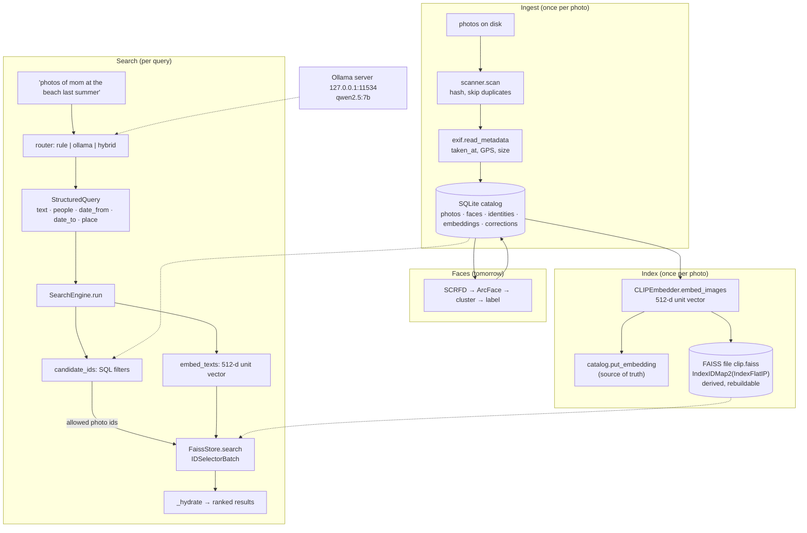

# D10-01 · Photo-Seek overview (30 min)

Hub: [[Day 10 - Photo-Seek I]] · Previous: [[D10-00 Recall]] · Next: [[D10-02 CLIP theory]] · Pack: [[Photo-Seek - prep#1. The pitch]]

> [!info] How to read the labels in every D10 note
> **[code]** = I read it in the repo at `upgrade-2026-10` (`aa5d476`). **[doc]** = a README, result JSON or prep-pack number. **[lib]** = how a library (open_clip, FAISS, Ollama) behaves; not in your repo. **[mine]** = my own reasoning; treat it as an argument, not a fact. **[ran]** = I ran your code today with plain Python (only the parts that need no numpy).

## 1. The problem

A person has tens of thousands of photos and cannot find one. Two questions come up again and again:

1. **"Who is in it?"** → needs faces grouped into people.
2. **"Find the photo of mom at the beach last summer."** → needs search by meaning, person and date.

Cloud tools answer both by uploading your photos and faces. Photo-Seek answers both **with nothing leaving the machine** [doc: prep pack decision 1].

## 2. Why local and offline matter

- Photos hold faces, children, homes, GPS points and dates. A face vector identifies a person for life; it cannot be reset like a password.
- "Offline" is the design rule that forces every other choice: local model weights, SQLite instead of a hosted database, a local LLM server, and a rule parser for when the LLM is down.

**What was actually shown** [doc: `eval/results/offline.json`]: three searches ran under a Python audit hook. It recorded **6 socket events, all to 127.0.0.1**. The Ollama server's own sockets were sampled with `ss` and had only loopback peers.

> [!warning] Say it precisely
> This is **process-level** evidence. It does not prove the operating system has no network access; that would need a network namespace or a firewall, which the shared server does not allow [code: `eval/offline.py:12-15`]. And say **"local" or "self-hosted", not "on-device"**: every number was measured on a shared server with an H200 GPU.

## 3. Two pipelines

| | Face organisation (tomorrow, [[Day 11 - Photo-Seek II and emotion steering]]) | Image retrieval (today) |
|---|---|---|
| Question | Who is in each photo? | Which photos match this sentence? |
| Models | SCRFD detector, ArcFace embedder (both pretrained, frozen) | CLIP ViT-B-32 (pretrained), qwen2.5:7b on Ollama (pretrained) |
| Core idea | Cluster face vectors; ask the user about uncertain faces | Parse the sentence into filters; SQL filters; CLIP ranks the rest |
| Output | `faces.identity_id` → `identities.name` | A ranked list of photos |

**They meet in one place:** the search filter `people=["mom"]` only works because the face pipeline gave some identity the name "mom" [code: `engine.py:150`].

## 4. Architecture

Three stores, three jobs:

| Store | Holds | Why this one |
|---|---|---|
| **SQLite catalog** | Every fact: paths, dates, faces, names, and every vector as a blob | The source of truth. Exact answers to exact questions (dates, people) |
| **FAISS file** | The same CLIP vectors, laid out for fast search | Derived. Can be deleted and rebuilt from the catalog [code: `faiss_store.py:3-5`] |
| **Ollama server** | The LLM weights, in a separate process | Loaded once; the CLI stays small [lib] |

## 5. Who made what

Interviewers will probe this. Keep the three columns apart.

| Pretrained weights (not trained by you) | Libraries you call | Written in this repo (yours to defend) |
|---|---|---|
| CLIP ViT-B-32 `laion2b_s34b_b79k` | open_clip, PyTorch | `CLIPEmbedder`: batching, error slots, normalisation ([[D10-03 CLIP code]]) |
| qwen2.5:7b | Ollama (server, constrained decoding) | The prompt, the JSON schema, validation, fallback ([[D10-07a Query parser code]]) |
| SCRFD, ArcFace | FAISS (`IndexFlatIP`, `IndexIDMap2`, `IDSelectorBatch`) | `FaissStore`: id replace, prefilter, atomic save ([[D10-05 FAISS code]]) |
| | SQLite | `StructuredQuery`, `RuleRouter`, `HybridRouter`, `SearchEngine`, the schema, the eval scripts, the 100-query gold set |

> [!warning] Three wordings to fix before the interview [doc: prep pack §5.1]
> - "LLM-based query **routing**" → the LLM **parses** the query into filters. It does not choose between retrieval backends. The class is *named* `OllamaRouter`, which is why the resume says routing.
> - "**on-device**" → "local" or "self-hosted".
> - R@1 39.4 is **zero-shot pretrained CLIP**. Your contribution is the system around it.

## 6. State of the repo today

- `import numpy` fails in the `photo-seek` env with `Cannot load libmkl_gf_lp64.so.3` [doc]. So tests and benchmarks **cannot be re-run today**; I did not repair the env.
- Last recorded test run: **156 passed** (22 Oct). The README says **157**. Keep both numbers and say so.
- No real personal library was ever processed: `data/catalog.db` has 0 photos [doc: prep pack]. The retrieval numbers come from COCO-5k and Flickr-1k.

## Check

1. Which pipeline produces the data that `people=["mom"]` filters on?
2. Which of the three stores can be deleted without losing anything?
3. What exactly did the offline audit observe, and what did it not prove?

> [!success]- Answers
> 1. The face pipeline: it fills `faces.identity_id` and the user names the identity.
> 2. The FAISS file; `rebuild_from_catalog` remakes it from the `embeddings` table.
> 3. Six socket events, all to 127.0.0.1, plus loopback-only Ollama peers. It did not prove OS-level isolation.
