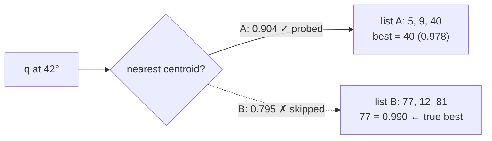
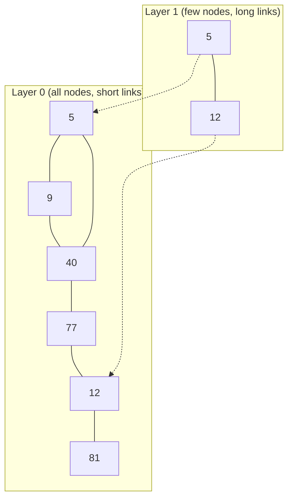

# D10-04 · FAISS theory: Flat, IVF, HNSW, PQ (40 min)

Hub: [[Day 10 - Photo-Seek I]] · Previous: [[D10-03 CLIP code]] · Next: [[D10-05 FAISS code]]

The day note already has the six-photo toy, Flat, a first IVF miss and pre- vs post-filtering ([[Day 10 - Photo-Seek I#5. Deep dive: FAISS indexes and pre-filtering from scratch|§5]]). This note keeps that toy and adds what was thin: **HNSW with a worked walk, PQ with real numbers, the memory and build trade-offs, and what changes at 1 million and 100 million vectors.**

> [!important] The one sentence
> Every index answers the same question, "which stored vectors are closest to q?". **Flat** answers it exactly by checking all of them; **IVF, HNSW and PQ** answer it faster or smaller by accepting that they may sometimes miss.

## 1. The nearest-neighbour problem

Given a query vector $q$ and $N$ stored vectors, return the $k$ with the **largest inner product** with $q$. For unit vectors that is the largest cosine.

The toy library: six photos as 2-D unit vectors (only the angle matters).

| photo id | angle | score vs q at 0° | score vs q at 42° |
|---|---|---|---|
| 5 | 5° | 0.996 | 0.799 |
| 9 | 15° | 0.966 | 0.891 |
| 40 | 30° | 0.866 | 0.978 |
| 77 | 50° | 0.643 | **0.990** |
| 12 | 70° | 0.342 | 0.883 |
| 81 | 120° | −0.500 | 0.208 |

## 2. Brute force = the Flat index

**Idea:** compute all $N$ scores, keep the $k$ best. `IndexFlatIP` is exactly this, in optimised C++.

- **Exact:** it cannot miss.
- **Cost per query:** $N \times d$ multiply-adds.
- **Memory:** $N \times d \times 4$ bytes. No extra structure.
- **Build:** none. Adding a vector is appending a row. No training.

| N | multiply-adds per query | memory (512-d float32) |
|---|---|---|
| 5,000 (the COCO eval) | 2.56 million | 10 MB |
| 100,000 (a big personal library) | 51 million | 205 MB |
| 1 million | 512 million | 2.05 GB |
| 100 million | 51 billion | 205 GB |

Measured [doc]: one query on COCO-5k takes **2.8 ms median**, and that includes the CLIP text encoding on the GPU; the flat scan is a small part of it.

## 3. IVF: look only in the nearest buckets

**Build.** Run k-means on the vectors to get `nlist` **centroids**. Each vector goes into the list of its nearest centroid. These lists are the "inverted lists": centroid → the ids filed under it.

**Search.** Compare $q$ with the `nlist` centroids, then scan only the `nprobe` nearest lists.

Toy with `nlist = 2`:

| list | members | centroid direction |
|---|---|---|
| A | 5, 9, 40 | 16.7° |
| B | 77, 12, 81 | 79.3° |

Query at **42°**, `nprobe = 1`: centroid A scores 0.904, B scores 0.795 → scan A only → best is photo 40 (0.978). The true best, photo **77 (0.990)**, sits in B. **Missed.** `nprobe = 2` finds it but scans everything.

- **Work per query:** about `nlist` + `nprobe` × (N / `nlist`) comparisons, instead of N.
- **The miss:** a query near a cell border has its true neighbour just across the border.
- **Needs training** (the k-means) before any vector can be added. The FAISS guideline is `nlist` between $4\sqrt{N}$ and $16\sqrt{N}$: 4,000–16,000 for 1 million vectors.
- **`nprobe` is the dial:** higher → more recall, more time.

## 4. HNSW: walk a graph toward the query

**Idea.** Link every vector to a few near neighbours. To search, start somewhere and keep stepping to whichever neighbour is closer to $q$. Stop when no neighbour is closer.

**The problem with one flat graph:** from a far-away start, the walk needs many small steps. **The fix: layers.** A few vectors also live on an upper layer with **long links**, like motorways above local streets. Search starts on the top layer, gets near quickly, then drops down for the fine steps. That is the "hierarchical" in *Hierarchical Navigable Small World*.

Toy graph on the six photos:

Search for q at **42°** (scores from the table in section 1):

| step | layer | at node | its neighbours' scores | move |
|---|---|---|---|---|
| 1 | 1 | 5 (0.799) | 12: 0.883 | → 12 (better) |
| 2 | 1 | 12 (0.883) | 5: 0.799 | none better → **drop to layer 0** |
| 3 | 0 | 12 (0.883) | 77: **0.990**, 81: 0.208 | → 77 |
| 4 | 0 | 77 (0.990) | 40: 0.978, 12: 0.883 | none better → **stop** |

Answer: photo 77, the true best. The walk scored 5 of the 6 vectors, so a toy this small saves nothing. The saving appears at scale: the number of hops grows roughly like $\log N$, not $N$ [lib].

**The knobs** [lib]: `M` = links per node (more → better recall, more memory); `efConstruction` = effort while building; `efSearch` = how many candidates the walk keeps (more → better recall, slower).

**The costs:**
- **Memory:** the full vectors **plus** the links. With `M = 32`, about 256 extra bytes per vector at the bottom layer [mine: 2·M ids × 4 bytes].
- **Build time:** every insert is itself a search. Slow to build.
- **Deletes:** FAISS's HNSW does not support removing vectors [lib]. Photo-Seek re-embeds and replaces photos, so this matters ([[D10-05 FAISS code#1. add - custom ids and replacing an old vector]]).
- **Greedy walks can stop early** at a local best. Approximate.

## 5. Product Quantization: make each vector tiny

IVF and HNSW make search **faster**. PQ makes vectors **smaller**.

**Idea.** Cut each vector into $m$ pieces. For each piece position, learn a small **codebook** of typical pieces (k-means again). Store, for each piece, only the **index** of the nearest codebook entry.

**Worked example.** A 4-d vector, $m = 2$ pieces of 2 numbers, codebooks of 4 entries (so 2 bits per piece).

| | codebook 1 (first two numbers) | codebook 2 (last two numbers) |
|---|---|---|
| code 0 | (0.5, 0.5) | (0.0, 0.5) |
| code 1 | (1.0, 0.0) | (0.5, 0.0) |
| code 2 | (0.0, 1.0) | (0.5, 0.5) |
| code 3 | (0.0, 0.0) | (0.0, 0.0) |

**Encode** $x = (0.6, 0.5, 0.1, 0.6)$:
- piece 1 = (0.6, 0.5). Squared distances to codebook 1: 0.01, 0.41, 0.61, 0.61 → **code 0**.
- piece 2 = (0.1, 0.6). Squared distances to codebook 2: 0.02, 0.52, 0.17, 0.37 → **code 0**.
- Stored: `[0, 0]`. That is 4 bits instead of 16 bytes.

**Search** with $q = (1, 0, 0, 1)$. First build two tiny tables, once per query: $q$'s first half against codebook 1, its second half against codebook 2.

| | code 0 | code 1 | code 2 | code 3 |
|---|---|---|---|---|
| table 1: (1, 0) · entry | 0.5 | 1.0 | 0.0 | 0.0 |
| table 2: (0, 1) · entry | 0.5 | 0.0 | 0.5 | 0.0 |

Score of $x$ = table1[0] + table2[0] = 0.5 + 0.5 = **1.0**. The exact score is $0.6 + 0.6 = $ **1.2**. Scoring a vector is now two table look-ups and an add, but the answer is **approximate**: the ranking can change.

**Real sizes.** 512-d vector, $m = 64$ pieces of 8 numbers, 256 entries per codebook (1 byte per piece):

| | bytes per vector | 1 million | 100 million |
|---|---|---|---|
| Flat float32 | 2,048 | 2.05 GB | 205 GB |
| PQ, 64 bytes | 64 | 64 MB | 6.4 GB |

32× smaller. PQ is almost always combined with IVF ("IVF-PQ"): IVF picks the lists, PQ stores what is in them.

## 6. Exact vs approximate

| | Exact | Approximate (ANN) |
|---|---|---|
| guarantees the true top k? | yes | no |
| how quality is measured | nothing to measure | **recall**: the share of the true top k it returns, with Flat as ground truth |
| who | Flat | IVF, HNSW, PQ and combinations |

> [!warning] Two different "recalls"
> **ANN recall** asks: did the index return the same neighbours Flat would? **Retrieval R@1 = 39.4** asks: is the top neighbour the *right photo*? Photo-Seek uses Flat, so its ANN recall is 100% by construction. All of the 60.6% miss is **CLIP's**, not the index's. That clean split is a real benefit of choosing an exact index. [mine]

## 7. Recall vs speed, memory, build cost

| | Flat | IVF (flat lists) | HNSW | IVF-PQ |
|---|---|---|---|---|
| exact? | **yes** | no | no | no |
| query work | N · d | ~ `nprobe`/`nlist` of N | ~ log N hops | ~ `nprobe`/`nlist` of N, on tiny codes |
| memory per 512-d vector | 2,048 B | 2,048 B + ids | 2,048 B + ~256 B links (M = 32) | ~64 B + ids |
| training needed? | **no** | yes (k-means) | no | yes (k-means, twice) |
| build cost | none | cheap after training | **slow** (insert = search) | training + encoding |
| delete by id? | **yes** | yes | no (in FAISS) | yes |
| dial for recall ↔ speed | none | `nprobe` | `efSearch` | `nprobe`, code size |
| typical miss | never | neighbour across a cell border | walk stops at a local best | quantisation changes the order |
| good when | N up to ~10⁵–10⁶ | N ~ 10⁶–10⁸, RAM is fine | N ~ 10⁶–10⁸, speed first, RAM is fine | N ≥ 10⁸, RAM is the limit |

Memory figures for HNSW and IVF-PQ are my estimates from the formulas [mine], not measurements.

## 8. Why IndexIDMap2(IndexFlatIP) fits this project

| reason | detail | source |
|---|---|---|
| **N is small** | a personal library is thousands to tens of thousands of vectors; flat search is under a millisecond | [code: `faiss_store.py:55-61`] |
| **No recall lost** | approximate indexes would "trade away recall for nothing" at this size | [code: same docstring] |
| **No training step** | the first photo can be indexed immediately; IVF and PQ need a training set first | [mine] |
| **Deletes and replaces** | re-embedding a photo removes the old vector by id | [code: `faiss_store.py:96-99`] |
| **Works with the prefilter** | `IDSelectorBatch` on a flat index is still exact inside the allowed set | [code: `faiss_store.py:137`] |
| **Clean evaluation** | every retrieval miss is CLIP's, never the index's | [mine] |
| **`IP`** | vectors are unit length, so inner product = cosine | [code: `base.py:7-9`] |
| **`IDMap2`** | FAISS numbers vectors 0, 1, 2…; the wrapper lets it speak in `photos.id` | [code: `faiss_store.py:37-38`] |

**The cost you accept:** O(N) per query, and a filtered search still walks every vector to check its id.

**Honest notes.** (1) No index type other than Flat was benchmarked in the repo; the choice is argued, not measured. (2) `IndexIDMap2` differs from plain `IndexIDMap` by keeping a reverse id → row map, which is what `reconstruct(id)` needs [lib]. The repo never calls `reconstruct`, so plain `IndexIDMap` would probably work too; I did not test that [mine].

## 9. What changes at 1 million and at 100 million

**1 million vectors** [mine]. 2 GB of RAM and 512 million multiply-adds per query: tens of milliseconds on a CPU. Flat is still *usable*, and a GPU flat index is an option. If latency matters, switch to **IVF** (`nlist` ≈ 4,000–16,000) or **HNSW**, and measure recall@k against Flat on a sample of queries. The code comment itself says IVF-PQ only becomes worth its training step "somewhere past ~10⁶ vectors" [code: `faiss_store.py:60`].

**100 million vectors** [mine]. Flat needs 205 GB and 51 billion multiply-adds per query. Not viable on one machine. The design changes in five places:

| area | today | at 100 million |
|---|---|---|
| index | Flat | **IVF-PQ** (≈ 7 GB of codes) or HNSW on a big-RAM host; exact **re-rank** of the top few hundred from stored full vectors |
| build | none | train on a sample; batch encode; hours, not seconds |
| where | one process, one file | **sharded** across machines; query all shards, merge the top k |
| **prefilter** | `IDSelectorBatch` over a Python set | the hard part: the SQL step could return millions of ids. Options: partition the index by a filter key (user, year); filter-aware ANN; or over-fetch and post-filter when the filter is loose |
| source of truth | SQLite + float32 blobs | a real database; vectors in object storage |
| quality tracking | not needed (exact) | a recall@k dashboard against a Flat sample |

And say the scoping honestly: **100 million photos is not a personal library.** It is a different product (multi-user, multi-tenant). The right answer shows you know what breaks, not that Photo-Seek would scale as is.

## Check

1. Why can IVF miss the true nearest neighbour? Use the toy.
2. In the HNSW walk, what is the upper layer for?
3. Encode $x = (0.9, 0.1, 0.4, 0.1)$ with the codebooks above. What is its approximate score against $q = (1, 0, 0, 1)$, and the exact one?
4. Which index families need a training step, and which cannot delete in FAISS?
5. Photo-Seek's R@1 is 39.4. How much of the miss is caused by the index?
6. Give two things that break first if you keep Flat at 100 million vectors.

> [!success]- Answers
> 1. q at 42° is nearer centroid A, but its best match (77) is filed in list B, which `nprobe = 1` never scans.
> 2. Long links that get the walk near the query in a few hops before the fine search on layer 0.
> 3. Piece 1 (0.9, 0.1) → nearest is (1.0, 0.0), code 1. Piece 2 (0.4, 0.1) → nearest is (0.5, 0.0), code 1. Approximate = table1[1] + table2[1] = 1.0 + 0.0 = **1.0**. Exact = 0.9 + 0.1 = **1.0**. (Here they happen to agree.)
> 4. IVF and PQ need training. HNSW cannot delete.
> 5. None. Flat is exact, so the index returns CLIP's true nearest neighbours.
> 6. RAM (205 GB of vectors) and latency (51 billion multiply-adds per query).

## Five things to remember

1. **Flat** = exact, O(N·d), no training, 2,048 B per vector.
2. **IVF** = k-means buckets, probe a few; misses near borders; needs training.
3. **HNSW** = layered graph walk, ~log N hops; extra memory, slow build, no deletes.
4. **PQ** = store codebook indexes, not numbers; 32× smaller, approximate scores.
5. **Flat here** because N is thousands; at 10⁸ you move to IVF-PQ + shards + re-rank, and filtering becomes the hard problem.
