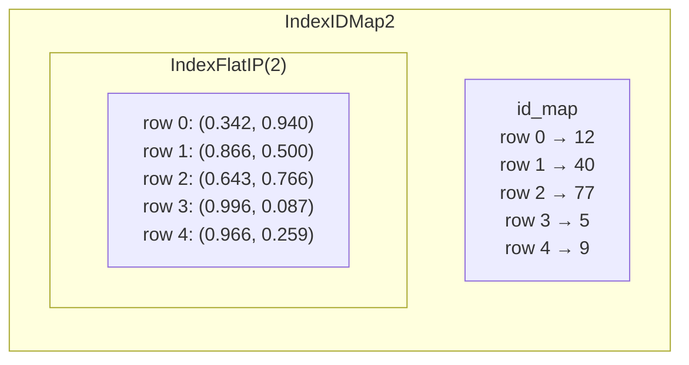
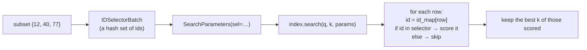

# D10-05 · FAISS code: index/faiss_store.py (30 min)

Hub: [[Day 10 - Photo-Seek I]] · Previous: [[D10-04 FAISS theory]] · Next: [[D10-06 Ollama and structured output]]

File: `src/photoseek/index/faiss_store.py` (184 lines). The second half of `search` (lines 131–145) is walked in [[Day 10 - Photo-Seek I#5.9 The code, line by line|day note §5.9]]. This note covers `add`, `remove`, the first half of `search`, `save`, `load` and `rebuild_from_catalog`, with one five-vector trace through all of them.

> [!warning] Not run today
> The env cannot import numpy, so FAISS could not be executed. The trace values below are **computed by hand** from the code and from how FAISS behaves [lib]. The engine-level traces in [[D10-07b Search engine code]] were really run, with a pure-Python stand-in for this class.

## 0. Map of the file

| lines | member | job |
|---|---|---|
| 26–30 | `SearchHit` | one result: `id`, `score` (frozen dataclass) |
| 34–49 | `VectorStore` | the Protocol: `dim`, `add`, `search`, `save` |
| 64–66 | `__init__` | remember `dim`; no FAISS object yet |
| 75–79 | `_ensure_index` | build `IndexIDMap2(IndexFlatIP(dim))` on first use |
| 81–99 | `add` | store vectors under catalog ids, replacing old ones |
| 101–109 | `remove` | drop ids |
| 111–145 | `search` | top k, optionally only inside `subset` |
| 147–157 | `save` | write a temp file, then rename |
| 159–166 | `load` | read the file back |
| 168–183 | `rebuild_from_catalog` | remake the index from SQLite |

## The running example: five photos, two dimensions

A `FaissStore(dim=2)` and five unit vectors $(\cos\theta, \sin\theta)$:

| photo id | angle | vector | score vs query (1, 0) |
|---|---|---|---|
| 12 | 70° | (0.342, 0.940) | 0.342 |
| 40 | 30° | (0.866, 0.500) | 0.866 |
| 77 | 50° | (0.643, 0.766) | 0.643 |
| 5 | 5° | (0.996, 0.087) | 0.996 |
| 9 | 15° | (0.966, 0.259) | 0.966 |

## 1. add - custom ids and replacing an old vector

`faiss_store.py:81–99`
```python
def add(self, ids: Sequence[int], vectors: Sequence[Vector]) -> None:
    import numpy as np

    if len(ids) != len(vectors):
        raise ValueError(f"{len(ids)} ids for {len(vectors)} vectors")
    if len(ids) == 0:
        return

    vecs = np.ascontiguousarray(np.asarray(vectors, dtype="float32"))
    if vecs.ndim != 2 or vecs.shape[1] != self._dim:
        raise ValueError(f"expected vectors of dim {self._dim}, got shape {vecs.shape}")
    id_arr = np.asarray(ids, dtype="int64")

    self._ensure_index()
    if self._index.ntotal:
        self.remove(id_arr)
    self._index.add_with_ids(vecs, id_arr)
```

**A primer on the two FAISS objects** [lib]

- `IndexFlatIP(d)` is one big array of rows, each `d` float32 numbers. It knows rows only by position: 0, 1, 2…
- `IndexIDMap2(inner)` wraps it and keeps a second array, `id_map`, the same length: `id_map[row] = your id`. Searches translate row numbers to your ids on the way out.



**Variables and shapes**

| name | type / shape | meaning | toy | real |
|---|---|---|---|---|
| `ids` | sequence of n ints | `photos.id` values | `[12, 40, 77, 5, 9]` | up to 256 per call |
| `vectors` | n items of length `dim` | CLIP vectors | five pairs | n × 512 |
| `vecs` | `[n, dim]` float32, C-contiguous | one block of memory FAISS can read | `[5, 2]` | `[256, 512]` |
| `id_arr` | `[n]` int64 | ids as FAISS wants them | `[12, 40, 77, 5, 9]` | |
| `self._index.ntotal` | int | vectors currently stored | 0, then 5 | |

**Line by line**

| line | what | why | what breaks without it |
|---|---|---|---|
| `len(ids) != len(vectors)` | refuse mismatched inputs | an id without a vector means some photo gets another's vector | silent mis-pairing |
| `len(ids) == 0: return` | nothing to do | `rebuild_from_catalog` calls `add` with a possibly empty last batch | FAISS call on an empty array |
| `np.asarray(..., dtype="float32")` | list of arrays → one 2-D float32 array | FAISS's C++ reads raw float32 memory | wrong dtype → garbage or an error |
| `np.ascontiguousarray` | guarantee one unbroken row-major block | FAISS takes a pointer to the first number and walks forward | a sliced or transposed array would be read wrongly |
| `vecs.ndim != 2 or shape[1] != dim` | check the shape | catches a 768-d vector from another model | mixed spaces in one index |
| `dtype="int64"` | ids as 64-bit ints | FAISS's id type | type error |
| `self._ensure_index()` | create the index on first add | construction stayed cheap (`import faiss` is lazy too) | `None` has no `add_with_ids` |
| `if self._index.ntotal: self.remove(id_arr)` | delete any old vector under these ids first | so a re-embedded photo is **replaced** | FAISS happily stores two vectors under one id; the stale one keeps appearing in results |
| `add_with_ids(vecs, id_arr)` | append rows and their ids | the actual store | — |

**Traced**

| call | state after |
|---|---|
| `store = FaissStore(2)` | `_index = None`, `len(store) = 0` |
| `store.add([12, 40, 77, 5, 9], five vectors)` | `ntotal` was 0 → no remove. `ntotal = 5`, `id_map = [12, 40, 77, 5, 9]` |
| `store.add([40], [(0.5, 0.866)])` (photo 40 re-embedded, now at 60°) | `ntotal = 5` → `remove([40])` returns 1 → `ntotal = 4` → add → `ntotal = 5`. Photo 40's row now holds (0.5, 0.866) |

`remove` (lines 101–109) wraps the ids in a `faiss.IDSelectorBatch` and calls `remove_ids`, which returns how many were present. So the same selector class is used twice in this file: here to say "delete these", and in `search` to say "only score these".

**Where the output goes:** nothing is returned. The index lives in memory until `save` ([[#4. save - a temp file and a rename]]).

## 2. search - the first half

`faiss_store.py:120–129`
```python
if self._index is None or self._index.ntotal == 0 or k <= 0:
    return []

q = np.asarray(query, dtype="float32").reshape(1, -1)
if q.shape[1] != self._dim:
    raise ValueError(f"query has dim {q.shape[1]}, index has {self._dim}")
```

| line | what | why |
|---|---|---|
| the three-way `or` | empty index or `k ≤ 0` → `[]` | FAISS asserts on `k = 0`; an empty list is the honest answer |
| `.reshape(1, -1)` | `(2,)` → `(1, 2)`; at real size `(512,)` → `(1, 512)` | FAISS always searches a **batch** of queries, shape `[n_queries, dim]`. `-1` means "work this size out" |
| the dim check | refuse a query from another model | a 768-d query against a 512-d index would crash inside C++ |

Then lines 131–145 (day note §5.9): build the selector if `subset` is given, clamp `k`, call `self._index.search(q, k, params=params)`, and turn row 0 of the result into `SearchHit`s.

**What FAISS returns** [lib]: two arrays, both `[n_queries, k]`. `scores` (float32) and `found` (int64 ids, already translated by the id map). Sorted best first. Missing results are id −1.

**Traced** on the five photos (the original vectors), query `(1, 0)`:

| call | `k` after clamping | scored | result |
|---|---|---|---|
| `search(q, 2)` | 2 | all five | `[(5, 0.996), (9, 0.966)]` |
| `search(q, 2, subset={12, 40, 77})` | min(2, 3) = 2 | only 12, 40, 77 | `[(40, 0.866), (77, 0.643)]` |
| `search(q, 10, subset={12, 40, 77})` | min(10, 3) = 3 | only 12, 40, 77 | `[(40, 0.866), (77, 0.643), (12, 0.342)]` |
| `search(q, 2, subset=set())` | — | nothing | `[]` (returns at line 135) |
| `search(q, 2, subset={999})` | min(2, 1) = 1 | no stored id matches | FAISS returns id −1 → dropped → `[]` |

### How IDSelectorBatch restricts the search



- The flat index still **visits** every row, but computes an inner product only for allowed ids [lib]. A disallowed photo cannot enter the top k, however similar it is.
- So the filter makes the search **correct**, not faster. With 3 allowed photos out of 5,000 you save 4,997 dot products but still do 5,000 membership checks.
- **Cost that grows** [mine]: `np.fromiter(subset)` copies the Python set into an array on every query. Fine for thousands of ids; not for millions ([[D10-04 FAISS theory#9. What changes at 1 million and at 100 million]]).

## 3. Why inner product on unit vectors is cosine

$$\cos(a, b) = \frac{a \cdot b}{\lVert a \rVert\,\lVert b \rVert} \quad\Longrightarrow\quad \cos(a, b) = a \cdot b \;\text{ when } \lVert a \rVert = \lVert b \rVert = 1$$

Check with photo 40 and the query: $(0.866, 0.500) \cdot (1, 0) = 0.866 = \cos 30°$.

Now the failure case. Store photo 12 **without** normalising, three times too long: $(1.026, 2.819)$. Its inner product with the query becomes $1.026$, which beats photo 5's $0.996$. A photo 70° away would rank first, only because its vector is long. That is why:

- `CLIPEmbedder` normalises both images and text [code: `clip.py:93–94, 111–112`];
- the convention is written at the top of `base.py`;
- `SearchHit.score` is commented "inner product on unit vectors, so: cosine similarity" [code: line 30].

**Why IP and not L2 distance?** For unit vectors $\lVert a - b \rVert^2 = 2 - 2\,a \cdot b$, so both give the **same ranking**. IP gives the cosine directly, and "higher is better" reads naturally. [mine]

**`FaissStore` does not normalise or check lengths itself.** It trusts its callers. A new embedder that forgets to normalise would break ranking silently [doc: decision 4's cost].

## 4. save - a temp file and a rename

`faiss_store.py:147–157`
```python
def save(self, path: str | Path) -> None:
    import faiss

    self._ensure_index()
    path = Path(path)
    path.parent.mkdir(parents=True, exist_ok=True)
    tmp = path.with_suffix(path.suffix + ".tmp")
    faiss.write_index(self._index, str(tmp))
    os.replace(tmp, path)
```

For `path = data/clip.faiss`: `path.suffix` is `".faiss"`, so `tmp` = `data/clip.faiss.tmp`.

**The problem.** Writing a file takes time. If the process dies half-way (Ctrl-C, out of disk, a killed job), a direct write leaves **half a file under the real name**. The next `photoseek search` would try to load it and crash, or worse, load garbage.

**The fix: write elsewhere, then swap.**

| step | disk state | if the process dies here |
|---|---|---|
| before | `clip.faiss` (old, good) | — |
| `write_index(tmp)` in progress | `clip.faiss` (old, good) + `clip.faiss.tmp` (partial) | the old index is untouched; a stale `.tmp` is left behind |
| `write_index` done | old good + tmp **complete** | still fine |
| `os.replace(tmp, path)` | `clip.faiss` (new, good) | the rename is **atomic**: a reader sees the old file or the new one, never a mix |

`os.replace` is atomic when both names are on the same filesystem [lib]. The temp file is in the **same directory** on purpose, which guarantees that.

**What it does not do** [mine]: it does not `fsync`, so a power cut right after the rename could still lose data on some filesystems. That is acceptable here because the index is **derived**: the catalog holds every vector.

**Other lines:** `_ensure_index()` lets an empty store be saved; `mkdir(parents=True, exist_ok=True)` creates `data/` on the first run.

## 5. load and rebuild_from_catalog

`load` (159–166): `faiss.read_index(path)`, then `cls(index.d)`. The dimension is read **from the file**, so the caller need not know it.

`rebuild_from_catalog` (168–183): streams `(photo_id, vector)` from `catalog.iter_embeddings()` and adds them in batches of 4,096 (`_REBUILD_BATCH`). This is the recovery path for a lost, corrupt or version-stale index file.

**Why the catalog is the source of truth** [code: lines 3–5; doc: decision 2]: a FAISS version bump or a change of index type becomes a **rebuild**, not a data migration. The cost is storing every vector twice.

**Know this:** no CLI command calls `rebuild_from_catalog`. Its only caller is a test (`tests/test_index.py:73`). `photoseek index --rebuild` re-embeds from the image files instead [code: `cli.py:119`]. So the recovery path exists and is tested, but is not wired to a command.

## Check

1. After `add([7], [v1])` then `add([7], [v2])`, how many vectors does the index hold, and which one?
2. Why `reshape(1, -1)` on the query?
3. `search(q, 5, subset={40, 77})` on the five-photo index. What is returned?
4. A crash happens while `write_index` is running. What does the next search load?
5. Why must the temp file be in the same directory as the final file?
6. If an embedder returned vectors of length 2 instead of 1, which line would catch it?

> [!success]- Answers
> 1. One: `v2`. The second `add` removes id 7 first.
> 2. FAISS searches batches of queries shaped `[n, dim]`; one query is a batch of one.
> 3. `k = min(5, 2) = 2` → `[(40, 0.866), (77, 0.643)]`.
> 4. The old, complete `clip.faiss`. The partial data is only in `clip.faiss.tmp`.
> 5. A rename is atomic only within one filesystem; the same directory guarantees that.
> 6. None. `FaissStore` checks the dimension, not the length. Ranking would silently favour long vectors.

## Five things to remember

1. `IndexIDMap2(IndexFlatIP(d))`: a flat array of rows plus an `id_map` from row to `photos.id`.
2. `add` = validate → float32 contiguous `[n, d]` → **remove old ids** → `add_with_ids`.
3. `search` = `[1, d]` query → optional `IDSelectorBatch(subset)` → top k → drop −1.
4. Unit vectors make inner product equal cosine; the store **trusts** callers to normalise.
5. `save` = write `clip.faiss.tmp`, then atomic `os.replace`; the index is derived and rebuildable.
