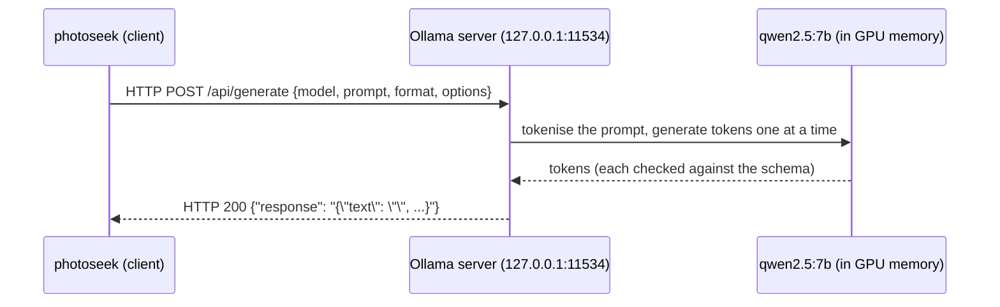

# D10-06 · Ollama and structured output (25 min)

Hub: [[Day 10 - Photo-Seek I]] · Previous: [[D10-05 FAISS code]] · Next: [[D10-07a Query parser code]]

The day note covers the constrained-decoding step table and the fallback ([[Day 10 - Photo-Seek I#6.4 The LLM router: JSON with a schema|§6.4–6.5]]). This note builds the ground under it: what a serving process is, what JSON and a JSON schema are, what the schema in *your* code does and does not constrain, and three **real** recorded outputs.

> [!important] The one sentence
> A schema forces the model's answer into the right **shape**; it cannot make the **content** true. So the code still validates, still falls back, and takes dates from rules.

## 1. What is an LLM serving process?

An LLM is a file of weights (qwen2.5:7b is 4.4 GB [doc]). Using it means: load the file into GPU memory (seconds), then run it token by token.

Loading on every query would cost seconds each time. So the model is kept loaded inside a **long-running program, a server**, and other programs send it requests.



Two processes, one machine. They talk over HTTP on the **loopback** address 127.0.0.1, which never leaves the computer. That is why the offline audit saw socket events at all, and why all six were loopback [doc].

## 2. What Ollama does

Ollama is a program that [lib]:
- downloads and stores model files (in quantised GGUF form);
- loads a model onto the GPU or CPU and keeps it loaded;
- runs the inference engine (llama.cpp);
- offers an HTTP API: `/api/generate`, `/api/chat`;
- supports **structured outputs**: pass a JSON schema as `format`.

**In this project** [doc: decisions 10, 26, 27]:
- It is the project's **own** Ollama binary on port **11534**. The system one on 11434 could not reach the GPU.
- The client is plain `urllib`: one POST is "not worth a dependency" [code: `router.py:253`].
- **Why Ollama and why qwen2.5:7b?** Local means offline, and Ollama gives schema-constrained output. The model name was in the first scaffold config; **no doc says why this model**. Say "not documented; a 7B model with good instruction following that fits in a 4.4 GB download" and label it as your reasoning.

## 3. What JSON is

JSON is a text format for structured data. Six kinds of value:

| kind | example |
|---|---|
| string | `"beach"` (double quotes only) |
| number | `40` |
| true / false | `true` |
| null | `null` (nothing) |
| array | `["mom", "dad"]` |
| object | `{"place": "beach", "people": ["mom"]}` |

Python reads it with `json.loads` (text → dict) and writes it with `json.dumps` (dict → text). It is the common language between the LLM (which emits text) and the code (which wants fields).

## 4. What a JSON schema is

A JSON schema is **itself JSON**, describing what another JSON value must look like. Yours [code: `router.py:261–271`]:

```python
SCHEMA = {
    "type": "object",
    "properties": {
        "text": {"type": "string"},
        "people": {"type": "array", "items": {"type": "string"}},
        "date_from": {"type": ["string", "null"]},
        "date_to": {"type": ["string", "null"]},
        "place": {"type": ["string", "null"]},
    },
    "required": ["text", "people", "date_from", "date_to", "place"],
}
```

| part | meaning |
|---|---|
| `"type": "object"` | the answer is `{ … }` |
| `"properties"` | the keys and the type of each value |
| `"type": ["string", "null"]` | a string **or** null |
| `"items": {"type": "string"}` | every element of the array is a string |
| `"required"` | all five keys must be present |

**What this schema does not constrain.** This is the part to say in an interview.

| The schema allows… | Example that passes the schema | What catches it |
|---|---|---|
| any string as a date (no `format` or `pattern`) | `"date_to": "2025-13-45"` | `_parse_date` → `None` [ran] |
| a date range that runs backwards | from 2026-08-31 to 2026-06-01 | **nothing** in the code I read |
| an empty person name | `"people": [""]` | `from_dict` drops blank names [code: `query.py:88`] |
| any person at all | `"people": ["kids"]` | the engine returns "unknown people" [doc: `offline.json`] |
| the wrong year | `"date_from": "2025-06-01"` for last summer | the hybrid's rule dates |
| extra keys (no `additionalProperties: false`) | `{"mood": "happy", …}` | `from_dict` ignores unknown keys |

## 5. Schema-constrained decoding

**Normal decoding.** At each step the model produces a score for every token in its vocabulary. A sampler picks one. Nothing stops it from writing `Sure! Here is the JSON:`.

**Constrained decoding.** The schema is compiled into a **grammar**: a set of rules for what may come next [lib]. Before each pick, every token that would break the grammar is **masked out** (its probability is set to zero). The model can only choose among legal continuations.

A step-by-step view for our query, after the model has written `{"text": "", "people": [`:

| candidate next token | model's own preference | legal? | result |
|---|---|---|---|
| `mom` (bare word) | high | no: array items must be strings, which start with `"` | masked |
| `"` | high | yes | **chosen** |
| `]` | lower | yes (an empty array) | allowed |
| `Sure` | tiny | no | masked |

**Guaranteed:** the output parses as JSON and has the five keys with the right types. **Not guaranteed:** anything about the values.

**A subtle risk** [mine]: masking changes what the model "wanted" to say. If its preferred token is illegal, it is pushed onto a second choice, and the rest of the answer follows from there. And generation stops at `num_predict = 200` tokens; if the object were not closed by then, the text would be cut and would not parse. The code handles that through `_extract_json` → `None` → fallback.

## 6. Valid JSON is not correct information

Three **real** recorded outputs from `eval/results/router_predictions.jsonl`, today pinned to 2026-10-22 [doc]:

**(a) Right shape, wrong year.** Query: *"photos of grandma last summer"*

| | people | date_from | date_to | all filters right? |
|---|---|---|---|---|
| gold | grandma | 2026-06-01 | 2026-08-31 | |
| LLM | grandma | **2025**-06-01 | **2025**-08-31 | ✗ |
| rules | grandma | 2026-06-01 | 2026-08-31 | ✓ |
| hybrid | grandma | 2026-06-01 | 2026-08-31 | ✓ (rules' dates) |

Perfect JSON. Every photo from the right summer would have been filtered out.

**(b) Right shape, a day too many.** Query: *"opening presents on Christmas 2023"*. Gold: 2023-12-25 to 2023-12-25. LLM: 2023-12-25 to **2023-12-26**. The rules found no date at all (and mistook "Christmas" for a place), so the hybrid kept the LLM's dates and was also wrong.

**(c) Right shape, a person who is not a person.** Query: *"children building a sandcastle at the beach last summer"*. The LLM returned `people: ["children"]`; gold has no people. The hybrid fixed the dates but kept the people, so it still failed. In the real system, "children" is not a named identity, so the search would return nothing.

These three are the whole argument for the design: **validate, fall back, and never trust the LLM with arithmetic.**

## 7. Temperature and deterministic output

After the mask, the remaining scores are divided by the **temperature** $T$ and turned into probabilities:

$$p_i = \frac{e^{z_i / T}}{\sum_j e^{z_j / T}}$$

Two legal tokens with scores 2.0 and 1.0:

| $T$ | p(first) | p(second) | behaviour |
|---|---|---|---|
| 1.0 | 0.73 | 0.27 | varied |
| 0.5 | 0.88 | 0.12 | mostly the first |
| → 0 | 1.00 | 0.00 | **greedy**: always the top token |

Your code sets `"options": {"temperature": 0.0, "num_predict": 200}` with the comment "Deterministic parsing beats creative parsing here" [code: `router.py:349–350`].

**Why:** a parser should give the same filters for the same sentence. A creative parser is a bug.

**But greedy is not perfectly repeatable** [doc]: across three repetitions, **3 of 100** queries changed output for the LLM arm (1 for the hybrid). Likely causes are floating-point ties and batching effects on the GPU [mine]. Say "near-deterministic", not "deterministic".

(Same word as CLIP's temperature, different job: see the note box in [[D10-02 CLIP theory#10. Temperature scaling]].)

## 8. From sentence to object: the whole path

Query: *"photos of mom at the beach last summer"*, today 2026-11-05.

**1. The request body** built by `_generate` [code: `router.py:341–352`]:

```json
{
  "model": "qwen2.5:7b",
  "prompt": "You convert photo-search requests into JSON filters… Today is 2026-11-05 (Thursday). … Request: photos of mom at the beach last summer\nJSON:",
  "stream": false,
  "format": { …the schema above… },
  "options": {"temperature": 0.0, "num_predict": 200}
}
```

**2. The reply.** Ollama answers with JSON whose `"response"` field is the model's text. A **likely** output (illustrative; this exact query is not in the recorded predictions, but the year error matches example (a)):

```json
{"text": "", "people": ["mom"], "date_from": "2025-06-01", "date_to": "2025-08-31", "place": "beach"}
```

**3. Into a Python object** via `_extract_json` and `StructuredQuery.from_dict`:

```python
StructuredQuery(text="", people=["mom"], date_from=date(2025, 6, 1), date_to=date(2025, 8, 31),
                place="beach", limit=40, raw="photos of mom at the beach last summer")
```

**4. The hybrid** then replaces the dates with the rules' 2026-06-01 → 2026-08-31.

Code for steps 1–4: [[D10-07a Query parser code]].

## Measured cost [doc]

| | median | p90 |
|---|---|---|
| rules | 0.19 ms | |
| LLM (qwen2.5:7b, H200) | 1.52 s | 2.19 s |

The LLM is about 8,000× slower than the rules. 1 of 100 queries fell back to the rules.

## Check

1. Why is the model kept in a separate server process?
2. Name two things your schema allows that are still wrong.
3. What does constrained decoding do to an illegal token?
4. Is `"date_to": "next Tuesday"` valid under your schema? What happens to it?
5. Temperature is 0. Why did 3 of 100 queries still change between runs?
6. Which component makes "last summer" correct in the final object, and why not the LLM?

> [!success]- Answers
> 1. Loading 4.4 GB takes seconds; a server loads once and answers many requests.
> 2. Any of: a malformed date string, a backwards range, the wrong year, a non-existent person, extra keys.
> 3. Masks it (probability zero) before the sampler picks.
> 4. Yes, it is a string. `_parse_date` fails to parse it and returns `None`, so that bound is dropped.
> 5. Greedy decoding still depends on floating-point results; near-ties can flip. The docs record the count, not the cause.
> 6. The rule parser, through the hybrid merge. The 7B model put "last summer" a year early in recorded outputs.

## Five things to remember

1. **Server:** load once, serve over loopback HTTP; `urllib` POST to `/api/generate`.
2. **Schema:** shape only: five required keys, types; **dates are just strings**.
3. **Constrained decoding:** illegal tokens are masked at each step → always parseable.
4. **Valid ≠ correct:** real outputs had the wrong year, an extra day, and "children" as a person.
5. **Temperature 0** = greedy, near-deterministic (3/100 changed); `num_predict` 200 caps the length.
