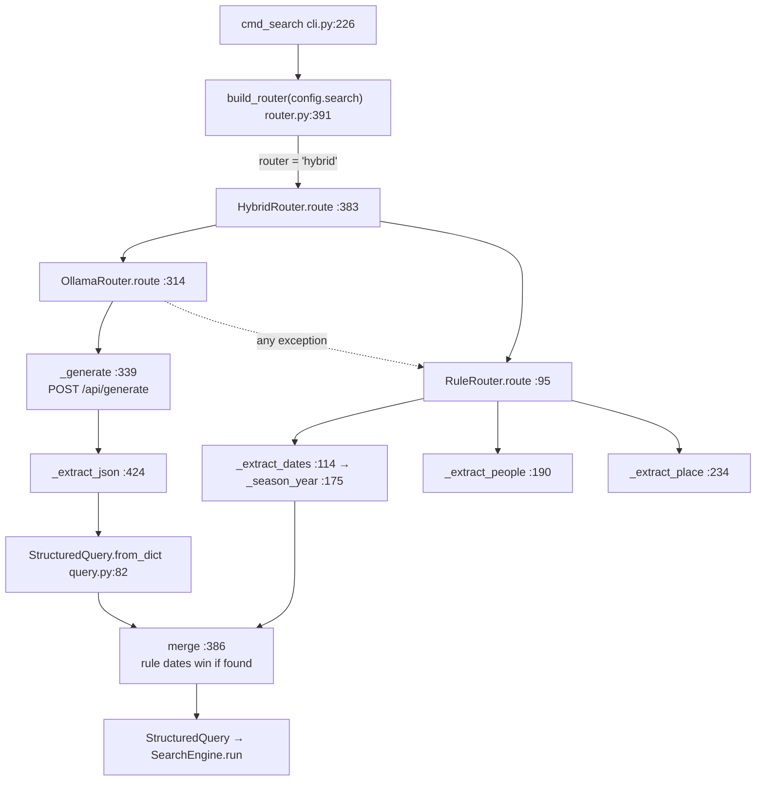

# D10-07a · Parser code: search/query.py and search/router.py (50 of the 90 min)

Hub: [[Day 10 - Photo-Seek I]] · Previous: [[D10-06 Ollama and structured output]] · Next: [[D10-07b Search engine code]]

Files: `query.py` (105 lines), `router.py` (452 lines). Order below = the order data flows. The day note already walks `OllamaRouter.route`, the "last summer" branch and the merge ([[Day 10 - Photo-Seek I#1. Parsing: the LLM for words, the rules for dates|§1]], [[Day 10 - Photo-Seek I#6. Deep dive: turning a sentence into filters from scratch|§6]]). This note adds the functions it skipped and **real traced values**.

> [!info] [ran] All rule-parser values here were produced today
> I imported your `RuleRouter` and `StructuredQuery` with plain Python and printed the results. Nothing on the LLM side was run (no Ollama call was made); LLM outputs are either from `router_predictions.jsonl` or marked "illustrative".



## 1. build_router: choosing the parser

`router.py:391–401`
```python
def build_router(config: SearchConfig, today: date | None = None) -> QueryRouter:
    if config.router == "ollama":
        return OllamaRouter(config, today=today)
    if config.router == "hybrid":
        return HybridRouter(config, today=today)
    if config.router == "rule":
        return RuleRouter(default_limit=config.top_k, today=today)
    raise ValueError(f"unknown router {config.router!r}; expected 'rule', 'ollama' or 'hybrid'")
```

- **Input:** `SearchConfig` (`router`, `ollama_model`, `ollama_host`, `ollama_timeout_s=30`, `fallback_to_rule=True`, `top_k=40`). **Output:** an object with a `route(query, limit=)` method, the `QueryRouter` Protocol [code: `router.py:34–38`].
- **The shipped default is `"rule"`** [code: `config.py:95`, `configs/default.yaml`]. The hybrid is opt-in with `--router hybrid`, which `cmd_search` copies into the config [code: `cli.py:229–230`]. So "the system uses an LLM" is true only when asked for. Say that.
- `today` is passed in so tests and the eval can pin the date (the eval pins 2026-10-22).
- A typo like `"hybird"` raises at once instead of silently using some default.

> [!note] The word "router"
> These classes **parse** a sentence into filters. They do not route between backends. Only `build_router` chooses anything, and it chooses a parser from the config. That is why the resume wording should be "LLM query parsing".

## 2. StructuredQuery: the contract

`query.py:22–45`
```python
@dataclass
class StructuredQuery:
    text: str = ""
    people: list[str] = field(default_factory=list)
    date_from: date | None = None
    date_to: date | None = None
    place: str | None = None
    limit: int = 40
    raw: str = ""
```

**Primer.** `@dataclass` writes `__init__`, `__repr__` and `==` for you from the field list. `field(default_factory=list)` gives each object its **own** new list; a plain `= []` default would be one list shared by every query, so appending to one would change all of them.

| field | type | used by | value for our query (after the hybrid) |
|---|---|---|---|
| `text` | str | CLIP | `""` (the engine later makes it `"beach"`) |
| `people` | list of str | SQL `EXISTS` | `["mom"]` |
| `date_from` | `date` or None | SQL `>=` | `date(2026, 6, 1)` |
| `date_to` | `date` or None | SQL `<` (plus one day) | `date(2026, 8, 31)` |
| `place` | str or None | SQL `LIKE`, or folded into text | `"beach"` |
| `limit` | int | top k | 40 |
| `raw` | str | logs, "what was understood" | the original sentence |

Two properties decide control flow later:

`query.py:47–56`
```python
@property
def has_filters(self) -> bool:
    return bool(self.people or self.date_from or self.date_to or self.place)

@property
def is_empty(self) -> bool:
    return not self.text.strip() and not self.has_filters
```

| query | `has_filters` | `is_empty` | consequence |
|---|---|---|---|
| ours | True | False | SQL runs |
| `text="sunsets"` only | False | False | no SQL; search the whole library |
| nothing at all | False | **True** | the LLM path treats it as a failure; the engine returns `[]` |

## 3. from_dict: distrust the model's JSON

`query.py:81–105`
```python
@classmethod
def from_dict(cls, data: dict[str, Any]) -> "StructuredQuery":
    return cls(
        text=str(data.get("text") or ""),
        people=[str(p) for p in (data.get("people") or []) if str(p).strip()],
        date_from=_parse_date(data.get("date_from")),
        date_to=_parse_date(data.get("date_to")),
        place=(str(data["place"]) if data.get("place") else None),
        limit=int(data.get("limit") or 40),
        raw=str(data.get("raw") or ""),
    )

def _parse_date(value: Any) -> date | None:
    if value is None or value == "":
        return None
    if isinstance(value, date):
        return value
    try:
        return date.fromisoformat(str(value)[:10])
    except (ValueError, TypeError):
        return None
```

**Primer.** `data.get("k")` returns `None` if the key is missing (no error). `x or default` gives `default` when `x` is `None`, `""`, `[]` or `0`. `@classmethod` makes `from_dict` a second constructor: `StructuredQuery.from_dict({...})`.

**Traced** [ran] on a deliberately dirty dict:

```python
{"text": "", "people": ["mom", " "], "date_from": "2025-06-01", "date_to": "2025-13-45",
 "place": "beach", "extra": 1, "raw": "photos of mom at the beach last summer", "limit": 40}
```

| field | expression | result | why |
|---|---|---|---|
| `text` | `str("" or "")` | `""` | `None` or missing would also become `""` |
| `people` | keep `p` if `str(p).strip()` | `["mom"]` | the blank `" "` is dropped; a blank name would later be an "unknown person" and kill the search |
| `date_from` | `fromisoformat("2025-06-01")` | `date(2025, 6, 1)` | |
| `date_to` | `fromisoformat("2025-13-45")` raises `ValueError` | **`None`** | month 13 does not exist; the bound is dropped, not fatal |
| `place` | `"beach"` is truthy | `"beach"` | `""` or `null` → `None` |
| `"extra"` | never read | ignored | unknown keys cannot break anything |

`str(value)[:10]` keeps the first 10 characters, so `"2026-06-01T10:00:00"` parses as `2026-06-01` [ran].

**What breaks without this care:** one malformed date from the model would raise inside the constructor and lose the whole parse, including the people and place it got right. With it, a bad date costs one filter.

**A gap** [mine]: nothing checks `date_from <= date_to`. A backwards range passes through and SQL simply matches no photo.

## 4. RuleRouter.route: peel the sentence like an onion

`router.py:95–110`
```python
def route(self, query: str, *, limit: int | None = None) -> StructuredQuery:
    remaining = " " + query.strip() + " "

    remaining, date_from, date_to = self._extract_dates(remaining)
    remaining, people = self._extract_people(remaining)
    remaining, place = self._extract_place(remaining)

    return StructuredQuery(
        text=_clean(remaining), people=people, date_from=date_from, date_to=date_to,
        place=place, limit=limit or self.default_limit, raw=query.strip(),
    )
```

**The idea.** Each extractor finds its phrase, **cuts it out**, and hands the rest on. Whatever survives all three is the visual text for CLIP.

**Traced** [ran], today = 2026-11-05:

| step | `remaining` afterwards | extracted |
|---|---|---|
| start | `' photos of mom at the beach last summer '` | |
| `_extract_dates` | `' photos of mom at the beach   '` | 2026-06-01 → 2026-08-31 |
| `_extract_people` | `' photos   at the beach   '` | `['mom']` |
| `_extract_place` | `' photos       '` | `'beach'` |
| `_clean` | `''` ("photos" is a stopword) | |

Result: `people=['mom'] dates=2026-06-01..2026-08-31 place="beach"`, `text=""`.

**Why the padding spaces?** `" " + query + " "` lets patterns assume a boundary on both sides. **Why dates first?** So "in June 2024" is consumed before the place rule sees "in June". **Why `_cut` leaves a space** [code: `router.py:407–409`]: so the words on either side of the hole do not fuse ("beach" + "dog" → "beachdog").

## 5. _extract_dates: a fixed ladder of patterns

`router.py:114–173`. It tries nine patterns **in order** and returns at the **first** match. Regex basics are in [[Day 10 - Photo-Seek I#6.2 The rule router: regular expressions plus a calendar|day note §6.2]].

| # | pattern (plain words) | example | result on 2026-11-05 [ran] |
|---|---|---|---|
| 1 | last / this / past + season | "last summer" | 2026-06-01 → 2026-08-31 |
| 2 | season + year | "winter 2024 skiing" | 2023-12-01 → 2024-02-29 |
| 3 | (in) month + year | "in June 2025" | 2025-06-01 → 2025-06-30 |
| 4 | last / this / past + year | "last year" | 2025-01-01 → 2025-12-31 |
| 5 | last / past + month | "last month" | 2026-10-01 → 2026-10-31 |
| 6 | last / past + week | "birthday party last week" | 2026-10-26 → 2026-11-01 (Mon–Sun) |
| 7 | yesterday | "yesterday" | 2026-11-04 → 2026-11-04 |
| 8 | today | | 2026-11-05 → 2026-11-05 |
| 9 | in / from / during + year | "photos from 2019" | 2019-01-01 → 2019-12-31 |
| — | nothing matched | "mom at christmas" | `None, None`; text unchanged |

Every branch returns **both** dates or **neither**. That fact is what makes the hybrid's test `if ruled.date_from or ruled.date_to` safe.

**The season branch on our query**

```python
for season, (start_m, end_m) in _SEASONS.items():
    match = re.search(rf"\b(last|this|past)\s+{season}\b", lowered)
    if match:
        year = self._season_year(end_m, previous=match.group(1) in ("last", "past"))
        start, end = _season_range(season, year)
        return _cut(text, match.span()), start, end
```

| variable | value [ran] |
|---|---|
| `season`, `(start_m, end_m)` | `"summer"`, `(6, 8)` (after "spring" failed to match) |
| `match.group(1)` | `"last"` → `previous = True` |
| `match.span()` | `(28, 39)`: where "last summer" sits in the padded string |
| `year` | 2026 (next section) |
| `start, end` | `date(2026, 6, 1)`, `date(2026, 8, 31)` |
| returned text | `' photos of mom at the beach   '` |

**Why search `lowered` but cut from `text`?** Matching is case-insensitive, but the original capitals must survive because the people rule uses a capital letter to spot names.

## 6. _season_year: which year is "last summer"?

`router.py:175–186`
```python
def _season_year(self, end_month: int, *, previous: bool) -> int:
    year = self.today.year
    if previous and self.today.month <= end_month:
        year -= 1
    return year
```

**The rule:** "last X" = the most recent X that has **fully ended**.

| asked on | phrase | `end_month` | `today.month <= end_month`? | year | range [ran] |
|---|---|---|---|---|---|
| 2026-11-05 | last summer | 8 | 11 ≤ 8 no | 2026 | 2026-06-01 → 2026-08-31 |
| 2026-07-10 | last summer | 8 | 7 ≤ 8 yes | 2025 | 2025-06-01 → 2025-08-31 |
| 2026-11-05 | last winter | 2 | 11 ≤ 2 no | 2026 | 2025-12-01 → 2026-02-28 |
| 2026-11-05 | this summer | 8 | (`previous` False) | 2026 | 2026-06-01 → 2026-08-31 |

Winter is keyed to the year it **ends** in: `_season_range("winter", 2026)` = Dec 2025 to Feb 2026 [code: `router.py:441–446`]. `_month_end` handles leap years by taking "the first of next month minus one day" (hence 2024-02-**29** above).

**Three limits to own** [ran / mine]:
- **"this winter" asked in November 2026 gives Dec 2025 – Feb 2026**, the winter that already ended. Most people would mean the coming one.
- **One date phrase per query.** "trip in June 2024 and last summer" matched only "last summer"; "June" then became the *place*.
- **Seasons are northern-hemisphere** [code: comment at line 70]. In India "summer" is closer to March–June. No doc discusses this.

## 7. People, place and the leftover text

**`_extract_people`** (`router.py:190–217`), three passes:

1. Quoted names: `photos of "Anna Marie"`.
2. A trigger word (`of`, `with`, `featuring`, `showing`) followed by words joined by "and". Each candidate must pass `_is_person`: a **kinship word** (mom, dad, grandma… 21 of them) or a **Capitalised** alphabetic word.
3. Bare kinship words anywhere ("mom at the beach").

| query [ran] | result | why |
|---|---|---|
| "photos of mom" | people `['mom']` | kinship word after "of" |
| "with Sarah and Tom in Goa" | people `['Sarah', 'Tom']`, place `Goa` | capitals after "with" |
| "photos of sunsets" | text `"sunsets"` | lowercase, not kinship → **not** a person |
| "photos of sarah" | text `"sarah"` | lowercase name is missed |
| "Sarah at the lake" | text `"Sarah"`, place `lake` | no trigger word, so no person |

That is the "conservative" design [code: docstring at line 84–88; doc: decision 9]: **a wrong filter silently hides the right photo; a missed one only leaves the word for CLIP.**

**`_extract_place`** (`router.py:234–247`): a trigger (`at`, `in`, `near`, `around`, `on`), an optional "the", then one or two words. First match only. It will take *anything* after "at": "mom at christmas" → `place="christmas"` [ran].

**`_clean`** (`router.py:412–421`): collapse spaces, drop stopwords ("photos", "my", "the", "show"…), then strip a dangling connective at either end. "a dog running on the beach" → place `beach`, text `"dog running"` [ran].

## 8. OllamaRouter.route and _generate

`route` (314–337) is walked in the day note. The shape is:

```
try:
    raw      = self._generate(query)                # HTTP to Ollama
    parsed   = _extract_json(raw)                   # text → dict, or None
    parsed["raw"], parsed["limit"] = …              # add our own fields
    structured = StructuredQuery.from_dict(parsed)  # dict → object, bad dates → None
    if structured.is_empty: raise                   # "nothing usable" counts as failure
    return structured
except Exception:
    if not config.fallback_to_rule: raise
    self.last_fallback, self.last_error = True, str(exc)
    return self._fallback.route(query, limit=limit) # the rule parser answers
```

`_generate` (`router.py:339–363`)
```python
payload = json.dumps({
    "model": self.config.ollama_model,
    "prompt": self.PROMPT.format(today=self.today.isoformat(),
                                 weekday=self.today.strftime("%A"), query=query),
    "stream": False,
    "format": self.SCHEMA,
    "options": {"temperature": 0.0, "num_predict": 200},
}).encode("utf-8")

request = urllib.request.Request(
    f"{self.config.ollama_host.rstrip('/')}/api/generate",
    data=payload, headers={"Content-Type": "application/json"},
)
with urllib.request.urlopen(request, timeout=self.config.ollama_timeout_s) as response:
    body = json.loads(response.read().decode("utf-8"))
return body.get("response", "")
```

| line | what | why | if changed |
|---|---|---|---|
| `PROMPT.format(today=…, weekday=…)` | writes "Today is 2026-11-05 (Thursday)" into the prompt | the model has no clock; relative dates need today | every relative date would be a guess |
| `"stream": False` | one reply, not a token stream | simpler to read | would need a streaming loop |
| `"format": self.SCHEMA` | schema-constrained decoding | always parseable | prose around the JSON, missing keys |
| `"temperature": 0.0` | greedy | same sentence → same filters | answers vary between runs |
| `"num_predict": 200` | at most 200 new tokens | a runaway generation cannot hang the search | |
| `.encode("utf-8")` | text → bytes | HTTP bodies are bytes | type error |
| `data=payload` | makes it a **POST** | | |
| `timeout=30` | give up after 30 s | a stuck server must not freeze the UI | the CLI hangs forever |
| `body.get("response", "")` | the model's text, or `""` | a missing field becomes "no JSON" → fallback | `KeyError` |

**The prompt** (`router.py:273–305`) holds: the five keys, ten rules (seasons, "last season = most recent fully ended", weeks, single days, "Do not guess"), and **three examples for a different today (2025-03-10)**. `{{` and `}}` in the source are how a literal brace is written inside `str.format`.

**`_extract_json`** (`router.py:424–438`): take the text from the first `{` to the last `}` and `json.loads` it. [ran]:

| model text | returns |
|---|---|
| `` Sure! ```json\n{"text": "", "people": ["mom"]}\n``` `` | `{'text': '', 'people': ['mom']}` |
| `{"text": "", "people": ["mo` (cut off) | `None` |

With the schema on, the first case should not happen; the function is a belt-and-braces layer [mine].

## 9. Fallback: every way the LLM path can fail

| failure | what raises | caught by | user sees |
|---|---|---|---|
| Ollama not running | `urlopen` → `URLError` (connection refused) | `except Exception` (line 332) | the rule parse |
| too slow (> 30 s) | `urlopen` → timeout | same | the rule parse |
| HTTP 404 / 500 (model missing) | `HTTPError` | same | the rule parse |
| reply is not JSON | `json.loads` on the body | same | the rule parse |
| no `{…}` in the model text, or cut-off JSON | `_extract_json` → `None` → `ValueError` | same | the rule parse |
| valid JSON, nothing in it | `is_empty` → `ValueError` | same | the rule parse |
| `fallback_to_rule = False` | re-raised | nobody | a crash (only if you switch the fallback off; it is on by default) |

`last_fallback` and `last_error` record that it happened. On the gold set, **1 of 100** queries fell back [doc].

**Why the rule parser is a good fallback:** it needs nothing (no server, no GPU, no network), answers in 0.19 ms, and never crashes on text. Its weakness is coverage (58% all-filters), not reliability.

## 10. HybridRouter.route: the merge

`router.py:383–388` (line table in [[Day 10 - Photo-Seek I#6.8 The code, line by line: the merge|day note §6.8]]).

```python
structured = self.llm.route(query, limit=limit)
ruled = self.rules.route(query, limit=limit)
if ruled.date_from or ruled.date_to:
    structured.date_from, structured.date_to = ruled.date_from, ruled.date_to
return structured
```

Four cases:

| LLM call | rules found a date? | final people / place / text | final dates |
|---|---|---|---|
| ok | yes | LLM | **rules** |
| ok | no | LLM | LLM (may be null) |
| failed → fallback | yes | rules | rules |
| failed → fallback | no | rules | none |

**Details worth saying:**
- The hybrid **always runs both** parsers. The rules cost 0.19 ms against 1.52 s, so this is free.
- Both dates are replaced **together**. Mixing one from each could give a range that starts after it ends.
- It mutates the LLM's object in place; nothing else holds that object.
- `HybridRouter.__init__` gives both parsers the **same** `today` [code: line 376–377].

## 11. The three "why" questions

**Why does the LLM own people, place and text?** Per field on the 100 gold queries [doc]:

| field | rules | LLM | hybrid |
|---|---|---|---|
| people | 83 | **97** | 97 |
| place | 85 | **95** | 95 |
| date_from | **87** | 82 | 94 |
| date_to | **87** | 82 | 92 |
| all four at once | 58 | 73 | **84** |

Language needs flexibility: lowercase names, no trigger word, paraphrase, deciding that "christmas" is not a place. Regex cannot do that; section 7's failures show it.

**Why do the rules win dates when they recognise a phrase?** A date range is arithmetic on a calendar. It has one right answer and a few lines of code compute it exactly. The 7B model, with the rule written in its prompt and an example, still put "last summer" a year early ([[D10-06 Ollama and structured output#6. Valid JSON is not correct information]]). When the rules do **not** match (holidays, "since March"), the LLM's date is kept, which is why the hybrid's date score (94) beats both parents.

**Why is the rule parser useful beyond dates?** It is the fallback (section 9), the default, the **baseline** the LLM has to beat (58 → 73 → 84), and the only parser the tests and the retrieval eval can run without a server.

> [!warning] Say the 84 correctly
> 84 of 100 **queries** had all four filters right at once. It is not "84% of fields". n = 100 gives a 95% interval of about 76–90. Paired on the same queries: hybrid beat LLM-only on 11 and lost on 0; beat rules on 29, lost on 3 [doc]. The gold queries were written by the same person who wrote the prompt and the rules.

## Check

1. `from_dict({"people": None, "date_from": "June"})` → what are `people` and `date_from`?
2. Give `remaining` after each of the three extractors for "a dog running on the beach".
3. "last summer" asked on 2026-08-31. Which year, and why?
4. The Ollama server is stopped. Which line raises, which line catches, and what does the hybrid return for our query?
5. The rules find no date; the LLM returns `date_from = "2023-12-25"`, `date_to = "2023-12-26"`. What does the hybrid return?
6. Why does `_extract_dates` search `lowered` but cut from `text`?
7. Name one query where the rules extract a wrong filter.

> [!success]- Answers
> 1. `[]` (`None or []`) and `None` (`fromisoformat("June")` raises, caught).
> 2. Dates: unchanged. People: unchanged (no trigger, no kinship word). Place: "on the beach" cut → `' a dog running   '`, place `beach`. Clean → `"dog running"`.
> 3. Month 8 ≤ 8 is true, so 2025: summer 2026 has not fully ended.
> 4. `urlopen` raises `URLError` in `_generate`; the `except` at line 332 catches it; the rule parser answers. The hybrid then overwrites dates with the same rule dates. Result: people `['mom']`, 2026-06-01 → 2026-08-31, place `beach`: the same filters.
> 5. The LLM's dates (line 386 is false). This is the recorded Christmas failure.
> 6. Matching must ignore case; the cut text keeps capitals for the name rule.
> 7. "mom at christmas" → `place="christmas"`; or "trip in June 2024 and last summer" → `place="June"`.

## Five things to remember

1. `StructuredQuery` = five filter fields + `limit` + `raw`; `from_dict` turns anything malformed into `None` or `[]`.
2. `RuleRouter.route` peels dates → people → place; the remainder, cleaned, is the CLIP text.
3. `_extract_dates` is a first-match ladder of nine patterns; `_season_year` picks the last **completed** season.
4. `OllamaRouter` = POST with schema + temperature 0 → validate → **any** failure falls back to rules.
5. `HybridRouter` = LLM parse, with the rule dates overwriting whenever the rules found a date: 84 vs 73 vs 58.
