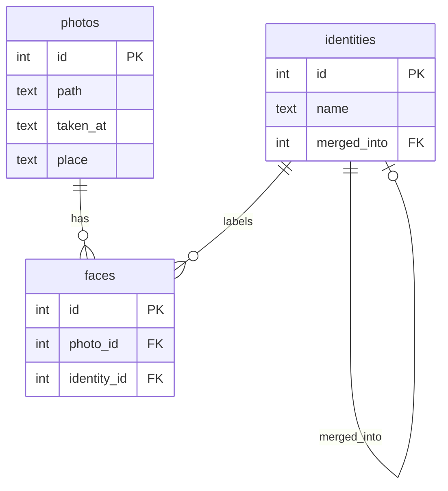
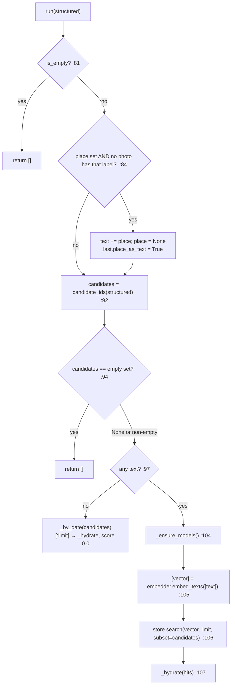

# D10-07b · Engine code: search/engine.py (40 of the 90 min)

Hub: [[Day 10 - Photo-Seek I]] · Previous: [[D10-07a Query parser code]] · Next: [[D10-08 Skim map]]

File: `src/photoseek/search/engine.py` (225 lines). The day note shows `run` and the SQL builder ([[Day 10 - Photo-Seek I#2. Executing: filters first, then vectors|§2]]). This note runs them on a **toy catalog with real output**, and adds `resolve_people`, `_ensure_models`, `_place_known`, `_by_date` and `_hydrate`.

## 0. How this note's values were produced

[ran] I built an in-memory SQLite catalog with your real `schema.sql`, created your real `SearchEngine`, and injected two tiny fakes (allowed by the Protocol design, [[D10-03 CLIP code#8. The Protocol pattern in base.py]]): an embedder that returns `(1, 0)` for any text, and a store that scores six 2-D vectors. **All SQL and all engine logic below is your code running.** Only CLIP and FAISS were replaced.

**The toy catalog**

| photo id | `taken_at` | faces (identity) | angle of its vector | cosine with "beach" = (1, 0) |
|---|---|---|---|---|
| 5 | 2026-03-02 10:00:00 | Mom | 5° | 0.996 |
| 9 | 2025-07-14 09:30:00 | Mom | 15° | 0.966 |
| 12 | 2026-06-20 16:05:00 | Mom, one unassigned face | 70° | 0.342 |
| 40 | 2026-07-04 11:12:00 | Mom, Dad | 30° | 0.866 |
| 77 | 2026-08-31 18:20:00 | Mom | 50° | 0.643 |
| 81 | 2026-09-01 08:00:00 | Dad | 120° | −0.500 |

| identity id | name | merged_into |
|---|---|---|
| 3 | Mom | — |
| 4 | Dad | — |
| 7 | Amma | 3 (an old cluster the user merged into Mom) |

`photos.place` is NULL for every row, as in a library with no reverse geocoding.

## 1. The tables the engine reads



One photo has many faces. One identity labels many faces. "Mom is in photo 40" is stored as a **row in `faces`** with `photo_id = 40, identity_id = 3`.

## 2. SearchEngine.run: the control flow

`engine.py:78–107`. Entry points: the CLI calls `router.route(...)` itself and then `engine.run(structured)` [code: `cli.py:233, 251`]; `engine.search(query)` (line 73) does both for the web UI.



**Variables**

| name | type | meaning | our query |
|---|---|---|---|
| `structured` | `StructuredQuery` | the parse | people `['mom']`, 2026-06-01..08-31, place `beach`, text `""` |
| `self.last` | `SearchOutcome` | what was understood, for explaining an empty result | filled as we go |
| `candidates` | `set[int]` or `None` | photo ids allowed by the filters | `{12, 40, 77}` |
| `vector` | `(512,)` float32 | the text embedding | (1, 0) in the toy |
| `hits` | list of `SearchHit` | ids and scores from FAISS | 3 hits |

**Traced** [ran] for the hybrid's output on our query:

| line | what happens | state |
|---|---|---|
| 80 | `self.last = SearchOutcome(query=structured)` | fresh record |
| 81 | `is_empty`? | False |
| 84 | `_place_known("beach")` → no row | condition true |
| 85–88 | `text = "" + " beach"` → `"beach"`; `replace(structured, text="beach", place=None)` | a **new** object; the original is not mutated |
| 89–90 | `last.query` updated, `last.place_as_text = True` | |
| 92 | `candidate_ids(...)` | `{12, 40, 77}` |
| 93 | `last.n_candidates` | 3 |
| 94 | empty set? | no |
| 97 | text empty? | no ("beach") |
| 104 | `_ensure_models()` | embedder and store are present |
| 105 | `embed_texts(["beach"])` | called with exactly `['beach']` |
| 106 | `store.search(vector, 40, subset={12, 40, 77})` | scores only those three |
| 107 | `_hydrate` | results below |

**Real output:**

| rank | photo | score | taken_at | people |
|---|---|---|---|---|
| 1 | 40 | 0.866 | 2026-07-04 11:12:00 | Dad, Mom |
| 2 | 77 | 0.643 | 2026-08-31 18:20:00 | Mom |
| 3 | 12 | 0.342 | 2026-06-20 16:05:00 | Mom |

Photos 5 and 9 look far more like a beach (0.996, 0.966) but were taken outside the date range. They never reach the ranker.

## 3. Why an unknown place is folded into the CLIP text

`engine.py:84–90`
```python
if structured.place and not self._place_known(structured.place):
    text = structured.text
    if structured.place.lower() not in text.lower():
        text = f"{text} {structured.place}".strip()
    structured = replace(structured, text=text, place=None)
    self.last.query = structured
    self.last.place_as_text = True
```

`_place_known` (`engine.py:192–199`) runs `SELECT 1 FROM photos WHERE place LIKE '%beach%' LIMIT 1`. `LIMIT 1` stops at the first hit: the question is only "does **any** photo have such a label?".

**The problem it fixes** [doc: story 4.4, commits 1637f63 and 31367c6]. "a dog on the beach" was parsed to `place="beach"`. The engine filtered on `photos.place`. That column is empty, because **reverse geocoding is not built**. The filter removed every photo: zero results for a perfectly good query.

**The fix.** A place is a hard filter only if some photo actually carries a matching label. Otherwise the word goes back to CLIP, which *can* see a beach.

| line | what | what breaks without it |
|---|---|---|
| `place.lower() not in text.lower()` | do not append a word already there | "dog running beach beach" (the second commit) |
| `.strip()` | when `text` was empty, `" beach"` → `"beach"` | a leading space in the query text |
| `replace(structured, …)` | a modified **copy** of the dataclass | mutating the caller's object would surprise the CLI, which prints it |
| `place_as_text = True` | records the decision for the UI | the user could not tell why "beach" was not a filter |

**The cost to admit** [doc: decision 13]: a real place name ("Jaipur") is then matched *visually*, which mostly does not work. And "beach" means two different things: a scene (CLIP can see it) or a location (needs GPS → place). The code treats the word as a location only when the library has location labels.

## 4. candidate_ids: SQL before vectors

`engine.py:109–148` (code in the day note §2). It returns one of three things, and the difference matters:

| return | meaning | what `run` does |
|---|---|---|
| `None` | the query has **no filters** | search the whole library |
| `set()` | filters exist and **matched nothing** | return `[]` at once |
| `{12, 40, 77}` | the allowed photos | rank only these |

Confusing `None` with `set()` would turn "no photo of that person" into "here is everything".

**The SQL our query builds** [ran]:

```sql
SELECT p.id FROM photos p
WHERE p.taken_at >= ?            -- '2026-06-01'
  AND p.taken_at <  ?            -- '2026-09-01'   (date_to + 1 day)
  AND EXISTS (SELECT 1 FROM faces f WHERE f.photo_id = p.id AND f.identity_id = ?)   -- 3
```

| photo | `>= 2026-06-01` | `< 2026-09-01` | Mom's face? | kept |
|---|---|---|---|---|
| 5 | ✗ (March) | | | no |
| 9 | ✗ (2025) | | | no |
| 12 | ✓ | ✓ | ✓ | **yes** |
| 40 | ✓ | ✓ | ✓ | **yes** |
| 77 | ✓ | ✓ (18:20 on Aug 31) | ✓ | **yes** |
| 81 | ✓ | ✗ (Sep 1) | | no |

**The `+ 1 day` is not cosmetic** [ran]. With `taken_at <= '2026-08-31'` the same catalog returns `[12, 40]`: photo 77, taken at 18:20 on the last day, is lost, because the text `'2026-08-31 18:20:00'` sorts **after** `'2026-08-31'`. With `< '2026-09-01'` it returns `[12, 40, 77]`.

**The `?` marks** are parameters. The driver sends the values separately from the SQL text, so a query like `mom'; DROP TABLE photos;--` is only ever a *value* being compared, never SQL.

### Why SQL filtering happens before vector ranking

| | filter first (the code) | rank first, filter after |
|---|---|---|
| top 2 for our query | 40, 77 | top 2 of all = 5, 9 → both fail the date filter → **nothing** |
| guarantees k results if k photos qualify? | yes | no; you must guess how many extra to fetch |
| who answers "which photos have mom in June–August"? | SQL, exactly | CLIP cannot: dates and identities are not in the embedding |
| CLIP + FAISS needed when the filter matches nothing? | no (returns before loading) | yes |

The module docstring says it in the author's words: "a top-k over the whole library can be entirely filled by photos that fail the filters, leaving nothing to show" [code: `engine.py:3–9`].

**Costs** [doc: decision 6; mine]: the flat index still walks every vector to check its id, so a filtered search is not faster; and the id set is copied into an array on each query.

### Why several people use separate EXISTS conditions

"photos of mom and dad" must mean **both are in the photo**.

```sql
... AND EXISTS (SELECT 1 FROM faces f WHERE f.photo_id = p.id AND f.identity_id = 3)   -- mom
    AND EXISTS (SELECT 1 FROM faces f WHERE f.photo_id = p.id AND f.identity_id = 4)   -- dad
```

Each `EXISTS` asks its own yes/no question about the photo: "is there **some** face row for this person?". Two questions joined by `AND` = both must be yes.

| alternative | what it returns on the toy [ran] | why it is wrong |
|---|---|---|
| `JOIN faces … WHERE identity_id IN (3, 4)` (no date filter) | photos 5, 9, 12, 40, 40, 77, 81 | `IN` means **either**: an OR. And photo 40 comes back twice |
| `JOIN faces f … WHERE f.identity_id = 3 AND f.identity_id = 4` | nothing | one face row cannot be two people |
| one `EXISTS` per person (the code) | photo **40** only (inside the date range) | correct |

`EXISTS` also never duplicates a photo. A join would return photo 40 twice (once per matching face) and need `DISTINCT`.

`dict.fromkeys(resolved.values())` (line 141) removes repeated identity ids while keeping order. [ran]: `people=["mom", "Amma"]` both resolve to identity 3, so **one** `EXISTS` clause is built, not two.

## 5. resolve_people: names to identity ids

`engine.py:150–174`
```python
resolved: dict[str, int | None] = {}
for name in names:
    row = self.catalog.conn.execute(
        "SELECT id, merged_into FROM identities WHERE lower(name) = lower(?)",
        (name.strip(),),
    ).fetchone()
    identity_id = None
    seen: set[int] = set()
    while row is not None and row["id"] not in seen:
        seen.add(row["id"])
        identity_id = row["id"]
        if row["merged_into"] is None:
            break
        row = self.catalog.conn.execute(
            "SELECT id, merged_into FROM identities WHERE id = ?", (row["merged_into"],)
        ).fetchone()
    resolved[name] = identity_id
return resolved
```

**Primer.** `.fetchone()` gives the first row or `None`. `row["id"]` works because the catalog sets `row_factory = sqlite3.Row` [code: `db.py:68`]. `(name.strip(),)` is a one-item tuple; the trailing comma makes it a tuple.

**Why `merged_into` exists** [doc: decision 24]. When the user merges cluster "Amma" into "Mom", the old identity row is **kept** as a tombstone pointing at the survivor, so old corrections that mention it still resolve. The faces move to identity 3.

**Traced** [ran]: `resolve_people(["mom", "Amma", "Ravi"])` → `{'mom': 3, 'Amma': 3, 'Ravi': None}`

| name | first lookup | loop | result |
|---|---|---|---|
| `"mom"` | `lower('Mom') = lower('mom')` → row id 3, merged_into NULL | `identity_id = 3`; NULL → break | 3 |
| `"Amma"` | row id 7, merged_into 3 | `identity_id = 7`; follow → row id 3, merged_into NULL → `identity_id = 3`; break | 3 |
| `"Ravi"` | no row → `None` | loop body never runs | `None` |

**Why the `seen` set?** If bad data ever had A → B → A, the loop would run forever. `seen` stops at the first repeat.

**What happens with an unknown name** (`engine.py:137–140`): `unknown_people = ["Ravi"]` is stored and `set()` is returned **immediately**, before any SQL runs. [ran]: `people=["mom", "Ravi"]` → `n_candidates = 0`, `unknown = ['Ravi']`, result `[]`, and `embed_texts` was **never called**.

**Why not just ignore the unknown name?** [code: `query.py:29–31`; doc: decision 14] Ignoring "Ravi" would silently answer a *different* question ("photos of mom"). An empty result with "unknown people ['Ravi']" tells the user what to fix. The cost is real and recorded: the LLM turned "two kids playing soccer" into `people=['kids']`, and the search returned "no matches: unknown people ['kids']" [doc: `offline.json`].

## 6. _ensure_models: load only when needed

`engine.py:178–190`
```python
def _ensure_models(self) -> None:
    if self.embedder is None:
        from photoseek.embed.clip import CLIPEmbedder
        self.embedder = CLIPEmbedder(self.config.embedding)
        self.embedder.load()
    if self.store is None:
        from photoseek.index import FaissStore
        path = self.config.storage.clip_index_path
        if not path.exists():
            raise FileNotFoundError(f"no index at {path} — run `photoseek index` first")
        self.store = FaissStore.load(path)
```

It is called at line 104, **after** every early return. So these queries never import torch or read the 578 MB of weights:

| query [ran] | returns at | CLIP loaded? |
|---|---|---|
| empty query | line 82 | no |
| unknown person | line 95 | no |
| dates that match no photo | line 95 | no |
| "photos of mom last summer" (no text, place absent) | line 100 | no |
| anything with visual text | line 107 | yes, once |

The `is None` checks are also what let a test inject fakes. A missing index file raises `FileNotFoundError`, which the CLI turns into a message and exit code 2 [code: `cli.py:252–254`].

## 7. _by_date: a query with nothing to rank

`engine.py:201–205`. "photos of mom last summer" has filters but no visual text. There is nothing for CLIP to compare, so the candidates are returned **newest first** with score 0.0. [ran]: `77, 40, 12`.

Note [mine]: it selects **every** photo id ordered by date and filters in Python. Fine for thousands of photos; at a million it should push the id filter into SQL.

## 8. _hydrate: ids back to something displayable

`engine.py:207–225`
```python
for photo_id, score in scored:
    photo = self.catalog.get_photo(photo_id)
    if photo is None:
        continue      # the index is derived and can lag the catalog; skip, don't crash
    people = tuple(
        row["name"] for row in self.catalog.conn.execute(
            "SELECT DISTINCT i.name FROM faces f JOIN identities i ON i.id = f.identity_id "
            "WHERE f.photo_id = ? AND i.name IS NOT NULL ORDER BY i.name", (photo_id,))
    )
    results.append(SearchResult(photo_id, photo["path"], score, photo["taken_at"], people))
```

- **Input:** `[(40, 0.866), (77, 0.643), (12, 0.342)]`. **Output:** `SearchResult(photo_id, path, score, taken_at, people)`, a frozen dataclass.
- **`if photo is None: continue`**: FAISS might still hold a vector for a photo deleted from the catalog. The index is derived; a stale hit is skipped rather than crashing.
- **`i.name IS NOT NULL`**: unnamed clusters are not shown as people. Photo 12's unassigned face is not listed [ran].
- **`DISTINCT`**: two faces of one person in a photo list the name once.
- Two SQL queries per result. With `limit = 40` that is 80 small queries: acceptable; it is an "N+1" pattern to name if asked [mine].

## 9. All the paths, on the toy [ran]

| parsed query | `n_candidates` | CLIP called? | result |
|---|---|---|---|
| mom, summer 2026, place beach | 3 | yes, `['beach']` | 40, 77, 12 |
| **Amma**, summer 2026, place beach | 3 | yes | 40, 77, 12 (the merge is followed) |
| mom **and dad**, summer 2026, place beach | 1 | yes | 40 |
| mom and **Ravi** | 0, unknown `['Ravi']` | **no** | `[]` |
| mom, summer 2026, **no text, no place** | 3 | **no** | 77, 40, 12 by date |
| text "beach" only | `None` | yes, subset `None` | 5, 9, 40, 77, 12, 81 |
| text "beach", dates in 2020 | 0 | **no** | `[]` |
| nothing | `None` | no | `[]` (`is_empty`) |

## Check

1. What are the three possible return values of `candidate_ids`, and what does `run` do with each?
2. Write the `WHERE` clause for "photos of mom and dad in 2025".
3. Why would `identity_id IN (3, 4)` be wrong for "mom and dad"?
4. `people = ["Amma"]`. Walk `resolve_people`.
5. Which queries never load CLIP? Name three.
6. Why does `_place_known` use `LIMIT 1`?
7. Photo 77 was taken at 18:20 on 31 August. Which comparison keeps it, and which loses it?

> [!success]- Answers
> 1. `None` → search everything; `set()` → return `[]`; a non-empty set → rank only those ids.
> 2. `p.taken_at >= '2025-01-01' AND p.taken_at < '2026-01-01' AND EXISTS (… f.identity_id = 3) AND EXISTS (… f.identity_id = 4)`.
> 3. `IN` is an OR: it returns photos with either person.
> 4. Row 7, merged_into 3 → follow → row 3, merged_into NULL → result 3.
> 5. An empty query, an unknown person, filters that match nothing, and a pure-filter query.
> 6. It only needs to know whether any such photo exists; it stops at the first.
> 7. `< '2026-09-01'` keeps it; `<= '2026-08-31'` loses it.

## Five things to remember

1. `run` = empty check → place fallback → **SQL candidates** → (no text? by date) → lazy models → embed text → FAISS on the subset → hydrate.
2. `None` ≠ `set()`: no filters vs no matches.
3. Dates are half-open: `>= from`, `< to + 1 day`. People: **one `EXISTS` per person**, AND-ed.
4. Names resolve case-insensitively and follow `merged_into`; an unknown name returns nothing, visibly.
5. Models load lazily after every early return; `_hydrate` skips ids the catalog no longer has.
