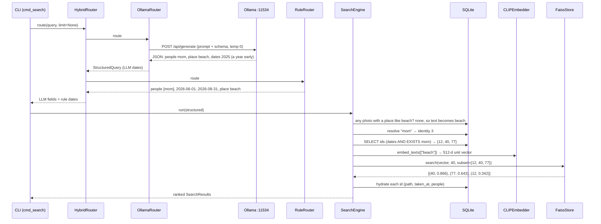

# D10-10 · Trace: "photos of mom at the beach last summer" (20 min)

Hub: [[Day 10 - Photo-Seek I]] · Previous: [[D10-09 Rebuild]] · Next: [[D10-11 Interview questions]] · Pack: [[Photo-Seek - prep#Trace 1: one search query, end to end]]

**Do it on paper first**, from memory, then compare. Command and date as in the prep pack:

```
photoseek search "photos of mom at the beach last summer" --router hybrid        (run on 2026-11-05)
```

Values marked [ran] come from running your rule parser and engine today on the toy catalog of [[D10-07b Search engine code]]. The LLM's reply is **illustrative** (no Ollama call was made); the photo ids are the toy's.

## The happy path



| # | where | what happens | value |
|---|---|---|---|
| 1 | `cli.py:315 main` | parse args; `Config.load` merges YAML over defaults; dispatch | `args.router = "hybrid"` |
| 2 | `cli.py:229–232` | override the config; `build_router` | a `HybridRouter` (the default would have been `rule`) |
| 3 | `router.py:383` → `:314` → `:339` | `_generate` POSTs the prompt ("Today is 2026-11-05 (Thursday)"), the schema, temperature 0, 200 tokens | HTTP to 127.0.0.1:11534 |
| 4 | `router.py:318–324` | `_extract_json` → dict; add `raw`, `limit = 40`; `from_dict` | people `["mom"]`, place `"beach"`, text `""`, dates *say* 2025-06-01 → 2025-08-31 (a year early, as in recorded outputs) |
| 5 | `router.py:385` → `:95` | the rule parser on the same sentence [ran] | people `['mom']`, **2026-06-01 → 2026-08-31**, place `beach`, text `""` |
| 6 | `router.py:386–387` | the rules found a date → overwrite both dates | LLM's people / place / text + the rules' dates |
| 7 | `cli.py:248–251` | open the catalog; `SearchEngine(config, catalog, router)`; `engine.run(structured)` | |
| 8 | `engine.py:84–90` | `_place_known("beach")` is false → fold into text [ran] | `text = "beach"`, `place = None`, `place_as_text = True` |
| 9 | `engine.py:136` → `:150` | `resolve_people(["mom"])` [ran] | `{'mom': 3}` |
| 10 | `engine.py:124–148` | SQL: `taken_at >= '2026-06-01' AND taken_at < '2026-09-01' AND EXISTS (… identity_id = 3)` [ran] | `{12, 40, 77}`, `n_candidates = 3` |
| 11 | `engine.py:104` | `_ensure_models`: load CLIP and `clip.faiss` (first query only) | |
| 12 | `clip.py:100` | tokenise `[1, 77]` → text tower `[1, 512]` → normalise | one `(512,)` float32 unit vector |
| 13 | `faiss_store.py:111` | `IDSelectorBatch({12, 40, 77})`; `k = min(40, 3) = 3`; inner product on the 3 allowed vectors | `[(40, 0.866), (77, 0.643), (12, 0.342)]` |
| 14 | `engine.py:207` | `_hydrate`: path, `taken_at`, named people [ran] | 40 → (Dad, Mom); 77 → (Mom); 12 → (Mom) |
| 15 | `cli.py:255–258` | print `parsed: text="beach" people=['mom'] dates=2026-06-01..2026-08-31 limit=40`, then rank, score, path, names | |

## Six "what if" cases

### 1. The LLM is unavailable

`urlopen` raises `URLError` inside `_generate` → caught at `router.py:332` → `last_fallback = True`, a warning is logged → `self._fallback.route(query)` returns the **rule parse**. The hybrid then runs the rules again and overwrites the dates with the same dates.

**For this query the final filters are identical** [ran]: people `['mom']`, summer 2026, place `beach`. The search works, about 1.5 s faster. For a harder query ("photos of sarah", lowercase) the rules would miss the person and CLIP would get the word instead.

If the server *hangs* rather than refuses, the user waits `ollama_timeout_s = 30` seconds first.

### 2. The JSON is malformed

| what came back | what happens |
|---|---|
| prose or code fences around the JSON | `_extract_json` cuts from the first `{` to the last `}` → still parses |
| cut off at 200 tokens, or no `{…}` at all | `_extract_json` → `None` → `ValueError` → fallback to rules |
| valid JSON but a bad date string | `_parse_date` → `None` for that bound only |
| valid JSON with everything empty | `is_empty` → `ValueError` → fallback |
| Ollama's HTTP body itself is not JSON | `json.loads` raises → fallback |

With schema-constrained decoding the first and second rows should be rare; 1 of 100 gold queries fell back [doc].

### 3. The date parser finds no date

Line 386 is false, so the **LLM's dates stand**, whatever they are.

- If the LLM also gave `null`: no date filter; the SQL has only the person clause.
- If the LLM gave dates: they are used unchecked. This is the recorded Christmas failure (25–26 Dec instead of 25 Dec) [doc].
- With `--router rule`: no date filter, and the date words stay in the CLIP text.

### 4. The person "mom" does not exist

`resolve_people` → `{'mom': None}` → `last.unknown_people = ['mom']` → `candidate_ids` returns `set()` (line 140) → `run` returns `[]` (line 95). CLIP and FAISS are **never loaded**. The CLI prints:

```
no matches: unknown people ['mom'] (name them with `photoseek label`)
```

[ran] with an unknown second person: `n_candidates = 0`, `unknown = ['Ravi']`, `embed_texts` not called. Design reason: a typo should be visible, not silently widen the search. Recorded cost: `people=['kids']` from the LLM gave exactly this message [doc: `offline.json`].

### 5. The place "beach" is unknown

This is the **normal** case today: nothing is reverse-geocoded, so no photo has a place label. "beach" moves into the CLIP text and ranks visually (step 8). If some photo *did* have a label containing "beach", the clause `p.place LIKE '%beach%'` would be added and `text` would stay `""`; then there is nothing to rank and the results come back **by date**, score 0.0.

### 6. SQL returns no candidate photos

`candidate_ids` returns `set()` → `last.n_candidates = 0` → `run` returns `[]` at line 95, before loading any model. The CLI prints `no matches`. [ran] with dates in 2020: `n_candidates = 0`, `[]`.

The opposite case is `None` (no filters at all, e.g. "sunsets"): then FAISS searches the whole library.

### One more: no index file

`_ensure_models` raises `FileNotFoundError("no index at … — run `photoseek index` first")`; `cmd_search` prints it and exits with code 2.

## Summary table

| situation | detected at | result | models loaded? |
|---|---|---|---|
| LLM down / timeout | `router.py:332` | rule parse; search continues | as needed |
| unusable JSON | `router.py:319` or `:327` | rule parse | as needed |
| bad date string | `query.py:102–105` | that bound becomes `None` | as needed |
| rules find no date | `router.py:386` | LLM's dates kept | as needed |
| unknown person | `engine.py:138–140` | `[]` + "unknown people" | **no** |
| unknown place | `engine.py:84` | place folded into the CLIP text | yes |
| filters match nothing | `engine.py:94` | `[]`, "no matches" | **no** |
| no visual text left | `engine.py:97` | candidates by date, score 0.0 | **no** |
| no index file | `engine.py:188` | error message, exit 2 | CLIP yes, index no |

## Say it in 60 seconds

"The CLI builds a hybrid parser. It sends the sentence to a local qwen2.5 7B on Ollama with a JSON schema, and gets people, place and text. It also runs a rule parser, and because the rules recognise 'last summer' their date range replaces the model's. The engine checks whether any photo has a place label like 'beach'; none does, so 'beach' becomes the text for CLIP. Then SQL finds the photos in that date range that contain a face labelled mom. Only those ids go to FAISS as an ID selector, and CLIP's text vector for 'beach' ranks them by cosine. If the LLM is down the rules answer alone; if nobody is called mom the search returns nothing and says why."
