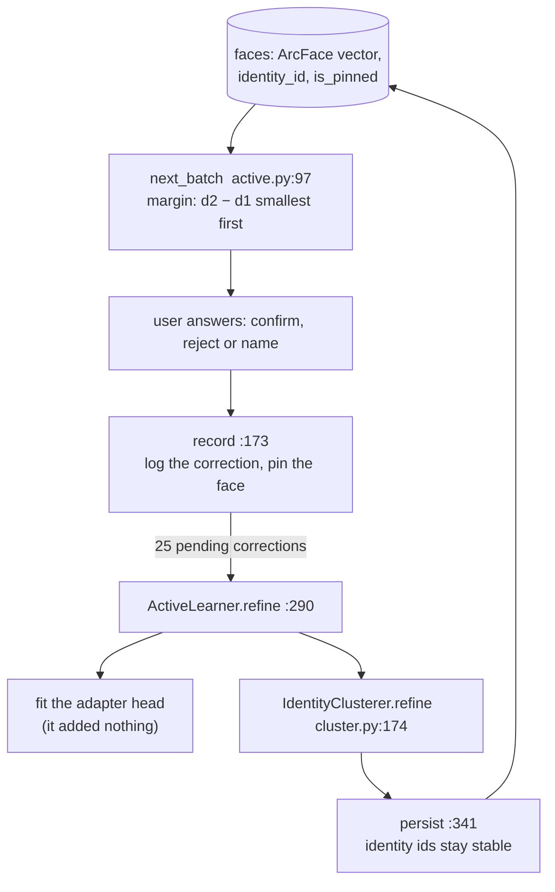
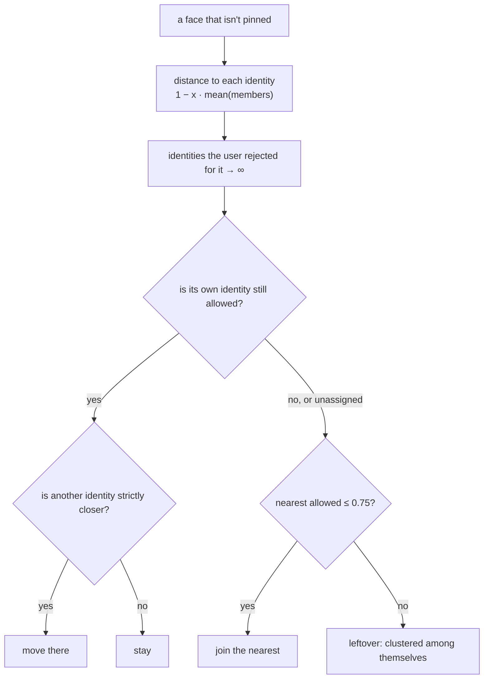
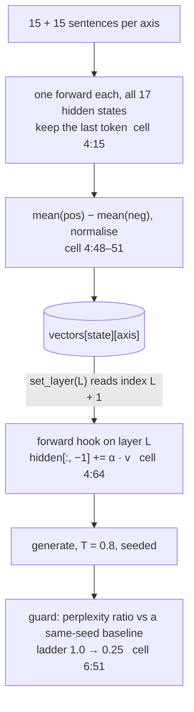
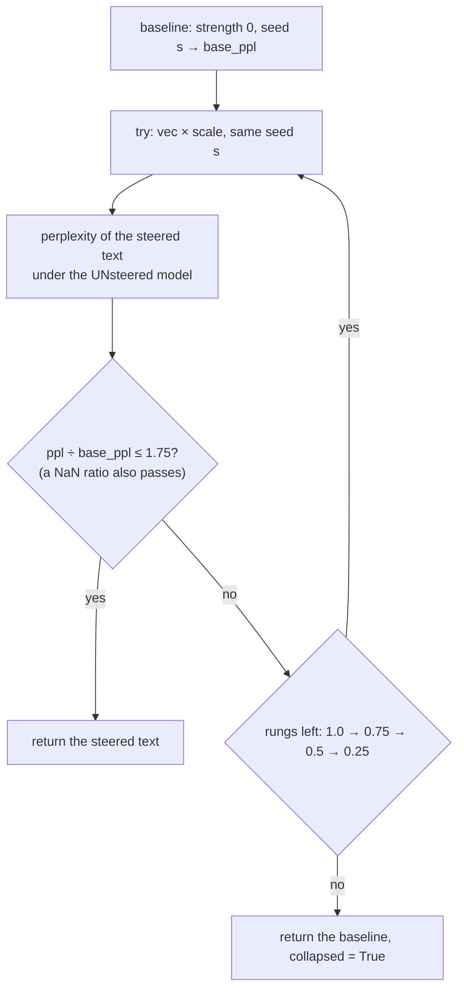

# Day 11 (Wed Nov 18): Photo-Seek II (faces), then emotion steering

Part of [[Interview plan (Nov 2026)]]. About 7.25 h. Morning: `photo_seek`, branch `upgrade-2026-10` (prep pack
[[Photo-Seek - prep]], Trace 2, stories 4.1–4.3). Afternoon: `emotion_steering` (branch `main`, one commit `d725cbe`;
prep pack [[Emotion steering - prep]]).

**Code, explained:** the figures, the code to read and what each snippet does are in [[#Code, explained]], right after section B.

**Resume bullets:**
- Photo-Seek (both resumes): "Built an active-learning face-clustering pipeline for offline photo organization, **fine-tuning ArcFace embeddings** on user correction signals to progressively refine identity clusters across **1,000+ photos**."
- Emotion steering (resume 4): "Built an activation-steering framework for **Llama 3.2 1B** spanning all **8 primary emotions** via Plutchik's 4 bipolar axes, injected as real-time hidden-state interventions and validated with ablations." / "Achieved **up to 90%** steering success entirely at inference time with no fine-tuning."

**The Photo-Seek faces bullet is not supported as written** (prep pack "Read these first", §5.1):
- **ArcFace is never fine-tuned.** A 512×512 linear adapter on frozen ArcFace vectors changed BCubed F1 by **−0.07** (CPLFW) and **+0.00** (LFW). The gain comes from the corrections, the constraints, and *which* faces the sampler asks about.
- **"1,000+ photos" matches nothing.** The eval clusters **5,606 held-out faces** (1,906 people) from 11,435 CPLFW photos. 1,000 is the number of **simulated reviews**. No real library was processed.
- **95.9 → 97.6** is BCubed F1 with the dev-chosen setting (agglomerative, 0.75) and **margin** sampling. The shipped defaults (HDBSCAN; uncertainty) give 91.75 and 97.2.
- Use prep pack §5.4's honest bullet: "…margin-based review sampling turns user corrections into hard clustering constraints. On 5,606 held-out cross-pose faces (CPLFW), 1,000 simulated reviews raised BCubed F1 from 95.9 to 97.6, a 41% error cut vs 7% for random review."

**The emotion bullet needs care too** (prep pack §5):
- **90% = the best of 240 cells** (Joy+, layer 9, strength 5: 18/20; 95% CI 70–97%). **Joy averaged 36%** over the sweep; Anger 3.3%, Disgust 5.9%, Sadness 7.6%.
- **"All 8 emotions":** vectors exist for all 8 poles, but only 6 can be scored by the classifier (Trust and Anticipation have no label).
- **"Validated with ablations":** layer × strength sweeps and a sign flip, but no random-vector control and no prompting baseline. The sweep code that made the CSVs is **not in the repo**, and the notebook can't run top to bottom.

**By tonight you can:**
- explain SCRFD, ArcFace's angular margin, and agglomerative clustering vs HDBSCAN;
- explain BCubed F1, active learning (uncertainty vs margin vs random) and the two refine bugs;
- explain difference-of-means steering vectors, the hook and the perplexity guard;
- say both projects' numbers honestly.

## Schedule

| # | Time | Kind | What |
|---|---|---|---|
| 0 | 15 min | recall | Day 10: CLIP, FAISS Flat, Trace 1 |
| 1 | 45 min | theory | Faces: detection, ArcFace, clustering, BCubed (A1) |
| 2 | 20 min | skim | `faces/detect.py`, `embed/arcface.py` |
| 3 | 60 min | code | `faces/cluster.py` (B1) |
| 4 | 25 min | theory | Active learning; metric learning (A2) |
| 5 | 60 min | code | `faces/active.py`, `faces/head.py` (B2) |
| 6 | 20 min | trace | Trace 2: one correction end to end (D1) |
| — | lunch | | |
| 7 | 40 min | theory | Activation steering (A3) |
| 8 | 50 min | code | `Project.ipynb`: calibration, the hook, the guard (B3) |
| 9 | 40 min | rebuild | A steering vector on GPT-2 (C) |
| 10 | 45 min | practice | Questions for both projects (E) |

## A. Theory

### A1. Faces (block 1, 45 min)

**Read:** Deng et al., *ArcFace* (2019), §1 and §3.1 (the additive angular margin, Figure 2). About 25 min. Skim the SCRFD abstract (Guo et al., 2021).
- **Pipeline:** SCRFD detects faces and 5 landmarks → align to 112×112 → ArcFace gives a 512-d unit vector. Same person → high cosine.
- **ArcFace loss:** softmax over identities with an additive margin m on the angle: `cos(θ_y + m)`. This forces tight clusters per identity.
- **Clustering:**
  - **Agglomerative (average linkage)** merges clusters while the average pairwise distance is under a threshold (0.75 here); you don't set k.
  - **HDBSCAN** is density-based and leaves noise unassigned.
  - **k-means** needs k (unknown here).
- **BCubed F1:** per face, precision = the share of its cluster with the same true identity; recall = the share of its identity in its cluster. Average over faces. It suits clustering because it doesn't need to match cluster IDs to identities.

### A2. Active learning (block 4, 25 min)

**Read:** Settles, *Active Learning Literature Survey*, §3.1 (uncertainty sampling, margin). 15 min.
- **Uncertainty:** ask about the faces farthest from their own centroid.
- **Margin:** ask about the faces where the nearest two identities are almost tied (`d2 − d1` smallest). Margin won: error cut **41%**, vs 32% for uncertainty and 7% for random.
- **Corrections as constraints:** a confirm *pins* a face to an identity; a reject becomes a *cannot-link*.
- **Metric learning** (the adapter head): a SupCon-style loss on pinned faces, initialised at W ≈ I. It added nothing. Propagation to unreviewed faces was **≤ +0.09 points**.

### A3. Activation steering (block 7, 40 min)

**Read:**
- Turner et al., *"Activation Addition"* (2023), §1–3. About 20 min.
- Rimsky et al., *"Steering Llama 2 via Contrastive Activation Addition"* (2024), §2. About 15 min.

**Concepts:**
- The **residual stream** carries a vector per token through the layers. Directions in it can encode concepts.
- **Difference of means:** run contrastive sentences (15 per pole), take the last token's hidden state, `v = mean(pos) − mean(neg)`, normalise. Your 4 Plutchik axes give 4 vectors per layer.
- **Inject:** a forward hook adds `α·v` to one layer's output at the **last position, every step**.
- **Middle layers work best** (layer 9 here): early layers hold token identity, late layers are committed to output.
- **Over-steering** breaks fluency before it shifts the mood. Hence the guard: perplexity of the steered text under the unsteered model, as a ratio to a same-seed baseline. Accept if ≤ 1.75×; otherwise retry at 75%, 50%, 25%, then fall back.

## B. Code

### B1. Clustering (block 3, 60 min, deep)

`photo_seek` `src/photoseek/faces/cluster.py` (402 lines):
- **76 `cluster`**: full clustering; **286 `_unsupervised`** (agglomerative or HDBSCAN);
- **174 `IdentityClusterer.refine`**: 201–204 the story 4.1 fix; **227–233** the true average-linkage distance `1 − x·mean(members)` with the mean *unnormalised* (story 4.2); 243–249 assignment rules; 261–273 leftovers;
- 314 `assign_new_faces` (incremental); **341 `persist`** (identity IDs stay stable; pinned faces never written).

Skim `faces/detect.py` (127 SCRFD `detect_array`) and `embed/arcface.py` (72 align, 85 `embed_faces`).

### B2. Active learning (block 5, 60 min, deep)

- `faces/active.py` (416 lines):
  - 69 `ActiveLearner`; **97 `next_batch`**: uncertainty 137–140, margin 141–144; 401 `_spread` (at most 2 questions per identity);
  - **239 `answer`** → 173 `record` (append to `corrections`, pin the face);
  - **290 `refine`**: 319–325 rejects become cannot-links; 333 corrections are marked consumed only after a successful retrain.
- `faces/head.py`: **60 `ProjectionHead.fit`** (≥ 20 labels across ≥ 3 identities, 27 and 73). Note the docstring's "25M parameters" is wrong (about 43M; §5.3).

### B3. Emotion steering (block 8, 50 min, deep)

`emotion_steering/Project.ipynb`. References are `cN:L` = cell N, line L (prep pack "Read this first"):
- `c3`: the calibration data, 15 sentences per pole;
- **`c4` `AppraisalSteerer`**: 15 `_get_all_layer_last_token_states`; 21 `calibrate_all_layers` (one pass, all 17 hidden states); **50–51** difference of means, normalise; **61** `set_layer` reads index `L+1` (index 0 is the embeddings); **64–69** the hook adds the vector to the last position; 82 chat template; 96 `manual_seed`; 98 `generate` (T = 0.8, 60 tokens);
- **`c6`**: 38 `continuation_perplexity`; **51 `generate_guarded`**; 65 the ladder; 71 the ratio; 77 the 1.75 threshold;
- `c2`: the j-hartmann DistilRoBERTa classifier; `c5`: the Gradio demo.

## Code, explained

Read this **with the files open**. It starts with a picture of the whole day and **the flow, step by step** (one concrete input followed through every function). Then each part has its own figure, the exact code (copied from the repo at the commit named below, so the line numbers match) and what that code does.

Morning: `photo_seek`, branch `upgrade-2026-10`
(`aa5d476`, paths under `src/photoseek/`). Afternoon: `emotion_steering/Project.ipynb` (`d725cbe`); notebook
references are **cell N, line L**.

---

### Part 1: Photo-Seek faces

> [!tip] Concept from scratch: [[#7. Deep dive: face embeddings and ArcFace from scratch|where face vectors come from: SCRFD, alignment and the ArcFace margin, number by number]]



#### The flow, step by step (faces)

One face goes from "unsure" to "fixed".

1. **Pick the question** (`next_batch`, `active.py:97`). Face f is assigned to identity 7. Distances: d1 = 0.40 to identity 7, d2 = 0.38 to identity 9. Its margin `d2 − d1` is tiny, so the **margin** strategy asks about it first (`:141–144`).
2. **The user says "not this person"** → `answer(…, "reject")` → `record` (`:173`) appends a `reject (f, 7)` row to `corrections`. It's committed at once.
3. **After 25 pending corrections**, `refine()` runs (`:290`):
   - fit the adapter head on the pinned faces (only if there are ≥ 20 labels across ≥ 3 identities);
   - read every `reject` row as a cannot-link: f can't be in 7 (`:319–325`);
   - call `IdentityClusterer.refine` (`cluster.py:174`).
4. **Inside the clusterer:** the distance to each identity is `1 − x · mean(members)` (`:232–233`). For f, identity 7 becomes ∞. f's own identity is no longer allowed, so the `elif` branch applies: the nearest allowed identity is 9 at 0.38 ≤ 0.75, so **f joins 9** (`:243–249`).
5. **Persist** (`:341`) writes the new assignments, keeping identity ids stable. **Only then** are the 25 corrections marked consumed (`active.py:333`).

#### 1. Which face to ask about: `next_batch`

> [!tip] Concept from scratch: [[#9. Deep dive: active learning with corrections from scratch|d1, d2, uncertainty vs margin on a 4-face toy, and answers as constraints]]

`src/photoseek/faces/active.py:119–130` (`upgrade-2026-10`)
```python
identities, centroids = _centroids(Z, assigned)
if identities:
    dist = 1.0 - Z[candidates] @ centroids.T
    column = {iid: c for c, iid in enumerate(identities)}
    own = np.asarray([column.get(assigned[i], -1) for i in candidates])
    nearest = dist.argmin(axis=1)
    proposed = np.where(own >= 0, own, nearest)
    d1 = dist[np.arange(len(candidates)), proposed]
    others = dist.copy()
    others[np.arange(len(candidates)), proposed] = np.inf
    d2 = others.min(axis=1) if len(identities) > 1 else np.full(len(candidates), 2.0)
    proposed_ids = [identities[p] for p in proposed]
```
> [!info] New functions in this code
> - `enumerate(xs)`: loops over a list and gives you each item **with its index**. `for i, x in enumerate(['a', 'b'])` gives `(0, 'a')`, then `(1, 'b')`. [[Function glossary#enumerate|→ examples]]
> - `np.asarray(xs)`: turns a list into a numpy array (no copy if it already is one). `np.asarray([0, 0, 1, -1])` → `array([ 0,  0,  1, -1])`. [[Function glossary#np.asarray|→ examples]]
> - `.get(key, default)`: a dict lookup that returns `default` (or None) instead of failing when `key` is missing. [[Function glossary#dict.get|→ examples]]
> - `.argmin(axis)`: the **index** of the smallest value (per row with `axis=1`). `np.array([[0.40, 0.38, 0.90]]).argmin(axis=1)` → `[1]`. Twin of `.argmax`. [[Function glossary#x.argmin|→ examples]]
> - `np.where(cond, a, b)`: element by element: `a` where `cond` is True, else `b`. `np.where(own >= 0, own, nearest)` takes the face's own identity column, or the nearest one when it has none (−1). [[Function glossary#np.where|→ examples]]
> - `query.where(condition)`: SQLAlchemy: adds a `WHERE` clause. `select(Vulnerability).where(Vulnerability.cwe_id == 89)` means `SELECT * FROM vulnerability WHERE cwe_id = 89`. `==` on a column builds SQL; it doesn't compare in Python. [[Function glossary#x.where|→ examples]]
> - `np.arange(n)`: the integers 0 … n−1 as an array. `np.arange(4)` → `array([0, 1, 2, 3])`. With a second index array it picks one cell per row: `dist[np.arange(4), proposed]`. [[Function glossary#np.arange|→ examples]]
> - `len(xs)`: how many items. `len([7, 8, 9])` = 3. [[Function glossary#len|→ examples]]
> - `.copy()`: a new, independent copy of an array (or list/dict). Changing the copy leaves the original alone: `residual = z.copy(); residual -= c` doesn't change `z`. [[Function glossary#x.copy|→ examples]]
> - `.min(axis)`: the smallest value (per row with `axis=1`). `np.array([[0.70, inf, 1.0]]).min(axis=1)` → `[0.70]`. [[Function glossary#x.min|→ examples]]
> - `np.full(n, value)`: an array of n copies of `value`. `np.full(3, 2.0)` → `array([2., 2., 2.])`. [[Function glossary#np.full|→ examples]]

- For each unpinned face: `d1` = distance to its **proposed** identity (its own, or the nearest if it has none); `d2` = distance to the **next** closest identity.

`src/photoseek/faces/active.py:137–149` (`upgrade-2026-10`)
```python
if strategy == "uncertainty":
    order = np.argsort(-d1, kind="stable")
    confidence = 1.0 - d1
    reason = "far from the centroid of its proposed identity"
elif strategy == "margin":
    order = np.argsort(d2 - d1, kind="stable")
    confidence = d2 - d1
    reason = "nearly as close to another identity"
elif strategy == "random":
    rng = np.random.default_rng(self._rng_seed + self._round)
    order = rng.permutation(len(candidates))
    confidence = 1.0 - d1
    reason = "random baseline"
```
> [!info] New functions in this code
> - `np.argsort(x, kind='stable')`: the **positions** that would sort `x` ascending, not the sorted values. `np.argsort([0.25, 0.02, 0.03])` → `[1, 2, 0]`. `argsort(-x)` sorts largest first; `kind='stable'` keeps ties in their original order. [[Function glossary#np.argsort|→ examples]]
> - `np.random.default_rng(seed)`: a random-number generator with its own seed. The same seed always gives the same sequence; `rng.permutation(4)` is then a reproducible shuffle of 0–3. [[Function glossary#np.random.default_rng|→ examples]]
> - `rng.permutation(n)`: a random ordering of 0 … n−1. `default_rng(0).permutation(4)` is always the same 4 numbers in the same order. [[Function glossary#x.permutation|→ examples]]

- **Uncertainty** asks about the faces farthest from their own identity (`-d1` sorted). **Margin** asks about the faces nearly tied between two people (`d2 − d1` smallest). **Random** is the control.
- Margin won: a 41% error cut vs 32% (uncertainty) vs 7% (random) after 1,000 simulated reviews. A margin face sits on a boundary, so one answer settles exactly the decision the clustering was unsure about.
- `_spread` caps questions at 2 per proposed identity, so one big messy cluster doesn't eat the whole batch.

#### 2. Updating clusters without starting over: `IdentityClusterer.refine`

> [!tip] Concept from scratch: [[#8. Deep dive: clustering faces and scoring it with BCubed from scratch|agglomerative clustering, the 1 − x·mean identity behind story 4.2, and BCubed]]



`src/photoseek/faces/cluster.py:232–249` (`upgrade-2026-10`)
```python
means = np.stack([X[m].mean(axis=0) for m in members])
dist = 1.0 - X @ means.T
for row, fid in enumerate(ids):
    if fid in pinned:
        continue
    allowed = dist[row].copy()
    for iid in identities:
        if (fid, iid) in rejected_pairs:
            allowed[index[iid]] = np.inf
    best = int(allowed.argmin())
    own = assign[fid]
    if own is not None and np.isfinite(allowed[index[own]]):
        if allowed[best] < allowed[index[own]]:
            assign[fid] = identities[best]
    elif np.isfinite(allowed[best]) and allowed[best] <= threshold:
        assign[fid] = identities[best]
    else:
        assign[fid] = None
```
> [!info] New functions in this code
> - `np.stack(arrays)`: joins equal-shape arrays along a **new** first axis: three `(512,)` means → one `(3, 512)` array (like `torch.stack`). [[Function glossary#np.stack|→ examples]]
> - `.mean(dim, keepdim=True)`: the average along an axis. On `[3, 8]` with `dim=-1` it averages each row's 8 numbers → `[3]`, or `[3, 1]` with `keepdim=True` (keeps the axis so the result broadcasts back over the row). [[Function glossary#x.mean|→ examples and figure]]
> - `int(x)`: converts to an integer, dropping the fraction. `int(3.9)` = 3. [[Function glossary#int|→ examples]]
> - `np.isfinite(x)`: True where `x` is a normal number, False for `inf` and `nan`. `np.isfinite(np.inf)` → False: that's how refine detects a rejected identity. [[Function glossary#np.isfinite|→ examples]]

- **Distance to an identity = `1 − x · mean(members)`**, with the mean **left unnormalised**. That equals the average cosine distance to all members, which is the same rule the clustering threshold (0.75) was tuned for. The first version used a *normalised* centroid, which sits closer to every face than the members do on average. So a refine with **zero** answers pulled 100–170 noise faces into identities. A no-answers control run exposed it (story 4.2).
- **The rules per face:** pinned faces never move; a rejected identity becomes `inf` (a cannot-link); an assigned face moves only to a **strictly closer** identity; an unassigned face joins only if within the threshold.
- Why not re-cluster from the pinned faces? The sampler asks about **outliers**, so a person seeded from their pinned faces is centred on their edge, and the rest of the person splits off (story 4.1, the docstring at 201–204).

#### 3. Commit only after success: `ActiveLearner.refine`

`src/photoseek/faces/active.py:311–333` (`upgrade-2026-10`)
```python
labelled = [i for i in range(len(ids)) if pinned[i] and assigned[i] is not None]
head_trained = False
if train_head:
    head = self.fit_refinement_head(X[labelled], [assigned[i] for i in labelled])
    head_trained = head is not None

Z = self.head.transform(X)
pinned_map = {ids[i]: assigned[i] for i in labelled}
rejected = [
    (row["face_id"], row["identity_id"])
    for row in self.catalog.conn.execute(
        "SELECT face_id, identity_id FROM corrections "
        "WHERE kind = 'reject' AND face_id IS NOT NULL AND identity_id IS NOT NULL"
    )
]
clusterer = IdentityClusterer(self.faces_config)
result = clusterer.refine(ids, Z, dict(zip(ids, assigned)),
                          pinned=pinned_map, rejected=rejected)
clusterer.persist(self.catalog, result)

after = dict(self.catalog.conn.execute("SELECT id, identity_id FROM faces").fetchall())
moved = sum(1 for fid, before in zip(ids, assigned) if after.get(fid) != before)
self.catalog.consume_corrections([row["id"] for row in pending])
```
> [!info] New functions in this code
> - `range(start, stop, step)`: the integers from `start` up to (not including) `stop`. `range(0, 10, 4)` gives 0, 4, 8. `range(3)` gives 0, 1, 2. [[Function glossary#range|→ examples]]
> - `conn.execute(sql, params) / session.execute(query)`: runs a database query. **sqlite3** (Photo-Seek): `conn.execute('SELECT id FROM photos WHERE taken_at >= ?', ['2026-06-01'])`: each `?` is filled from `params` by the driver, never pasted into the text, so query text can't inject SQL; iterate the result for rows. **SQLAlchemy** (Day 12): `session.execute(select(...))` sends a built query to the database. [[Function glossary#x.execute|→ examples]]
> - `dict(pairs)`: builds a dictionary. `dict(model.named_parameters())` maps each parameter name to its tensor, for lookup by name. [[Function glossary#dict|→ examples]]
> - `zip(a, b)`: walks several lists **in step**, pairing their items. `zip([1, 2], ['x', 'y'])` gives `(1, 'x')`, `(2, 'y')`. [[Function glossary#zip|→ examples]]
> - `cursor.fetchall()`: all remaining result rows as a list. `conn.execute('SELECT id, identity_id FROM faces').fetchall()` → `[(1, 7), (2, None), …]`; `dict(...)` of that makes `{face_id: identity_id}`. [[Function glossary#x.fetchall|→ examples]]
> - `sum(xs)`: adds up the items. `sum([1, 2, 3])` = 6. [[Function glossary#sum|→ examples]]

- Fit the adapter head on pinned faces, project all faces through it, read every `reject` as a cannot-link, run the clusterer, persist, and **only then** mark the corrections consumed (line 333). A crash mid-retrain leaves them pending, so the user's answers aren't lost.
- The head is a 512×512 linear map on **frozen** ArcFace vectors. It changed BCubed F1 by −0.07, so the gain is from the constraints and the sampler, not from "fine-tuning ArcFace".

**Check yourself:** a face assigned to identity 7 with distances `{7: 0.40, 9: 0.38, 12: 0.90}`, not pinned, no rejections. Does it move? Now the user rejected 7 for it: where does it go? Then what if 9 were 0.80 with threshold 0.75? (*Moves to 9: 0.38 < 0.40. After rejecting 7: own is inf, so the `elif` applies; 9 at 0.38 ≤ 0.75, so it joins 9. At 0.80: over the threshold, so it becomes unassigned and goes to the leftover clustering.*)

---

### Part 2: Emotion steering



#### 4. Calibration: difference of means

> [!tip] Concept from scratch: [[#10. Deep dive: activation steering from scratch|difference of means, the hook and the perplexity guard on 3-number vectors]]

##### The flow, step by step (steering)

The Gradio demo with the prompt "I am waiting for the results.", **Joy = 5**, **layer 9**, guard on, seed 0
(perplexities below are illustrative).

1. `set_layer(9)` makes the active vectors `all_layer_vectors[10]`: index 10 is layer 9's output, since index 0 is the embeddings (cell 4:61).
2. `vec = 5 × v_joy`, a vector of norm 5 (cell 5:12–15).
3. **Baseline:** `generate(strength = 0, seed = 0)`. The hook is registered but adds nothing. Its continuation's perplexity is, say, 8.0 (cell 6:58–60).
4. **Rung 1.0:** `generate(manual_vec = vec, seed = 0)`. At layer 9, the hook adds `vec` to the last position on every forward pass (cell 4:64–72). Same seed, so the only difference from the baseline is the vector.
5. **Check:** the steered continuation is scored by the **unsteered** model, giving a perplexity of, say, 11.2. Ratio 1.4 ≤ 1.75 → **accepted** (cell 6:66–80). Above 1.75, it would retry at 0.75, 0.5 and 0.25 of the vector, then fall back to the baseline.
6. The classifier labels both texts; the demo shows them side by side with the rung table.

`Project.ipynb` cell 4, lines 15–19
```python
def _get_all_layer_last_token_states(self, text):
    inputs = self.tokenizer(text, return_tensors="pt").to(self.device)
    outputs = self.model(**inputs, output_hidden_states=True)
    # hidden_states[0] = embedding output, hidden_states[i+1] = output of layer i
    return [h[:, -1, :].squeeze(0).detach().float().cpu() for h in outputs.hidden_states]
```
> [!info] New functions in this code
> - `.to(dtype or device)`: converts a tensor's number type or moves it. `x.to(torch.float32)` makes a float32 copy (from bfloat16); `x.to('cuda')` moves it to the GPU. In Triton code, `.to(tl.float32)` converts a loaded value. [[Function glossary#x.to|→ examples and figure]]
> - `.device`: where the tensor lives: `cpu` or `cuda:0` (a GPU). [[Function glossary#x.device|→ examples]]
> - `.squeeze(d)`: removes axis `d` if its size is 1 (the opposite of `unsqueeze`). `[1, 100]` → `.squeeze(0)` → `[100]`. Without `d` it removes every size-1 axis. [[Function glossary#x.squeeze|→ examples]]
> - `.float()`: a float32 copy of the tensor. [[Function glossary#x.float|→ examples]]
> - `.cpu()`: a copy of the tensor in CPU memory (no-op if it's already there). Needed before saving or converting to NumPy. [[Function glossary#x.cpu|→ examples]]

`Project.ipynb` cell 4, lines 45–52
```python
self.all_layer_vectors = {i: {} for i in range(num_states)}
for name in calibration_data:
    for i in range(num_states):
        pos_mean = pos_sums[name][i] / pos_counts[name]
        neg_mean = neg_sums[name][i] / neg_counts[name]
        direction = pos_mean - neg_mean
        direction = direction / direction.norm()
        self.all_layer_vectors[i][name] = direction.to(self.device).to(self.model.dtype)
```
> [!info] New functions in this code
> - `.dtype`: the number type stored: `torch.bfloat16`, `torch.float32`, `torch.long` (64-bit integers), … [[Function glossary#x.dtype|→ examples]]

- One forward pass per sentence returns **all 17** hidden states (embedding output + 16 layers). The last token's state at each one is kept, so vectors for every layer come from 120 passes in total. Switching layers is then a dictionary lookup (story S3).
- `direction = mean(pos) − mean(neg)`, normalised to length 1. Strength is applied later, so a slider value of 5 means a vector of norm 5.

`Project.ipynb` cell 4, lines 58–61
```python
def set_layer(self, layer_id):
    """Switch active injection layer — a cache lookup, not a recomputation."""
    self.layer_id = layer_id
    self.vectors = self.all_layer_vectors.get(layer_id + 1, {})  # +1 offsets the embedding layer
```

- `hidden_states[0]` is the embedding output, so layer `L`'s output is index `L + 1`. The vector you add to layer L's output must come from that same position.

#### 5. Injection: the forward hook

`Project.ipynb` cell 4, lines 64–72
```python
def _hook_fn(self, module, input, output):
    if self._inject_vec is None:
        return output
    if isinstance(output, tuple):
        hidden = output[0]
        hidden[:, -1, :] += self._inject_vec.to(hidden.dtype)
        return (hidden,) + output[1:]
    output[:, -1, :] += self._inject_vec.to(output.dtype)
    return output
```
> [!info] New functions in this code
> - `isinstance(x, T)`: True if `x` is of type `T`. `isinstance(out, tuple)` checks whether a layer returned a tuple. [[Function glossary#isinstance|→ examples]]

`Project.ipynb` cell 4, lines 92–104
```python
target_layer = self.model.model.layers[self.layer_id]
handle = target_layer.register_forward_hook(self._hook_fn)
try:
    if seed is not None:
        torch.manual_seed(seed)
    with torch.no_grad():
        out = self.model.generate(
            **inputs, max_new_tokens=max_new_tokens,
            do_sample=True, temperature=0.8, pad_token_id=self.tokenizer.eos_token_id
        )
finally:
    handle.remove()
    self._inject_vec = None
```
> [!info] New functions in this code
> - `module.register_forward_hook(fn)`: asks PyTorch to call `fn(module, input, output)` right after this module's forward pass on every call. If `fn` returns something, that **replaces** the output. Returns a handle; `handle.remove()` unregisters it. [[Function glossary#x.register_forward_hook|→ examples]]
> - `torch.manual_seed(s)`: fixes PyTorch's random generator. Calling it with the same `s` right before two `generate` calls makes them draw the same random numbers when sampling. [[Function glossary#torch.manual_seed|→ examples]]
> - `torch.no_grad()`: a `with` block in which PyTorch records no gradients: less memory, for inference. (`torch.inference_mode` is a stricter, faster variant.) [[Function glossary#torch.no_grad|→ examples]]
> - `.generate(**inputs, max_new_tokens=n)`: Hugging Face's built-in generation loop: runs the model repeatedly, appending tokens, until `n` new tokens (or EOS). The baseline uses it. [[Function glossary#model.generate|→ examples]]
> - `.remove(x)`: deletes the first item equal to `x` from a list (an error if it isn't there). [[Function glossary#list.remove|→ examples]]

- The hook adds the vector to the **last position** of layer L's output on **every** forward pass. During prefill that's the last prompt token; during decoding it's each new token. Earlier positions stay unsteered, but their K/V at later layers were computed from the steered state and are cached that way.
- `finally:` removes the hook and clears the vector even if generation throws. Without that, the next "unsteered" call (the guard's baseline) would still be steered.
- `torch.manual_seed(seed)` right before `generate`: the steered and baseline runs draw the same random numbers, so they differ only by the vector (story S2).

#### 6. The guard: back off before the text collapses

> [!tip] Concept from scratch: [[#10. Deep dive: activation steering from scratch|perplexity and the ladder, computed by hand]]



`Project.ipynb` cell 6, lines 45–48
```python
logits = steerer.model(ids).logits[:, :-1, :].float()
targets = ids[:, 1:]
token_logprobs = torch.log_softmax(logits, dim=-1).gather(-1, targets.unsqueeze(-1)).squeeze(-1)
return math.exp(-token_logprobs[:, prompt_len - 1:].mean().item())
```
> [!info] New functions in this code
> - `torch.log_softmax(x, dim=-1)`: the natural log of softmax, computed in one stable step. Each row becomes log-probabilities: `log_softmax([0., 0.])` → `[-0.693, -0.693]` (ln 0.5). [[Function glossary#torch.log_softmax|→ examples]]
> - `.gather(dim, index)`: picks, along `dim`, the element at the given index for every row. `logprobs.gather(-1, targets.unsqueeze(-1))` takes, at each position, the log-probability of the token that actually came next: `[1, T, V]` → `[1, T, 1]`. [[Function glossary#x.gather|→ examples]]
> - `.unsqueeze(d)`: inserts a new axis of size 1 at position `d`. A `[3]` tensor → `.unsqueeze(1)` → `[3, 1]` (a column); `.unsqueeze(0)` → `[1, 3]` (a row). Needed so tensors broadcast against each other. [[Function glossary#x.unsqueeze|→ examples and figure]]
> - `math.exp(x)`: e to the power x. `math.exp(0)` = 1, `math.exp(-2.85)` = 0.058. [[Function glossary#math.exp|→ examples]]
> - `.item()`: the Python number inside a one-element tensor. [[Function glossary#x.item|→ examples]]

`Project.ipynb` cell 6, lines 66–85
```python
for scale in rungs:
    raw, ids, plen = steerer.generate(
        prompt, manual_vec=vec * scale, seed=seed,
        max_new_tokens=max_new_tokens, return_ids=True)
    ppl = continuation_perplexity(steerer, ids, plen)
    ratio = ppl / base_ppl if base_ppl else float("nan")
    result["trace"].append({"scale": scale, "ppl": ppl, "ratio": ratio})
    if verbose:
        print(f"  scale {scale:.2f} → ppl {ppl:7.1f} ({ratio:.2f}x baseline)")

    # nan (degenerate/too-short) is not evidence of collapse — accept it
    if (not enabled) or (not math.isfinite(ratio)) or ratio <= ppl_ratio_max:
        result.update(text=strip_response(raw), applied_scale=scale, ppl=ppl,
                      ratio=ratio, degraded=(scale < 1.0), collapsed=False)
        return result

# every rung tripped the threshold — fall back to the safe unsteered output
result.update(text=result["base_text"], applied_scale=0.0, ppl=base_ppl,
              ratio=1.0, degraded=True, collapsed=True)
return result
```
> [!info] New functions in this code
> - `float(x)`: converts to a floating-point number. `float('-inf')` is minus infinity, a value smaller than every number (used to mask scores). [[Function glossary#float|→ examples]]
> - `.append(x)`: adds `x` at the end of a list. `[1].append(2)` → `[1, 2]`. [[Function glossary#list.append|→ examples]]
> - `print(x)`: writes text to the output. `print(f'{0.5:.2f}x')` prints `0.50x`; `:.2f` = 2 decimals. [[Function glossary#print|→ examples]]
> - `math.isfinite(x)`: True for a normal number, False for `inf`, `-inf` and `nan`. The guard's `not math.isfinite(ratio)` is True for NaN, which is why a NaN ratio is accepted. [[Function glossary#math.isfinite|→ examples]]

- Score the steered continuation with the **unsteered** model: "how surprised is the base model by what its steered self wrote?" Only the generated part counts (`prompt_len − 1` onwards). Divide by the same-seed baseline's perplexity.
- Accept at the first ladder rung with ratio ≤ 1.75; otherwise try 75%, 50%, 25%, then return the baseline text with `collapsed=True`.
- **A gap to own:** a NaN ratio (a continuation under 2 tokens) is **accepted** (line 77). The 1.75 threshold was never calibrated against data, and the guard costs 2–5 generations per request.

---

### 7. Deep dive: face embeddings and ArcFace from scratch

Part 1 above starts from ArcFace vectors already in the database. This section explains where they come from and why
a single distance threshold (0.75) can tell people apart. Order: the face pipeline → "same person" as an angle →
training as classification → why plain softmax isn't enough → the additive angular margin, number by number → what
Photo-Seek does (and doesn't) do with it → questions → check.

> [!important] The one sentence to hold on to
> ArcFace trains a face network as a classifier over thousands of people, but makes the right person win **even after
> its angle is pushed 28.6° away**. That squeezes every person into a tight cone, so "cosine distance below a
> threshold" works as a same-person test for people the network never saw.

#### 7.1 From photo to vector

Four steps, run once per photo at ingest:

1. **Detect** (SCRFD, `faces/detect.py:127`): find each face's box and **5 landmarks** (two eyes, nose, two mouth corners). Faces under 40 px or with score under 0.6 are skipped (decision 15).
2. **Align** (`embed/arcface.py:72`): a similarity transform (rotate, scale, shift) moves the 5 landmarks onto fixed positions in a **112 × 112** crop. Every face then looks "straight ahead" at the same size.
3. **Embed** (`embed_faces`, `arcface.py:85`): the ArcFace network (IResNet-50, `w600k_r50` in InsightFace's `buffalo_l`) maps the crop to **512 numbers**.
4. **Normalise** to length 1, like CLIP (§4.3 of Day 10).

Why align? ArcFace was trained on aligned crops; a raw, tilted box gives a worse vector (decision 16).

#### 7.2 "Same person" = small angle

Two unit vectors' **cosine distance** is $1 - \cos\theta$:

| angle between two face vectors | cosine | distance $1 - \cos\theta$ |
|---|---|---|
| 0° | 1.000 | 0.000 |
| 30° | 0.866 | 0.134 |
| 60° | 0.500 | 0.500 |
| 75.5° | 0.250 | **0.750** (Photo-Seek's threshold) |
| 90° | 0.000 | 1.000 |

We want: two photos of the same person → small angle; two different people → large angle. Whether that holds depends
entirely on how the network was trained.

#### 7.3 Training as classification

Training data: millions of face crops labelled with **which person** (WebFace600K: about 600k people). The network
ends in a classifier with one **weight vector $W_j$ per person**, also normalised to length 1. Think of $W_j$ as
"the centre direction of person j".

The score ("logit") for person j is $s \cos\theta_j$, where $\theta_j$ is the angle between the face vector $x$ and
$W_j$, and $s$ is a fixed scale (64). Softmax turns scores into probabilities; the loss is $-\ln p(\text{true person})$.

**Toy:** 3 people. A face of person y sits at $\theta_y = 60°$ from its own centre; the other centres are at 80° and
85°:
- logits: $64 \cos 60° = 32.0$, $64 \cos 80° = 11.1$, $64 \cos 85° = 5.6$;
- $p(y) = e^{32} / (e^{32} + e^{11.1} + e^{5.6}) \approx 1.0000$; loss ≈ 0.

**The problem:** the face is 60° from its own centre, which is far (distance 0.5), yet the loss is already zero.
Training stops pushing. Faces of one person end up spread over a wide region that only has to be *closer to its own
centre than to the others*. With 600k people, those regions touch, and a fixed threshold can't separate new people.

#### 7.4 The fix: an additive angular margin

ArcFace (Deng et al., 2019) changes **only the true person's logit**:

$$\text{logit}_y = s \cos(\theta_y + m) \qquad \text{logit}_{j \ne y} = s \cos\theta_j$$

with $m = 0.5$ radians $= 28.6°$. The face is scored **as if it were 28.6° farther** from its own centre than it is.

Same toy, with the margin:

| θ_y | logit_y = 64·cos(θ_y + 28.6°) | others | p(true) | loss |
|---|---|---|---|---|
| 60° | 64 · cos 88.6° = **1.5** | 11.1, 5.6 | 0.0001 | **9.6** |
| 55° | 7.1 | 11.1, 5.6 | 0.017 | 4.05 |
| 51.4° | 11.06 (≈ tie with 11.1) | 11.1, 5.6 | 0.49 | 0.72 |
| 50° | 12.6 | 11.1, 5.6 | 0.81 | 0.21 |
| 45° | 18.0 | 11.1, 5.6 | 0.999 | 0.001 |

![[d11-1-arcface.svg]]

At 60°, the face now **loses** to person 2 (1.5 vs 11.1), so the loss is large and the gradient pulls $x$ toward
$W_y$. The loss only becomes small once $\theta_y + 28.6°$ is clearly smaller than the angle to any other centre. So
every person is packed into a cone well inside its region, with a **gap** of about $m$ to the neighbours.

**Why "angular"?** Earlier margins were added to the cosine ($\cos\theta - m$, CosFace) or multiplied the angle
(SphereFace). Adding $m$ to the **angle** gives a constant geodesic gap on the sphere, which is easy to reason about
and trains stably.

**What $s$ does.** Unit vectors give cosines in [−1, 1]; softmax over such small numbers can never get close to
probability 1. Multiplying by $s = 64$ lets the loss actually reach zero for a well-placed face.

#### 7.5 What this buys Photo-Seek

The network is trained on 600k people and then used on **your** family, whom it never saw. Because every training
person was packed into a tight cone, new people tend to form tight cones too. So a single number, "distance below
0.75", works as a same-person test for strangers. Clustering (§8) relies on exactly that.

#### 7.6 What Photo-Seek does and doesn't do with ArcFace

- It **never trains or fine-tunes** ArcFace. The `buffalo_l` model is used frozen.
- It tried a small **adapter**: a 512 × 512 linear map on top of the frozen vectors, started at the identity matrix, trained on pinned faces with a supervised contrastive loss (decision 17). It changed BCubed F1 by **−0.07** (CPLFW) and **+0.00** (LFW): nothing.
- So the resume's "fine-tuning ArcFace embeddings" is wrong; say "frozen ArcFace embeddings, with corrections as clustering constraints".
- The docstrings' "25M parameters" is also wrong: the 174 MB ONNX file at 4 bytes per weight is about **43M**.

#### 7.7 The margin in code (the standard formula, not in this repo)

Photo-Seek only runs inference, but interviewers ask for the loss. In PyTorch it's a few lines:

```python
cos = F.normalize(x) @ F.normalize(W).T            # [batch, people]: cos θ_j for every person
theta = torch.acos(cos.clamp(-1 + 1e-7, 1 - 1e-7))  # angles
target = torch.cos(theta + m)                       # cos(θ + m), used only for the true person
logits = torch.where(onehot.bool(), target, cos) * s
loss = F.cross_entropy(logits, labels)
```
> [!info] New functions in this code
> - `F.normalize(x, dim=-1)`: the same function as `torch.nn.functional.normalize` (`F` is the usual short name): each row divided by its length. `F.normalize(tensor([[3., 4.]]))` → `[[0.6, 0.8]]`. [[Function glossary#F.normalize|→ examples]]
> - `torch.acos(x)`: arc-cosine: the angle (radians) whose cosine is x. `torch.acos(tensor(0.5))` = 1.047 (60°). Its slope is infinite at ±1, so inputs are clamped slightly inside. [[Function glossary#torch.acos|→ examples]]
> - `.clamp(min=..., max=...)`: clips each element into a range. `tensor([-4, 2, 12]).clamp(0, 9)` → `[0, 2, 9]`. `copy_hits` uses `clamp(max=len - 1)` so an index never runs past the end. [[Function glossary#x.clamp|→ examples]]
> - `torch.cos(x)`: cosine of every element (radians). `torch.cos(tensor(1.047 + 0.5))` = 0.024: ArcFace's cos(θ + m) for θ = 60°, m = 0.5. [[Function glossary#torch.cos|→ examples]]
> - `.cos()`: cosine of every element. [[Function glossary#x.cos|→ examples and figure]]
> - `torch.where(cond, a, b)`: element by element: `a` where `cond` is True, else `b` (like `np.where` and `tl.where`). ArcFace uses it to swap in cos(θ + m) only at the true class. [[Function glossary#torch.where|→ examples]]
> - `.bool()`: converts to True/False: nonzero → True. A one-hot `[0., 1., 0.]` becomes `[False, True, False]`, usable as a mask. [[Function glossary#x.bool|→ examples]]
> - `F.cross_entropy(logits, target)`: softmax + negative log-probability of the correct class, averaged over the batch. Logits `[[2.0, 0.5, -1.0]]`, target `[0]` → 0.2413. [[Function glossary#F.cross_entropy|→ examples]]

On the toy (one face, 3 people, true person 0): `cos = [0.500, 0.174, 0.087]`, `theta = [60°, 80°, 85°]`,
`target[0] = cos(88.6°) = 0.024`, `logits = [1.5, 11.1, 5.6]`, loss = 9.6. The `clamp` keeps `acos` away from ±1,
where its gradient is infinite.

#### 7.8 Questions people usually ask next

##### "Why not train directly on pairs or triplets (same / different)?"

Triplet loss (FaceNet) works but needs careful mining of hard triplets, and each step sees few comparisons.
Margin-softmax losses compare every face against all class centres at once, train faster and became the standard.

##### "Will it work on profile faces?"

Less well. That's why the eval uses **CPLFW** (cross-pose LFW): 11,215 faces where the same person appears at
different angles. Its starting BCubed F1 (95.91) is lower than LFW's (99.83).

##### "Why 512 numbers?"

It's the network's design (and CLIP's too, by coincidence). Enough to separate hundreds of thousands of identities,
small enough to store and compare cheaply: 2 KB per face in float32.

#### 7.9 Check your understanding

1. Name the four steps from photo to face vector.
2. Two face vectors are 75.5° apart. What's their cosine distance, and is it under Photo-Seek's threshold?
3. With plain softmax, a face at 60° from its centre (others at 80°, 85°) has loss ≈ 0. Why is that a problem?
4. With $m = 28.6°$, roughly below what angle θ_y does that face start to win?
5. Does Photo-Seek fine-tune ArcFace? What did it try, and what changed?
6. What does $s$ do?

> [!success]- Answers
> 1. Detect (SCRFD, box + 5 landmarks) → align to 112 × 112 → embed (ArcFace, 512-d) → normalise.
> 2. 1 − cos 75.5° = 0.75: exactly at the threshold.
> 3. Training stops pushing it closer, so each person stays spread out and different people's regions touch; a fixed threshold can't separate them.
> 4. When θ_y + 28.6° drops below 80° (the nearest other centre): θ_y < 51.4°.
> 5. No. A 512 × 512 adapter on frozen vectors; it changed BCubed F1 by −0.07 / +0.00.
> 6. It scales the cosines (in [−1, 1]) so the softmax can reach probabilities near 1.

#### 7.10 The five things to remember

1. **Pipeline:** SCRFD detect → 5-landmark align to 112 × 112 → ArcFace 512-d → unit length.
2. **Same person** = small angle; Photo-Seek's cut is distance 0.75 (about 75.5°).
3. **ArcFace** = softmax over people with the true logit $s\cos(\theta_y + m)$, $s = 64$, $m = 0.5$ rad.
4. **The margin** keeps training until each face is well inside its person's cone, leaving gaps between people, so one threshold works for unseen people.
5. **Here it's frozen:** the adapter added nothing (−0.07 / +0.00); "fine-tuning ArcFace" is not what happened.

---

### 8. Deep dive: clustering faces and scoring it with BCubed from scratch

Section 2 above walks `IdentityClusterer.refine`. This section builds the clustering ideas from zero and explains the
metric behind "95.9 → 97.6". Order: the task → why not k-means → agglomerative average linkage, step by step →
HDBSCAN in one paragraph → the average-linkage identity behind story 4.2 → the refine rules on an example → the code
line by line → BCubed → questions → check.

> [!important] The one sentence to hold on to
> Group face vectors into people **without knowing how many people there are**, by merging the closest groups while
> their **average** pairwise distance stays under 0.75; later updates must measure distance the same way, as
> $1 - x \cdot \text{mean(members)}$ with the mean **not** normalised.

#### 8.1 The task

Input: N face vectors (unit length, 512-d). Output: a label per face, "person 1", "person 2", …, or "unassigned".
Nobody tells you the number of people, and some faces are junk (blurry, a poster in the background).

#### 8.2 Why not k-means

k-means needs **k**, the number of clusters, up front. A photo library doesn't know how many people it holds. And
k-means puts **every** point in some cluster, so junk faces would be forced into a person (decision 18).

#### 8.3 Agglomerative clustering with average linkage

**The algorithm:**
1. Start with every face alone: N clusters.
2. Find the two clusters with the smallest **linkage distance** and merge them.
3. Repeat until the smallest linkage distance is above the **threshold** (0.75 here).

**Average linkage:** the distance between clusters A and B is the average over all pairs:

$$D(A, B) = \frac{1}{|A|\,|B|} \sum_{a \in A} \sum_{b \in B} (1 - a \cdot b)$$

**Toy:** five faces as 2-D unit vectors at angles a 0°, b 20°, c 40°, d 120°, e 135°. Pairwise distances $1 - \cos$:

| | a | b | c | d | e |
|---|---|---|---|---|---|
| a | 0 | 0.060 | 0.234 | 1.500 | 1.707 |
| b | 0.060 | 0 | 0.060 | 1.174 | 1.423 |
| c | 0.234 | 0.060 | 0 | 0.826 | 1.087 |
| d | 1.500 | 1.174 | 0.826 | 0 | 0.034 |
| e | 1.707 | 1.423 | 1.087 | 0.034 | 0 |

| step | closest pair | linkage distance | action |
|---|---|---|---|
| 1 | d, e | 0.034 | merge |
| 2 | a, b | 0.060 | merge (b, c is also 0.060; ties go either way) |
| 3 | {a, b}, c | (0.234 + 0.060) / 2 = 0.147 | merge |
| 4 | {d, e}, {a, b, c} | average of 6 pairs = 1.286 | **1.286 > 0.75: stop** |

Result: **two people**, {a, b, c} and {d, e}. Nobody said "k = 2"; the threshold decided.

![[d11-2-agglo.svg]]

**Why "average" and not "single" or "complete"?** Single linkage (closest pair) chains: one in-between face can glue
two people together. Complete linkage (farthest pair) splits a person whose photos vary. Average is the compromise.

**Cost:** it needs all pairwise distances, $N^2$ of them. For 5,606 faces that's 31 million numbers (about 126 MB in
float32): fine here, the limit for big libraries.

#### 8.4 HDBSCAN in one paragraph

HDBSCAN (the shipped default) is **density-based**: a cluster is a region where faces are packed densely, and faces
in sparse regions are labelled **noise**. Its knob is `min_cluster_size`, not a distance threshold. On CPLFW the
dev-tuned agglomerative 0.75 started higher (95.91 BCubed F1) than HDBSCAN (91.75), which is why the eval uses it.

#### 8.5 The identity behind story 4.2

`refine()` must ask "how far is face x from identity j?" and compare that with the **same** 0.75 threshold. The
consistent answer is the average-linkage distance from x to all of j's members. That has a short form:

$$\frac{1}{n}\sum_{i=1}^{n} (1 - x \cdot m_i) = 1 - x \cdot \Big(\frac{1}{n}\sum_{i=1}^{n} m_i\Big) = 1 - x \cdot \bar m$$

So one dot product with the **mean** gives the average distance, as long as $\bar m$ is left as it is.

**The bug was normalising $\bar m$.** The mean of unit vectors is **shorter** than 1 (they point in different
directions). Rescaling it to length 1 makes $x \cdot \bar m$ bigger, so every face looks **closer** than it really is.

**Numbers.** Members at −50°, 0°, 50°; candidate x at 75°; threshold 0.75.

| method | computation | distance | joins? |
|---|---|---|---|
| average of the 3 distances | (1.574 + 0.741 + 0.094) / 3 | **0.803** | no |
| $1 - x \cdot \bar m$, $\bar m = (0.762, 0)$ | 1 − 0.762 · cos 75° | **0.803** | no (same number) |
| normalised centroid, length 1 | 1 − cos 75° | **0.741** | **yes**, wrongly |

![[d11-3-centroid.svg]]

On CPLFW this pulled **100–170 noise faces** into identities in the first refine, even with **zero** user answers. A
"no answers" control run, which should change nothing, exposed it (story 4.2). The fix is the
`means = …mean(axis=0)` line below, with no normalisation.

#### 8.6 The refine rules on one face

Face f, not pinned, assigned to identity 7. Distances: {7: 0.40, 9: 0.38, 12: 0.90}.

| situation | rule that applies | result |
|---|---|---|
| no rejections | own (7) is allowed → move only if another is **strictly closer**: 0.38 < 0.40 | moves to **9** |
| the user rejected 7 for f | 7 becomes ∞; own isn't allowed → join the nearest allowed if ≤ 0.75: 9 at 0.38 | joins **9** |
| rejected 7, and 9 were 0.80 | nearest allowed (9) is 0.80 > 0.75 | **unassigned** → leftover clustering |
| f is pinned | skipped | stays where the user put it |

Pinned faces never move: otherwise the loop would undo its own training signal (decision 21). A face moves only on
evidence (decision 22), which fixed story 4.1, where re-clustering from the pinned faces split people apart.

#### 8.7 The code, line by line

`src/photoseek/faces/cluster.py:232–249` (`upgrade-2026-10`)
```python
means = np.stack([X[m].mean(axis=0) for m in members])
dist = 1.0 - X @ means.T
for row, fid in enumerate(ids):
    if fid in pinned:
        continue
    allowed = dist[row].copy()
    for iid in identities:
        if (fid, iid) in rejected_pairs:
            allowed[index[iid]] = np.inf
    best = int(allowed.argmin())
    own = assign[fid]
    if own is not None and np.isfinite(allowed[index[own]]):
        if allowed[best] < allowed[index[own]]:
            assign[fid] = identities[best]
    elif np.isfinite(allowed[best]) and allowed[best] <= threshold:
        assign[fid] = identities[best]
    else:
        assign[fid] = None
```

Run it for face f of §8.6 with "the user rejected 7". Identities `[7, 9, 12]`, so `index = {7: 0, 9: 1, 12: 2}`.

| line | code | value |
|---|---|---|
| 232 | `means = np.stack([X[m].mean(axis=0) …])` | one **unnormalised** mean per identity: shape `[3, 512]` |
| 233 | `dist = 1.0 - X @ means.T` | every face vs every identity: `[N, 3]`; f's row = `[0.40, 0.38, 0.90]` |
| 235 | `if fid in pinned: continue` | f isn't pinned |
| 237 | `allowed = dist[row].copy()` | `[0.40, 0.38, 0.90]` (a copy, so `dist` stays intact) |
| 238–240 | rejected pairs → `np.inf` | (f, 7) was rejected → `[inf, 0.38, 0.90]` |
| 241 | `best = allowed.argmin()` | 1 (identity 9) |
| 242 | `own = assign[fid]` | 7 |
| 243 | `isfinite(allowed[index[7]])` | `isfinite(inf)` = False → skip this branch |
| 246 | `elif isfinite(0.38) and 0.38 <= 0.75` | True |
| 247 | `assign[fid] = identities[1]` | **9** |

`X @ means.T` is a matrix product: row i, column j = face i's dot product with identity j's mean (Day 1's matmul
picture). One line computes all N × 3 distances.

#### 8.8 BCubed: scoring a clustering

Why not plain accuracy? The predicted cluster names ("cluster 3") don't correspond to true names ("Anna"), so you
can't compare labels directly. **BCubed** scores **each face** by looking only at its own cluster and its own person:

- **precision(face)** = the share of its **predicted cluster** that has its **true person**;
- **recall(face)** = the share of its **true person** that's in its **predicted cluster**.

Average each over faces; F1 = $2PR / (P + R)$.

**Toy:** 6 faces; true people A A A B B C; predicted clusters {1, 2, 3, 4}, {5}, {6}. Face 4 (a B) was wrongly put with
the As.

![[d11-4-bcubed.svg]]

| face | true | its cluster | precision | recall |
|---|---|---|---|---|
| 1, 2, 3 | A | {1, 2, 3, 4} | 3/4 = 0.75 | 3/3 = 1.00 |
| 4 | B | {1, 2, 3, 4} | 1/4 = 0.25 | 1/2 = 0.50 |
| 5 | B | {5} | 1/1 = 1.00 | 1/2 = 0.50 |
| 6 | C | {6} | 1.00 | 1.00 |
| **mean** | | | **0.750** | **0.833** |

F1 = 2 · 0.750 · 0.833 / (0.750 + 0.833) = **0.789**.

One misplaced face lowered the precision of **four** faces (its cluster-mates) and the recall of **two** (its true
group). That's why BCubed suits clustering: every face's experience counts, and big clusters don't swamp the score the
way they do in pairwise F1.

**The project's number:** BCubed F1 95.91 → 97.57 after 1,000 simulated reviews on 5,606 CPLFW test faces. As an
error: $1 - F1$ went 4.09% → 2.43%, a **41%** cut ($1.66 / 4.09$).

#### 8.9 Questions people usually ask next

##### "How was 0.75 chosen?"

On a **dev** half of the identities (1,906 people), never on the test half (decision 19). The shipped default config
(HDBSCAN) was not updated to that winner: own it.

##### "Why keep identity ids stable in `persist`?"

Corrections and pinned faces refer to identity ids. If a refine renumbered identities, every stored correction would
point at the wrong person. `persist` (`cluster.py:341`) keeps ids and never writes pinned faces.

##### "What happens to faces that end up unassigned?"

They're clustered **among themselves** (`cluster.py:261–273`) with the same threshold. A tight group of leftovers can
become a new person; the rest stay unassigned.

##### "Isn't a 2-D example misleading?"

The rules are the same in 512-d; only the numbers change. For a large cluster, the mean's length is about
$\sqrt{\text{average pairwise cosine}}$: members averaging cosine 0.6 give a mean of length about 0.77. So the
normalised-centroid error of §8.5 is the same size in 512-d as in the toy.

#### 8.10 Check your understanding

1. Why can't k-means be used here?
2. Clusters {a, b} and {c} with d(a, c) = 0.234, d(b, c) = 0.060. What's their average-linkage distance?
3. Show that the average of $1 - x \cdot m_i$ equals $1 - x \cdot \bar m$.
4. Why did normalising the mean make noise faces join identities?
5. Face g, assigned to 12, distances {7: 0.50, 9: 0.70, 12: 0.55}, no rejections. Where does it go? And if g were unassigned?
6. True A A B B; predicted {1, 2, 3}, {4}. Compute BCubed precision and recall.

> [!success]- Answers
> 1. It needs the number of people k in advance, and it forces every face (junk too) into a cluster.
> 2. (0.234 + 0.060) / 2 = 0.147.
> 3. $\frac1n\sum(1 - x\cdot m_i) = 1 - \frac1n\sum x\cdot m_i = 1 - x\cdot\frac1n\sum m_i$, because the dot product is linear.
> 4. The mean of unit vectors is shorter than 1; scaling it up to 1 increases every dot product, so distances shrink below the threshold.
> 5. Own (12) is allowed; 7 at 0.50 < 0.55 is strictly closer → moves to 7. Unassigned: nearest allowed is 7 at 0.50 ≤ 0.75 → joins 7.
> 6. Precision: faces 1, 2 → 2/3; face 3 → 1/3; face 4 → 1 → (2/3 + 2/3 + 1/3 + 1)/4 = 0.667. Recall: faces 1, 2 → 1; face 3 → 1/2; face 4 → 1/2 → 0.75.

#### 8.11 The five things to remember

1. **Agglomerative, average linkage:** merge the closest groups while the average pairwise distance ≤ 0.75; no k needed.
2. **HDBSCAN:** density-based, labels noise; the shipped default, but lower on CPLFW (91.75 vs 95.91).
3. **Refine uses $1 - x \cdot \bar m$ with $\bar m$ unnormalised:** the same average-linkage distance the threshold was tuned for; normalising it was story 4.2's bug.
4. **Refine rules:** pinned never move; rejects are ∞; an assigned face moves only if strictly closer; an unassigned one joins only within 0.75.
5. **BCubed:** per-face precision and recall, averaged; 95.91 → 97.57 = a 41% error cut.

---

### 9. Deep dive: active learning with corrections from scratch

Sections 1 and 3 above walk `next_batch` and `refine`. This section explains why *which* faces you ask about matters
more than anything else in this project. Order: the idea → d1 and d2 → three ways to choose, on a toy → why margin
wins → answers as constraints → measuring it honestly → the code line by line → questions → check.

> [!important] The one sentence to hold on to
> A person's time is the scarce resource, so ask about the faces where **one answer settles a decision the clustering
> was unsure about**: those nearly tied between two people (smallest margin $d_2 - d_1$). Then treat every answer as
> a hard constraint, never a hint.

#### 9.1 The idea

The clustering of §8 makes mistakes. A user can fix them ("this is Anna", "this isn't Ravi"), but they'll answer
maybe a few dozen questions, not 5,000. **Active learning** = the system chooses which faces to show, to get the most
improvement per answer.

#### 9.2 Two numbers per face: d1 and d2

For every face not yet pinned, using its distance to each identity's centre (from `_centroids`):
- **proposed identity:** its current one, or the nearest if it has none;
- **$d_1$** = distance to the proposed identity;
- **$d_2$** = distance to the **next** closest identity.

Four unpinned faces, three identities (7, 9, 12):

| face | assigned | dist to 7 | to 9 | to 12 | proposed | $d_1$ | $d_2$ | margin $d_2 - d_1$ |
|---|---|---|---|---|---|---|---|---|
| f1 | 7 | 0.70 | 0.95 | 1.00 | 7 | 0.70 | 0.95 | 0.25 |
| f2 | 7 | 0.40 | 0.42 | 0.90 | 7 | 0.40 | 0.42 | **0.02** |
| f3 | 9 | 0.33 | 0.30 | 0.80 | 9 | 0.30 | 0.33 | **0.03** |
| f4 | none | 0.65 | 1.10 | 0.85 | 7 (nearest) | 0.65 | 0.85 | 0.20 |

Note f3: it's assigned to 9 although 7 is only 0.03 farther. f2 is assigned to 7 with 9 only 0.02 away.

#### 9.3 Three ways to choose (batch of 2)

| strategy | sort by | order | asks about |
|---|---|---|---|
| **uncertainty** | largest $d_1$ first | f1 (0.70), f4 (0.65), f2, f3 | **f1, f4** |
| **margin** | smallest $d_2 - d_1$ first | f2 (0.02), f3 (0.03), f4, f1 | **f2, f3** |
| **random** | a seeded shuffle | any | the control |

- **Uncertainty** picks faces **far from their own person**. f1 is far from 7, but it's even farther from everyone else: whatever the answer, it probably stays with 7 or becomes unassigned. Its answer fixes one face.
- **Margin** picks faces **on a boundary**. f2 sits between 7 and 9. "Is this Anna (7)?" decides which side of the 7/9 border it belongs on, exactly the decision the clustering was guessing.

`_spread` then caps the batch at **2 questions per proposed identity**, so one messy person can't take the whole
batch (decision 20). Here neither batch hits the cap.

#### 9.4 Why margin won

Measured after 1,000 simulated reviews on 5,606 CPLFW test faces (BCubed F1, start 95.91):

| strategy | final F1 | error 1 − F1 | error cut |
|---|---|---|---|
| margin | 97.57 | 4.09% → 2.43% | **41%** |
| uncertainty (the shipped default) | 97.23 | → 2.77% | 32% |
| random (median of 3 seeds) | 96.19 | → 3.81% | 7% |

Error cut = (4.09 − 2.43) / 4.09 = 0.41. Random barely helps: most random faces were already right, so the answer
changes nothing.

#### 9.5 Answers become constraints

`answer` → `record` (`active.py:173`) appends a row to the `corrections` table and commits it at once:

| answer | stored as | effect in refine |
|---|---|---|
| "yes, this is 7" (confirm) | the face is **pinned** to 7 | never moved again (must stay) |
| "not 7" (reject) | a `reject (f, 7)` row | **cannot-link**: f's distance to 7 becomes ∞ |
| "this is Anna" (name) | name + confirm (2 rows) | pinned to Anna's identity |

They're **hard** constraints, not hints. If the model could move a face the user labelled, the loop would undo its
own training signal (decision 21). The cost: a wrong user answer is never corrected.

The table is **append-only** (decision 24): corrections are both training data and history.

#### 9.6 Commit only after success

After 25 pending corrections, `refine()` runs (section 3 above): fit the adapter head (if ≥ 20 labels over ≥ 3
identities), read every reject as a cannot-link, run the clusterer, persist. **Only then** does line 333 mark the
corrections consumed. A crash mid-refine leaves them pending, so the next refine retries with the same answers.
This is the same "check everything, then commit" rule as Day 2's admission fix.

#### 9.7 What the numbers really say

Be ready to defend these (prep pack §5.2):
- **1,000 reviews = 18% of the test faces**; 1,539 correction rows (a "name + confirm" writes 2).
- **The simulated user is perfect** (answers come from gold labels). Real users make mistakes.
- **Propagation ≤ +0.09 points:** on faces **never asked about**, F1 barely moved. Almost all the gain is on the reviewed faces themselves. Say it plainly: the corrections fix what they touch; they don't spread much.
- **The adapter head added nothing** (−0.07 on CPLFW).
- **3 photos per person** in CPLFW, unlike a family library with hundreds per person.

#### 9.8 The code, line by line

`src/photoseek/faces/active.py:119–130` (`upgrade-2026-10`)
```python
identities, centroids = _centroids(Z, assigned)
if identities:
    dist = 1.0 - Z[candidates] @ centroids.T
    column = {iid: c for c, iid in enumerate(identities)}
    own = np.asarray([column.get(assigned[i], -1) for i in candidates])
    nearest = dist.argmin(axis=1)
    proposed = np.where(own >= 0, own, nearest)
    d1 = dist[np.arange(len(candidates)), proposed]
    others = dist.copy()
    others[np.arange(len(candidates)), proposed] = np.inf
    d2 = others.min(axis=1) if len(identities) > 1 else np.full(len(candidates), 2.0)
    proposed_ids = [identities[p] for p in proposed]
```

With the toy: `identities = [7, 9, 12]`, candidates f1–f4.

| line | code | value |
|---|---|---|
| 121 | `dist = 1.0 - Z[candidates] @ centroids.T` | every candidate vs every identity centre: the 4 × 3 table of §9.2 |
| 122 | `column = {7: 0, 9: 1, 12: 2}` | identity id → column number |
| 123 | `own = [column.get(assigned[i], -1) …]` | `[0, 0, 1, -1]` (f4 has none → −1) |
| 124 | `nearest = dist.argmin(axis=1)` | `[0, 0, 1, 0]` |
| 125 | `np.where(own >= 0, own, nearest)` | `[0, 0, 1, 0]`: own where it exists, else nearest |
| 126 | `dist[np.arange(4), proposed]` | picks one cell per row: `d1 = [0.70, 0.40, 0.30, 0.65]` |
| 127–128 | copy, set the proposed cell to ∞ | so the min skips it |
| 129 | `others.min(axis=1)` | `d2 = [0.95, 0.42, 0.33, 0.85]` |
| 130 | `proposed_ids` | `[7, 7, 9, 7]` |

Line 126 is **fancy indexing**: two index arrays, `[0, 1, 2, 3]` and `[0, 0, 1, 0]`, pick cells (0,0), (1,0), (2,1),
(3,0). With one identity, there's no "second closest", so `d2` is set to 2.0, the largest possible cosine distance.

`src/photoseek/faces/active.py:137–149` (`upgrade-2026-10`)
```python
if strategy == "uncertainty":
    order = np.argsort(-d1, kind="stable")
    confidence = 1.0 - d1
    reason = "far from the centroid of its proposed identity"
elif strategy == "margin":
    order = np.argsort(d2 - d1, kind="stable")
    confidence = d2 - d1
    reason = "nearly as close to another identity"
elif strategy == "random":
    rng = np.random.default_rng(self._rng_seed + self._round)
    order = rng.permutation(len(candidates))
    confidence = 1.0 - d1
    reason = "random baseline"
```

| line | code | value on the toy |
|---|---|---|
| 138 | `np.argsort(-d1)` | sorting `[-0.70, -0.40, -0.30, -0.65]` ascending → `[0, 3, 1, 2]` = f1, f4, f2, f3 |
| 142 | `np.argsort(d2 - d1)` | sorting `[0.25, 0.02, 0.03, 0.20]` → `[1, 2, 3, 0]` = f2, f3, f4, f1 |
| 146–147 | seeded generator, `permutation` | a different but reproducible shuffle each round |

`argsort` returns the **positions** that would sort the array, not the sorted values. The minus sign in `-d1` turns
"largest first" into an ascending sort. `kind="stable"` keeps ties in their original order, so runs are repeatable.
The `reason` string is shown to the user next to the face.

#### 9.9 Questions people usually ask next

##### "Why not ask about the faces the model is *most* confident are wrong?"

It doesn't know which are wrong; that's the point. Margin is the best proxy for "an answer will change something".

##### "Why did uncertainty sampling break the first refine?" (story 4.1)

The old refine rebuilt each person from their **pinned** faces. Uncertainty pins **outliers**, the least typical faces.
A person seeded from outliers is centred on their edge, so the rest of the person split off (LFW recall 99.73 →
96.88). The fix: keep current identities and move faces only on evidence.

##### "Wouldn't fine-tuning on the corrections help more?"

That's what the adapter head tried, and it added nothing: tens to hundreds of labels are too few to improve a model
trained on 600k people. The gain comes from the constraints and the sampler.

##### "How would you evaluate with real users?"

Count questions until the user stops correcting, log disagreements with earlier answers (real users err), and check
that a no-answers refine stays flat (story 4.2's control).

#### 9.10 Check your understanding

1. Define $d_1$, $d_2$ and the margin.
2. A face has distances {7: 0.52, 9: 0.55, 12: 0.60} and is assigned to 9. Give $d_1$, $d_2$ and the margin.
3. Why does a margin face's answer help more than an uncertainty face's?
4. What's the difference between a confirm and a reject in `refine`?
5. Why are corrections marked consumed only at the end?
6. What does "propagation ≤ +0.09" mean, and why say it in an interview?
7. `np.argsort([0.3, 0.1, 0.2])` = ?

> [!success]- Answers
> 1. $d_1$: distance to its proposed identity (own, or nearest if none); $d_2$: distance to the next closest identity; margin = $d_2 - d_1$.
> 2. Proposed = own = 9 → $d_1$ = 0.55; next closest = 7 → $d_2$ = 0.52; margin = −0.03 (negative: it's actually closer to 7, the top question for margin sampling).
> 3. It sits on the boundary between two people, so the answer settles a decision the clustering was guessing; an outlier's answer usually only fixes that one face.
> 4. Confirm pins the face (it never moves); reject makes that identity ∞ for the face (a cannot-link).
> 5. So a crash mid-refine leaves them pending and no answer is lost.
> 6. Faces never asked about barely improved: the gain is on the reviewed faces. Saying it shows you know what the 41% does and doesn't mean.
> 7. `[1, 2, 0]`: the positions of 0.1, 0.2, 0.3.

#### 9.11 The five things to remember

1. **Active learning** = choose which faces a human reviews, to get the most per answer.
2. **$d_1$, $d_2$:** distance to the proposed identity and to the next one; **margin** = $d_2 - d_1$.
3. **Margin won:** 41% error cut vs 32% (uncertainty) and 7% (random) after 1,000 simulated reviews.
4. **Answers are hard constraints:** confirm = pinned, reject = cannot-link (∞); corrections are consumed only after a successful refine.
5. **Honest scope:** a perfect simulated user, 18% of faces reviewed, propagation ≤ +0.09, the adapter head added nothing.

---

### 10. Deep dive: activation steering from scratch

Part 2 above walks the notebook's cells. This section builds the method from zero on numbers small enough to check
by hand. Order: hidden states → a direction from two groups of sentences → normalise and scale → which layer index →
the hook, prefill vs decode → same-seed comparisons → perplexity → the guard ladder → what the results do and don't
show → questions → check.

> [!important] The one sentence to hold on to
> Average the model's hidden state over joyful sentences and over sad ones; their **difference** is a "joy" direction.
> Adding a multiple of it to one middle layer's output, at the last position on every step, nudges what the model
> writes, and a perplexity guard backs off when the push breaks fluency.

#### 10.1 Hidden states: one vector per token per layer

Llama 3.2 1B has **16 layers** and a hidden size of **2048**. For a prompt of T tokens, each layer reads and writes a
`[T, 2048]` tensor: one vector per token (Day 1's residual stream). With `output_hidden_states=True`, the model returns
**17** of them:

| index | what it is |
|---|---|
| 0 | the embedding output (before any layer) |
| 1 | the output of layer 0 |
| … | … |
| 10 | the output of layer 9 |
| 16 | the output of layer 15 (the last) |

So layer L's output is index **L + 1**. That off-by-one is story S5.

The **last** token's vector is the one that predicts the next word, so it's the natural summary of "where the model's
head is" after reading the sentence.

#### 10.2 A direction from two groups of sentences

Take 3 joyful and 3 sad sentences (the project uses 15 + 15 per axis). Run each, keep the last token's state at one
layer. Shrink 2048 numbers to **3**:

| joy sentence | state | | sad sentence | state |
|---|---|---|---|---|
| j1 | (2, 1, 0) | | s1 | (0, 1, 0) |
| j2 | (3, 1, 1) | | s2 | (1, 1, 1) |
| j3 | (2.5, 0.5, 0.5) | | s3 | (0.5, 1.5, 0.5) |
| **mean** | **(2.5, 0.83, 0.5)** | | **mean** | **(0.5, 1.17, 0.5)** |

**Difference of means:** $(2.5 - 0.5,\ 0.83 - 1.17,\ 0.5 - 0.5) = (2, -0.33, 0)$.

Everything the two groups **share** (sentence length, "I am …" structure) cancels in the subtraction. What's left is
what differs on average: here, mostly feature 1.

![[d11-5-steer.svg]]

**Check it separates them.** Project each state onto the direction (dot product with the unit vector below):
joy sentences give 1.81, 2.80, 2.38; sad ones give −0.16, 0.82, 0.25. Every joy sentence scores higher than every sad
one.

Plutchik's 8 emotions come as 4 opposite pairs (joy–sadness, trust–disgust, fear–anger, surprise–anticipation), so one
vector per axis covers two emotions: $+v$ toward one pole, $-v$ toward the other.

#### 10.3 Normalise, then scale

Length of the difference: $\sqrt{2^2 + 0.33^2} = 2.03$. Divide by it:

$$v = \frac{(2, -0.33, 0)}{2.03} = (0.986,\ -0.164,\ 0) \qquad \lVert v \rVert = 1$$

Now the slider value **is** the size of the push: Joy = 5 adds $5v$, a vector of length exactly 5. A new prompt whose
last state is $h = (1.2, 1.9, -0.3)$ becomes

$$h + 5v = (1.2 + 4.93,\ 1.9 - 0.82,\ -0.3) = (6.13,\ 1.08,\ -0.3)$$

Its projection on $v$ goes from 0.87 to 5.87: exactly +5, and nothing else about $h$ changes.

**The catch** (design D5): the residual stream's own size grows with depth, so a push of length 5 is large at an early
layer and small at a late one. A fraction of the layer's mean residual norm would be a fairer unit.

#### 10.4 The hook: where and when the vector is added

A **forward hook** is a function PyTorch calls right after a module's `forward`, with its output; if the hook returns
something, that replaces the output. The notebook registers one on `model.model.layers[9]` and adds the vector to the
**last position** of that layer's output:

`hidden[:, -1, :] += vec`

What "last position" means changes during generation:

| phase | positions in this forward pass | which one is steered |
|---|---|---|
| prefill (the prompt, say 12 tokens) | 12 | only the 12th (the last prompt token) |
| decode step 1 | 1 (the new token) | that token |
| decode step 2, 3, … | 1 each | each new token |

So every **generated** token is steered at layer 9, plus the last prompt token. Earlier prompt tokens aren't. But the
steered states feed layers 10–15, whose keys and values go into the **KV cache**, so later tokens keep attending to
steered history. (Exercise 3 in the prep pack: turn the cache off and the effect weakens, because past tokens are
recomputed unsteered.)

#### 10.5 Same seed, so the only difference is the vector

Generation samples at temperature 0.8, so two runs differ even without steering. `torch.manual_seed(seed)` right
before `generate` makes the baseline (strength 0) and the steered run draw the **same** random numbers. Until their
tokens diverge, any difference comes from the vector (story S2).

#### 10.6 Perplexity: "how surprised is the model?"

For a continuation of $n$ tokens, with $p_t$ the probability the model gave to the token that actually came next:

$$\text{ppl} = \exp\Big(-\frac{1}{n}\sum_{t=1}^{n} \ln p_t\Big)$$

It's the "effective number of choices" per token: ppl 4 ≈ as unsure as a fair 4-way pick.

**Baseline** continuation, 4 tokens with $p = 0.5, 0.25, 0.125, 0.0625$:
- $-\ln p$: 0.693, 1.386, 2.079, 2.773; mean = 1.733;
- ppl = $e^{1.733}$ = **5.66** ($= 2^{2.5}$).

**Steered** continuation, each token half as likely: $p = 0.25, 0.125, 0.0625, 0.03125$ → ppl = $2^{3.5}$ = **11.31**.

Ratio = 11.31 / 5.66 = **2.0**. Both texts are scored by the **unsteered** model: "how odd does the normal model find
what its steered self wrote?" Broken text ("interploggrus") gets a very high ppl.

#### 10.7 The guard: a ladder of strengths

![[d11-6-guard.svg]]

1. Baseline: strength 0, seed s → base_ppl 5.66.
2. Rung 1.0: full vector, same seed → ppl 11.31, ratio 2.0 > 1.75 → **reject**.
3. Rung 0.75: ppl, say, 8.49 → ratio 1.5 ≤ 1.75 → **accept**; the result says `degraded = True` (scale < 1).
4. If 0.75, 0.5 and 0.25 all fail, return the baseline text with `collapsed = True`.

Costs and gaps to own:
- **2 to 5 generations** per request (baseline + up to 4 rungs), each also scored.
- **1.75 was never calibrated** against data.
- **A NaN ratio is accepted** (line 77 below): `not math.isfinite(ratio)` is True for NaN. NaN appears when there's nothing to score (an empty continuation, or a NaN baseline), so a degenerate output passes the guard.

#### 10.8 The code, line by line

`Project.ipynb` cell 4, lines 15–19
```python
def _get_all_layer_last_token_states(self, text):
    inputs = self.tokenizer(text, return_tensors="pt").to(self.device)
    outputs = self.model(**inputs, output_hidden_states=True)
    # hidden_states[0] = embedding output, hidden_states[i+1] = output of layer i
    return [h[:, -1, :].squeeze(0).detach().float().cpu() for h in outputs.hidden_states]
```

For one calibration sentence of, say, T = 8 tokens:

| line | code | shape |
|---|---|---|
| 16 | `self.tokenizer(text, return_tensors="pt")` | `input_ids [1, 8]` |
| 17 | `self.model(**inputs, output_hidden_states=True)` | `hidden_states`: a tuple of 17 tensors, each `[1, 8, 2048]` |
| 19 | `h[:, -1, :]` | the last token only: `[1, 2048]` |
| 19 | `.squeeze(0)` | drop the batch axis: `[2048]` |
| 19 | `.detach().float().cpu()` | no gradient history, float32, on the CPU |
| 19 | the list | 17 vectors of `[2048]`, one per index |

One pass gives all 17 indices; 120 sentences (4 axes × 30) build every layer's vectors at once (story S3).

`Project.ipynb` cell 4, lines 45–52
```python
self.all_layer_vectors = {i: {} for i in range(num_states)}
for name in calibration_data:
    for i in range(num_states):
        pos_mean = pos_sums[name][i] / pos_counts[name]
        neg_mean = neg_sums[name][i] / neg_counts[name]
        direction = pos_mean - neg_mean
        direction = direction / direction.norm()
        self.all_layer_vectors[i][name] = direction.to(self.device).to(self.model.dtype)
```

| line | code | toy value |
|---|---|---|
| 48 | `pos_sums / pos_counts` | sum of the 3 joy states ÷ 3 = (2.5, 0.83, 0.5) |
| 49 | `neg_sums / neg_counts` | (0.5, 1.17, 0.5) |
| 50 | `pos_mean - neg_mean` | (2, −0.33, 0) |
| 51 | `/ direction.norm()` | ÷ 2.03 → (0.986, −0.164, 0) |
| 52 | store, as fp16 on the GPU | `all_layer_vectors[i]["Joy_Sadness"]` (axis name illustrative) |

Sums and counts (built in lines 21–44) avoid keeping all 120 states in memory.

`Project.ipynb` cell 4, lines 58–61
```python
def set_layer(self, layer_id):
    """Switch active injection layer — a cache lookup, not a recomputation."""
    self.layer_id = layer_id
    self.vectors = self.all_layer_vectors.get(layer_id + 1, {})  # +1 offsets the embedding layer
```

`set_layer(9)` reads index **10**: the output of layer 9, the same place the hook adds the vector.

`Project.ipynb` cell 4, lines 64–72
```python
def _hook_fn(self, module, input, output):
    if self._inject_vec is None:
        return output
    if isinstance(output, tuple):
        hidden = output[0]
        hidden[:, -1, :] += self._inject_vec.to(hidden.dtype)
        return (hidden,) + output[1:]
    output[:, -1, :] += self._inject_vec.to(output.dtype)
    return output
```

| line | code | what happens |
|---|---|---|
| 65–66 | `_inject_vec is None` → return unchanged | the baseline run: hook registered, adds nothing |
| 67 | `isinstance(output, tuple)` | a decoder layer may return `(hidden, …)`; handle both forms |
| 69 | `hidden[:, -1, :] += vec` | `[batch, positions, 2048]`: every batch row, **last** position, all 2048 features, in place |
| 70 | `(hidden,) + output[1:]` | rebuild the tuple with the edited hidden state |

`Project.ipynb` cell 4, lines 92–104
```python
target_layer = self.model.model.layers[self.layer_id]
handle = target_layer.register_forward_hook(self._hook_fn)
try:
    if seed is not None:
        torch.manual_seed(seed)
    with torch.no_grad():
        out = self.model.generate(
            **inputs, max_new_tokens=max_new_tokens,
            do_sample=True, temperature=0.8, pad_token_id=self.tokenizer.eos_token_id
        )
finally:
    handle.remove()
    self._inject_vec = None
```

- **93:** `register_forward_hook` returns a handle; the hook now runs on every forward of layer 9.
- **96:** fix the random generator, so baseline and steered runs sample alike.
- **98–101:** sample (T = 0.8) up to `max_new_tokens` (60 here).
- **102–104:** `finally` always removes the hook and clears the vector, even if `generate` raises. Otherwise the guard's next "unsteered" scoring would still be steered.

`Project.ipynb` cell 6, lines 45–48 (end of `continuation_perplexity`)
```python
logits = steerer.model(ids).logits[:, :-1, :].float()
targets = ids[:, 1:]
token_logprobs = torch.log_softmax(logits, dim=-1).gather(-1, targets.unsqueeze(-1)).squeeze(-1)
return math.exp(-token_logprobs[:, prompt_len - 1:].mean().item())
```

Toy: 3 prompt tokens + 4 generated = 7 ids; vocabulary V.

| line | code | shape / value |
|---|---|---|
| 45 | `model(ids).logits[:, :-1, :]` | `[1, 6, V]`: position t predicts token t + 1; the last position predicts nothing we have |
| 46 | `ids[:, 1:]` | `[1, 6]`: the token that actually came next at each position |
| 47 | `log_softmax(…).gather(-1, targets.unsqueeze(-1)).squeeze(-1)` | `[1, 6]`: ln p of each actual next token |
| 48 | `[:, prompt_len - 1:]` | from position 2 on: the 4 continuation tokens, ln p = −0.693, −1.386, −2.079, −2.773 |
| 48 | `math.exp(-mean)` | $e^{1.733}$ = 5.66 |

`gather` picks, in each row of V numbers, the one at the target token's index. It's run with no hook registered, so the
scoring model is unsteered.

`Project.ipynb` cell 6, lines 66–85: the ladder loop (shown in section 6 above). Line 71,
`ratio = ppl / base_ppl if base_ppl else float("nan")`; line 77 accepts when the guard is off, the ratio isn't finite,
or ratio ≤ 1.75.

#### 10.9 What the results show, and don't

- **Middle layers work best:** stage 1 scored 4% at layer 0, **27% at layer 9**, 2% at layer 14 (all poles). Early layers mostly hold token identity (layer-0 joy gives "!!!!!!"); late layers have little computation left and a bigger residual norm.
- **"Up to 90%"** = Joy+, layer 9, strength 5: **18/20** (Wilson 95% CI 70–97%), the best of **240** cells. Joy averaged **36%** over the sweep; surprise 23%, fear 14%, sadness 8%, disgust 6%, anger 3%.
- **Asymmetric:** the same axis gives joy 18/20 but sadness at best 6/20. The instruct model's cheerful prior resists the negative direction.
- **Missing controls:** no random-vector control, no prompting baseline, and the sweep code isn't in the repo.

#### 10.10 Questions people usually ask next

##### "Why the last token only, and not every position?"

The last position is where the next word is decided, and steering only it keeps the prompt's meaning intact.
Steering every prompt token (ActAdd- and CAA-style) is stronger and collapses sooner (prep pack exercise 2).

##### "Why difference of means and not a trained probe?"

It needs no training, 120 forward passes in total, and it's the standard baseline in the steering papers. A probe or
PCA (as in RepE) might find a cleaner direction; that wasn't tried.

##### "Why perplexity under the unsteered model, not the steered one?"

The steered model may find its own odd text perfectly likely. The unsteered model is the reference for "normal
English".

##### "Would it work on a bigger model?"

Probably as well or better (larger models tend to have cleaner linear features). The cost is the same; the strength
scale would need retuning because residual norms differ.

#### 10.11 Check your understanding

1. You want to steer layer 4's output. Which `hidden_states` index do you calibrate from?
2. Joy states (1, 0), (3, 2); sad states (0, 1), (2, 1). Compute $v$.
3. With $v$ of length 1 and slider value 3, how far does the hook move the state?
4. During decoding, which positions get the vector?
5. Continuation probabilities 0.5 and 0.125. What's the perplexity?
6. Baseline ppl 6, rung 1.0 gives ppl 12, rung 0.75 gives ppl 9. What does the guard return?
7. Why is the `finally` block essential?

> [!success]- Answers
> 1. Index 5 (index 0 is the embeddings).
> 2. Means (2, 1) and (1, 1); difference (1, 0); length 1 → v = (1, 0).
> 3. Exactly 3 (it adds 3v).
> 4. The one new token at each step (plus the last prompt token during prefill).
> 5. −ln: 0.693 and 2.079; mean 1.386; ppl = e^1.386 = 4.
> 6. Ratio 2.0 → reject; ratio 1.5 ≤ 1.75 → accept rung 0.75's text, marked degraded.
> 7. Without it, a failed generation would leave the hook and vector in place, and the next "unsteered" call (the baseline or the scorer) would be steered.

#### 10.12 The five things to remember

1. **Direction:** mean(joy states) − mean(sad states) at the last token, normalised; one vector per axis per layer, from 120 passes.
2. **Index L + 1:** `hidden_states[0]` is the embeddings, so layer L's output is index L + 1.
3. **Inject:** a forward hook adds strength × v at layer 9's last position on every forward pass; the KV cache carries the effect forward.
4. **Guard:** ppl of the steered text under the unsteered model ÷ same-seed baseline ppl; accept ≤ 1.75, else try 0.75, 0.5, 0.25, else the baseline. NaN passes: a known hole.
5. **Results:** best cell 18/20 (90%, CI 70–97%) of 240; joy averaged 36%, sadness 8%; middle layers best; no random-vector or prompting control.

## C. Rebuild it yourself (block 9, 40 min)

GPT-2 small on CPU, about 50 lines:
1. 10 "happy" and 10 "sad" sentences. Collect the last-token hidden state at layer 6 (`output_hidden_states=True`; remember index 0 is the embeddings).
2. `v = mean(happy) − mean(sad)`, normalise.
3. Register a forward hook on `model.transformer.h[6]` that adds `α·v` to `output[0][:, -1, :]`. Generate from "Today I went to the shop and" at α = 0, 4, 8, 16, with the same seed.
4. Compute the perplexity of each continuation under the unhooked model. Where does fluency break?

## D. Traces

**D1 (block 6).** Prep pack Trace 2: the user types `y` for one face. Write what `next_batch` sorts by (margin), what `answer` writes, when `refine` runs (25 pending corrections), and why a crash mid-retrain loses nothing.

**D2 (in block 10, 5 min).** The Gradio defaults (layer 12, Joy 5, guard on): which hidden-state index is the vector from? How many generations does one request cost at minimum and at most? (*2 and 5.*)

## E. Questions

**Photo-Seek faces**
1. Walk me through the pipeline from a photo to an identity.
2. Did you fine-tune ArcFace? (*No. Say it first; the adapter added −0.07.*)
3. Why average-linkage agglomerative clustering? Why not k-means?
4. What is BCubed F1, and why not accuracy?
5. Uncertainty vs margin vs random: results, and why margin wins.
6. Corrections once made clustering *worse*. Why? (*Story 4.1.*)
7. A refine with zero answers changed the clusters. Why? (*Story 4.2: the null-control arm.*)
8. "1,000+ photos": what was actually clustered?

**Emotion steering**
9. How do you compute a steering vector? Why the last token?
10. Why layer 9? What happens at layer 0 and layer 15?
11. "Up to 90%": what is the mean, and what is the CI on 18/20?
12. Why do anger and disgust barely steer? (*Classifier and data limits; a punctuation confound: 6/15 anger sentences end in "!".*)
13. What does the perplexity guard measure, and how did you choose 1.75? (*Not calibrated; say so.*)
14. What ablation is missing? (*A random-vector control and a prompting baseline.*)
15. Hostile: "Your notebook can't run top to bottom and the sweep code is missing. How can I trust the CSVs?"

## My notes and fumbles

- 
