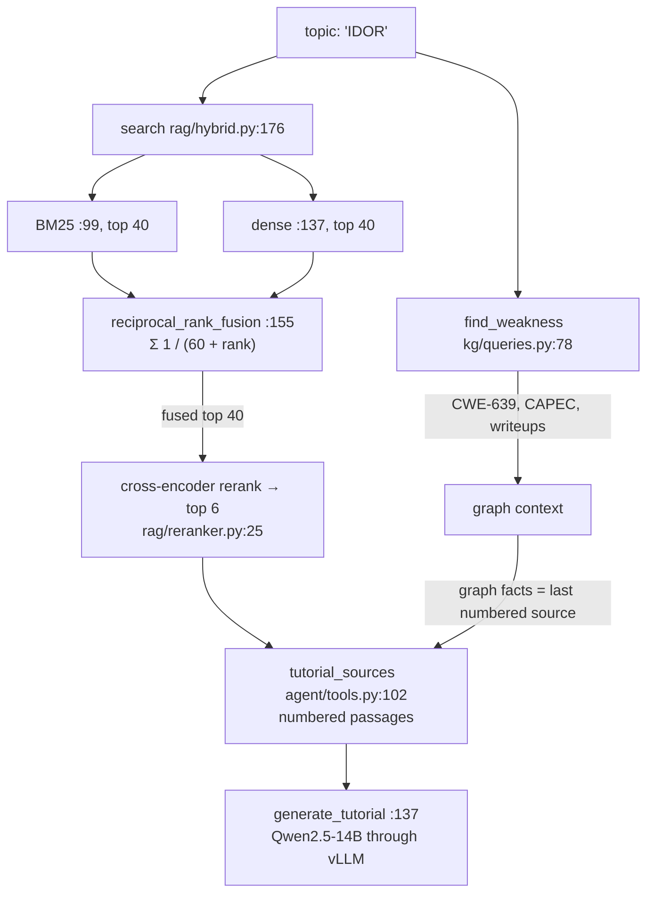
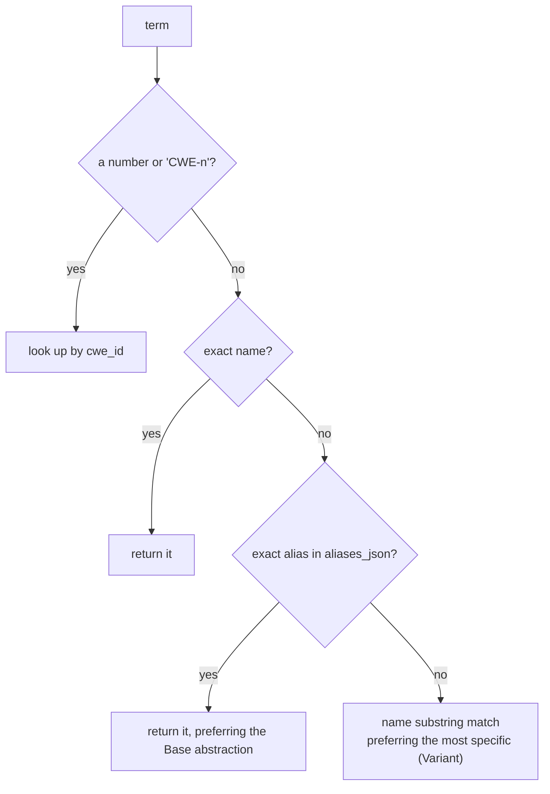
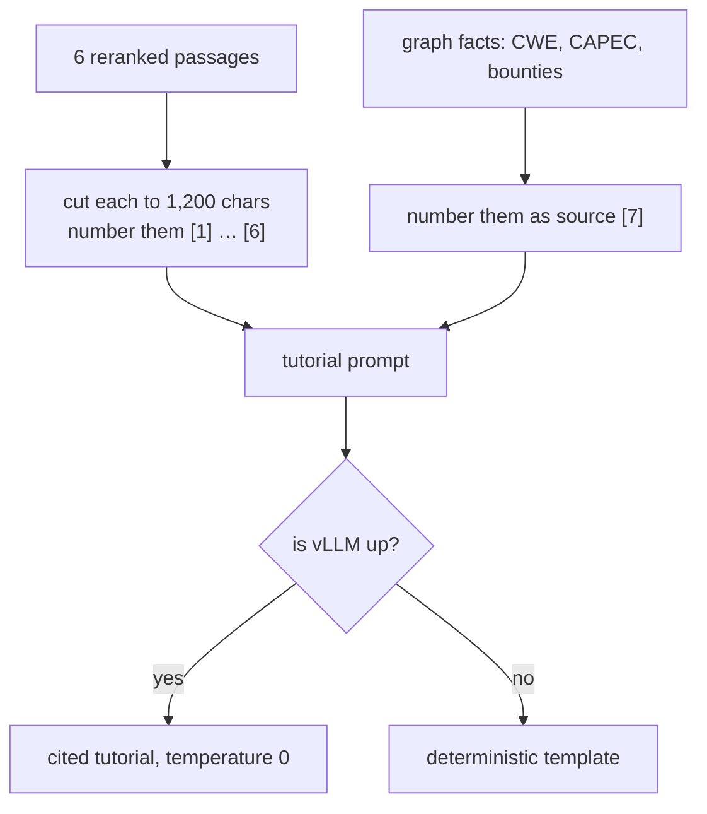
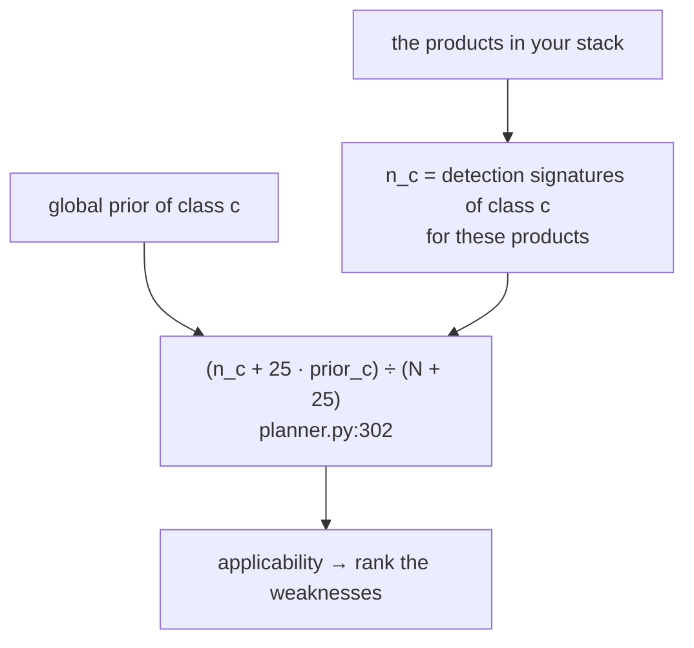

# Day 12 (Thu Nov 19): BountyBrain (full day)

Part of [[Interview plan (Nov 2026)]]. Repo `bountybrain`, **branch `upgrade-2026-10`** (HEAD `4267980`). Read it with
`git show upgrade-2026-10:<path>`; don't switch branches. About 7 h. Prep pack: [[BountyBrain - prep]] (architecture §2,
23 design decisions §3, 10 stories §4, numbers §5).

**Code, explained:** the figures, the code to read and what each snippet does are in [[#Code, explained]], right after section B.

**Resume bullets (resume 4):**
- "Built an interactive cybersecurity learning application connecting vulnerability classes, attack patterns and real-world writeups, with **cited explanations** and resources for hands-on practice."
- "Built a knowledge graph of **30k+ nodes across exploits** enabling contextual vulnerability exploration."

**Three things that can hurt you** (prep pack §0). Settle them first, in block 1:
1. **"30k+ nodes across exploits" is wrong as worded.** 30k+ is the *core* subgraph (35,278 nodes), and the core is defined as everything *except* CVE and exploit nodes (`kg/metrics.py:165`, `CORE_KINDS`). The full graph has **111,896 nodes, including 46,647 exploits**. Honest wording: "a 112k-node knowledge graph linking 969 CWE weakness classes, 615 CAPEC attack patterns, 13.6k detection signatures, 46.6k public exploits and 6.4k disclosed writeups".
2. **Authorship.** The first commit (`4c8c10b`, 2026-08-16) is authored by **Tarunsai**, not you. It contains the scaffold, including RRF k = 60 and the bge-small / bge-reranker choice. Later commits carry a `Co-Authored-By: Claude` trailer. The faithfulness hand labels were made by Claude (RESULTS §5). **Decide tonight how you describe this.** Interviewers can open the repo. Don't claim sole authorship of the first commit's choices.
3. **Several "why" questions have no recorded answer:** the embedder, the reranker, RRF k = 60, the 400-token chunks, Qwen2.5-14B. Say what the code shows and what you'd test. Don't invent a selection process.

Also: "cited explanations" means **54.5%** of sentences carry a citation and **32.6%** are cited *and* supported. The UI caption "Every claim is cited" (`ui/pages/1_Learn.py:16`) is false.

**By tonight you can:**
- explain the graph's schema and why SQLite, not a graph database;
- explain BM25, dense retrieval, RRF and cross-encoder reranking, with your ablation numbers;
- explain R@k, MRR, nDCG, and how faithfulness was measured;
- tell stories 4.2 (planner vs baseline), 4.4 (the confounded comparison) and 4.5 (constrained decoding that was never on).

## Schedule

| # | Time | Kind | What |
|---|---|---|---|
| 0 | 15 min | recall | Day 11: BCubed, margin sampling, steering vectors |
| 1 | 30 min | read | Prep pack §0, §1 pitch, §2 diagrams; settle the three risks |
| 2 | 40 min | theory | Knowledge graphs: CWE, CAPEC; BM25 vs dense; bi- vs cross-encoders; RRF (A1) |
| 3 | 60 min | code | `kg/build.py`, skim `kg/models.py`, `kg/queries.py` (B1) |
| 4 | 60 min | code | `rag/index.py`, `rag/hybrid.py`, `rag/reranker.py`, `ingestion/chunker.py` (B2) |
| — | lunch | | |
| 5 | 30 min | theory | R@k, MRR, nDCG; faithfulness; LLM judges and Cohen's κ (A2) |
| 6 | 45 min | code | The tutorial path and the recon planner (B3) |
| 7 | 30 min | skim | `clients/llm.py`, `agent/path.py`, `agent/labs.py`, `api/app.py`, the eval scripts (B4) |
| 8 | 60 min | rebuild | BM25 + dense + RRF + rerank on 200 documents (C) |
| 9 | 20 min | trace | `POST /learn {"topic": "IDOR"}` by hand (D) |
| 10 | 40 min | practice | The questions (E) |

## A. Theory

### A1. Graph and retrieval (block 2, 40 min)

**Read:**
- MITRE's CWE and CAPEC "About" pages (10 min): a CWE is a weakness *class* (with a parent/child hierarchy); a CAPEC is an attack *pattern* that exploits CWEs; CVEs are concrete instances.
- Cormack et al., *"Reciprocal Rank Fusion outperforms Condorcet…"* (2009): the 2-page paper. 10 min.
- The Sentence-Transformers docs page *"Retrieve & Re-Rank"* (bi-encoder vs cross-encoder). 15 min.

**Concepts:**
- **BM25:** a lexical score from term frequency (saturated by k1), inverse document frequency and length normalisation (b). It's good at exact identifiers ("CWE-639", "SSRF").
- **Dense:** a bi-encoder embeds the query and the passages separately (bge-small-en-v1.5; the query gets an instruction prefix, passages don't). It's good at paraphrase.
- **RRF:** `score(d) = Σ_runs 1/(k + rank)`, k = 60. It uses ranks, not raw scores, so BM25 and cosine scales never need calibrating.
- **Cross-encoder rerank:** reads (query, passage) together. More accurate, but O(candidates) model calls, so only the top 40 fused candidates are reranked.
- **Why SQLite and not Neo4j** (decision 3.2): typed relational tables, simple joins, one file, no server. The graph queries you need are 1–3 hops.

### A2. Evaluation (block 5, 30 min)

- **R@k:** the gold chunk is in the top k. **MRR:** the mean of 1/rank of the first relevant hit. **nDCG@k:** a graded, position-discounted gain over the ideal (story 4.3: your first nDCG was 1.113, which is impossible).
- **Your retrieval eval:** 200 LLM-generated known-item queries. hybrid+rerank **R@5 0.965, MRR 0.861**; dense 0.885/0.759; BM25 0.850/0.735; hybrid 0.910/0.773. Caveat: the source chunk *stays* in the index, and queries can reuse its words.
- **Faithfulness:** split the answer into sentences; for each cited sentence an LLM judge checks support; reweight by hand labels. **Cohen's κ** measures judge–label agreement beyond chance. Caveats: the judge is the same model as the generator, and the "blind hand labels" were made by Claude.

## B. Code

### B1. The graph (block 3, 60 min, deep)

`bountybrain/kg/build.py`:
- **470 `build`**; **79 `GraphBuilder`**;
- 107 `load_weaknesses` (curated aliases persisted via **440 `_merged_aliases`**: the story 4.4 fix), 151 `load_techniques`, 211 `ensure_cves`, 223 `ensure_products`, 231 `load_signatures`, 278 `load_exploits`, 328 `load_documents`.
- `kg/queries.py`: **78 `find_weakness`** (number → `CWE-…` → exact name → alias, 103), 139 `weakness_hierarchy`, 173 `techniques_for_weakness`, 185 `attack_chain`, 244 `documents_for_weakness`.
- `kg/metrics.py`: **165 `CORE_KINDS`** (why the 30k+ has no exploits), 168 `core_subgraph`, 410 `compute_all`.

### B2. Retrieval (block 4, 60 min, deep)

- `ingestion/chunker.py` **59 `chunk_text`**: structure-aware; code fences kept whole.
- `rag/index.py` **115 `build_index`**: 70 `iter_chunks`, 97 the chunk cache (11,355 chunks; BM25 reads this file).
- `rag/hybrid.py`: **99 `_bm25_search`** (in memory), **137 `_dense_search`** (embedded Qdrant), **155 `reciprocal_rank_fusion`**, **176 `search`** (mode `hybrid_rerank`, 40 candidates; 200 the rerank call).
- `rag/reranker.py` **25 `rerank`** (bge-reranker-base).

### B3. Tutorial and planner (block 6, 45 min, deep)

- `agent/tools.py`: 27 `local_rag_search`; 102 `tutorial_sources` (passages cut to 1,200 chars; the graph summary is the last numbered source); **137 `generate_tutorial`** (temperature 0; 174 a deterministic fallback).
- `recon/planner.py`: **649 `plan_from_findings`** → **233 `rank_weaknesses`**; **299–307** P(weakness | product) shrunk toward the global prior with a pseudo-count of 25 (story 4.2).

### B4. Skim (block 7, 30 min)

`clients/llm.py` (117 `chat`; `response_format` json_schema, story 4.5), `agent/path.py` (59 `learning_path`), `agent/labs.py` (144 `find_practice_labs`; 29 CWE classes), `api/app.py` (33 warm-up at startup; 106 `/learn`), `eval/classification.py` (the confound), `eval/faithfulness.py`.

## Code, explained

Read this **with the files open**. It starts with a picture of the whole day and **the flow, step by step** (one concrete input followed through every function). Then each part has its own figure, the exact code (copied from the repo at the commit named below, so the line numbers match) and what that code does.

Repo `bountybrain`, branch **`upgrade-2026-10`** (`4267980`); read it with
`git show upgrade-2026-10:<path>`. Paths below are under `bountybrain/`.



### The flow, step by step

`POST /learn {"topic": "IDOR"}`, end to end.

1. **Route:** `api/app.py:106` calls the tools in order. (At start-up, `_startup` at `:33` already ran a throwaway search, so the embedder, the reranker and BM25 are loaded.)
2. **Resolve the topic** (`find_weakness`, `kg/queries.py:78`): "IDOR" is not a number, not `CWE-…` and not an exact name. The exact-alias query `aliases_json ILIKE '%"IDOR"%'` finds **CWE-639**, because the curated alias is stored in the graph.
3. **Graph context:** its parent and child weaknesses (`:139`), the attack patterns (`:173`) and up to 8 disclosed writeups (`:244`).
4. **Retrieve** (`search`, `rag/hybrid.py:176`, mode `hybrid_rerank`):
   - dense: embed the query (with the BGE instruction prefix) → top 40 from Qdrant;
   - BM25: score all 11,355 chunks in memory → top 40;
   - RRF: sum `1/(60 + rank)` per chunk → one fused list;
   - rerank: the cross-encoder scores the top 40 (query, chunk) pairs and keeps **6**.
5. **Number the sources** (`tutorial_sources`, `agent/tools.py:102`): 6 passages cut to 1,200 characters, plus the graph summary as source **[7]**.
6. **Generate** (`generate_tutorial`, `:137`): one chat call to vLLM, temperature 0, 2,048 tokens max. If it fails, a deterministic template is used instead (`:151–152`).
7. **Labs** (`agent/labs.py:144`): practice labs found through the CWE id, walking up the CWE tree if needed. The response took 9.1 s in the end-to-end test.

---

### 1. Resolving a topic in the graph



`bountybrain/kg/queries.py:87–120` (`upgrade-2026-10`)
```python
text = str(term).strip()
if text.upper().startswith("CWE-") and text[4:].isdigit():
    v = s.execute(
        select(Vulnerability).where(Vulnerability.cwe_id == int(text[4:]))
    ).scalar_one_or_none()
    return _weakness_dict(v) if v else None

v = s.execute(
    select(Vulnerability).where(func.lower(Vulnerability.name) == text.lower())
).scalar_one_or_none()
if v:
    return _weakness_dict(v)

# An exact alias beats any substring hit. Without this, "SQL injection"
# substring-matched "SQL Injection: Hibernate" (a Variant) ahead of
# CWE-89, whose alias it is, and "path traversal" landed on CWE-24.
exact = s.execute(
    select(Vulnerability).where(Vulnerability.aliases_json.ilike(f'%"{text}"%'))
).scalars().all()
if exact:
    rank = {"Base": 0, "Variant": 1, "Class": 2, "Compound": 3, "Pillar": 4}
    exact.sort(key=lambda v: rank.get(v.abstraction or "", 9))
    return _weakness_dict(exact[0])

# fall back to a name substring match, preferring the most
# specific abstraction so "injection" does not return the Pillar
rank = {"Variant": 0, "Base": 1, "Compound": 2, "Class": 3, "Pillar": 4}
rows = s.execute(
    select(Vulnerability).where(Vulnerability.name.ilike(f"%{text}%"))
).scalars().all()
if not rows:
    return None
rows.sort(key=lambda v: rank.get(v.abstraction or "", 9))
return _weakness_dict(rows[0])
```
> [!info] New functions in this code
> - `str(x)`: converts anything to its text form. `str(89)` → `'89'`. `find_weakness` uses `str(term)` so a number or a string both work. [[Function glossary#str|→ examples]]
> - `.strip()`: removes spaces (and newlines) from both ends of a string. `'  CWE-89 '.strip()` → `'CWE-89'`. [[Function glossary#x.strip|→ examples]]
> - `.upper()`: the string in capitals. `'cwe-89'.upper()` → `'CWE-89'`, so a user typing `cwe-89` still matches `CWE-`. [[Function glossary#x.upper|→ examples]]
> - `.startswith(prefix)`: True if the string begins with `prefix`. `'CWE-89'.startswith('CWE-')` → True. [[Function glossary#x.startswith|→ examples]]
> - `.isdigit()`: True if every character is a digit (and there's at least one). `'89'.isdigit()` → True; `'8a'.isdigit()` → False. [[Function glossary#x.isdigit|→ examples]]
> - `conn.execute(sql, params) / session.execute(query)`: runs a database query. **sqlite3** (Photo-Seek): `conn.execute('SELECT id FROM photos WHERE taken_at >= ?', ['2026-06-01'])`: each `?` is filled from `params` by the driver, never pasted into the text, so query text can't inject SQL; iterate the result for rows. **SQLAlchemy** (Day 12): `session.execute(select(...))` sends a built query to the database. [[Function glossary#x.execute|→ examples]]
> - `select(Model)`: SQLAlchemy: starts building a `SELECT … FROM table` query for a mapped class. Nothing runs until `session.execute(...)`. [[Function glossary#select|→ examples]]
> - `query.where(condition)`: SQLAlchemy: adds a `WHERE` clause. `select(Vulnerability).where(Vulnerability.cwe_id == 89)` means `SELECT * FROM vulnerability WHERE cwe_id = 89`. `==` on a column builds SQL; it doesn't compare in Python. [[Function glossary#x.where|→ examples]]
> - `int(x)`: converts to an integer, dropping the fraction. `int(3.9)` = 3. [[Function glossary#int|→ examples]]
> - `result.scalar_one_or_none()`: SQLAlchemy: the single object in the result, `None` if there are no rows, and an **error** if there are two or more. Safe for lookups by a unique key like `cwe_id`. [[Function glossary#x.scalar_one_or_none|→ examples]]
> - `.lower() / func.lower(col)`: on a string: the string in small letters, `'SQL Injection'.lower()` → `'sql injection'`. In SQLAlchemy, `func.lower(Vulnerability.name)` is the SQL function `LOWER(name)`, so the comparison happens case-insensitively inside the database. [[Function glossary#x.lower|→ examples]]
> - `column.ilike(pattern)`: SQLAlchemy: a case-insensitive `LIKE`. `%` matches any text, so `aliases_json.ilike('%"IDOR"%')` finds rows whose alias list contains the whole string `"IDOR"`, quotes included. [[Function glossary#x.ilike|→ examples]]
> - `result.scalars()`: SQLAlchemy: yields the first column of each row (here the `Vulnerability` objects themselves) instead of row tuples. [[Function glossary#x.scalars|→ examples]]
> - `result.all()`: SQLAlchemy: reads every remaining row into a Python list. [[Function glossary#x.all|→ examples]]
> - `.sort(key=f)`: sorts a list **in place** (by `f(x)` if given). `nodes.sort(key=lambda n: n.last_accessed)` puts the least recently used first. [[Function glossary#list.sort|→ examples]]
> - `.get(key, default)`: a dict lookup that returns `default` (or None) instead of failing when `key` is missing. [[Function glossary#dict.get|→ examples]]

A cascade from most to least exact:
1. `CWE-89` or a number → a direct lookup.
2. An exact name (case-insensitive).
3. **An exact alias.** `aliases_json` is a JSON list stored as text, so `ILIKE '%"IDOR"%'` (with the quotes) matches the whole alias, not a fragment. If several weaknesses share the alias, prefer the **Base** abstraction.
4. Only then a name substring, preferring the **most specific** abstraction (Variant before Pillar).

- The comment at lines 100–102 is story 4.8: "SQL injection" used to match "SQL Injection: Hibernate" (a Variant) by substring before CWE-89, whose alias it is.
- The curated aliases (like "IDOR") are only here because the builder **persists** them (`kg/build.py:440`). Before that fix, the keyword classifier read them from disk while the LLM's shortlist didn't, which confounded the classifier comparison (story 4.4).

---

### 2. Hybrid retrieval

> [!tip] Concept from scratch: [[#7. Deep dive: fusion (RRF) and cross-encoder reranking from scratch|RRF and cross-encoder reranking with worked numbers (§7)]]

> [!tip] Concept from scratch: [[#6. Deep dive: dense retrieval from scratch|dense retrieval and cosine similarity, from zero (§6)]]

> [!tip] Concept from scratch: [[#5. Deep dive: BM25 from scratch|BM25 from zero, scored by hand on eight documents (§5)]]

`bountybrain/rag/hybrid.py:194–202` (`upgrade-2026-10`)
```python
else:
    dense = _dense_search(query, depth, flt)
    lexical = _bm25_search(query, depth, flt)
    runs = [r for r in (dense, lexical) if r]
    fused = reciprocal_rank_fusion(runs) if runs else []
    if mode == "hybrid_rerank":
        hits = rerank(query, fused[:depth], top_n=top_k)
    else:
        hits = fused[:top_k]
```

- Both arms retrieve **40 candidates** (`depth`), not just `top_k`. The reranker can only promote what it's given.
- `runs = [r for r in (dense, lexical) if r]`: if Qdrant is unreachable, the dense arm returns `[]` and retrieval degrades to BM25 instead of failing.

`bountybrain/rag/hybrid.py:99–118` (`upgrade-2026-10`)
```python
def _bm25_search(query: str, limit: int, flt: dict | None = None) -> list[Hit]:
    build_bm25()
    bm = _bm25_state["bm25"]
    if bm is None:
        return []
    rows = _bm25_state["rows"]
    scores = bm.get_scores(_tokenize(query))
    order = sorted(range(len(scores)), key=lambda i: -scores[i])

    hits: list[Hit] = []
    for i in order:
        if scores[i] <= 0:
            break
        row = rows[i]
        if flt and not _matches(row, flt):
            continue
        hits.append(_row_to_hit(row, float(scores[i])))
        if len(hits) >= limit:
            break
    return hits
```
> [!info] New functions in this code
> - `bm25.get_scores(query_tokens)`: rank_bm25: a numpy array with one BM25 score per document, in corpus order. Higher = better match; 0 = no query word present. [[Function glossary#x.get_scores|→ examples]]
> - `sorted(xs, key=f)`: a new list in increasing order (by `f(x)` if `key` is given). `sorted([3, 1, 2])` = `[1, 2, 3]`. [[Function glossary#sorted|→ examples]]
> - `range(start, stop, step)`: the integers from `start` up to (not including) `stop`. `range(0, 10, 4)` gives 0, 4, 8. `range(3)` gives 0, 1, 2. [[Function glossary#range|→ examples]]
> - `len(xs)`: how many items. `len([7, 8, 9])` = 3. [[Function glossary#len|→ examples]]
> - `.append(x)`: adds `x` at the end of a list. `[1].append(2)` → `[1, 2]`. [[Function glossary#list.append|→ examples]]
> - `float(x)`: converts to a floating-point number. `float('-inf')` is minus infinity, a value smaller than every number (used to mask scores). [[Function glossary#float|→ examples]]

- BM25 scores **every** chunk in memory (11,355 of them), sorts, and stops at the first zero score. It's good at exact identifiers ("CWE-918", "SSRF") that an embedder can blur.

`bountybrain/rag/hybrid.py:155–170` (`upgrade-2026-10`)
```python
def reciprocal_rank_fusion(runs: list[list[Hit]], k: int = RRF_K) -> list[Hit]:
    """Fuse ranked lists by 1/(k + rank), summed across runs."""
    scores: dict[tuple[int, int], float] = {}
    best: dict[tuple[int, int], Hit] = {}
    for run in runs:
        for rank, hit in enumerate(run, start=1):
            key = (hit.document_id, hit.chunk_idx)
            scores[key] = scores.get(key, 0.0) + 1.0 / (k + rank)
            if key not in best:
                best[key] = hit
    fused = []
    for key, score in sorted(scores.items(), key=lambda kv: -kv[1]):
        hit = best[key]
        hit.score = score
        fused.append(hit)
    return fused
```
> [!info] New functions in this code
> - `enumerate(xs)`: loops over a list and gives you each item **with its index**. `for i, x in enumerate(['a', 'b'])` gives `(0, 'a')`, then `(1, 'b')`. [[Function glossary#enumerate|→ examples]]
> - `.items()`: a dict's `(key, value)` pairs, for looping over both. [[Function glossary#dict.items|→ examples]]

- **RRF:** each list contributes `1/(60 + rank)` per chunk, and the sums are sorted. It uses **ranks only**, so BM25's unbounded scores and cosine's [−1, 1] never need calibrating against each other. A chunk ranked well by both arms beats one ranked first by only one: rank 1 in one list gives 1/61 ≈ 0.0164, while rank 5 in both gives 2/65 ≈ 0.0308.
- The key is `(document_id, chunk_idx)`, so the same chunk from both arms is merged.

`bountybrain/rag/reranker.py:25–34` (`upgrade-2026-10`)
```python
def rerank(query: str, hits: list, top_n: int = 5) -> list:
    model = _model()
    if model is None or not hits:
        return hits[:top_n]
    pairs = [(query, h.text) for h in hits]
    scores = model.predict(pairs)
    ranked = sorted(zip(hits, scores, strict=True), key=lambda x: -x[1])
    for h, s in ranked:
        h.score = float(s)
    return [h for h, _ in ranked[:top_n]]
```
> [!info] New functions in this code
> - `model.predict(inputs)`: runs a trained model on inputs. For `CrossEncoder`, `predict([(q, p1), (q, p2)])` returns one score per pair, e.g. `array([7.4, -3.2])`; only their order matters here. [[Function glossary#x.predict|→ examples]]
> - `zip(a, b)`: walks several lists **in step**, pairing their items. `zip([1, 2], ['x', 'y'])` gives `(1, 'x')`, `(2, 'y')`. [[Function glossary#zip|→ examples]]

- The cross-encoder reads `(query, chunk)` **together**, so it can judge actual relevance, but that's one model call per pair. So it reranks only the 40 fused candidates. The ablation: R@1 went 0.675 → 0.800 with reranking, and hybrid+rerank reached R@5 0.965, MRR 0.861.

**Check yourself:** dense ranks [A, B, C]; BM25 ranks [C, D, A]. Compute the RRF scores with k = 60 and give the fused order. (*A: 1/61 + 1/63 ≈ 0.0323; C: 1/63 + 1/61 ≈ 0.0323 (a tie with A); B: 1/62 ≈ 0.0161; D: 1/62 ≈ 0.0161. The order between tied items follows insertion: A, C, B, D.*)

---

### 3. Grounded generation

> [!tip] Concept from scratch: [[#9. Deep dive: measuring faithfulness, and Cohen's κ, from scratch|how faithfulness, Cohen's κ and the 32.6% were computed (§9)]]



`bountybrain/agent/tools.py:110–125` (`upgrade-2026-10`)
```python
numbered = [
    {"title": s["title"], "url": s["url"], "doc_type": s.get("doc_type"),
     "text": s["text"][:SOURCE_CHARS]}
    for s in sources
]
brief = _context_brief(context)
if brief:
    numbered.append(
        {
            "title": "BountyBrain knowledge graph (MITRE CWE/CAPEC, disclosed-report metadata)",
            "url": (context or {}).get("weakness", {}).get("url", ""),
            "doc_type": "graph",
            "text": json.dumps(brief, indent=2),
        }
    )
return numbered
```
> [!info] New functions in this code
> - `json.dumps(obj)`: converts Python dicts/lists/numbers into a JSON **string**. `json.dumps({'cwe': 639})` → `'{"cwe": 639}'`. Used to put graph facts into the prompt as text. [[Function glossary#json.dumps|→ examples]]

- Every passage is numbered and cut to 1,200 characters. The **graph facts become the last numbered source** too. When they were an unnumbered "context" block, the model used them without citing them, and nothing could check those claims.

`bountybrain/agent/tools.py:145–152` (`upgrade-2026-10`)
```python
try:
    return chat(
        system=TUTORIAL_SYSTEM,
        user=tutorial_prompt(topic, sources, context),
        max_tokens=2048,
    )
except (LLMError, Exception):
    return _template_tutorial(topic, sources, context)
```

- If vLLM is down or errors, fall back to a deterministic template, so the page always renders. The measured result to quote honestly: 54.5% of sentences carry a citation, and 32.6% are cited *and* supported (judged by the same Qwen, against 40 hand labels made by Claude).

---

### 4. The planner fix (story 4.2)

> [!tip] Concept from scratch: [[#10. Deep dive: smoothing toward a prior (the planner fix) from scratch|shrinkage toward a prior, with numbers (§10)]]



`bountybrain/recon/planner.py:299–307` (`upgrade-2026-10`)
```python
prior = _global_class_prior(s)
observed = {c: len(e["signatures"]) for c, e in per_cwe.items()}
total_observed = sum(observed.values())
conditional = {
    c: (n + SMOOTHING_ALPHA * prior.get(c, 0.0))
    / (total_observed + SMOOTHING_ALPHA)
    for c, n in observed.items()
}
max_conditional = max(conditional.values(), default=0.0) or 1.0
```
> [!info] New functions in this code
> - `sum(xs)`: adds up the items. `sum([1, 2, 3])` = 6. [[Function glossary#sum|→ examples]]
> - `.values()`: all the values of a dict, without the keys. [[Function glossary#dict.values|→ examples]]
> - `max(xs) / max(a, b)`: the largest. `max([3, 9, 2])` = 9. With `key=f` it compares `f(x)` instead: `max(range(3), key=lambda i: s[i])` is the index of the largest `s[i]`. [[Function glossary#max|→ examples]]

- Applicability = **P(weakness | this product's stack)**, shrunk toward the global prior: `(n_c + α·prior_c) / (N + α)` with α = 25 (a pseudo-count).
- The old score was a log-count that saturated at 1.0 for any popular product, so every class tied on applicability and the stack-independent terms decided the ranking. That lost to "rank by global frequency" (P@1 0.280 vs 0.325). With the conditional estimate it reached **0.427**.
- The pseudo-count keeps a product with 3 signatures from being ranked purely on those 3: its estimate is mostly the prior until it has data.

---

### 5. Deep dive: BM25 from scratch

Section 2 above walks `_bm25_search`. This section builds BM25 from zero, on eight tiny documents you can score by
hand. Order: the problem → three ideas → the toy corpus → IDF → term-frequency saturation → length normalisation →
the full score → the code, line by line → questions → check.

> [!important] The one sentence to hold on to
> BM25 scores a chunk by adding, for each query word it contains, **how rare that word is** (IDF) times **how often it
> appears**, with repeats giving diminishing returns and long chunks getting a little less credit.

#### 5.1 The problem

A user types "SSRF server metadata". There are 11,355 chunks. You want the chunks that **share the query's words**,
with the important words counting most. No model, no training: just counting.

#### 5.2 Three ideas

1. **Rare words matter more.** "metadata" in a chunk tells you a lot. "the" tells you nothing; it's everywhere.
2. **Repeats help, but less and less.** Saying "SSRF" twice is more on-topic than once. Saying it 50 times isn't 50 times more on-topic.
3. **Long chunks get less credit per match.** A match in a 10-word chunk is stronger evidence than one match in a 1,000-word chunk.

BM25 turns each idea into one factor.

#### 5.3 The toy corpus

Eight one-line documents, tokenised exactly like the project does (lowercase, then the regex in §5.8):

| doc | text | words |
|---|---|---|
| 0 | SSRF: the server fetches a URL chosen by the attacker | 10 |
| 1 | Blind SSRF: the app fetches the URL but shows nothing | 10 |
| 2 | IDOR: change the id in the URL to read another account | 11 |
| 3 | XSS runs attacker script in the victim browser | 8 |
| 4 | CSRF tricks the browser into sending a request | 8 |
| 5 | Path traversal reads files outside the web root | 8 |
| 6 | The app logs every request it handles | 7 |
| 7 | SSRF to cloud metadata: SSRF on a server reaches 169.254.169.254 | 10 |

$N = 8$ documents, average length $\text{avgdl} = 72 / 8 = 9.0$ words. Query tokens: `ssrf`, `server`, `metadata`.

#### 5.4 IDF: how rare is the word?

Let $n$ be the number of documents containing the word. The library the project uses (`rank_bm25`) computes:

$$\text{idf} = \ln \frac{N - n + 0.5}{n + 0.5}$$

| word | in docs | $n$ | idf |
|---|---|---|---|
| ssrf | 0, 1, 7 | 3 | $\ln(5.5 / 3.5) = 0.452$ |
| server | 0, 7 | 2 | $\ln(6.5 / 2.5) = 0.956$ |
| metadata | 7 | 1 | $\ln(7.5 / 1.5) = 1.609$ |
| the | all but 7 | 7 | $\ln(1.5 / 7.5) = -1.609$ → floored to **0.340** |

- The rarer the word, the bigger its IDF: "metadata" is worth 3.6× "ssrf" here.
- The `+ 0.5` terms stop a division by zero and soften the extremes.
- **A word in more than half the documents gets a negative IDF.** `rank_bm25` replaces it with a floor: $\varepsilon \times$ the average IDF $= 0.25 \times 1.361 = 0.340$. A word in **exactly** half gets $\ln 1 = 0$. (Lucene adds 1 inside the log, so its IDF never goes negative.)

#### 5.5 Term frequency, with saturation

Let $f$ be how many times the word appears in the document. For a document of average length, BM25 uses:

$$\frac{f\,(k_1 + 1)}{f + k_1}, \qquad k_1 = 1.5$$

| $f$ | 0 | 1 | 2 | 3 | 5 | 10 | 100 |
|---|---|---|---|---|---|---|---|
| factor | 0 | **1.000** | 1.429 | 1.667 | 1.923 | 2.174 | 2.463 |

The factor can never exceed $k_1 + 1 = 2.5$. The first occurrence is worth 1.0, the second adds 0.43, the tenth
almost nothing. $k_1$ sets how fast it saturates: a small $k_1$ means "present or not", a large one is closer to a raw
count.

![[d12-1-bm25.svg]]

#### 5.6 Length normalisation

Replace $k_1$ in the denominator by a length-adjusted $K$:

$$K = k_1 \left(1 - b + b\,\frac{L}{\text{avgdl}}\right), \qquad b = 0.75$$

For a 10-word document: $K = 1.5\,(0.25 + 0.75 \times 10/9) = 1.625$. One occurrence then gives
$2.5 / (1 + 1.625) = 0.952$.

| length $L$ | $K$ | factor for $f = 1$ |
|---|---|---|
| 7 (shorter than average) | 1.250 | 1.111 |
| 9 (average) | 1.500 | 1.000 |
| 10 | 1.625 | 0.952 |
| 11 | 1.750 | 0.909 |

- $b = 0$ switches length normalisation off; $b = 1$ applies it fully.
- So the same single match counts 1.111 in a 7-word chunk but 0.909 in an 11-word one.

#### 5.7 The full score

$$\text{BM25}(q, d) = \sum_{t \in q} \text{idf}(t) \cdot \frac{f_{t,d}\,(k_1 + 1)}{f_{t,d} + K_d}$$

Doc 7 (10 words, $K = 1.625$) contains ssrf twice, server once and metadata once:

| term | idf | $f$ | tf factor | contribution |
|---|---|---|---|---|
| ssrf | 0.452 | 2 | $2 \times 2.5 / (2 + 1.625) = 1.379$ | 0.623 |
| server | 0.956 | 1 | 0.952 | 0.910 |
| metadata | 1.609 | 1 | 0.952 | 1.533 |
| **total** | | | | **3.066** |

The ranking:

| rank | doc | score | why |
|---|---|---|---|
| 1 | 7 | 3.066 | all three words, including the rare "metadata" |
| 2 | 0 | 1.340 | ssrf 0.430 + server 0.910 |
| 3 | 1 | 0.430 | ssrf only |
| — | 2–6 | 0 | no query word at all |

Notice doc 1 says "fetches the URL", which is exactly what SSRF does, yet it ranks last among the hits. BM25 has no
idea that words mean things. That gap is what the dense arm (§6) fills.

#### 5.8 The code, line by line

**Tokenising** (both the chunks and the query go through this):

`bountybrain/rag/hybrid.py:33–33` (`upgrade-2026-10`)
```python
_TOKEN = re.compile(r"[a-z0-9_.-]+")
```
> [!info] New functions in this code
> - `re.compile(pattern)`: turns a regex pattern into a reusable object (compiled once, used many times). `_TOKEN = re.compile(r'[a-z0-9_.-]+')` matches runs of letters, digits, `_`, `.` and `-`. [[Function glossary#x.compile|→ examples]]

`bountybrain/rag/hybrid.py:62–63` (`upgrade-2026-10`)
```python
def _tokenize(text: str) -> list[str]:
    return _TOKEN.findall(text.lower())
```
> [!info] New functions in this code
> - `pattern.findall(s)`: all non-overlapping matches, as a list of strings. `_TOKEN.findall('cwe-918: ssrf')` → `['cwe-918', 'ssrf']`. If the pattern has one group `( )`, it returns just the group's text: that's how `_CITE.findall` returns `'2, 4–5'` from `[2, 4–5]`. [[Function glossary#x.findall|→ examples]]

- `text.lower()`, then keep runs of letters, digits, `_`, `.` and `-`. Everything else splits.
- `"CWE-918: SSRF via /api/v1/fetch?url="` → `['cwe-918', 'ssrf', 'via', 'api', 'v1', 'fetch', 'url']`. The identifier **`cwe-918` survives whole**, because `-` is allowed. So does `169.254.169.254`.
- `"user's"` → `['user', 's']`. There's no stemming: `fetches` and `fetch` are different words. The query "fetch" doesn't match doc 0.

**Building the index once:**

`bountybrain/rag/hybrid.py:66–77` (`upgrade-2026-10`)
```python
def build_bm25(force: bool = False) -> None:
    """Build the lexical index from the same chunk cache the dense side used."""
    if _bm25_state["bm25"] is not None and not force:
        return
    rows = load_chunk_cache()
    if not rows:
        _bm25_state["bm25"] = None
        _bm25_state["rows"] = []
        return
    corpus = [_tokenize(r.get("text", "")) for r in rows]
    _bm25_state["bm25"] = BM25Okapi(corpus)
    _bm25_state["rows"] = rows
```
> [!info] New functions in this code
> - `rank_bm25.BM25Okapi(corpus, k1=1.5, b=0.75, epsilon=0.25)`: builds a BM25 index from a list of tokenised documents: per-document word counts, per-word IDF (negative ones floored at epsilon × mean IDF) and the average length. [[Function glossary#BM25Okapi|→ examples]]

- `load_chunk_cache()` returns the same 11,355 chunk rows the dense index was built from, so both arms search the same corpus.
- `BM25Okapi(corpus)` walks every chunk once and stores, per chunk, a word → count dictionary; per word, its IDF; and `avgdl`. That's the precomputed part of §5.4–5.6.
- The module-level `_bm25_state` dict caches it, so only the first search pays.

**Scoring a query** (inside the library, `rank_bm25.py`, `BM25Okapi.get_scores`):

```python
score = np.zeros(self.corpus_size)
doc_len = np.array(self.doc_len)
for q in query:
    q_freq = np.array([(doc.get(q) or 0) for doc in self.doc_freqs])
    score += (self.idf.get(q) or 0) * (q_freq * (self.k1 + 1) /
                                       (q_freq + self.k1 * (1 - self.b + self.b * doc_len / self.avgdl)))
```
> [!info] New functions in this code
> - `np.zeros(n)`: a numpy array of n zeros (float64). `np.zeros(3)` → `array([0., 0., 0.])`. BM25 starts every chunk's score at 0 this way. [[Function glossary#np.zeros|→ examples]]
> - `np.array(xs)`: turns a Python list into a NumPy array, so maths applies to every element at once. `np.array([0.9, 0.2]) * 2` → `[1.8, 0.4]`. [[Function glossary#np.array|→ examples]]

- One pass per query word. `q_freq` is $f$ for **every** chunk: an array of 11,355 counts, mostly 0.
- The long line is §5.7's formula, computed for all chunks at once. A word not in the corpus has `idf.get(q)` = None → 0.
- A word repeated in the query is added twice: "ssrf ssrf" doubles its weight.

**Ranking** (lines 105–118 in section 2 above):
- `order = sorted(range(len(scores)), key=lambda i: -scores[i])` sorts chunk indices by score, highest first.
- `if scores[i] <= 0: break`: since the list is sorted, the first zero means no later chunk matched anything.
- `_matches(row, flt)` applies the optional filter (for example `doc_type`), and the loop stops at `limit` = 40 hits.

The whole thing is a brute-force scan, and it's fast: **16 ms median** per query over 11,355 chunks (RESULTS §2).

#### 5.9 Questions people usually ask next

##### "Why keep BM25 if you have embeddings?"

Exact strings. A query with `CVE-2021-44228`, `CWE-918` or a product name needs those exact tokens. An embedder can
blur a rare identifier into "something about vulnerabilities". In the ablation BM25 alone reached R@5 0.850 vs dense
0.885: close, and each arm finds things the other misses.

##### "What do $k_1$ and $b$ default to, and did you tune them?"

$k_1 = 1.5$, $b = 0.75$, $\varepsilon = 0.25$: the `rank_bm25` defaults. They weren't tuned. Typical values in the
literature are $k_1 \in [1.2, 2.0]$ and $b = 0.75$.

##### "Why does the IDF floor exist?"

With this IDF form, a word in more than half the chunks would **subtract** from a chunk's score, so containing "the"
would hurt. The floor keeps every match non-negative.

##### "What would you improve?"

Stemming or lemmatising ("fetches" → "fetch"), and an inverted index so you only touch chunks that contain a query
word, instead of scanning all 11,355. At this corpus size the scan is already fast enough.

#### 5.10 Check your understanding

1. Which three ideas does BM25 combine?
2. Compute the IDF of a word that appears in 1 of 8 documents.
3. With $k_1 = 1.5$, what's the most a single word can contribute per unit of IDF?
4. Why does doc 1 score below doc 0, although both mention SSRF?
5. Why is `cwe-918` one token, and why does that matter?
6. What does `if scores[i] <= 0: break` rely on?

> [!success]- Answers
> 1. Rarity (IDF), saturating term frequency ($k_1$), and length normalisation ($b$).
> 2. $\ln((8 - 1 + 0.5) / (1 + 0.5)) = \ln 5 = 1.609$.
> 3. $k_1 + 1 = 2.5$, approached only as the count goes to infinity.
> 4. Doc 0 also contains "server" (idf 0.956); doc 1 only matches "ssrf".
> 5. The regex keeps `-`; so an exact identifier query matches only chunks with that identifier, which is BM25's strength.
> 6. The indices are sorted by score, so after the first non-positive score every later score is also ≤ 0.

#### 5.11 The five things to remember

1. **Formula:** $\sum_t \text{idf}(t) \cdot f(k_1 + 1) / (f + K)$, with $K = k_1(1 - b + b\,L/\text{avgdl})$.
2. **IDF:** $\ln((N - n + 0.5)/(n + 0.5))$; rare words dominate; `rank_bm25` floors negatives at $0.25 \times$ mean IDF.
3. **Saturation:** $k_1 = 1.5$ caps a word's factor at 2.5; the first occurrence matters most.
4. **Code:** regex tokens (identifiers stay whole, no stemming), index built once, brute-force scan of 11,355 chunks, 16 ms.
5. **Role:** exact identifiers; blind to meaning, which is why it's paired with dense retrieval.

---

### 6. Deep dive: dense retrieval from scratch

BM25 (§5) matches words. This section explains the other arm, which matches **meaning**. Order: the idea → a toy in
two dimensions → cosine similarity → the bi-encoder and its costs → the query prefix → the code, line by line →
questions → check.

> [!important] The one sentence to hold on to
> An embedding model turns every text into a vector so that texts with similar meaning point in similar directions;
> retrieval then means "find the chunk vectors with the largest cosine to the query vector".

#### 6.1 The idea

The query "make the backend request an internal address" shares **no** words with "SSRF: the server fetches a URL
chosen by the attacker". BM25 scores that pair 0. Yet they mean nearly the same thing.

An embedding model (here `BAAI/bge-small-en-v1.5`) reads a text and outputs a list of 384 numbers. It was trained so
that a question and a passage answering it get **similar vectors**. Then "similar meaning" becomes "small angle
between vectors", which is cheap to compute.

#### 6.2 A toy in two dimensions

Real vectors have 384 dimensions, which you can't draw. Pretend there are only two, with these (made-up) meanings:
- dimension 1: "about making a server fetch something";
- dimension 2: "about who may access what".

| text | raw vector | unit vector | angle |
|---|---|---|---|
| **query**: "make the backend request an internal address" | (3, 1) | (0.949, 0.316) | 18.4° |
| SSRF doc | (8, 1) | (0.992, 0.124) | 7.1° |
| cloud-metadata doc | (2, 1) | (0.894, 0.447) | 26.6° |
| IDOR doc | (1, 4) | (0.243, 0.970) | 76.0° |

A **unit vector** is the vector divided by its length, so it has length 1. Only its direction is left.

![[d12-2-dense.svg]]

#### 6.3 Cosine similarity, with numbers

$$\cos(q, d) = \frac{q \cdot d}{\lVert q \rVert\,\lVert d \rVert}$$

With unit vectors, the lengths are 1 and cosine is just the dot product:

| doc | dot product of unit vectors | cosine | angle to the query |
|---|---|---|---|
| cloud metadata | $0.949 \times 0.894 + 0.316 \times 0.447$ | **0.990** | 8.1° |
| SSRF | $0.949 \times 0.992 + 0.316 \times 0.124$ | 0.981 | 11.3° |
| IDOR | $0.949 \times 0.243 + 0.316 \times 0.970$ | 0.537 | 57.5° |

- Cosine is 1 for the same direction, 0 for unrelated (90°), −1 for opposite.
- Both SSRF-like docs score high; IDOR, a different weakness, scores low. Nothing here needed shared words.
- **Why normalise?** The raw dot product of (3, 1) and (8, 1) is 25, which grows with vector length. Length often tracks text length or word frequency, not relevance. Dividing by the lengths ($\sqrt{10} \times \sqrt{65}$) gives 0.981, which depends on direction only.

#### 6.4 The bi-encoder, and why it's cheap

The model encodes the query and each chunk **separately** (hence *bi*-encoder). That split is what makes it fast:

| when | what runs | cost |
|---|---|---|
| once, at indexing | embed all 11,355 chunks | 11,355 model calls (minutes on a GPU) |
| per query | embed the query | **1** model call |
| per query | compare | 11,355 dot products of 384 numbers ≈ 4.4 million multiply-adds |

The price: the query and the chunk never "see" each other inside the model. Each is squeezed into one vector first.
Fine distinctions ("SSRF via DNS rebinding" vs "SSRF via redirects") can be lost. The cross-encoder (§7) pays to fix
exactly that.

#### 6.5 The query prefix

BGE v1.5 was trained with an instruction in front of **queries only**:

> `Represent this sentence for searching relevant passages: ` + query

Queries are short questions; passages are long statements. The prefix tells the model "this is the question side",
and the code docstring says skipping it measurably hurts recall. Passages are embedded **without** it. So the project
has two functions, not one.

#### 6.6 The code, line by line

**The prefix table:**

`bountybrain/clients/embeddings.py:25–35` (`upgrade-2026-10`)
```python
_QUERY_PREFIXES = {
    "bge": "Represent this sentence for searching relevant passages: ",
}


def _query_prefix(model_name: str) -> str:
    lowered = model_name.lower()
    for key, prefix in _QUERY_PREFIXES.items():
        if key in lowered:
            return prefix
    return ""
```

- `_query_prefix("BAAI/bge-small-en-v1.5")` lowercases the name, finds `"bge"` in it, and returns the instruction.
- Any other model family gets `""`: symmetric models need no prefix.

**Embedding the chunks (at indexing time):**

`bountybrain/clients/embeddings.py:59–70` (`upgrade-2026-10`)
```python
def embed_passages(texts: Sequence[str], show_progress: bool = False) -> list[list[float]]:
    """Embed documents for indexing (no instruction prefix)."""
    if not texts:
        return []
    vecs = _model().encode(
        list(texts),
        normalize_embeddings=True,
        batch_size=settings.embed_batch_size,
        show_progress_bar=show_progress,
        convert_to_numpy=True,
    )
    return vecs.tolist()
```
> [!info] New functions in this code
> - `model.encode(texts, normalize_embeddings=True)`: sentence-transformers: embeds a list of texts into a `[len(texts), dim]` array (dim = 384 for bge-small). `normalize_embeddings=True` makes every row length 1. (Not `str.encode`, which turns text into bytes.) [[Function glossary#x.encode|→ examples]]
> - `list(xs)`: makes a new list from any iterable. `list(reversed(range(3)))` = `[2, 1, 0]`. `list(x)` on a list makes a **copy**. [[Function glossary#list|→ examples]]
> - `.tolist()`: converts a tensor to a plain Python list (copies to the CPU). [[Function glossary#x.tolist|→ examples]]

- `_model()` loads the SentenceTransformer once (`lru_cache(maxsize=1)` remembers the result).
- `normalize_embeddings=True` divides every vector by its length: these are the unit vectors of §6.2.
- `batch_size` embeds many chunks per GPU call; `.tolist()` turns the numpy array of shape `[n, 384]` into Python lists for Qdrant.

**Embedding the query:**

`bountybrain/clients/embeddings.py:73–82` (`upgrade-2026-10`)
```python
def embed_query(text: str) -> list[float]:
    """Embed a search query (with the model's instruction prefix)."""
    prefix = _query_prefix(settings.embed_model)
    vec = _model().encode(
        [prefix + text],
        normalize_embeddings=True,
        show_progress_bar=False,
        convert_to_numpy=True,
    )
    return vec[0].tolist()
```

- `[prefix + text]`: a batch of one string, with the instruction in front.
- `vec[0]` takes the single row of the `[1, 384]` result.

**The vector store:**

`bountybrain/clients/qdrant.py:88–91` (`upgrade-2026-10`)
```python
c.create_collection(
    collection_name=name,
    vectors_config=qm.VectorParams(size=dim, distance=qm.Distance.COSINE),
)
```
> [!info] New functions in this code
> - `client.create_collection(name, vectors_config=...)`: Qdrant: creates a named store of vectors, fixing their size and the distance used to compare them. [[Function glossary#x.create_collection|→ examples]]
> - `qm.VectorParams(size=384, distance=Distance.COSINE)`: Qdrant: the vector settings of a collection: how many numbers per vector, and which similarity ranks results (cosine here). [[Function glossary#x.VectorParams|→ examples]]

- The collection is created with `size=dim` (384) and `Distance.COSINE`, so Qdrant ranks by §6.3's formula.
- By default Qdrant runs **embedded** against `./data/qdrant` (`config.py:41–45`), with no server to start.

**The dense arm of `search`:**

`bountybrain/rag/hybrid.py:137–149` (`upgrade-2026-10`)
```python
def _dense_search(query: str, limit: int, flt: dict | None = None) -> list[Hit]:
    if not qc.is_reachable():
        return []
    try:
        vec = embeddings.embed_query(query)
    except Exception:
        return []
    raw = qc.search(vec, limit=limit, flt=flt)
    hits: list[Hit] = []
    for r in raw:
        p = r.payload or {}
        hits.append(_row_to_hit(p, float(r.score)))
    return hits
```
> [!info] New functions in this code
> - `re.search(pattern, s) / index.search(q, k)`: two different things share this name. **`re.search`** finds the first place a regex matches anywhere in `s` and returns a match object (or None): `re.search(r'\b(last|this)\s+summer\b', 'photos last summer')` matches `'last summer'`. **A FAISS index's `.search(q, k)`** returns the k best scores and ids for each query row: two arrays of shape `[n_queries, k]`. [[Function glossary#x.search|→ examples]]

- `qc.is_reachable()` and the `try/except` make every failure return `[]`. Section 2 showed what happens then: `runs` drops the empty list and search continues on BM25 alone.
- `qc.search(vec, limit=40)` returns the 40 nearest chunks with their payloads (text, url, ids), already sorted by cosine.
- `_row_to_hit(p, float(r.score))` builds the same `Hit` objects BM25 produces, so RRF can fuse the two.

Median latency for the dense arm: **39 ms** per query (RESULTS §2).

#### 6.7 Questions people usually ask next

##### "Why bge-small and not a bigger model?"

There's no recorded reason; it was in the first commit (the Day 12 risks above). What the code shows: 384 dimensions,
small and fast enough to embed ~11k chunks in minutes. What you'd test: a larger embedder on the same 200 queries,
comparing R@5 and latency.

##### "When does dense lose to BM25?"

On rare exact strings: CVE ids, CWE numbers, product versions. Those tokens are rare in training data, so the
embedder maps them to something vague. BM25 gives them a huge IDF instead.

##### "Isn't comparing against all 11,355 vectors slow?"

No: 4.4 million multiply-adds is about a millisecond of arithmetic or less. At millions of chunks you'd switch to an
approximate index (HNSW, IVF; Day 10 covers FAISS), trading a little recall for a lot of speed.

##### "Why chunk the documents at all?"

One vector per whole article would average many topics into one blurred direction. Chunks of ~400 tokens
(`ingestion/chunker.py:19`) keep each vector about one thing, and give the generator passages short enough to cite.

#### 6.8 Check your understanding

1. What does a bi-encoder do with the query and the chunk?
2. Compute the cosine of (1, 0) and (0.6, 0.8).
3. Why normalise the vectors before comparing?
4. What happens if you embed queries without the BGE prefix?
5. Why can't a bi-encoder judge fine distinctions as well as a cross-encoder?
6. What happens to search if Qdrant is down?

> [!success]- Answers
> 1. It encodes each **separately** into a vector; the score is their cosine.
> 2. Both are unit vectors, so cosine = 1 × 0.6 + 0 × 0.8 = 0.6.
> 3. So the score depends on direction (meaning), not on vector length.
> 4. Recall drops: the model was trained to expect the instruction on the query side only.
> 5. Each text is squeezed into one vector before they meet; the model never reads them together.
> 6. `_dense_search` returns `[]`, `runs` keeps only BM25's list, and search degrades instead of failing.

#### 6.9 The five things to remember

1. **Idea:** text → vector; similar meaning → small angle; score = cosine.
2. **Unit vectors:** `normalize_embeddings=True`, so cosine = dot product.
3. **Bi-encoder:** chunks embedded once offline; per query 1 model call + 11,355 dot products; 39 ms.
4. **Asymmetric prefix:** BGE's instruction on queries only; two separate functions.
5. **Weakness:** exact identifiers; and query and chunk never see each other, which the reranker fixes.

---

### 7. Deep dive: fusion (RRF) and cross-encoder reranking from scratch

You now have two ranked lists of 40, one from BM25 (§5) and one from dense (§6). This section explains how they become
the 6 passages the tutorial cites. Order: why you can't just add scores → RRF with numbers → what $k$ does → the RRF
code → the cross-encoder → the funnel → the rerank code → what each stage bought → questions → check.

> [!important] The one sentence to hold on to
> RRF merges ranked lists using **ranks only** ($\sum 1/(60 + \text{rank})$), so chunks that both arms like rise to the
> top; then a cross-encoder, which reads the query and each chunk **together**, re-orders the best 40 and keeps 6.

#### 7.1 Why not just add the scores?

Take two runs over the same chunks A–F:

| chunk | dense cosine | BM25 score |
|---|---|---|
| A | 0.83 (rank 1) | 3.1 |
| B | 0.81 (rank 2) | — |
| C | 0.79 (rank 3) | 12.4 (rank 1) |
| D | 0.70 (rank 4) | — |
| E | 0.65 (rank 5) | — |
| F | — | 9.8 (rank 2) |

Adding them gives C 13.19, F 9.80, A 3.93, B 0.81, D 0.70, E 0.65. **BM25 decides everything**: its scores run to
12, cosines stay below 1. F comes second although dense never found it. And BM25's scale changes with every query (a
query of rare words gives big scores), so no fixed weight fixes this.

#### 7.2 Reciprocal rank fusion, with numbers

Throw the scores away and keep the positions:

$$\text{RRF}(d) = \sum_{\text{runs}} \frac{1}{k + \text{rank}_{\text{run}}(d)}, \qquad k = 60$$

A chunk missing from a run gets nothing from it. With dense = [A, B, C, D, E] and BM25 = [C, F, B]:

| chunk | from dense | from BM25 | RRF | fused rank |
|---|---|---|---|---|
| C | 1/63 = 0.01587 | 1/61 = 0.01639 | **0.03227** | 1 |
| B | 1/62 = 0.01613 | 1/63 = 0.01587 | **0.03200** | 2 |
| A | 1/61 = 0.01639 | — | 0.01639 | 3 |
| F | — | 1/62 = 0.01613 | 0.01613 | 4 |
| D | 1/64 = 0.01563 | — | 0.01563 | 5 |
| E | 1/65 = 0.01538 | — | 0.01538 | 6 |

B was never first anywhere, yet it beats A, dense's favourite. Being found by **both** arms is what counts.

![[d12-3-rrf.svg]]

#### 7.3 What $k$ does

$1/(k + \text{rank})$ for a few ranks:

| rank | 1 | 2 | 5 | 10 | 40 |
|---|---|---|---|---|---|
| $k = 0$: $1/\text{rank}$ | 1.000 | 0.500 | 0.200 | 0.100 | 0.025 |
| $k = 60$ | 0.0164 | 0.0161 | 0.0154 | 0.0143 | 0.0100 |

- With $k = 0$, rank 1 is worth 10× rank 10: the top of each list dominates. The same example gives C 1.333, **A 1.000**, B 0.833: A now beats B.
- With $k = 60$, rank 1 is worth only 1.15× rank 10. Position matters little; **agreement** matters a lot.
- 60 is the value from the original paper (Cormack et al., 2009). It's in the first commit and was never tuned here.

#### 7.4 The RRF code, line by line

(`rag/hybrid.py:155–170`, shown in section 2 above.)

- `for run in runs:` runs over `[dense, lexical]`: dense's list first, then BM25's.
- `for rank, hit in enumerate(run, start=1)`: `enumerate(..., start=1)` numbers the hits 1, 2, 3, … instead of 0, 1, 2, so rank 1 gives $1/61$.
- `key = (hit.document_id, hit.chunk_idx)`: a chunk's identity. The same chunk from both arms has the same key. That's how C collects both contributions.
- `scores[key] = scores.get(key, 0.0) + 1.0 / (k + rank)`: `.get(key, 0.0)` starts a new chunk at 0. After both runs, `scores[C] = 0.01587 + 0.01639`.
- `if key not in best: best[key] = hit` keeps the first `Hit` object seen for each key (dense's copy, if both found it). Its text and payload are the same either way.
- `sorted(scores.items(), key=lambda kv: -kv[1])` sorts by RRF score, highest first. Python's sort is stable, so ties keep first-seen order.
- `hit.score = score` **overwrites** the cosine or BM25 score with the RRF score. Downstream code sees one consistent scale.

Up to 80 chunks come out (40 + 40, minus the overlap).

#### 7.5 The cross-encoder

A **cross-encoder** (here `BAAI/bge-reranker-base`) takes the query and one chunk **as one input**. The tokenizer
joins them with special separator tokens (written generically as `[SEP]` here):

> `make the backend request an internal address [SEP] SSRF: the server fetches a URL …`

Inside the transformer, attention lets every query word look at every chunk word, in every layer. The output is one
number: how relevant this chunk is to this query.

| | bi-encoder (dense, §6) | cross-encoder (rerank) |
|---|---|---|
| input | query alone; chunk alone | query and chunk together |
| chunk work at search time | none (embedded offline) | one forward pass **per pair** |
| comparisons possible | one vector vs one vector | word vs word, every layer |
| per query here | 1 model call | 40 model calls (batched) |

It's more accurate because it sees both texts at once. It's too slow to run on everything: scoring all 11,355 chunks
would be 284× the 40 pairs it scores now. Hence the funnel.

#### 7.6 The funnel

![[d12-4-funnel.svg]]

Each stage is cheap enough for its input size and accurate enough to pass the right chunk on.

#### 7.7 The rerank code, line by line

`bountybrain/rag/reranker.py:13–34` (`upgrade-2026-10`)
```python
@lru_cache(maxsize=1)
def _model():
    try:
        from sentence_transformers import CrossEncoder
    except Exception:
        return None
    try:
        return CrossEncoder(settings.reranker_model)
    except Exception:
        return None


def rerank(query: str, hits: list, top_n: int = 5) -> list:
    model = _model()
    if model is None or not hits:
        return hits[:top_n]
    pairs = [(query, h.text) for h in hits]
    scores = model.predict(pairs)
    ranked = sorted(zip(hits, scores, strict=True), key=lambda x: -x[1])
    for h, s in ranked:
        h.score = float(s)
    return [h for h, _ in ranked[:top_n]]
```
> [!info] New functions in this code
> - `@functools.lru_cache(maxsize=1)`: a decorator that remembers a function's result for given arguments. On a no-argument loader like `_model()`, the first call loads the model and every later call returns the same object instantly. [[Function glossary#lru_cache|→ examples]]
> - `sentence_transformers.CrossEncoder(model_name)`: loads a model that reads a (query, passage) pair **together** and outputs one relevance score per pair. [[Function glossary#CrossEncoder|→ examples]]

- `@lru_cache(maxsize=1)` on `_model()`: the first call loads the model, every later call returns the same object.
- Both `try/except` blocks return `None` if the package or the model is missing. Then `rerank` returns `hits[:top_n]`: plain RRF order. Retrieval never crashes because of the reranker.
- `pairs = [(query, h.text) for h in hits]`: 40 tuples, each `(query, chunk text)`.
- `model.predict(pairs)` runs the 40 pairs (in batches) and returns 40 scores.
- `sorted(zip(hits, scores, strict=True), key=lambda x: -x[1])`: `zip` pairs each hit with its score; `strict=True` raises if the lengths differ. Sorted by score, highest first.
- `h.score = float(s)` replaces the RRF score by the reranker's; `ranked[:top_n]` keeps 6 for the tutorial (5 by default).

A toy run, with made-up reranker scores on the fused list [C, B, A, F]: C 2.1, B 7.4, A 5.0, F −3.2 → returned order
**B, A, C, F**. Only the order of the scores matters, not their scale.

#### 7.8 What each stage bought (200 queries, RESULTS §2)

| mode | R@1 | R@5 | R@10 | MRR | median latency |
|---|---|---|---|---|---|
| BM25 | 0.655 | 0.850 | 0.890 | 0.735 | 16 ms |
| dense | 0.665 | 0.885 | 0.925 | 0.759 | 39 ms |
| hybrid (RRF) | 0.675 | 0.910 | 0.955 | 0.773 | 56 ms |
| **hybrid + rerank** | **0.800** | **0.965** | **0.975** | **0.861** | 154 ms |

- **Fusion** barely moves R@1 (0.665 → 0.675: 2 queries of 200). It widens the pool: R@10 0.925 → 0.955, so the right chunk is usually among the candidates.
- **Reranking** is what pays: R@1 0.675 → 0.800 (+25 queries). The right chunk was in the pool, just not first. Cost: about 98 ms more per query.

#### 7.9 Questions people usually ask next

##### "Why RRF and not a weighted sum?"

Cosine lives in [−1, 1]; BM25 is unbounded and its scale moves with the query and the corpus. A weighted sum needs
per-query normalisation; RRF needs nothing and has no weight to tune.

##### "Did you tune $k = 60$?"

No. It's the paper's standard value, and it was in the first commit. The code comment says results are insensitive to
it; that was never tested. With a reranker on top, you'd expect little effect, since the reranker re-orders anyway.

##### "Why rerank 40 and not 100?"

Cost grows linearly with candidates: one pass per pair. R@10 of fusion is already 0.955, so 40 covers almost every
query's gold chunk. To choose properly, you'd plot R@5 after reranking against candidates (20, 40, 80, 160).

##### "Doesn't overwriting `hit.score` lose information?"

Yes: after reranking, you can't see the cosine or BM25 score any more. It keeps the API simple (one score per hit). For
debugging you'd keep each stage's score in the payload.

#### 7.10 Check your understanding

1. Why does adding BM25 and cosine scores fail?
2. Dense = [X, Y], BM25 = [Y, Z]. RRF scores with $k = 60$, and the fused order?
3. With $k = 0$, which wins: rank 1 in one list, or rank 3 in both?
4. Why does `reciprocal_rank_fusion` key on `(document_id, chunk_idx)`?
5. What does a cross-encoder see that a bi-encoder doesn't?
6. Why not cross-encode all 11,355 chunks?
7. What happens if the reranker model fails to load?

> [!success]- Answers
> 1. They're on incomparable, query-dependent scales; BM25's larger numbers dominate the sum.
> 2. Y: 1/62 + 1/61 = 0.03252; X: 1/61 = 0.01639; Z: 1/62 = 0.01613. Order Y, X, Z.
> 3. Rank 1 in one list: 1/1 = 1.0 vs 1/3 + 1/3 = 0.667. With $k = 60$ it flips: 0.0164 vs 0.0317.
> 4. So the same chunk returned by both arms is recognised as one item and its contributions add up.
> 5. The query and the chunk together, so attention can compare their words directly.
> 6. One forward pass per pair: 11,355 passes per query instead of 40, about 284× the cost.
> 7. `_model()` returns `None`, and `rerank` returns the first `top_n` hits in RRF order.

#### 7.11 The five things to remember

1. **RRF:** $\sum_{\text{runs}} 1/(60 + \text{rank})$; ranks only, no calibration, nothing to tune.
2. **$k = 60$ flattens:** agreement between arms beats a single top rank.
3. **Cross-encoder:** query and chunk read together; accurate, one pass per pair.
4. **Funnel:** 11,355 → 40 + 40 → fused → rerank 40 → top 6.
5. **Measured:** fusion widens the pool (R@10 0.955); reranking orders it (R@1 0.675 → 0.800, MRR 0.861), for ~98 ms.

---

### 8. Deep dive: retrieval metrics from scratch (R@k, MRR, nDCG)

The ablation in §7.8 is a table of R@1, R@5, MRR and nDCG. This section builds each metric by hand on five queries,
then reads the project's evaluation code and its one famous bug. Order: what's being measured → R@k → MRR → nDCG →
the 1.113 bug → the code → the caveats → questions → check.

> [!important] The one sentence to hold on to
> For each query, find **where** the right answer landed in the ranked list; R@k asks "in the top k?", MRR averages
> 1/position, and nDCG gives credit to every relevant hit, discounted by $\log_2$ of its position.

#### 8.1 What is being measured

The project's evaluation is **known-item retrieval**:
1. sample 200 chunks, 50 per document type (seed 23);
2. an LLM writes one realistic search query per chunk, told not to copy its rare words;
3. run each query through a retrieval mode; a hit is **relevant** if it comes from the **same document** as the source chunk.

Relevance is per document, not per chunk (`hit.document_id == q.document_id`). So a long document's several chunks can
all count. That detail matters for nDCG (§8.5).

#### 8.2 Five toy queries

Top 5 results per query; ✓ marks a relevant hit, and "first ✓" is the rank of the first one:

| query | rank 1 | 2 | 3 | 4 | 5 | first ✓ |
|---|---|---|---|---|---|---|
| q1 | ✓ | · | · | · | · | 1 |
| q2 | · | · | ✓ | · | · | 3 |
| q3 | · | · | · | · | · | none |
| q4 | · | ✓ | · | · | · | 2 |
| q5 | ✓ | · | · | · | · | 1 |

![[d12-5-metrics.svg]]

#### 8.3 Recall@k

$$\text{R@}k = \frac{\#\{\text{queries whose first relevant hit is at rank} \le k\}}{\#\text{queries}}$$

- R@1 = 2/5 = **0.40** (q1, q5).
- R@5 = 4/5 = **0.80** (all but q3).

R@k ignores **where** inside the top k the hit landed: q2's rank 3 counts as much as q1's rank 1 for R@5.
(With one relevant item, "recall@k" and "hit rate@k" are the same thing.)

#### 8.4 Mean reciprocal rank

$$\text{MRR} = \frac{1}{|Q|} \sum_{q} \frac{1}{\text{rank of the first relevant hit}} \qquad (\text{a miss counts } 0)$$

$$\text{MRR} = \frac{1 + 1/3 + 0 + 1/2 + 1}{5} = \frac{2.833}{5} = \mathbf{0.567}$$

MRR rewards being **first**: rank 1 gives 1, rank 2 only 0.5. The project's 0.861 for hybrid + rerank means the first
relevant hit is, on average, very near the top.

#### 8.5 nDCG: credit for every relevant hit

When several hits can be relevant (several chunks of the gold document), **DCG** adds them all, each discounted by
its position:

$$\text{DCG} = \sum_{i=1}^{k} \frac{\text{rel}_i}{\log_2(i + 1)}$$

| rank $i$ | 1 | 2 | 3 | 4 | 5 |
|---|---|---|---|---|---|
| discount $1/\log_2(i+1)$ | 1.000 | 0.631 | 0.500 | 0.431 | 0.387 |

Take a query whose top 5 is [·, ✓, ✓, ·, ·] (two chunks of the gold document, at ranks 2 and 3):

$$\text{DCG} = 0.631 + 0.500 = 1.131$$

**nDCG** divides by the **ideal** DCG, the best possible order: both relevant hits at ranks 1 and 2.

$$\text{IDCG} = 1.000 + 0.631 = 1.631, \qquad \text{nDCG} = 1.131 / 1.631 = \mathbf{0.693}$$

So nDCG lies in [0, 1]: 1 means "all the relevant hits, in the best order".

#### 8.6 The 1.113 bug (story 4.3)

The first run reported **nDCG@10 = 1.113**, which is impossible. The ideal DCG had assumed **one** relevant item:
$\text{IDCG} = 1$. With the toy query above, that gives $1.131 / 1 = 1.131 > 1$. Two gold chunks in the list were
being compared with an ideal that had room for only one.

The fix: build the ideal from **all relevant hits found**. Then the best arm scored 0.873. The impossible value is what
exposed the bug: always sanity-check metrics against their range.

A follow-up to expect: "is the fix fully right?" Not quite. The textbook ideal uses **every** relevant item in the
collection, found or not. This one only counts those that were retrieved, so it can't penalise missing chunks of the
gold document. It's bounded by 1, but optimistic.

#### 8.7 The code, line by line

`bountybrain/eval/retrieval.py:151–152` (`upgrade-2026-10`)
```python
def _dcg(relevances: list[int]) -> float:
    return sum(rel / math.log2(i + 2) for i, rel in enumerate(relevances))
```
> [!info] New functions in this code
> - `math.log2(x)`: logarithm base 2: the power you raise 2 to, to get x. `math.log2(4)` = 2.0; `1 / math.log2(3)` = 0.631 is nDCG's discount at rank 2. [[Function glossary#math.log2|→ examples]]

- `enumerate(relevances)` gives `i = 0, 1, 2, …`, so the discount is `log2(i + 2)`: 1 for the first hit, as in §8.5.
- `[0, 1, 1, 0, 0]` → `1/log2(3) + 1/log2(4)` = 1.131.

`bountybrain/eval/retrieval.py:162–189` (`upgrade-2026-10`)
```python
for q in queries:
    t0 = time.perf_counter()
    result = hybrid.search(q.query, top_k=top_k, mode=mode, candidates=candidates)
    latencies.append((time.perf_counter() - t0) * 1000)

    rank = None
    rels = []
    for i, hit in enumerate(result.hits, start=1):
        hit_is_gold = hit.document_id == q.document_id
        rels.append(1 if hit_is_gold else 0)
        if hit_is_gold and rank is None:
            rank = i
    ranks.append(rank)

    # The gold document is chunked, so several retrieved hits can be
    # relevant. Normalising against a single-relevant ideal therefore lets
    # nDCG exceed 1.0 — which it did (1.113) before this was fixed. The
    # ideal ranking puts *all* the relevant hits found at the top.
    n_relevant = sum(rels)
    ideal = _dcg([1] * n_relevant) if n_relevant else 0.0
    ndcgs.append(_dcg(rels) / ideal if ideal else 0.0)

n = len(queries)

def recall_at(k: int) -> float:
    return sum(1 for r in ranks if r is not None and r <= k) / n if n else 0.0

mrr = sum(1.0 / r for r in ranks if r is not None) / n if n else 0.0
```
> [!info] New functions in this code
> - `time.perf_counter()`: a high-resolution clock in seconds, for measuring how long something took (subtract two readings). [[Function glossary#time.perf_counter|→ examples]]

- `time.perf_counter()` before and after `hybrid.search` measures each query's latency in ms.
- The inner loop builds `rels` (1 for each hit from the gold document) and remembers `rank`, the first relevant position. A miss leaves `rank = None`.
- `n_relevant = sum(rels)`; `ideal = _dcg([1] * n_relevant)`: the fixed ideal, all found relevant hits at the top. If nothing relevant was found, nDCG is 0.
- `recall_at(k)` counts queries with `r is not None and r <= k`; the `is not None` check matters, since `None <= 5` raises in Python 3.
- `mrr` sums `1.0 / r` over the hits and divides by **all** `n` queries, so misses count as 0.

The real numbers, decoded (200 queries, hybrid + rerank):
- R@1 0.800 = **160** queries with the gold document first;
- R@5 0.965 = **193** queries with it in the top 5;
- MRR 0.861, nDCG@10 0.873.

#### 8.8 Caveats to say out loud

- **Recall is a lower bound.** Only the source document counts, so a relevant chunk from another document scores as a miss.
- **The source chunk stays in the index.** "Held-out" means sampled, not removed. The query was written *from* that chunk, so retrieval is easier than for real user questions.
- **Lexical leakage.** The "don't copy rare words" instruction isn't checked; overlap flatters BM25.
- **One query set, one seed.** No confidence intervals: 0.665 vs 0.675 is 2 queries out of 200.

#### 8.9 Questions people usually ask next

##### "Why both R@k and MRR?"

R@5 asks "will the generator see the right passage?" (it gets the top 6). MRR asks "is it near the top?", which
matters when only the first few are read. The reranker barely moved R@10 but lifted MRR 0.773 → 0.861.

##### "Is 0.965 R@5 good?"

On this easy known-item set, yes; it's not a claim about real user questions. You'd want a hand-labelled set of real
queries with graded relevance to say more.

##### "How would you get error bars?"

Bootstrap: resample the 200 queries with replacement 1,000 times, recompute each metric, and report the 2.5th and
97.5th percentiles. Paired by query, since all arms ran the same queries.

#### 8.10 Check your understanding

1. First-relevant ranks for four queries are 2, 1, none, 4. Compute R@1, R@3 and MRR.
2. Why does a miss count 0 in MRR rather than being skipped?
3. Compute DCG for [✓, ·, ✓].
4. Why did the first nDCG exceed 1?
5. What does "known-item" relevance under-count?

> [!success]- Answers
> 1. R@1 = 1/4 = 0.25; R@3 = 2/4 = 0.50; MRR = (0.5 + 1 + 0 + 0.25)/4 = 0.4375.
> 2. Skipping misses would reward a system for failing on hard queries; dividing by all queries keeps it honest.
> 3. 1/log2(2) + 1/log2(4) = 1 + 0.5 = 1.5.
> 4. The ideal assumed one relevant hit, but several chunks of the gold document were found, so DCG exceeded the ideal.
> 5. Relevant passages from other documents: they count as misses, so absolute recall is a lower bound.

#### 8.11 The five things to remember

1. **R@k:** share of queries with a relevant hit in the top k; 0.965 at k = 5 = 193 of 200.
2. **MRR:** mean of 1/first-relevant-rank, misses = 0; rewards being first (0.861).
3. **nDCG:** every relevant hit, discounted by $\log_2(i + 1)$, divided by the ideal; always in [0, 1].
4. **The bug:** an ideal with one relevant item gave 1.113; fixed by an ideal over all found relevant hits (0.873, still a little optimistic).
5. **Caveats:** known-item, source chunk still indexed, possible lexical leakage, one seed.

---

### 9. Deep dive: measuring faithfulness, and Cohen's κ, from scratch

The resume says "cited explanations". This section shows how that claim was measured, why the judge had to be checked
against hand labels, and how the headline **32.6%** comes out of the numbers. Order: the two questions → splitting a
tutorial into claims → the judge → why calibrate → Cohen's κ on the real confusion matrix → reweighting a stratified
sample → the code → questions → check.

> [!important] The one sentence to hold on to
> Split each tutorial into sentences, check which ones cite a source, let an LLM judge whether the cited text supports
> them, then **measure the judge** against hand labels (agreement and κ) and use those labels to correct its rates.

#### 9.1 Two questions

A tutorial can fail in two separate ways:
1. **Citation:** does the sentence point at a source at all (`[3]`)? Is the number real?
2. **Support:** does the cited source actually say what the sentence says?

The first is checkable exactly, with a regex. The second needs reading, so it needs a judge.

#### 9.2 From tutorial to claims, on a toy

Take this tutorial fragment:

```text
## What it is
SSRF makes the server send a request to a URL the attacker chooses [1]. Cloud metadata at 169.254.169.254 is a classic target. [2]
Always test only systems you are allowed to test [7].
**Key takeaways:**
```

`split_claims` turns it into:

| claim | words | cites |
|---|---|---|
| "SSRF makes the server send a request … chooses [1]." | 13 | [1] |
| "Cloud metadata at 169.254.169.254 is a classic target. [2]" | 11 | [2] |
| "Always test only systems you are allowed to test [7]." | 9 | [7] |

- The heading (`## …`) is skipped, and so is `**Key takeaways:**`: under 5 words, it's structure, not a claim.
- The `[2]` sat **after** the full stop, so the splitter first cut it off as its own piece. The "leading citations" rule moves it back to the sentence before.
- `[2, 4–5]` would expand to `[2, 4, 5]`.

The third claim is a safety reminder tagged with a source number. In the real run, 4 of the 8 hand-unsupported
sentences were exactly this kind.

#### 9.3 The rates, on the real run (30 topics)

| quantity | count | rate |
|---|---|---|
| sentences (claims) | 424 | |
| carrying at least one citation | 231 | **54.5%** |
| citation numbers pointing at no source | 0 of 318 | 0% |
| judge: supported / partial / unsupported (of 231) | 98 / 112 / 21 | 42.4% / 48.5% / 9.1% |

The judge reads only the cited excerpts, **truncated exactly as the generator saw them**, and answers in JSON with one
of three labels.

#### 9.4 Why the judge can't just be trusted

The judge is **the same Qwen2.5-14B** that wrote the tutorials. It might be lenient towards its own style, or strict in
odd ways. So 40 judged claims were labelled by hand, **blind** to the judge's verdicts. The labeller was Claude, not
the project owner (say this if asked).

The sample was **stratified**: 20 claims the judge called supported and 20 it didn't. Otherwise, with mostly
"supported" verdicts, the disagreements you care about would be rare in the sample.

#### 9.5 Cohen's κ on the real confusion matrix

Judge (rows) vs hand label (columns), n = 40:

| judge ↓ / hand → | supported | partial | unsupported | judge total |
|---|---|---|---|---|
| supported | **20** | 0 | 0 | 20 |
| partial | 5 | **7** | 2 | 14 |
| unsupported | 0 | 0 | **6** | 6 |
| hand total | 25 | 7 | 8 | 40 |

![[d12-6-kappa.svg]]

**Observed agreement** $p_o$: the diagonal.

$$p_o = \frac{20 + 7 + 6}{40} = \frac{33}{40} = 0.825$$

But two raters who guess can agree by luck. **Chance agreement** $p_e$: if the judge and the hand labeller picked
labels independently, at their own rates, how often would they match?

$$p_e = \frac{20 \cdot 25 + 14 \cdot 7 + 6 \cdot 8}{40^2} = \frac{500 + 98 + 48}{1600} = \frac{646}{1600} = 0.404$$

**Cohen's κ** is the share of the *possible* improvement over chance that was achieved:

$$\kappa = \frac{p_o - p_e}{1 - p_e} = \frac{0.825 - 0.404}{1 - 0.404} = \mathbf{0.707}$$

- κ = 1: perfect agreement; κ = 0: no better than chance; κ < 0: worse than chance.
- Collapsed to "supported or not": $p_o = 35/40 = 0.875$, $p_e = (20 \cdot 25 + 20 \cdot 15)/1600 = 0.5$, κ = **0.75**.
- A common reading (Landis and Koch) calls 0.61–0.80 "substantial".

What the matrix says in words: when the judge says **supported** or **unsupported**, the hand label agreed every time
(20/20, 6/6). Its **partial** is a catch-all: 5 of those 14 were really supported.

#### 9.6 Reweighting the stratified sample

The 40 aren't a random sample of the 231 cited claims (half were drawn from "supported"). So you can't just count hand
"supported" labels. Instead, for each judge bucket, take the share a careful reader calls supported, and scale it by
the bucket's real size:

| judge bucket | size | hand-supported share in the sample | estimated supported |
|---|---|---|---|
| supported | 98 | 20/20 = 1.000 | 98.0 |
| partial | 112 | 5/14 = 0.357 | 40.0 |
| unsupported | 21 | 0/6 = 0 | 0 |
| **total** | 231 | | **138.0** |

- Cited claims that are supported: 138 / 231 = **59.7%**.
- **Of every sentence written:** 138 / 424 = **32.6%** are cited *and* supported. That's the honest headline.

#### 9.7 The code, line by line

**Citation markers:**

`bountybrain/eval/faithfulness.py:118–118` (`upgrade-2026-10`)
```python
_CITE = re.compile(r"\[(\d+(?:\s*[,–-]\s*\d+)*)\]")
```

`bountybrain/eval/faithfulness.py:129–138` (`upgrade-2026-10`)
```python
def _cited_numbers(text: str) -> list[int]:
    nums: list[int] = []
    for group in _CITE.findall(text):
        for part in re.split(r"\s*,\s*", group):
            if re.search(r"[–-]", part):
                a, b = (int(x) for x in re.split(r"\s*[–-]\s*", part))
                nums.extend(range(a, b + 1))
            else:
                nums.append(int(part))
    return sorted(set(nums))
```
> [!info] New functions in this code
> - `re.split(pattern, s) / s.split()`: cuts a string into a list at every match. `re.split(r'\s*,\s*', '2, 4–5')` → `['2', '4–5']` (commas with any spaces around them); plain `'a b'.split()` splits on whitespace. [[Function glossary#x.split|→ examples]]
> - `.extend(xs)`: adds **all** items of `xs` at the end. `a = [1]; a.extend([2, 3])` → `[1, 2, 3]`. [[Function glossary#list.extend|→ examples]]
> - `set(xs)`: a collection with no duplicates and fast membership tests: `3 in {1, 3}` is True, in constant time. [[Function glossary#set|→ examples]]

- `_CITE` matches `[` + a number + optional `, n` or `–n` parts + `]`. `findall` returns the inside, e.g. `"2, 4–5"`.
- Each part is split on commas; a range `4–5` becomes `range(4, 6)` = 4, 5. `sorted(set(nums))` removes duplicates: `[1][1]` → `[1]`.

**Agreement and κ:**

`bountybrain/eval/faithfulness.py:331–341` (`upgrade-2026-10`)
```python
def stats(pairs: list[tuple[str, str]]) -> dict:
    n = len(pairs)
    agree = sum(j == h for j, h in pairs)
    jc, hc = Counter(j for j, _ in pairs), Counter(h for _, h in pairs)
    pe = sum(jc[k] * hc[k] for k in set(jc) | set(hc)) / (n * n) if n else 0.0
    po = agree / n if n else 0.0
    return {
        "n": n,
        "agreement": round(po, 4),
        "cohen_kappa": round((po - pe) / (1 - pe), 4) if pe < 1 else 1.0,
    }
```
> [!info] New functions in this code
> - `collections.Counter(xs)`: a dict that counts how often each item appears. `Counter(['supported', 'partial', 'supported'])` → `{'supported': 2, 'partial': 1}`. A missing key reads as 0, not an error. [[Function glossary#Counter|→ examples]]
> - `round(x, n)`: rounds to `n` decimal places. `round(0.7183, 1)` = 0.7. [[Function glossary#round|→ examples]]

- `pairs` is a list of `(judge, hand)` labels; `agree` counts equal pairs (33).
- `Counter(j for j, _ in pairs)` counts each judge label: `{supported: 20, partial: 14, unsupported: 6}`. `hc` does the same for hand labels.
- `pe` is §9.5's sum over every label seen by either rater, divided by $n^2$: 646 / 1600.
- `if pe < 1` guards the division: if both raters always use one label, κ is undefined, and the code reports 1.0.

**Reweighting:**

`bountybrain/eval/faithfulness.py:358–363` (`upgrade-2026-10`)
```python
judged = Counter(c["verdict"] for c in claims if c.get("verdict"))
hand_supported = 0.0
for label, n in judged.items():
    said = [h for j, h in pairs if j == label]
    if said:
        hand_supported += n * sum(h == "supported" for h in said) / len(said)
```

`bountybrain/eval/faithfulness.py:379–383` (`upgrade-2026-10`)
```python
def _calibrated_of_all(result: dict) -> float:
    """Of every sentence written, the share that is cited *and* supported,
    using the hand-calibrated rate for the cited ones."""
    rate = result["judge_vs_hand"]["hand_calibrated_supported_rate"]
    return round(rate * result["judged"] / result["claims"], 4) if result["claims"] else 0.0
```

- `judged` counts the real bucket sizes (98, 112, 21). For each, `n * share` adds 98 × 1.0, 112 × 5/14, 21 × 0 = 138. The return value then divides by `sum(judged.values())` = 231: 0.5974.
- `_calibrated_of_all` turns 0.5974 (of judged) into "of all claims": 0.5974 × 231 / 424 = **0.3255**.

#### 9.8 Questions people usually ask next

##### "So is 'every claim is cited' true?"

No. 54.5% of sentences carry a citation, and about 32.6% are cited and supported. The UI caption "Every claim is
cited" (`ui/pages/1_Learn.py:16`) is false. Say the numbers.

##### "Why not use a stronger, different judge?"

You should; using the generator as its own judge is a known bias. The hand check measures how much that bias matters
here: the confident labels held, and "partial" was too harsh. A different model family as judge would be the next
step.

##### "What changed to get from 13.2% to 54.5% cited?"

Two prompt changes, tried on 10 separate dev topics, then run once on the 30 test topics: the graph facts became the
**last numbered source** (they used to be an unnumbered "context" block, which the model used without citing), and the
citation rules moved **after** the sources, with an example.

##### "Is it reproducible?"

Partly. Each topic is one sample at temperature 0, but vLLM output isn't bit-stable under batching, and re-judging the
same claims isn't perfectly repeatable either.

#### 9.9 Check your understanding

1. Which of the two faithfulness questions can a regex answer?
2. Why is `**Key takeaways:**` not a claim?
3. Two raters label 10 items; they agree on 8; each says "yes" to 5 and "no" to 5. Compute $p_e$ and κ.
4. Why is the hand-check sample stratified, and what does that force you to do afterwards?
5. How do you get from 59.7% to 32.6%?

> [!success]- Answers
> 1. Whether a sentence cites anything, and whether the number points at a real source.
> 2. It has fewer than 5 words; `split_claims` treats short fragments as structure.
> 3. $p_e = (5 \cdot 5 + 5 \cdot 5)/100 = 0.5$; κ = (0.8 − 0.5)/(1 − 0.5) = 0.6.
> 4. So disagreements aren't drowned out by the many "supported" verdicts; afterwards you must reweight each judge bucket by its real size instead of counting raw sample labels.
> 5. 59.7% is of the 231 cited claims: 138 supported. Divided by all 424 sentences, it's 32.6%.

#### 9.10 The five things to remember

1. **Two checks:** cited at all (54.5%, exact) and supported by the cited text (needs a judge).
2. **Calibrate the judge:** 40 blind hand labels, stratified; the judge was the generator itself.
3. **κ:** $(p_o - p_e)/(1 - p_e)$ = (0.825 − 0.404)/0.596 = 0.707 three-way; 0.75 for supported-or-not.
4. **Reweight:** per-bucket hand share × bucket size = 138 of 231 cited claims supported (59.7%).
5. **Headline:** 32.6% of all sentences are cited and supported; the caption "every claim is cited" is false.

---

### 10. Deep dive: smoothing toward a prior (the planner fix) from scratch

Section 4 above shows the five lines that rescued the recon planner. This section explains why they work. Order: the
question the planner asks → why a raw share is noisy → why the old log-count failed → pseudo-counts with numbers → the
same thing as a weighted average → the code → the result → questions → check.

> [!important] The one sentence to hold on to
> Estimate "how much of this product's weakness surface is class c" as $(n_c + \alpha\,p_c)/(N + \alpha)$: pretend you
> saw $\alpha = 25$ extra signatures spread like the global average, so a product with little data falls back to the
> average and one with lots of data speaks for itself.

#### 10.1 The question

Given a target's technology stack, which weakness class should a tester try first? One ingredient is
**applicability**: of the detection signatures known for these products, what share belong to class $c$?

- $n_c$: signatures on this stack for class $c$;
- $N$: all signatures on this stack;
- $p_c$: the **global prior**, class $c$'s share of every signature in the graph.

#### 10.2 Why the raw share is noisy

The raw estimate is $n_c / N$. Two stacks, with the same shares but very different amounts of evidence:

| stack | SSRF | XSS | $N$ | raw SSRF share | raw XSS share |
|---|---|---|---|---|---|
| A | 3 | 1 | 4 | 0.75 | 0.25 |
| B | 300 | 100 | 400 | 0.75 | 0.25 |

Stack A's 0.75 rests on **three** signatures. One more XSS signature would move it to 0.60. Trusting it as much as
stack B's is overconfident.

#### 10.3 Why the old log-count failed (story 4.2)

The first planner used a log-scaled **count**, capped at 1.0, like `_log_scale` below:

$$\min\!\left(1, \frac{\ln(1 + n)}{\ln(1 + S)}\right)$$

With a saturation of $S = 25$ (illustrative; the old value isn't in git), $n$ = 3 gives 0.425, but 25, 100 and 300
**all give 1.0**. Every popular product has many signatures for several classes, so they all tied at 1.0. Then the
ranking was decided by the **stack-independent** terms (bounty size, exploitability), the same for every target. So it
lost to "rank by global frequency": P@1 **0.280 vs 0.325**.

#### 10.4 Pseudo-counts, with numbers

Add $\alpha$ imaginary signatures, shared out by the global prior:

$$\hat p(c \mid \text{stack}) = \frac{n_c + \alpha\,p_c}{N + \alpha}, \qquad \alpha = 25$$

With made-up priors $p_{\text{SSRF}} = 0.05$ and $p_{\text{XSS}} = 0.30$ (XSS is globally common):

| stack | SSRF estimate | XSS estimate | winner |
|---|---|---|---|
| A ($N = 4$) | $(3 + 25 \times 0.05)/29 = 4.25/29 = 0.147$ | $(1 + 25 \times 0.30)/29 = 8.5/29 = 0.293$ | XSS |
| B ($N = 400$) | $(300 + 1.25)/425 = 0.709$ | $(100 + 7.5)/425 = 0.253$ | SSRF |

- With 4 real signatures against 25 imaginary ones, the prior still wins: stack A looks mostly like the average stack.
- With 400 real signatures, the data wins, and the estimates sit close to the raw 0.75 / 0.25.

![[d12-7-shrinkage.svg]]

#### 10.5 The same thing as a weighted average

Rewrite the estimate:

$$\hat p = \underbrace{\frac{N}{N + \alpha}}_{w}\cdot\frac{n_c}{N} + \left(1 - w\right)\cdot p_c$$

| stack | $w = N/(N + \alpha)$ | SSRF: $w \times 0.75 + (1 - w) \times 0.05$ |
|---|---|---|
| A | 4/29 = 0.138 | 0.103 + 0.043 = 0.147 |
| B | 400/425 = 0.941 | 0.706 + 0.003 = 0.709 |

So $\alpha$ is literally "how many signatures until the data counts as much as the prior": at $N = \alpha = 25$, $w =
0.5$. This is **shrinkage**: noisy estimates are pulled toward a sensible average, more strongly when they rest on
less data. (In Bayesian terms, it's the posterior mean under a Dirichlet prior with pseudo-counts $\alpha\,p_c$.)

#### 10.6 The code, line by line

`bountybrain/recon/planner.py:299–307` (`upgrade-2026-10`)
```python
prior = _global_class_prior(s)
observed = {c: len(e["signatures"]) for c, e in per_cwe.items()}
total_observed = sum(observed.values())
conditional = {
    c: (n + SMOOTHING_ALPHA * prior.get(c, 0.0))
    / (total_observed + SMOOTHING_ALPHA)
    for c, n in observed.items()
}
max_conditional = max(conditional.values(), default=0.0) or 1.0
```

- `prior = _global_class_prior(s)`: a dict `{cwe_id: share of all signatures}`, computed once and cached.
- `observed = {c: len(e["signatures"]) ...}`: $n_c$ for every candidate class on this stack.
- `total_observed`: $N$.
- `conditional = {...}`: §10.4's formula for each class. `prior.get(c, 0.0)` gives 0 for a class with no signatures anywhere.
- `max_conditional = max(...) or 1.0`: the `or 1.0` avoids dividing by zero when every estimate is 0.

Then line 319 rescales: `applicability = conditional / max_conditional`, so the best class on this stack gets 1.0 and
the term is comparable with the other $[0, 1]$ components. In stack A, XSS gets 1.0 and SSRF 0.147 / 0.293 = 0.5.

A class can be a candidate with $n_c = 0$, when it's reached only through a CVE found during recon (lines 279–283).
It then gets just $\alpha\,p_c / (N + \alpha)$: the prior's opinion.

`bountybrain/recon/planner.py:416–433` (`upgrade-2026-10`)
```python
def _global_class_prior(s) -> dict[int, float]:
    """P(weakness class) across every detection template in the graph.

    Used as the smoothing target so that a product with only a handful of
    templates degrades gracefully to the population base rate instead of
    over-committing to whatever two classes happened to be observed.
    """
    if "prior" in _PRIOR_CACHE:
        return _PRIOR_CACHE["prior"]
    rows = s.execute(
        select(Vulnerability.cwe_id, func.count(SignatureDetectsWeakness.signature_id))
        .join(SignatureDetectsWeakness, SignatureDetectsWeakness.vuln_id == Vulnerability.id)
        .group_by(Vulnerability.cwe_id)
    ).all()
    total = sum(n for _, n in rows) or 1
    prior = {cwe_id: n / total for cwe_id, n in rows}
    _PRIOR_CACHE["prior"] = prior
    return prior
```
> [!info] New functions in this code
> - `func.count(col) / list.count(x)`: in SQLAlchemy, `func.count(col)` is SQL `COUNT(col)`, the number of rows (per group with `group_by`). On a Python list, `['a', 'b', 'a'].count('a')` = 2. [[Function glossary#x.count|→ examples]]
> - `sep.join(xs) / select(...).join(T, cond)`: on a string separator: glues a list of strings with `sep` between them, `', '.join(['a', 'b'])` → `'a, b'`. In a SQLAlchemy query (`planner.py`), `.join(Table, condition)` is an SQL JOIN: pair each row with the matching rows of another table. [[Function glossary#x.join|→ examples]]
> - `query.group_by(col)`: SQLAlchemy: SQL `GROUP BY`: one output row per distinct `col` value, so `func.count(...)` counts per group (signatures per CWE). [[Function glossary#x.group_by|→ examples]]

- One SQL query: join weaknesses to signature edges, `group_by(cwe_id)`, `func.count(...)` per class.
- `total = sum(...) or 1` guards an empty graph; `prior = {cwe: n / total}` turns counts into shares that sum to 1.
- `_PRIOR_CACHE` stores it, so the query runs once per process.

`bountybrain/recon/planner.py:183–187` (`upgrade-2026-10`)
```python
def _log_scale(value: float, saturation: float) -> float:
    """Map a count onto [0,1], with diminishing returns."""
    if value <= 0:
        return 0.0
    return min(1.0, math.log1p(value) / math.log1p(saturation))
```
> [!info] New functions in this code
> - `min(xs) / min(a, b)`: the smallest. `min(5, 2)` = 2. [[Function glossary#min|→ examples]]
> - `math.log1p(x)`: ln(1 + x), computed accurately even for tiny x. `math.log1p(0)` = 0; `math.log1p(25)` = 3.258. `_log_scale` divides two of these to map a count onto [0, 1]. [[Function glossary#math.log1p|→ examples]]

- `math.log1p(value)` is $\ln(1 + \text{value})$ (accurate even for tiny values); `min(1.0, ...)` caps it. This is the saturating shape from §10.3. It's still used for exploit and writeup counts, where "lots" really should mean "enough".

#### 10.7 The result

On 400 held-out cases across 147 products (20% of a product's signatures held out as gold **and removed from the
evidence**, so the planner can't grade itself on the answer):

| strategy | P@1 | MRR |
|---|---|---|
| planner (value-weighted) | **0.427** | 0.517 |
| prior (global class frequency) | 0.325 | 0.445 |
| random | 0.095 | 0.245 |
| first planner (log-count) | 0.280 | — |

Beating the **prior** is the bar that matters: it shows the planner actually uses the stack.

#### 10.8 Questions people usually ask next

##### "Why α = 25?"

There's no recorded tuning. The comment reads it as "pretend we saw 25 extra templates". To choose it properly, sweep
α (5, 10, 25, 50, 100) on a separate validation split of products and pick the best P@1, never on the 400 test cases.

##### "How is this different from Laplace smoothing?"

Laplace adds 1 to every count: a **uniform** prior. Here the pseudo-counts follow the **global** prior, so a stack with
no data defaults to "what's common everywhere", which is a much better guess than "all classes equally likely".

##### "Why did the evaluation need `exclude_signature_paths`?"

The gold label for a held-out template **is** a signature → CWE edge. If that edge stayed in the evidence pool, the
planner would be scored on a fact it was handed, and would look near-perfect for free.

#### 10.9 Check your understanding

1. What does $\alpha$ mean in words?
2. $N = 0$ (no signatures): what is the estimate for class $c$?
3. Compute $w$ for $N = 75$, $\alpha = 25$.
4. Why did the log-count planner lose to the global-frequency baseline?
5. Why rescale by `max_conditional`?

> [!success]- Answers
> 1. The number of imaginary signatures, spread by the global prior, that are added to the real ones.
> 2. $(0 + \alpha p_c)/(0 + \alpha) = p_c$: exactly the prior.
> 3. $75 / 100 = 0.75$: three quarters data, one quarter prior.
> 4. It saturated at 1.0 for every class on popular products, so applicability tied and stack-independent terms decided the ranking.
> 5. So the best class on the stack scores 1.0 and applicability is on the same $[0, 1]$ scale as the other score components.

#### 10.10 The five things to remember

1. **Estimate:** $(n_c + \alpha p_c)/(N + \alpha)$, α = 25 pseudo-signatures spread by the global prior.
2. **Weighted average:** weight on the data $w = N/(N + \alpha)$; little data → the prior, lots → the data.
3. **Why it was needed:** a capped log-count tied every class at 1.0 for popular products.
4. **Code:** `planner.py:299–307`, the cached prior at `:416`, rescaled by the best class at `:319`.
5. **Result:** P@1 0.280 → 0.427, vs 0.325 for the prior, on 400 held-out cases, with the gold edge removed.

## C. Rebuild it yourself (block 8, 60 min)

About 90 lines, CPU only (`rank_bm25`, `sentence-transformers`):
1. Take 200 short documents (for example, CWE descriptions or any Wikipedia paragraphs). Chunk them.
2. BM25 top 20, dense (any small embedder) top 20, then `rrf([bm25, dense], k=60)`.
3. Rerank the fused top 20 with a small cross-encoder (`cross-encoder/ms-marco-MiniLM-L-6-v2`).
4. Write 20 queries with known gold documents. Report R@5 and MRR for BM25, dense, RRF and RRF + rerank. Does your ordering match BountyBrain's?

## D. Trace (block 9, 20 min)

From memory, then check against prep pack §2 "One request, end to end": `POST /learn {"topic": "IDOR"}`.
Which step resolves "IDOR" to CWE-639? How many candidates come from each retriever? What is fused, what is reranked, how many sources reach the prompt, and what happens if vLLM is down?

## E. Questions

1. Give the 60-second pitch.
2. What's in the graph? Why is CWE the spine?
3. "30k+ nodes across exploits": walk me through the counts. (*Correct it first.*)
4. Why SQLite and not a graph database?
5. Why hybrid retrieval? Show the ablation.
6. Why RRF and not a weighted sum of scores?
7. Why rerank only the top 40?
8. How did you measure faithfulness? What are its weaknesses? (*Same model judges; Claude hand labels; one generation per topic.*)
9. The LLM classifier didn't beat keyword matching. Why? (*Story 4.4: the shortlist was the ceiling; gold in the top 12 only 45–53% of the time.*)
10. Your planner lost to a baseline at first. What was wrong? (*Story 4.2.*)
11. How do you know constrained decoding is on? (*Story 4.5.*)
12. Who wrote the first commit? Which design choices were yours?
13. Hostile: "A cybersecurity tool that tells me how to exploit things: how do you keep it from being misused?" (*It never scans; learning content only; decision 3.23.*)

## My notes and fumbles

- 
