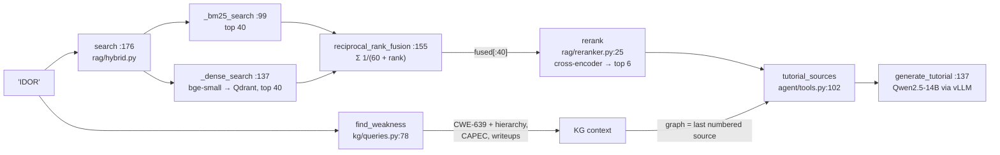

# Day 12 (Thu Nov 19): BountyBrain (full day)

Part of [[Interview plan (Nov 2026)]]. Repo `bountybrain`, **branch `upgrade-2026-10`** (HEAD `4267980`). Read it with
`git show upgrade-2026-10:<path>`; don't switch branches. About 7 h. Prep pack: [[BountyBrain - prep]] (architecture §2,
23 design decisions §3, 10 stories §4, numbers §5).

**Code, explained:** the figures, the code to read and what each snippet does are in [[#Code, explained]], right after section B.

**Resume bullets (resume 4):**
- "Built an interactive cybersecurity learning application connecting vulnerability classes, attack patterns and real-world writeups, with **cited explanations** and resources for hands-on practice."
- "Built a knowledge graph of **30k+ nodes across exploits** enabling contextual vulnerability exploration."

**Three things that can hurt you** (prep pack §0). Settle them first, in block 1:
1. **"30k+ nodes across exploits" is wrong as worded.** 30k+ is the *core* subgraph (35,278 nodes), and the core is defined as everything *except* CVE and exploit nodes (`kg/metrics.py:165`, `CORE_KINDS`). The full graph has **111,896 nodes, including 46,647 exploits**. Honest wording: "a 112k-node knowledge graph linking 969 CWE weakness classes, 615 CAPEC attack patterns, 13.6k detection signatures, 46.6k public exploits and 6.4k disclosed writeups".
2. **Authorship.** The first commit (`4c8c10b`, 2026-08-16) is authored by **Tarunsai**, not you. It contains the scaffold, including RRF k = 60 and the bge-small / bge-reranker choice. Later commits carry a `Co-Authored-By: Claude` trailer. The faithfulness hand labels were made by Claude (RESULTS §5). **Decide tonight how you describe this.** Interviewers can open the repo. Don't claim sole authorship of the first commit's choices.
3. **Several "why" questions have no recorded answer:** the embedder, the reranker, RRF k = 60, the 400-token chunks, Qwen2.5-14B. Say what the code shows and what you'd test. Don't invent a selection process.

Also: "cited explanations" means **54.5%** of sentences carry a citation and **32.6%** are cited *and* supported. The UI caption "Every claim is cited" (`ui/pages/1_Learn.py:16`) is false.

**By tonight you can:**
- explain the graph's schema and why SQLite, not a graph database;
- explain BM25, dense retrieval, RRF and cross-encoder reranking, with your ablation numbers;
- explain R@k, MRR, nDCG, and how faithfulness was measured;
- tell stories 4.2 (planner vs baseline), 4.4 (the confounded comparison) and 4.5 (constrained decoding that was never on).

## Schedule

| # | Time | Kind | What |
|---|---|---|---|
| 0 | 15 min | recall | Day 11: BCubed, margin sampling, steering vectors |
| 1 | 30 min | read | Prep pack §0, §1 pitch, §2 diagrams; settle the three risks |
| 2 | 40 min | theory | Knowledge graphs: CWE, CAPEC; BM25 vs dense; bi- vs cross-encoders; RRF (A1) |
| 3 | 60 min | code | `kg/build.py`, skim `kg/models.py`, `kg/queries.py` (B1) |
| 4 | 60 min | code | `rag/index.py`, `rag/hybrid.py`, `rag/reranker.py`, `ingestion/chunker.py` (B2) |
| — | lunch | | |
| 5 | 30 min | theory | R@k, MRR, nDCG; faithfulness; LLM judges and Cohen's κ (A2) |
| 6 | 45 min | code | The tutorial path and the recon planner (B3) |
| 7 | 30 min | skim | `clients/llm.py`, `agent/path.py`, `agent/labs.py`, `api/app.py`, the eval scripts (B4) |
| 8 | 60 min | rebuild | BM25 + dense + RRF + rerank on 200 documents (C) |
| 9 | 20 min | trace | `POST /learn {"topic": "IDOR"}` by hand (D) |
| 10 | 40 min | practice | The questions (E) |

## A. Theory

### A1. Graph and retrieval (block 2, 40 min)

**Read:**
- MITRE's CWE and CAPEC "About" pages (10 min): a CWE is a weakness *class* (with a parent/child hierarchy); a CAPEC is an attack *pattern* that exploits CWEs; CVEs are concrete instances.
- Cormack et al., *"Reciprocal Rank Fusion outperforms Condorcet…"* (2009): the 2-page paper. 10 min.
- The Sentence-Transformers docs page *"Retrieve & Re-Rank"* (bi-encoder vs cross-encoder). 15 min.

**Concepts:**
- **BM25:** a lexical score from term frequency (saturated by k1), inverse document frequency and length normalisation (b). It's good at exact identifiers ("CWE-639", "SSRF").
- **Dense:** a bi-encoder embeds the query and the passages separately (bge-small-en-v1.5; the query gets an instruction prefix, passages don't). It's good at paraphrase.
- **RRF:** `score(d) = Σ_runs 1/(k + rank)`, k = 60. It uses ranks, not raw scores, so BM25 and cosine scales never need calibrating.
- **Cross-encoder rerank:** reads (query, passage) together. More accurate, but O(candidates) model calls, so only the top 40 fused candidates are reranked.
- **Why SQLite and not Neo4j** (decision 3.2): typed relational tables, simple joins, one file, no server. The graph queries you need are 1–3 hops.

### A2. Evaluation (block 5, 30 min)

- **R@k:** the gold chunk is in the top k. **MRR:** the mean of 1/rank of the first relevant hit. **nDCG@k:** a graded, position-discounted gain over the ideal (story 4.3: your first nDCG was 1.113, which is impossible).
- **Your retrieval eval:** 200 LLM-generated known-item queries. hybrid+rerank **R@5 0.965, MRR 0.861**; dense 0.885/0.759; BM25 0.850/0.735; hybrid 0.910/0.773. Caveat: the source chunk *stays* in the index, and queries can reuse its words.
- **Faithfulness:** split the answer into sentences; for each cited sentence an LLM judge checks support; reweight by hand labels. **Cohen's κ** measures judge–label agreement beyond chance. Caveats: the judge is the same model as the generator, and the "blind hand labels" were made by Claude.

## B. Code

### B1. The graph (block 3, 60 min, deep)

`bountybrain/kg/build.py`:
- **470 `build`**; **79 `GraphBuilder`**;
- 107 `load_weaknesses` (curated aliases persisted via **440 `_merged_aliases`**: the story 4.4 fix), 151 `load_techniques`, 211 `ensure_cves`, 223 `ensure_products`, 231 `load_signatures`, 278 `load_exploits`, 328 `load_documents`.
- `kg/queries.py`: **78 `find_weakness`** (number → `CWE-…` → exact name → alias, 103), 139 `weakness_hierarchy`, 173 `techniques_for_weakness`, 185 `attack_chain`, 244 `documents_for_weakness`.
- `kg/metrics.py`: **165 `CORE_KINDS`** (why the 30k+ has no exploits), 168 `core_subgraph`, 410 `compute_all`.

### B2. Retrieval (block 4, 60 min, deep)

- `ingestion/chunker.py` **59 `chunk_text`**: structure-aware; code fences kept whole.
- `rag/index.py` **115 `build_index`**: 70 `iter_chunks`, 97 the chunk cache (11,355 chunks; BM25 reads this file).
- `rag/hybrid.py`: **99 `_bm25_search`** (in memory), **137 `_dense_search`** (embedded Qdrant), **155 `reciprocal_rank_fusion`**, **176 `search`** (mode `hybrid_rerank`, 40 candidates; 200 the rerank call).
- `rag/reranker.py` **25 `rerank`** (bge-reranker-base).

### B3. Tutorial and planner (block 6, 45 min, deep)

- `agent/tools.py`: 27 `local_rag_search`; 102 `tutorial_sources` (passages cut to 1,200 chars; the graph summary is the last numbered source); **137 `generate_tutorial`** (temperature 0; 174 a deterministic fallback).
- `recon/planner.py`: **649 `plan_from_findings`** → **233 `rank_weaknesses`**; **299–307** P(weakness | product) shrunk toward the global prior with a pseudo-count of 25 (story 4.2).

### B4. Skim (block 7, 30 min)

`clients/llm.py` (117 `chat`; `response_format` json_schema, story 4.5), `agent/path.py` (59 `learning_path`), `agent/labs.py` (144 `find_practice_labs`; 29 CWE classes), `api/app.py` (33 warm-up at startup; 106 `/learn`), `eval/classification.py` (the confound), `eval/faithfulness.py`.

## Code, explained

Read this **with the files open**. Each part has a small figure of the pipeline, then the exact code (copied from the repo at the commit named below, so the line numbers match), then what it does and how it hands off to the next piece.

Repo `bountybrain`, branch **`upgrade-2026-10`** (`4267980`); read it with
`git show upgrade-2026-10:<path>`. Paths below are under `bountybrain/`.



---

### 1. Resolving a topic in the graph

`bountybrain/kg/queries.py:87–120` (`upgrade-2026-10`)
```python
text = str(term).strip()
if text.upper().startswith("CWE-") and text[4:].isdigit():
    v = s.execute(
        select(Vulnerability).where(Vulnerability.cwe_id == int(text[4:]))
    ).scalar_one_or_none()
    return _weakness_dict(v) if v else None

v = s.execute(
    select(Vulnerability).where(func.lower(Vulnerability.name) == text.lower())
).scalar_one_or_none()
if v:
    return _weakness_dict(v)

# An exact alias beats any substring hit. Without this, "SQL injection"
# substring-matched "SQL Injection: Hibernate" (a Variant) ahead of
# CWE-89, whose alias it is, and "path traversal" landed on CWE-24.
exact = s.execute(
    select(Vulnerability).where(Vulnerability.aliases_json.ilike(f'%"{text}"%'))
).scalars().all()
if exact:
    rank = {"Base": 0, "Variant": 1, "Class": 2, "Compound": 3, "Pillar": 4}
    exact.sort(key=lambda v: rank.get(v.abstraction or "", 9))
    return _weakness_dict(exact[0])

# fall back to a name substring match, preferring the most
# specific abstraction so "injection" does not return the Pillar
rank = {"Variant": 0, "Base": 1, "Compound": 2, "Class": 3, "Pillar": 4}
rows = s.execute(
    select(Vulnerability).where(Vulnerability.name.ilike(f"%{text}%"))
).scalars().all()
if not rows:
    return None
rows.sort(key=lambda v: rank.get(v.abstraction or "", 9))
return _weakness_dict(rows[0])
```

A cascade from most to least exact:
1. `CWE-89` or a number → a direct lookup.
2. An exact name (case-insensitive).
3. **An exact alias.** `aliases_json` is a JSON list stored as text, so `ILIKE '%"IDOR"%'` (with the quotes) matches the whole alias, not a fragment. If several weaknesses share the alias, prefer the **Base** abstraction.
4. Only then a name substring, preferring the **most specific** abstraction (Variant before Pillar).

- The comment at lines 100–102 is story 4.8: "SQL injection" used to match "SQL Injection: Hibernate" (a Variant) by substring before CWE-89, whose alias it is.
- The curated aliases (like "IDOR") are only here because the builder **persists** them (`kg/build.py:440`). Before that fix, the keyword classifier read them from disk while the LLM's shortlist didn't, which confounded the classifier comparison (story 4.4).

---

### 2. Hybrid retrieval

`bountybrain/rag/hybrid.py:194–202` (`upgrade-2026-10`)
```python
else:
    dense = _dense_search(query, depth, flt)
    lexical = _bm25_search(query, depth, flt)
    runs = [r for r in (dense, lexical) if r]
    fused = reciprocal_rank_fusion(runs) if runs else []
    if mode == "hybrid_rerank":
        hits = rerank(query, fused[:depth], top_n=top_k)
    else:
        hits = fused[:top_k]
```

- Both arms retrieve **40 candidates** (`depth`), not just `top_k`. The reranker can only promote what it's given.
- `runs = [r for r in (dense, lexical) if r]`: if Qdrant is unreachable, the dense arm returns `[]` and retrieval degrades to BM25 instead of failing.

`bountybrain/rag/hybrid.py:99–118` (`upgrade-2026-10`)
```python
def _bm25_search(query: str, limit: int, flt: dict | None = None) -> list[Hit]:
    build_bm25()
    bm = _bm25_state["bm25"]
    if bm is None:
        return []
    rows = _bm25_state["rows"]
    scores = bm.get_scores(_tokenize(query))
    order = sorted(range(len(scores)), key=lambda i: -scores[i])

    hits: list[Hit] = []
    for i in order:
        if scores[i] <= 0:
            break
        row = rows[i]
        if flt and not _matches(row, flt):
            continue
        hits.append(_row_to_hit(row, float(scores[i])))
        if len(hits) >= limit:
            break
    return hits
```

- BM25 scores **every** chunk in memory (11,355 of them), sorts, and stops at the first zero score. It's good at exact identifiers ("CWE-918", "SSRF") that an embedder can blur.

`bountybrain/rag/hybrid.py:155–170` (`upgrade-2026-10`)
```python
def reciprocal_rank_fusion(runs: list[list[Hit]], k: int = RRF_K) -> list[Hit]:
    """Fuse ranked lists by 1/(k + rank), summed across runs."""
    scores: dict[tuple[int, int], float] = {}
    best: dict[tuple[int, int], Hit] = {}
    for run in runs:
        for rank, hit in enumerate(run, start=1):
            key = (hit.document_id, hit.chunk_idx)
            scores[key] = scores.get(key, 0.0) + 1.0 / (k + rank)
            if key not in best:
                best[key] = hit
    fused = []
    for key, score in sorted(scores.items(), key=lambda kv: -kv[1]):
        hit = best[key]
        hit.score = score
        fused.append(hit)
    return fused
```

- **RRF:** each list contributes `1/(60 + rank)` per chunk, and the sums are sorted. It uses **ranks only**, so BM25's unbounded scores and cosine's [−1, 1] never need calibrating against each other. A chunk ranked well by both arms beats one ranked first by only one: rank 1 in one list gives 1/61 ≈ 0.0164, while rank 5 in both gives 2/65 ≈ 0.0308.
- The key is `(document_id, chunk_idx)`, so the same chunk from both arms is merged.

`bountybrain/rag/reranker.py:25–34` (`upgrade-2026-10`)
```python
def rerank(query: str, hits: list, top_n: int = 5) -> list:
    model = _model()
    if model is None or not hits:
        return hits[:top_n]
    pairs = [(query, h.text) for h in hits]
    scores = model.predict(pairs)
    ranked = sorted(zip(hits, scores, strict=True), key=lambda x: -x[1])
    for h, s in ranked:
        h.score = float(s)
    return [h for h, _ in ranked[:top_n]]
```

- The cross-encoder reads `(query, chunk)` **together**, so it can judge actual relevance, but that's one model call per pair. So it reranks only the 40 fused candidates. The ablation: R@1 went 0.675 → 0.800 with reranking, and hybrid+rerank reached R@5 0.965, MRR 0.861.

**Check yourself:** dense ranks [A, B, C]; BM25 ranks [C, D, A]. Compute the RRF scores with k = 60 and give the fused order. (*A: 1/61 + 1/63 ≈ 0.0323; C: 1/63 + 1/61 ≈ 0.0323 (a tie with A); B: 1/62 ≈ 0.0161; D: 1/62 ≈ 0.0161. The order between tied items follows insertion: A, C, B, D.*)

---

### 3. Grounded generation

`bountybrain/agent/tools.py:110–125` (`upgrade-2026-10`)
```python
numbered = [
    {"title": s["title"], "url": s["url"], "doc_type": s.get("doc_type"),
     "text": s["text"][:SOURCE_CHARS]}
    for s in sources
]
brief = _context_brief(context)
if brief:
    numbered.append(
        {
            "title": "BountyBrain knowledge graph (MITRE CWE/CAPEC, disclosed-report metadata)",
            "url": (context or {}).get("weakness", {}).get("url", ""),
            "doc_type": "graph",
            "text": json.dumps(brief, indent=2),
        }
    )
return numbered
```

- Every passage is numbered and cut to 1,200 characters. The **graph facts become the last numbered source** too. When they were an unnumbered "context" block, the model used them without citing them, and nothing could check those claims.

`bountybrain/agent/tools.py:145–152` (`upgrade-2026-10`)
```python
try:
    return chat(
        system=TUTORIAL_SYSTEM,
        user=tutorial_prompt(topic, sources, context),
        max_tokens=2048,
    )
except (LLMError, Exception):
    return _template_tutorial(topic, sources, context)
```

- If vLLM is down or errors, fall back to a deterministic template, so the page always renders. The measured result to quote honestly: 54.5% of sentences carry a citation, and 32.6% are cited *and* supported (judged by the same Qwen, against 40 hand labels made by Claude).

---

### 4. The planner fix (story 4.2)

`bountybrain/recon/planner.py:299–307` (`upgrade-2026-10`)
```python
prior = _global_class_prior(s)
observed = {c: len(e["signatures"]) for c, e in per_cwe.items()}
total_observed = sum(observed.values())
conditional = {
    c: (n + SMOOTHING_ALPHA * prior.get(c, 0.0))
    / (total_observed + SMOOTHING_ALPHA)
    for c, n in observed.items()
}
max_conditional = max(conditional.values(), default=0.0) or 1.0
```

- Applicability = **P(weakness | this product's stack)**, shrunk toward the global prior: `(n_c + α·prior_c) / (N + α)` with α = 25 (a pseudo-count).
- The old score was a log-count that saturated at 1.0 for any popular product, so every class tied on applicability and the stack-independent terms decided the ranking. That lost to "rank by global frequency" (P@1 0.280 vs 0.325). With the conditional estimate it reached **0.427**.
- The pseudo-count keeps a product with 3 signatures from being ranked purely on those 3: its estimate is mostly the prior until it has data.

## C. Rebuild it yourself (block 8, 60 min)

About 90 lines, CPU only (`rank_bm25`, `sentence-transformers`):
1. Take 200 short documents (for example, CWE descriptions or any Wikipedia paragraphs). Chunk them.
2. BM25 top 20, dense (any small embedder) top 20, then `rrf([bm25, dense], k=60)`.
3. Rerank the fused top 20 with a small cross-encoder (`cross-encoder/ms-marco-MiniLM-L-6-v2`).
4. Write 20 queries with known gold documents. Report R@5 and MRR for BM25, dense, RRF and RRF + rerank. Does your ordering match BountyBrain's?

## D. Trace (block 9, 20 min)

From memory, then check against prep pack §2 "One request, end to end": `POST /learn {"topic": "IDOR"}`.
Which step resolves "IDOR" to CWE-639? How many candidates come from each retriever? What is fused, what is reranked, how many sources reach the prompt, and what happens if vLLM is down?

## E. Questions

1. Give the 60-second pitch.
2. What's in the graph? Why is CWE the spine?
3. "30k+ nodes across exploits": walk me through the counts. (*Correct it first.*)
4. Why SQLite and not a graph database?
5. Why hybrid retrieval? Show the ablation.
6. Why RRF and not a weighted sum of scores?
7. Why rerank only the top 40?
8. How did you measure faithfulness? What are its weaknesses? (*Same model judges; Claude hand labels; one generation per topic.*)
9. The LLM classifier didn't beat keyword matching. Why? (*Story 4.4: the shortlist was the ceiling; gold in the top 12 only 45–53% of the time.*)
10. Your planner lost to a baseline at first. What was wrong? (*Story 4.2.*)
11. How do you know constrained decoding is on? (*Story 4.5.*)
12. Who wrote the first commit? Which design choices were yours?
13. Hostile: "A cybersecurity tool that tells me how to exploit things: how do you keep it from being misused?" (*It never scans; learning content only; decision 3.23.*)

## My notes and fumbles

- 
