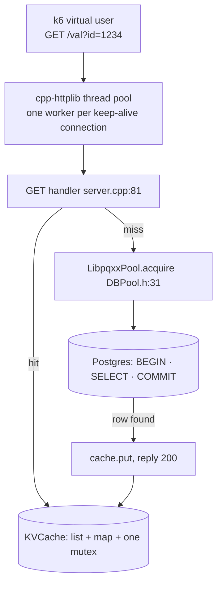
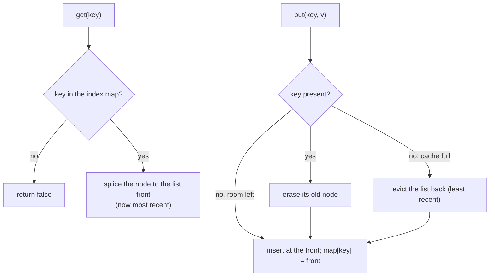
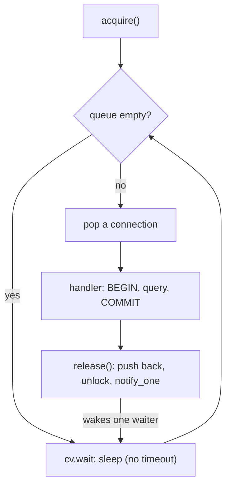
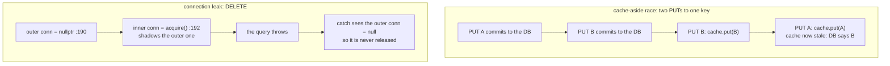
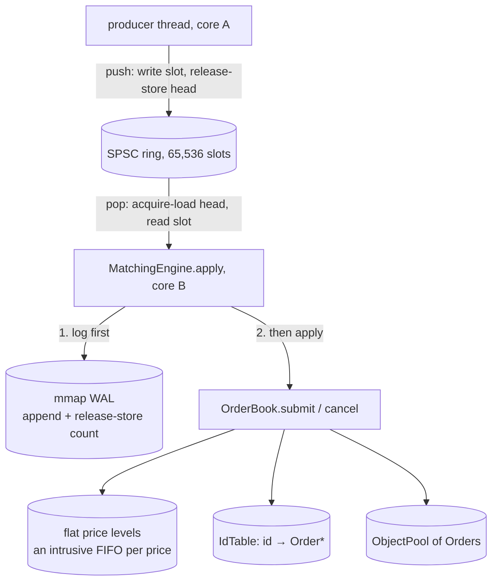
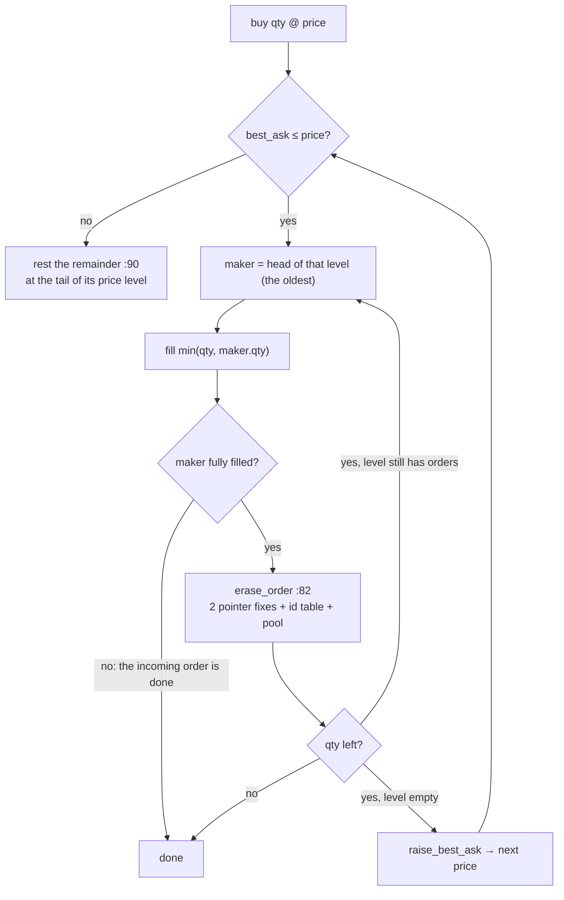
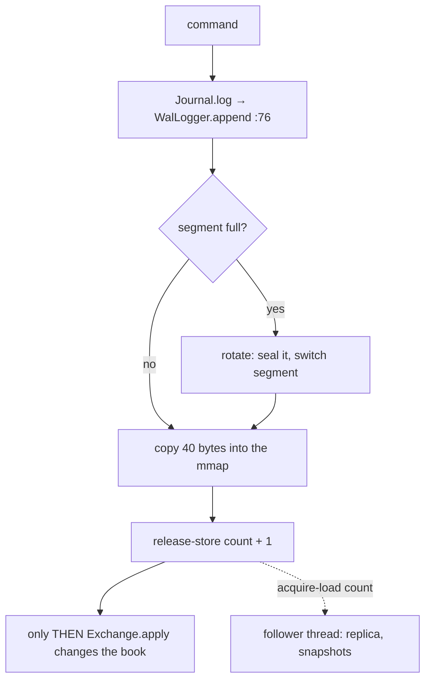

# Day 13 (Fri Nov 20): the DECS KV server, then Micro Exchange

Part of [[Interview plan (Nov 2026)]]. About 7 h. Morning: `decs` (branch `main`, one commit `82de05e`; prep pack [[DECS KV server - prep]]). Afternoon: `microexchange`, **branch `upgrade-2026-10`** (HEAD `1fc2869`; `main` is the original; prep pack [[Micro Exchange - prep]]). Read the branch with `git show upgrade-2026-10:<path>`.

**Micro Exchange starts from zero at [[#Part 7. What an exchange does (start here)]]**: what an exchange is → the two-thread design → the ring → the book → the log → numbers and tests → interview cards.

**How this note is built:** one study guide, [[#Study guide]]. Each part goes *idea → tiny example → the code → every variable and what it holds → the code traced on small values → where the output goes next → questions → check*. Theory and code sit together.

**Resume bullets (resume 5):**
- DECS: "Engineered a high-throughput, multi-tier concurrent C++ HTTP key-value store featuring an **800-thread** architecture, thread-safe **LRU cache**, and **PostgreSQL** persistence across a **20K-key** workload." / "Stress tested … across **1K virtual users** …" / "Isolated server and database resources via **CPU core pinning**, identifying **CPU saturation at 11K TPS** for cache-heavy reads versus **I/O saturation at 3.1K TPS** for write-heavy workloads."
- Micro Exchange: "Engineered a **C++20** limit-order matching engine with **price-time priority**, a **lock-free ring buffer**, object pooling, **WAL** persistence, and crash recovery, verified via **200k+ order fuzzing** and baseline checks." / "Scaled to **10.8M ops/s** at 2M commands by replacing O(n) cancellation and heap-based data structures with O(1) ID lookup and contiguous memory layouts, pushing throughput to **50×** over the baseline."

**DECS: what holds and what doesn't** (prep pack §0, §5.1):
- **11K "CPU saturation" holds**, read per core: the hand-typed `cpu` column hits 100% at 750–1000 VUs while TPS sits at 11.1K. The whole machine was at 26%, so say "the pinned server core saturated".
- **3.1K "I/O saturation" is not supported.** The disk (`sdd`) averaged 6% busy, max 13%, while the server core sat at 75%. Say **"database-bound"** (commit/fsync path, group commit at ~30 commits per flush), not "I/O saturated".
- **"800 threads"** is read from stdin and never saved. The data is consistent with ~800, but the repo can't prove it.
- **The ~43 ms floor on every request is Nagle + delayed ACK** (`TCP_NODELAY` off in cpp-httplib; headers and body in two `write()` calls). This one fact explains every latency curve.
- Real bugs to know cold: the cache-aside race (stale cache under concurrent writes); DELETE and `/nocache/val` shadow `conn`, so a DB error leaks a pool connection (`server.cpp:192`, `:233`). The Postgres password is hard-coded in a public repo.

**Micro Exchange: what holds and what doesn't** (prep pack §0, §5):
- **10.8M ops/s and 50× are single laptop runs with no raw output kept.** On the shared Xeon server the original binary gives **3.44M ops/s and 18.1×** at 2M commands (median of 5 paired runs). Use prep pack §5's honest wording.
- "O(1) ID lookup" is off: the naive engine already looks up by id in O(1) (`baseline/naive_engine.hpp:60`). Its O(n) is walking the price level's `std::list` (`:108-119`). The fix is **O(1) unlinking** through an intrusive list.
- **Authorship:** the first commit's author is Tarunsai; upgrade commits carry `Co-Authored-By: Claude`. Decide how you'll explain it.
- Strong fuzzing (differential) and real crash recovery (SIGKILL) exist **only on the unpushed upgrade branch**. Push it, or say "property fuzzing" and "log replay".

**By tonight you can:**
- explain thread-per-connection vs event-loop servers, LRU design, connection pools, and Little's law;
- use Little's law and the utilisation law on your DECS numbers;
- explain price-time priority, the SPSC ring with acquire/release, false sharing and the WAL;
- give both projects' numbers honestly, with setups.

## Schedule

| # | Time | Kind | What |
|---|---|---|---|
| 0 | 15 min | recall | Day 12: RRF, the ablation, the 30k+ correction |
| 1 | 30 min | guide | [[#Part 1. One GET through the DECS server]] |
| 2 | 60 min | guide | [[#Part 2. The LRU cache]], [[#Part 3. The connection pool]] |
| 3 | 30 min | guide | [[#Part 4. The 43 ms floor (Nagle meets delayed ACK)]], [[#Part 5. Two bugs to know before anyone points at them]] |
| 4 | 45 min | guide | [[#Part 6. The operational laws (reading the DECS numbers)]] |
| 5 | 30 min | practice | DECS trace and questions (D1, E1); skim the load scripts `script.sh`, `get_popular.js`, `put_only.js`, `dbpin.sh` |
| — | lunch | | |
| 6 | 30 min | guide | [[#Part 7. What an exchange does (start here)]], [[#Part 8. The design: two threads, a queue, one writer]] |
| 7 | 60 min | guide | [[#Part 9. The SPSC ring buffer and memory ordering]] |
| 8 | 75 min | guide | [[#Part 10. The order book and matching]] |
| 9 | 45 min | guide | [[#Part 11. The write-ahead log and crash recovery]] |
| 10 | 20 min | guide | [[#Part 12. Everything together: one command, the numbers, the tests]] |
| 11 | 45 min | rebuild | A tiny order book in Python: `exercises/day13_tiny_book.py` (C) |
| 12 | 30 min | practice | [[#Part 13. Interview cards, and how to say it]], then the trace and questions (D2, E2) |

Optional outside reading is in [[#Sources, and what they say]]. A file-by-file line map is in [[#Line map for reading the files]].

## Study guide

Morning: `decs/project/` (`82de05e`). Afternoon: `microexchange`, branch **`upgrade-2026-10`** (`1fc2869`), read with `git show upgrade-2026-10:<path>`. The code blocks are copied from those commits, so the line numbers match.

**How each code block is explained.** After each block you get three things, in this order:
- **Variables and what they hold:** every name in the code, its type, what it means, and its value in the example;
- **Traced:** the code run step by step on a tiny example, showing the state after each step;
- **Where the output goes:** which function or line uses the result next.

---

### Part 1. One GET through the DECS server

> [!important] The one sentence to hold on to
> A worker thread takes the request, asks the cache, and only on a miss borrows a database connection, runs three round trips to Postgres, fills the cache and replies.

#### 1.1 The picture



#### 1.2 The flow in eight steps

A GET for key **1234** that misses, then the same GET again.

1. A k6 virtual user sends `GET /val?id=1234` on its keep-alive connection.
2. The worker thread that owns that connection parses the request and calls the handler at `server.cpp:81`.
3. `parse_id` gives 1234 (bad ids get a 400). `cache.get` locks the mutex and **misses** (`KVCache.h:21–25`).
4. `pool.acquire()` waits on the condition variable until a database connection is free (`DBPool.h:31–37`).
5. `BEGIN`, `SELECT value … WHERE id = $1`, `COMMIT`: **three round trips** to Postgres (`server.cpp:107–110`). Then `pool.release(conn)` (`:111`).
6. The row exists, so `cache.put` inserts it at the front of the LRU list and evicts the tail if the cache is full (`KVCache.h:34–44`). Reply 200.
7. cpp-httplib writes the headers and the body in **two** `write()` calls. With `TCP_NODELAY` off, Nagle holds the body until the client ACKs the headers, and the client delays that ACK ~40 ms: the **43 ms floor**.
8. **The second GET for 1234 hits:** `splice` moves the node to the front, and the handler returns at `:100–101` without touching Postgres.

#### 1.3 The code: the GET handler

`project/server.cpp:97–127`
```cpp
string cached_value;

if (cache.get(id_int, cached_value)) {
  res.set_content(cached_value, "text/plain");
  return;
}

db::connection *conn = nullptr;
try {
  conn = pool.acquire();
  db::work txn{*conn};
  db::result r =
      txn.exec_params("SELECT value FROM kv_store WHERE id = $1", id_int);
  txn.commit();
  pool.release(conn);

  if (r.empty()) {
    res.status = 404;
    res.set_content("No value found for id: " + to_string(id_int),
                    "text/plain");
  } else {
    string db_val = r[0][0].as<string>();
    cache.put(id_int, db_val);
    res.set_content(db_val, "text/plain");
  }
} catch (const std::exception &e) {
  if (conn)
    pool.release(conn);
  res.status = 500;
  res.set_content(string("Database error: ") + e.what(), "text/plain");
}
```
> [!info] New functions in this code
> - `res.set_content(body, "text/plain")`: cpp-httplib: sets the HTTP response body and its Content-Type. The status defaults to 200. [[Function glossary#x.set_content|→ examples]]
> - `db::work txn{*conn};`: starts a **transaction** on a connection (sends `BEGIN`). Nothing is permanent until `txn.commit()`; if `txn` is destroyed first, it rolls back. [[Function glossary#db::work|→ examples]]
> - `txn.exec_params(sql, a, b)`: runs a SQL statement with `$1`, `$2` placeholders filled by `a`, `b` (no string concatenation, so no SQL injection). Returns a `result` of rows: `r.empty()`, `r[0][0].as<string>()`. [[Function glossary#x.exec_params|→ examples]]
> - `txn.commit()`: sends `COMMIT`: the transaction's changes become permanent. Postgres replies only after its WAL record is flushed (unless synchronous_commit is off). [[Function glossary#x.commit|→ examples]]
> - `catch (const std::exception &e)`: the base class of standard errors. Catching it catches libpqxx's errors too; `e.what()` is the message. [[Function glossary#std::exception|→ examples]]
> - `e.what()`: the error message of an exception, as a C string. [[Function glossary#x.what|→ examples]]

**Variables and what they hold**

| name | type | what it holds | example: GET id 1234, DB row = "hello" |
|---|---|---|---|
| `id_int` | int | the key, parsed from `?id=` | 1234 |
| `cached_value` | string | filled by `cache.get` on a hit | "" on the miss, "hello" on the hit |
| `cache` | `KVCache` (Part 2) | list + map + mutex, shared by all threads | |
| `pool` | `LibpqxxPool` (Part 3) | a queue of open connections, shared | |
| `conn` | `db::connection*` | one borrowed connection, or `nullptr` | a pointer while borrowed |
| `txn` | `db::work` | one transaction on `conn` (sends `BEGIN`) | |
| `r` | `db::result` | the rows returned: rows × columns | 1 row × 1 column |
| `r[0][0]` | field | row 0, column 0 | "hello" |
| `db_val` | string | that field as a string | "hello" |
| `res` | HTTP response | `status` (default 200) and body | 200, "hello" |

**Traced: the first GET (a miss).**

| line | what runs | state after |
|---|---|---|
| 99 | `cache.get(1234, cached_value)` | returns `false`; `cached_value` still "" |
| 106 | `pool.acquire()` | `conn` = a connection; the pool has one fewer |
| 107 | `db::work txn{*conn}` | round trip 1: `BEGIN` |
| 108–109 | `txn.exec_params("SELECT …", 1234)` | round trip 2; `r` = 1 × 1, holds "hello" |
| 110 | `txn.commit()` | round trip 3: `COMMIT` |
| 111 | `pool.release(conn)` | the connection is back in the pool |
| 113 | `r.empty()` | false, so the `else` branch |
| 118 | `db_val = r[0][0].as<string>()` | `db_val` = "hello" |
| 119 | `cache.put(1234, "hello")` | the cache now holds (1234, "hello") at the front |
| 120 | `res.set_content(db_val, …)` | reply: 200, body "hello" |

**Traced: the second GET (a hit).**

| line | what runs | state after |
|---|---|---|
| 99 | `cache.get(1234, cached_value)` | returns `true`; `cached_value` = "hello"; the node moves to the list front |
| 100 | `res.set_content(cached_value, …)` | reply: 200, body "hello" |
| 101 | `return` | Postgres is never touched |

Three things to notice:
- A hit returns at line 101 without touching Postgres: ~90 µs of server-core CPU per request at saturation.
- A miss costs **three round trips** to Postgres (`BEGIN`, the `SELECT`, `COMMIT`) inside `db::work`: ~270 µs per request. A read-only query doesn't need a transaction; `pqxx::nontransaction` would save two round trips.
- A 404 isn't cached, so repeated reads of a missing key always go to the database.

**Where the output goes.** `res` goes back to cpp-httplib, which writes the headers and the body to the socket in two `write()` calls. That is where the 43 ms comes from (Part 4). The per-request costs of the two paths, ~90 µs and ~270 µs, are measured in Part 6.

---

### Part 2. The LRU cache

> [!important] The one sentence to hold on to
> A hash map finds the node and a linked list keeps recency order, so `get` and `put` are both O(1); one mutex guards both.

#### 2.1 Why a cache at all?

Part 6 measures the two costs: a cache hit costs ~90 µs of server CPU and a miss ~270 µs. With hit ratio h, the mean cost per request is

$$S = h \cdot 90 + (1 - h) \cdot 270\ \mu s$$

At h = 0.9: $S = 81 + 27 = 108\ \mu s$, so the plateau is $1 / 108\ \mu s \approx 9{,}260$ req/s. At h = 0 it's ~3,700. The cache roughly triples what one core can serve.

#### 2.2 LRU on a tiny example

**LRU** (least recently used): when the cache is full, evict the entry that was used longest ago. Capacity 3:

![[d13-2-lru.svg]]

- `get(1)` is a hit, so 1 becomes the most recent and moves to the front.
- `put(4)` finds the cache full, so it evicts the **back**, key 2 (used longest ago).
- `get(2)` now misses and must go to Postgres.

To do this in O(1), you need two structures:
- a **doubly linked list** in recency order (front = newest), so moving or removing a node is a few pointer fixes;
- a **hash map** from key to that key's list node, so you find the node without walking the list.

#### 2.3 The code



`project/KVCache.h:12–46`
```cpp
class KVCache {
  size_t capacity;
  std::list<std::pair<int, std::string>> items;
  std::unordered_map<int, std::list<std::pair<int, std::string>>::iterator> index;
  std::mutex mtx;

public:
  KVCache(size_t cap) : capacity(cap) {}

  bool get(int key, std::string &value) {
    std::lock_guard<std::mutex> lock(mtx);
    auto it = index.find(key);
    if (it == index.end())
      return false;

    // Move to front (LRU)
    items.splice(items.begin(), items, it->second);
    value = it->second->second;
    // std::cout << "Cache hit: " << key << " -> " << value << std::endl;
    return true;
  }

  void put(int key, const std::string &value) {
    std::lock_guard<std::mutex> lock(mtx);
    if (index.count(key)) {
      items.erase(index[key]);
    } else if (items.size() >= capacity) {
      auto last = items.back();
      index.erase(last.first);
      items.pop_back();
    }
    items.emplace_front(key, value);
    index[key] = items.begin();
    // std::cout << "Cache put: " << key << " -> " << value << std::endl;
  }
```
> [!info] New functions in this code
> - `(size_t)row * N`: an unsigned 64-bit integer type. Casting before multiplying keeps `row · N` from overflowing 32-bit `int` (2.1 × 10⁹) for big N. [[Function glossary#size_t|→ examples]]
> - `std::list<T>`: a **doubly linked list**: every element is its own node with prev/next pointers. Insert or remove anywhere in O(1) if you hold an iterator, but no `[i]` indexing. Iterators stay valid when *other* elements move or are removed, which is why the LRU map can store them. [[Function glossary#std::list|→ examples]]
> - `std::pair<A, B>`: two values in one object, read as `.first` and `.second`. The LRU list stores `std::pair<int, std::string>` = (key, value). [[Function glossary#std::pair|→ examples]]
> - `std::unordered_map<K, V>`: a hash table from keys to values: lookup, insert and erase in expected O(1), no ordering. `index[7]` creates an entry for 7 if missing; `index.find(7)` does not. [[Function glossary#std::unordered_map|→ examples]]
> - `std::mutex`: a lock: only one thread can hold it at a time; others block in `lock()` until it's free. Protects data several threads touch. [[Function glossary#std::mutex|→ examples]]
> - `std::lock_guard<std::mutex> lock(mtx);`: locks `mtx` now and unlocks it automatically when `lock` goes out of scope (RAII), even if the code returns early or throws. [[Function glossary#std::lock_guard|→ examples]]
> - `.find(key)`: on a map: an iterator to the entry for `key`, or `.end()` if there is none. `if (it == index.end()) return false;` is the "miss" test. [[Function glossary#x.find|→ examples]]
> - `.end()`: an iterator **one past** the last element: not a real element, used as "not found" and as the stop point of loops. [[Function glossary#x.end|→ examples]]
> - `list.splice(pos, other, it)`: moves the node `it` points at to just before `pos`, by relinking pointers: no copy, no allocation. `items.splice(items.begin(), items, it)` moves an entry to the front, and `it` stays valid. [[Function glossary#x.splice|→ examples]]
> - `.begin()`: an iterator to the first element. On the LRU list, the front = most recently used. [[Function glossary#x.begin|→ examples]]
> - `.erase(it) / .erase(key)`: removes an element: from a list by iterator (O(1)), from a map by key or iterator. `index.erase(2)` deletes key 2. [[Function glossary#x.erase|→ examples]]
> - `.size()`: the number of elements. `items.size() >= capacity` means the cache is full. [[Function glossary#x.size|→ examples]]
> - `.back()`: a reference to the **last** element. On the LRU list that's the least recently used entry, the next to evict. [[Function glossary#x.back|→ examples]]
> - `.pop_back()`: removes the last element (O(1) on a list). Used after reading `back()` to evict. [[Function glossary#x.pop_back|→ examples]]
> - `.emplace_front(args...)`: builds a new element **in place** at the front, from constructor arguments: `items.emplace_front(4, "d")` creates the pair (4, "d") directly in the new node. [[Function glossary#x.emplace_front|→ examples]]

**Variables and what they hold**

| name | type | what it holds | example (capacity 3) |
|---|---|---|---|
| `capacity` | size_t | the most entries allowed | 3 |
| `items` | `std::list<pair<int, string>>` | the entries as (key, value), **front = most recent** | `[(3,c), (2,b), (1,a)]` |
| `index` | `unordered_map<int, list iterator>` | key → a handle to that key's node in `items` | `{1 → node (1,a), 2 → node (2,b), 3 → node (3,c)}` |
| `mtx` | `std::mutex` | one lock for both structures | |
| `it` | map iterator | the map entry for `key`, or `index.end()` | |
| `it->second` | list iterator | the node itself | node (1,a) |
| `it->second->second` | string | that node's value | "a" |
| `last` | pair (a copy) | the back of the list, the eviction victim | (2,b) |

Two structures hold the same entries. `items` answers "which is oldest?". `index` answers "where is key k?". Every operation must keep them in step.

**Traced: six calls on a cache of capacity 3.**

| call | branch taken | `items` after (front first) | `index` keys after | returns |
|---|---|---|---|---|
| start | | `[]` | {} | |
| `put(1, a)` | not present, not full | `[(1,a)]` | {1} | |
| `put(2, b)` | not present, not full | `[(2,b), (1,a)]` | {1, 2} | |
| `put(3, c)` | not present, not full | `[(3,c), (2,b), (1,a)]` | {1, 2, 3} | |
| `get(1)` | found → `splice` to front | `[(1,a), (3,c), (2,b)]` | {1, 2, 3} | true, value = "a" |
| `put(4, d)` | not present, size 3 ≥ 3 → evict back (2,b) | `[(4,d), (1,a), (3,c)]` | {1, 3, 4} | |
| `get(2)` | `find` gives `end()` | unchanged | {1, 3, 4} | **false** (a miss) |

#### 2.4 The same code, line by line

```cpp
std::list<std::pair<int, std::string>> items;
std::unordered_map<int, std::list<std::pair<int, std::string>>::iterator> index;
```
- `items` holds `(key, value)` pairs, front = most recent. `index[key]` is an **iterator** (a pointer-like handle) to that pair's node.

```cpp
auto it = index.find(key);
if (it == index.end())
  return false;
items.splice(items.begin(), items, it->second);
value = it->second->second;
```
- `get(1)` on the list `[3, 2, 1]`: `index.find(1)` gives the node of 1. `splice` relinks that node to the front: `[1, 3, 2]`. No copy, no allocation: the node itself moves, so the iterator stored in `index` stays valid.
- `it->second->second`: `it->second` is the list iterator, and its `->second` is the value string.

```cpp
if (index.count(key)) {
  items.erase(index[key]);
} else if (items.size() >= capacity) {
  auto last = items.back();
  index.erase(last.first);
  items.pop_back();
}
items.emplace_front(key, value);
index[key] = items.begin();
```
- `put(4, d)` on `[1, 3, 2]` (full): key 4 isn't present, and the size is 3 ≥ 3. So it reads `items.back()` = `(2, b)`, removes key 2 from the map, then pops it. Then it builds `(4, d)` at the front, `[4, 1, 3]`, and stores its iterator.
- Updating an existing key erases its old node first, so a key never appears twice.

**One mutex** (`lock_guard` at the top of each method) guards both structures. Even `get` must lock: `splice` writes to the list. Every request serialises on that lock, which is part of the ~90 µs.

**Where the output goes.** `get` returns `true` and fills `value`: the handler replies at once (Part 1, line 100). `get` returns `false`: the handler goes to the pool (Part 3) and Postgres, then calls `put` with the row. `put` returns nothing; its effect is the changed `items` and `index`.

---

### Part 3. The connection pool

> [!important] The one sentence to hold on to
> A queue of already-open Postgres connections behind a mutex; `acquire` sleeps on a condition variable until one is free, and `release` puts it back and wakes one sleeper.

#### 3.1 Why a pool

Opening a Postgres connection forks a backend process and authenticates: milliseconds each time. So the server opens a few connections at start-up and **lends** them out.

#### 3.2 The code



`project/DBPool.h:31–44`
```cpp
pqxx::connection *acquire() {
  std::unique_lock<std::mutex> lock(mtx);
  cv.wait(lock, [&] { return !pool.empty(); });
  pqxx::connection *conn = pool.front();
  pool.pop();
  return conn;
}

void release(pqxx::connection *conn) {
  std::unique_lock<std::mutex> lock(mtx);
  pool.push(conn);
  lock.unlock();
  cv.notify_one();
}
```
> [!info] New functions in this code
> - `pqxx::connection`: one open connection to Postgres (a server-side backend process). Opening one costs milliseconds, hence the pool. `db::` is the project's alias for `pqxx::`. [[Function glossary#pqxx::connection|→ examples]]
> - `std::unique_lock<std::mutex> lock(mtx);`: like `lock_guard`, but you can `unlock()` early and a condition variable can release and re-take it while waiting. Needed for `cv.wait`. [[Function glossary#std::unique_lock|→ examples]]
> - `.empty()`: true when there are no elements. `!pool.empty()` = a connection is available. [[Function glossary#x.empty|→ examples]]
> - `.front()`: a reference to the **first** element. On `std::queue`, the oldest item (the next connection to lend). [[Function glossary#x.front|→ examples]]
> - `.push(x)`: on `std::queue`: adds `x` at the back. `pool.push(conn)` returns a connection to the pool. [[Function glossary#x.push|→ examples]]
> - `.unlock()`: releases a `unique_lock` before its scope ends. The pool unlocks before `notify_one` so the woken thread doesn't block on the mutex. [[Function glossary#x.unlock|→ examples]]
> - `cv.notify_one()`: wakes **one** thread waiting on the condition variable (if any). It then re-checks its predicate. [[Function glossary#x.notify_one|→ examples]]

**Variables and what they hold**

| name | type | what it holds | example (pool of 2) |
|---|---|---|---|
| `pool` | `std::queue<pqxx::connection*>` | the **free** connections | `[c1, c2]` |
| `mtx` | `std::mutex` | guards `pool` | |
| `cv` | `std::condition_variable` | where threads sleep while `pool` is empty | |
| `lock` | `std::unique_lock` | holds `mtx`; `cv.wait` releases it while asleep | |
| `conn` | `pqxx::connection*` | the connection being lent or returned | c1 |

**Traced: a pool of 2, three requests arriving together.**

| step | what runs | `pool` after | who holds what | who sleeps |
|---|---|---|---|---|
| start | | `[c1, c2]` | | |
| 1 | R1 `acquire()`: predicate true, pop the front | `[c2]` | R1: c1 | |
| 2 | R2 `acquire()`: pop | `[]` | R1: c1, R2: c2 | |
| 3 | R3 `acquire()`: `!pool.empty()` is false → `cv.wait` | `[]` | R1: c1, R2: c2 | **R3** |
| 4 | R1 `release(c1)`: push, unlock, `notify_one` | `[c1]` | R2: c2 | R3 is waking |
| 5 | R3 wakes, re-checks the predicate (true), pops | `[]` | R2: c2, R3: c1 | |

```cpp
cv.wait(lock, [&] { return !pool.empty(); });
```
- The predicate form re-checks after every wake-up. Threads can wake **spuriously** (with nothing changed), or another thread can grab the connection first. A plain `cv.wait(lock)` would then pop from an empty queue.

```cpp
pool.push(conn);
lock.unlock();
cv.notify_one();
```
- Unlock **before** notify: otherwise the woken thread runs, finds the mutex still held, and blocks again at once.
- There is **no timeout** on `acquire`. If every connection leaks (the DELETE bug, Part 5), every later request sleeps forever.

**Where the output goes.** `acquire` returns a `connection*` to the handler, which builds a `db::work` transaction on it (Part 1, lines 106–110). `release` takes the same pointer back at line 111, or in the `catch` at lines 123–124.

---

### Part 4. The 43 ms floor (Nagle meets delayed ACK)

> [!important] The one sentence to hold on to
> The response leaves in two small `write()` calls; Nagle holds the second until the first is ACKed, and the client delays that ACK about 40 ms, so every request takes about 43 ms.

There is no project code for this part: the two writes are inside cpp-httplib. What the project's own code decides is only that it never turns `TCP_NODELAY` on.

Two TCP features, each sensible alone:
- **Nagle's algorithm** (sender side): if earlier data is still un-ACKed, hold back a new **small** segment until the ACK arrives. It stops a program from flooding the network with tiny packets.
- **Delayed ACK** (receiver side): don't ACK each segment at once. Wait up to ~40 ms (Linux) hoping to piggyback the ACK on a reply.

cpp-httplib writes the response in **two** `write()` calls: headers, then body. Then:

![[d13-3-nagle.svg]] [[d13-3-nagle.html|▶ Step through it]]

1. The headers go out at once (nothing was outstanding).
2. The body is small, and the headers aren't ACKed yet, so **Nagle holds it**.
3. The client got the headers but has nothing to send back, so it **delays the ACK** ~40 ms.
4. The ACK timer fires, the ACK arrives, Nagle releases the body: the response completes after ~43 ms.

**The evidence:** k6's `http_req_receiving` (first byte to last byte) averages **42.7 ms**. That gap *is* the held body. Waiting for the first byte (the real server time) is tiny.

**The fixes:** `srv.set_tcp_nodelay(true)` (turn Nagle off), or write headers and body in **one** call (`writev`).

**Where this goes.** The 43 ms is the no-load latency **D** in Part 6. It fixes the low-load throughput (VUs ÷ 43 ms) and the position of the knee.

---

### Part 5. Two bugs to know before anyone points at them



#### 5.1 The cache-aside race

`project/server.cpp:158–163`
```cpp
txn.exec_params(sql, id_int, val);
txn.commit();
pool.release(conn);

cache.put(id_int, val);
res.set_content("Key saved/updated: " + to_string(id_int), "text/plain");
```

- **The cache-aside race:** the database write commits at 159, and the cache update happens at 162, outside any common lock. Two concurrent PUTs to one key can commit in order A, B and update the cache in order B, A, leaving the cache stale (A) until eviction. Likewise, a GET that read the old row can `put` it after a PUT already updated the cache.

**Traced as a timeline.**

Cache-aside = write the DB, then update the cache, with no lock covering both. Two PUTs to key 7:

| time | PUT A (value "x") | PUT B (value "y") | DB | cache |
|---|---|---|---|---|
| 1 | commit "x" | | x | (old) |
| 2 | | commit "y" | **y** | (old) |
| 3 | | `cache.put("y")` | y | y |
| 4 | `cache.put("x")` | | y | **x** ← stale |

Every later GET returns "x" until key 7 is evicted, while the DB says "y". A slow GET that read the old row can do the same thing after a PUT.

Standard fixes: on a write, **delete** the cache entry instead of setting it (the next read refills it); version each value and refuse older versions; or Facebook's **leases** (Memcache paper, NSDI 2013).

#### 5.2 The connection leak

`project/server.cpp:190–197`
```cpp
db::connection *conn = nullptr;
try {
  db::connection *conn = pool.acquire();
  db::work txn{*conn};
  db::result r =
      txn.exec_params("DELETE FROM kv_store WHERE id = $1", id_int);
  txn.commit();
  pool.release(conn);
```

- **The connection leak:** line 192 declares a **new** `conn` inside the `try`, shadowing the outer one at 190. If the DELETE throws, the `catch` sees the outer `conn`, still `nullptr`, and never releases. The pool shrinks by one connection per failed DELETE.

**Variables and what they hold**

| name | declared at | what it holds when the DELETE throws |
|---|---|---|
| outer `conn` | line 190, before the `try` | `nullptr`, never assigned |
| inner `conn` | line 192, inside the `try` | the borrowed connection; it goes out of scope when the exception leaves the `try` |

**Traced: a pool of 2, two failing DELETEs.**

| step | what runs | `pool` after | lost for good |
|---|---|---|---|
| start | | `[c1, c2]` | |
| 1 | DELETE 1: inner `conn = acquire()` | `[c2]` | |
| 2 | the query throws; `catch` tests the **outer** `conn` (null) → no release | `[c2]` | c1 |
| 3 | DELETE 2: inner `conn = acquire()`, throws the same way | `[]` | c1, c2 |
| 4 | any later request: `acquire()` → `cv.wait`, no timeout | `[]` | the request sleeps forever |

The fix is one word: drop the type on line 192 (`conn = pool.acquire();`) so it assigns the outer variable. `/nocache/val` has the same shadowing at line 233.

#### 5.3 Questions people usually ask next (Parts 2 to 5)

##### "Why a list and not a vector for the LRU order?"

Moving an element to the front of a vector shifts everything before it: O(n). A linked list relinks one node in O(1), and its iterators stay valid when other nodes move, which the map relies on.

##### "How would you make the cache scale across cores?"

**Shard** it: N independent caches, each with its own mutex, chosen by `hash(key) % N`. Requests for different shards no longer wait for one another. Or use approximate LRU (Redis samples a few keys and evicts the oldest).

##### "How big should the pool be?"

Too few connections and threads queue in `acquire`; too many and Postgres thrashes its own cores. A common starting point is (DB cores × 2) + spindles (HikariCP's rule), then measure.

##### "Why do 800 threads help on a 12-CPU machine?"

Not for parallelism: each keep-alive connection pins a worker thread in cpp-httplib, so you need about one thread per connection. An **event loop** (epoll) would serve thousands of connections with a few threads.

#### 5.4 Check your understanding (Parts 2 to 5)

1. Why does an O(1) LRU need both a hash map and a linked list?
2. List `[3, 2, 1]` (front first), capacity 3. Apply `get(2)`, then `put(5, e)`. What is the list?
3. Why must `get` take the mutex, even though it only "reads"?
4. Why use the predicate form of `cv.wait`?
5. Explain the 43 ms in four steps. Name two fixes.
6. Write an interleaving of two PUTs that leaves the cache stale.

> [!success]- Answers
> 1. The map finds a key's node in O(1); the list keeps recency and lets you move or remove a node in O(1).
> 2. `get(2)` → `[2, 3, 1]`; `put(5, e)` evicts the back (1) → `[5, 2, 3]`.
> 3. `splice` changes the list (it moves the node to the front), so concurrent gets would corrupt it.
> 4. Wake-ups can be spurious, or another thread can take the connection first; the predicate is re-checked each time.
> 5. Headers sent; body held by Nagle (headers un-ACKed); the client delays its ACK ~40 ms; the ACK releases the body. Fixes: `TCP_NODELAY`, or one write for headers + body.
> 6. A commits "x", B commits "y", B caches "y", A caches "x": the DB has "y", the cache "x".

#### 5.5 The five things to remember (Parts 2 to 5)

1. **Why cache:** a hit costs ~90 µs vs ~270 µs; at h = 0.9 the plateau is ~9,260 req/s instead of ~3,700.
2. **LRU = map + list:** find via the map, `splice` to the front on a hit, evict `back()` when full; one mutex for both.
3. **Pool:** `cv.wait` with a predicate; release unlocks then notifies; no timeout, so a leak is fatal.
4. **43 ms:** two writes + Nagle + delayed ACK; `http_req_receiving` = 42.7 ms is the proof; fix with `TCP_NODELAY`.
5. **Cache-aside race:** DB order A, B but cache order B, A; fix with delete-on-write, versions or leases.

---

### Part 6. The operational laws (reading the DECS numbers)

Parts 1–5 show what the server does. This part shows **how to reason about its numbers**. Two one-line laws predict both measured curves. There is no project code here: the inputs are the k6 results and the CPU readings.

> [!important] The one sentence to hold on to
> In-flight requests = throughput × latency (**N = X·R**), and a resource's busy fraction = throughput × its time per request (**U = X·S**). The resource with the largest S caps throughput at **1/S**.

#### 6.1 What a closed-loop load test is

k6 runs **N virtual users** (VUs). Each one sends a request, waits for the reply, and only then sends the next. That is a **closed loop**: the load slows down when the server slows down.

So a VU is always in one of two places: waiting for a reply, or in k6's own short gap before the next request.

#### 6.2 Little's law

**Tiny example.** A café serves 3 customers a minute, and each stays 10 minutes. How many are inside on average?

$$N = X \cdot R = 3\ \tfrac{\text{customers}}{\text{min}} \times 10\ \text{min} = 30$$

The law needs **no assumptions** about arrival patterns or service-time distributions. It holds for any stable system.

**On the DECS numbers** (get-popular, 1000 VUs: X = 11,187 req/s, R = 84.8 ms):

$$N = 11{,}187 \times 0.0848\ \text{s} \approx 949\ \text{requests in flight}$$

The other ~51 VUs are in k6's gap between requests. At 10 VUs, flip it around:

$$X = \frac{N}{R} = \frac{10}{0.0434\ \text{s}} \approx 230\ \text{req/s} \quad(\text{measured: } 225)$$

So at low load, **TPS is just VUs ÷ 43 ms**. The server isn't busy; every request simply takes 43 ms (Part 4).

#### 6.3 The utilisation law

**Tiny example.** A cashier serves 2 customers a minute, and each takes 20 s of her time. She is busy

$$U = X \cdot S = 2\ \tfrac{1}{\text{min}} \times \tfrac{1}{3}\ \text{min} = \tfrac{2}{3} \approx 67\%\ \text{of the time.}$$

Turn it around to **measure** the time per request from two numbers you have: $S = U / X$.

| workload (at saturation) | server-core U | X (req/s) | S = U / X |
|---|---|---|---|
| get-popular (cache hits) | 100% | 11,150 | **≈ 90 µs** |
| get-only (cache misses) | 98% | 3,620 | **≈ 270 µs** |
| put-only | 75% | 3,170 | ≈ 240 µs, and the core is **not** full |

A miss costs 3× a hit: three round trips to Postgres (`BEGIN`, `SELECT`, `COMMIT`) plus the libpqxx work.

A resource can't be busy more than 100%, so $X \le 1/S$. For cache hits: $1 / 90\ \mu s \approx 11{,}150$ req/s. That is the plateau.

Tie this back to the code: the ~90 µs is Part 1's hit path (lines 99–101, one `cache.get` under the mutex). The ~270 µs is the miss path (lines 106–120: `acquire`, three round trips, `release`, `cache.put`).

#### 6.4 Two regimes and the knee

Let **D** be the no-load latency (43 ms here) and **S** the bottleneck's time per request (90 µs). Then:

$$X \le \min\!\left(\frac{N}{D},\ \frac{1}{S}\right) \qquad R \ge \max\!\left(D,\ N \cdot S\right)$$

- **Few users:** nobody queues. Each user does one request per D, so $X = N / D$ and $R = D$.
- **Many users:** the bottleneck is always busy. $X = 1/S$, and by Little's law $R = N / X$ grows in a straight line.

The lines cross at the **knee**:

$$N^* = \frac{D}{S} = 0.043 \times 11{,}150 \approx 480\ \text{VUs}$$

![[d13-1-laws.svg]]

| VUs | model X | measured X | model R | measured R |
|---|---|---|---|---|
| 10 | 233 | 225 | 43 ms | 43.9 ms |
| 100 | 2,326 | 2,260 | 43 ms | 43.4 ms |
| 250 | 5,814 | 5,183 | 43 ms | 47.4 ms |
| 500 | 11,150 | 10,184 | 44.8 ms | 47.9 ms |
| 750 | 11,150 | 11,130 | 67.3 ms | 64.7 ms |
| 1000 | 11,150 | 11,187 | 89.7 ms | 84.8 ms |

The data bends between 500 and 750 VUs, right where the model says. The same check works for the other workloads:
get-only $0.043 \times 3{,}620 \approx 155$ VUs, and latency starts rising after 175.

#### 6.5 Using the laws on the resume claims

**"CPU saturation at 11K TPS" holds, read per core.** U = 100% on the server core, and X stopped growing at 1/S. The whole machine was at 26%, so say "the pinned server core saturated".

**"I/O saturation at 3.1K TPS" does not hold.** At the put-only plateau:
- the server core is at 75%, so it isn't the cap;
- the disk (`sdd`) is 6% busy on average, 13% at most, so it isn't the cap either;
- 1,857 commits/s over ~61 flushes/s means ~30 commits share each flush: Postgres **group commit** is working.

The cap is somewhere in the **database tier** (the commit path, locks, its own CPU). Say "database-bound", not "I/O saturated". The laws don't name the bottleneck for you; they rule candidates out.

#### 6.6 What-ifs the laws answer in one line

- **Turn on `TCP_NODELAY`.** D falls from ~43 ms to about 1 ms. At 10 VUs, $X = 10 / 0.001$: thousands of req/s instead of 225. The plateau stays ~11K (S is unchanged). The knee moves to $N^* \approx 0.001 \times 11{,}150 \approx 11$ VUs.
- **Only 100 HTTP threads.** Only 100 requests can be in service, each taking 43 ms: $X \le 100 / 0.043 \approx 2{,}326$ req/s, far below 11K.
- **90% hit ratio.** Mean $S = 0.9 \times 90 + 0.1 \times 270 = 108\ \mu s$, so the plateau drops to $1/108\ \mu s \approx 9{,}260$ req/s.

#### 6.7 Questions people usually ask next

##### "At 1000 VUs, N / X = 89.4 ms, but measured R = 84.8 ms. Is Little's law wrong?"

No. The ~4.6 ms gap is k6's own time between requests (the "think time" Z). The full closed-loop form is $R = N / X - Z$. N counts every VU, but only those not in their gap are inside the server.

##### "Open loop vs closed loop: why does it matter?"

A closed loop slows its own load when the server slows, so a stall sends *fewer* requests and hides queueing. An open loop sends at a fixed rate whatever happens, which shows real queue growth and tail latency. k6 VUs are closed loop.

##### "Why did the cost per request rise with concurrency?"

At 100–175 VUs a hit cost only ~30–50 µs; at saturation ~90 µs. More threads mean more context switches (~60K/s in `cpu.log`) and more lock contention on the cache mutex. Treat it as a trend: the low-end CPU readings are coarse integers typed by hand.

##### "Does Little's law need Poisson arrivals?"

No. It needs only a stable system (arrivals = departures over the window). Queueing formulas like M/M/1 need distributions; the operational laws don't.

#### 6.8 Check your understanding

1. State Little's law and the utilisation law.
2. A server handles 2,000 req/s at 25 ms mean latency. How many requests are inside it?
3. A core is 80% busy at 4,000 req/s. What is S? What is the most this core can serve?
4. D = 43 ms and S = 270 µs. Where is the knee?
5. Why doesn't "the core is at 75% and TPS is flat" prove the disk is the bottleneck?
6. With `TCP_NODELAY`, what happens to TPS at 10 VUs and at 1000 VUs?

> [!success]- Answers
> 1. N = X·R (in flight = throughput × latency); U = X·S (busy fraction = throughput × time per request).
> 2. 2,000 × 0.025 = 50.
> 3. S = 0.8 / 4,000 = 200 µs; at most 1 / 200 µs = 5,000 req/s.
> 4. N* = 0.043 / 0.000270 ≈ 160 VUs (the measured get-only bend is after 175).
> 5. Flat TPS with the core below 100% only says the core isn't the cap. You must measure the disk too: it was 6% busy, so it isn't the cap either. The cap is in the database tier.
> 6. At 10 VUs, TPS jumps from ~225 to thousands (D shrinks). At 1000 VUs it stays ~11K, because S didn't change.

#### 6.9 The five things to remember

1. **Little:** N = X·R. 11,187 × 0.0848 ≈ 949 in flight; 10 VUs / 43 ms ≈ 230 TPS.
2. **Utilisation:** S = U / X. Hits ≈ 90 µs, misses ≈ 270 µs (three DB round trips).
3. **Bounds:** X ≤ min(N/D, 1/S); R ≥ max(D, N·S). Knee N* = D/S ≈ 480 VUs, matching the data.
4. **Reading claims:** reads are core-bound (U = 100%); writes are database-bound, not disk-bound (disk 6%, group commit ~30 per flush).
5. **What-ifs in one line:** smaller D moves the knee left; fewer threads cap X at threads / D.

---

### Part 7. What an exchange does (start here)

> [!important] The one sentence to hold on to
> An exchange keeps a **book** of waiting buy and sell orders, and a **matching engine** decides who trades with whom:
> best price first, and at the same price, whoever came first.

Micro Exchange is a matching engine written in C++. Before any C++, you need the problem it solves. Parts 7 to 13 build it in this order:

| Part | Question it answers |
|---|---|
| 7 | What is an exchange, an order, a book, a match? |
| 8 | How is the program laid out? Why two threads and one queue? |
| 9 | How does the queue (the ring buffer) work without a lock? |
| 10 | How is the book stored so that every operation is one step? |
| 11 | How does the book come back after a crash? |
| 12 | One command from start to end; the numbers; how it was tested |
| 13 | Interview cards, and how to describe the project out loud |

#### 7.1 The problem

You want to buy 70 shares of a company. You tell the exchange:

> Buy 70 shares, and I will pay at most 102 per share.

At the same moment one person wants to sell 40 shares for at least 101. Another wants to sell 20 for at least 101. A third wants 103.

Who trades with whom? At what price? What happens to the part nobody wants to sell you?

The software that answers these questions is the **matching engine**. It has to:

- receive buy and sell orders;
- store the orders that can't trade yet;
- find a buyer and a seller whose prices fit;
- make the trade;
- let people cancel;
- treat everyone in a fixed, fair order.

#### 7.2 Orders, bids and asks

An **order** is one instruction: buy or sell, how many, at what price.

| Order | Side | Quantity | Price |
|---|---|---|---|
| A | Buy | 70 | 102 |
| B | Sell | 40 | 101 |
| C | Sell | 20 | 101 |
| D | Sell | 50 | 103 |

Two words you must use correctly:

- **Bid:** an order to **buy**. "I bid 102."
- **Ask:** an order to **sell**. "I ask 101."

Orders that are waiting are said to **rest**. All resting orders together are the **order book**. It has a bid side and an ask side.

Prices in this engine are whole numbers called **ticks**. A tick is the smallest price step. Using integers avoids all rounding problems of decimals. In code a price is an `int64_t` (a 64-bit whole number).

Three more words:

- **Best bid:** the highest price any buyer is offering.
- **Best ask:** the lowest price any seller is asking.
- **Spread:** best ask − best bid.

Example: buyers wait at 99, sellers wait at 101 and 103. Best bid = 99, best ask = 101, spread = 101 − 99 = 2.

#### 7.3 When can two orders trade?

A **limit order** names the worst price you accept.

- Buy limit at 102: "I pay 102 **or less**."
- Sell limit at 101: "I receive 101 **or more**."

So a buyer and a seller fit when the buyer's limit is at or above the seller's limit:

| new order | can trade when | in code |
|---|---|---|
| a buy at `price` | the cheapest seller is cheap enough | `best_ask_ <= price` |
| a sell at `price` | the highest buyer pays enough | `best_bid_ >= price` |

**At what price does the trade happen?** A buy at 102 meets a resting sell at 101. The buyer would pay 102. The seller would accept 101. The trade happens at **101**: the price of the order that was **already resting**.

The resting order is called the **maker** (it "made" the price available). The incoming order is the **taker**. The rule is **maker-price execution**. In code the trade is recorded with `maker->price`.

**It is the resting order's price, not "the seller's price".** In the example above the resting order happened to be the seller. Swap the roles and the rule stays the same:

| who was already resting (the maker) | who just arrived (the taker) | trade price |
|---|---|---|
| a **sell** at 101 | a buy at 102 | **101**: the resting seller's price |
| a **buy** at 20 | a sell at 18 | **20**: the resting buyer's price |

In the second row the seller would have accepted 18, but the buyer's standing offer was 20, so the seller receives 20.

The code has one branch per incoming side. In both, `maker` is the resting order, and the trade is recorded with `maker->price` (`order_book.cpp:139` and `:157`):

```cpp
// incoming BUY: maker is a resting seller
trades_.push_back(Trade{id, maker->id, maker->price, x});

// incoming SELL: maker is a resting buyer
trades_.push_back(Trade{maker->id, id, maker->price, x});
```

The incoming order's own `price` is **never** written into a trade. It is used in exactly one place: the loop test (`best_ask_ <= price` or `best_bid_ >= price`), which decides whether matching may continue. So read an incoming order's price as a **permission** ("I accept anything down to here"), not as the price it will get.

Why this way? The resting order was a public promise: "I sell at 101." The newcomer accepted that promise. It is the only rule under which nobody gets a worse price than they agreed to.

#### 7.4 Price-time priority

Often several resting orders could serve the newcomer. Two rules decide who goes first:

1. **Better price first.** A buyer is matched with the cheapest seller first.
2. **Same price: older first.** Among sellers at the same price, the one who arrived first trades first.

Together this is **price-time priority**. It is the fairness rule of most exchanges.

Run the example. Resting sells: S1 = 40 @ 101 (older), S2 = 20 @ 101 (newer), S3 = 50 @ 103. Resting buy: B1 = 30 @ 99. A **buy 70 @ 102** arrives.

![[d13-6-book.svg]]

| step | best ask | maker | fill | qty left |
|---|---|---|---|---|
| 1 | 101 ≤ 102 | S1 (head of 101) | min(70, 40) = 40 | 30 |
| 2 | 101 | S2 | min(30, 20) = 20 | 10 |
| 3 | 101 empty → scan up → 103 > 102 | stop | | 10 |
| 4 | | rest 10 at the tail of bid 102 | best bid = 102 | 0 |

Read it once more in words:

- S1 goes first: it has the best price, and it is older than S2. Trade min(70, 40) = 40. The buyer still wants 30.
- S2 is next. Trade min(30, 20) = 20. The buyer still wants 10.
- The next seller asks 103. The buyer's limit is 102. No trade.
- The last 10 shares **rest** in the book as a bid at 102.

One incoming order produced **two trades** (a "partial fill" each time) and one resting order. This small example is the one every later Part traces through the code.

#### 7.5 Three order types

The types differ in one thing only: what happens to the part that **can't trade right now**.

| type | meaning | the unfilled part |
|---|---|---|
| **Limit** | trade at my price or better | **rests** in the book and waits |
| **IOC** (immediate or cancel) | trade what you can right now, up to my price | **expires** at once |
| **Market** | trade right now at whatever price there is | **expires** at once |

![[d13y-types.svg]] [[d13y-types.html|▶ Step through it]]

*Animated, 4 steps, loops. The same buyer of 80 shares, sent as each of the three types.*

In code a Market order has no special loop. Its price is simply set to the most extreme value, so the price test always passes (`order_book.cpp:117`):

```cpp
if (type == OrdType::Market) price = side == Side::Buy ? kMaxPrice - 1 : 1;
```

`a ? b : c` means "if `a` then `b`, else `c`". A market **buy** gets the highest legal price (`kMaxPrice − 1` = 65,535), so every seller is "cheap enough". A market **sell** gets price 1.

**"A market sell has price 1. Does a buyer at 20 then buy at 1?"** No. The seller receives 20.

- The 1 is only the seller's **limit** (7.3): the test `best_bid_ >= 1` is always true, so no buyer is refused. That is all it does.
- The loop starts at `best_bid_`, the **highest** buyer, and the trade prints at `maker->price`, that buyer's price: 20.
- The price 1 can never be bought against later, because a market order **never rests**. Only a `Limit` order reaches `rest`; a market order's leftover expires. So the 1 never enters the book and never becomes a maker price.

You can see it in the session below: command 9 is a market sell, and it fills at **99**, the resting bid's price.

What a market order does risk is **slippage**. Suppose the buyers are 10 shares at 20 and 100 shares at 5, and you market-sell 50. You get 10 at 20 and 40 at 5. Each buyer paid exactly what they offered, but your average is poor because the book was thin. A market order promises to trade **now**, not to trade at a good price. Real exchanges limit this with price bands; this engine has none. A seller who wants protection sends an IOC with a real limit (sell IOC @ 18) instead.

#### 7.6 A whole session: ten commands, and the book after each

This is one small session. It uses every order type and every way an order can end. Follow the book step by step.

A quantity can end in exactly four places: **filled**, **resting**, **cancelled** or **expired**.

![[d13x-session.svg]] [[d13x-session.html|▶ Step through it]]

*Animated, 11 steps, loops (about 5 s per step). The yellow box is the command that just arrived. The ladder is the book after it. A dashed box is an order that just left the book, with the reason. The five boxes underneath are the counters; the ones that changed are red.*

How to read the ladder: prices run down the middle, highest at the top. Sellers (asks) sit on the right, buyers (bids) on the left. On each side, the order nearest the price column is the oldest at that price and trades first. A trade can happen only when the best bid is at or above the best ask.

The same session as tables, for reference:

| # | command | what happens | asks after (oldest first) | bids after | best ask / best bid |
|---|---|---|---|---|---|
| 1 | New Sell Limit id 1, 40 @ 101 | nothing to match; rests | 101: [#1 40] | | 101 / none |
| 2 | New Sell Limit id 2, 20 @ 101 | rests **behind** #1 (later arrival) | 101: [#1 40, #2 20] | | 101 / none |
| 3 | New Sell Limit id 3, 50 @ 103 | rests | 101: [#1 40, #2 20]; 103: [#3 50] | | 101 / none |
| 4 | New Buy Limit id 4, 30 @ 99 | best ask 101 > 99: no trade; rests | same | 99: [#4 30] | 101 / 99 |
| 5 | New Sell Limit id **1**, 5 @ 105 | id 1 is already resting → **rejected**; 5 expires | same | same | 101 / 99 |
| 6 | New Buy Limit id 9, 70 @ 102 | fills 40 with #1, 20 with #2 (both at 101); 10 rests | 103: [#3 50] | 102: [#9 10]; 99: [#4 30] | 103 / 102 |
| 7 | Cancel id 9 | found by id, unlinked; 10 cancelled | 103: [#3 50] | 99: [#4 30] | 103 / 99 |
| 8 | New Buy **IOC** id 10, 80 @ 103 | fills 50 with #3 at 103; the other 30 **expire** | empty | 99: [#4 30] | none / 99 |
| 9 | New Sell **Market** id 11, 50 | fills 30 with #4 at 99; the other 20 expire | empty | empty | none / none |
| 10 | Cancel id 2 | id 2 was filled in step 6, so it is not in the id table → returns `false` | empty | empty | none / none |

("none" for the ask side is `best_ask_ = kMaxPrice`; for the bid side `best_bid_ = 0`. Those are the values the scans in `raise_best_ask` and `lower_best_bid` stop at.)

**The four counters after each command.** A trade of x counts **2x** in `filled_qty_`: x for the buyer and x for the seller.

| after # | submitted so far | filled | resting | cancelled | expired | sum |
|---|---|---|---|---|---|---|
| 4 | 140 | 0 | 140 | 0 | 0 | 140 ✓ |
| 5 | 145 | 0 | 140 | 0 | 5 | 145 ✓ |
| 6 | 215 | 120 | 90 | 0 | 5 | 215 ✓ |
| 7 | 215 | 120 | 80 | 10 | 5 | 215 ✓ |
| 8 | 295 | 220 | 30 | 10 | 35 | 295 ✓ |
| 9 | 345 | 280 | 0 | 10 | 55 | 345 ✓ |

`filled + resting + cancelled + expired == submitted` after **every** command. This is the **conservation rule**: shares are never created and never lost. The fuzzer checks it after each command (the comment at `exchange.hpp:44–45` states it). If any line of the book loses or invents quantity, the sum breaks at once. Command 6 is the example Parts 9–11 trace in detail.

#### 7.7 Check your understanding

1. Best bid is 99, best ask is 101. A sell 10 @ 100 arrives. Does it trade?
2. A buy 50 @ 105 meets a resting sell 50 @ 101. At what price is the trade?
3. Sells resting: X = 10 @ 101 (older), Y = 10 @ 101 (newer), Z = 10 @ 100. A buy 15 @ 101 arrives. Who trades, how much?
4. Buy IOC 80 @ 103 arrives; only 50 are offered at or below 103. Where do the 80 shares end up?
5. In the session, why does command 5 fail?
6. A buy 10 @ 20 is resting. A market sell 10 arrives (its price is set to 1 in code). At what price is the trade, and why?

> [!success]- Answers
> 1. No. It needs a buyer at 100 or more; the best is 99. It rests, and the best ask becomes 100.
> 2. 101, the resting (maker) order's price.
> 3. Z first (best price): 10. Then X (older than Y at 101): 5. Y gets nothing. X keeps 5.
> 4. 50 filled, 30 expired, 0 resting.
> 5. Its id (1) belongs to an order that is still resting. A limit order with a duplicate id is rejected, and its 5 shares count as expired.
> 6. At 20. The buyer is the resting order (the maker), and a trade prints at `maker->price`. The 1 is only the seller's limit for the loop test, and it never enters the book because a market order never rests.

#### 7.8 The five things to remember

1. **Book** = resting bids (buys) and asks (sells); best bid = highest buy, best ask = lowest sell.
2. **Match test:** buy trades while `best_ask <= price`; sell trades while `best_bid >= price`.
3. **Price-time priority:** best price first; at one price, oldest first. The trade prints at the **maker's** price.
4. **Limit** rests its leftover; **IOC** and **Market** never rest.
5. **Conservation:** filled + resting + cancelled + expired = submitted, always.

---

### Part 8. The design: two threads, a queue, one writer

> [!important] The one sentence to hold on to
> One thread only receives commands, one thread only matches, and a queue joins them; the matching thread is the **only** thing that ever touches the book.

#### 8.1 What a thread is

A program normally does one thing after another. A **thread** is one such sequence of steps. A program may start several threads. Each runs its own function, and on a machine with several CPU **cores** they really run at the same time.

```cpp
void intake()   { /* receive commands */ }
void matching() { /* match them */ }

std::thread producer(intake);     // starts running intake() on its own
std::thread matcher(matching);    // starts running matching() at the same time
producer.join();                  // wait until intake() returns
matcher.join();
```

All threads of one program share the same memory. That is useful (they can hand data to each other) and dangerous (they can step on each other's data).

This engine has three threads:

| thread | its only job |
|---|---|
| **producer** (intake) | receive commands and put them in the queue |
| **matching** | take commands out, log them, change the book |
| **follower** | in the background: read the log, keep a copy of the book, write snapshots (Part 11) |

Why split intake from matching? Matching is the part that must be fast. Every nanosecond the matching thread spends on something else (reading a socket, parsing bytes) delays every order behind it.

#### 8.2 Why only one thread touches the book

Suppose two threads both matched orders, to go faster. Both can reach the same resting order at the same moment.

![[d13y-race.svg]] [[d13y-race.html|▶ Step through it]]

*Animated, 6 steps, loops. Two threads read, change and write the same quantity. One update is lost.*

What you just saw is a **lost update**. `qty -= 30` looks like one step, but it is three: read the number, subtract, write it back. Two threads can interleave those steps. The same happens with the linked-list pointers of Part 10: two threads unlinking neighbours at once leave pointers aimed at dead orders.

There are two ways out:

| way | how | cost |
|---|---|---|
| **lock the book** (a mutex) | a thread must take the lock before touching the book; others wait | every match pays for locking, and threads queue up behind the lock |
| **single writer** | only one thread is ever allowed to touch the book | no lock at all; but matching uses one core only |

This engine picks **single writer**. It buys two things:

- **Speed:** the book's code has no locks and no atomics. It is plain single-threaded code.
- **Determinism:** commands are applied in exactly one order. The same commands always give the same book. Part 11 depends on this: crash recovery replays the commands and must get the same book back.

**"Why not several matching threads?"** For one book, they would fight over the same data and need locks, and the order of trades would depend on thread timing. To scale, you give each **symbol** (each stock) its own book and its own matching thread. Books of different symbols share nothing.

#### 8.3 Why a queue sits between the threads

The producer may receive 100 commands in a burst while the matching thread has time for 80. The other 20 must wait somewhere, in arrival order. That is a **queue**: first in, first out.

The queue is the **only** thing both threads touch. So all the difficulty of two threads sharing memory is squeezed into this one small piece. Part 9 is about making it correct and fast.

This engine's queue is an **SPSC ring buffer**: Single Producer, Single Consumer. One thread puts in, one takes out. That restriction is what lets it work with no lock.

#### 8.4 The whole pipeline



![[d13m-pipeline.svg]] [[d13m-pipeline.html|▶ Step through it]]

*Animated, 6 steps, loops. It follows one command from the producer to the book. The text of each step is in the bar at the bottom of the figure.*

Follow the arrows once:

1. The **producer** writes a command into a ring slot and publishes it.
2. The **matching thread** takes it out.
3. It first writes the command to the **log** (the WAL, a file).
4. Only then does it change the **book**: match, rest or cancel.
5. The **follower** reads the log in the background and keeps a second copy of the book for snapshots.

#### 8.5 What travels through the pipeline: the 40-byte Command

A `struct` in C++ is a group of named values stored side by side in memory. The thing that moves through the ring and into the log is this one:

`include/engine/order.hpp:18–29` (`upgrade-2026-10`)
```cpp
struct Command {
    OpType   type;
    Side     side;
    OrdType  ord_type;
    uint8_t  pad_ = 0;
    uint16_t symbol;
    uint64_t id;
    int64_t  price;  // integer ticks; ignored for Market
    uint64_t qty;
    uint64_t tsc;    // cycle counter when the command was submitted
};
static_assert(sizeof(Command) == 40, "Command is the WAL record; keep it 40 bytes");
```

**Variables and what they hold** (the example: "buy 70 @ 102", order id 9)

| field | type | bytes (offset) | what it holds | example |
|---|---|---|---|---|
| `type` | `OpType` (uint8) | 1 (0) | New = 1 or Cancel = 2 | New |
| `side` | `Side` (uint8) | 1 (1) | Buy = 0 or Sell = 1 | Buy |
| `ord_type` | `OrdType` (uint8) | 1 (2) | Limit, Market or Ioc | Limit |
| `pad_` | uint8 | 1 (3) | explicit padding | 0 |
| `symbol` | uint16 | 2 (4) | which book | 0 |
| (padding) | | 2 (6) | added by the compiler so `id` starts at a multiple of 8 | |
| `id` | uint64 | 8 (8) | the order id | 9 |
| `price` | int64 | 8 (16) | price in integer ticks | 102 |
| `qty` | uint64 | 8 (24) | quantity | 70 |
| `tsc` | uint64 | 8 (32) | CPU cycle counter at submit time | |

6 + 2 + 4 × 8 = **40 bytes**. The struct is plain data ("trivially copyable"), so the same 40 bytes can be copied as they are into a ring slot and into the log. That is why the comment calls it "the WAL record".

Three things about it that interviewers ask:

- **Why fixed-size integers (`uint64_t`, `uint16_t`)?** The same bytes are written to a file and read back later. Their sizes must never depend on the compiler.
- **What is padding?** The CPU wants an 8-byte number to start at an address that is a multiple of 8. `id` would start at byte 6, so the compiler inserts 2 empty bytes to push it to byte 8.
- **What does `static_assert` do?** It is checked when the program is **compiled**. If someone adds a field and the size is no longer 40, the build fails. Old log files would otherwise be read with the wrong layout.

#### 8.6 The hot path

The **hot path** is the code that runs for **every** command, so its speed decides the speed of the whole system:

```text
producer: push into the ring
matching: pop  →  append to the log  →  match / rest / cancel  →  record the latency
```

Everything in this project follows one rule: **keep slow things off the hot path**. On the hot path there is:

| no… | because | replaced by | Part |
|---|---|---|---|
| lock | waiting and waking cost microseconds | a lock-free ring, a spinning consumer | 9 |
| `new` / `delete` | the allocator is slow and unpredictable | a pre-allocated pool | 10 |
| tree walk or list walk | pointer hops miss the cache | array index, intrusive list, hash table | 10 |
| system call | switching into the kernel costs hundreds of ns | a memory-mapped log | 11 |
| copying the book | 1.6 ms stall | the follower thread snapshots its own copy | 11 |

When an interviewer asks "why did you do X?", the answer is nearly always one row of this table.

#### 8.7 Check your understanding

1. Which threads may modify the live book?
2. `qty -= 30` on a shared order from two threads: what can go wrong?
3. Name the two things the single-writer design buys.
4. How would you scale this engine to 1,000 symbols?
5. Why is `Command` exactly 40 bytes and checked with `static_assert`?

> [!success]- Answers
> 1. Only the matching thread.
> 2. A lost update: both read the old value, both write; one subtraction disappears.
> 3. No locks on the book (speed), and one fixed order of commands (determinism, which recovery needs).
> 4. One book per symbol, books spread over several matching threads; a symbol's commands always go to the same thread.
> 5. It is the ring slot and the log record. The byte layout on disk must not change silently.

---

### Part 9. The SPSC ring buffer and memory ordering

> [!important] The one sentence to hold on to
> One producer writes only `head`, one consumer writes only `tail`, so no lock is needed. The producer writes the slot **then** publishes `head` with **release**; the consumer reads `head` with **acquire**, **then** the slot, so it always sees a complete command.

This is the hardest part of the project. It goes in small steps: a queue → a ring → why not a lock → the C++ words → the code line by line → the hardware underneath.

#### 9.1 From a queue to a ring

A queue is first in, first out. Push A, B, C, D; pop gives A first.

The simple way to store it is an array. But after popping A, slot 0 is free and the data sits in slots 1–3. Shifting everything down on each pop would be wasteful. A **ring buffer** never moves data. It keeps two counters and reuses the slots in a circle:

- An array of `Capacity` slots, where Capacity is a power of two (here 4; in the engine 65,536).
- Two counters that **only grow**: `head` (how many pushed) and `tail` (how many popped).
- The slot for index i is `i & (Capacity − 1)`: the low bits, the same as `i % Capacity`, but one AND instruction.
- size = head − tail; empty when head == tail; full when head − tail ≥ Capacity.

![[d13-4-ring.svg]] [[d13-4-ring.html|▶ Step through it]]

Because the counters never wrap back to 0, "full" and "empty" never look the same, and no slot is wasted. In the real ring, index 70,000 lands in slot 70,000 & 65,535 = **4,464**. A 64-bit counter at 10 M pushes per second overflows after about **58,000 years**.

#### 9.2 Why not just protect a queue with a lock?

The textbook queue for two threads looks like this:

```cpp
std::mutex m;
std::queue<Command> q;

void push(Command c) {
    std::lock_guard<std::mutex> lock(m);   // take the lock; released at the closing brace
    q.push(c);
}
```

A **mutex** ("mutual exclusion") is a lock. Only one thread can hold it. A second thread that wants it must wait. This is correct. It is how the naive engine does it. It is slow for two reasons:

- **Taking and releasing** the lock costs time on every push and every pop, even when nobody else wants it.
- **Sleeping.** When the queue is empty, the consumer goes to sleep on a *condition variable* ("wake me when something arrives"). Waking it is a job for the operating system.

![[d13y-wake.svg]] [[d13y-wake.html|▶ Step through it]]

*Animated, 4 steps, loops. The same one-command handoff with a sleeping consumer (top) and a spinning consumer (bottom).*

The ring's consumer never sleeps. It **spins**: it keeps asking "anything new?" in a tight loop. That is called **busy waiting**.

| | spinning | sleeping |
|---|---|---|
| when idle | keeps checking | waits to be woken |
| reaction time | nanoseconds | microseconds (OS wake-up) |
| CPU use | one core at 100%, always | almost nothing when idle |
| right for | very low latency, a core to spare | long or rare waits |

And why can the lock go away completely? Because of **SPSC**:

- exactly one thread (the producer) ever writes `head`;
- exactly one thread (the consumer) ever writes `tail`;
- so no two threads ever compete to **change** the same variable.

Each side only needs to **read** the other side's counter safely. The rest of this Part is about that word "safely".

#### 9.3 Before the code: the C++ these lines are made of

The ring's code looks strange because almost every word in it is about **two threads touching the same memory**. This section explains each word once. The line-by-line walk comes right after.

##### Idea 1: two threads, one variable

The producer thread and the matching thread run **at the same time**, on two different cores. Most variables belong to one thread. A few are **shared**: both threads can reach them. In the ring the shared things are `head_`, `tail_` and the slots.

Sharing is where things go wrong, because C++ has a hard rule: if one thread **writes** a plain variable while another thread **reads** it, that is a **data race**, and the program's behaviour is undefined. "Undefined" is not a figure of speech. The compiler is allowed to assume it never happens, and to optimise on that assumption.

![[d13x-stale.svg]] [[d13x-stale.html|▶ Step through it]]

*Animated, 4 steps, loops. It shows a consumer loop on a plain variable being turned into a loop that never ends. The text of each step is in the bar at the bottom.*

##### Idea 2: `std::atomic<size_t>`

`std::atomic<T>` is a wrapper that makes one variable **safe to read in one thread while another thread writes it**. The declaration in this ring is:

```cpp
alignas(kCacheLine) std::atomic<size_t> head_{0};
```

Read it from the inside out:

| piece | meaning |
|---|---|
| `size_t` | an unsigned 64-bit whole number (0 … 1.8 × 10¹⁹). Used for counts and array positions. |
| `std::atomic<size_t>` | a `size_t` that two threads may read and write at once without a data race |
| `head_` | its name. The trailing `_` is this code's way of marking a **member** of the class (it lives in the ring object, not in one function call) |
| `{0}` | it starts at 0 |
| `alignas(kCacheLine)` | put it at the start of its own 64-byte cache line (see *False sharing* below) |

An atomic gives two promises. A reader never sees a half-written value. And the compiler must really read memory each time you ask, so the loop in the figure can't go stale.

##### Idea 3: `.load()` and `.store()`

You can't use an atomic like a normal variable in this code. You go through two functions:

| call | what it does | plain-variable equivalent |
|---|---|---|
| `head_.load(order)` | **read** the shared value and return a copy | `x = head_;` |
| `head_.store(v, order)` | **write** `v` into the shared value | `head_ = v;` |

So `const size_t head = head_.load(...)` means: *read the shared counter once, and keep the answer in my own private variable called `head`*.

![[d13x-load.svg]] [[d13x-load.html|▶ Step through it]]

*Animated, 4 steps, loops. The blue box is shared memory; the yellow box is the function's own copy. The text of each step is in the bar at the bottom.*

Note the two names. **`head_`** (with the underscore) is the shared atomic. **`head`** (no underscore) is the private copy inside one call of `push`. They are different variables.

##### Idea 4: the argument, `std::memory_order_...`

Reading the number itself is always safe with an atomic. The argument answers a second question: **what else is guaranteed along with this read or write?**

Think of a letterbox with a flag. The producer puts a letter in the box (writes the slot), then raises the flag (stores `head_`). The consumer looks at the flag (loads `head_`), then opens the box (reads the slot). The flag is only useful if "flag up" really means "the letter is completely inside".

| order | used on | the promise | in the letterbox picture | where the ring uses it |
|---|---|---|---|---|
| `memory_order_relaxed` | load or store | **none** beyond the number itself | just glancing at your own notebook | reading your **own** index (lines 28, 39) |
| `memory_order_release` | a store | everything I wrote **before** this store is visible to whoever reads this value | "I raise the flag only after the letter is fully in" | publishing `head_` (34) and `tail_` (45) |
| `memory_order_acquire` | a load | if I read a released value, I also see everything written before that release | "I check the flag before I open the box" | reading the **other** side's index (30, 41) |
| `memory_order_seq_cst` | load or store | all of the above, plus one global order for every such operation | a single shared logbook everyone signs | not used here; it is what you get if you write nothing |

A release store and the acquire load that reads it form a pair. That pair is the only thing that carries a guarantee from one thread to the other.

##### Idea 5: `const` and the private copy

`const size_t head` says the copy can't be changed after it is made. Nothing in `push` needs to change it: the function computes `head + 1` and stores that into the shared `head_`. `const` lets the compiler stop you if you try.

##### Idea 6: `index & (Capacity − 1)`

`&` is bitwise AND: a result bit is 1 only where both inputs have a 1. With Capacity 4, `Capacity − 1` is 3, binary `011`. ANDing with it keeps the lowest two bits and drops the rest:

| index | binary | `& 011` | slot |
|---|---|---|---|
| 0 | 000 | 000 | 0 |
| 1 | 001 | 001 | 1 |
| 2 | 010 | 010 | 2 |
| 3 | 011 | 011 | 3 |
| 4 | **1**00 | 000 | 0 |
| 5 | **1**01 | 001 | 1 |
| 6 | **1**10 | 010 | 2 |
| 7 | **1**11 | 011 | 3 |

That is the same as `index % 4`, but one cheap instruction instead of a division. It works **only** when Capacity is a power of two. With Capacity 6, `Capacity − 1` is 5, binary `101`, and indices 0…7 would land on slots 0, 1, 0, 1, 4, 5, 4, 5. Slots 2 and 3 are never used, and index 2 overwrites the unread item of index 0.

##### Idea 7: `bool`, `const T&` and `T&`

- `bool push(...)` returns `true` (done) or `false` (the ring is full, nothing was written). The caller decides what to do with `false`; here it tries again.
- `T` is a placeholder type. In this engine `T` is `Command`, the 40-byte struct of Part 7.
- `const T& item` is a **reference**: `push` looks at the caller's command where it already is, with no copy, and promises not to change it.
- `T& out` (in `pop`) is a reference the function **writes through**: the popped command lands in the caller's variable.

#### 9.4 The code

`include/core/ring_buffer.hpp:27–47` (`upgrade-2026-10`)
```cpp
bool push(const T& item) {
    const size_t head = head_.load(std::memory_order_relaxed);
    if (head - tail_cache_ >= Capacity) {
        tail_cache_ = tail_.load(std::memory_order_acquire);
        if (head - tail_cache_ >= Capacity) return false;
    }
    slots_[head & (Capacity - 1)] = item;
    head_.store(head + 1, std::memory_order_release);
    return true;
}

bool pop(T& out) {
    const size_t tail = tail_.load(std::memory_order_relaxed);
    if (tail == head_cache_) {
        head_cache_ = head_.load(std::memory_order_acquire);
        if (tail == head_cache_) return false;
    }
    out = slots_[tail & (Capacity - 1)];
    tail_.store(tail + 1, std::memory_order_release);
    return true;
}
```
> [!info] New functions in this code
> - `x.load(order)`: reads an atomic. `head_.load(std::memory_order_acquire)` reads it and makes later reads see everything the writer did before its release store. [[Function glossary#x.load|→ examples]]
> - `std::memory_order_relaxed`: atomicity only, **no ordering** of other memory. Fine for reading your own index (only you write it). [[Function glossary#std::memory_order_relaxed|→ examples]]
> - `std::memory_order_acquire`: for loads: reads after it can't move before it, and if it reads a released value it sees all writes before that release. [[Function glossary#std::memory_order_acquire|→ examples]]
> - `x.store(v, order)`: writes an atomic. `head_.store(head + 1, std::memory_order_release)` publishes every earlier write together with the new value. [[Function glossary#x.store|→ examples]]
> - `std::memory_order_release`: for stores: writes before it can't move after it, so a reader that acquires this value sees them all. [[Function glossary#std::memory_order_release|→ examples]]

`include/core/ring_buffer.hpp:59–65` (`upgrade-2026-10`)
```cpp
alignas(kCacheLine) std::atomic<size_t> head_{0};
size_t tail_cache_ = 0;  // producer's view of tail_

// alignas above also rounds sizeof(RingBuffer) up to a multiple of the
// cache line, so a neighbouring object cannot land on the consumer's line.
alignas(kCacheLine) std::atomic<size_t> tail_{0};
size_t head_cache_ = 0;  // consumer's view of head_
```
> [!info] New functions in this code
> - `alignas(64) T x;`: forces `x` to start at an address that is a multiple of 64 bytes, i.e. at the start of a cache line. Two `alignas(64)` members can never share a line, which prevents false sharing. [[Function glossary#alignas|→ examples]]
> - `std::atomic<size_t> head_{0};`: a variable that threads can read and write **without a data race**. Each operation can carry a memory order (relaxed, acquire, release, seq_cst) that says what other memory it orders. [[Function glossary#std::atomic|→ examples]]
> - `sizeof(float)`: size of a type in bytes: `sizeof(float)` = 4, `sizeof(double)` = 8. [[Function glossary#sizeof|→ examples]]

**Variables and what they hold**

| name | type | written by | what it holds | example (Capacity 4) |
|---|---|---|---|---|
| `slots_` | array of `Capacity` × `T` (here `Command`, 40 B) | producer writes, consumer reads | the queued items | 4 slots; 65,536 in the engine |
| `head_` | `atomic<size_t>`, own cache line | **producer only** | how many items were ever pushed | 4 |
| `tail_` | `atomic<size_t>`, own cache line | **consumer only** | how many items were ever popped | 1 |
| `tail_cache_` | plain size_t, on `head_`'s line | producer only | the producer's last-seen copy of `tail_` (may be stale) | 0 |
| `head_cache_` | plain size_t, on `tail_`'s line | consumer only | the consumer's last-seen copy of `head_` (may be stale) | 4 |
| `head`, `tail` | local size_t | | this call's snapshot of its own index | |
| `head & (Capacity − 1)` | size_t | | the slot number for index `head` | 4 & 3 = 0 |
| `head − tail` | size_t | | items currently in the ring | 3 |

![[d13m-ring.svg]] [[d13m-ring.html|▶ Step through it]]

*Animated, 10 steps, loops. It plays the ten rows of the table below: watch the two arrows chase each other around the four slots. The text of each step is in the bar at the bottom of the figure.*

**Traced: nine calls on a ring of Capacity 4.** A cell in bold changed in that step.

| call | own index read | cache test → reload? | slot used | `head_` | `tail_` | `tail_cache_` | `head_cache_` | `slots_[0…3]` | returns |
|---|---|---|---|---|---|---|---|---|---|
| start | | | | 0 | 0 | 0 | 0 | `[–, –, –, –]` | |
| push A | head 0 | 0 − 0 ≥ 4? no | 0 & 3 = 0 | **1** | 0 | 0 | 0 | `[A, –, –, –]` | true |
| push B | head 1 | 1 − 0 ≥ 4? no | 1 | **2** | 0 | 0 | 0 | `[A, B, –, –]` | true |
| push C | head 2 | no | 2 | **3** | 0 | 0 | 0 | `[A, B, C, –]` | true |
| push D | head 3 | 3 − 0 ≥ 4? no | 3 | **4** | 0 | 0 | 0 | `[A, B, C, D]` | true |
| pop | tail 0 | 0 == 0 → reload `head_cache_` = 4; 0 ≠ 4 | 0 | 4 | **1** | 0 | **4** | `[A, B, C, D]` | true, out = A |
| push E | head 4 | 4 − 0 ≥ 4 → reload `tail_cache_` = 1; 4 − 1 = 3 < 4 | 4 & 3 = 0 | **5** | 1 | **1** | 4 | `[E, B, C, D]` | true |
| pop | tail 1 | 1 == 4? no → **no reload** | 1 | 5 | **2** | 1 | 4 | `[E, B, C, D]` | true, out = B |
| push F | head 5 | 5 − 1 ≥ 4 → reload `tail_cache_` = 2; 5 − 2 = 3 < 4 | 5 & 3 = 1 | **6** | 2 | **2** | 4 | `[E, F, C, D]` | true |
| push G | head 6 | 6 − 2 ≥ 4 → reload: still 2; 6 − 2 = 4 ≥ 4 | none | 6 | 2 | 2 | 4 | `[E, F, C, D]` | **false** (full) |

Read three things off the table:
- A popped item is **not erased**. Slot 0 still held A until push E overwrote it. Only `tail_` moving past it makes it free.
- The second pop did not read `head_` at all: its cached copy (4) already showed items waiting.
- Push G fails with 4 items in 4 slots: no slot is wasted, because the counters never wrap.

#### 9.5 Every line of push: what it does, why, what uses it, what breaks

![[d13x-push.svg]] [[d13x-push.html|▶ Step through it]]

*Animated, 8 steps, loops. The code is on the left with the running line highlighted; the variables are on the right, and the one that just changed is red. The text of each step is in the bar at the bottom.*

The starting state is the "push E" moment of the trace above: `head_ = 4`, `tail_ = 1` (the consumer just popped A), and the producer's `tail_cache_` is still 0.

##### Line 28: `const size_t head = head_.load(std::memory_order_relaxed);`

- **What it does.** Reads the shared counter `head_` (4) once and keeps a private copy, `head = 4`.
- **Why it is written this way.**
  - *A private copy:* the function needs this number three more times. One read, then a local, is cheaper and can't change under it.
  - *`relaxed`:* the producer is the **only** thread that ever writes `head_`. A thread always sees its own last write, so it needs no promise about anyone else.
- **What uses it next.** Line 29 and 31 (`head − tail_cache_`), line 33 (`head & (Capacity − 1)`), line 34 (`head + 1`).

**What breaks if you change it:**

| change | result |
|---|---|
| use `acquire` or the default instead of `relaxed` | still correct. It only asks for a promise nobody needs. |
| no local; call `head_.load()` at each use | still correct with one producer, but four reads instead of one |
| declare `head_` as a plain `size_t` | a data race with the consumer, which reads it on line 41. Undefined behaviour; the figure in 8.3 shows one real outcome. |

##### Line 29: `if (head - tail_cache_ >= Capacity) {`

- **What it does.** Counts the items the producer *believes* are in the ring: pushed minus popped = 4 − 0 = 4. Four items in four slots: it looks full.
- **Why it is written this way.** `tail_cache_` is the producer's **old copy** of the consumer's counter. Using it avoids touching `tail_`, a variable the other core keeps writing (expensive: see *Cached indices*). The old copy can only be **too small**, because `tail_` only grows. So the count can only be **too big**. The mistake is always on the safe side: "looks full" when it isn't, never "has room" when it doesn't.
- **What uses it next.** If false (the common case), jump straight to line 33: no shared read at all. If true, lines 30–31 check properly.

**What breaks if you change it:**

| change | result |
|---|---|
| `>` instead of `>=` | allows a fifth item into four slots: it overwrites an item that was never read |
| delete the cache and always load `tail_` | still correct, but every push pulls a cache line from the other core |

##### Line 30: `tail_cache_ = tail_.load(std::memory_order_acquire);`

- **What it does.** Reads the consumer's real counter (1) and refreshes the copy: `tail_cache_ = 1`.
- **Why it is written this way.** This is the **acquire** half of a pair. The consumer stores `tail_` with **release** on line 45, *after* it has finished copying a slot out. So when the producer sees `tail_ = 1` here, it also knows the consumer is completely done with slot 0. Only then is it safe to write into slot 0 again.
- **What uses it next.** Line 31 re-checks with the fresh value. The refreshed copy is also kept for later pushes.

**What breaks if you change it:**

| change | result |
|---|---|
| delete the line | the copy stays 0 for ever. After 4 pushes (65,536 in the real ring) every push returns `false`, even if the consumer has emptied the ring. The producer is stuck. |
| `relaxed` instead of `acquire` | the producer learns the number, but gets no promise that the consumer's copy-out of that slot is finished. Line 33 could overwrite a slot that is still being read. |

##### Line 31: `if (head - tail_cache_ >= Capacity) return false;`

- **What it does.** Counts again with the fresh value: 4 − 1 = 3, which is less than 4. There is room, so it goes on. Had it still been 4, the ring would be **really** full and the function would stop here.
- **Why it is written this way.** The first test used an old number. This one is the real decision. Returning `false` writes nothing and leaves `head_` alone, so the caller can simply try again.
- **What uses it next.** `false` → the caller retries. Otherwise line 33.

**What breaks if you change it:**

| change | result |
|---|---|
| delete the line | a push into a truly full ring writes the slot anyway. Example: `head = 6`, `tail = 2`: slot 6 & 3 = 2 still holds C, unread. C is lost. |
| wait in a loop here instead of returning | works, but then `push` can block. Returning `false` leaves the choice to the caller. |

##### Line 33: `slots_[head & (Capacity - 1)] = item;`

- **What it does.** Picks slot 4 & 3 = **0** and copies the 40 bytes of the command into it. The old bytes of A, already popped, are overwritten.
- **Why it is written this way.** `head & (Capacity − 1)` turns the ever-growing counter into a position in the array (Idea 6). `=` on a `Command` is a plain 40-byte copy, which is why `Command` has to be a simple struct.
- **What uses it next.** Nothing yet. `head_` is still 4, so the consumer believes only indices 1–3 exist. The new bytes are in memory but **invisible**.
- **What breaks if you change it.** See line 34: the two lines are a pair, and their order is the whole point.

##### Line 34: `head_.store(head + 1, std::memory_order_release);`

- **What it does.** Writes 5 into the shared `head_`. This is the moment E becomes visible to the consumer.
- **Why it is written this way.**
  - *After line 33:* first the letter goes in the box, then the flag goes up.
  - *`release`:* promises that the 40 bytes written on line 33 are visible to any thread that reads `head_ = 5` with acquire. Without it, "after" in the source code is not a promise to another thread.
  - *`head + 1` from the local:* no need to read `head_` again; nobody else changes it.
- **What uses it next.** The consumer's line 41 (`head_.load(acquire)`). Its `pop` can now read slot 0.

**What breaks if you change it:**

| change | result |
|---|---|
| put it **before** line 33 | the consumer can see `head_ = 5` and read slot 0 before E is there (figure below) |
| `relaxed` instead of `release` | the two writes (slot, `head_`) are to unrelated places, so the compiler or CPU may let the `head_` write become visible first. Same failure as the swap. |
| delete the line | the slot is written but never announced. The consumer waits for ever. |

![[d13x-swap.svg]] [[d13x-swap.html|▶ Step through it]]

*Animated, 5 steps, loops. The two lines of `push` in the wrong order: one command is applied twice and one is lost. The text of each step is in the bar at the bottom.*

##### Line 35: `return true;`

- **What it does.** Tells the caller the command is in the ring.
- **What uses it next.** The caller moves on to its next command. With `false` (line 31) it would call `push` again with the same command.

#### 9.6 Every line of pop: the mirror image

![[d13x-pop.svg]] [[d13x-pop.html|▶ Step through it]]

*Animated, 8 steps, loops. The first `pop` of the trace: the ring holds A B C D and the consumer's copy of head is still 0. The text of each step is in the bar at the bottom.*

`pop` is `push` seen in a mirror. Swap the roles: `tail` for `head`, "empty" for "full", "read the slot" for "write the slot".

| line | code | what it does | why it is written this way | what breaks without it |
|---|---|---|---|---|
| 39 | `const size_t tail = tail_.load(relaxed);` | private copy of the consumer's **own** counter | only the consumer writes `tail_`, so no promise is needed | a plain `tail_` would race with the producer's line 30 |
| 40 | `if (tail == head_cache_) {` | "have I read everything I know about?" using the **old copy** of head | avoids touching `head_`, which the producer keeps writing. The old copy can only be too small, so the mistake is "looks empty", never "reads a slot that was not written". | skip this test and it would read slots that were never written |
| 41 | `head_cache_ = head_.load(acquire);` | refresh the copy from the producer's real counter | the **acquire** half of the pair with line 34: seeing the new head means the slot bytes are visible too | deleted: the consumer never learns about new items and returns `false` for ever. `relaxed`: it may read a half-written command. |
| 42 | `if (tail == head_cache_) return false;` | still equal → really empty; give up for now | the caller decides whether to spin, pause or exit | deleted: it would read a slot nobody wrote and hand garbage to the book |
| 44 | `out = slots_[tail & (Capacity - 1)];` | copy the 40 bytes out into the caller's variable | a **copy**, not a pointer into the ring: once `tail_` moves, the producer may overwrite the slot | returning a pointer instead would let the producer overwrite the command while the book is still using it |
| 45 | `tail_.store(tail + 1, release);` | give the slot back to the producer | *after* line 44, with **release**: the producer's acquire on line 30 then knows the copy-out is finished | before line 44, or `relaxed`: the producer may overwrite the slot mid-copy |
| 46 | `return true;` | `out` holds a command | | |

**Who calls it** (`matching_engine.hpp:35–46`):

```cpp
for (;;) {
    if (q.pop(c)) {
        apply(c);
    } else if (producer_done.load(std::memory_order_acquire) && q.empty()) {
        break;
    } else {
        cpu_pause();
    }
}
```

- `pop` returned `true` → `apply(c)` logs the command and changes the book (Parts 11 and 10).
- `pop` returned `false` → if the producer has said it is finished and the ring is empty, stop. Otherwise `cpu_pause()` (a hint to the CPU that this is a short wait) and go round again. The matching thread never sleeps: it **spins**, so it reacts within nanoseconds, at the price of one core running at 100%.

**The two pairs, side by side.** Each shared counter has one writer, and each is written with release and read by the other side with acquire:

| counter | written on | with | read by the other side on | with | the guarantee it carries |
|---|---|---|---|---|---|
| `head_` | line 34 (producer) | release, after writing the slot | line 41 (consumer) | acquire, before reading the slot | "the command is completely in the slot" |
| `tail_` | line 45 (consumer) | release, after copying the slot out | line 30 (producer) | acquire, before reusing the slot | "I have finished reading that slot" |

#### 9.7 Why is ordering needed at all? The hardware underneath

![[d13m-ordering.svg]] [[d13m-ordering.html|▶ Step through it]]

*Animated, 5 steps, loops. Top lane: what may happen with no ordering rule. Bottom lane: the same steps with release and acquire. The text of each step is in the bar at the bottom of the figure.*

Your code says "write the slot, then write head". Neither the compiler nor the CPU promises others will **see** it in that order:
- the **compiler** may reorder two stores to different variables if this thread can't tell the difference;
- the **CPU** has a store buffer and caches; another core can see writes in a different order (weakly ordered CPUs like ARM do this often).

Without a rule, the consumer could see head = 5 **before** E's 40 bytes arrive, and copy a half-written command.

##### Release and acquire, stated precisely

![[d13-5-ordering.svg]]

- A **release store** promises: every write this thread did *before* it is visible to anyone who sees the stored value.
- An **acquire load** promises: if it reads a value from a release store, every read this thread does *after* it sees those earlier writes.
- Together they **synchronize-with**: write slot → release head ⇒ acquire head → read slot.

The pair runs in **both** directions:

| index | written by | release side | acquire side | protects against |
|---|---|---|---|---|
| `head_` | producer | after writing the slot | consumer before reading it | reading a half-written slot |
| `tail_` | consumer | after copying the slot out | producer before reusing it | overwriting a slot still being read |

**Cost on x86:** x86 (TSO) never reorders store-store or load-load, so release and acquire compile to plain `mov`s; they only stop the *compiler* from reordering. `seq_cst` (the default) would make each store an `xchg` or `mov + mfence`: a full fence on every push. On ARM, release and acquire become `stlr`/`ldar`.

#### 9.8 Cached indices

Reading the *other* side's index means pulling a cache line the other core keeps writing: slow. So each side keeps a private copy (`tail_cache_`, `head_cache_`) and reloads the real one only when its copy says "full" or "empty".

The catch: when the consumer keeps up, the queue looks empty on almost every `pop`, so the consumer reloads `head_` almost every time. The trick mostly helps the side that is rarely blocked.

#### 9.9 Cache lines and false sharing

First, what a **cache** is. Main memory is far from the CPU: a read from it takes around 100 ns. So each core keeps its own small, fast copy of the memory it used recently. That copy is the cache.

Three facts are enough:

- The cache does not hold single variables. It holds **lines of 64 bytes**. Touch one byte, and the whole 64-byte line around it is loaded.
- Several cores may hold a copy of the same line, as long as they only **read** it.
- To **write** a line, a core must own it alone. Every other core's copy is thrown away. The next time another core needs that line, it must fetch it again from the writer. That transfer is slow (it is the "cross-core handoff" of 9.10).

Now put `head_` and `tail_` (8 bytes each) next to each other. They land in the same 64-byte line. The producer writes `head_`; the consumer writes `tail_`. They never touch the same variable, yet they keep stealing the same line from each other.

![[d13m-falseshare.svg]] [[d13m-falseshare.html|▶ Step through it]]

*Animated, 4 steps, loops. Left: `head_` and `tail_` on one cache line. Right: one line each. The text of each step is in the bar at the bottom of the figure.*

Cores move memory in **64-byte cache lines**. To write a line, a core must own it exclusively, which invalidates every other core's copy. If `head_` and `tail_` sat on one line, each push would steal the line from the consumer and each pop would steal it back, even though they write different variables. That is **false sharing**.

`alignas(64)` puts `head_` (with the producer's `tail_cache_`) and `tail_` (with the consumer's `head_cache_`) on separate lines, so each line has one writer. Not covered: the slots. A `Command` is 40 bytes, so neighbouring slots share lines, and a nearly empty queue has both cores touching the same slot lines.

**The four declarations, line by line** (`ring_buffer.hpp:59–65`):

| line | what it does | why it is written this way | what breaks without it |
|---|---|---|---|
| `alignas(kCacheLine) std::atomic<size_t> head_{0};` | starts `head_` on a fresh 64-byte line | the producer writes it on every push | without `alignas`, `head_` and `tail_` (8 bytes each) would sit side by side on one line: the ping-pong in the figure. Still correct, just slow. |
| `size_t tail_cache_ = 0;` | the producer's private copy; placed right after `head_`, so on the **same** line | only the producer touches both, so sharing a line costs nothing | it is a plain `size_t` on purpose: one thread only, so no atomic is needed |
| `alignas(kCacheLine) std::atomic<size_t> tail_{0};` | starts `tail_` on the **next** line | the consumer writes it on every pop | as above |
| `size_t head_cache_ = 0;` | the consumer's private copy, on `tail_`'s line | only the consumer touches both | |

**"Does `alignas(64)` make the ring thread-safe?"** No. The atomics and the release/acquire pairs make it **correct**. `alignas(64)` only makes it **fast**. Remove it and the program still gives the same answers, just slower.

**Where the output goes.** `pop` fills `out`, a `Command`. The matching thread's `run` loop hands it to `MatchingEngine::apply` (Part 11, `matching_engine.hpp:24`), which logs it and then calls the book (Part 10).

#### 9.10 What the handoff costs (the server numbers)

| path | commands/s | ns per command |
|---|---|---|
| book alone, one core | 18.1 M | ≈ 55 |
| two-thread pipeline (ring + WAL + rdtsc + histogram) | 3.44 M | ≈ 291 |

The extra ~235 ns per command is most likely the **cross-core handoff**: at least two cache-line transfers per command (the consumer reloads `head_`, then reads the freshly written slot). On a big server mesh such a transfer costs ~100 ns or more. This is a **hypothesis**: never profiled. Throughput stayed flat at 3.2–3.4 M while the book grew 20×, which says the book isn't the limit.

#### 9.11 Questions people usually ask next

##### "Why not just use `seq_cst` everywhere?"

It would be correct, but each store becomes a full fence on x86. Release/acquire is exactly the ordering the handoff needs, and nothing more.

##### "Is this lock-free or wait-free?"

Each `push` and `pop` finishes in a bounded number of steps whatever the other thread does: **wait-free**. The program as a whole still waits, because a caller spins when the ring is full or empty.

Three words to keep apart:

| word | meaning | here |
|---|---|---|
| **blocking** | a thread may have to wait for another thread (a lock) | the naive mutex queue |
| **lock-free** | the system as a whole always makes progress, though one thread may retry | — |
| **wait-free** | **every** call finishes in a bounded number of its own steps | `push` and `pop`: no loop inside, they return `true` or `false` |


##### "Would it work with two producers?"

No. Two producers could read the same `head`, both write slot `head & mask`, and one command would be lost. Several gateways need a ring each, or an MPSC queue with compare-and-swap.

##### "How did you test the ordering?"

Honestly: by reasoning. The fuzzer is single-threaded, and there's no TSan run in the repo. A test that "passes on x86" proves little, because x86 hides most reorderings that ARM would expose.

#### 9.12 Check your understanding

1. Capacity 8, head = 21, tail = 14. How many items? Which slot does the next push use? Is it full?
2. Why must Capacity be a power of two?
3. Why may each side load its **own** index relaxed?
4. What breaks if `head_.store` is relaxed? And if `tail_.store` is relaxed?
5. What does `alignas(64)` prevent, and what does it not cover?
6. Why is the two-thread pipeline ~5× slower than the book alone?

> [!success]- Answers
> 1. 21 − 14 = 7 items; next push uses slot 21 & 7 = 5; not full (7 < 8).
> 2. So `i & (Capacity − 1)` equals `i % Capacity`; with growing indices, that also makes the wrap-around free.
> 3. Only that thread writes it, so it always sees its own latest value.
> 4. Relaxed `head_`: the consumer can see the new head before the slot's contents (a torn command). Relaxed `tail_`: the producer can reuse a slot before the consumer finished copying it.
> 5. False sharing between `head_` and `tail_`; it doesn't cover the 40-byte slots, which share lines.
> 6. Every command crosses cores (≈2 cache-line transfers), plus the WAL append, two `rdtsc` and the histogram: ~235 ns extra per command. A hypothesis, not profiled.
7. In the trace above, after "push F": how many items are in the ring, and which slot would the next pop read?

> [!success]- Answer to 7
> 6 − 2 = 4 items (C, D, E, F); the next pop reads slot 2 & 3 = 2, which holds C.

#### 9.13 The five things to remember

1. **SPSC:** one writer per index → no lock; indices only grow; slot = i & (Capacity − 1); size = head − tail.
2. **Order of operations:** write slot → release head; acquire head → read slot (and the mirror pair on tail).
3. **Why:** compilers and CPUs reorder; release/acquire forbid exactly the reorderings that matter. On x86 they cost nothing at runtime.
4. **Speed tricks:** cached indices (reload only when full/empty) and `alignas(64)` against false sharing.
5. **Numbers:** book 18.1 M/s (55 ns) vs pipeline 3.44 M/s (291 ns); the gap is most likely the cross-core handoff.

---

### Part 10. The order book and matching

> [!important] The one sentence to hold on to
> A flat array indexed by price finds the level in one step; a linked list inside the orders keeps arrival order and unlinks in one step; a hash table finds an order by id; a pre-allocated pool means no `new` while matching.

#### 10.1 What the book has to do, and the four structures that do it

Part 7 showed **what** matching is. This Part is **how** the book is stored so that each operation takes a fixed, small number of steps. The book is asked four things, millions of times a second:

| need | structure | cost |
|---|---|---|
| find the level for a price | `std::vector<Level>` of 65,536 ticks per side, indexed by price | one array index; 2 × 65,536 × 24 B ≈ **3 MB** per symbol |
| oldest first within a level | an **intrusive** doubly linked list (`prev`/`next` inside `Order`), append at tail | O(1) append, O(1) unlink |
| find an order by id (cancel) | `IdTable`: open addressing, linear probing | expected O(1), no allocation |
| get memory for a new order | `ObjectPool`: a pre-allocated free stack | O(1), never calls `new` |

"O(1)" means the cost does not grow with the size of the book: a book of ten orders and a book of a million answer in the same number of steps.

The next sections build these one at a time. First, the two C++ ideas all four are made of.

#### 10.2 Pointers and references (read this before any book code)

The book's code is full of `Order*`, `->`, `nullptr` and `Level&`. They are simple once you see memory as numbered boxes.

![[d13y-pointer.svg]] [[d13y-pointer.html|▶ Step through it]]

*Animated, 7 steps, loops. Two orders at made-up addresses 1000 and 1048, and a pointer that holds the number 1000.*

| you see | read it as | example |
|---|---|---|
| `Order* maker` | `maker` is a **pointer**: it holds the address of an `Order` | `maker = lvl.head;` |
| `maker->qty` | go to that address, take the field `qty` | `maker->qty -= x;` changes the order itself |
| `nullptr` | the pointer points at nothing | `if (lvl.head)` = "is there an order?" |
| `*o` | the whole object `o` points at | `*o = Order{...};` overwrites it |
| `Level& lvl` | `lvl` is a **reference**: a second name for an existing `Level` | `lvl.qty -= x;` changes the real level |

Why does this matter for speed? Passing a pointer or a reference moves 8 bytes. Nothing is copied, nothing is searched. "Given a pointer to the order" means "we already know exactly where it is".

#### 10.3 Structure 1: price levels in a flat array

All orders at one price form a **level**. The first question for every command is: where is the level for this price?

![[d13y-levels.svg]] [[d13y-levels.html|▶ Step through it]]

*Animated, 6 steps, loops. Finding price 101 in a tree (3 hops) and in an array (1 step).*

```cpp
std::vector<Level> bids_;   // 65,536 levels, index = price
std::vector<Level> asks_;   // 65,536 levels, index = price
```

`asks_[101]` **is** the level for sellers at 101. There is nothing to search: this is called a **direct-address table**.

| | `std::map<price, Level>` (naive) | flat array (this engine) |
|---|---|---|
| find a level | walk a tree: O(log n) pointer hops | one index: O(1) |
| memory layout | nodes scattered on the heap | one contiguous block, cache friendly |
| a new price | allocates a node | nothing: the slot already exists |
| memory used | only for prices in use | 2 × 65,536 × 24 B ≈ **3 MB** per symbol, always |
| price range | any | must be bounded: 1 … 65,535 ticks |

The array does not tell you which level is the **best** one. So the book also caches two numbers, `best_ask_` and `best_bid_`, and updates them as orders come and go (10.9).

#### 10.4 Structure 2: a linked list inside the orders (time priority)

Inside one level the orders must stay in arrival order, oldest first. The book also has to remove any order from the middle (a cancel) without shifting the others. A **doubly linked list** does both: each order knows the one before it (`prev`) and the one after it (`next`).

`include/engine/order.hpp:33–40` and `include/engine/order_book.hpp:38–42` (`upgrade-2026-10`)
```cpp
struct Order {
    uint64_t id;
    int64_t  price;
    uint64_t qty;
    Side     side;
    Order*   prev;
    Order*   next;
};

struct Level {
    Order* head = nullptr;
    Order* tail = nullptr;
    uint64_t qty = 0;
};
```

**Variables and what they hold** (the state before the buy arrives)

| name | type / size | what it holds | example |
|---|---|---|---|
| `Order` | 48 B | one resting order, with its own list links | S1 = {id 1, price 101, qty 40, Sell, prev null, next S2} |
| `Order::prev`, `next` | pointers | the older and the newer order **at the same price** | S2 = {…, qty 20, prev S1, next null} |
| `Level` | 24 B | one price: `head` = oldest order, `tail` = newest, `qty` = total resting | asks_[101] = {head S1, tail S2, qty 60} |
| `asks_`, `bids_` | `vector<Level>`, 65,536 entries each | one `Level` per price tick; the index **is** the price | asks_[103] = {S3, S3, 50}; bids_[99] = {B1, B1, 30} |
| `best_ask_`, `best_bid_` | int64 | lowest non-empty ask price, highest non-empty bid price | 101, 99 |
| `index_` | `IdTable` | order id → `Order*` | {1 → S1, 2 → S2, 3 → S3, 4 → B1} |
| `pool_` | `ObjectPool<Order>` | pre-allocated `Order` nodes not in use | |

(The ids 1–4 and 9 are made up for the example.)

**Intrusive** is the word for where the links live. In a normal list (`std::list`), the list creates its own small node objects, and each node points at your data. Here the `prev` and `next` pointers are fields **of the `Order` itself**. Two consequences:

- no extra node to allocate per order;
- if you hold a pointer to an order, you already hold its place in the list. Removing it needs no search (10.6).

#### 10.5 The code: `submit` and the match loop

`submit` is called for every new order. Before the loop it checks the order (`order_book.cpp:114–124`):

```cpp
uint64_t OrderBook::submit(uint64_t id, Side side, int64_t price, uint64_t qty,
                           OrdType type) {
    if (qty == 0) return 0;
    if (type == OrdType::Market) price = side == Side::Buy ? kMaxPrice - 1 : 1;
    if (id == 0 || price <= 0 || price >= kMaxPrice ||
        (type == OrdType::Limit && index_.find(id))) {
        expired_qty_ += qty;  // rejected before it touched the book
        return 0;
    }

    uint64_t filled = 0;
```

| line | what it does | what breaks without it |
|---|---|---|
| `if (qty == 0) return 0;` | an order for nothing does nothing | harmless, but it would rest an empty order |
| `if (type == Market) price = ...` | gives a market order the extreme price (7.5) | a market order would need its own copy of the loop |
| `id == 0` | id 0 means "empty slot" in the id table (10.10) | storing id 0 would look like an empty slot and be lost |
| `price <= 0 \|\| price >= kMaxPrice` | the price is used as an array index | `asks_[price]` would read outside the array: a crash or silent corruption |
| `type == Limit && index_.find(id)` | a resting order already has this id | two orders with one id: `cancel(id)` could only ever find one |
| `expired_qty_ += qty;` | the rejected quantity is counted | the conservation sum of Part 7 would not balance |

Then the loop. The example again:

Asks: 101 = [S1 40, S2 20] (S1 older), 103 = [S3 50]. Bids: 99 = [B1 30]. A **buy 70 @ 102** arrives:

| step | best ask | maker | fill | qty left |
|---|---|---|---|---|
| 1 | 101 ≤ 102 | S1 (head of 101) | min(70, 40) = 40 | 30 |
| 2 | 101 | S2 | min(30, 20) = 20 | 10 |
| 3 | 101 empty → scan up → 103 > 102 | stop | | 10 |
| 4 | | rest 10 at the tail of bid 102 | best bid = 102 | 0 |



`src/order_book.cpp:126–143` (`upgrade-2026-10`)
```cpp
if (side == Side::Buy) {
    while (qty > 0 && best_ask_ <= price) {
        Level& lvl = asks_[best_ask_];
        while (qty > 0 && lvl.head) {
            Order* maker = lvl.head;  // oldest order at this price wins
            const uint64_t x = std::min(qty, maker->qty);
            qty -= x;
            maker->qty -= x;
            lvl.qty -= x;
            resting_qty_ -= x;
            filled_qty_ += 2 * x;  // both sides of the trade
            filled += x;
            if (record_trades_)
                trades_.push_back(Trade{id, maker->id, maker->price, x});
            if (maker->qty == 0) erase_order(maker);
        }
        if (lvl.head == nullptr) raise_best_ask();
    }
```
> [!info] New functions in this code
> - `std::min(a, b)`: the smaller of two values (C++). `std::min(elems, (size_t)4000000)` caps the check at 4M elements; both arguments must have the same type, hence the cast. [[Function glossary#std::min|→ examples]]
> - `.push_back(x)`: appends a copy of `x` at the end of a vector or list. `trades_.push_back(Trade{...})`; a vector may reallocate when it outgrows its capacity (hence `reserve`). [[Function glossary#x.push_back|→ examples]]

**Variables and what they hold**

| name | type | what it holds | at the start of the example |
|---|---|---|---|
| `id`, `side`, `price` | the incoming order | | 9, Buy, 102 |
| `qty` | uint64 | what is **still unfilled** of the incoming order | 70 |
| `lvl` | `Level&` | the best ask level | asks_[101] |
| `maker` | `Order*` | the oldest order at that level | S1 |
| `x` | uint64 | the size of this fill | |
| `filled` | uint64 | total filled so far; the return value | 0 |
| `lvl.qty` | uint64 | total resting at this price | 60 |
| `resting_qty_`, `filled_qty_` | uint64 | book-wide counters (used by the fuzzer's conservation check) | |
| `trades_` | `vector<Trade>` | {buy id, sell id, price, qty} per fill, if recording is on | empty |

![[d13m-match.svg]] [[d13m-match.html|▶ Step through it]]

*Animated, 8 steps, loops. The price ladder for the worked example, including the cancel that follows. The text of each step is in the bar at the bottom of the figure.*

**Traced: buy 70 @ 102.**

| step | test | `maker` | `x = min(qty, maker->qty)` | `qty` | `maker->qty` | `lvl.qty` | `filled` | then |
|---|---|---|---|---|---|---|---|---|
| start | | | | 70 | | 60 | 0 | |
| outer 1 | 70 > 0 and 101 ≤ 102 ✓ | | | | | | | `lvl = asks_[101]` |
| inner 1 | 70 > 0 and head = S1 ✓ | S1 | min(70, 40) = **40** | 30 | 0 | 20 | 40 | trade {9, 1, **101**, 40}; `erase_order(S1)` → head = S2 |
| inner 2 | 30 > 0 and head = S2 ✓ | S2 | min(30, 20) = **20** | 10 | 0 | 0 | 60 | trade {9, 2, 101, 20}; `erase_order(S2)` → head = null |
| inner 3 | head = null ✗ | | | | | | | leave the inner loop |
| line 142 | `lvl.head == nullptr` ✓ | | | | | | | `raise_best_ask`: 101 → 102 (empty) → **103** |
| outer 2 | 10 > 0 but 103 ≤ 102 ✗ | | | 10 | | | 60 | leave the loop |

Both trades execute at **101**, the maker's price, although the buyer offered 102. `filled_qty_` rose by 2 × 60 = 120 (both sides counted).

![[d13x-match.svg]] [[d13x-match.html|▶ Step through it]]

*Animated, 16 steps, loops. The same trace as the table, but with the code beside it: the highlighted line is the one running. The text of each step is in the bar at the bottom.*

**Every line: what it does, why it is there, what breaks without it.**

| line | code | what it does | why it is written this way | what breaks without it |
|---|---|---|---|---|
| 127 | `while (qty > 0 && best_ask_ <= price)` | keep going while I still want something **and** the cheapest seller is cheap enough | two separate reasons to stop: I am filled, or the prices no longer cross | drop the price test: a limit buy pays any price. Drop `qty > 0`: with nothing left to fill, the loop never ends. |
| 128 | `Level& lvl = asks_[best_ask_];` | `lvl` is a second **name** for the level at the best ask price | the `&` makes it a reference, not a copy: `asks_` is an array indexed by price, so this is one array step | without `&`, `lvl` is a copy. Line 134 would change the copy, and line 142 would test a stale `head` that points at an order already erased. |
| 129 | `while (qty > 0 && lvl.head)` | keep going while someone is still waiting at this price | a pointer counts as "true" when it is not null | |
| 130 | `Order* maker = lvl.head;` | take the **oldest** order at this price | the head is the oldest because `rest` always appends at the tail. This one line is time priority. | take `lvl.tail` instead and the newest order trades first |
| 131 | `const uint64_t x = std::min(qty, maker->qty);` | the size of this trade: the smaller of what I want and what the maker has | neither side may trade more than it has | without `min`: `qty -= 40` when `qty` is 30 wraps round (unsigned) to about 1.8 × 10¹⁹. The order would then try to buy the whole book. |
| 132 | `qty -= x;` | what I still want | | |
| 133 | `maker->qty -= x;` | what the maker still has. `->` means "the field of the thing this pointer points at" | | |
| 134 | `lvl.qty -= x;` | the level's running total | kept so "how much rests at 101?" is one read, not a walk of the list | the total drifts away from the real orders; the fuzzer's comparison with the naive engine catches it |
| 135–137 | `resting_qty_ -= x; filled_qty_ += 2 * x; filled += x;` | the book-wide counters, and this order's own fill | `2 * x`: the buyer filled x and the seller filled x | the conservation sum of Part 7 stops balancing |
| 138–139 | `if (record_trades_) trades_.push_back(...)` | write the trade down, only if asked | a growing vector can allocate memory, so benchmarks switch recording off | |
| 140 | `if (maker->qty == 0) erase_order(maker);` | a fully filled order leaves the book | a partly filled maker stays at the head and keeps its place in the queue | the empty maker stays at the head. Next round `x = min(qty, 0) = 0`, nothing changes, and the loop never ends. |
| 142 | `if (lvl.head == nullptr) raise_best_ask();` | the level is used up: find the next price with sellers | `best_ask_` is a cached answer; it is recomputed only when its level empties | `best_ask_` keeps pointing at an empty level. The inner loop is skipped, the outer test stays true, and the loop never ends. |


**The sell side** is the same loop with everything mirrored: `best_bid_ >= price`, `bids_[best_bid_]`, and `lower_best_bid()` scanning downward.

**Where the output goes.** Two things leave the loop. `qty = 10` is still unfilled: line 164 passes it to `rest` (10.7). `filled = 60` is returned to `Exchange::apply`.

#### 10.6 The code: unlinking a filled order

`src/order_book.cpp:82–88` (`upgrade-2026-10`)
```cpp
void OrderBook::erase_order(Order* o) {
    Level& lvl = (o->side == Side::Buy ? bids_ : asks_)[o->price];
    if (o->prev) o->prev->next = o->next; else lvl.head = o->next;
    if (o->next) o->next->prev = o->prev; else lvl.tail = o->prev;
    index_.erase(o->id);
    pool_.release(o);
}
```

![[d13m-unlink.svg]] [[d13m-unlink.html|▶ Step through it]]

*Animated, 6 steps, loops. A level with three orders: first the middle one is erased (both `if` branches), then the head (the `else` branch of line 84). The text of each step is in the bar at the bottom of the figure.*

**Traced: `erase_order(S1)` on asks_[101] = [S1, S2].**

| line | test | what changes | level after |
|---|---|---|---|
| 84 | `S1->prev` is null → `else` | `lvl.head = S1->next` = S2 | head S2, tail S2 |
| 85 | `S1->next` is S2 → `if` | `S2->prev = S1->prev` = null | S2 = {prev null, next null} |
| 86 | | `index_.erase(1)`: id 1 leaves the table (10.10) | |
| 87 | | `pool_.release(S1)`: the node returns to the pool (10.11) | |

Then `erase_order(S2)`: `prev` null → `lvl.head = null`; `next` null → `lvl.tail = null`. The level is empty.

**Every line: what it does, why it is there, what breaks without it.**

| line | code | what it does | why it is written this way | what breaks without it |
|---|---|---|---|---|
| 83 | `Level& lvl = (o->side == Side::Buy ? bids_ : asks_)[o->price];` | finds the level this order sits in, from the order's own `side` and `price` | `a ? b : c` picks `b` if `a` is true, else `c`. The order knows where it lives, so no search. | |
| 84 | `if (o->prev) o->prev->next = o->next; else lvl.head = o->next;` | fixes the link that points **at** `o` from the older side | two cases: there is an older order (skip over `o`), or `o` was the head (the level's `head` moves on) | without the `else`: `lvl.head` keeps pointing at `o`. Line 87 gives that node back to the pool, the next `rest` reuses it for a different order, and level 101's head now points into some other level. |
| 85 | `if (o->next) o->next->prev = o->prev; else lvl.tail = o->prev;` | the same from the newer side | symmetric: a newer order exists, or `o` was the tail | without the `else`: `lvl.tail` is stale. The next `rest` links the new order behind a dead node, so it can never be reached from the head and never trades. |
| 86 | `index_.erase(o->id);` | forgets the id | so `cancel(id)` later returns `false` instead of finding a stale pointer | a later `cancel` of this id would follow the old pointer and cancel whatever order now lives in that reused node |
| 87 | `pool_.release(o);` | gives the node back | last, because lines 83–86 still read `o`'s fields | the pool loses one node per filled order. When it runs dry, `rest` refuses every new order. |

Each `Order` carries its own `prev`/`next` (an *intrusive* list), so removing it is two pointer fixes. No search, no allocation.

#### 10.7 The code: resting the remainder

![[d13y-rest.svg]] [[d13y-rest.html|▶ Step through it]]

*Animated, 13 steps, loops. `rest(9, Buy, 102, 10)` one line at a time; the last step shows a second order joining the same level.*

`src/order_book.cpp:164–166` and `:90–112` (`upgrade-2026-10`)
```cpp
    if (qty > 0 && (type != OrdType::Limit || !rest(id, side, price, qty)))
        expired_qty_ += qty;
    return filled;
```
```cpp
bool OrderBook::rest(uint64_t id, Side side, int64_t price, uint64_t qty) {
    Order* o = pool_.acquire();
    if (!o) return false;  // pool exhausted: refuse the order rather than allocate
    *o = Order{id, price, qty, side, nullptr, nullptr};

    Level& lvl = (side == Side::Buy ? bids_ : asks_)[price];
    o->prev = lvl.tail;
    if (lvl.tail) lvl.tail->next = o; else lvl.head = o;
    lvl.tail = o;

    lvl.qty += qty;
    resting_qty_ += qty;
    index_.insert(id, o);
    if (price < lo_price_) lo_price_ = price;
    if (price > hi_price_) hi_price_ = price;

    if (side == Side::Buy) {
        if (price > best_bid_) best_bid_ = price;
    } else {
        if (price < best_ask_) best_ask_ = price;
    }
    return true;
}
```

**Every line of `rest`: what it does, why it is there, what breaks without it.**

| line | code | what it does | why it is written this way | what breaks without it |
|---|---|---|---|---|
| 91–92 | `Order* o = pool_.acquire(); if (!o) return false;` | takes a pre-made node; gives up if none is left | no `new` on the matching path (10.11) | without the check, line 93 writes through a null pointer: a crash |
| 93 | `*o = Order{id, price, qty, side, nullptr, nullptr};` | fills in every field. `*o` means "the node `o` points at". | the node is **reused**: it still holds the fields and links of its previous order | stale `prev`/`next` from the node's last life would splice this order into the wrong list |
| 95 | `Level& lvl = ...[price];` | the level for this price, by reference | | |
| 96–98 | `o->prev = lvl.tail; if (lvl.tail) lvl.tail->next = o; else lvl.head = o; lvl.tail = o;` | appends at the **tail** | newest at the tail keeps the head the oldest: time priority | insert at the head instead and the newest order would trade first |
| 100–101 | `lvl.qty += qty; resting_qty_ += qty;` | the level total and the book total | | the conservation sum breaks |
| 102 | `index_.insert(id, o);` | remembers id → node | `cancel` needs it | the order could never be cancelled: `cancel` returns `false` |
| 106–110 | `if (price > best_bid_) best_bid_ = price;` (or the ask mirror) | updates the cached best price, only if this order is better | most orders don't improve the best, so this is usually one failed comparison | `best_bid_` stays 99 while an order rests at 102. A sell at 101 tests `99 >= 101`, sees no match, and rests: the book is now crossed (a buyer at 102 and a seller at 101 that never traded). |

Line 164 reads: if something is left, a **Limit** order tries to rest it; a Market or IOC order never rests. Whatever cannot rest is counted as expired.

**Traced: `rest(9, Buy, 102, 10)`.**

| line | what runs | state after |
|---|---|---|
| 91 | `pool_.acquire()` | `o` = a free node (call it N) |
| 93 | fill the node | N = {id 9, price 102, qty 10, Buy, prev null, next null} |
| 95 | `lvl = bids_[102]` | an empty level: {null, null, 0} |
| 96 | `o->prev = lvl.tail` | N.prev = null |
| 97 | `lvl.tail` is null → `else` | `lvl.head = N` |
| 98 | `lvl.tail = o` | bids_[102] = {head N, tail N} |
| 100 | `lvl.qty += 10` | bids_[102].qty = 10 |
| 102 | `index_.insert(9, N)` | the id table now has 9 → N |
| 107 | 102 > 99 | `best_bid_` = **102** |

Had the level already held orders, line 97 would link the old tail to N instead. Appending at the tail **is** time priority: the head is always the oldest.

**Where the output goes.** `rest` returns `true`, so nothing expires. The book now has the new best bid 102 with 10 resting, and the next sell at 102 or lower will match against N first.

#### 10.8 The code: cancel

![[d13y-cancel.svg]] [[d13y-cancel.html|▶ Step through it]]

*Animated, 10 steps, loops. `cancel(9)` one line at a time.*

`src/order_book.cpp:169–186` (`upgrade-2026-10`)
```cpp
bool OrderBook::cancel(uint64_t id) {
    Order* o = index_.find(id);
    if (!o) return false;

    const Side side = o->side;
    const int64_t price = o->price;
    Level& lvl = (side == Side::Buy ? bids_ : asks_)[price];
    lvl.qty -= o->qty;
    resting_qty_ -= o->qty;
    cancelled_qty_ += o->qty;
    erase_order(o);

    if (lvl.head == nullptr) {
        if (side == Side::Buy && price == best_bid_) lower_best_bid();
        if (side == Side::Sell && price == best_ask_) raise_best_ask();
    }
    return true;
}
```

**Traced: `cancel(9)` right after the example.**

| line | what runs | state after |
|---|---|---|
| 170 | `index_.find(9)` | `o` = N (one table lookup, no walk) |
| 173–175 | copy `side`, `price`; pick the level | Buy, 102, bids_[102] |
| 176–178 | the counters | bids_[102].qty = 0; `cancelled_qty_` += 10 |
| 179 | `erase_order(N)` | head = null, tail = null; id 9 leaves the table; N returns to the pool |
| 181–182 | level empty, Buy, 102 == `best_bid_` | `lower_best_bid`: 102 → 101 → 100 → **99** (B1 rests there) |

**Every line of `cancel`: what it does, why it is there, what breaks without it.**

| line | code | what it does | why it is written this way | what breaks without it |
|---|---|---|---|---|
| 170–171 | `Order* o = index_.find(id); if (!o) return false;` | id → node, or "no such resting order" | the order may already be filled, cancelled, or never have existed. All three look the same: not in the table. | without the check: a null pointer is used on line 173 |
| 173–174 | `const Side side = o->side; const int64_t price = o->price;` | copies two fields into locals | line 179 gives the node back; after that `o->side` and `o->price` belong to nobody | reading `o->price` on line 182 would read a node that may already describe another order |
| 176–178 | `lvl.qty -= o->qty; resting_qty_ -= o->qty; cancelled_qty_ += o->qty;` | moves the quantity from "resting" to "cancelled" | | the conservation sum breaks |
| 179 | `erase_order(o);` | the same unlink as a fill | one function for both ways an order leaves | |
| 181–184 | `if (lvl.head == nullptr) { ... lower_best_bid(); ... }` | if that was the last order at the **best** price, find the new best | only then can the best price have changed | `best_bid_` would name an empty price until the next sell arrives (the match loop's own rescan would then repair it) |

`side` and `price` are copied **before** `erase_order`, because the node goes back to the pool and may be reused.

#### 10.9 Keeping the best price up to date

`best_ask_` and `best_bid_` are cached answers to "what is the best price right now?". Two events change them:

- **A better order rests.** `rest` compares once and updates (lines 106–110).
- **The best level empties** (its last order was filled or cancelled). Then the book has to look for the next non-empty level (`order_book.cpp:68–74`):

```cpp
void OrderBook::raise_best_ask() {
    while (best_ask_ < kMaxPrice && asks_[best_ask_].head == nullptr) ++best_ask_;
}

void OrderBook::lower_best_bid() {
    while (best_bid_ > 0 && bids_[best_bid_].head == nullptr) --best_bid_;
}
```

Read `raise_best_ask` as: "while I am still inside the array **and** this level is empty, step one price up".

Traced on the example: level 101 empties. 101 empty → 102. 102 empty → 103. 103 has S3 → stop. `best_ask_ = 103`.

| piece | what it does | what breaks without it |
|---|---|---|
| `asks_[best_ask_].head == nullptr` | "nobody is waiting at this price" | |
| `++best_ask_` | try the next price up (asks get worse upward) | |
| `best_ask_ < kMaxPrice` | stop at the end of the array | with no sellers left, the scan would run off the array |

When the ask side is empty the scan ends at `best_ask_ = kMaxPrice`. That value means "no sellers": no buy price can be ≥ 65,536, so the match loop's test fails by itself.

**The weak spot, and you should say it first.** The scan goes one tick at a time. Normally the next level is a tick or two away. But if the next seller is far away, or the side is empty, it walks up to 65,536 levels: a latency spike. The fix is a **bitmap**: one bit per level ("empty or not"), and a single CPU instruction (find-first-set) jumps to the next set bit.

#### 10.10 Structure 3: the id table, a hash table from zero

A cancel arrives with only an id: "cancel order 9". Where is order 9? Searching every level would be far too slow.

A **hash table** answers "where is the thing with this key?" in about one step. The idea:

1. Take a big array of slots.
2. Turn the key into a slot number with a **hash function**. That slot is the key's **home**.
3. Store the key there, with its value (here: the `Order*`).
4. To look up, compute the same home and look there.

Two different keys can get the same home. That is a **collision**. There are two classic answers:

| answer | how | drawback |
|---|---|---|
| chaining | each slot holds a small linked list of the keys that landed there | a pointer hop and an allocation per entry |
| **open addressing** (this engine) | keep everything in the one array; if the home is taken, use another slot | deleting is tricky |

With open addressing you need a rule for "another slot". The simplest is **linear probing**: try the next slot, then the next, wrapping around at the end. It is cache friendly, because neighbouring slots sit in the same cache line.

**The hash function here** (`order_book.cpp:11–16`):

```cpp
uint64_t mix(uint64_t x) {
    x += 0x9e3779b97f4a7c15ull;
    x = (x ^ (x >> 30)) * 0xbf58476d1ce4e5b9ull;
    x = (x ^ (x >> 27)) * 0x94d049bb133111ebull;
    return x ^ (x >> 31);
}
```

You don't need to memorise the constants (this is the well-known *splitmix64* mixer). You need to know **why** it is there. The home slot is `mix(id) & mask_`, which keeps only the **low bits**. Without mixing, ids that share their low bits (for example ids that step by 4,096, or that carry a client number in the high bits) would all get the same home and pile into one long run. `mix` stirs the number so that **every** bit of the id changes the low bits. `>>` shifts bits right, `^` is XOR, and the multiplications spread each bit across the word.

**What it is for.** `cancel(9)` arrives with only an id. The table answers "where is the `Order` with id 9?" in one or two steps, without walking any list.

`src/order_book.cpp:26–47` (`upgrade-2026-10`)
```cpp
IdTable::IdTable(size_t capacity)
    : keys_(round_up_pow2(capacity * 2), kEmpty),
      vals_(keys_.size(), nullptr),
      mask_(keys_.size() - 1) {}

size_t IdTable::slot(uint64_t id) const { return mix(id) & mask_; }

void IdTable::insert(uint64_t id, Order* o) {
    size_t i = slot(id);
    while (keys_[i] != kEmpty && keys_[i] != id) i = (i + 1) & mask_;
    keys_[i] = id;
    vals_[i] = o;
}

Order* IdTable::find(uint64_t id) const {
    size_t i = slot(id);
    while (keys_[i] != kEmpty) {
        if (keys_[i] == id) return vals_[i];
        i = (i + 1) & mask_;
    }
    return nullptr;
}
```

**Variables and what they hold**

| name | type | what it holds | toy (8 slots) | real (default `max_orders` = 2²⁰) |
|---|---|---|---|---|
| `keys_` | `vector<uint64_t>` | the order id stored in each slot; `kEmpty` = 0 means free (id 0 is never valid) | 8 entries | 2 × 2²⁰ = 2²¹ = 2,097,152 entries |
| `vals_` | `vector<Order*>` | for the same slot, the pointer to that order | 8 entries | 2²¹ entries |
| `mask_` | size_t | size − 1; `x & mask_` = `x % size` | 7 | 2²¹ − 1 |
| `mix(id)` | uint64 | a scrambled copy of the id, so nearby ids land far apart | | |
| `slot(id)` | size_t | the id's **home** slot: `mix(id) & mask_` | made up below | |
| `i` | size_t | the slot being looked at; `(i + 1) & mask_` steps forward and wraps | | |

The table has **two parallel arrays**: `keys_[i]` says who lives in slot i, `vals_[i]` says where that order is.

**Traced on the toy.** Four ids A, B, C, D with homes 2, 2, 3, 5 (made up; real homes come from `mix`).

| call | home | slots looked at | result | `keys_[0…7]` after |
|---|---|---|---|---|
| `insert(A)` | 2 | 2 (empty) | stored at 2 | `[–, –, A, –, –, –, –, –]` |
| `insert(B)` | 2 | 2 (A) → 3 (empty) | stored at 3 | `[–, –, A, B, –, –, –, –]` |
| `insert(C)` | 3 | 3 (B) → 4 (empty) | stored at 4 | `[–, –, A, B, C, –, –, –]` |
| `insert(D)` | 5 | 5 (empty) | stored at 5 | `[–, –, A, B, C, D, –, –]` |
| `find(C)` | 3 | 3 (B, not C) → 4 (C) | returns `vals_[4]` | |
| `find(X)`, home 4 | 4 | 4 (C) → 5 (D) → 6 (empty) | returns `nullptr` | |

A, B, C, D sit in one unbroken **run** (slots 2–5). A lookup walks the run from the home slot and stops at the first empty slot. So an empty slot **in the middle of a run** would hide everything after it. That is the whole problem of deleting.

![[d13m-idtable.svg]] [[d13m-idtable.html|▶ Step through it]]

*Animated, 7 steps, loops. Step 3 shows the wrong way to erase; steps 4–7 show the backward shift that `IdTable::erase` does. The text of each step is in the bar at the bottom of the figure.*

The table is one array of keys. An id's **home** slot is `mix(id) & mask`. If it's taken, try the next slot, and so on (**linear probing**). A lookup walks from the home slot until it finds the id or an **empty** slot.

The capacity is 2 × max orders, rounded up to a power of two, so the table is at most half full and probe runs stay short.

**The deletion problem.** If you just empty a slot, you may cut a probe run: a later key that probed past it would become unreachable. The first version used **tombstones** ("deleted, keep probing"). They are never reclaimed, so after enough distinct ids no empty slot is left, and a lookup of a missing id **never stops** (story S4).

**Backward shift** closes the hole instead:

![[d13-7-idtable.svg]]

```cpp
for (size_t j = (i + 1) & mask_; keys_[j] != kEmpty; j = (j + 1) & mask_) {
    const size_t home = slot(keys_[j]);
    if (((j - home) & mask_) >= ((j - i) & mask_)) {
        keys_[i] = keys_[j];
        vals_[i] = vals_[j];
        i = j;
    }
}
keys_[i] = kEmpty;
```
- `i` is the hole. For each later key in the run, `(j − home)` is how far it sits from home, and `(j − i)` how far the hole is behind it. If the key is at least as far from home as the hole is, it may move back into the hole without passing its home.
- In the figure: hole i = 2. B at j = 3 with home 2: 1 ≥ 1, so it moves; the hole becomes 3. C at j = 4 with home 3: 1 ≥ 1, it moves; hole = 4. D at j = 5 is at home: 0 ≥ 1 fails, so it stays. Slot 6 is empty: stop, and empty slot 4.
- `& mask_` makes the distances wrap correctly around the end of the array.

**The key lines of `erase`: what each does and what breaks.**

| code | what it does | why it is written this way | what breaks if changed |
|---|---|---|---|
| `while (keys_[i] != id) { if (keys_[i] == kEmpty) return; i = (i + 1) & mask_; }` | walks from the home slot to the id; stops if it meets an empty slot (the id is not there) | the same walk as `find` | |
| `for (j = (i + 1) & mask_; keys_[j] != kEmpty; j = (j + 1) & mask_)` | visits every later key in the same run | the run ends at the first empty slot, so the loop always stops | |
| `const size_t home = slot(keys_[j]);` | where that key **wants** to live | needed to know whether moving it back is allowed | |
| `if (((j - home) & mask_) >= ((j - i) & mask_))` | "is this key at least as far from its home as the hole is behind it?" | if yes, the hole lies between the key's home and the key, so the key may drop back into it | always move: a key lands **before** its home, and `find` (which starts at the home) never sees it. Never move: the hole cuts the run (step 3 of the figure). |
| `keys_[i] = keys_[j]; vals_[i] = vals_[j]; i = j;` | moves the key and its pointer into the hole; the hole is now where the key was | both arrays move together, or an id would point at the wrong order | |
| `keys_[i] = kEmpty; vals_[i] = nullptr;` | marks the final hole empty | a real empty slot, not a tombstone | with tombstones the table slowly fills with "deleted" marks and a failed lookup never finds an empty slot to stop at (story S4) |

#### 10.11 Structure 4: the object pool

Every resting order needs a 48-byte `Order` to live in. The usual way to get memory is `new`:

```cpp
Order* o = new Order();   // ask the allocator for memory
...
delete o;                 // give it back
```

`new` is a call into the **allocator**, a general-purpose piece of code that must find a free block of the right size. That takes a variable amount of time, sometimes takes a lock, and sometimes asks the operating system for more memory. On the hot path that means unpredictable pauses. And the blocks it returns are scattered across memory, which costs cache misses.

A **pool** does all the allocating once, before trading starts. Think of a car park: all spaces are built up front; an arriving order takes a free space; when it leaves, the space is free for the next one.

![[d13m-pool.svg]] [[d13m-pool.html|▶ Step through it]]

*Animated, 6 steps, loops. Four pre-allocated nodes and the stack of pointers to the free ones. The text of each step is in the bar at the bottom of the figure.*

```cpp
T* acquire() { return top_ > 0 ? free_[--top_] : nullptr; }
void release(T* p) { free_[top_++] = p; }
```
- All `capacity` orders are allocated once in the constructor. `free_` is a stack of pointers to unused ones; `top_` counts them.
- Capacity 4: `top_ = 4`. `acquire()` returns `free_[3]`, `top_ = 3`. Releasing it puts it back at `free_[3]`, `top_ = 4`. The next `acquire()` returns **the same node**, still hot in the cache (LIFO reuse).
- An empty pool returns `nullptr`, and `rest` **refuses** the order (counted as expired) instead of allocating.

**The two lines, piece by piece.**

| code | what it does | why it is written this way | what breaks if changed |
|---|---|---|---|
| `top_ > 0 ? free_[--top_] : nullptr` | if any node is free: lower `top_` by one, then return the pointer at that position. Else return null. | `--top_` (minus **before** the name) lowers first, then uses the new value | without the `top_ > 0` test, `--top_` on 0 wraps to a huge number and reads far outside the array |
| `free_[top_++] = p;` | store the pointer at position `top_`, then raise `top_` | `top_++` (plus **after**) uses the old value, then raises it | there is **no** check for releasing the same node twice. A double release would hand one node to two orders. The book never does this, because `erase_order` is the only caller. |

Measured: **983,976 heap allocations** for the naive engine vs **3** for this one (the thread, the ring storage and the histogram), counted by replacing `operator new`.

**Is the pool thread-safe?** No, and it does not need to be. Only the matching thread uses it (the single-writer rule of Part 8).

#### 10.12 Why the naive engine was slow

The repo keeps the simple first version (`baseline/naive_engine.hpp`) as a reference. It is correct, and it is what the speedup is measured against.

![[d13y-naive.svg]] [[d13y-naive.html|▶ Step through it]]

*Animated, 5 steps, loops. Cancelling order 4 out of five at one price: the naive walk, then this engine's direct unlink.*

`baseline/naive_engine.hpp:107–119` (`upgrade-2026-10`)
```cpp
template <typename Levels>
void erase_from(Levels& levels, const OrderPtr& o) {
    auto lvl = levels.find(o->price);
    if (lvl == levels.end()) return;
    std::list<OrderPtr>& orders = lvl->second;
    for (auto i = orders.begin(); i != orders.end(); ++i) {
        if ((*i)->id == o->id) {
            orders.erase(i);
            break;
        }
    }
    if (orders.empty()) levels.erase(lvl);
}
```

- **What "O(n) cancellation" really meant:** the naive engine finds the order by id in O(1) too, but then **walks the price level's `std::list`** to find the node, which is O(orders at that price). Plus `std::map` levels and `shared_ptr` orders: an allocation per order (983,976 allocations vs 3).

| naive | cost | this engine |
|---|---|---|
| `std::map<price, std::list>` levels | O(log L) per lookup, a node per level | flat array: O(1) |
| cancel walks the level's `std::list` to find the order | O(orders at that price) | intrusive unlink: O(1) |
| `shared_ptr` per order | an allocation + refcount per order | pool: zero allocations |
| mutex + condvar queue | sleep / wake per handoff | SPSC ring, spinning |
| `ofstream` + `flush` per log record | a syscall per record | mmap'd log |

The naive engine already finds an order by id in O(1) (a hash map). Its O(n) is the **level walk**. So say "O(1) unlinking", not "O(1) id lookup". The ~10× at small books comes mostly from constant factors (queue, log, timing); the growth to larger speedups with book size is what the O(1) cancel and the flat layout bought.

#### 10.13 The costs on one page

| operation | this engine | how |
|---|---|---|
| find a price level | O(1) | array index (10.3) |
| append an order at a price | O(1) | link at the tail (10.7) |
| unlink a known order | O(1) | two pointer fixes (10.6) |
| find an order by id | expected O(1) | hash table at ≤ 50% load (10.10) |
| get / return an order node | O(1) | pool stack (10.11) |
| match an incoming order | O(number of orders it fills) | plus a level scan when a level empties (10.9) |
| find the next best price | usually 1–2 steps; worst case 65,536 | the known weak spot (10.9) |

#### 10.14 Questions people usually ask next

##### "Why not `std::map` for the levels?"

Each lookup walks a tree of pointers (cache misses), and a new price allocates a node. Prices are integer ticks in a known range, so an array is one index. The price: 3 MB per symbol whatever its use, and thousands of symbols would need a sparse structure.

##### "What's the worst case of `raise_best_ask`?"

It scans one tick at a time. If the ask side empties, it walks up to 65,536 levels (~64k checks over 1.5 MB): a latency spike. A two-level bitmap of non-empty levels with find-first-set would bound it.

##### "Market and IOC orders?"

Market uses an extreme price and never rests; IOC trades up to its limit and the rest is cancelled. Both add leftovers to `expired_qty_`. One gap: the duplicate-id check runs only for Limit orders, so an IOC can reuse a resting id.

##### "Why is `Order` 48 bytes and not 40?"

id, price, qty (8 B each), side (1 B), prev and next (8 B each): 41 B of fields, padded to 48 for 8-byte alignment, with 7 bytes of padding after `side`.

#### 10.15 Check your understanding

1. State price-time priority. At what price does a trade execute?
2. Asks 101 = [S1 40, S2 30]. A buy 50 @ 102 arrives. Fills? What rests? What is `lvl.head` after?
3. Why is unlinking O(1) in this book but O(n) in the naive one?
4. Why do tombstones eventually hang a lookup?
5. Slots 0–7, home(X) = 6, home(Y) = 6, home(Z) = 7; X at 6, Y at 7, Z at 0 (wrapped). Erase X: what moves?
6. What does the pool do when it's empty?

> [!success]- Answers
> 1. Best price first; at one price, oldest first. At the resting (maker) price.
> 2. S1 fills 40 and is erased; S2 fills 10 and keeps 20; nothing rests; `lvl.head` = S2.
> 3. Each order carries its own `prev`/`next`, so given the pointer you fix two links. The naive engine must walk the `std::list` at that price to find the node.
> 4. Tombstones are never turned back into empty slots. Eventually no empty slot remains, and a probe for a missing id loops forever.
> 5. Hole 6. Y at 7: (7 − 6) = 1 ≥ (7 − 6) = 1 → moves to 6; hole 7. Z at 0: (0 − 7) & 7 = 1 ≥ (0 − 7) & 7 = 1 → moves to 7; hole 0. Slot 1 empty → stop; slot 0 emptied.
> 6. `acquire` returns `nullptr`; `rest` refuses the order, and its qty counts as expired.

#### 10.16 The five things to remember

1. **Rule:** best price first, oldest first; trade at the maker's price.
2. **Levels:** a flat tick-indexed array (3 MB per symbol); cached best bid/ask, rescanned only when a level empties.
3. **FIFO per level:** an intrusive doubly linked list; append at tail; unlink with two pointer fixes.
4. **Id table:** linear probing at ≤ 50% load; backward-shift delete (no tombstones; story S4).
5. **No allocation:** a LIFO free-stack pool; 983,976 vs 3 allocations. The naive O(n) was the level walk, not the id lookup.

---

### Part 11. The write-ahead log and crash recovery

> [!important] The one sentence to hold on to
> Write each command to the log **before** applying it; after a crash, load the last snapshot and replay every logged command after it. The book is deterministic, so the replay rebuilds it exactly.

#### 11.1 The problem: the book lives in RAM

Everything in Part 10 (levels, orders, the id table) is in the process's memory. If the program crashes, all of it is gone. 10,000 resting orders vanish. An exchange can't tell its users "sorry, we forgot your orders".

So something must be written to a **file** as the engine runs, and there must be a way to rebuild the book from that file.

Two kinds of crash behave differently:
- **Process crash** (`kill -9`, a segfault): the process's memory is gone, but data already handed to the kernel (the **page cache**) survives and reaches disk later.
- **Power loss or kernel crash:** the page cache is gone too. Only data forced to disk (`fsync`, `msync`) survives.

The engine's book lives in process memory, so any crash wipes it. The log is how it comes back.

#### 11.2 The idea: log the commands, not the book

Saving the whole book after every command would be absurd: megabytes per command. Instead, save the **commands**:

```text
1. New  Sell 40 @ 101   id 1
2. New  Sell 20 @ 101   id 2
3. New  Buy  70 @ 102   id 9
4. Cancel               id 9
```

Each is 40 bytes. To get the book back, start from an empty book and **replay** them in order. This file is the **write-ahead log (WAL)**. "Write-ahead" means: written **before** the change is made.

Replaying only works because the book is a **deterministic state machine**: the same commands, in the same order, always produce exactly the same book. Nothing inside `apply` reads a clock or a random number, and there is one matching thread, so there is one order. (That is the second payoff of the single-writer design of Part 8.)

Logging the commands is called **logical logging**. The alternative, **physical logging**, writes the resulting changes ("level 101 qty is now 20, order 1 removed, …"). It needs more bytes, but it does not need determinism.

#### 11.3 Log first, then apply



`include/engine/matching_engine.hpp:24–31` (`upgrade-2026-10`)
```cpp
void apply(const Command& c) {
    if (journal_) journal_->log(c, ex_);  // write-ahead: log before mutating state
    ex_.apply(c);
    ++processed_;
    if (hist_) {
        const uint64_t cycles = rdtsc() - c.tsc;
        hist_->record(static_cast<uint64_t>(TscClock::to_ns(cycles)));
    }
```
> [!info] New functions in this code
> - `rdtsc()`: reads the CPU's time-stamp counter (cycles since reset) in ~20 cycles: far cheaper than `std::chrono`. Here a helper wrapping the x86 instruction; `TscClock::to_ns` converts cycles to ns. [[Function glossary#rdtsc|→ examples]]

**Variables and what they hold**

| name | type | what it holds |
|---|---|---|
| `c` | `const Command&`, 40 B | the command just popped from the ring (Part 9) |
| `journal_` | pointer, may be null | the log; null when persistence is off |
| `ex_` | `Exchange` | the books; `ex_.apply(c)` calls `OrderBook::submit` or `cancel` (Part 10) |
| `processed_` | counter | commands applied so far |
| `c.tsc` | uint64 | the cycle counter stamped when the command was submitted |
| `cycles` | uint64 | cycles from submit to "applied": the command's latency |
| `hist_` | histogram, may be null | collects the latency of every command, in ns |

**Every line of `apply`: what it does, why it is there, what breaks without it.**

| line | code | what it does | why it is written this way | what breaks if changed |
|---|---|---|---|---|
| 25 | `if (journal_) journal_->log(c, ex_);` | writes the command to the log, if logging is on | **before** line 26: the log must never be behind the book | swap with line 26: a crash between the two loses a command that already changed the book |
| 26 | `ex_.apply(c);` | changes the book: `submit` or `cancel` (Part 10) | the book is the only state, and only this thread touches it, so it needs no lock | |
| 27 | `++processed_;` | counts commands | a plain counter: one thread only | |
| 28–31 | `if (hist_) { cycles = rdtsc() - c.tsc; hist_->record(...); }` | latency = cycle counter now minus the counter stamped at submit | `rdtsc` reads a CPU counter in about 20 cycles, far cheaper than a clock call | a slower clock would add its own cost to every latency it measures |

The process can die at any instruction. Check each point:

![[d13-8-wal.svg]]

| dies at | the log has the command? | the book has it? | after recovery |
|---|---|---|---|
| A: before the count is raised | no (record invisible) | no | consistent: it never happened |
| B: logged, not yet applied | yes | no | replay applies it ✓ |
| C: after both | yes | yes | replay rebuilds the same book ✓ |

With "apply, then log", a crash between the two would lose a command that already changed the book (and may already have been acknowledged).

Replay works because the book is a **deterministic state machine**: the same commands in the same order always give the same book. No clocks, no randomness inside `apply`.

#### 11.4 mmap: writing a file without system calls

The normal way to write a file is to ask the operating system each time:

```cpp
std::ofstream file("log.bin", std::ios::app);
file.write(bytes, 40);
file.flush();
```

Each write that reaches the OS is a **system call**: the CPU switches from your program into the kernel and back. That costs hundreds of nanoseconds, more than everything else on the hot path together. The naive engine does this for every record.

**`mmap`** (memory map) is a different deal with the kernel: "make this file appear as a range of my memory". After that, the program writes to the file with ordinary memory writes. In this engine `records_` is a pointer into that range, so one line **is** the file write:

```cpp
records_[n] = c;    // 40 bytes copied; no system call
```

Where do the bytes really go, and what survives which crash?

![[d13y-pagecache.svg]] [[d13y-pagecache.html|▶ Step through it]]

*Animated, 6 steps, loops. The process, the kernel's page cache and the disk; then a `kill -9`, then a power cut.*

The **page cache** is the kernel's own in-memory copy of file contents. A mapped file's pages **are** page-cache pages. A page that was written but not yet saved to disk is **dirty**. The kernel saves dirty pages on its own schedule. `msync` (for mapped files) and `fsync` (for ordinary writes) mean "save now and don't return until the disk has it".

| | naive: `ofstream` + `flush` per record | here: `mmap(MAP_SHARED)` |
|---|---|---|
| per record | a `write()` syscall | a plain memory store (~40 bytes) |
| survives `kill -9` | yes (page cache) | yes (page cache) |
| survives power loss | only with fsync | only after `msync`, which runs at the end of a run |
| disk full | an error code | **SIGBUS** on a page write |

So the honest claim is **crash recovery from process crashes**, not power-loss durability. `ftruncate` makes a sparse file, so the first touch of each page faults; `posix_fallocate` would reserve the blocks up front.

#### 11.5 The code: append

`include/persistence/wal_logger.hpp:76–82` (`upgrade-2026-10`)
```cpp
bool append(const Command& c) {
    const uint64_t n = header_->count;
    if (n >= max_records_) return false;
    records_[n] = c;
    std::atomic_ref<uint64_t>(header_->count).store(n + 1, std::memory_order_release);
    return true;
}
```
> [!info] New functions in this code
> - `std::atomic_ref<uint64_t>(x).store(v, order)`: C++20: treats an **ordinary** variable as atomic for one operation. The WAL header lives in an mmap'd file, so `count` is a plain `uint64_t` updated through `atomic_ref`. [[Function glossary#std::atomic_ref|→ examples]]

**Variables and what they hold**

| name | type | what it holds | tiny example | real example |
|---|---|---|---|---|
| `header_->count` | plain uint64 inside the mmap'd file | how many complete records the segment has | 2 | 12,345 |
| `n` | uint64 | this call's copy of the count | 2 | 12,345 |
| `max_records_` | uint64 | the segment's capacity in records | | |
| `records_` | `Command*` into the mmap'd file | the record array; record i is 40 bytes at `records_[i]` | | |

![[d13m-wal.svg]] [[d13m-wal.html|▶ Step through it]]

*Animated, 5 steps, loops. It shows the file after each line of `append`, what a reader would see, and what a crash at that moment would mean. The text of each step is in the bar at the bottom of the figure.*

**Traced: appending to a segment that holds 2 records.**

| line | what runs | file after | what a reader sees |
|---|---|---|---|
| 77 | `n = header_->count` | count 2, records [r0, r1] | 2 records |
| 78 | 2 ≥ `max_records_`? no | | |
| 79 | `records_[2] = c` | count **2**, records [r0, r1, c] | still 2 records: `c` is there but invisible |
| 80 | release-store count = 3 | count **3** | 3 records, all complete |

Between lines 79 and 80 a crash leaves count = 2: the half-finished record is simply never read. That is row A of the crash table above.

- Say the segment holds 12,345 records: `n = 12,345`. It isn't full, so the 40-byte command is copied into `records_[12345]` inside the mapped file.
- Then `count = 12,346` with a **release** store. Readers (the follower thread, or `recover` after a kill) load `count` with acquire, so they see records 0 … 12,345 complete. A record is never "half there" from a reader's view.
- `atomic_ref` treats the plain `uint64_t` in the shared header as atomic for this one store.
- When full it returns `false`; the journal then rotates to the other segment. On `main`, `append` silently dropped the record here, and the count was a plain `++` (story S9).

**Every line of `append`: what it does, why it is there, what breaks without it.**

| line | code | what it does | why it is written this way | what breaks if changed |
|---|---|---|---|---|
| 77 | `const uint64_t n = header_->count;` | a private copy of the record count | a plain read: the matching thread is the only writer of `count` | |
| 78 | `if (n >= max_records_) return false;` | the segment is full: say so | the caller (`Journal::log`) rotates to the other segment and appends there | deleted: line 79 writes past the end of the mapped file and the process is killed. Returning nothing (as `main` did): the record is silently lost. |
| 79 | `records_[n] = c;` | copies the 40 bytes into the file's memory | `records_` points into the `mmap`, so this ordinary copy **is** the file write; no system call | |
| 80 | `std::atomic_ref<uint64_t>(header_->count).store(n + 1, std::memory_order_release);` | publishes the record | the same letterbox rule as the ring: bytes first (79), flag second (80), with **release**. `atomic_ref` is needed because `count` lives in a file header and can't be declared `std::atomic`. | before line 79, or a plain `++count` (as on `main`): a reader can see count = 3 while record 2 is still half-written, and replay garbage |
| 81 | `return true;` | the record is in the log | | |

**Where the output goes.** `true` → `Journal::log` returns and `apply` goes on to `ex_.apply(c)`. `false` → the journal rotates to the other segment and appends there. The new `count` is read by two others: the follower thread (11.6) and `recover` after a crash (11.7).

#### 11.6 Snapshots and the follower thread

Two problems with a log that only grows:

- the file gets bigger for ever;
- recovery gets slower for ever. Replaying a billion commands to restart is not acceptable.

A **snapshot** fixes both. It is a saved copy of the whole book at one moment, say "as of command 40,000". Recovery then loads the snapshot and replays only the commands **after** 40,000. Log records the snapshot covers can be thrown away.

But who takes the snapshot? Copying a big book takes time, and the matching thread has none to spare.

![[d13y-follower.svg]] [[d13y-follower.html|▶ Step through it]]

*Animated, 5 steps, loops. The first design (the matching thread copies its book) and the final one (a follower thread keeps its own copy).*

The **follower** is a third thread. It reads the log, replays every record into its own book (the **replica**), and snapshots that. This works for the same reason recovery works: same commands, same order, same book. The pattern has a name worth saying: **moving work off the hot path**.

How does the follower know a record is complete before it reads it? The same release/acquire pair as the ring: `append` copies the record, **then** release-stores `count`; the follower acquire-loads `count`, **then** reads records below it.

![[d13m-segments.svg]] [[d13m-segments.html|▶ Step through it]]

*Animated, 6 steps, loops. Two segments passing through Active, Sealed and Free, and which thread makes each change. The text of each step is in the bar at the bottom of the figure.*

A log can't grow forever. Every so often a **snapshot** captures the whole book, and log records it covers can be dropped.

- **Two segments.** Matching appends to the Active one. When it fills, matching seals it and switches to the other.
- **A follower thread** reads the log (acquire-load `count`, replay new records into its own replica book). It snapshots the *replica* and then frees sealed segments the snapshot covers.
- Each segment state change has **one owner**: Active → Sealed (matching), Sealed → Free (follower), Free → Active (matching). An early draft let the follower free "any non-active segment" and could empty the one matching had just switched into (story S3).

Why a replica? The first design copied the live books on the matching thread: a **1.6 ms** stall per snapshot at 88,390 resting orders (story S2). Now matching copies nothing; snapshots every 100k commands cost about 1.02× in throughput.

The follower reads in **200 µs batches** (~800 records at 4 M commands/s): polling nonstop kept pulling the header's cache line, which holds `count`, away from the matching core on every append (story S6).

#### 11.7 The code: recover

```cpp
if (use_snapshot) r.snapshot_seq = Snapshot::load(ex, paths.snapshot());
r.seq = r.snapshot_seq;
```
- Load the book as of command 40,000 (the figure's example): `r.seq = 40000`.

```cpp
for (const WalContents& s : segs) {
    if (s.records.empty()) continue;
    const uint64_t end = s.base_seq + s.records.size();
    if (end <= r.seq) continue;      // already folded into the snapshot
    if (s.base_seq > r.seq) {        // records missing between the two
        r.ok = false;
        break;
    }
    for (uint64_t i = r.seq - s.base_seq; i < s.records.size(); ++i) {
        ex.apply(s.records[i]);
        ++r.replayed;
    }
    r.seq = end;
}
```

**Variables and what they hold**

| name | type | what it holds | example |
|---|---|---|---|
| `r.snapshot_seq` | uint64 | how many commands the snapshot already contains | 40,000 |
| `r.seq` | uint64 | how many commands the rebuilt book contains **so far** | 40,000 → 52,345 |
| `segs` | list of `WalContents`, sorted by `base_seq` | the log segments found on disk | 1 segment |
| `s.base_seq` | uint64 | the sequence number of the segment's first record | 40,000 |
| `s.records` | array of `Command` | the segment's complete records | 12,345 records |
| `end` | uint64 | one past the segment's last sequence number | 52,345 |
| `i` | uint64 | index inside the segment of the first record not yet applied | 0 |
| `r.replayed` | counter | commands replayed | 12,345 |

![[d13m-recover.svg]] [[d13m-recover.html|▶ Step through it]]

*Animated, 6 steps, loops. The red line is `r.seq`: how much of the history the rebuilt book contains so far. The text of each step is in the bar at the bottom of the figure.*

**Traced: snapshot at 60,000, segment A (base 50,000, 15,000 records), segment B (base 65,000, 2,000 records).**

| segment | `end` | `end <= r.seq`? | `base_seq > r.seq`? | replay indices | `r.seq` after |
|---|---|---|---|---|---|
| start | | | | | 60,000 |
| A | 65,000 | 65,000 ≤ 60,000? no | 50,000 > 60,000? no | 60,000 − 50,000 = **10,000** … 14,999 (5,000 commands) | 65,000 |
| B | 67,000 | no | 65,000 > 65,000? no | 0 … 1,999 (2,000 commands) | 67,000 |

If B's base were 70,000 instead: 70,000 > 65,000, so commands 65,000–69,999 are missing and `r.ok = false`.

**Every line of the replay loop: what it does, why it is there, what breaks without it.**

| code | what it does | why it is written this way | what breaks if changed |
|---|---|---|---|
| `r.seq = r.snapshot_seq;` | "the book already contains this many commands" | the snapshot is the starting point; the log only has to supply what came after | |
| `if (s.records.empty()) continue;` | skips an unused segment | | |
| `const uint64_t end = s.base_seq + s.records.size();` | one past the last sequence number in this segment | | |
| `if (end <= r.seq) continue;` | the whole segment is older than the book: skip it | its commands are already inside the snapshot | replaying it would apply those commands a **second** time |
| `if (s.base_seq > r.seq) { r.ok = false; break; }` | the segment starts later than the book ends: commands are missing | a book rebuilt with a hole would look fine and be wrong | without it, recovery would skip the missing commands silently and report success |
| `for (i = r.seq - s.base_seq; ...)` | starts **inside** the segment, at the first command the book doesn't have | `r.seq − base` converts a sequence number into a position in this segment | start at 0: the commands the snapshot already contains are applied twice |
| `ex.apply(s.records[i]); ++r.replayed;` | the **same** `apply` the live engine uses | one code path for live and replay is what makes the rebuilt book identical | |
| `r.seq = end;` | the book now reaches the end of this segment | the next segment is compared against this | |

- The segments are sorted by `base_seq` first. Segment 0 has base 40,000 and 12,345 records: `end = 52,345 > 40,000`, `base ≤ seq`, so replay from index `40000 − 40000 = 0`: 12,345 commands. `r.seq = 52,345`.
- A segment wholly before the snapshot is skipped. A segment starting **after** `r.seq` means a gap, and recovery refuses (`ok = false`) rather than build a wrong book.

Tested on the branch: **SIGKILL at random points, 40/40 exact recoveries** (8/8 re-run), plus six injected bugs that each failed a test.

**Where the output goes.** `recover` leaves `ex` holding the rebuilt books and returns `r` (ok, seq, replayed). The engine then continues appending from sequence `r.seq`.

#### 11.8 Replacing a file atomically (the snapshot)

A crash can also happen **while the snapshot is being written**. A half-written snapshot that has replaced the good one would be a disaster. So the old snapshot must stay valid until the new one is completely on disk.

`snapshot.hpp:84–100` writes `snapshot.tmp` → `fsync` it → `rename` over `snapshot` → `fsync` the directory.
- `rename` is atomic on POSIX: a crash leaves the old file or the new one, never a mix.
- The first fsync makes the **contents** durable before the name points at them.
- The directory fsync makes the **rename** itself durable.
- If a snapshot write fails, the process aborts (`write_or_die`): truncating the log behind a snapshot that never reached disk would lose commands.

#### 11.9 Questions people usually ask next

##### "Why not fsync every record?"

An fsync costs microseconds to milliseconds; at millions of commands a second that's impossible. Real systems **group-commit**: many records per fsync, and acknowledge a batch only after its fsync. Here acks (in the gateway) go out before anything is synced.

##### "Does 40/40 SIGKILL recoveries prove durability?"

It proves the log format, the ordering and the recovery logic. It can't prove power-loss durability: after a SIGKILL the kernel still holds the dirty pages and writes them out. Only a power cut (or a VM snapshot trick) tests that.

##### "What if a record is corrupted on disk?"

There is no checksum, only a magic number and a record size. A torn or flipped record would replay silently. A CRC per record (or per batch) is the standard fix.

##### "Why log the command and not the resulting changes?"

The command is 40 bytes and the book is deterministic, so replaying commands is enough (**logical** logging). Logging the changes (physical logging) costs more bytes but doesn't need a deterministic apply.

#### 11.10 Check your understanding

1. What survives a `kill -9` but not a power cut?
2. Why log **before** applying? What goes wrong the other way round?
3. Why is the count stored with release, and who loads it with acquire?
4. Snapshot at seq 60,000; segment A: base 50,000, 15,000 records; segment B: base 65,000, 2,000 records. What does `recover` replay?
5. Same, but segment B has base 70,000. What happens?
6. Why fsync the directory after the rename?

> [!success]- Answers
> 1. The page cache: written data the kernel hasn't flushed yet.
> 2. So the log always covers at least the state; a crash between the two steps is fixed by replay. Apply-then-log could lose an applied (maybe acknowledged) command.
> 3. So any reader that sees count = n also sees records 0 … n−1 complete. The follower thread and `recover` load it.
> 4. A: end 65,000 > 60,000, base ≤ 60,000 → replay indices 10,000 … 14,999 (5,000 commands), seq = 65,000. B: base 65,000 ≤ 65,000 → replay all 2,000, seq = 67,000.
> 5. After A, seq = 65,000, but B starts at 70,000 > 65,000: records 65,000–69,999 are missing, so `ok = false`.
> 6. The rename changes the directory; without the directory fsync, a power cut could undo the rename even though the file's contents were durable.

#### 11.11 The five things to remember

1. **Log first, then apply;** a deterministic book makes replay exact.
2. **Publish with release:** copy the record, then release-store the count; readers acquire-load it and see only whole records.
3. **mmap** = no syscall per record; survives process crashes, not power loss (no per-record msync); SIGBUS on a full disk.
4. **Snapshots off the hot path:** a follower replays into a replica, snapshots it, frees sealed segments; one owner per state change.
5. **Recovery:** snapshot + replay the segments in order; refuse a gap. 40/40 SIGKILL recoveries exact; atomic replace = tmp → fsync → rename → fsync dir.

---

### Part 12. Everything together: one command, the numbers, the tests

> [!important] The one sentence to hold on to
> The book alone does 18.1 M commands/s; the full two-thread pipeline does 3.44 M/s, because handing each command to another core costs more than matching it.

#### 12.1 One command through every component

![[d13m-pipeline.svg]] [[d13m-pipeline.html|▶ Step through it]]

A **buy 70 @ 102** arrives; resting sells at 101 are S1 (40, the older) and S2 (20).

1. **Producer** (`ring_buffer.hpp:27–35`): copy the 40-byte command into `slots_[head & mask]`, then `head_.store(head + 1, release)`.
2. **Matching thread** (`:38–46`): `head_.load(acquire)` sees the new head, so the slot copy sees the whole command. Copy it out, then `tail_.store(tail + 1, release)` frees the slot.
3. **Log first** (`matching_engine.hpp:25` → `wal_logger.hpp:76–82`): copy the command into the mmap'd log, then release-store the new record count.
4. **Match** (`order_book.cpp:114`): the order is valid. `best_ask_ = 101 ≤ 102`, so trade against the level head, the oldest order: S1 fills 40 and is unlinked by `erase_order` (two pointer fixes, the id-table erase, back to the pool). S2 fills 20 and is erased too. Level 101 is now empty, so `raise_best_ask` scans upward.
5. **Rest the remainder** (`rest`, `:90–112`): 70 − 60 = **10** remain. Take an `Order` from the pool, append it at the tail of bid level 102, insert its id into the id table, and set `best_bid_ = 102`.
6. **Latency:** `rdtsc() − c.tsc` goes into the histogram (`matching_engine.hpp:29–30`). Meanwhile the follower thread reads the new log count with acquire, replays the command on its replica, and takes snapshots off the hot path.

| step | what moves | from → to | who | Part |
|---|---|---|---|---|
| 1 | 40 bytes | producer's `Command` → `slots_[head & mask]` | producer, `push` | 9 |
| 2 | 40 bytes | `slots_[tail & mask]` → `out` | matching, `pop` | 9 |
| 3 | 40 bytes | `out` → `records_[n]` in the mapped log | matching, `append` | 11 |
| 4 | the fields | `id, side, price, qty` → `OrderBook::submit` | matching, `apply` | 10 |
| 5 | one number | `rdtsc() − c.tsc` → the latency histogram | matching | below |

**How the latency is measured.** `rdtsc` is a CPU instruction that returns a counter of clock cycles. It takes about 20 cycles, far less than asking the OS for the time. The producer stamps each command with the counter (`c.tsc`) when it submits it. After applying it, the matching thread reads the counter again. The difference, converted to nanoseconds, is that command's latency: the time from "submitted" to "applied". It goes into a **histogram** (counts per latency bucket), from which you read percentiles such as p99: "99% of commands were faster than this".

#### 12.2 The numbers, and how to read them

Measured on the shared Xeon server:

| what | commands/s | ns per command |
|---|---|---|
| the order book alone, one thread | 18.1 M | ≈ 55 |
| the two-thread pipeline (ring + log + `rdtsc` + histogram) | 3.44 M | ≈ 291 |

The surprise is that adding a second thread makes it **slower** per command. Threads don't add speed here; they add a handoff. Each command crosses from one core to another, and that means cache lines moving between cores: the line holding `head_`, and the line holding the slot. The extra ≈ 235 ns per command is most likely that. It is a **hypothesis**: it was reasoned, never profiled. One piece of evidence: throughput stayed at 3.2–3.4 M/s while the book grew 20×, so the book is not the limit.

Against the naive engine, on the same server at 2 M commands: **18.1×** faster (median of 5 paired runs). The resume's 10.8 M ops/s and 50× are single runs on a laptop with no raw output kept. Quote the server numbers, and say where each was measured.

Where the speedup comes from:

| naive | this engine | what it saved |
|---|---|---|
| mutex + condition variable queue | SPSC ring, spinning | a sleep and wake per handoff (most of the naive 2.2 ms p99) |
| `ofstream` + `flush` per record | mmap log | a system call per record |
| `std::map` levels | flat array | tree walks and node allocations |
| `std::list` walk to cancel | intrusive unlink | O(orders at that price) → O(1) |
| `shared_ptr` per order | pool | 983,976 heap allocations → 3 |

#### 12.3 How it was tested

Fast code that gives wrong answers is worthless, so know these three:

- **Differential fuzzing.** A fuzzer generates random commands. The same stream goes into this engine and into the naive engine. Their results must be identical. The naive engine is slow but simple enough to trust, so it acts as the answer key.
- **The conservation check.** After every command: filled + resting + cancelled + expired = submitted (Part 7).
- **Kill tests.** The process is killed with `SIGKILL` at random moments, then recovered. The recovered book must equal the book the commands should produce: **40/40 exact** (8/8 on a re-run).

And a test of the tests: **six bugs were injected on purpose**, and each one made a test fail. That shows the tests can actually catch mistakes.

These live on the `upgrade-2026-10` branch.

#### 12.4 Limits to name before the interviewer does

1. **No ThreadSanitizer run.** The ring's memory ordering is argued, not machine-checked.
2. **The fuzzer is single-threaded.** It tests the book's logic, not the two-thread handoff. And x86 hides most reorderings that ARM would expose.
3. **No checksum on log records.** A corrupted record would be replayed silently. Fix: a CRC per record.
4. **Not power-loss durable.** No `msync` per record. Process crashes only.
5. **The best-price scan** can walk 65,536 levels. Fix: a bitmap.
6. **3 MB per symbol** for the level arrays, used or not. Thousands of symbols would need a sparse structure.
7. **One producer only.** Several gateways need a ring each, or a multi-producer queue.
8. **The pipeline cost is a hypothesis.** It was not profiled.

Naming a limit and its fix is a strong answer to "what would you improve?".

---

### Part 13. Interview cards, and how to say it

#### 13.1 Twenty cards

Cover the answer, say yours out loud, then open it.

> [!question]- 1. What is a matching engine?
> The part of an exchange that keeps the book of resting buy and sell orders and decides which incoming order trades with which resting order, at what price, in what order.

> [!question]- 2. What is price-time priority?
> Best price first; among orders at the same price, the oldest first. Here: the match loop always takes the best level (`best_ask_` / `best_bid_`) and the **head** of its list, and new orders are appended at the **tail**.

> [!question]- 3. Limit vs Market vs IOC?
> Limit: trade at my price or better, the leftover rests. IOC: trade now up to my price, the leftover expires. Market: trade now at any price, the leftover expires. In code a Market order is given the extreme price, and only a Limit order calls `rest`.

> [!question]- 4. At what price does a trade happen?
> At the resting (maker) order's price: `maker->price`. A buy at 102 against a resting sell at 101 trades at 101.

> [!question]- 5. Why a single matching thread?
> Two threads changing one book need locks and can lose updates or corrupt the lists. One writer needs no lock, and it applies commands in one fixed order, which makes the book deterministic. Recovery by replay depends on that. To scale: one book and thread per symbol.

> [!question]- 6. What is SPSC and why does it need no lock?
> Single producer, single consumer. Only the producer writes `head`, only the consumer writes `tail`. No two threads ever change the same variable, so each side only has to read the other's counter safely.

> [!question]- 7. Why are `head_` and `tail_` atomic?
> Each is written by one thread and read by the other. On a plain variable that is a data race: undefined behaviour. The compiler could, for example, read `head_` once and spin for ever on the stale value.

> [!question]- 8. Explain acquire and release.
> The producer writes the slot, then stores `head` with release: "everything I wrote before this is visible to whoever reads this value". The consumer loads `head` with acquire, then reads the slot. Seeing the new head guarantees seeing the whole command. The mirror pair on `tail` stops the producer from overwriting a slot that is still being read.

> [!question]- 9. Why relaxed for a thread's own index?
> Only that thread writes it, and a thread always sees its own writes. No promise about another thread is needed.

> [!question]- 10. What is false sharing, and what does `alignas(64)` do?
> Cores share memory in 64-byte cache lines, and writing a line takes it away from every other core. If `head_` and `tail_` share a line, producer and consumer keep stealing it though they write different variables. `alignas(64)` gives each its own line. It is a speed fix, not a correctness fix.

> [!question]- 11. Why a power-of-two capacity?
> Then `index & (Capacity − 1)` equals `index % Capacity`: one AND instead of a division. The counters only grow, so full (`head − tail >= Capacity`) and empty (`head == tail`) never look alike.

> [!question]- 12. Why spin instead of sleeping?
> Waking a sleeping thread goes through the OS scheduler: microseconds. A spinning consumer reacts in nanoseconds. The price is one core at 100%.

> [!question]- 13. Why a flat array for price levels?
> The price is the index: one step, no tree walk, no allocation, contiguous memory. Cost: 3 MB per symbol and a bounded price range. A `std::map` is O(log n) pointer hops.

> [!question]- 14. What is an intrusive linked list?
> The `prev` and `next` pointers are fields of the `Order` itself. No separate list node, and whoever holds a pointer to the order can unlink it with two pointer writes. No search.

> [!question]- 15. How does a cancel find its order?
> The id table: a hash table from order id to `Order*`, open addressing with linear probing, at most half full. Then `erase_order` unlinks it in O(1).

> [!question]- 16. Why backward-shift deletion?
> Emptying a slot can cut a probe run and hide later keys. Tombstones avoid that but are never reclaimed; in time no empty slot is left and a failed lookup never stops. Backward shift moves later keys of the run back into the hole and leaves a truly empty slot.

> [!question]- 17. Why an object pool?
> `new` and `delete` on the hot path are slow, unpredictable and scatter memory. The pool allocates every `Order` once and hands them out from a stack in O(1). 983,976 heap allocations in the naive engine against 3.

> [!question]- 18. What is a WAL, and why log before applying?
> A log of commands written before the book changes. A crash between the two steps then leaves a logged command that replay will apply. The other order could lose a command that already changed the book.

> [!question]- 19. Why mmap, and what does it not give you?
> A log record becomes a 40-byte memory write: no system call. The page cache survives a process crash, so `kill -9` is recoverable. It does **not** survive a power cut, because there is no `msync` per record.

> [!question]- 20. Why snapshots, and why a follower thread?
> A snapshot bounds the log's size and the recovery time: load it, replay only what came after. Taking it on the matching thread stalled matching for 1.6 ms. The follower replays the log into its own replica and snapshots that, so matching never stops.

#### 13.2 How to describe the project in one minute

Say it in this order: what it is → the layout → the data structures → durability → the numbers with their setup.

> Micro Exchange is a limit-order matching engine in C++20. It keeps an order book per symbol and matches by price-time priority.
>
> It runs as a pipeline. An intake thread pushes 40-byte commands into a single-producer, single-consumer ring buffer. One matching thread pops them and is the only writer of the book, so the book needs no locks and is deterministic.
>
> The book is built so every operation is constant time: a flat array of price levels indexed by price, an intrusive doubly linked list per level for time priority, an open-addressing hash table from order id to order for cancels, and a pre-allocated object pool so the hot path never allocates.
>
> For durability, each command is appended to a memory-mapped write-ahead log before it is applied. A follower thread replays the log into a replica and takes snapshots from it. After a crash, the engine loads the snapshot and replays the tail of the log.
>
> On a shared Xeon server the full pipeline does 3.44 million commands a second, 18 times the simple baseline. It recovered exactly in 40 of 40 kill tests. It is durable against process crashes, not power loss.

Then stop. Let them choose where to dig. Each sentence above is one Part of this note. For the authorship and resume-number caveats, see the top of this note.

#### 13.3 If you only have an hour

1. Part 7: the example (buy 70 @ 102) until you can run it in your head.
2. Part 9: 9.3 to 9.6. Draw the ring and say the two release/acquire pairs.
3. Part 10: the match loop animation, then `erase_order`.
4. Part 11: the three crash points, and "process crash yes, power loss no".
5. Part 12.4: the limits. Then the cards.


## Sources, and what they say

Optional. The study guide above is complete without these.

**DECS**

**Read:**
- Little's law and the utilisation law: any queueing-theory intro (for example, the "Operational Laws" chapter in Lazowska et al., *Quantitative System Performance*, free online, §3.1–3.3). About 25 min.
- On Nagle + delayed ACK: John Nagle's own Hacker News comment on it, or the Wikipedia article "Nagle's algorithm" (the interaction section). 10 min.

> [!abstract] What it says: the operational laws (Lazowska et al., *Quantitative System Performance*)
> The book measures a system over a window of time instead of assuming a probability model.
> You count four things in a window of length $T$: arrivals, completions $C$, busy time $B$, and jobs in the system.
> From them come throughput $X = C/T$, utilisation $U = B/T$ and service time per job $S = B/C$.
> **Utilisation law:** $U = X \cdot S$. It holds for any device, with no assumptions about arrival patterns.
> **Little's law:** $N = X \cdot R$: jobs inside = throughput × time each job spends inside.
> **Response time law** for a closed (interactive) system: $R = N/X - Z$, where $Z$ is the users' think time.
> **Bottleneck analysis:** the device with the largest demand $D_{max}$ caps throughput at $1/D_{max}$.
> The "knee" is the user count where the system stops scaling: about $N^* = (D + Z)/D_{max}$.
> The book's main picture: throughput rises linearly with users, then flattens at $1/D_{max}$; response time stays flat, then climbs linearly.
> **In this project:** k6 VUs are a closed system with $Z = 0$, so $N^* \approx D/S$ gives your ≈480 VU knee.

> [!abstract] What it says: Nagle's algorithm and delayed ACK
> **Nagle's algorithm** (RFC 896, 1984) is a sender rule. While earlier data is still un-ACKed, small new data waits.
> It is sent when the ACK arrives or a full segment has built up. It stopped "tinygram" floods of 1-byte packets.
> **Delayed ACK** is a receiver rule: wait a little before ACKing, hoping to piggyback the ACK on a reply.
> On Linux the delay is about 40 ms at minimum.
> **The bad interaction:** a sender does two small writes (headers, then body) and then waits for a reply.
> The second write waits for an ACK (Nagle). The receiver waits for more data before ACKing (delayed ACK). Both stall until the ACK timer fires.
> Nagle himself has said the interaction is the real problem, and that delayed ACK is the part he'd change.
> Fixes: one `write()` per response (or `writev`), or set `TCP_NODELAY` on the socket.
> **In this project:** cpp-httplib's two writes with `TCP_NODELAY` off explain the ~43 ms floor on every request.

**Micro Exchange**

**Read:**
- An order-book primer: price-time priority, limit vs market vs IOC orders, partial fills. (Any exchange-microstructure intro; for example, the "Limit order book" Wikipedia article.) 15 min.
- Preshing on Programming, *"Acquire and Release Semantics"* and *"An Introduction to Lock-Free Programming"*. 20 min.
- Optional: Rigtorp's blog *"Optimizing a ring buffer for throughput"* (the cached-index trick your ring uses).

> [!abstract] What it says: the limit order book
> An order book holds resting **buy orders (bids)** and **sell orders (asks)**, each grouped by price level.
> The highest bid and the lowest ask are the best prices; the gap between them is the **spread**.
> A **limit order** names a worst acceptable price. If it can trade now, it does; any rest sits in the book.
> A **market order** takes the best prices available until it is filled. An **IOC** order fills what it can and cancels the rest.
> **Partial fills:** one incoming order can trade against several resting orders, and a resting order can be filled bit by bit.
> **Price-time priority (FIFO):** better price first; at the same price, the order that arrived first goes first. Some markets use pro-rata instead.
> The usual picture: a ladder of prices, bids below and asks above, with queue lengths drawn at each level.
> **In this project:** the book keeps a FIFO list per price level, and the matcher walks the best levels of the other side.

> [!abstract] What it says: Preshing on acquire/release and lock-free programming
> **Lock-free** means the system as a whole always makes progress. If any one thread is paused, the others can still finish their work.
> His intro flowchart: multiple threads, shared memory, and threads that can't block each other → lock-free.
> Tools: atomic read-modify-write operations, compare-and-swap loops, and care with memory ordering. He also warns about the ABA problem.
> **Memory reordering:** the compiler and the CPU may reorder plain loads and stores, as long as one thread can't tell.
> **Acquire** (on a read): nothing after it in program order may move before it.
> **Release** (on a write): nothing before it may move after it.
> A release-write that an acquire-read observes makes all earlier writes visible to the reader ("synchronizes-with").
> The classic example publishes a message: write the data, then release-store a flag. The reader acquire-loads the flag, then reads the data.
> On x86, ordinary loads and stores already behave this way, so the cost is only a compiler barrier. ARM and POWER need real fence instructions.
> **In this project:** the ring's producer release-stores `head` after writing a slot; the consumer acquire-loads it.

> [!abstract] What it says: Rigtorp, optimising a ring buffer
> He starts from a simple single-producer single-consumer ring with atomic read and write indices.
> **Problem 1: false sharing.** If both indices sit on one cache line, every update by one core invalidates the other's copy. Fix: align each index to its own cache line.
> **Problem 2: reading the other side's index every time.** Each such read pulls a cache line from the other core.
> **The trick:** each side keeps a private, cached copy of the other's index. It reloads the real one only when the cached copy says the ring looks full (producer) or empty (consumer).
> Most operations then touch only local cache lines, and throughput rises a lot. Read his post for the exact benchmark numbers.
> **In this project:** your ring pads head and tail apart and caches the opposite index in the same way.

## Line map for reading the files

Use this when you open the files themselves.

**DECS**

`decs/project/`:
- `server.cpp`: **26 `main`** (stdin config: pool size 39–42, cache size 43–46, `http_threads` 67–72; the password at 36–37); **81 GET `/val`** (99 cache, 106 pool acquire, 107–110 BEGIN/SELECT/COMMIT, 119 cache put); **131 POST `/save`** (150–160 UPSERT); **174 DELETE** (192 the shadowed `conn`); 215 `/nocache/val` (233).
- `KVCache.h`: **12 `KVCache`**; 21 `get` (28 splice to front); 34 `put` (38–42 evict tail); 48 `erase`.
- `DBPool.h`: **12 `LibpqxxPool`**; 31 `acquire` (blocks with no timeout, 33); 39 `release`.
- **Find the cache-aside race yourself:** two clients, a PUT and a GET on the same key. Which interleaving leaves the cache stale?

**Micro Exchange core** (on `upgrade-2026-10`)

- `include/core/ring_buffer.hpp`: **27 `push`** (30 reload `tail_` only if the cached copy looks full; 33 slot write; 34 release store), **38 `pop`** (41 acquire; 45 release).
- `include/core/object_pool.hpp`: 23 `acquire`, 25 `release` (pre-allocated; no `new` on the hot path: **983,976 allocations vs 3**).
- `include/engine/order.hpp`: the 40-byte `Command` (18, size check at 29).
- `src/order_book.cpp`: 33/40 `IdTable` (open addressing), **49 `IdTable::erase`** (backward-shift deletion, story S4); **82 `erase_order`** (O(1) unlink); **114 `submit`** (127 the match loop; 130 the oldest order at the best level; 142 `raise_best_ask`; 164 `rest`); **169 `cancel`**.
- `include/engine/matching_engine.hpp`: **24 `apply`** (log first at 25, then apply at 26, latency at 30); 35 `run`.
- `baseline/naive_engine.hpp`: 60 the O(1) index; **108 `erase_from`** (the O(n) list walk). Why is the naive engine slow overall? (*`std::map`, `std::list`, `shared_ptr`, a mutex/condvar queue, a syscall per log record.*)

**Persistence**

- `include/persistence/wal_logger.hpp`: **76 `append`** (79 struct copy into the mmap; 80 release store of the count).
- `include/persistence/journal.hpp`: 84 `log`; 122 `rotate`; **146 `follow`** (a follower thread replays into a replica and takes snapshots off the matching thread, story S2); 179 free a sealed segment; 187 sleep 200 µs (story S6); **234 `recover`** (refuse a gap at 249).
- Skim `snapshot.hpp`, `net/*`, `src/gateway.cpp`, `src/main.cpp`.

## C. Rebuild it yourself (block 10, 45 min; pick one)

1. **SPSC ring in C++, about 50 lines:** `template<class T, size_t N> class Spsc` with `push`/`pop`, acquire/release, cached indices, and `alignas(64)` on head and tail. A test: one thread pushes 0…10⁷, the other pops and checks the order and the sum. Time it with and without `alignas(64)`.
2. **Order book in Python:** `Days/exercises/day13_tiny_book.py` is written except the match loop inside `submit` (look for `TODO(human)`, about 8 lines). Run `python3 day13_tiny_book.py`: it replays the ten commands of Part 7.6 and checks the book and the conservation sum after each.

## D. Traces

**D1 (DECS).** A GET for key 1234 that misses, then hits (prep pack §2 "One GET traced"). Count the round trips to Postgres. Where does the 43 ms come from?

**D2 (Micro Exchange).** Prep pack §2 "One command, end to end": buy 70 @ 102 against resting sells at 101. Then cancel the leftover 10. Write every pointer fix and id-table change.

## E. Questions

**E1. DECS**
1. Walk me through a GET, miss then hit.
2. Why does every request take about 43 ms at low load? How would you fix it? (*`TCP_NODELAY`; prep pack exercise 1.*)
3. Prove the read plateau is CPU-bound and the write plateau is not disk-bound. Use the utilisation law.
4. Why 800 threads? Is that a good design? What would an event loop change?
5. Is your cache consistent with the database? Show the race.
6. Little's law on your own numbers: does it hold?
7. Hostile: "Your CPU column was typed by hand and the thread count isn't recorded. Why should I trust either?"

**E2. Micro Exchange**
8. Explain price-time priority and how your book implements it.
9. Walk me through the ring buffer's memory ordering. What breaks with relaxed ordering?
10. 10.8M ops/s: where was it measured? What does the server give, and why the difference?
11. What made the naive engine slow? What did "O(n) cancellation" actually mean?
12. How does crash recovery work? How did you test it? (*SIGKILL, 40/40, on the branch.*)
13. Snapshots stalled matching at first. How did you fix it? (*Story S2.*)
14. Hostile: "Your headline numbers didn't reproduce. Why are they still on your resume?"

## My notes and fumbles

- 
