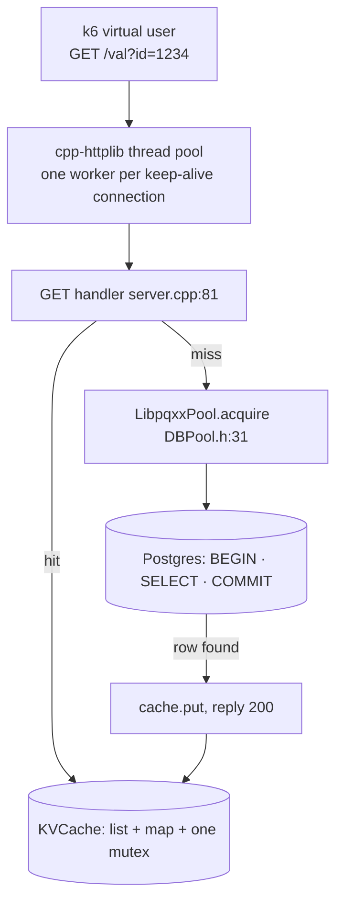
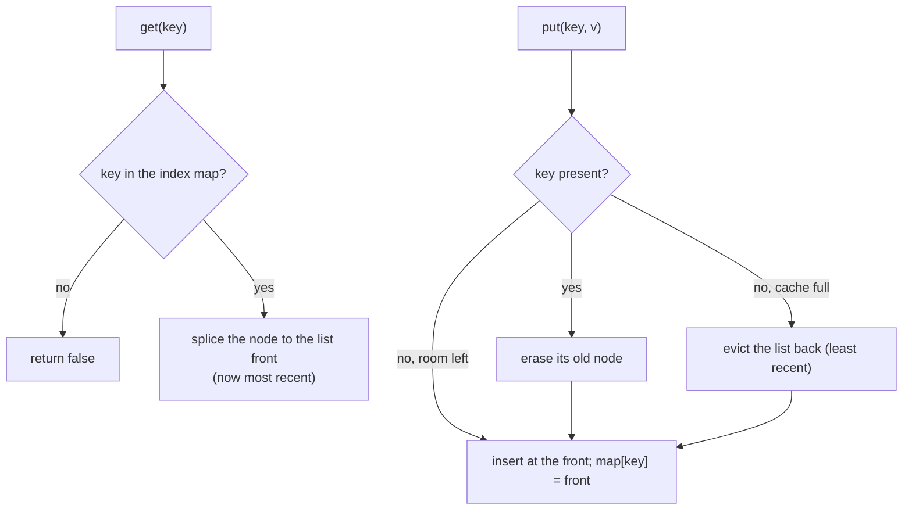
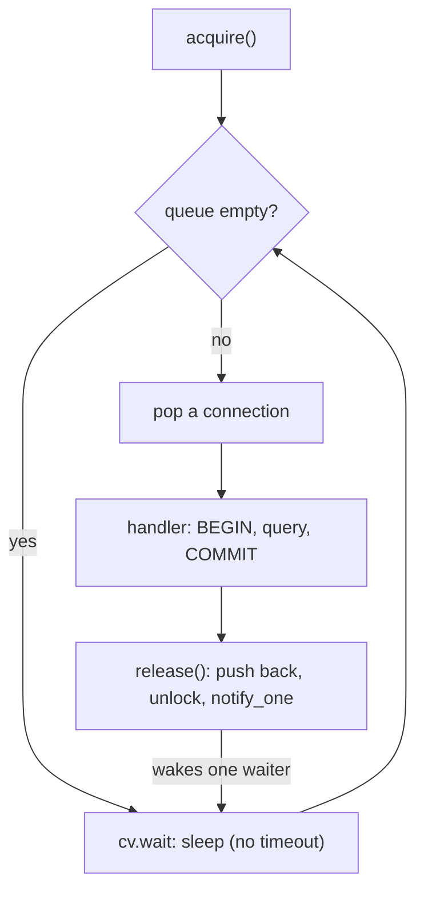
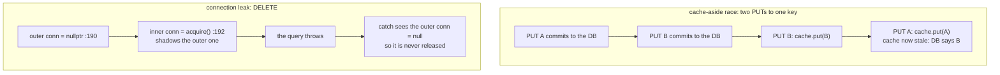
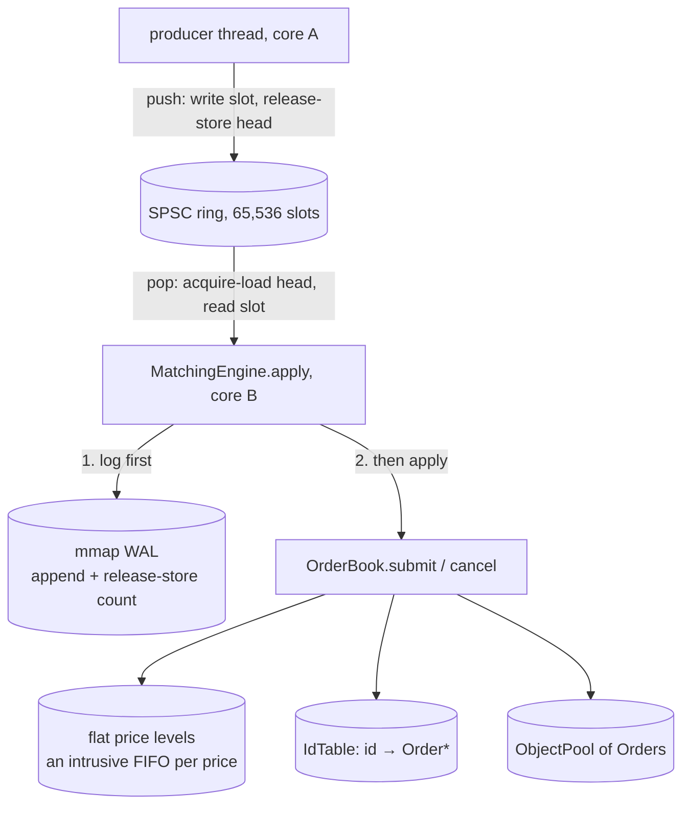
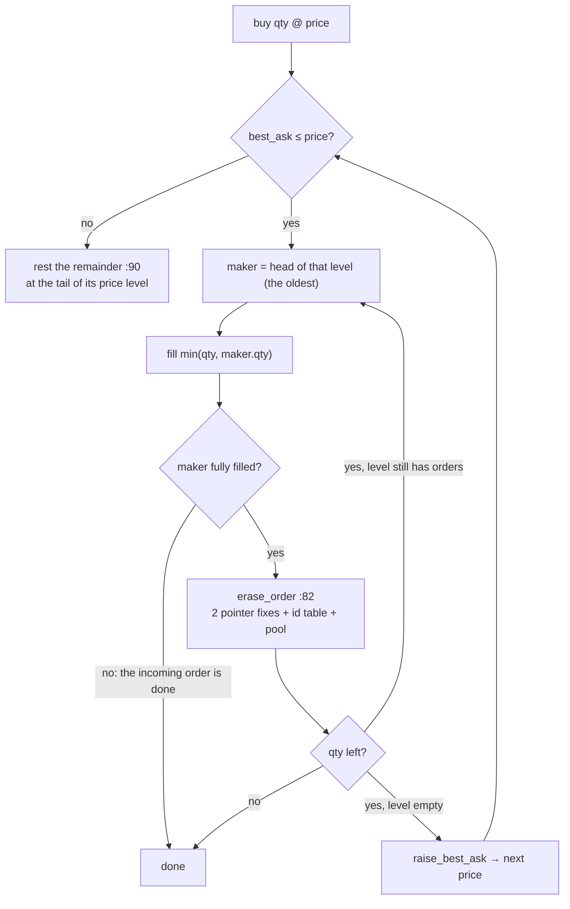
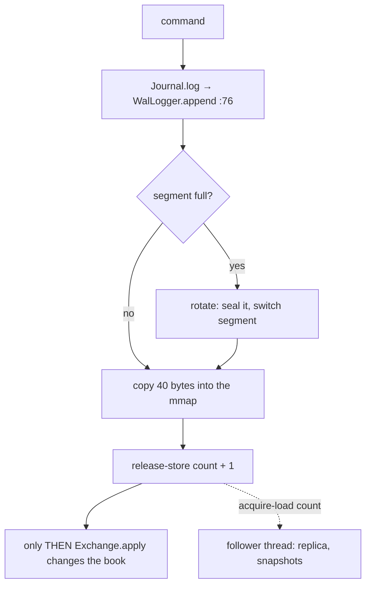

# Day 13 (Fri Nov 20): the DECS KV server, then Micro Exchange

Part of [[Interview plan (Nov 2026)]]. About 7 h. Morning: `decs` (branch `main`, one commit `82de05e`; prep pack
[[DECS KV server - prep]]). Afternoon: `microexchange`, **branch `upgrade-2026-10`** (HEAD `1fc2869`; `main` is the original;
prep pack [[Micro Exchange - prep]]). Read the branch with `git show upgrade-2026-10:<path>`.

**Code, explained:** the figures, the code to read and what each snippet does are in [[#Code, explained]], right after section B.

**Resume bullets (resume 5):**
- DECS: "Engineered a high-throughput, multi-tier concurrent C++ HTTP key-value store featuring an **800-thread** architecture, thread-safe **LRU cache**, and **PostgreSQL** persistence across a **20K-key** workload." / "Stress tested … across **1K virtual users** …" / "Isolated server and database resources via **CPU core pinning**, identifying **CPU saturation at 11K TPS** for cache-heavy reads versus **I/O saturation at 3.1K TPS** for write-heavy workloads."
- Micro Exchange: "Engineered a **C++20** limit-order matching engine with **price-time priority**, a **lock-free ring buffer**, object pooling, **WAL** persistence, and crash recovery, verified via **200k+ order fuzzing** and baseline checks." / "Scaled to **10.8M ops/s** at 2M commands by replacing O(n) cancellation and heap-based data structures with O(1) ID lookup and contiguous memory layouts, pushing throughput to **50×** over the baseline."

**DECS: what holds and what doesn't** (prep pack §0, §5.1):
- **11K "CPU saturation" holds**, read per core: the hand-typed `cpu` column hits 100% at 750–1000 VUs while TPS sits at 11.1K. The whole machine was at 26%, so say "the pinned server core saturated".
- **3.1K "I/O saturation" is not supported.** The disk (`sdd`) averaged 6% busy, max 13%, while the server core sat at 75%. Say **"database-bound"** (commit/fsync path, group commit at ~30 commits per flush), not "I/O saturated".
- **"800 threads"** is read from stdin and never saved. The data is consistent with ~800, but the repo can't prove it.
- **The ~43 ms floor on every request is Nagle + delayed ACK** (`TCP_NODELAY` off in cpp-httplib; headers and body in two `write()` calls). This one fact explains every latency curve.
- Real bugs to know cold: the cache-aside race (stale cache under concurrent writes); DELETE and `/nocache/val` shadow `conn`, so a DB error leaks a pool connection (`server.cpp:192`, `:233`). The Postgres password is hard-coded in a public repo.

**Micro Exchange: what holds and what doesn't** (prep pack §0, §5):
- **10.8M ops/s and 50× are single laptop runs with no raw output kept.** On the shared Xeon server the original binary gives **3.44M ops/s and 18.1×** at 2M commands (median of 5 paired runs). Use prep pack §5's honest wording.
- "O(1) ID lookup" is off: the naive engine already looks up by id in O(1) (`baseline/naive_engine.hpp:60`). Its O(n) is walking the price level's `std::list` (`:108-119`). The fix is **O(1) unlinking** through an intrusive list.
- **Authorship:** the first commit's author is Tarunsai; upgrade commits carry `Co-Authored-By: Claude`. Decide how you'll explain it.
- Strong fuzzing (differential) and real crash recovery (SIGKILL) exist **only on the unpushed upgrade branch**. Push it, or say "property fuzzing" and "log replay".

**By tonight you can:**
- explain thread-per-connection vs event-loop servers, LRU design, connection pools, and Little's law;
- use Little's law and the utilisation law on your DECS numbers;
- explain price-time priority, the SPSC ring with acquire/release, false sharing and the WAL;
- give both projects' numbers honestly, with setups.

## Schedule

| # | Time | Kind | What |
|---|---|---|---|
| 0 | 15 min | recall | Day 12: RRF, the ablation, the 30k+ correction |
| 1 | 45 min | theory | Servers, caches, pools, operational laws (A1) |
| 2 | 60 min | code | DECS: `server.cpp`, `KVCache.h`, `DBPool.h` (B1) |
| 3 | 15 min | skim | DECS load scripts: `script.sh`, `get_popular.js`, `put_only.js`, `dbpin.sh` |
| 4 | 30 min | practice | DECS trace and questions (D1, E1) |
| — | lunch | | |
| 5 | 45 min | theory | Order books; SPSC rings; memory ordering; false sharing (A2) |
| 6 | 75 min | code | Micro Exchange: ring, pool, book, engine (B2) |
| 7 | 20 min | theory | WAL, fsync, mmap, crash recovery (A3) |
| 8 | 30 min | code | `wal_logger.hpp`, `journal.hpp` (B3) |
| 9 | 45 min | rebuild | An SPSC ring buffer, or a tiny order book (C) |
| 10 | 30 min | practice | Micro Exchange trace and questions (D2, E2) |

## A. Theory

### A1. Servers and the operational laws (block 1, 45 min)

**Read:**
- Little's law and the utilisation law: any queueing-theory intro (for example, the "Operational Laws" chapter in Lazowska et al., *Quantitative System Performance*, free online, §3.1–3.3). About 25 min.
- On Nagle + delayed ACK: John Nagle's own Hacker News comment on it, or the Wikipedia article "Nagle's algorithm" (the interaction section). 10 min.

**Concepts and your numbers** (prep pack §5.3):
- **Little's law N = X·R.** get-popular at 1000 VUs: 11,187 × 0.0848 s ≈ 949 in flight. At 10 VUs: 10 / 0.0434 s ≈ 230 TPS, matching 225. So at low load TPS = VUs / 43 ms.
- **Utilisation law S = U/X:** cache hits ≈ 1.00 / 11,150 ≈ **90 µs** of server-core CPU per request; cache misses ≈ 270 µs (three DB round trips: BEGIN, SELECT, COMMIT).
- **Knee of a closed system N\* ≈ D/S:** get-popular 0.043 × 11,150 ≈ 480 VUs. The data bends between 500 and 750. ✓
- **Thread-per-connection** (cpp-httplib's pool; a worker owns one keep-alive connection) vs an **event loop** (epoll, few threads). 800 threads is about holding connections, not parallelism on 12 CPUs.
- **LRU:** a doubly linked list + hash map; `splice` to front on a hit; evict the tail. One mutex: simple, but contended.

### A2. The matching engine (block 5, 45 min)

**Read:**
- An order-book primer: price-time priority, limit vs market vs IOC orders, partial fills. (Any exchange-microstructure intro; for example, the "Limit order book" Wikipedia article.) 15 min.
- Preshing on Programming, *"Acquire and Release Semantics"* and *"An Introduction to Lock-Free Programming"*. 20 min.
- Optional: Rigtorp's blog *"Optimizing a ring buffer for throughput"* (the cached-index trick your ring uses).

**Concepts:**
- **Price-time priority:** best price first; at one price, oldest first (a FIFO per level).
- **SPSC ring:** one producer, one consumer, a power-of-two buffer. The producer writes the slot, then publishes `head` with **release**. The consumer loads `head` with **acquire**, so it sees the complete slot. Each side caches the other's index to avoid cross-core reads.
- **False sharing:** two threads writing different variables on one 64-byte cache line ping-pong it. Pad the head and tail apart.
- **Why the server is slower than the laptop:** the book alone does 18.1M/s (about 55 ns per command) on one core; the full two-thread pipeline does 3.44M/s (about 290 ns). The gap is most likely the **cross-core handoff** plus the WAL append, `rdtsc` and the histogram. It's a hypothesis: never profiled.

### A3. Durability (block 7, 20 min)

- **WAL:** log first, then apply. Recovery = load the snapshot + replay later records.
- **mmap:** writes go to the page cache; `fsync`/`msync` makes them durable. Snapshots: write tmp → fsync → rename → fsync dir (`snapshot.hpp:84-100`).
- On `main`, `append` silently dropped records when the log was full, and the count wasn't published with release ordering (story S9). The branch fixed both.

## B. Code

### B1. DECS (block 2, 60 min, deep)

`decs/project/`:
- `server.cpp`: **26 `main`** (stdin config: pool size 39–42, cache size 43–46, `http_threads` 67–72; the password at 36–37); **81 GET `/val`** (99 cache, 106 pool acquire, 107–110 BEGIN/SELECT/COMMIT, 119 cache put); **131 POST `/save`** (150–160 UPSERT); **174 DELETE** (192 the shadowed `conn`); 215 `/nocache/val` (233).
- `KVCache.h`: **12 `KVCache`**; 21 `get` (28 splice to front); 34 `put` (38–42 evict tail); 48 `erase`.
- `DBPool.h`: **12 `LibpqxxPool`**; 31 `acquire` (blocks with no timeout, 33); 39 `release`.
- **Find the cache-aside race yourself:** two clients, a PUT and a GET on the same key. Which interleaving leaves the cache stale?

### B2. Micro Exchange core (block 6, 75 min, deep)

On `upgrade-2026-10`:
- `include/core/ring_buffer.hpp`: **27 `push`** (30 reload `tail_` only if the cached copy looks full; 33 slot write; 34 release store), **38 `pop`** (41 acquire; 45 release).
- `include/core/object_pool.hpp`: 23 `acquire`, 25 `release` (pre-allocated; no `new` on the hot path: **983,976 allocations vs 3**).
- `include/engine/order.hpp`: the 40-byte `Command` (18, size check at 29).
- `src/order_book.cpp`: 33/40 `IdTable` (open addressing), **49 `IdTable::erase`** (backward-shift deletion, story S4); **82 `erase_order`** (O(1) unlink); **114 `submit`** (127 the match loop; 130 the oldest order at the best level; 142 `raise_best_ask`; 164 `rest`); **169 `cancel`**.
- `include/engine/matching_engine.hpp`: **24 `apply`** (log first at 25, then apply at 26, latency at 30); 35 `run`.
- `baseline/naive_engine.hpp`: 60 the O(1) index; **108 `erase_from`** (the O(n) list walk). Why is the naive engine slow overall? (*`std::map`, `std::list`, `shared_ptr`, a mutex/condvar queue, a syscall per log record.*)

### B3. Persistence (block 8, 30 min, deep)

- `include/persistence/wal_logger.hpp`: **76 `append`** (79 struct copy into the mmap; 80 release store of the count).
- `include/persistence/journal.hpp`: 84 `log`; 122 `rotate`; **146 `follow`** (a follower thread replays into a replica and takes snapshots off the matching thread, story S2); 179 free a sealed segment; 187 sleep 200 µs (story S6); **234 `recover`** (refuse a gap at 249).
- Skim `snapshot.hpp`, `net/*`, `src/gateway.cpp`, `src/main.cpp`.

## Code, explained

Read this **with the files open**. It starts with a picture of the whole day and **the flow, step by step** (one concrete input followed through every function). Then each part has its own figure, the exact code (copied from the repo at the commit named below, so the line numbers match) and what that code does.

Morning: `decs/project/` (`82de05e`). Afternoon: `microexchange`,
branch **`upgrade-2026-10`** (`1fc2869`), read with `git show upgrade-2026-10:<path>`.

---

### Part 1: DECS



#### The flow, step by step (DECS)

A GET for key **1234** that misses, then the same GET again.

1. A k6 virtual user sends `GET /val?id=1234` on its keep-alive connection.
2. The worker thread that owns that connection parses the request and calls the handler at `server.cpp:81`.
3. `parse_id` gives 1234 (bad ids get a 400). `cache.get` locks the mutex and **misses** (`KVCache.h:21–25`).
4. `pool.acquire()` waits on the condition variable until a database connection is free (`DBPool.h:31–37`).
5. `BEGIN`, `SELECT value … WHERE id = $1`, `COMMIT`: **three round trips** to Postgres (`server.cpp:107–110`). Then `pool.release(conn)` (`:111`).
6. The row exists, so `cache.put` inserts it at the front of the LRU list and evicts the tail if the cache is full (`KVCache.h:34–44`). Reply 200.
7. cpp-httplib writes the headers and the body in **two** `write()` calls. With `TCP_NODELAY` off, Nagle holds the body until the client ACKs the headers, and the client delays that ACK ~40 ms: the **43 ms floor**.
8. **The second GET for 1234 hits:** `splice` moves the node to the front, and the handler returns at `:100–101` without touching Postgres.

#### 1. The LRU cache



`project/KVCache.h:12–46`
```cpp
class KVCache {
  size_t capacity;
  std::list<std::pair<int, std::string>> items;
  std::unordered_map<int, std::list<std::pair<int, std::string>>::iterator> index;
  std::mutex mtx;

public:
  KVCache(size_t cap) : capacity(cap) {}

  bool get(int key, std::string &value) {
    std::lock_guard<std::mutex> lock(mtx);
    auto it = index.find(key);
    if (it == index.end())
      return false;

    // Move to front (LRU)
    items.splice(items.begin(), items, it->second);
    value = it->second->second;
    // std::cout << "Cache hit: " << key << " -> " << value << std::endl;
    return true;
  }

  void put(int key, const std::string &value) {
    std::lock_guard<std::mutex> lock(mtx);
    if (index.count(key)) {
      items.erase(index[key]);
    } else if (items.size() >= capacity) {
      auto last = items.back();
      index.erase(last.first);
      items.pop_back();
    }
    items.emplace_front(key, value);
    index[key] = items.begin();
    // std::cout << "Cache put: " << key << " -> " << value << std::endl;
  }
```

- A **doubly linked list** keeps recency order (front = newest); a **hash map** goes from key to list node. Both `get` and `put` are O(1).
- `splice` moves a node to the front **without** copying or reallocating it. That's why the map can store list iterators safely.
- `put` on a full cache evicts `items.back()`, the least recently used entry.
- **One mutex** for everything: simple and correct, but every reader serialises on it. At 11K requests/s that lock is part of the per-request CPU cost. A sharded cache (N mutexes by key hash) is the standard fix.

#### 2. The connection pool



`project/DBPool.h:31–44`
```cpp
pqxx::connection *acquire() {
  std::unique_lock<std::mutex> lock(mtx);
  cv.wait(lock, [&] { return !pool.empty(); });
  pqxx::connection *conn = pool.front();
  pool.pop();
  return conn;
}

void release(pqxx::connection *conn) {
  std::unique_lock<std::mutex> lock(mtx);
  pool.push(conn);
  lock.unlock();
  cv.notify_one();
}
```

- A queue of open connections, guarded by a mutex and a condition variable. `cv.wait(lock, predicate)` sleeps until a connection is free; the predicate form handles spurious wake-ups.
- `release` unlocks **before** `notify_one`, so the woken thread doesn't immediately block on the mutex.
- No timeout: if every connection leaks, every request blocks forever. That makes the leak in section 4 serious.

#### 3. A GET, miss then hit

`project/server.cpp:97–127`
```cpp
string cached_value;

if (cache.get(id_int, cached_value)) {
  res.set_content(cached_value, "text/plain");
  return;
}

db::connection *conn = nullptr;
try {
  conn = pool.acquire();
  db::work txn{*conn};
  db::result r =
      txn.exec_params("SELECT value FROM kv_store WHERE id = $1", id_int);
  txn.commit();
  pool.release(conn);

  if (r.empty()) {
    res.status = 404;
    res.set_content("No value found for id: " + to_string(id_int),
                    "text/plain");
  } else {
    string db_val = r[0][0].as<string>();
    cache.put(id_int, db_val);
    res.set_content(db_val, "text/plain");
  }
} catch (const std::exception &e) {
  if (conn)
    pool.release(conn);
  res.status = 500;
  res.set_content(string("Database error: ") + e.what(), "text/plain");
}
```

- A hit returns at line 101 without touching Postgres: ~90 µs of server-core CPU per request at saturation.
- A miss costs **three round trips** to Postgres (`BEGIN`, the `SELECT`, `COMMIT`) inside `db::work`: ~270 µs per request. A read-only query doesn't need a transaction; `pqxx::nontransaction` would save two round trips.
- A 404 isn't cached, so repeated reads of a missing key always go to the database.

#### 4. Two bugs to know before anyone points at them



`project/server.cpp:158–163`
```cpp
txn.exec_params(sql, id_int, val);
txn.commit();
pool.release(conn);

cache.put(id_int, val);
res.set_content("Key saved/updated: " + to_string(id_int), "text/plain");
```

- **The cache-aside race:** the database write commits at 159, and the cache update happens at 162, outside any common lock. Two concurrent PUTs to one key can commit in order A, B and update the cache in order B, A, leaving the cache stale (A) until eviction. Likewise, a GET that read the old row can `put` it after a PUT already updated the cache.

`project/server.cpp:190–197`
```cpp
db::connection *conn = nullptr;
try {
  db::connection *conn = pool.acquire();
  db::work txn{*conn};
  db::result r =
      txn.exec_params("DELETE FROM kv_store WHERE id = $1", id_int);
  txn.commit();
  pool.release(conn);
```

- **The connection leak:** line 192 declares a **new** `conn` inside the `try`, shadowing the outer one at 190. If the DELETE throws, the `catch` sees the outer `conn`, still `nullptr`, and never releases. The pool shrinks by one connection per failed DELETE.

---

### Part 2: Micro Exchange



#### 5. The lock-free SPSC ring buffer

##### The flow, step by step (Micro Exchange)

A **buy 70 @ 102** arrives; resting sells at 101 are S1 (40, the older) and S2 (20).

1. **Producer** (`ring_buffer.hpp:27–35`): copy the 40-byte command into `slots_[head & mask]`, then `head_.store(head + 1, release)`.
2. **Matching thread** (`:38–46`): `head_.load(acquire)` sees the new head, so the slot copy sees the whole command. Copy it out, then `tail_.store(tail + 1, release)` frees the slot.
3. **Log first** (`matching_engine.hpp:25` → `wal_logger.hpp:76–82`): copy the command into the mmap'd log, then release-store the new record count.
4. **Match** (`order_book.cpp:114`): the order is valid. `best_ask_ = 101 ≤ 102`, so trade against the level head, the oldest order: S1 fills 40 and is unlinked by `erase_order` (two pointer fixes, the id-table erase, back to the pool). S2 fills 20 and is erased too. Level 101 is now empty, so `raise_best_ask` scans upward.
5. **Rest the remainder** (`rest`, `:90–112`): 70 − 60 = **10** remain. Take an `Order` from the pool, append it at the tail of bid level 102, insert its id into the id table, and set `best_bid_ = 102`.
6. **Latency:** `rdtsc() − c.tsc` goes into the histogram (`matching_engine.hpp:29–30`). Meanwhile the follower thread reads the new log count with acquire, replays the command on its replica, and takes snapshots off the hot path.

`include/core/ring_buffer.hpp:27–47` (`upgrade-2026-10`)
```cpp
bool push(const T& item) {
    const size_t head = head_.load(std::memory_order_relaxed);
    if (head - tail_cache_ >= Capacity) {
        tail_cache_ = tail_.load(std::memory_order_acquire);
        if (head - tail_cache_ >= Capacity) return false;
    }
    slots_[head & (Capacity - 1)] = item;
    head_.store(head + 1, std::memory_order_release);
    return true;
}

bool pop(T& out) {
    const size_t tail = tail_.load(std::memory_order_relaxed);
    if (tail == head_cache_) {
        head_cache_ = head_.load(std::memory_order_acquire);
        if (tail == head_cache_) return false;
    }
    out = slots_[tail & (Capacity - 1)];
    tail_.store(tail + 1, std::memory_order_release);
    return true;
}
```

`include/core/ring_buffer.hpp:59–65` (`upgrade-2026-10`)
```cpp
alignas(kCacheLine) std::atomic<size_t> head_{0};
size_t tail_cache_ = 0;  // producer's view of tail_

// alignas above also rounds sizeof(RingBuffer) up to a multiple of the
// cache line, so a neighbouring object cannot land on the consumer's line.
alignas(kCacheLine) std::atomic<size_t> tail_{0};
size_t head_cache_ = 0;  // consumer's view of head_
```

- **Indices only grow**; the slot is `index & (Capacity − 1)`, so the capacity must be a power of two. "Full" means `head − tail ≥ Capacity`, so there's no wrap-around special case.
- **The ordering contract:** the producer writes the slot, *then* `head_.store(…, release)`. The consumer `head_.load(acquire)`, *then* reads the slot. Release/acquire guarantees that if the consumer sees the new head, it also sees the slot's contents. With `relaxed` on both, the CPU or compiler could reorder, and the consumer could read a half-written command.
- **Cached indices:** each side keeps its own copy of the other's index (`tail_cache_`, `head_cache_`) and reloads it only when the queue *looks* full or empty. Most pushes and pops then touch no cache line the other core writes.
- `alignas(64)` puts `head_` and `tail_` on separate cache lines, so the producer writing `head_` doesn't keep invalidating the consumer's line (**false sharing**).

#### 6. Matching: price-time priority with O(1) unlinking



`src/order_book.cpp:126–143` (`upgrade-2026-10`)
```cpp
if (side == Side::Buy) {
    while (qty > 0 && best_ask_ <= price) {
        Level& lvl = asks_[best_ask_];
        while (qty > 0 && lvl.head) {
            Order* maker = lvl.head;  // oldest order at this price wins
            const uint64_t x = std::min(qty, maker->qty);
            qty -= x;
            maker->qty -= x;
            lvl.qty -= x;
            resting_qty_ -= x;
            filled_qty_ += 2 * x;  // both sides of the trade
            filled += x;
            if (record_trades_)
                trades_.push_back(Trade{id, maker->id, maker->price, x});
            if (maker->qty == 0) erase_order(maker);
        }
        if (lvl.head == nullptr) raise_best_ask();
    }
```

- `best_ask_` indexes a **flat array of price levels**, no tree. While the incoming buy price crosses the best ask, trade against `lvl.head`, the **oldest** order at that price (time priority). Fill `min(qty, maker->qty)`; remove the maker when it's fully filled. When a level empties, `raise_best_ask` scans up to the next non-empty price.

`src/order_book.cpp:82–88` (`upgrade-2026-10`)
```cpp
void OrderBook::erase_order(Order* o) {
    Level& lvl = (o->side == Side::Buy ? bids_ : asks_)[o->price];
    if (o->prev) o->prev->next = o->next; else lvl.head = o->next;
    if (o->next) o->next->prev = o->prev; else lvl.tail = o->prev;
    index_.erase(o->id);
    pool_.release(o);
}
```

- **O(1) erase:** each `Order` carries its own `prev`/`next` (an *intrusive* list), so removing it is two pointer fixes. Then the id is removed from the table and the node goes back to the pool. No search, no allocation.

`baseline/naive_engine.hpp:107–119` (`upgrade-2026-10`)
```cpp
template <typename Levels>
void erase_from(Levels& levels, const OrderPtr& o) {
    auto lvl = levels.find(o->price);
    if (lvl == levels.end()) return;
    std::list<OrderPtr>& orders = lvl->second;
    for (auto i = orders.begin(); i != orders.end(); ++i) {
        if ((*i)->id == o->id) {
            orders.erase(i);
            break;
        }
    }
    if (orders.empty()) levels.erase(lvl);
}
```

- **What "O(n) cancellation" really meant:** the naive engine finds the order by id in O(1) too, but then **walks the price level's `std::list`** to find the node, which is O(orders at that price). Plus `std::map` levels and `shared_ptr` orders: an allocation per order (983,976 allocations vs 3).

#### 7. Write-ahead log



`include/engine/matching_engine.hpp:24–31` (`upgrade-2026-10`)
```cpp
void apply(const Command& c) {
    if (journal_) journal_->log(c, ex_);  // write-ahead: log before mutating state
    ex_.apply(c);
    ++processed_;
    if (hist_) {
        const uint64_t cycles = rdtsc() - c.tsc;
        hist_->record(static_cast<uint64_t>(TscClock::to_ns(cycles)));
    }
```

`include/persistence/wal_logger.hpp:76–82` (`upgrade-2026-10`)
```cpp
bool append(const Command& c) {
    const uint64_t n = header_->count;
    if (n >= max_records_) return false;
    records_[n] = c;
    std::atomic_ref<uint64_t>(header_->count).store(n + 1, std::memory_order_release);
    return true;
}
```

- **Log, then apply** (line 25): if the process dies after logging, recovery replays the command; if it dies before, the command was never applied. Either way the book and the log agree.
- `append` copies the 40-byte command into an mmap'd segment, then publishes the new count with **release**. The follower thread (and a reader after a SIGKILL) that loads the count with acquire sees only fully written records.
- A full segment returns `false` (the journal then rotates). The original `main` silently dropped records here.

**Check yourself:** asks resting at 101: [S1 qty 40, S2 qty 30] (S1 older). A buy for 50 @ 102 arrives. What trades happen, what rests, and what does `lvl.head` point to afterwards? (*S1 fills 40 and is erased; S2 fills 10 and keeps 20; nothing of the buy rests; `lvl.head` = S2.*)

## C. Rebuild it yourself (block 9, 45 min; pick one)

1. **SPSC ring in C++, about 50 lines:** `template<class T, size_t N> class Spsc` with `push`/`pop`, acquire/release, cached indices, and `alignas(64)` on head and tail. A test: one thread pushes 0…10⁷, the other pops and checks the order and the sum. Time it with and without `alignas(64)`.
2. **Order book in Python, about 70 lines:** levels as `dict[price] → deque`, best bid/ask, `submit` with partial fills, `cancel` by id through a dict of nodes. Check price-time priority on a hand-made sequence.

## D. Traces

**D1 (DECS).** A GET for key 1234 that misses, then hits (prep pack §2 "One GET traced"). Count the round trips to Postgres. Where does the 43 ms come from?

**D2 (Micro Exchange).** Prep pack §2 "One command, end to end": buy 70 @ 102 against resting sells at 101. Then cancel the leftover 10. Write every pointer fix and id-table change.

## E. Questions

**E1. DECS**
1. Walk me through a GET, miss then hit.
2. Why does every request take about 43 ms at low load? How would you fix it? (*`TCP_NODELAY`; prep pack exercise 1.*)
3. Prove the read plateau is CPU-bound and the write plateau is not disk-bound. Use the utilisation law.
4. Why 800 threads? Is that a good design? What would an event loop change?
5. Is your cache consistent with the database? Show the race.
6. Little's law on your own numbers: does it hold?
7. Hostile: "Your CPU column was typed by hand and the thread count isn't recorded. Why should I trust either?"

**E2. Micro Exchange**
8. Explain price-time priority and how your book implements it.
9. Walk me through the ring buffer's memory ordering. What breaks with relaxed ordering?
10. 10.8M ops/s: where was it measured? What does the server give, and why the difference?
11. What made the naive engine slow? What did "O(n) cancellation" actually mean?
12. How does crash recovery work? How did you test it? (*SIGKILL, 40/40, on the branch.*)
13. Snapshots stalled matching at first. How did you fix it? (*Story S2.*)
14. Hostile: "Your headline numbers didn't reproduce. Why are they still on your resume?"

## My notes and fumbles

- 
