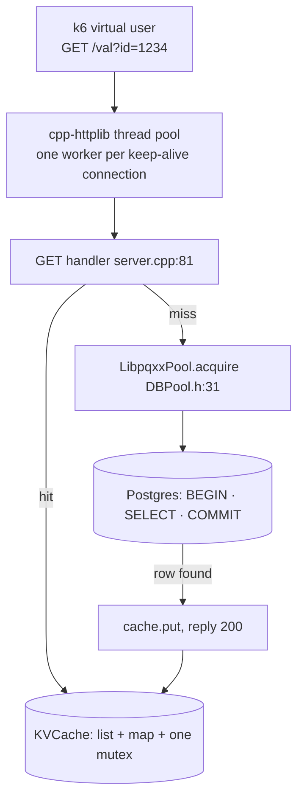
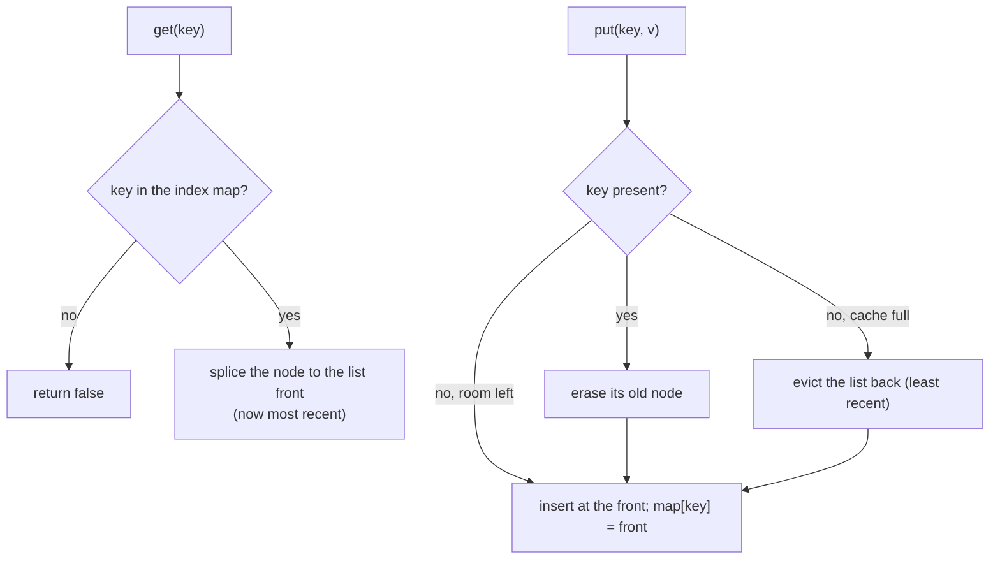
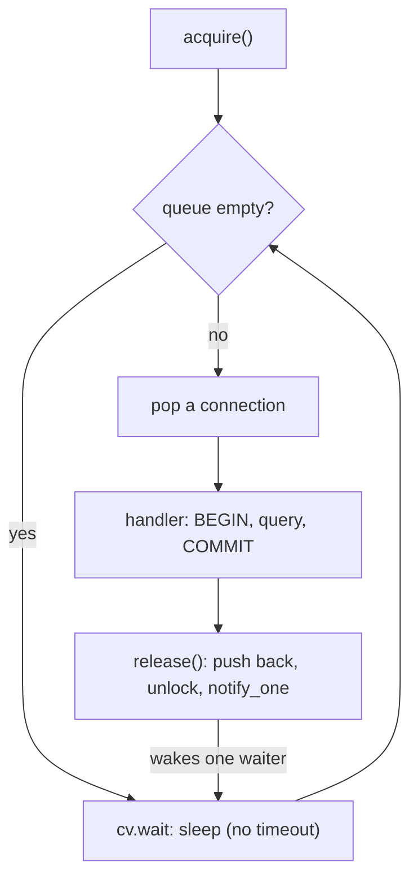
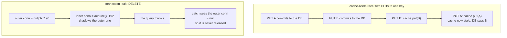
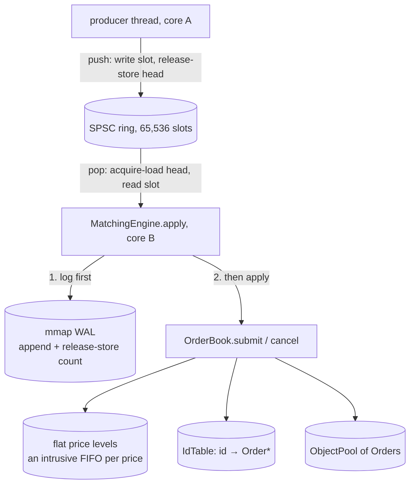
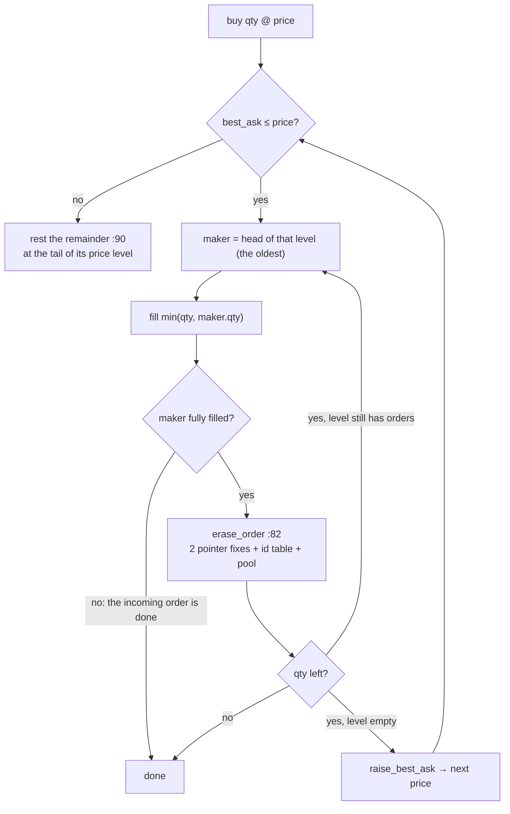
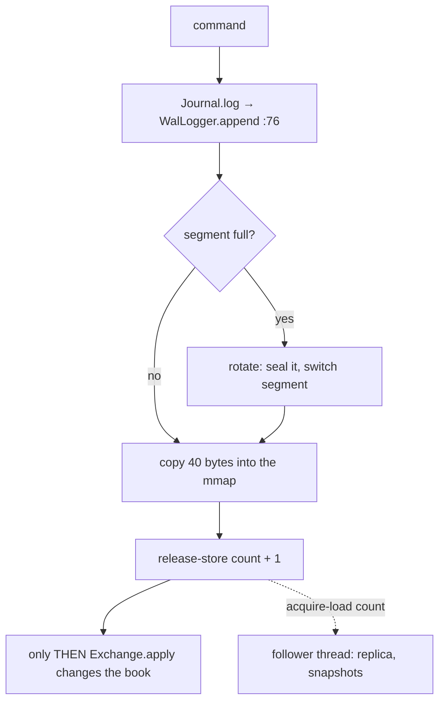

# Day 13 (Fri Nov 20): the DECS KV server, then Micro Exchange

Part of [[Interview plan (Nov 2026)]]. About 7 h. Morning: `decs` (branch `main`, one commit `82de05e`; prep pack
[[DECS KV server - prep]]). Afternoon: `microexchange`, **branch `upgrade-2026-10`** (HEAD `1fc2869`; `main` is the original;
prep pack [[Micro Exchange - prep]]). Read the branch with `git show upgrade-2026-10:<path>`.

**Code, explained:** the figures, the code to read and what each snippet does are in [[#Code, explained]], right after section B.

**Resume bullets (resume 5):**
- DECS: "Engineered a high-throughput, multi-tier concurrent C++ HTTP key-value store featuring an **800-thread** architecture, thread-safe **LRU cache**, and **PostgreSQL** persistence across a **20K-key** workload." / "Stress tested … across **1K virtual users** …" / "Isolated server and database resources via **CPU core pinning**, identifying **CPU saturation at 11K TPS** for cache-heavy reads versus **I/O saturation at 3.1K TPS** for write-heavy workloads."
- Micro Exchange: "Engineered a **C++20** limit-order matching engine with **price-time priority**, a **lock-free ring buffer**, object pooling, **WAL** persistence, and crash recovery, verified via **200k+ order fuzzing** and baseline checks." / "Scaled to **10.8M ops/s** at 2M commands by replacing O(n) cancellation and heap-based data structures with O(1) ID lookup and contiguous memory layouts, pushing throughput to **50×** over the baseline."

**DECS: what holds and what doesn't** (prep pack §0, §5.1):
- **11K "CPU saturation" holds**, read per core: the hand-typed `cpu` column hits 100% at 750–1000 VUs while TPS sits at 11.1K. The whole machine was at 26%, so say "the pinned server core saturated".
- **3.1K "I/O saturation" is not supported.** The disk (`sdd`) averaged 6% busy, max 13%, while the server core sat at 75%. Say **"database-bound"** (commit/fsync path, group commit at ~30 commits per flush), not "I/O saturated".
- **"800 threads"** is read from stdin and never saved. The data is consistent with ~800, but the repo can't prove it.
- **The ~43 ms floor on every request is Nagle + delayed ACK** (`TCP_NODELAY` off in cpp-httplib; headers and body in two `write()` calls). This one fact explains every latency curve.
- Real bugs to know cold: the cache-aside race (stale cache under concurrent writes); DELETE and `/nocache/val` shadow `conn`, so a DB error leaks a pool connection (`server.cpp:192`, `:233`). The Postgres password is hard-coded in a public repo.

**Micro Exchange: what holds and what doesn't** (prep pack §0, §5):
- **10.8M ops/s and 50× are single laptop runs with no raw output kept.** On the shared Xeon server the original binary gives **3.44M ops/s and 18.1×** at 2M commands (median of 5 paired runs). Use prep pack §5's honest wording.
- "O(1) ID lookup" is off: the naive engine already looks up by id in O(1) (`baseline/naive_engine.hpp:60`). Its O(n) is walking the price level's `std::list` (`:108-119`). The fix is **O(1) unlinking** through an intrusive list.
- **Authorship:** the first commit's author is Tarunsai; upgrade commits carry `Co-Authored-By: Claude`. Decide how you'll explain it.
- Strong fuzzing (differential) and real crash recovery (SIGKILL) exist **only on the unpushed upgrade branch**. Push it, or say "property fuzzing" and "log replay".

**By tonight you can:**
- explain thread-per-connection vs event-loop servers, LRU design, connection pools, and Little's law;
- use Little's law and the utilisation law on your DECS numbers;
- explain price-time priority, the SPSC ring with acquire/release, false sharing and the WAL;
- give both projects' numbers honestly, with setups.

## Schedule

| # | Time | Kind | What |
|---|---|---|---|
| 0 | 15 min | recall | Day 12: RRF, the ablation, the 30k+ correction |
| 1 | 45 min | theory | Servers, caches, pools, operational laws (A1) |
| 2 | 60 min | code | DECS: `server.cpp`, `KVCache.h`, `DBPool.h` (B1) |
| 3 | 15 min | skim | DECS load scripts: `script.sh`, `get_popular.js`, `put_only.js`, `dbpin.sh` |
| 4 | 30 min | practice | DECS trace and questions (D1, E1) |
| — | lunch | | |
| 5 | 45 min | theory | Order books; SPSC rings; memory ordering; false sharing (A2) |
| 6 | 75 min | code | Micro Exchange: ring, pool, book, engine (B2) |
| 7 | 20 min | theory | WAL, fsync, mmap, crash recovery (A3) |
| 8 | 30 min | code | `wal_logger.hpp`, `journal.hpp` (B3) |
| 9 | 45 min | rebuild | An SPSC ring buffer, or a tiny order book (C) |
| 10 | 30 min | practice | Micro Exchange trace and questions (D2, E2) |

## A. Theory

### A1. Servers and the operational laws (block 1, 45 min)

**Read:**
- Little's law and the utilisation law: any queueing-theory intro (for example, the "Operational Laws" chapter in Lazowska et al., *Quantitative System Performance*, free online, §3.1–3.3). About 25 min.
- On Nagle + delayed ACK: John Nagle's own Hacker News comment on it, or the Wikipedia article "Nagle's algorithm" (the interaction section). 10 min.

**Concepts and your numbers** (prep pack §5.3):
- **Little's law N = X·R.** get-popular at 1000 VUs: 11,187 × 0.0848 s ≈ 949 in flight. At 10 VUs: 10 / 0.0434 s ≈ 230 TPS, matching 225. So at low load TPS = VUs / 43 ms.
- **Utilisation law S = U/X:** cache hits ≈ 1.00 / 11,150 ≈ **90 µs** of server-core CPU per request; cache misses ≈ 270 µs (three DB round trips: BEGIN, SELECT, COMMIT).
- **Knee of a closed system N\* ≈ D/S:** get-popular 0.043 × 11,150 ≈ 480 VUs. The data bends between 500 and 750. ✓
- **Thread-per-connection** (cpp-httplib's pool; a worker owns one keep-alive connection) vs an **event loop** (epoll, few threads). 800 threads is about holding connections, not parallelism on 12 CPUs.
- **LRU:** a doubly linked list + hash map; `splice` to front on a hit; evict the tail. One mutex: simple, but contended.

### A2. The matching engine (block 5, 45 min)

**Read:**
- An order-book primer: price-time priority, limit vs market vs IOC orders, partial fills. (Any exchange-microstructure intro; for example, the "Limit order book" Wikipedia article.) 15 min.
- Preshing on Programming, *"Acquire and Release Semantics"* and *"An Introduction to Lock-Free Programming"*. 20 min.
- Optional: Rigtorp's blog *"Optimizing a ring buffer for throughput"* (the cached-index trick your ring uses).

**Concepts:**
- **Price-time priority:** best price first; at one price, oldest first (a FIFO per level).
- **SPSC ring:** one producer, one consumer, a power-of-two buffer. The producer writes the slot, then publishes `head` with **release**. The consumer loads `head` with **acquire**, so it sees the complete slot. Each side caches the other's index to avoid cross-core reads.
- **False sharing:** two threads writing different variables on one 64-byte cache line ping-pong it. Pad the head and tail apart.
- **Why the server is slower than the laptop:** the book alone does 18.1M/s (about 55 ns per command) on one core; the full two-thread pipeline does 3.44M/s (about 290 ns). The gap is most likely the **cross-core handoff** plus the WAL append, `rdtsc` and the histogram. It's a hypothesis: never profiled.

### A3. Durability (block 7, 20 min)

- **WAL:** log first, then apply. Recovery = load the snapshot + replay later records.
- **mmap:** writes go to the page cache; `fsync`/`msync` makes them durable. Snapshots: write tmp → fsync → rename → fsync dir (`snapshot.hpp:84-100`).
- On `main`, `append` silently dropped records when the log was full, and the count wasn't published with release ordering (story S9). The branch fixed both.

## B. Code

### B1. DECS (block 2, 60 min, deep)

`decs/project/`:
- `server.cpp`: **26 `main`** (stdin config: pool size 39–42, cache size 43–46, `http_threads` 67–72; the password at 36–37); **81 GET `/val`** (99 cache, 106 pool acquire, 107–110 BEGIN/SELECT/COMMIT, 119 cache put); **131 POST `/save`** (150–160 UPSERT); **174 DELETE** (192 the shadowed `conn`); 215 `/nocache/val` (233).
- `KVCache.h`: **12 `KVCache`**; 21 `get` (28 splice to front); 34 `put` (38–42 evict tail); 48 `erase`.
- `DBPool.h`: **12 `LibpqxxPool`**; 31 `acquire` (blocks with no timeout, 33); 39 `release`.
- **Find the cache-aside race yourself:** two clients, a PUT and a GET on the same key. Which interleaving leaves the cache stale?

### B2. Micro Exchange core (block 6, 75 min, deep)

On `upgrade-2026-10`:
- `include/core/ring_buffer.hpp`: **27 `push`** (30 reload `tail_` only if the cached copy looks full; 33 slot write; 34 release store), **38 `pop`** (41 acquire; 45 release).
- `include/core/object_pool.hpp`: 23 `acquire`, 25 `release` (pre-allocated; no `new` on the hot path: **983,976 allocations vs 3**).
- `include/engine/order.hpp`: the 40-byte `Command` (18, size check at 29).
- `src/order_book.cpp`: 33/40 `IdTable` (open addressing), **49 `IdTable::erase`** (backward-shift deletion, story S4); **82 `erase_order`** (O(1) unlink); **114 `submit`** (127 the match loop; 130 the oldest order at the best level; 142 `raise_best_ask`; 164 `rest`); **169 `cancel`**.
- `include/engine/matching_engine.hpp`: **24 `apply`** (log first at 25, then apply at 26, latency at 30); 35 `run`.
- `baseline/naive_engine.hpp`: 60 the O(1) index; **108 `erase_from`** (the O(n) list walk). Why is the naive engine slow overall? (*`std::map`, `std::list`, `shared_ptr`, a mutex/condvar queue, a syscall per log record.*)

### B3. Persistence (block 8, 30 min, deep)

- `include/persistence/wal_logger.hpp`: **76 `append`** (79 struct copy into the mmap; 80 release store of the count).
- `include/persistence/journal.hpp`: 84 `log`; 122 `rotate`; **146 `follow`** (a follower thread replays into a replica and takes snapshots off the matching thread, story S2); 179 free a sealed segment; 187 sleep 200 µs (story S6); **234 `recover`** (refuse a gap at 249).
- Skim `snapshot.hpp`, `net/*`, `src/gateway.cpp`, `src/main.cpp`.

## Code, explained

Read this **with the files open**. It starts with a picture of the whole day and **the flow, step by step** (one concrete input followed through every function). Then each part has its own figure, the exact code (copied from the repo at the commit named below, so the line numbers match) and what that code does.

Morning: `decs/project/` (`82de05e`). Afternoon: `microexchange`,
branch **`upgrade-2026-10`** (`1fc2869`), read with `git show upgrade-2026-10:<path>`.

---

### Part 1: DECS



#### The flow, step by step (DECS)

A GET for key **1234** that misses, then the same GET again.

1. A k6 virtual user sends `GET /val?id=1234` on its keep-alive connection.
2. The worker thread that owns that connection parses the request and calls the handler at `server.cpp:81`.
3. `parse_id` gives 1234 (bad ids get a 400). `cache.get` locks the mutex and **misses** (`KVCache.h:21–25`).
4. `pool.acquire()` waits on the condition variable until a database connection is free (`DBPool.h:31–37`).
5. `BEGIN`, `SELECT value … WHERE id = $1`, `COMMIT`: **three round trips** to Postgres (`server.cpp:107–110`). Then `pool.release(conn)` (`:111`).
6. The row exists, so `cache.put` inserts it at the front of the LRU list and evicts the tail if the cache is full (`KVCache.h:34–44`). Reply 200.
7. cpp-httplib writes the headers and the body in **two** `write()` calls. With `TCP_NODELAY` off, Nagle holds the body until the client ACKs the headers, and the client delays that ACK ~40 ms: the **43 ms floor**.
8. **The second GET for 1234 hits:** `splice` moves the node to the front, and the handler returns at `:100–101` without touching Postgres.

#### 1. The LRU cache

> [!tip] Concept from scratch: [[#9. Deep dive: the LRU cache, the connection pool and the 43 ms floor from scratch|the LRU cache on a 3-entry example, line by line]]



`project/KVCache.h:12–46`
```cpp
class KVCache {
  size_t capacity;
  std::list<std::pair<int, std::string>> items;
  std::unordered_map<int, std::list<std::pair<int, std::string>>::iterator> index;
  std::mutex mtx;

public:
  KVCache(size_t cap) : capacity(cap) {}

  bool get(int key, std::string &value) {
    std::lock_guard<std::mutex> lock(mtx);
    auto it = index.find(key);
    if (it == index.end())
      return false;

    // Move to front (LRU)
    items.splice(items.begin(), items, it->second);
    value = it->second->second;
    // std::cout << "Cache hit: " << key << " -> " << value << std::endl;
    return true;
  }

  void put(int key, const std::string &value) {
    std::lock_guard<std::mutex> lock(mtx);
    if (index.count(key)) {
      items.erase(index[key]);
    } else if (items.size() >= capacity) {
      auto last = items.back();
      index.erase(last.first);
      items.pop_back();
    }
    items.emplace_front(key, value);
    index[key] = items.begin();
    // std::cout << "Cache put: " << key << " -> " << value << std::endl;
  }
```
> [!info] New functions in this code
> - `(size_t)row * N`: an unsigned 64-bit integer type. Casting before multiplying keeps `row · N` from overflowing 32-bit `int` (2.1 × 10⁹) for big N. [[Function glossary#size_t|→ examples]]
> - `std::list<T>`: a **doubly linked list**: every element is its own node with prev/next pointers. Insert or remove anywhere in O(1) if you hold an iterator, but no `[i]` indexing. Iterators stay valid when *other* elements move or are removed, which is why the LRU map can store them. [[Function glossary#std::list|→ examples]]
> - `std::pair<A, B>`: two values in one object, read as `.first` and `.second`. The LRU list stores `std::pair<int, std::string>` = (key, value). [[Function glossary#std::pair|→ examples]]
> - `std::unordered_map<K, V>`: a hash table from keys to values: lookup, insert and erase in expected O(1), no ordering. `index[7]` creates an entry for 7 if missing; `index.find(7)` does not. [[Function glossary#std::unordered_map|→ examples]]
> - `std::mutex`: a lock: only one thread can hold it at a time; others block in `lock()` until it's free. Protects data several threads touch. [[Function glossary#std::mutex|→ examples]]
> - `std::lock_guard<std::mutex> lock(mtx);`: locks `mtx` now and unlocks it automatically when `lock` goes out of scope (RAII), even if the code returns early or throws. [[Function glossary#std::lock_guard|→ examples]]
> - `.find(key)`: on a map: an iterator to the entry for `key`, or `.end()` if there is none. `if (it == index.end()) return false;` is the "miss" test. [[Function glossary#x.find|→ examples]]
> - `.end()`: an iterator **one past** the last element: not a real element, used as "not found" and as the stop point of loops. [[Function glossary#x.end|→ examples]]
> - `list.splice(pos, other, it)`: moves the node `it` points at to just before `pos`, by relinking pointers: no copy, no allocation. `items.splice(items.begin(), items, it)` moves an entry to the front, and `it` stays valid. [[Function glossary#x.splice|→ examples]]
> - `.begin()`: an iterator to the first element. On the LRU list, the front = most recently used. [[Function glossary#x.begin|→ examples]]
> - `.erase(it) / .erase(key)`: removes an element: from a list by iterator (O(1)), from a map by key or iterator. `index.erase(2)` deletes key 2. [[Function glossary#x.erase|→ examples]]
> - `.size()`: the number of elements. `items.size() >= capacity` means the cache is full. [[Function glossary#x.size|→ examples]]
> - `.back()`: a reference to the **last** element. On the LRU list that's the least recently used entry, the next to evict. [[Function glossary#x.back|→ examples]]
> - `.pop_back()`: removes the last element (O(1) on a list). Used after reading `back()` to evict. [[Function glossary#x.pop_back|→ examples]]
> - `.emplace_front(args...)`: builds a new element **in place** at the front, from constructor arguments: `items.emplace_front(4, "d")` creates the pair (4, "d") directly in the new node. [[Function glossary#x.emplace_front|→ examples]]

- A **doubly linked list** keeps recency order (front = newest); a **hash map** goes from key to list node. Both `get` and `put` are O(1).
- `splice` moves a node to the front **without** copying or reallocating it. That's why the map can store list iterators safely.
- `put` on a full cache evicts `items.back()`, the least recently used entry.
- **One mutex** for everything: simple and correct, but every reader serialises on it. At 11K requests/s that lock is part of the per-request CPU cost. A sharded cache (N mutexes by key hash) is the standard fix.

#### 2. The connection pool

> [!tip] Concept from scratch: [[#9. Deep dive: the LRU cache, the connection pool and the 43 ms floor from scratch|the pool on a 2-connection example, and the 43 ms Nagle floor]]



`project/DBPool.h:31–44`
```cpp
pqxx::connection *acquire() {
  std::unique_lock<std::mutex> lock(mtx);
  cv.wait(lock, [&] { return !pool.empty(); });
  pqxx::connection *conn = pool.front();
  pool.pop();
  return conn;
}

void release(pqxx::connection *conn) {
  std::unique_lock<std::mutex> lock(mtx);
  pool.push(conn);
  lock.unlock();
  cv.notify_one();
}
```
> [!info] New functions in this code
> - `pqxx::connection`: one open connection to Postgres (a server-side backend process). Opening one costs milliseconds, hence the pool. `db::` is the project's alias for `pqxx::`. [[Function glossary#pqxx::connection|→ examples]]
> - `std::unique_lock<std::mutex> lock(mtx);`: like `lock_guard`, but you can `unlock()` early and a condition variable can release and re-take it while waiting. Needed for `cv.wait`. [[Function glossary#std::unique_lock|→ examples]]
> - `.empty()`: true when there are no elements. `!pool.empty()` = a connection is available. [[Function glossary#x.empty|→ examples]]
> - `.front()`: a reference to the **first** element. On `std::queue`, the oldest item (the next connection to lend). [[Function glossary#x.front|→ examples]]
> - `.push(x)`: on `std::queue`: adds `x` at the back. `pool.push(conn)` returns a connection to the pool. [[Function glossary#x.push|→ examples]]
> - `.unlock()`: releases a `unique_lock` before its scope ends. The pool unlocks before `notify_one` so the woken thread doesn't block on the mutex. [[Function glossary#x.unlock|→ examples]]
> - `cv.notify_one()`: wakes **one** thread waiting on the condition variable (if any). It then re-checks its predicate. [[Function glossary#x.notify_one|→ examples]]

- A queue of open connections, guarded by a mutex and a condition variable. `cv.wait(lock, predicate)` sleeps until a connection is free; the predicate form handles spurious wake-ups.
- `release` unlocks **before** `notify_one`, so the woken thread doesn't immediately block on the mutex.
- No timeout: if every connection leaks, every request blocks forever. That makes the leak in section 4 serious.

#### 3. A GET, miss then hit

> [!tip] Concept from scratch: [[#8. Deep dive: the operational laws from scratch (Little's law, utilisation, the knee)|why a hit costs ~90 µs and a miss ~270 µs, and where the 11K plateau and the knee come from (the operational laws)]]

`project/server.cpp:97–127`
```cpp
string cached_value;

if (cache.get(id_int, cached_value)) {
  res.set_content(cached_value, "text/plain");
  return;
}

db::connection *conn = nullptr;
try {
  conn = pool.acquire();
  db::work txn{*conn};
  db::result r =
      txn.exec_params("SELECT value FROM kv_store WHERE id = $1", id_int);
  txn.commit();
  pool.release(conn);

  if (r.empty()) {
    res.status = 404;
    res.set_content("No value found for id: " + to_string(id_int),
                    "text/plain");
  } else {
    string db_val = r[0][0].as<string>();
    cache.put(id_int, db_val);
    res.set_content(db_val, "text/plain");
  }
} catch (const std::exception &e) {
  if (conn)
    pool.release(conn);
  res.status = 500;
  res.set_content(string("Database error: ") + e.what(), "text/plain");
}
```
> [!info] New functions in this code
> - `res.set_content(body, "text/plain")`: cpp-httplib: sets the HTTP response body and its Content-Type. The status defaults to 200. [[Function glossary#x.set_content|→ examples]]
> - `db::work txn{*conn};`: starts a **transaction** on a connection (sends `BEGIN`). Nothing is permanent until `txn.commit()`; if `txn` is destroyed first, it rolls back. [[Function glossary#db::work|→ examples]]
> - `txn.exec_params(sql, a, b)`: runs a SQL statement with `$1`, `$2` placeholders filled by `a`, `b` (no string concatenation, so no SQL injection). Returns a `result` of rows: `r.empty()`, `r[0][0].as<string>()`. [[Function glossary#x.exec_params|→ examples]]
> - `txn.commit()`: sends `COMMIT`: the transaction's changes become permanent. Postgres replies only after its WAL record is flushed (unless synchronous_commit is off). [[Function glossary#x.commit|→ examples]]
> - `catch (const std::exception &e)`: the base class of standard errors. Catching it catches libpqxx's errors too; `e.what()` is the message. [[Function glossary#std::exception|→ examples]]
> - `e.what()`: the error message of an exception, as a C string. [[Function glossary#x.what|→ examples]]

- A hit returns at line 101 without touching Postgres: ~90 µs of server-core CPU per request at saturation.
- A miss costs **three round trips** to Postgres (`BEGIN`, the `SELECT`, `COMMIT`) inside `db::work`: ~270 µs per request. A read-only query doesn't need a transaction; `pqxx::nontransaction` would save two round trips.
- A 404 isn't cached, so repeated reads of a missing key always go to the database.

#### 4. Two bugs to know before anyone points at them

> [!tip] Concept from scratch: [[#9. Deep dive: the LRU cache, the connection pool and the 43 ms floor from scratch|the cache-aside race as a timeline]]



`project/server.cpp:158–163`
```cpp
txn.exec_params(sql, id_int, val);
txn.commit();
pool.release(conn);

cache.put(id_int, val);
res.set_content("Key saved/updated: " + to_string(id_int), "text/plain");
```

- **The cache-aside race:** the database write commits at 159, and the cache update happens at 162, outside any common lock. Two concurrent PUTs to one key can commit in order A, B and update the cache in order B, A, leaving the cache stale (A) until eviction. Likewise, a GET that read the old row can `put` it after a PUT already updated the cache.

`project/server.cpp:190–197`
```cpp
db::connection *conn = nullptr;
try {
  db::connection *conn = pool.acquire();
  db::work txn{*conn};
  db::result r =
      txn.exec_params("DELETE FROM kv_store WHERE id = $1", id_int);
  txn.commit();
  pool.release(conn);
```

- **The connection leak:** line 192 declares a **new** `conn` inside the `try`, shadowing the outer one at 190. If the DELETE throws, the `catch` sees the outer `conn`, still `nullptr`, and never releases. The pool shrinks by one connection per failed DELETE.

---

### Part 2: Micro Exchange



#### 5. The lock-free SPSC ring buffer

> [!tip] Concept from scratch: [[#10. Deep dive: the SPSC ring buffer and memory ordering from scratch|the ring on a 4-slot example, and why release/acquire]]

##### The flow, step by step (Micro Exchange)

A **buy 70 @ 102** arrives; resting sells at 101 are S1 (40, the older) and S2 (20).

1. **Producer** (`ring_buffer.hpp:27–35`): copy the 40-byte command into `slots_[head & mask]`, then `head_.store(head + 1, release)`.
2. **Matching thread** (`:38–46`): `head_.load(acquire)` sees the new head, so the slot copy sees the whole command. Copy it out, then `tail_.store(tail + 1, release)` frees the slot.
3. **Log first** (`matching_engine.hpp:25` → `wal_logger.hpp:76–82`): copy the command into the mmap'd log, then release-store the new record count.
4. **Match** (`order_book.cpp:114`): the order is valid. `best_ask_ = 101 ≤ 102`, so trade against the level head, the oldest order: S1 fills 40 and is unlinked by `erase_order` (two pointer fixes, the id-table erase, back to the pool). S2 fills 20 and is erased too. Level 101 is now empty, so `raise_best_ask` scans upward.
5. **Rest the remainder** (`rest`, `:90–112`): 70 − 60 = **10** remain. Take an `Order` from the pool, append it at the tail of bid level 102, insert its id into the id table, and set `best_bid_ = 102`.
6. **Latency:** `rdtsc() − c.tsc` goes into the histogram (`matching_engine.hpp:29–30`). Meanwhile the follower thread reads the new log count with acquire, replays the command on its replica, and takes snapshots off the hot path.

`include/core/ring_buffer.hpp:27–47` (`upgrade-2026-10`)
```cpp
bool push(const T& item) {
    const size_t head = head_.load(std::memory_order_relaxed);
    if (head - tail_cache_ >= Capacity) {
        tail_cache_ = tail_.load(std::memory_order_acquire);
        if (head - tail_cache_ >= Capacity) return false;
    }
    slots_[head & (Capacity - 1)] = item;
    head_.store(head + 1, std::memory_order_release);
    return true;
}

bool pop(T& out) {
    const size_t tail = tail_.load(std::memory_order_relaxed);
    if (tail == head_cache_) {
        head_cache_ = head_.load(std::memory_order_acquire);
        if (tail == head_cache_) return false;
    }
    out = slots_[tail & (Capacity - 1)];
    tail_.store(tail + 1, std::memory_order_release);
    return true;
}
```
> [!info] New functions in this code
> - `x.load(order)`: reads an atomic. `head_.load(std::memory_order_acquire)` reads it and makes later reads see everything the writer did before its release store. [[Function glossary#x.load|→ examples]]
> - `std::memory_order_relaxed`: atomicity only, **no ordering** of other memory. Fine for reading your own index (only you write it). [[Function glossary#std::memory_order_relaxed|→ examples]]
> - `std::memory_order_acquire`: for loads: reads after it can't move before it, and if it reads a released value it sees all writes before that release. [[Function glossary#std::memory_order_acquire|→ examples]]
> - `x.store(v, order)`: writes an atomic. `head_.store(head + 1, std::memory_order_release)` publishes every earlier write together with the new value. [[Function glossary#x.store|→ examples]]
> - `std::memory_order_release`: for stores: writes before it can't move after it, so a reader that acquires this value sees them all. [[Function glossary#std::memory_order_release|→ examples]]

`include/core/ring_buffer.hpp:59–65` (`upgrade-2026-10`)
```cpp
alignas(kCacheLine) std::atomic<size_t> head_{0};
size_t tail_cache_ = 0;  // producer's view of tail_

// alignas above also rounds sizeof(RingBuffer) up to a multiple of the
// cache line, so a neighbouring object cannot land on the consumer's line.
alignas(kCacheLine) std::atomic<size_t> tail_{0};
size_t head_cache_ = 0;  // consumer's view of head_
```
> [!info] New functions in this code
> - `alignas(64) T x;`: forces `x` to start at an address that is a multiple of 64 bytes, i.e. at the start of a cache line. Two `alignas(64)` members can never share a line, which prevents false sharing. [[Function glossary#alignas|→ examples]]
> - `std::atomic<size_t> head_{0};`: a variable that threads can read and write **without a data race**. Each operation can carry a memory order (relaxed, acquire, release, seq_cst) that says what other memory it orders. [[Function glossary#std::atomic|→ examples]]
> - `sizeof(float)`: size of a type in bytes: `sizeof(float)` = 4, `sizeof(double)` = 8. [[Function glossary#sizeof|→ examples]]

- **Indices only grow**; the slot is `index & (Capacity − 1)`, so the capacity must be a power of two. "Full" means `head − tail ≥ Capacity`, so there's no wrap-around special case.
- **The ordering contract:** the producer writes the slot, *then* `head_.store(…, release)`. The consumer `head_.load(acquire)`, *then* reads the slot. Release/acquire guarantees that if the consumer sees the new head, it also sees the slot's contents. With `relaxed` on both, the CPU or compiler could reorder, and the consumer could read a half-written command.
- **Cached indices:** each side keeps its own copy of the other's index (`tail_cache_`, `head_cache_`) and reloads it only when the queue *looks* full or empty. Most pushes and pops then touch no cache line the other core writes.
- `alignas(64)` puts `head_` and `tail_` on separate cache lines, so the producer writing `head_` doesn't keep invalidating the consumer's line (**false sharing**).

#### 6. Matching: price-time priority with O(1) unlinking

> [!tip] Concept from scratch: [[#11. Deep dive: the order book from scratch (price-time priority, intrusive lists, the id table, the pool)|the order book, the intrusive list, the id table and the pool, from zero]]



`src/order_book.cpp:126–143` (`upgrade-2026-10`)
```cpp
if (side == Side::Buy) {
    while (qty > 0 && best_ask_ <= price) {
        Level& lvl = asks_[best_ask_];
        while (qty > 0 && lvl.head) {
            Order* maker = lvl.head;  // oldest order at this price wins
            const uint64_t x = std::min(qty, maker->qty);
            qty -= x;
            maker->qty -= x;
            lvl.qty -= x;
            resting_qty_ -= x;
            filled_qty_ += 2 * x;  // both sides of the trade
            filled += x;
            if (record_trades_)
                trades_.push_back(Trade{id, maker->id, maker->price, x});
            if (maker->qty == 0) erase_order(maker);
        }
        if (lvl.head == nullptr) raise_best_ask();
    }
```
> [!info] New functions in this code
> - `std::min(a, b)`: the smaller of two values (C++). `std::min(elems, (size_t)4000000)` caps the check at 4M elements; both arguments must have the same type, hence the cast. [[Function glossary#std::min|→ examples]]
> - `.push_back(x)`: appends a copy of `x` at the end of a vector or list. `trades_.push_back(Trade{...})`; a vector may reallocate when it outgrows its capacity (hence `reserve`). [[Function glossary#x.push_back|→ examples]]

- `best_ask_` indexes a **flat array of price levels**, no tree. While the incoming buy price crosses the best ask, trade against `lvl.head`, the **oldest** order at that price (time priority). Fill `min(qty, maker->qty)`; remove the maker when it's fully filled. When a level empties, `raise_best_ask` scans up to the next non-empty price.

`src/order_book.cpp:82–88` (`upgrade-2026-10`)
```cpp
void OrderBook::erase_order(Order* o) {
    Level& lvl = (o->side == Side::Buy ? bids_ : asks_)[o->price];
    if (o->prev) o->prev->next = o->next; else lvl.head = o->next;
    if (o->next) o->next->prev = o->prev; else lvl.tail = o->prev;
    index_.erase(o->id);
    pool_.release(o);
}
```

- **O(1) erase:** each `Order` carries its own `prev`/`next` (an *intrusive* list), so removing it is two pointer fixes. Then the id is removed from the table and the node goes back to the pool. No search, no allocation.

`baseline/naive_engine.hpp:107–119` (`upgrade-2026-10`)
```cpp
template <typename Levels>
void erase_from(Levels& levels, const OrderPtr& o) {
    auto lvl = levels.find(o->price);
    if (lvl == levels.end()) return;
    std::list<OrderPtr>& orders = lvl->second;
    for (auto i = orders.begin(); i != orders.end(); ++i) {
        if ((*i)->id == o->id) {
            orders.erase(i);
            break;
        }
    }
    if (orders.empty()) levels.erase(lvl);
}
```
> [!info] New functions in this code
> - `template<int TILE> __global__ void k(...)`: makes the kernel generic over a **compile-time** number. `mm_tiled_1to1<32>` and `<64>` are compiled separately, so `TILE` can size static arrays and loops can be fully unrolled. [[Function glossary#template|→ examples]]

- **What "O(n) cancellation" really meant:** the naive engine finds the order by id in O(1) too, but then **walks the price level's `std::list`** to find the node, which is O(orders at that price). Plus `std::map` levels and `shared_ptr` orders: an allocation per order (983,976 allocations vs 3).

#### 7. Write-ahead log

> [!tip] Concept from scratch: [[#12. Deep dive: write-ahead logging and crash recovery from scratch|log-then-apply, crash points and recovery, from zero]]



`include/engine/matching_engine.hpp:24–31` (`upgrade-2026-10`)
```cpp
void apply(const Command& c) {
    if (journal_) journal_->log(c, ex_);  // write-ahead: log before mutating state
    ex_.apply(c);
    ++processed_;
    if (hist_) {
        const uint64_t cycles = rdtsc() - c.tsc;
        hist_->record(static_cast<uint64_t>(TscClock::to_ns(cycles)));
    }
```
> [!info] New functions in this code
> - `rdtsc()`: reads the CPU's time-stamp counter (cycles since reset) in ~20 cycles: far cheaper than `std::chrono`. Here a helper wrapping the x86 instruction; `TscClock::to_ns` converts cycles to ns. [[Function glossary#rdtsc|→ examples]]

`include/persistence/wal_logger.hpp:76–82` (`upgrade-2026-10`)
```cpp
bool append(const Command& c) {
    const uint64_t n = header_->count;
    if (n >= max_records_) return false;
    records_[n] = c;
    std::atomic_ref<uint64_t>(header_->count).store(n + 1, std::memory_order_release);
    return true;
}
```
> [!info] New functions in this code
> - `std::atomic_ref<uint64_t>(x).store(v, order)`: C++20: treats an **ordinary** variable as atomic for one operation. The WAL header lives in an mmap'd file, so `count` is a plain `uint64_t` updated through `atomic_ref`. [[Function glossary#std::atomic_ref|→ examples]]

- **Log, then apply** (line 25): if the process dies after logging, recovery replays the command; if it dies before, the command was never applied. Either way the book and the log agree.
- `append` copies the 40-byte command into an mmap'd segment, then publishes the new count with **release**. The follower thread (and a reader after a SIGKILL) that loads the count with acquire sees only fully written records.
- A full segment returns `false` (the journal then rotates). The original `main` silently dropped records here.

**Check yourself:** asks resting at 101: [S1 qty 40, S2 qty 30] (S1 older). A buy for 50 @ 102 arrives. What trades happen, what rests, and what does `lvl.head` point to afterwards? (*S1 fills 40 and is erased; S2 fills 10 and keeps 20; nothing of the buy rests; `lvl.head` = S2.*)

---

### 8. Deep dive: the operational laws from scratch (Little's law, utilisation, the knee)

Sections 1–4 above show what the DECS server does. This section explains **how to reason about its numbers**. Two
one-line laws predict both measured curves. Order: what a closed-loop test is → Little's law → the utilisation law →
the two regimes and the knee → using the laws on the resume claims → what-ifs → questions → check.

> [!important] The one sentence to hold on to
> In-flight requests = throughput × latency (**N = X·R**), and a resource's busy fraction = throughput × its time per
> request (**U = X·S**). The resource with the largest S caps throughput at **1/S**.

#### 8.1 What a closed-loop load test is

k6 runs **N virtual users** (VUs). Each one sends a request, waits for the reply, and only then sends the next. That is
a **closed loop**: the load slows down when the server slows down.

So a VU is always in one of two places: waiting for a reply, or in k6's own short gap before the next request.

#### 8.2 Little's law: N = X · R

**Tiny example.** A café serves 3 customers a minute, and each stays 10 minutes. How many are inside on average?

$$N = X \cdot R = 3\ \tfrac{\text{customers}}{\text{min}} \times 10\ \text{min} = 30$$

The law needs **no assumptions** about arrival patterns or service-time distributions. It holds for any stable system.

**On the DECS numbers** (get-popular, 1000 VUs: X = 11,187 req/s, R = 84.8 ms):

$$N = 11{,}187 \times 0.0848\ \text{s} \approx 949\ \text{requests in flight}$$

The other ~51 VUs are in k6's gap between requests. At 10 VUs, flip it around:

$$X = \frac{N}{R} = \frac{10}{0.0434\ \text{s}} \approx 230\ \text{req/s} \quad(\text{measured: } 225)$$

So at low load, **TPS is just VUs ÷ 43 ms**. The server isn't busy; every request simply takes 43 ms (section 9.5).

#### 8.3 The utilisation law: U = X · S

**Tiny example.** A cashier serves 2 customers a minute, and each takes 20 s of her time. She is busy

$$U = X \cdot S = 2\ \tfrac{1}{\text{min}} \times \tfrac{1}{3}\ \text{min} = \tfrac{2}{3} \approx 67\%\ \text{of the time.}$$

Turn it around to **measure** the time per request from two numbers you have: $S = U / X$.

| workload (at saturation) | server-core U | X (req/s) | S = U / X |
|---|---|---|---|
| get-popular (cache hits) | 100% | 11,150 | **≈ 90 µs** |
| get-only (cache misses) | 98% | 3,620 | **≈ 270 µs** |
| put-only | 75% | 3,170 | ≈ 240 µs, and the core is **not** full |

A miss costs 3× a hit: three round trips to Postgres (`BEGIN`, `SELECT`, `COMMIT`) plus the libpqxx work.

A resource can't be busy more than 100%, so $X \le 1/S$. For cache hits: $1 / 90\ \mu s \approx 11{,}150$ req/s. That is
the plateau.

#### 8.4 Two regimes and the knee

Let **D** be the no-load latency (43 ms here) and **S** the bottleneck's time per request (90 µs). Then:

$$X \le \min\!\left(\frac{N}{D},\ \frac{1}{S}\right) \qquad R \ge \max\!\left(D,\ N \cdot S\right)$$

- **Few users:** nobody queues. Each user does one request per D, so $X = N / D$ and $R = D$.
- **Many users:** the bottleneck is always busy. $X = 1/S$, and by Little's law $R = N / X$ grows in a straight line.

The lines cross at the **knee**:

$$N^* = \frac{D}{S} = 0.043 \times 11{,}150 \approx 480\ \text{VUs}$$

![[d13-1-laws.svg]]

| VUs | model X | measured X | model R | measured R |
|---|---|---|---|---|
| 10 | 233 | 225 | 43 ms | 43.9 ms |
| 100 | 2,326 | 2,260 | 43 ms | 43.4 ms |
| 250 | 5,814 | 5,183 | 43 ms | 47.4 ms |
| 500 | 11,150 | 10,184 | 44.8 ms | 47.9 ms |
| 750 | 11,150 | 11,130 | 67.3 ms | 64.7 ms |
| 1000 | 11,150 | 11,187 | 89.7 ms | 84.8 ms |

The data bends between 500 and 750 VUs, right where the model says. The same check works for the other workloads:
get-only $0.043 \times 3{,}620 \approx 155$ VUs, and latency starts rising after 175.

#### 8.5 Using the laws on the resume claims

**"CPU saturation at 11K TPS" holds, read per core.** U = 100% on the server core, and X stopped growing at 1/S. The
whole machine was at 26%, so say "the pinned server core saturated".

**"I/O saturation at 3.1K TPS" does not hold.** At the put-only plateau:
- the server core is at 75%, so it isn't the cap;
- the disk (`sdd`) is 6% busy on average, 13% at most, so it isn't the cap either;
- 1,857 commits/s over ~61 flushes/s means ~30 commits share each flush: Postgres **group commit** is working.

The cap is somewhere in the **database tier** (the commit path, locks, its own CPU). Say "database-bound", not "I/O
saturated". The laws don't name the bottleneck for you; they rule candidates out.

#### 8.6 What-ifs the laws answer in one line

- **Turn on `TCP_NODELAY`.** D falls from ~43 ms to about 1 ms. At 10 VUs, $X = 10 / 0.001$: thousands of req/s instead of 225. The plateau stays ~11K (S is unchanged). The knee moves to $N^* \approx 0.001 \times 11{,}150 \approx 11$ VUs.
- **Only 100 HTTP threads.** Only 100 requests can be in service, each taking 43 ms: $X \le 100 / 0.043 \approx 2{,}326$ req/s, far below 11K.
- **90% hit ratio.** Mean $S = 0.9 \times 90 + 0.1 \times 270 = 108\ \mu s$, so the plateau drops to $1/108\ \mu s \approx 9{,}260$ req/s.

#### 8.7 Questions people usually ask next

##### "At 1000 VUs, N / X = 89.4 ms, but measured R = 84.8 ms. Is Little's law wrong?"

No. The ~4.6 ms gap is k6's own time between requests (the "think time" Z). The full closed-loop form is
$R = N / X - Z$. N counts every VU, but only those not in their gap are inside the server.

##### "Open loop vs closed loop: why does it matter?"

A closed loop slows its own load when the server slows, so a stall sends *fewer* requests and hides queueing. An open
loop sends at a fixed rate whatever happens, which shows real queue growth and tail latency. k6 VUs are closed loop.

##### "Why did the cost per request rise with concurrency?"

At 100–175 VUs a hit cost only ~30–50 µs; at saturation ~90 µs. More threads mean more context switches (~60K/s in
`cpu.log`) and more lock contention on the cache mutex. Treat it as a trend: the low-end CPU readings are coarse
integers typed by hand.

##### "Does Little's law need Poisson arrivals?"

No. It needs only a stable system (arrivals = departures over the window). Queueing formulas like M/M/1 need
distributions; the operational laws don't.

#### 8.8 Check your understanding

1. State Little's law and the utilisation law.
2. A server handles 2,000 req/s at 25 ms mean latency. How many requests are inside it?
3. A core is 80% busy at 4,000 req/s. What is S? What is the most this core can serve?
4. D = 43 ms and S = 270 µs. Where is the knee?
5. Why doesn't "the core is at 75% and TPS is flat" prove the disk is the bottleneck?
6. With `TCP_NODELAY`, what happens to TPS at 10 VUs and at 1000 VUs?

> [!success]- Answers
> 1. N = X·R (in flight = throughput × latency); U = X·S (busy fraction = throughput × time per request).
> 2. 2,000 × 0.025 = 50.
> 3. S = 0.8 / 4,000 = 200 µs; at most 1 / 200 µs = 5,000 req/s.
> 4. N* = 0.043 / 0.000270 ≈ 160 VUs (the measured get-only bend is after 175).
> 5. Flat TPS with the core below 100% only says the core isn't the cap. You must measure the disk too: it was 6% busy, so it isn't the cap either. The cap is in the database tier.
> 6. At 10 VUs, TPS jumps from ~225 to thousands (D shrinks). At 1000 VUs it stays ~11K, because S didn't change.

#### 8.9 The five things to remember

1. **Little:** N = X·R. 11,187 × 0.0848 ≈ 949 in flight; 10 VUs / 43 ms ≈ 230 TPS.
2. **Utilisation:** S = U / X. Hits ≈ 90 µs, misses ≈ 270 µs (three DB round trips).
3. **Bounds:** X ≤ min(N/D, 1/S); R ≥ max(D, N·S). Knee N* = D/S ≈ 480 VUs, matching the data.
4. **Reading claims:** reads are core-bound (U = 100%); writes are database-bound, not disk-bound (disk 6%, group commit ~30 per flush).
5. **What-ifs in one line:** smaller D moves the knee left; fewer threads cap X at threads / D.

---

### 9. Deep dive: the LRU cache, the connection pool and the 43 ms floor from scratch

Sections 1–4 above walk the DECS code. This section builds each mechanism from zero, on numbers small enough to
follow by hand. Order: why cache → LRU on a 3-entry example → the code line by line → the connection pool → Nagle and
delayed ACK → the cache-aside race → questions → check.

> [!important] The one sentence to hold on to
> A hash map finds the node and a linked list keeps recency, so `get` and `put` are O(1). A pool lends out a few
> expensive DB connections. And two small `write()` calls meeting Nagle plus delayed ACK cost ~40 ms per response.

#### 9.1 Why a cache at all?

From §8.3: a cache hit costs ~90 µs of server CPU and a miss ~270 µs. With hit ratio h, the mean cost per request is

$$S = h \cdot 90 + (1 - h) \cdot 270\ \mu s$$

At h = 0.9: $S = 81 + 27 = 108\ \mu s$, so the plateau is $1 / 108\ \mu s \approx 9{,}260$ req/s. At h = 0 it's
~3,700. The cache roughly triples what one core can serve.

#### 9.2 LRU on a tiny example

**LRU** (least recently used): when the cache is full, evict the entry that was used longest ago. Capacity 3:

![[d13-2-lru.svg]]

- `get(1)` is a hit, so 1 becomes the most recent and moves to the front.
- `put(4)` finds the cache full, so it evicts the **back**, key 2 (used longest ago).
- `get(2)` now misses and must go to Postgres.

To do this in O(1), you need two structures:
- a **doubly linked list** in recency order (front = newest), so moving or removing a node is a few pointer fixes;
- a **hash map** from key to that key's list node, so you find the node without walking the list.

#### 9.3 The code, line by line

```cpp
std::list<std::pair<int, std::string>> items;
std::unordered_map<int, std::list<std::pair<int, std::string>>::iterator> index;
```
- `items` holds `(key, value)` pairs, front = most recent. `index[key]` is an **iterator** (a pointer-like handle) to that pair's node.

```cpp
auto it = index.find(key);
if (it == index.end())
  return false;
items.splice(items.begin(), items, it->second);
value = it->second->second;
```
- `get(1)` on the list `[3, 2, 1]`: `index.find(1)` gives the node of 1. `splice` relinks that node to the front: `[1, 3, 2]`. No copy, no allocation: the node itself moves, so the iterator stored in `index` stays valid.
- `it->second->second`: `it->second` is the list iterator, and its `->second` is the value string.

```cpp
if (index.count(key)) {
  items.erase(index[key]);
} else if (items.size() >= capacity) {
  auto last = items.back();
  index.erase(last.first);
  items.pop_back();
}
items.emplace_front(key, value);
index[key] = items.begin();
```
- `put(4, d)` on `[1, 3, 2]` (full): key 4 isn't present, and the size is 3 ≥ 3. So it reads `items.back()` = `(2, b)`, removes key 2 from the map, then pops it. Then it builds `(4, d)` at the front, `[4, 1, 3]`, and stores its iterator.
- Updating an existing key erases its old node first, so a key never appears twice.

**One mutex** (`lock_guard` at the top of each method) guards both structures. Even `get` must lock: `splice` writes
to the list. Every request serialises on that lock, which is part of the ~90 µs.

#### 9.4 The connection pool

Opening a Postgres connection forks a backend process and authenticates: milliseconds each time. So the server opens
a few connections at start-up and **lends** them out.

**Tiny example:** a pool of 2 connections, and three requests arrive together.
1. R1 and R2 each `acquire()` one; the queue is now empty.
2. R3 calls `acquire()`: the predicate `!pool.empty()` is false, so `cv.wait` puts it to **sleep** (releasing the mutex while asleep).
3. R1 finishes and calls `release()`: it pushes its connection back, unlocks, then `notify_one()` wakes R3.
4. R3 wakes, re-checks the predicate (now true), pops the connection, and runs.

```cpp
cv.wait(lock, [&] { return !pool.empty(); });
```
- The predicate form re-checks after every wake-up. Threads can wake **spuriously** (with nothing changed), or another thread can grab the connection first. A plain `cv.wait(lock)` would then pop from an empty queue.

```cpp
pool.push(conn);
lock.unlock();
cv.notify_one();
```
- Unlock **before** notify: otherwise the woken thread runs, finds the mutex still held, and blocks again at once.
- There is **no timeout** on `acquire`. If every connection leaks (the DELETE bug, §4), every later request sleeps forever.

#### 9.5 The 43 ms floor: Nagle meets delayed ACK

Two TCP features, each sensible alone:
- **Nagle's algorithm** (sender side): if earlier data is still un-ACKed, hold back a new **small** segment until the ACK arrives. It stops a program from flooding the network with tiny packets.
- **Delayed ACK** (receiver side): don't ACK each segment at once. Wait up to ~40 ms (Linux) hoping to piggyback the ACK on a reply.

cpp-httplib writes the response in **two** `write()` calls: headers, then body. Then:

![[d13-3-nagle.svg]]

1. The headers go out at once (nothing was outstanding).
2. The body is small, and the headers aren't ACKed yet, so **Nagle holds it**.
3. The client got the headers but has nothing to send back, so it **delays the ACK** ~40 ms.
4. The ACK timer fires, the ACK arrives, Nagle releases the body: the response completes after ~43 ms.

**The evidence:** k6's `http_req_receiving` (first byte to last byte) averages **42.7 ms**. That gap *is* the held
body. Waiting for the first byte (the real server time) is tiny.

**The fixes:** `srv.set_tcp_nodelay(true)` (turn Nagle off), or write headers and body in **one** call (`writev`).

#### 9.6 The cache-aside race, as a timeline

Cache-aside = write the DB, then update the cache, with no lock covering both. Two PUTs to key 7:

| time | PUT A (value "x") | PUT B (value "y") | DB | cache |
|---|---|---|---|---|
| 1 | commit "x" | | x | (old) |
| 2 | | commit "y" | **y** | (old) |
| 3 | | `cache.put("y")` | y | y |
| 4 | `cache.put("x")` | | y | **x** ← stale |

Every later GET returns "x" until key 7 is evicted, while the DB says "y". A slow GET that read the old row can do the
same thing after a PUT.

Standard fixes: on a write, **delete** the cache entry instead of setting it (the next read refills it); version each
value and refuse older versions; or Facebook's **leases** (Memcache paper, NSDI 2013).

#### 9.7 Questions people usually ask next

##### "Why a list and not a vector for the LRU order?"

Moving an element to the front of a vector shifts everything before it: O(n). A linked list relinks one node in O(1),
and its iterators stay valid when other nodes move, which the map relies on.

##### "How would you make the cache scale across cores?"

**Shard** it: N independent caches, each with its own mutex, chosen by `hash(key) % N`. Requests for different
shards no longer wait for one another. Or use approximate LRU (Redis samples a few keys and evicts the oldest).

##### "How big should the pool be?"

Too few connections and threads queue in `acquire`; too many and Postgres thrashes its own cores. A common starting
point is (DB cores × 2) + spindles (HikariCP's rule), then measure.

##### "Why do 800 threads help on a 12-CPU machine?"

Not for parallelism: each keep-alive connection pins a worker thread in cpp-httplib, so you need about one thread per
connection. An **event loop** (epoll) would serve thousands of connections with a few threads.

#### 9.8 Check your understanding

1. Why does an O(1) LRU need both a hash map and a linked list?
2. List `[3, 2, 1]` (front first), capacity 3. Apply `get(2)`, then `put(5, e)`. What is the list?
3. Why must `get` take the mutex, even though it only "reads"?
4. Why use the predicate form of `cv.wait`?
5. Explain the 43 ms in four steps. Name two fixes.
6. Write an interleaving of two PUTs that leaves the cache stale.

> [!success]- Answers
> 1. The map finds a key's node in O(1); the list keeps recency and lets you move or remove a node in O(1).
> 2. `get(2)` → `[2, 3, 1]`; `put(5, e)` evicts the back (1) → `[5, 2, 3]`.
> 3. `splice` changes the list (it moves the node to the front), so concurrent gets would corrupt it.
> 4. Wake-ups can be spurious, or another thread can take the connection first; the predicate is re-checked each time.
> 5. Headers sent; body held by Nagle (headers un-ACKed); the client delays its ACK ~40 ms; the ACK releases the body. Fixes: `TCP_NODELAY`, or one write for headers + body.
> 6. A commits "x", B commits "y", B caches "y", A caches "x": the DB has "y", the cache "x".

#### 9.9 The five things to remember

1. **Why cache:** a hit costs ~90 µs vs ~270 µs; at h = 0.9 the plateau is ~9,260 req/s instead of ~3,700.
2. **LRU = map + list:** find via the map, `splice` to the front on a hit, evict `back()` when full; one mutex for both.
3. **Pool:** `cv.wait` with a predicate; release unlocks then notifies; no timeout, so a leak is fatal.
4. **43 ms:** two writes + Nagle + delayed ACK; `http_req_receiving` = 42.7 ms is the proof; fix with `TCP_NODELAY`.
5. **Cache-aside race:** DB order A, B but cache order B, A; fix with delete-on-write, versions or leases.

---

### 10. Deep dive: the SPSC ring buffer and memory ordering from scratch

Section 5 above walks `ring_buffer.hpp`. This section builds the ring from zero and explains why each memory order is
there. Order: why a queue between threads → the ring on a 4-slot example → `push`/`pop` line by line → why ordering is
needed → release/acquire → cached indices → false sharing → what the handoff costs → questions → check.

> [!important] The one sentence to hold on to
> One producer writes only `head`, one consumer writes only `tail`, so no lock is needed. The producer writes the slot
> **then** publishes `head` with **release**; the consumer reads `head` with **acquire**, **then** the slot, so it always
> sees a complete command.

#### 10.1 Why a queue between two threads?

The engine splits the work: an intake thread (the producer) hands commands to the matching thread (the consumer).
Intake then never waits for matching. They need a queue between them.

The naive engine uses a mutex + condition variable queue. A sleeping consumer must be woken by the OS, which is slow:
the docs credit most of the naive 2.2 ms p99 to sleeping and waking. With exactly **one** writer per index, you can
drop the lock entirely: **SPSC** (single producer, single consumer).

#### 10.2 The ring on a 4-slot example

- An array of `Capacity` slots, where Capacity is a power of two (here 4; in the engine 65,536).
- Two counters that **only grow**: `head` (how many pushed) and `tail` (how many popped).
- The slot for index i is `i & (Capacity − 1)`: the low bits, the same as `i % Capacity`, but one AND instruction.
- size = head − tail; empty when head == tail; full when head − tail ≥ Capacity.

![[d13-4-ring.svg]]

Because the counters never wrap back to 0, "full" and "empty" never look the same, and no slot is wasted. In the real
ring, index 70,000 lands in slot 70,000 & 65,535 = **4,464**. A 64-bit counter at 10 M pushes per second overflows after
about **58,000 years**.

#### 10.3 `push` and `pop`, line by line (the "push E" step)

State: Capacity 4, head = 4, tail = 1 (the consumer just popped A), and the producer's cached `tail_cache_ = 0`.

```cpp
const size_t head = head_.load(std::memory_order_relaxed);
if (head - tail_cache_ >= Capacity) {
    tail_cache_ = tail_.load(std::memory_order_acquire);
    if (head - tail_cache_ >= Capacity) return false;
}
slots_[head & (Capacity - 1)] = item;
head_.store(head + 1, std::memory_order_release);
```
- `head = 4`, loaded **relaxed**: only this thread writes `head_`, so it always sees its own last value.
- `4 − 0 ≥ 4`: it *looks* full by the stale cached tail. So it reloads the real `tail_` with **acquire** → 1.
- `4 − 1 = 3 < 4`: there is room. Write E into slot `4 & 3 = 0`.
- Publish: `head_ = 5` with **release**.

```cpp
const size_t tail = tail_.load(std::memory_order_relaxed);
if (tail == head_cache_) {
    head_cache_ = head_.load(std::memory_order_acquire);
    if (tail == head_cache_) return false;
}
out = slots_[tail & (Capacity - 1)];
tail_.store(tail + 1, std::memory_order_release);
```
- The consumer, with tail = 1 and `head_cache_ = 4`: 1 ≠ 4, so items remain and it **doesn't touch** `head_` at all. It copies slot `1 & 3 = 1` (B), then publishes tail = 2 with release.

#### 10.4 Why ordering is needed at all

Your code says "write the slot, then write head". Neither the compiler nor the CPU promises others will **see** it in
that order:
- the **compiler** may reorder two stores to different variables if this thread can't tell the difference;
- the **CPU** has a store buffer and caches; another core can see writes in a different order (weakly ordered CPUs like ARM do this often).

Without a rule, the consumer could see head = 5 **before** E's 40 bytes arrive, and copy a half-written command.

#### 10.5 Release and acquire

![[d13-5-ordering.svg]]

- A **release store** promises: every write this thread did *before* it is visible to anyone who sees the stored value.
- An **acquire load** promises: if it reads a value from a release store, every read this thread does *after* it sees those earlier writes.
- Together they **synchronize-with**: write slot → release head ⇒ acquire head → read slot.

The pair runs in **both** directions:

| index | written by | release side | acquire side | protects against |
|---|---|---|---|---|
| `head_` | producer | after writing the slot | consumer before reading it | reading a half-written slot |
| `tail_` | consumer | after copying the slot out | producer before reusing it | overwriting a slot still being read |

**Cost on x86:** x86 (TSO) never reorders store-store or load-load, so release and acquire compile to plain `mov`s;
they only stop the *compiler* from reordering. `seq_cst` (the default) would make each store an `xchg` or
`mov + mfence`: a full fence on every push. On ARM, release and acquire become `stlr`/`ldar`.

#### 10.6 Cached indices

Reading the *other* side's index means pulling a cache line the other core keeps writing: slow. So each side keeps a
private copy (`tail_cache_`, `head_cache_`) and reloads the real one only when its copy says "full" or "empty".

The catch: when the consumer keeps up, the queue looks empty on almost every `pop`, so the consumer reloads `head_`
almost every time. The trick mostly helps the side that is rarely blocked.

#### 10.7 False sharing

Cores move memory in **64-byte cache lines**. To write a line, a core must own it exclusively, which invalidates every
other core's copy. If `head_` and `tail_` sat on one line, each push would steal the line from the consumer and each
pop would steal it back, even though they write different variables. That is **false sharing**.

`alignas(64)` puts `head_` (with the producer's `tail_cache_`) and `tail_` (with the consumer's `head_cache_`) on
separate lines, so each line has one writer. Not covered: the slots. A `Command` is 40 bytes, so neighbouring slots
share lines, and a nearly empty queue has both cores touching the same slot lines.

#### 10.8 What the handoff costs (the server numbers)

| path | commands/s | ns per command |
|---|---|---|
| book alone, one core | 18.1 M | ≈ 55 |
| two-thread pipeline (ring + WAL + rdtsc + histogram) | 3.44 M | ≈ 291 |

The extra ~235 ns per command is most likely the **cross-core handoff**: at least two cache-line transfers per
command (the consumer reloads `head_`, then reads the freshly written slot). On a big server mesh such a transfer
costs ~100 ns or more. This is a **hypothesis**: never profiled. Throughput stayed flat at 3.2–3.4 M while the book
grew 20×, which says the book isn't the limit.

#### 10.9 Questions people usually ask next

##### "Why not just use `seq_cst` everywhere?"

It would be correct, but each store becomes a full fence on x86. Release/acquire is exactly the ordering the handoff
needs, and nothing more.

##### "Is this lock-free or wait-free?"

Each `push` and `pop` finishes in a bounded number of steps whatever the other thread does: **wait-free**. The program
as a whole still waits, because a caller spins when the ring is full or empty.

##### "Would it work with two producers?"

No. Two producers could read the same `head`, both write slot `head & mask`, and one command would be lost. Several
gateways need a ring each, or an MPSC queue with compare-and-swap.

##### "How did you test the ordering?"

Honestly: by reasoning. The fuzzer is single-threaded, and there's no TSan run in the repo. A test that "passes on x86"
proves little, because x86 hides most reorderings that ARM would expose.

#### 10.10 Check your understanding

1. Capacity 8, head = 21, tail = 14. How many items? Which slot does the next push use? Is it full?
2. Why must Capacity be a power of two?
3. Why may each side load its **own** index relaxed?
4. What breaks if `head_.store` is relaxed? And if `tail_.store` is relaxed?
5. What does `alignas(64)` prevent, and what does it not cover?
6. Why is the two-thread pipeline ~5× slower than the book alone?

> [!success]- Answers
> 1. 21 − 14 = 7 items; next push uses slot 21 & 7 = 5; not full (7 < 8).
> 2. So `i & (Capacity − 1)` equals `i % Capacity`; with growing indices, that also makes the wrap-around free.
> 3. Only that thread writes it, so it always sees its own latest value.
> 4. Relaxed `head_`: the consumer can see the new head before the slot's contents (a torn command). Relaxed `tail_`: the producer can reuse a slot before the consumer finished copying it.
> 5. False sharing between `head_` and `tail_`; it doesn't cover the 40-byte slots, which share lines.
> 6. Every command crosses cores (≈2 cache-line transfers), plus the WAL append, two `rdtsc` and the histogram: ~235 ns extra per command. A hypothesis, not profiled.

#### 10.11 The five things to remember

1. **SPSC:** one writer per index → no lock; indices only grow; slot = i & (Capacity − 1); size = head − tail.
2. **Order of operations:** write slot → release head; acquire head → read slot (and the mirror pair on tail).
3. **Why:** compilers and CPUs reorder; release/acquire forbid exactly the reorderings that matter. On x86 they cost nothing at runtime.
4. **Speed tricks:** cached indices (reload only when full/empty) and `alignas(64)` against false sharing.
5. **Numbers:** book 18.1 M/s (55 ns) vs pipeline 3.44 M/s (291 ns); the gap is most likely the cross-core handoff.

---

### 11. Deep dive: the order book from scratch (price-time priority, intrusive lists, the id table, the pool)

Section 6 above walks the matching loop. This section explains what a limit order book is and why each data
structure was chosen. Order: what the book is → matching on the worked example → cancel → the four data structures →
the id table's backward-shift delete → the object pool → why the naive engine was slow → questions → check.

> [!important] The one sentence to hold on to
> Best price first, and at one price the oldest order first. A flat array indexed by price finds the level in O(1); an
> intrusive linked list per level keeps arrival order and unlinks in O(1); a hash table finds an order by id; a
> pre-allocated pool means no `new` while matching.

#### 11.1 What a limit order book is

- A **limit order** says "buy (or sell) up to qty at price p or better".
- Orders that can't trade at once **rest** in the book: **bids** (buys) and **asks** (sells), grouped by price into **levels**.
- **Best bid** = highest buy price; **best ask** = lowest sell price. They never cross while resting: best bid < best ask.
- **Price-time priority:** an incoming order trades with the best opposite price first. At one price, the **oldest** order trades first.
- A trade happens at the **resting** (maker) order's price.

#### 11.2 Matching, on the worked example

Asks: 101 = [S1 40, S2 20] (S1 older), 103 = [S3 50]. Bids: 99 = [B1 30]. A **buy 70 @ 102** arrives:

![[d13-6-book.svg]]

| step | best ask | maker | fill | qty left |
|---|---|---|---|---|
| 1 | 101 ≤ 102 | S1 (head of 101) | min(70, 40) = 40 | 30 |
| 2 | 101 | S2 | min(30, 20) = 20 | 10 |
| 3 | 101 empty → scan up → 103 > 102 | stop | | 10 |
| 4 | | rest 10 at the tail of bid 102 | best bid = 102 | 0 |

Now `cancel(new)`: the id table finds the order, `erase_order` unlinks it, level 102 is empty, and it was the best bid,
so `lower_best_bid` scans down to 99.

#### 11.3 The four data structures

| need | structure | cost |
|---|---|---|
| find the level for a price | `std::vector<Level>` of 65,536 ticks per side, indexed by price | one array index; 2 × 65,536 × 24 B ≈ **3 MB** per symbol |
| oldest first within a level | an **intrusive** doubly linked list (`prev`/`next` inside `Order`), append at tail | O(1) append, O(1) unlink |
| find an order by id (cancel) | `IdTable`: open addressing, linear probing | expected O(1), no allocation |
| get memory for a new order | `ObjectPool`: a pre-allocated free stack | O(1), never calls `new` |

**Intrusive** means the links live *inside* the object, not in a separate list node. Given a pointer to the order,
unlinking needs no search:

```cpp
if (o->prev) o->prev->next = o->next; else lvl.head = o->next;
if (o->next) o->next->prev = o->prev; else lvl.tail = o->prev;
index_.erase(o->id);
pool_.release(o);
```
- Erasing S1 from level 101 = [S1, S2]: S1 has no `prev`, so `lvl.head = S2`; S1's `next` is S2, so `S2->prev = nullptr`. Two pointer fixes. Then the id goes out of the table and the node goes back to the pool.

Appending to the tail (`rest`) is the mirror image: `o->prev = lvl.tail`, link the old tail to `o` (or make `o` the
head of an empty level), then `lvl.tail = o`. Appending at the tail **is** time priority.

#### 11.4 The id table: open addressing with backward-shift delete

The table is one array of keys. An id's **home** slot is `mix(id) & mask`. If it's taken, try the next slot, and so
on (**linear probing**). A lookup walks from the home slot until it finds the id or an **empty** slot.

The capacity is 2 × max orders, rounded up to a power of two, so the table is at most half full and probe runs stay short.

**The deletion problem.** If you just empty a slot, you may cut a probe run: a later key that probed past it would
become unreachable. The first version used **tombstones** ("deleted, keep probing"). They are never reclaimed, so after
enough distinct ids no empty slot is left, and a lookup of a missing id **never stops** (story S4).

**Backward shift** closes the hole instead:

![[d13-7-idtable.svg]]

```cpp
for (size_t j = (i + 1) & mask_; keys_[j] != kEmpty; j = (j + 1) & mask_) {
    const size_t home = slot(keys_[j]);
    if (((j - home) & mask_) >= ((j - i) & mask_)) {
        keys_[i] = keys_[j];
        vals_[i] = vals_[j];
        i = j;
    }
}
keys_[i] = kEmpty;
```
- `i` is the hole. For each later key in the run, `(j − home)` is how far it sits from home, and `(j − i)` how far the hole is behind it. If the key is at least as far from home as the hole is, it may move back into the hole without passing its home.
- In the figure: hole i = 2. B at j = 3 with home 2: 1 ≥ 1, so it moves; the hole becomes 3. C at j = 4 with home 3: 1 ≥ 1, it moves; hole = 4. D at j = 5 is at home: 0 ≥ 1 fails, so it stays. Slot 6 is empty: stop, and empty slot 4.
- `& mask_` makes the distances wrap correctly around the end of the array.

#### 11.5 The object pool

```cpp
T* acquire() { return top_ > 0 ? free_[--top_] : nullptr; }
void release(T* p) { free_[top_++] = p; }
```
- All `capacity` orders are allocated once in the constructor. `free_` is a stack of pointers to unused ones; `top_` counts them.
- Capacity 4: `top_ = 4`. `acquire()` returns `free_[3]`, `top_ = 3`. Releasing it puts it back at `free_[3]`, `top_ = 4`. The next `acquire()` returns **the same node**, still hot in the cache (LIFO reuse).
- An empty pool returns `nullptr`, and `rest` **refuses** the order (counted as expired) instead of allocating.

Measured: **983,976 heap allocations** for the naive engine vs **3** for this one (the thread, the ring storage and the
histogram), counted by replacing `operator new`.

#### 11.6 Why the naive engine was slow

| naive | cost | this engine |
|---|---|---|
| `std::map<price, std::list>` levels | O(log L) per lookup, a node per level | flat array: O(1) |
| cancel walks the level's `std::list` to find the order | O(orders at that price) | intrusive unlink: O(1) |
| `shared_ptr` per order | an allocation + refcount per order | pool: zero allocations |
| mutex + condvar queue | sleep / wake per handoff | SPSC ring, spinning |
| `ofstream` + `flush` per log record | a syscall per record | mmap'd log |

The naive engine already finds an order by id in O(1) (a hash map). Its O(n) is the **level walk**. So say "O(1)
unlinking", not "O(1) id lookup". The ~10× at small books comes mostly from constant factors (queue, log, timing);
the growth to larger speedups with book size is what the O(1) cancel and the flat layout bought.

#### 11.7 Questions people usually ask next

##### "Why not `std::map` for the levels?"

Each lookup walks a tree of pointers (cache misses), and a new price allocates a node. Prices are integer ticks in a
known range, so an array is one index. The price: 3 MB per symbol whatever its use, and thousands of symbols would need
a sparse structure.

##### "What's the worst case of `raise_best_ask`?"

It scans one tick at a time. If the ask side empties, it walks up to 65,536 levels (~64k checks over 1.5 MB): a
latency spike. A two-level bitmap of non-empty levels with find-first-set would bound it.

##### "Market and IOC orders?"

Market uses an extreme price and never rests; IOC trades up to its limit and the rest is cancelled. Both add leftovers
to `expired_qty_`. One gap: the duplicate-id check runs only for Limit orders, so an IOC can reuse a resting id.

##### "Why is `Order` 48 bytes and not 40?"

id, price, qty (8 B each), side (1 B), prev and next (8 B each): 41 B of fields, padded to 48 for 8-byte alignment,
with 7 bytes of padding after `side`.

#### 11.8 Check your understanding

1. State price-time priority. At what price does a trade execute?
2. Asks 101 = [S1 40, S2 30]. A buy 50 @ 102 arrives. Fills? What rests? What is `lvl.head` after?
3. Why is unlinking O(1) in this book but O(n) in the naive one?
4. Why do tombstones eventually hang a lookup?
5. Slots 0–7, home(X) = 6, home(Y) = 6, home(Z) = 7; X at 6, Y at 7, Z at 0 (wrapped). Erase X: what moves?
6. What does the pool do when it's empty?

> [!success]- Answers
> 1. Best price first; at one price, oldest first. At the resting (maker) price.
> 2. S1 fills 40 and is erased; S2 fills 10 and keeps 20; nothing rests; `lvl.head` = S2.
> 3. Each order carries its own `prev`/`next`, so given the pointer you fix two links. The naive engine must walk the `std::list` at that price to find the node.
> 4. Tombstones are never turned back into empty slots. Eventually no empty slot remains, and a probe for a missing id loops forever.
> 5. Hole 6. Y at 7: (7 − 6) = 1 ≥ (7 − 6) = 1 → moves to 6; hole 7. Z at 0: (0 − 7) & 7 = 1 ≥ (0 − 7) & 7 = 1 → moves to 7; hole 0. Slot 1 empty → stop; slot 0 emptied.
> 6. `acquire` returns `nullptr`; `rest` refuses the order, and its qty counts as expired.

#### 11.9 The five things to remember

1. **Rule:** best price first, oldest first; trade at the maker's price.
2. **Levels:** a flat tick-indexed array (3 MB per symbol); cached best bid/ask, rescanned only when a level empties.
3. **FIFO per level:** an intrusive doubly linked list; append at tail; unlink with two pointer fixes.
4. **Id table:** linear probing at ≤ 50% load; backward-shift delete (no tombstones; story S4).
5. **No allocation:** a LIFO free-stack pool; 983,976 vs 3 allocations. The naive O(n) was the level walk, not the id lookup.

---

### 12. Deep dive: write-ahead logging and crash recovery from scratch

Section 7 above walks `append`. This section explains why "log first" makes recovery exact, and what each durability
step does and doesn't buy. Order: what a crash loses → log, then apply → `append` line by line → mmap vs `write()` →
segments, snapshots and the follower → `recover` line by line → atomic file replace → questions → check.

> [!important] The one sentence to hold on to
> Write each command to the log **before** applying it; publish the record count with **release**, so a reader sees
> only complete records. After a crash, load the last snapshot and replay every logged command after it: the book is
> deterministic, so the replay rebuilds it exactly.

#### 12.1 What a crash loses

Two kinds of crash behave differently:
- **Process crash** (`kill -9`, a segfault): the process's memory is gone, but data already handed to the kernel (the **page cache**) survives and reaches disk later.
- **Power loss or kernel crash:** the page cache is gone too. Only data forced to disk (`fsync`, `msync`) survives.

The engine's book lives in process memory, so any crash wipes it. The log is how it comes back.

#### 12.2 Log, then apply

```cpp
if (journal_) journal_->log(c, ex_);  // write-ahead: log before mutating state
ex_.apply(c);
```

The process can die at any instruction. Check each point:

![[d13-8-wal.svg]]

| dies at | the log has the command? | the book has it? | after recovery |
|---|---|---|---|
| A: before the count is raised | no (record invisible) | no | consistent: it never happened |
| B: logged, not yet applied | yes | no | replay applies it ✓ |
| C: after both | yes | yes | replay rebuilds the same book ✓ |

With "apply, then log", a crash between the two would lose a command that already changed the book (and may already
have been acknowledged).

Replay works because the book is a **deterministic state machine**: the same commands in the same order always give
the same book. No clocks, no randomness inside `apply`.

#### 12.3 `append`, line by line

```cpp
bool append(const Command& c) {
    const uint64_t n = header_->count;
    if (n >= max_records_) return false;
    records_[n] = c;
    std::atomic_ref<uint64_t>(header_->count).store(n + 1, std::memory_order_release);
    return true;
}
```
- Say the segment holds 12,345 records: `n = 12,345`. It isn't full, so the 40-byte command is copied into `records_[12345]` inside the mapped file.
- Then `count = 12,346` with a **release** store. Readers (the follower thread, or `recover` after a kill) load `count` with acquire, so they see records 0 … 12,345 complete. A record is never "half there" from a reader's view.
- `atomic_ref` treats the plain `uint64_t` in the shared header as atomic for this one store.
- When full it returns `false`; the journal then rotates to the other segment. On `main`, `append` silently dropped the record here, and the count was a plain `++` (story S9).

#### 12.4 mmap vs `write()`

| | naive: `ofstream` + `flush` per record | here: `mmap(MAP_SHARED)` |
|---|---|---|
| per record | a `write()` syscall | a plain memory store (~40 bytes) |
| survives `kill -9` | yes (page cache) | yes (page cache) |
| survives power loss | only with fsync | only after `msync`, which runs at the end of a run |
| disk full | an error code | **SIGBUS** on a page write |

So the honest claim is **crash recovery from process crashes**, not power-loss durability. `ftruncate` makes a sparse
file, so the first touch of each page faults; `posix_fallocate` would reserve the blocks up front.

#### 12.5 Segments, snapshots and the follower

A log can't grow forever. Every so often a **snapshot** captures the whole book, and log records it covers can be
dropped.

- **Two segments.** Matching appends to the Active one. When it fills, matching seals it and switches to the other.
- **A follower thread** reads the log (acquire-load `count`, replay new records into its own replica book). It snapshots the *replica* and then frees sealed segments the snapshot covers.
- Each segment state change has **one owner**: Active → Sealed (matching), Sealed → Free (follower), Free → Active (matching). An early draft let the follower free "any non-active segment" and could empty the one matching had just switched into (story S3).

Why a replica? The first design copied the live books on the matching thread: a **1.6 ms** stall per snapshot at
88,390 resting orders (story S2). Now matching copies nothing; snapshots every 100k commands cost about 1.02× in
throughput.

The follower reads in **200 µs batches** (~800 records at 4 M commands/s): polling nonstop kept pulling the header's
cache line, which holds `count`, away from the matching core on every append (story S6).

#### 12.6 `recover`, line by line

```cpp
if (use_snapshot) r.snapshot_seq = Snapshot::load(ex, paths.snapshot());
r.seq = r.snapshot_seq;
```
- Load the book as of command 40,000 (the figure's example): `r.seq = 40000`.

```cpp
for (const WalContents& s : segs) {
    if (s.records.empty()) continue;
    const uint64_t end = s.base_seq + s.records.size();
    if (end <= r.seq) continue;      // already folded into the snapshot
    if (s.base_seq > r.seq) {        // records missing between the two
        r.ok = false;
        break;
    }
    for (uint64_t i = r.seq - s.base_seq; i < s.records.size(); ++i) {
        ex.apply(s.records[i]);
        ++r.replayed;
    }
    r.seq = end;
}
```
- The segments are sorted by `base_seq` first. Segment 0 has base 40,000 and 12,345 records: `end = 52,345 > 40,000`, `base ≤ seq`, so replay from index `40000 − 40000 = 0`: 12,345 commands. `r.seq = 52,345`.
- A segment wholly before the snapshot is skipped. A segment starting **after** `r.seq` means a gap, and recovery refuses (`ok = false`) rather than build a wrong book.

Tested on the branch: **SIGKILL at random points, 40/40 exact recoveries** (8/8 re-run), plus six injected bugs that
each failed a test.

#### 12.7 Replacing a file atomically (the snapshot)

`snapshot.hpp:84–100` writes `snapshot.tmp` → `fsync` it → `rename` over `snapshot` → `fsync` the directory.
- `rename` is atomic on POSIX: a crash leaves the old file or the new one, never a mix.
- The first fsync makes the **contents** durable before the name points at them.
- The directory fsync makes the **rename** itself durable.
- If a snapshot write fails, the process aborts (`write_or_die`): truncating the log behind a snapshot that never reached disk would lose commands.

#### 12.8 Questions people usually ask next

##### "Why not fsync every record?"

An fsync costs microseconds to milliseconds; at millions of commands a second that's impossible. Real systems
**group-commit**: many records per fsync, and acknowledge a batch only after its fsync. Here acks (in the gateway) go out
before anything is synced.

##### "Does 40/40 SIGKILL recoveries prove durability?"

It proves the log format, the ordering and the recovery logic. It can't prove power-loss durability: after a SIGKILL
the kernel still holds the dirty pages and writes them out. Only a power cut (or a VM snapshot trick) tests that.

##### "What if a record is corrupted on disk?"

There is no checksum, only a magic number and a record size. A torn or flipped record would replay silently. A CRC per
record (or per batch) is the standard fix.

##### "Why log the command and not the resulting changes?"

The command is 40 bytes and the book is deterministic, so replaying commands is enough (**logical** logging). Logging
the changes (physical logging) costs more bytes but doesn't need a deterministic apply.

#### 12.9 Check your understanding

1. What survives a `kill -9` but not a power cut?
2. Why log **before** applying? What goes wrong the other way round?
3. Why is the count stored with release, and who loads it with acquire?
4. Snapshot at seq 60,000; segment A: base 50,000, 15,000 records; segment B: base 65,000, 2,000 records. What does `recover` replay?
5. Same, but segment B has base 70,000. What happens?
6. Why fsync the directory after the rename?

> [!success]- Answers
> 1. The page cache: written data the kernel hasn't flushed yet.
> 2. So the log always covers at least the state; a crash between the two steps is fixed by replay. Apply-then-log could lose an applied (maybe acknowledged) command.
> 3. So any reader that sees count = n also sees records 0 … n−1 complete. The follower thread and `recover` load it.
> 4. A: end 65,000 > 60,000, base ≤ 60,000 → replay indices 10,000 … 14,999 (5,000 commands), seq = 65,000. B: base 65,000 ≤ 65,000 → replay all 2,000, seq = 67,000.
> 5. After A, seq = 65,000, but B starts at 70,000 > 65,000: records 65,000–69,999 are missing, so `ok = false`.
> 6. The rename changes the directory; without the directory fsync, a power cut could undo the rename even though the file's contents were durable.

#### 12.10 The five things to remember

1. **Log first, then apply;** a deterministic book makes replay exact.
2. **Publish with release:** copy the record, then release-store the count; readers acquire-load it and see only whole records.
3. **mmap** = no syscall per record; survives process crashes, not power loss (no per-record msync); SIGBUS on a full disk.
4. **Snapshots off the hot path:** a follower replays into a replica, snapshots it, frees sealed segments; one owner per state change.
5. **Recovery:** snapshot + replay the segments in order; refuse a gap. 40/40 SIGKILL recoveries exact; atomic replace = tmp → fsync → rename → fsync dir.

## C. Rebuild it yourself (block 9, 45 min; pick one)

1. **SPSC ring in C++, about 50 lines:** `template<class T, size_t N> class Spsc` with `push`/`pop`, acquire/release, cached indices, and `alignas(64)` on head and tail. A test: one thread pushes 0…10⁷, the other pops and checks the order and the sum. Time it with and without `alignas(64)`.
2. **Order book in Python, about 70 lines:** levels as `dict[price] → deque`, best bid/ask, `submit` with partial fills, `cancel` by id through a dict of nodes. Check price-time priority on a hand-made sequence.

## D. Traces

**D1 (DECS).** A GET for key 1234 that misses, then hits (prep pack §2 "One GET traced"). Count the round trips to Postgres. Where does the 43 ms come from?

**D2 (Micro Exchange).** Prep pack §2 "One command, end to end": buy 70 @ 102 against resting sells at 101. Then cancel the leftover 10. Write every pointer fix and id-table change.

## E. Questions

**E1. DECS**
1. Walk me through a GET, miss then hit.
2. Why does every request take about 43 ms at low load? How would you fix it? (*`TCP_NODELAY`; prep pack exercise 1.*)
3. Prove the read plateau is CPU-bound and the write plateau is not disk-bound. Use the utilisation law.
4. Why 800 threads? Is that a good design? What would an event loop change?
5. Is your cache consistent with the database? Show the race.
6. Little's law on your own numbers: does it hold?
7. Hostile: "Your CPU column was typed by hand and the thread count isn't recorded. Why should I trust either?"

**E2. Micro Exchange**
8. Explain price-time priority and how your book implements it.
9. Walk me through the ring buffer's memory ordering. What breaks with relaxed ordering?
10. 10.8M ops/s: where was it measured? What does the server give, and why the difference?
11. What made the naive engine slow? What did "O(n) cancellation" actually mean?
12. How does crash recovery work? How did you test it? (*SIGKILL, 40/40, on the branch.*)
13. Snapshots stalled matching at first. How did you fix it? (*Story S2.*)
14. Hostile: "Your headline numbers didn't reproduce. Why are they still on your resume?"

## My notes and fumbles

- 
