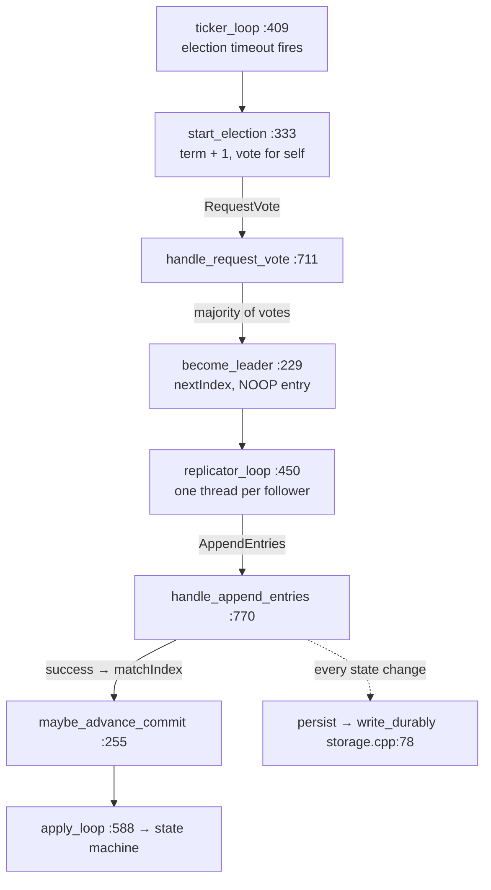
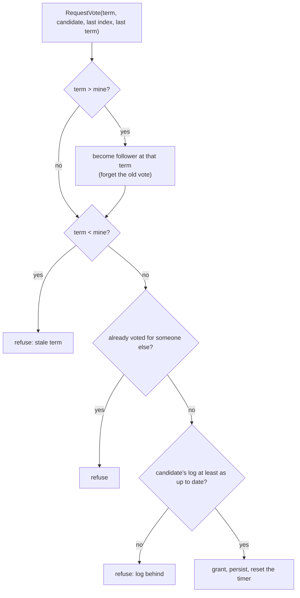
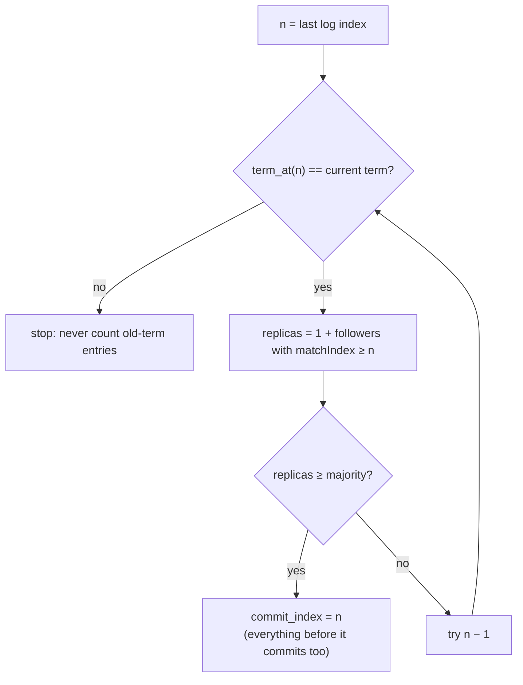
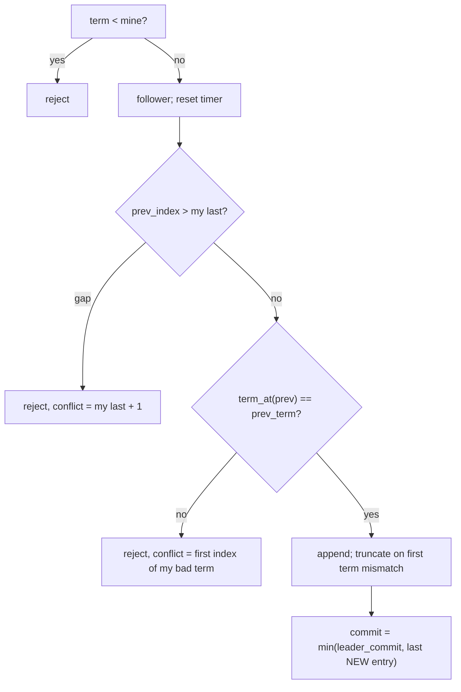
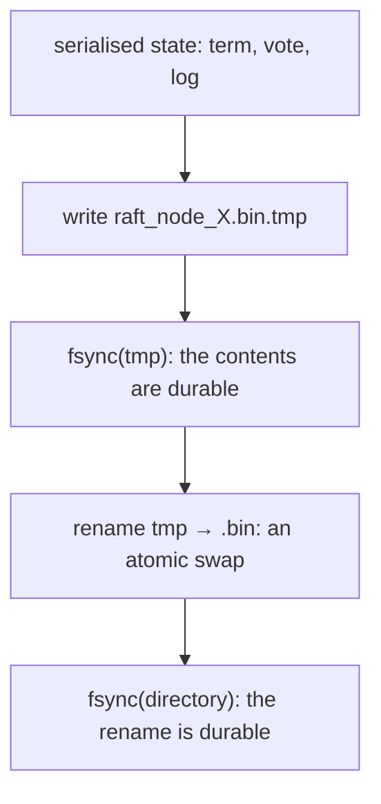

# Day 14 (Sat Nov 21): Raft (raftkv)

Part of [[Interview plan (Nov 2026)]]. Repo `raftkv`. About 7 h. Prep pack: [[Raft - prep]] (original vs upgrade §0,
key files §2, design decisions §3, stories §4, numbers §5, a code-review appendix).

**Code, explained:** the figures, the code to read and what each snippet does are in [[#Code, explained]], right after section B.

**Two versions, and a branch trap:**
- **Original** = `origin/main` = commit **`2a19135`** ("RAFT", 768-line `raft_node.cpp`). It's what GitHub shows and what your resume bullets describe.
- **Upgrade** = branch `upgrade-2026-10` = **`bad36f1`** (1,077 lines): snapshots, pre-vote, fault injection, the linearizability checker, sharding, and both bug fixes.
- **Your local `main` has been fast-forwarded to `bad36f1`** (7 commits ahead of `origin/main`). So `git show main:…` shows the *upgrade*, not the original. To read the original, use `git show 2a19135:<path>` (or `origin/main:<path>`).
- **Authorship:** all 7 upgrade commits carry `Co-Authored-By: Claude`. The honest line (prep pack §0): "The core Raft engine is mine. I used an AI assistant for the hardening pass, and I reviewed and can explain every line."

**Resume bullets (resume 5):**
- "Engineered a from-scratch **Raft consensus** system in C++, implementing leader election, log replication, conflict resolution, and **crash-safe persistent storage** with **cross-platform** cluster support."
- "Built an automated **chaos-testing pipeline** to inject node failures and verify leader failover, **zero data loss**, and automatic follower catch-up, with a **live dashboard** tracking cluster health and replication progress."

**Check before you defend** (prep pack §5):
- **"Crash-safe":** `main` had the port-before-load bug that could wipe the log on restart (story 2). `persist()` ignores write errors. SIGKILL tests can't prove fsync works.
- **"Cross-platform":** `platform.h` and a cross-compile with zig (upgrade), but **the Windows and macOS binaries were never run**, and there's no log of a mixed-OS cluster.
- **"Pipeline":** on `main` it's one script with one scenario (SIGKILL the leader once). Say "an automated chaos test".
- **"Zero data loss"** = no *acknowledged* write lost (100 keys re-read, 11/11 runs); a single sequential client; SIGKILL is not power loss.
- Never quote "bench 500 → 446 writes/sec" from the README: no data behind it. Use ~250 writes/s (3 nodes) and ~200 (5 nodes), fsync-bound.

**By tonight you can:**
- explain election, replication, the commit rule and Figure 8, and the persistence rules;
- trace both real bugs (follower commit index; port before load) with concrete logs;
- explain pre-vote, check-quorum, linearizable reads and snapshots;
- quote failover ≈ 1.0 s and ~250 writes/s with their setups.

## Schedule

| # | Time | Kind | What |
|---|---|---|---|
| 0 | 15 min | recall | Day 13: Little's law, the ring's acquire/release |
| 1 | 75 min | theory | The Raft paper §5 (A1) |
| 2 | 30 min | code | `include/raft_node.h`, `include/timing.h` (B1) |
| 3 | 90 min | code | Election, commit and the RPC handlers (B2) |
| — | lunch | | |
| 4 | 50 min | code | Replication, apply, submit (B3) |
| 5 | 25 min | code | `src/storage.cpp`: fsync + atomic rename (B4) |
| 6 | 40 min | theory | Linearizability, CAP, Raft vs Paxos, pre-vote, snapshots (A2) |
| 7 | 30 min | skim | Upgrade-only code, transport, scripts (B5) |
| 8 | 40 min | rebuild | A Raft log-matching simulator (C) |
| 9 | 20 min | trace | Does the entry survive? (D) |
| 10 | 40 min | practice | The questions (E) |

## A. Theory

### A1. Raft (block 1, 75 min)

**Read:** Ongaro & Ousterhout, *"In Search of an Understandable Consensus Algorithm"* (2014), **§5 in full** and **Figure 2** (print it). About 60 min.
**Play:** the *Raft visualization* at thesecretlivesofdata.com/raft (10 min) or raft.github.io's interactive demo.

> [!abstract] What it says: the Raft paper (Ongaro & Ousterhout, 2014), §5 and Figure 2
> **Goal:** a consensus algorithm as safe as Paxos but easier to understand. It splits the problem into leader election, log replication and safety.
> **Roles and terms:** each server is a follower, a candidate or the leader. Time is divided into numbered **terms**, with at most one leader per term.
> A server that sees a higher term adopts it and becomes a follower.
> **Election (§5.2):** a follower that hears nothing for an election timeout becomes a candidate. It raises its term, votes for itself and asks the others for votes.
> A majority of votes makes it leader. Timeouts are randomised (the paper suggests 150–300 ms), so split votes are rare.
> **Replication (§5.3):** the leader sends AppendEntries with the previous entry's index and term. A follower whose log doesn't match there rejects, and the leader backs up and retries.
> **Safety (§5.4):** a voter refuses a candidate whose log is less up to date (the election restriction). A leader counts replicas only for entries of its **own** term; Figure 8 shows an older entry on a majority being overwritten.
> **Figure 2** is a one-page summary of every rule. It lists the persistent state (currentTerm, votedFor, log[]) and the volatile state (commitIndex, lastApplied, plus nextIndex[] and matchIndex[] on the leader). It also gives both RPCs with receiver rules, and the rules for each role.
> **Timing (§5.6):** broadcast time ≪ election timeout ≪ mean time between failures.
> **In this project:** raftkv implements Figure 2 directly; your story 1 is its follower commit-index rule.

> [!abstract] What it says: the Raft visualisation
> A step-by-step animation of five nodes. Each node shows its role, its term and an election-timeout ring that counts down.
> First a follower times out, becomes a candidate, collects votes and starts sending heartbeats as leader.
> Then a client write: the leader appends it, replicates it, and commits it once a majority has it.
> Then a network partition: the minority side's leader keeps taking writes but can never commit them.
> When the partition heals, that old leader sees the higher term, steps down, and its uncommitted entries are rolled back.
> **Use it to:** picture §5 before reading the code, and the partition case before the CAP questions.

**Concepts:**
- **Election:** randomised timeouts; a vote per term; the **election restriction** (vote only for a log at least as up to date: last term first, then length).
- **Replication:** AppendEntries with `prevLogIndex`/`prevLogTerm`; the follower rejects on mismatch; the leader backs up (yours jumps back by conflicting term).
- **Commit rule:** a leader commits an entry from its **current term** once a majority has it; earlier entries commit indirectly. **Figure 8** shows why counting replicas of an old-term entry is unsafe. Your no-op on election makes the rule fire quickly.
- **Persistence:** `currentTerm`, `votedFor` and the log must be on disk *before* replying.
- **Follower commit index** = `min(leaderCommit, index of last new entry)`. Your story 1 is exactly this line.

> [!tip] Explained from scratch: [[#5. Deep dive: terms and leader election from scratch|§5 terms and elections]], [[#6. Deep dive: log replication and log matching from scratch|§6 replication and log matching]], [[#7. Deep dive: the commit rule and Figure 8 from scratch|§7 the commit rule and Figure 8]], [[#8. Deep dive: Raft durability from scratch (what to persist, when, and how)|§8 durability]]

### A2. Beyond §5 (block 6, 40 min)

**Read:** Raft paper §6 (membership, skim) and §7 (log compaction). Ongaro's thesis §9.6 on **pre-vote** and check-quorum (10 min). Kleppmann's blog *"Please stop calling databases CP or AP"* (15 min).

> [!abstract] What it says: Raft paper §6, cluster membership changes
> Switching straight from the old set of servers to the new one is unsafe. During the switch, two separate majorities could each elect a leader.
> Raft passes through a **joint consensus** configuration that contains both sets.
> While it is in force, elections and commits need a majority of the old set **and** of the new set.
> The configurations themselves travel as special log entries, and a server uses the latest one in its log.
> The paper also covers adding empty servers as non-voters first, and a leader that is removed from the cluster.
> **In this project:** raftkv uses a fixed membership, so this is background only.

> [!abstract] What it says: Raft paper §7, log compaction
> The log can't grow forever. Each server **snapshots** its state machine and throws away the log up to that point.
> The snapshot records the last included index and term, so the AppendEntries consistency check still works for the next entry.
> A follower that is too far behind, needing entries the leader has already discarded, gets the snapshot via an **InstallSnapshot** RPC.
> Servers snapshot independently; the leader doesn't coordinate it.
> **In this project:** `main` has no compaction and rewrites the whole log on every persist, which is why writes slow down as the log grows (§8).

> [!abstract] What it says: Ongaro's thesis, pre-vote and check-quorum
> **The problem:** a server cut off from the others keeps timing out and raising its term.
> When it reconnects, its high term forces a healthy leader to step down, for nothing.
> **Pre-vote:** before raising its term, a candidate asks whether the others *would* vote for it. Servers that still hear from a leader say no.
> It raises its term only after a majority says yes, so a returning node can't disrupt a working cluster.
> **Check-quorum:** a leader that hasn't heard from a majority within an election timeout steps down, so clients stop sending to a leader that can't commit.
> **In this project:** story 5 measured exactly this: 0/5 vs 5/5 leaders deposed, with and without pre-vote.

> [!abstract] What it says: Kleppmann, "Please stop calling databases CP or AP" (2015)
> In the CAP theorem, **C** means *linearizability*, and **A** means every request to a non-failed node eventually gets a response.
> The only fault it considers is a network partition. Most real systems meet neither definition in full, so "CP" and "AP" labels mislead.
> For example, a "CP" store that serves reads from a local replica isn't linearizable. ZooKeeper's default reads are his main case.
> A majority-based system also isn't "available" in CAP's sense, because the minority side must refuse requests.
> He suggests naming the actual consistency model you give (linearizable, sequential, causal, …) and saying how latency and partitions affect it.
> **In this project:** raftkv's reads go through the log, so they are linearizable, and the minority side is unavailable. `--unsafe-local-reads` is the stale-read counterexample.

**Concepts:**
- **Linearizability:** every operation appears to take effect at one instant between its call and its return. Your reads go **through the log** (safe). `--unsafe-local-reads` is the negative control.
- **CAP:** under a partition, Raft keeps consistency and gives up availability on the minority side.
- **Raft vs Paxos:** same safety guarantees; Raft has a strong leader and explicit log matching, designed to be understandable.
- **Pre-vote:** a node first asks "would you vote for me?" without raising its term, so a returning partitioned node doesn't depose a healthy leader (story 5: 0/5 vs 5/5 deposed).
- **Snapshots:** compact the log; InstallSnapshot for followers that are too far behind.

> [!tip] Explained from scratch: [[#5.6 Pre-vote and check-quorum (the upgrade)|§5.6 pre-vote and check-quorum]], [[#6. Deep dive: log replication and log matching from scratch|§6 replication (and when InstallSnapshot is needed)]], [[#8. Deep dive: Raft durability from scratch (what to persist, when, and how)|§8 durability]]

## B. Code

Line numbers are for the **upgrade** (`upgrade-2026-10`). Original (`2a19135`) lines are in brackets where they matter.

### B1. Headers (block 2, 30 min, deep)

- `include/raft_node.h`: node state; `majority()` :151; `has_quorum()` :153.
- `include/timing.h`: defaults :17–23; the `lan`/`wifi`/`slow` profiles :39–50; `validate_timing` :56–75 (story 3: election storms on Wi-Fi).

### B2. Election, commit, handlers (block 3, 90 min, deep)

`src/raft_node.cpp`:
- **216 `become_follower`** [163], **229 `become_leader`** [176] (the no-op), **255 `maybe_advance_commit`** [202] (the current-term check);
- **333 `start_election`** [225], **409 `ticker_loop`** [300] (timeouts; check-quorum);
- **711 `handle_request_vote`** [526] (the election restriction);
- **770 `handle_append_entries`** [585]: 824–846 conflict backup by term; **859–865 the fixed follower commit bound** (on the original, `2a19135:src/raft_node.cpp:663` uses `last_log_index()`: story 1).

### B3. Replication (block 4, 50 min, deep)

- **450 `replicator_loop`** [332]: one thread per follower, batches of 64, `nextIndex`/`matchIndex`;
- **588 `apply_loop`** [427]; **619 `submit`** [455] (a client command waits for commit, with a timeout);
- 174 `persist` [147] (rewrites the whole log each time, hence story 6's throughput decay).

### B4. Storage (block 5, 25 min, deep)

`src/storage.cpp` **78 `write_durably`**: write a temp file → `fsync` → `rename` over the real file → `fsync` the directory. Why each step? What does a crash between each pair of steps leave on disk?
Then `src/main.cpp` 367–381: the fixed start-up order (load state, *then* open the port: story 2).

### B5. Skim (block 7, 30 min)

Upgrade-only: `start_pre_vote` (283), `take_snapshot` (186), `handle_install_snapshot` (915). Then `src/transport.cpp` (framing 120–138), `src/state_machine.cpp`, `src/fault.cpp`, `src/main.cpp`, `scripts/chaos_test.py` (phases 193–258), `scripts/linearizability.py` (99 `check_register`), `scripts/dashboard.py`.

## Code, explained

Read this **with the files open**. It starts with a picture of the whole day and **the flow, step by step** (one concrete input followed through every function). Then each part has its own figure, the exact code (copied from the repo at the commit named below, so the line numbers match) and what that code does.

Repo `raftkv`: the **upgrade** is branch `upgrade-2026-10` (`bad36f1`), the
**original** is commit `2a19135` (= `origin/main`). Your local `main` was fast-forwarded to the upgrade, so read the
original by commit id. Snippets are from the upgrade unless marked.



### The flow, step by step

`python3 scripts/client.py set city mumbai` on a 3-node cluster. n1 is leader in **term 2**; its log ends at index 6.

1. **Submit** (`submit`, `raft_node.cpp:619`): the leader appends entry **7** = `(term 2, "SET city mumbai")`, calls `persist()`, and wakes the replicators. The client call waits for the commit, with a timeout.
2. **Replicate:** n1's replicator for n2 sends `AppendEntries(term 2, prev = 6 / term 2, entries = [7], leader_commit = 6)`.
3. **The follower checks and appends** (`handle_append_entries`, `:770`): the term is current; its entry 6 has term 2, so the logs match (`:834`). It appends 7 (`:848–857`), persists, and replies success.
4. **Commit** (`maybe_advance_commit`, `:255`): `matchIndex[n2] = 7`. Entry 7 is from the current term, and it's on 2 of 3 nodes (leader + n2) = a majority, so **commit_index = 7**.
5. **Apply:** `apply_loop` (`:588`) applies `SET city mumbai` to the key-value map, and `submit` returns OK to the client.
6. **Followers learn about the commit** on the next heartbeat (`leader_commit = 7`): each sets `commit = min(7, last new entry)` (`:862–865`) and applies too.
7. **If n1 crashes after step 4:** n2 has entry 7. n3, which lacks it, can't win an election, because n2 won't vote for a less up-to-date log (`:747–748`). So the committed entry survives.

---

### 1. Voting: three rules, in order

> [!tip] Concept from scratch: [[#5. Deep dive: terms and leader election from scratch|terms, random timeouts and the election restriction, from zero]]



`src/raft_node.cpp:725–759` (`upgrade-2026-10`)
```cpp
if (term > current_term_) {
  become_follower(term, "candidate has newer term");
  dirty = true;
}

const uint64_t my_last_index = last_log_index();
const uint64_t my_last_term = term_at(my_last_index);
const std::string mine =
    std::to_string(my_last_term) + "/" + std::to_string(my_last_index);
const std::string theirs =
    std::to_string(cand_last_term) + "/" + std::to_string(cand_last_index);

// Each refusal below maps to one rule from the Raft paper; the debug line
// names which one decided the outcome.
bool granted = false;
std::string reason;
if (term < current_term_) {
  reason = "stale-term " + std::to_string(term) + "<" + std::to_string(current_term_);
} else if (voted_for_ != -1 && voted_for_ != candidate) {
  reason = "already-voted n" + std::to_string(voted_for_) + " in t" +
           std::to_string(current_term_);
} else {
  const bool up_to_date = cand_last_term > my_last_term ||
                          (cand_last_term == my_last_term && cand_last_index >= my_last_index);
  if (!up_to_date) {
    reason = "log-behind " + theirs + "<" + mine;
  } else {
    voted_for_ = candidate;
    granted = true;
    dirty = true;
    last_heard_ = Clock::now();
    election_timeout_ = random_election_timeout();
    reason = "log-ok " + theirs + ">=" + mine + ", no prior vote";
  }
}
```
> [!info] New functions in this code
> - `std::to_string(x)`: turns a number into a `std::string`. `std::to_string(42)` = "42". raftkv's wire format is text fields, so every number goes through it. [[Function glossary#std::to_string|→ examples]]

1. **Newer term?** Step down to follower at that term first (and forget the old vote).
2. **Stale term** → refuse. **Already voted** for someone else this term → refuse.
3. **Election restriction:** grant only if the candidate's log is at least as up to date: a higher last term, or the same last term and at least as long. A candidate missing a committed entry can never collect a majority, because every majority includes a node that has that entry.

- `persist()` before replying (line 766): a vote that's forgotten after a crash could let one node vote twice in one term, which could elect two leaders.

### 2. Becoming leader, and the commit rule

> [!tip] Concept from scratch: [[#7. Deep dive: the commit rule and Figure 8 from scratch|the commit rule and Figure 8, step by step]]



`src/raft_node.cpp:235–251` (`upgrade-2026-10`)
```cpp
for (const PeerInfo& peer : cluster_) {
  if (peer.id == id_) continue;
  next_index_[peer.id] = last_log_index() + 1;
  match_index_[peer.id] = 0;
  last_contact_[peer.id] = Clock::now();  // grace period before the quorum check
}

if (debug::at(debug::kOn)) {
  dbg("LEADER t" + std::to_string(current_term_) + " log=" + std::to_string(last_log_index()));
}

// A no-op entry from the new term lets the current-term commit rule finish
// committing anything inherited from previous terms.
log_.push_back(LogEntry{current_term_, last_log_index() + 1, "NOOP -"});
entrylog::appended(last_log_index(), current_term_, "NOOP -");
persist();
maybe_advance_commit();
```
> [!info] New functions in this code
> - `.push_back(x)`: appends a copy of `x` at the end of a vector or list. `trades_.push_back(Trade{...})`; a vector may reallocate when it outgrows its capacity (hence `reserve`). [[Function glossary#x.push_back|→ examples]]

- `nextIndex` = the leader's last index + 1 for every follower (optimistic); `matchIndex` = 0 (nothing confirmed yet).
- **The NOOP entry from the new term:** the commit rule below only counts *current-term* entries. Without a new entry, older entries inherited by the leader would wait until a client wrote something.

`src/raft_node.cpp:255–276` (`upgrade-2026-10`)
```cpp
void RaftNode::maybe_advance_commit() {
  if (role_ != Role::Leader) return;
  for (uint64_t n = last_log_index(); n > commit_index_; --n) {
    if (term_at(n) != current_term_) break;
    int replicas = 1;
    for (const auto& [peer_id, matched] : match_index_) {
      if (matched >= n) ++replicas;
    }
    if (replicas >= majority()) {
      if (debug::at(debug::kOn)) {
        dbg("COMMIT " + std::to_string(commit_index_) + "->" + std::to_string(n) + " t" +
            std::to_string(current_term_) + " on " + std::to_string(replicas) + "/" +
            std::to_string(cluster_.size()));
      }
      const uint64_t previous = commit_index_;
      commit_index_ = n;
      record_commits(previous);
      apply_cv_.notify_all();
      return;
    }
  }
}
```
> [!info] New functions in this code
> - `.size()`: the number of elements. `items.size() >= capacity` means the cache is full. [[Function glossary#x.size|→ examples]]
> - `cv.notify_all()`: wakes **every** thread waiting on the condition variable. `apply_cv_.notify_all()` wakes the apply loop and every client waiting for its entry to commit. [[Function glossary#x.notify_all|→ examples]]

- Walk down from the end of the log; **stop at the first entry not from the current term** (line 258). Count replicas via `match_index_` (+1 for the leader itself). The highest current-term index on a majority becomes the commit index, which commits everything before it too.
- Why not count old-term entries? **Figure 8:** an old-term entry can sit on a majority and still be overwritten by a later leader. Once a *current*-term entry is on a majority, no node without it can win an election.

### 3. AppendEntries: check, repair, append, commit

> [!tip] Concept from scratch: [[#6. Deep dive: log replication and log matching from scratch|log matching and repairing a divergent follower, on an example]]



`src/raft_node.cpp:824–846` (`upgrade-2026-10`)
```cpp
if (check_index > last_log_index()) {
  const uint64_t conflict = last_log_index() + 1;
  if (verbose) {
    dbg("AE NO gap prev=" + std::to_string(prev_index) + " mine=" +
            std::to_string(last_log_index()) + " -> conflict=" + std::to_string(conflict),
        detail);
  }
  if (dirty) persist();
  return Message{"AER", {std::to_string(current_term_), "0", std::to_string(conflict)}};
}
if (check_index >= 1 && term_at(check_index) != check_term) {
  const uint64_t bad_term = term_at(check_index);
  uint64_t first = check_index;
  while (first > snapshot_index_ + 1 && term_at(first - 1) == bad_term) --first;
  if (verbose) {
    dbg("AE NO term-mismatch i" + std::to_string(prev_index) + " mine=t" +
            std::to_string(bad_term) + " want=t" + std::to_string(prev_term) +
            " -> conflict=" + std::to_string(first),
        detail);
  }
  if (dirty) persist();
  return Message{"AER", {std::to_string(current_term_), "0", std::to_string(first)}};
}
```

- **Log matching:** if the follower's entry at `prev_index` has `prev_term`, everything before it matches too (Raft's log-matching property). Otherwise reject.
- **Fast backup:** instead of "try one index earlier", reply with the **first index of the conflicting term**, so the leader skips a whole term per round trip.

`src/raft_node.cpp:848–857` (`upgrade-2026-10`)
```cpp
for (const LogEntry& entry : entries) {
  if (has_index(entry.index)) {
    if (term_at(entry.index) == entry.term) continue;
    entrylog::truncated(entry.index, term_at(entry.index));
    log_.resize(entry.index - snapshot_index_ - 1);
  }
  log_.push_back(entry);
  entrylog::appended(entry.index, entry.term, entry.command);
  dirty = true;
}
```
> [!info] New functions in this code
> - `v.resize(n)`: makes a vector exactly `n` elements long: drops the extra ones from the end, or adds default ones. `log_.resize(3)` keeps entries 0–2 and **truncates** the rest. [[Function glossary#x.resize|→ examples]]

- An entry that already exists with the same term is skipped; on the **first** term mismatch the log is truncated from there and the leader's entries are appended. Entries that agree are never truncated, which keeps a delayed, duplicate message harmless.

`src/raft_node.cpp:862–865` (`upgrade-2026-10`)
```cpp
const uint64_t last_new_entry = entries.empty() ? check_index : entries.back().index;
if (leader_commit > commit_index_ && last_new_entry > commit_index_) {
  const uint64_t previous = commit_index_;
  commit_index_ = std::min(leader_commit, last_new_entry);
```
> [!info] New functions in this code
> - `.empty()`: true when there are no elements. `!pool.empty()` = a connection is available. [[Function glossary#x.empty|→ examples]]
> - `.back()`: a reference to the **last** element. On the LRU list that's the least recently used entry, the next to evict. [[Function glossary#x.back|→ examples]]
> - `std::min(a, b)`: the smaller of two values (C++). `std::min(elems, (size_t)4000000)` caps the check at 4M elements; both arguments must have the same type, hence the cast. [[Function glossary#std::min|→ examples]]

`src/raft_node.cpp:661–663` (`2a19135`)
```cpp
if (leader_commit > commit_index_) {
  const uint64_t previous = commit_index_;
  commit_index_ = std::min(leader_commit, last_log_index());
```

- **Story 1, the bug you fixed.** The original bounded the commit by `last_log_index()`, the end of the follower's *whole* log. But stale entries can sit past the entries this message just verified. The fix bounds it by the **last entry this message proved**. Trace: B holds stale term-3 entries 75..200; the leader sends 11..74 with `leader_commit = 300`. Old: `min(300, 200) = 200`, so B commits its stale 75..200, a safety violation. New: `min(300, 74) = 74`.

### 4. Durability

> [!tip] Concept from scratch: [[#8. Deep dive: Raft durability from scratch (what to persist, when, and how)|what Raft must persist, when, and how]]



`src/storage.cpp:78–91` (`upgrade-2026-10`)
```cpp
bool write_durably(const std::string& path, const std::string& dir, const std::string& blob) {
  const std::string tmp = path + ".tmp";
  int fd = open_file_write(tmp);
  if (fd < 0) return false;
  if (!write_all(fd, blob.data(), blob.size()) || !file_sync(fd)) {
    file_close(fd);
    return false;
  }
  file_close(fd);

  if (!replace_file(tmp, path)) return false;
  sync_directory(dir);
  return true;
}
```
> [!info] New functions in this code
> - `s.data()`: a pointer to the first byte of a string's (or vector's) contiguous storage, for C-style APIs like `write(fd, ptr, len)`. [[Function glossary#x.data|→ examples]]

- **Write a temp file → fsync it → rename over the real file → fsync the directory.** `rename` is atomic, so after a crash the file is either all old or all new. The first fsync makes the *contents* durable; the directory fsync makes the *rename* durable.
- What a SIGKILL test can't show: the data reaches the page cache before fsync anyway, so only a power cut would catch a missing fsync.

`src/main.cpp:367–375` (`upgrade-2026-10`)
```cpp
// Load the saved state before the port opens, so no inbound RPC can touch
// the log before it has been read back from disk.
std::string start_error;
if (!node.start(&start_error)) {
  std::cerr << "cannot start: " << start_error << "\n";
  return 1;
}

if (!transport.start([&node](const Message& request, const std::string& peer) {
```
> [!info] New functions in this code
> - `std::cerr << msg`: the standard error stream (unbuffered). Used for start-up failures. [[Function glossary#std::cerr|→ examples]]

- **Story 2:** load state, *then* open the port. In the original the port opened first. An early RPC with a higher term triggered `persist()` of the **empty** in-memory log over the saved file, then `start()` loaded that empty file, so the node forgot entries it had acknowledged.

**Check yourself:** 5 nodes, leader in term 4 with `match_index = {n2: 50, n3: 48, n4: 50, n5: 30}`, its own log ends at 50, entries 46–50 are term 4, and `commit_index = 40`. What does `maybe_advance_commit` set? (*n = 50: leader + n2 + n4 = 3 ≥ majority 3, so commit = 50.*) Why can't a term-4 leader's log end in a term-3 entry? And if `match_index` were `{n2: 50, n3: 45, n4: 44, n5: 30}`, what would it commit? (*`become_leader` appends a term-4 NOOP. Only the leader and n2 have ≥ 46, so 2 < 3: nothing commits; the loop stops at the first term-3 entry below 46.*)

---

### 5. Deep dive: terms and leader election from scratch

Section 1 above walks `handle_request_vote`. This section builds elections from zero. Order: why a leader → terms →
timeouts and why they're random → one election, step by step → the voting rules and the election restriction →
pre-vote and check-quorum → questions → check.

> [!important] The one sentence to hold on to
> A follower that hears nothing for a **random** 600–1200 ms becomes a candidate in a **new term** and asks for votes;
> each node grants **one vote per term**, only to a candidate whose log is **at least as up to date**, and a majority of
> votes makes a leader.

#### 5.1 Why a leader?

Raft keeps a **replicated log**: every node applies the same commands in the same order to the same deterministic
state machine (here, a key-value map), so all nodes end in the same state. Agreeing on the order is the hard part.

Raft makes it simple with a **strong leader**: clients send commands to the leader; it decides the order and copies
its log to the followers. Entries flow only leader → follower. Elections exist to pick that leader, and to pick a new
one when it fails.

#### 5.2 Terms: a logical clock

Time is split into numbered **terms**: 1, 2, 3, … Each term starts with an election and has **at most one** leader.

The rule that keeps everyone consistent: **any message carrying a higher term makes the receiver adopt that term and
become a follower.** So a deposed leader that wakes up with term 2 and hears term 3 steps down at once. A message with
a *lower* term is stale and is refused.

#### 5.3 Timeouts, and why they're random

| setting | default | why |
|---|---|---|
| heartbeat (leader → followers) | 100 ms | "I'm alive" (an empty AppendEntries) |
| rpc timeout | 400 ms | how long one RPC may block a replicator |
| election timeout | uniform in **[600, 1200] ms**, re-drawn on every reset | silence this long → start an election |

The rule is **heartbeat ≪ election timeout ≪ time between failures**. The validator also demands
`election_min ≥ rpc_timeout + heartbeat` (600 ≥ 400 + 100): one lost RPC must not trigger an election.

**Why random?** If two followers time out at the same moment, both become candidates, each votes for itself, and
neither gets a majority: a **split vote**. With independent uniform timeouts on a 600 ms range, the chance that two
fire within δ of each other is

$$P = 1 - \left(1 - \frac{\delta}{600}\right)^2$$

With δ = 10 ms (the ticker checks every 10 ms): $P = 1 - (590/600)^2 \approx 3.3\%$. A split vote just means a retry
with fresh random timeouts, so two in a row is ~0.1%.

**Expected failover.** After the leader dies, the first survivor to time out starts the election. The minimum of k
uniforms on [600, 1200] has mean $600 + 600/(k+1)$:
- 3 nodes (2 survivors): 600 + 200 = **800 ms**;
- 5 nodes (3 survivors): 600 + 150 = **750 ms**.

Measured: median **1.01 s** (3 nodes, leader killed) and **0.81 s** (5 nodes, 2 killed: 3 survivors race), quantised to ~0.2 s by the test's poll loop.

#### 5.4 One election, step by step

n1 leads term 2, its last heartbeat was at t = 0, then it crashes. n2 drew 750 ms, n3 drew 1010 ms.

![[d14-1-election.svg]]

```cpp
role_ = Role::Candidate;
++current_term_;
voted_for_ = id_;
leader_id_ = -1;
last_heard_ = Clock::now();
election_timeout_ = random_election_timeout();
persist();
```
- At 750 ms, n2's ticker fires: n2 becomes a **candidate**, `current_term_` 2 → **3**, it votes for itself (`voted_for_ = 2`), forgets the old leader, re-arms its timer with a new random value (in case this election fails), and **persists** the new term and vote before asking anyone.

```cpp
request.fields = {std::to_string(term), std::to_string(id_), std::to_string(last_log_index()),
                  std::to_string(term_at(last_log_index()))};
auto votes = std::make_shared<std::atomic<int>>(1);
```
> [!info] New functions in this code
> - `std::make_shared<T>(args...)`: allocates a `T` and returns a `shared_ptr` to it; the object lives until the last copy of the pointer is gone. The vote counter is shared by one thread per peer this way. [[Function glossary#std::make_shared|→ examples]]
> - `std::atomic<size_t> head_{0};`: a variable that threads can read and write **without a data race**. Each operation can carry a memory order (relaxed, acquire, release, seq_cst) that says what other memory it orders. [[Function glossary#std::atomic|→ examples]]
- RequestVote carries `(term 3, candidate 2, last index 6, last term 2)`. `votes` starts at **1** (its own vote) and is shared by one thread per peer.
- n3 replies "granted" (5.5). In that thread: `total = ++(*votes)` = 2 ≥ majority 2, so `become_leader()`. The thread first checks `role_ == Candidate && current_term_ == term`, so a late vote from an old election is ignored.

#### 5.5 The voting rules and the election restriction

`handle_request_vote` applies three rules in order (section 1's code):
1. **Higher term?** Step down to follower at that term (forgetting any vote from the old term).
2. **Stale term?** Refuse. **Already voted** for someone else this term? Refuse.
3. **Election restriction:** grant only if the candidate's log is at least as up to date:

$$\text{cand\_last\_term} > \text{my\_last\_term} \ \ \text{or}\ \ (\text{equal terms and cand\_last\_index} \ge \text{my\_last\_index})$$

Note it compares the **last term first**, not the length. A short log ending in term 5 beats a long log ending in term 3.

**Why it protects committed entries:**

![[d14-2-restriction.svg]]

An entry is committed once it's on a **majority**. A winner needs votes from a **majority**. Two majorities of 5 (3
and 3) must share at least one node, because 3 + 3 > 5. That node holds the entry and refuses any candidate whose log
lacks it. So every new leader already has every committed entry (**Leader Completeness**), and leaders never need to
fetch entries from followers.

On a grant, the voter also **resets its own timer**: a node that just voted shouldn't immediately start a competing
election.

#### 5.6 Pre-vote and check-quorum (the upgrade)

- **Problem:** a follower cut off from the others keeps timing out and raising its term (to 9, 10, …). When it reconnects, its higher term forces the healthy leader to step down: a needless election.
- **Pre-vote:** before raising its term, a node asks "*would* you vote for me?". Peers that still hear a leader say no, so an isolated node never raises its term. Measured (6 s isolation, 5 runs each): term rise +0 and **0/5** leaders deposed with pre-vote; +7 median and **5/5** deposed without (3 nodes).
- **Check-quorum:** a leader that can't hear a majority steps down (`ticker_loop`), so clients stop waiting on a leader that can't commit anything.

#### 5.7 Questions people usually ask next

##### "Why persist the vote before replying?"

If a node voted, crashed before saving the vote, and restarted, it could vote again in the same term for someone else.
Two candidates could then both collect a majority: two leaders in one term (§8).

##### "Can elections fail forever?"

In theory, if timeouts kept colliding. With random re-draws each round, the chance of k split votes in a row falls
like 0.033^k. In practice a leader appears within one or two rounds.

##### "Why an odd number of nodes?"

A majority of 4 is 3, the same as for 5, but 4 nodes tolerate only 1 failure (5 tolerate 2). The extra node adds cost
without adding fault tolerance.

##### "What happened on Wi-Fi?"

RTTs over 100 ms made followers time out under a healthy leader: elections every few seconds, NOOP entries piling up,
terms in the thousands. The fix is a slower timing profile (`wifi`: heartbeat 250, rpc 1000, election 1500–3000 ms).
There's no before/after measurement in the repo.

#### 5.8 Check your understanding

1. What does a node do when it gets a message with a higher term? A lower one?
2. List the three vote rules in order.
3. Node X's log ends (term 4, index 9); candidate C's ends (term 5, index 7). Does X grant? And if C's ended (term 4, index 8)?
4. Why must two majorities overlap, and why does that matter?
5. With election timeouts in [600, 1200] ms and 3 survivors, what is the expected time until the first one fires?
6. What problem does pre-vote fix?

> [!success]- Answers
> 1. Higher: adopt the term and become a follower. Lower: refuse it as stale.
> 2. Step down on a higher term; refuse a stale term or a second vote in the same term; grant only if the candidate's log is at least as up to date.
> 3. Yes: last term 5 > 4 wins whatever the length. No: same last term, but index 8 < 9.
> 4. Any two sets of more than half the nodes share a node. The voter holding a committed entry refuses candidates without it, so no such candidate can win.
> 5. 600 + 600 / 4 = 750 ms.
> 6. An isolated node raising its term and deposing a healthy leader when it returns (0/5 vs 5/5 deposed).

#### 5.9 The five things to remember

1. **Terms:** at most one leader per term; a higher term always wins, a lower one is refused.
2. **Timeouts:** heartbeat 100 ms, election random in [600, 1200] ms; randomness makes split votes rare (~3% with a 10 ms window).
3. **Candidate:** term + 1, vote for self, persist, ask everyone; a majority makes it leader.
4. **Restriction:** vote only for logs at least as up to date (last term first, then length); majority overlap ⇒ the winner has every committed entry.
5. **Upgrade:** pre-vote (0/5 vs 5/5 deposed) and check-quorum; failover ≈ 0.8–1.0 s, as the timeout maths predicts.

---

### 6. Deep dive: log replication and log matching from scratch

Section 3 above walks `handle_append_entries`. This section explains why one consistency check is enough to keep every
log correct, and how a follower that went wrong gets repaired. Order: what AppendEntries carries → the log-matching
property → the check → repairing a divergent follower → append and truncate → the leader's side → questions → check.

> [!important] The one sentence to hold on to
> Every AppendEntries says "these entries follow index *prev* with term *prev_term*". A follower accepts only if its own
> entry at *prev* has that term; by induction, an accepted log matches the leader's up to the last entry sent.

#### 6.1 What AppendEntries carries

`AppendEntries(term, leader, prev_index, prev_term, entries[], leader_commit)`:
- `term`: the leader's term (stale leaders get refused, §5.2);
- `prev_index`, `prev_term`: the entry **just before** the new ones, as the leader has it;
- `entries`: up to **64** entries starting at `prev_index + 1` (empty = a heartbeat);
- `leader_commit`: how far the leader has committed, so followers can apply too.

In the flow above: `AppendEntries(term 2, prev = 6 / term 2, entries = [7], leader_commit = 6)`.

#### 6.2 The log-matching property

**If two logs have an entry with the same index and the same term, the logs are identical up to that index.**

Why it holds:
1. A leader creates at most one entry per index in its term, and never changes it. So (index, term) names one command.
2. A follower accepts entries only if its entry at `prev_index` has `prev_term`. So by induction, each accepted entry is preceded by entries that also match.

The consequence: a follower never needs to compare whole logs. One (index, term) check per message is enough.

#### 6.3 The check, in code

(Debug-logging lines are left out of the next two excerpts; the full code is in section 3 above.)

```cpp
if (check_index > last_log_index()) {
  const uint64_t conflict = last_log_index() + 1;
  ...
  return Message{"AER", {std::to_string(current_term_), "0", std::to_string(conflict)}};
}
if (check_index >= 1 && term_at(check_index) != check_term) {
  const uint64_t bad_term = term_at(check_index);
  uint64_t first = check_index;
  while (first > snapshot_index_ + 1 && term_at(first - 1) == bad_term) --first;
  ...
  return Message{"AER", {std::to_string(current_term_), "0", std::to_string(first)}};
}
```
- **Gap:** the follower's log is shorter than `prev`. It replies "no, send from my last + 1".
- **Mismatch:** it has an entry at `prev`, but with another term. It walks back to the **first index of that bad term** and replies with it.

#### 6.4 Repairing a divergent follower, on an example

A follower that was cut off may hold entries from terms that never committed. The leader's log (terms by index) is
`1 1 1 4 4 5 5 6 6 6`; the follower's is `1 1 1 2 2 2 3 3 3 3 3`.

![[d14-3-backup.svg]]

| round | leader sends prev | leader's term there | follower's term there | reply |
|---|---|---|---|---|
| 1 | 10 | 6 | 3 | reject, conflict = 7 (first index of term 3) |
| 2 | 6 | 5 | 2 | reject, conflict = 4 (first index of term 2) |
| 3 | 3 | 1 | 1 | **match**: append 4..10 |

The leader sets `next_index = conflict` on each reject (`:576–584`). **Fast backup** skips a whole term per round
trip: 3 rounds here. Going back one index at a time would take 8 (prev = 10, 9, …, 4 rejected, then 3).

Is skipping safe? Yes: the leader may resend a few entries the follower already has, which the append rule (6.5)
skips harmlessly.

#### 6.5 Append and truncate

```cpp
for (const LogEntry& entry : entries) {
  if (has_index(entry.index)) {
    if (term_at(entry.index) == entry.term) continue;
    log_.resize(entry.index - snapshot_index_ - 1);
  }
  log_.push_back(entry);
}
```
- Round 3 sends entries 4..10. Entry 4 (term 4): the follower has index 4 with term 2, a mismatch, so it **truncates** from 4 on: `resize(4 − 0 − 1 = 3)` keeps indices 1–3. Then it appends 4..10. Its stale entry 11 disappears with the truncation.
- An entry that already exists **with the same term** is skipped, never truncated.

Why that matters: messages can arrive late or twice. Suppose an old message carrying only entries 4..5 arrives *after*
4..10 were appended. Entries 4 and 5 match, so they're skipped, and 6..10 survive. Truncating on any message would
delete entries the follower had already acknowledged.

#### 6.6 The leader's side

- `next_index[peer]`: the next entry to send. It starts at the leader's last index + 1 (optimistic) and moves back on rejects.
- `match_index[peer]`: the highest entry known to be on that peer. It starts at 0 and moves up on success: `matched = prev_index + batch.size()`.
- One **replicator thread per follower** (`replicator_loop`), so one slow follower doesn't hold up the others. Each batch is at most 64 entries.

On success the leader calls `maybe_advance_commit()` (§7).

#### 6.7 Questions people usually ask next

##### "Can a leader ever delete entries from its own log?"

No (**Leader Append-Only**). Only followers truncate, and only entries the leader's log contradicts.

##### "Doesn't truncating risk deleting a committed entry?"

No. A committed entry is on a majority, and the leader has it (Leader Completeness, §5.5). A follower's entry that
conflicts with the leader therefore can't be committed.

##### "Why not send the whole log on a mismatch?"

It could be huge. One check per message plus fast backup finds the divergence point in about one round trip per
conflicting term, then sends only what's missing. A follower that is very far behind (past a snapshot) gets
InstallSnapshot instead.

#### 6.8 Check your understanding

1. State the log-matching property. Why does one (prev_index, prev_term) check suffice?
2. The follower has 5 entries; the leader sends prev = 8. What does it reply?
3. Follower terms `1 1 2 2 2`; leader terms `1 1 3 3 3 3`, next_index = 6. Walk the rounds.
4. Why skip an existing entry with the same term instead of truncating?
5. What do `next_index` and `match_index` mean, and where do they start?

> [!success]- Answers
> 1. Same index and term ⇒ identical logs up to there. A follower accepts entries only if the previous entry matches, so by induction everything before matches too.
> 2. A gap: reject with conflict = 6 (its last + 1).
> 3. Round 1: prev = 5, leader t3 vs follower t2 → reject, conflict = 3 (first index of t2). Round 2: prev = 2, both t1 → match; send 3..6; at 3 the terms differ → truncate to 2 entries, append 3..6.
> 4. A late or duplicate message would otherwise delete entries that came after it and were already acknowledged.
> 5. next_index: the next entry to send (starts at leader's last + 1). match_index: highest entry known to be replicated (starts at 0).

#### 6.9 The five things to remember

1. **AppendEntries** = (term, prev_index, prev_term, ≤ 64 entries, leader_commit); empty = heartbeat.
2. **Log matching:** same (index, term) ⇒ same prefix; one check per message keeps it true by induction.
3. **Repair:** reject with the first index of the conflicting term; 3 round trips instead of 8 in the example.
4. **Append rule:** skip matching entries; truncate only at the first term mismatch, so stale duplicates are harmless.
5. **Leader bookkeeping:** next_index (optimistic, moves back), match_index (confirmed, moves up), one replicator thread per follower.

---

### 7. Deep dive: the commit rule and Figure 8 from scratch

Section 2 above walks `maybe_advance_commit`. This section explains why the rule counts **only current-term
entries**, and why the follower bounds its commit index the way it does. Order: what "committed" means →
`maybe_advance_commit` line by line → Figure 8 → the NOOP → the follower's side and story 1 → apply and reply →
questions → check.

> [!important] The one sentence to hold on to
> A leader marks index N committed only when the entry at N is **from its own term** and is on a **majority**; that
> commits everything before N too. A follower commits up to `min(leader_commit, last entry this message proved)`.

#### 7.1 What "committed" means

An entry is **committed** when it can never be lost or replaced: it's safe to apply to the state machine and to answer
the client "OK". The leader decides this; followers learn it from `leader_commit` in later messages.

"On a majority" sounds like enough. It almost is. Figure 8 (7.3) shows the one case where it isn't.

#### 7.2 `maybe_advance_commit`, line by line

Use the check-yourself numbers: 5 nodes (majority 3), the leader is in term 4, its log ends at 50, entries 46–50 are
term 4, `commit_index = 40`, and `match_index = {n2: 50, n3: 48, n4: 50, n5: 30}`.

```cpp
for (uint64_t n = last_log_index(); n > commit_index_; --n) {
  if (term_at(n) != current_term_) break;
  int replicas = 1;
  for (const auto& [peer_id, matched] : match_index_) {
    if (matched >= n) ++replicas;
  }
  if (replicas >= majority()) {
    ...
    commit_index_ = n;
    record_commits(previous);
    apply_cv_.notify_all();
    return;
  }
}
```
- `n = 50`: term 4 = current. `replicas` starts at 1 (the leader itself). n2 (50 ≥ 50) and n4 (50) count; n3 (48) and n5 (30) don't. `replicas = 3 ≥ 3`, so **commit_index = 50**. Entries 41–49 are committed with it.
- Now try `match_index = {n2: 50, n3: 45, n4: 44, n5: 30}`. n = 50: replicas = 2 (leader, n2). n = 49 … 46: still 2. n = 45: term 3 ≠ 4 → **break**. Nothing commits, even though index 45 is on 3 nodes (leader, n2, n3).
- Walking **down** from the end finds the highest committable index first, then `return`s.

#### 7.3 Figure 8: why "on a majority" isn't enough

![[d14-4-figure8.svg]]

1. (a) S1 leads term 2 and puts index 2 (term 2) on S1 and S2.
2. (b) S1 crashes. S5 wins term 3 (votes from S3, S4, S5) and writes index 2 = term 3, only locally.
3. (c) S5 crashes. S1 wins term 4 and copies its term-2 entry to S3. It is now on **3 of 5**.
4. (d) If S1 called it committed and then crashed, S5 could win term 5: its last term 3 beats the others' 2, so S2, S3 and S4 all vote for it. S5 then overwrites index 2 everywhere. A "committed" entry was lost.
5. (e) The rule prevents (d): S1 may only count its **term-4** entry. Once that is on a majority, S5 (last term 3) can't win, and committing index 3 commits index 2 with it.

An old-term entry becomes committed only **indirectly**, when a current-term entry after it commits.

#### 7.4 The NOOP entry

```cpp
log_.push_back(LogEntry{current_term_, last_log_index() + 1, "NOOP -"});
persist();
maybe_advance_commit();
```
- A new leader may inherit uncommitted entries from older terms. By 7.3 it can't commit them directly. Without a new entry, they'd wait until some client happened to write.
- So `become_leader` appends a **NOOP** in its own term at once. When the NOOP reaches a majority, everything before it commits.
- It's also quietly load-bearing for safety here: the quorum-loss step-down resets `voted_for` in the same term, which is safe only because the stepped-down leader already has a term-T entry (prep pack exercise 2).

#### 7.5 The follower's side, and story 1

A follower can't count replicas; it trusts `leader_commit`. But it must not commit entries it hasn't **verified**:

$$\text{commit} = \min(\text{leader\_commit},\ \text{last entry this message proved})$$

![[d14-5-story1.svg]]

- The leader sends `prev = 10`, entries 11..74, `leader_commit = 300`. B's 11..74 match, so nothing is truncated, and B's stale term-3 entries 75..200 are still there.
- **Original:** `min(300, last_log_index() = 200) = 200`. B commits and applies 75..200, which the leader's log contradicts: a safety violation.
- **Fix** (`d798369`): `min(300, last_new_entry = 74) = 74`. Only verified entries commit. A later message repairs 75..200 first.

```cpp
const uint64_t last_new_entry = entries.empty() ? check_index : entries.back().index;
```
- For a heartbeat (no entries), the last proved entry is `prev_index` itself, which the consistency check just verified.

#### 7.6 Apply and reply

1. `apply_loop` wakes on `apply_cv_`, then applies entries `last_applied + 1 … commit_index` in order and stores each result with its term.
2. `submit` (the client's call) waits until `last_applied ≥ its index`. It then checks the applied entry's term is **its own**. If not, a newer leader replaced the entry: reply "replaced by a newer leader", never a false "OK".

#### 7.7 Questions people usually ask next

##### "Would the tests catch it if you deleted the current-term check?"

Almost certainly not (prep pack exercise 1). Figure 8 needs a precise sequence of crashes and elections that random
fault injection rarely produces, and the NOOP shrinks the window further. Some safety rules are defended by argument,
a targeted test or a model checker, not random testing.

##### "Why doesn't the leader count itself through `match_index`?"

`match_index` holds only followers. The leader always has its own entries, so `replicas` starts at 1.

##### "Is a committed entry applied at once on every node?"

No. The leader applies as soon as it commits. Followers apply after the next AppendEntries tells them the new
`leader_commit` (a heartbeat within 100 ms).

#### 7.8 Check your understanding

1. When may a leader set `commit_index = N`?
2. 3 nodes, leader in term 6, log ends at 20 (17–20 are term 6), `match_index = {n2: 18, n3: 12}`. What commits?
3. Explain in four steps how Figure 8 loses an entry under the naive rule.
4. Why does `become_leader` append a NOOP?
5. B has stale entries 30..80; the leader sends entries 21..29 with `leader_commit = 90`. Old vs new commit index?
6. Why does `submit` check the term of the applied entry?

> [!success]- Answers
> 1. When the entry at N has the leader's current term and is on a majority (leader + followers with match ≥ N).
> 2. n = 20, 19: replicas 1 (n2 at 18 < 19). n = 18: leader + n2 = 2 ≥ 2 → commit 18 (and everything before it).
> 3. An old-term entry reaches a majority; the leader crashes before any current-term entry commits; a node with a newer last term (but without that entry) wins; it overwrites the entry.
> 4. So the new leader has a current-term entry at once; when it commits, inherited older entries commit too. (It also makes the same-term vote reset safe.)
> 5. Old: min(90, 80) = 80, committing stale 30..80. New: min(90, 29) = 29.
> 6. The entry at that index might have been replaced by a newer leader; then the client's command was not applied.

#### 7.9 The five things to remember

1. **Committed** = safe to apply and acknowledge; never lost.
2. **Leader rule:** highest N with term(N) = current term on a majority; stop at the first older-term entry (`:258`).
3. **Figure 8:** an old-term entry on a majority can still be overwritten; it commits only behind a current-term entry.
4. **NOOP:** a new leader appends one at once, so inherited entries commit without waiting for a client.
5. **Follower rule:** commit = min(leader_commit, last entry this message proved); story 1 fixed `last_log_index()` → `last_new_entry`.

---

### 8. Deep dive: Raft durability from scratch (what to persist, when, and how)

Section 4 above walks `write_durably` and the start-up order. This section explains why Raft's safety proofs assume
three things survive a crash, and what each storage step buys. Order: the three persistent fields → change, persist,
reply → `write_durably` line by line → story 2 → what it costs → what tests can and can't show → questions → check.

> [!important] The one sentence to hold on to
> Before answering any RPC, a node saves `currentTerm`, `votedFor` and its log with temp-file → fsync → rename →
> fsync-directory, so after any crash it remembers every promise it made.

#### 8.1 The three fields that must survive

![[d14-6-persist.svg]]

| field | the promise it records | if forgotten after a crash |
|---|---|---|
| `currentTerm` | "I've seen term T" | the node could accept messages from a leader it already rejected |
| `votedFor` | "I voted for C in term T" | it could vote twice in one term → **two leaders** |
| `log[]` | "I hold entries up to N" (it ACKed them) | a majority that held an entry no longer does → a committed entry is lost |

`commitIndex` and `lastApplied` are **not** persisted: they can be relearned from the leader after a restart.

#### 8.2 Change, persist, then reply

Every handler follows the same order: change the state → `persist()` → reply.
- `handle_request_vote` persists at line 766 before returning the vote.
- `start_election` persists the new term and self-vote before sending a single RequestVote.
- `submit` persists the new entry before waking the replicators; followers persist appended entries before replying success.

Replying first and persisting later would let a crash in between break a promise someone else already counted on.

#### 8.3 `write_durably`, line by line

```cpp
const std::string tmp = path + ".tmp";
int fd = open_file_write(tmp);
if (!write_all(fd, blob.data(), blob.size()) || !file_sync(fd)) {
  file_close(fd);
  return false;
}
file_close(fd);
if (!replace_file(tmp, path)) return false;
sync_directory(dir);
return true;
```
- Write the serialised state (term, vote, log) to `raft_node_1.bin.tmp`.
- `file_sync` (fsync): force the **contents** to the disk. Without it, the bytes may sit only in the page cache.
- `replace_file` (rename): atomically point `raft_node_1.bin` at the new file.
- `sync_directory`: make the **rename** itself durable (a rename is a change to the directory).

A crash at each point:

| crash after | on disk after reboot | state the node loads |
|---|---|---|
| writing tmp (no fsync) | maybe a partial tmp | the **old** `.bin` (tmp is ignored) |
| fsync of tmp | a complete tmp | the old `.bin` |
| rename, before the dir fsync | the rename may or may not have survived | old or new, **never a mix** |
| the dir fsync | the new file | the new `.bin` |

Overwriting the file in place would allow a half-old, half-new file after a crash.

#### 8.4 Story 2: load before opening the port

```cpp
if (!node.start(&start_error)) {
  std::cerr << "cannot start: " << start_error << "\n";
  return 1;
}
if (!transport.start([&node](const Message& request, const std::string& peer) {
```
The original opened the port **first**. A timeline of the bug:
1. A follower restarts. Its in-memory state is empty: term 0, no log.
2. The port opens. Within milliseconds a heartbeat arrives with term 5.
3. 5 > 0, so the handler adopts term 5 and calls `persist()`: it writes term 5 and an **empty log** over the saved file.
4. Then `start()` loads that file: the node has forgotten entries it had acknowledged.

The leader refills the log, so the node looks healthy. But if it was part of the majority for an entry and the leader
then dies, that entry can be lost. The fix (`d798369`): load the saved state, **then** open the port.

#### 8.5 What it costs

- **Two fsyncs per persist** (file + directory), done under the global mutex, with no group commit.
- **The whole log is rewritten** on every persist (on `main`, with no compaction), so each write gets slower as the log grows: **235 → 125 writes/s** over 6,000 writes (`compaction_bench.json`, compaction off). With snapshots every 1,000 entries: 194 → 179.
- Measured ~250 writes/s with 3 nodes is ≈ **4 ms per write**, "dominated by one fsync per write" (README). Treat it as relative, not a capacity claim.

Real systems append to a log file instead of rewriting it, and **group-commit**: one fsync covers many entries.

#### 8.6 What tests can and can't show

- **SIGKILL tests** (no acknowledged write lost; 0 of 500 keys after killing all 3 nodes, 10/10) prove the recovery logic and the start-up order.
- They **can't** prove fsync works. After a SIGKILL the kernel still holds the dirty pages and writes them out. Remove `file_sync` and the tests still pass (prep pack exercise 3). Only power loss or a kernel crash tests it.
- **macOS:** `fsync` doesn't flush the drive's own cache; real durability needs `F_FULLFSYNC`.

#### 8.7 Questions people usually ask next

##### "What if the `.bin` file is corrupt?"

Today the node starts **empty, silently** (`raft_node.cpp:120`): it forgets its vote and log. A checksum and a refusal
to start would be safer.

##### "What if the disk write fails?"

`persist()` ignores `Storage::save`'s result (`:181`). The node would keep acknowledging writes that aren't durable.
It should stop (crash) instead of continuing.

##### "Why not persist `commitIndex`?"

It's derived: a restarted node relearns it from the next AppendEntries. Persisting it would cost an fsync for nothing.

#### 8.8 Check your understanding

1. Which three fields must Raft persist, and what breaks without each?
2. Why must a node persist before replying?
3. Why write a temp file and rename it, rather than overwrite?
4. What do the two fsyncs each make durable?
5. Retell story 2 in four steps. What was the fix?
6. Why can't a SIGKILL test prove fsync is there?

> [!success]- Answers
> 1. currentTerm (accepting a rejected leader), votedFor (double votes → two leaders), the log (losing acknowledged, possibly committed entries).
> 2. Another node may act on the reply (count the vote, count the replica); a crash before persisting would break that promise.
> 3. rename is atomic, so a crash leaves the old file or the new one, never a mix.
> 4. The file fsync makes the contents durable; the directory fsync makes the rename durable.
> 5. Restart with empty memory; the port opens first; a higher-term RPC makes the handler persist an empty log over the file; start() loads the empty file. Fix: load state, then open the port.
> 6. The page cache survives a process kill and is flushed later anyway; only power loss or a kernel crash removes it.

#### 8.9 The five things to remember

1. **Persist three things:** currentTerm, votedFor, log; not commitIndex.
2. **Order:** change → persist → reply, everywhere.
3. **Atomic replace:** tmp → fsync → rename → fsync dir; a crash leaves old or new, never a mix.
4. **Story 2:** load state before opening the port, or an early RPC persists an empty log.
5. **Cost and limits:** 2 fsyncs + a whole-log rewrite per write (235 → 125 writes/s); SIGKILL tests can't prove fsync.

## C. Rebuild it yourself (block 8, 40 min)

In Python, about 80 lines, no networking: logs are lists of `(term, cmd)`.
1. `append_entries(follower_log, prev_index, prev_term, entries, leader_commit)` returning `(success, new_commit)`. Implement the Figure 2 rules exactly, including truncate-on-conflict and `commit = min(leader_commit, index of last new entry)`.
2. Replay story 1's trace (prep pack §4): B has stale term-3 entries 75..200; C sends `prev=10` with 11..74 and `leader_commit=300`. Show that the buggy bound gives 200 and the correct one gives 74.
3. Write `leader_can_commit(index, current_term, match_indices, log)` with the current-term rule. Build Figure 8's scenario and show that the naive "majority has it" rule commits an entry that is later overwritten.

## D. Trace (block 9, 20 min)

5 nodes. The leader (term 4) appends entry 50, replicates it to 1 of 4 followers, then crashes. Does entry 50 survive?
- Who can win the next election? (*The election restriction.*)
- If the follower that has entry 50 wins, is entry 50 committed at once? (*No: only when an entry from its own term commits on a majority: the no-op.*)
- If another node wins, what happens to entry 50 on the follower that had it?
- Was entry 50 ever acknowledged to the client? So is losing it a violation?

## E. Questions

1. Explain Raft leader election. Why randomised timeouts?
2. Walk me through log replication and how a follower's log is repaired.
3. Why can't a leader commit an old-term entry by counting replicas? (*Figure 8.*)
4. What must be persisted, and when? How do you make a write crash-safe?
5. Tell me about a bug you found. (*Story 1 with the concrete trace; story 2 for durability.*)
6. How are your reads linearizable? How did you test that? What did the negative control show?
7. What is pre-vote, and what did it fix? Show the numbers.
8. How fast is failover? How did you measure it? (*≈ 1.0 s median, 3 nodes; quantised by the 0.2 s poll loop.*)
9. Why only ~250 writes/s? (*One fsync per write; a new TCP connection per request; a sequential client.*)
10. "Zero data loss": under what failures? What about power loss?
11. Did you run it across operating systems?
12. Which parts did an AI assistant help with?
13. Hostile: "Why build Raft yourself instead of using etcd?"

## My notes and fumbles

- 
