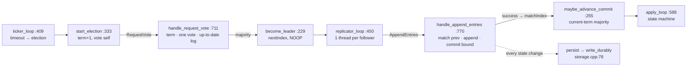
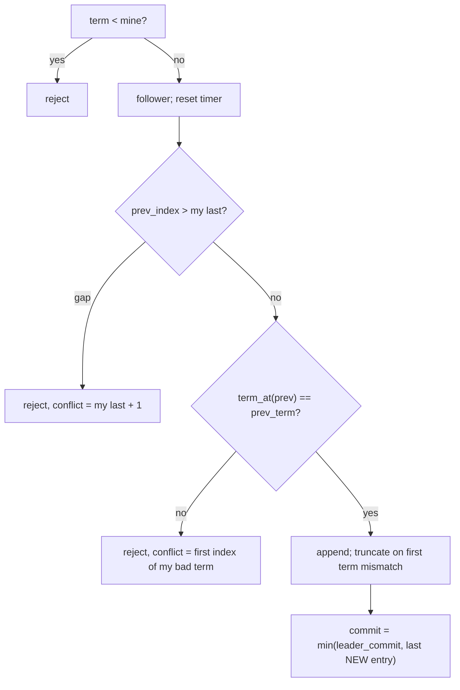

# Day 14 (Sat Nov 21): Raft (raftkv)

Part of [[Interview plan (Nov 2026)]]. Repo `raftkv`. About 7 h. Prep pack: [[Raft - prep]] (original vs upgrade §0,
key files §2, design decisions §3, stories §4, numbers §5, a code-review appendix).

**Code, explained:** the figures, the code to read and what each snippet does are in [[#Code, explained]], right after section B.

**Two versions, and a branch trap:**
- **Original** = `origin/main` = commit **`2a19135`** ("RAFT", 768-line `raft_node.cpp`). It's what GitHub shows and what your resume bullets describe.
- **Upgrade** = branch `upgrade-2026-10` = **`bad36f1`** (1,077 lines): snapshots, pre-vote, fault injection, the linearizability checker, sharding, and both bug fixes.
- **Your local `main` has been fast-forwarded to `bad36f1`** (7 commits ahead of `origin/main`). So `git show main:…` shows the *upgrade*, not the original. To read the original, use `git show 2a19135:<path>` (or `origin/main:<path>`).
- **Authorship:** all 7 upgrade commits carry `Co-Authored-By: Claude`. The honest line (prep pack §0): "The core Raft engine is mine. I used an AI assistant for the hardening pass, and I reviewed and can explain every line."

**Resume bullets (resume 5):**
- "Engineered a from-scratch **Raft consensus** system in C++, implementing leader election, log replication, conflict resolution, and **crash-safe persistent storage** with **cross-platform** cluster support."
- "Built an automated **chaos-testing pipeline** to inject node failures and verify leader failover, **zero data loss**, and automatic follower catch-up, with a **live dashboard** tracking cluster health and replication progress."

**Check before you defend** (prep pack §5):
- **"Crash-safe":** `main` had the port-before-load bug that could wipe the log on restart (story 2). `persist()` ignores write errors. SIGKILL tests can't prove fsync works.
- **"Cross-platform":** `platform.h` and a cross-compile with zig (upgrade), but **the Windows and macOS binaries were never run**, and there's no log of a mixed-OS cluster.
- **"Pipeline":** on `main` it's one script with one scenario (SIGKILL the leader once). Say "an automated chaos test".
- **"Zero data loss"** = no *acknowledged* write lost (100 keys re-read, 11/11 runs); a single sequential client; SIGKILL is not power loss.
- Never quote "bench 500 → 446 writes/sec" from the README: no data behind it. Use ~250 writes/s (3 nodes) and ~200 (5 nodes), fsync-bound.

**By tonight you can:**
- explain election, replication, the commit rule and Figure 8, and the persistence rules;
- trace both real bugs (follower commit index; port before load) with concrete logs;
- explain pre-vote, check-quorum, linearizable reads and snapshots;
- quote failover ≈ 1.0 s and ~250 writes/s with their setups.

## Schedule

| # | Time | Kind | What |
|---|---|---|---|
| 0 | 15 min | recall | Day 13: Little's law, the ring's acquire/release |
| 1 | 75 min | theory | The Raft paper §5 (A1) |
| 2 | 30 min | code | `include/raft_node.h`, `include/timing.h` (B1) |
| 3 | 90 min | code | Election, commit and the RPC handlers (B2) |
| — | lunch | | |
| 4 | 50 min | code | Replication, apply, submit (B3) |
| 5 | 25 min | code | `src/storage.cpp`: fsync + atomic rename (B4) |
| 6 | 40 min | theory | Linearizability, CAP, Raft vs Paxos, pre-vote, snapshots (A2) |
| 7 | 30 min | skim | Upgrade-only code, transport, scripts (B5) |
| 8 | 40 min | rebuild | A Raft log-matching simulator (C) |
| 9 | 20 min | trace | Does the entry survive? (D) |
| 10 | 40 min | practice | The questions (E) |

## A. Theory

### A1. Raft (block 1, 75 min)

**Read:** Ongaro & Ousterhout, *"In Search of an Understandable Consensus Algorithm"* (2014), **§5 in full** and **Figure 2** (print it). About 60 min.
**Play:** the *Raft visualization* at thesecretlivesofdata.com/raft (10 min) or raft.github.io's interactive demo.
- **Election:** randomised timeouts; a vote per term; the **election restriction** (vote only for a log at least as up to date: last term first, then length).
- **Replication:** AppendEntries with `prevLogIndex`/`prevLogTerm`; the follower rejects on mismatch; the leader backs up (yours jumps back by conflicting term).
- **Commit rule:** a leader commits an entry from its **current term** once a majority has it; earlier entries commit indirectly. **Figure 8** shows why counting replicas of an old-term entry is unsafe. Your no-op on election makes the rule fire quickly.
- **Persistence:** `currentTerm`, `votedFor` and the log must be on disk *before* replying.
- **Follower commit index** = `min(leaderCommit, index of last new entry)`. Your story 1 is exactly this line.

### A2. Beyond §5 (block 6, 40 min)

**Read:** Raft paper §6 (membership, skim) and §7 (log compaction). Ongaro's thesis §9.6 on **pre-vote** and check-quorum (10 min). Kleppmann's blog *"Please stop calling databases CP or AP"* (15 min).
- **Linearizability:** every operation appears to take effect at one instant between its call and its return. Your reads go **through the log** (safe). `--unsafe-local-reads` is the negative control.
- **CAP:** under a partition, Raft keeps consistency and gives up availability on the minority side.
- **Raft vs Paxos:** same safety guarantees; Raft has a strong leader and explicit log matching, designed to be understandable.
- **Pre-vote:** a node first asks "would you vote for me?" without raising its term, so a returning partitioned node doesn't depose a healthy leader (story 5: 0/5 vs 5/5 deposed).
- **Snapshots:** compact the log; InstallSnapshot for followers that are too far behind.

## B. Code

Line numbers are for the **upgrade** (`upgrade-2026-10`). Original (`2a19135`) lines are in brackets where they matter.

### B1. Headers (block 2, 30 min, deep)

- `include/raft_node.h`: node state; `majority()` :151; `has_quorum()` :153.
- `include/timing.h`: defaults :17–23; the `lan`/`wifi`/`slow` profiles :39–50; `validate_timing` :56–75 (story 3: election storms on Wi-Fi).

### B2. Election, commit, handlers (block 3, 90 min, deep)

`src/raft_node.cpp`:
- **216 `become_follower`** [163], **229 `become_leader`** [176] (the no-op), **255 `maybe_advance_commit`** [202] (the current-term check);
- **333 `start_election`** [225], **409 `ticker_loop`** [300] (timeouts; check-quorum);
- **711 `handle_request_vote`** [526] (the election restriction);
- **770 `handle_append_entries`** [585]: 824–846 conflict backup by term; **859–865 the fixed follower commit bound** (on the original, `2a19135:src/raft_node.cpp:663` uses `last_log_index()`: story 1).

### B3. Replication (block 4, 50 min, deep)

- **450 `replicator_loop`** [332]: one thread per follower, batches of 64, `nextIndex`/`matchIndex`;
- **588 `apply_loop`** [427]; **619 `submit`** [455] (a client command waits for commit, with a timeout);
- 174 `persist` [147] (rewrites the whole log each time, hence story 6's throughput decay).

### B4. Storage (block 5, 25 min, deep)

`src/storage.cpp` **78 `write_durably`**: write a temp file → `fsync` → `rename` over the real file → `fsync` the directory. Why each step? What does a crash between each pair of steps leave on disk?
Then `src/main.cpp` 367–381: the fixed start-up order (load state, *then* open the port: story 2).

### B5. Skim (block 7, 30 min)

Upgrade-only: `start_pre_vote` (283), `take_snapshot` (186), `handle_install_snapshot` (915). Then `src/transport.cpp` (framing 120–138), `src/state_machine.cpp`, `src/fault.cpp`, `src/main.cpp`, `scripts/chaos_test.py` (phases 193–258), `scripts/linearizability.py` (99 `check_register`), `scripts/dashboard.py`.

## Code, explained

Read this **with the files open**. Each part has a small figure of the pipeline, then the exact code (copied from the repo at the commit named below, so the line numbers match), then what it does and how it hands off to the next piece.

Repo `raftkv`: the **upgrade** is branch `upgrade-2026-10` (`bad36f1`), the
**original** is commit `2a19135` (= `origin/main`). Your local `main` was fast-forwarded to the upgrade, so read the
original by commit id. Snippets are from the upgrade unless marked.



---

### 1. Voting: three rules, in order

`src/raft_node.cpp:725–759` (`upgrade-2026-10`)
```cpp
if (term > current_term_) {
  become_follower(term, "candidate has newer term");
  dirty = true;
}

const uint64_t my_last_index = last_log_index();
const uint64_t my_last_term = term_at(my_last_index);
const std::string mine =
    std::to_string(my_last_term) + "/" + std::to_string(my_last_index);
const std::string theirs =
    std::to_string(cand_last_term) + "/" + std::to_string(cand_last_index);

// Each refusal below maps to one rule from the Raft paper; the debug line
// names which one decided the outcome.
bool granted = false;
std::string reason;
if (term < current_term_) {
  reason = "stale-term " + std::to_string(term) + "<" + std::to_string(current_term_);
} else if (voted_for_ != -1 && voted_for_ != candidate) {
  reason = "already-voted n" + std::to_string(voted_for_) + " in t" +
           std::to_string(current_term_);
} else {
  const bool up_to_date = cand_last_term > my_last_term ||
                          (cand_last_term == my_last_term && cand_last_index >= my_last_index);
  if (!up_to_date) {
    reason = "log-behind " + theirs + "<" + mine;
  } else {
    voted_for_ = candidate;
    granted = true;
    dirty = true;
    last_heard_ = Clock::now();
    election_timeout_ = random_election_timeout();
    reason = "log-ok " + theirs + ">=" + mine + ", no prior vote";
  }
}
```

1. **Newer term?** Step down to follower at that term first (and forget the old vote).
2. **Stale term** → refuse. **Already voted** for someone else this term → refuse.
3. **Election restriction:** grant only if the candidate's log is at least as up to date: a higher last term, or the same last term and at least as long. A candidate missing a committed entry can never collect a majority, because every majority includes a node that has that entry.

- `persist()` before replying (line 766): a vote that's forgotten after a crash could let one node vote twice in one term, which could elect two leaders.

### 2. Becoming leader, and the commit rule

`src/raft_node.cpp:235–251` (`upgrade-2026-10`)
```cpp
for (const PeerInfo& peer : cluster_) {
  if (peer.id == id_) continue;
  next_index_[peer.id] = last_log_index() + 1;
  match_index_[peer.id] = 0;
  last_contact_[peer.id] = Clock::now();  // grace period before the quorum check
}

if (debug::at(debug::kOn)) {
  dbg("LEADER t" + std::to_string(current_term_) + " log=" + std::to_string(last_log_index()));
}

// A no-op entry from the new term lets the current-term commit rule finish
// committing anything inherited from previous terms.
log_.push_back(LogEntry{current_term_, last_log_index() + 1, "NOOP -"});
entrylog::appended(last_log_index(), current_term_, "NOOP -");
persist();
maybe_advance_commit();
```

- `nextIndex` = the leader's last index + 1 for every follower (optimistic); `matchIndex` = 0 (nothing confirmed yet).
- **The NOOP entry from the new term:** the commit rule below only counts *current-term* entries. Without a new entry, older entries inherited by the leader would wait until a client wrote something.

`src/raft_node.cpp:255–276` (`upgrade-2026-10`)
```cpp
void RaftNode::maybe_advance_commit() {
  if (role_ != Role::Leader) return;
  for (uint64_t n = last_log_index(); n > commit_index_; --n) {
    if (term_at(n) != current_term_) break;
    int replicas = 1;
    for (const auto& [peer_id, matched] : match_index_) {
      if (matched >= n) ++replicas;
    }
    if (replicas >= majority()) {
      if (debug::at(debug::kOn)) {
        dbg("COMMIT " + std::to_string(commit_index_) + "->" + std::to_string(n) + " t" +
            std::to_string(current_term_) + " on " + std::to_string(replicas) + "/" +
            std::to_string(cluster_.size()));
      }
      const uint64_t previous = commit_index_;
      commit_index_ = n;
      record_commits(previous);
      apply_cv_.notify_all();
      return;
    }
  }
}
```

- Walk down from the end of the log; **stop at the first entry not from the current term** (line 258). Count replicas via `match_index_` (+1 for the leader itself). The highest current-term index on a majority becomes the commit index, which commits everything before it too.
- Why not count old-term entries? **Figure 8:** an old-term entry can sit on a majority and still be overwritten by a later leader. Once a *current*-term entry is on a majority, no node without it can win an election.

### 3. AppendEntries: check, repair, append, commit



`src/raft_node.cpp:824–846` (`upgrade-2026-10`)
```cpp
if (check_index > last_log_index()) {
  const uint64_t conflict = last_log_index() + 1;
  if (verbose) {
    dbg("AE NO gap prev=" + std::to_string(prev_index) + " mine=" +
            std::to_string(last_log_index()) + " -> conflict=" + std::to_string(conflict),
        detail);
  }
  if (dirty) persist();
  return Message{"AER", {std::to_string(current_term_), "0", std::to_string(conflict)}};
}
if (check_index >= 1 && term_at(check_index) != check_term) {
  const uint64_t bad_term = term_at(check_index);
  uint64_t first = check_index;
  while (first > snapshot_index_ + 1 && term_at(first - 1) == bad_term) --first;
  if (verbose) {
    dbg("AE NO term-mismatch i" + std::to_string(prev_index) + " mine=t" +
            std::to_string(bad_term) + " want=t" + std::to_string(prev_term) +
            " -> conflict=" + std::to_string(first),
        detail);
  }
  if (dirty) persist();
  return Message{"AER", {std::to_string(current_term_), "0", std::to_string(first)}};
}
```

- **Log matching:** if the follower's entry at `prev_index` has `prev_term`, everything before it matches too (Raft's log-matching property). Otherwise reject.
- **Fast backup:** instead of "try one index earlier", reply with the **first index of the conflicting term**, so the leader skips a whole term per round trip.

`src/raft_node.cpp:848–857` (`upgrade-2026-10`)
```cpp
for (const LogEntry& entry : entries) {
  if (has_index(entry.index)) {
    if (term_at(entry.index) == entry.term) continue;
    entrylog::truncated(entry.index, term_at(entry.index));
    log_.resize(entry.index - snapshot_index_ - 1);
  }
  log_.push_back(entry);
  entrylog::appended(entry.index, entry.term, entry.command);
  dirty = true;
}
```

- An entry that already exists with the same term is skipped; on the **first** term mismatch the log is truncated from there and the leader's entries are appended. Entries that agree are never truncated, which keeps a delayed, duplicate message harmless.

`src/raft_node.cpp:862–865` (`upgrade-2026-10`)
```cpp
const uint64_t last_new_entry = entries.empty() ? check_index : entries.back().index;
if (leader_commit > commit_index_ && last_new_entry > commit_index_) {
  const uint64_t previous = commit_index_;
  commit_index_ = std::min(leader_commit, last_new_entry);
```

`src/raft_node.cpp:661–663` (`2a19135`)
```cpp
if (leader_commit > commit_index_) {
  const uint64_t previous = commit_index_;
  commit_index_ = std::min(leader_commit, last_log_index());
```

- **Story 1, the bug you fixed.** The original bounded the commit by `last_log_index()`, the end of the follower's *whole* log. But stale entries can sit past the entries this message just verified. The fix bounds it by the **last entry this message proved**. Trace: B holds stale term-3 entries 75..200; the leader sends 11..74 with `leader_commit = 300`. Old: `min(300, 200) = 200`, so B commits its stale 75..200, a safety violation. New: `min(300, 74) = 74`.

### 4. Durability

`src/storage.cpp:78–91` (`upgrade-2026-10`)
```cpp
bool write_durably(const std::string& path, const std::string& dir, const std::string& blob) {
  const std::string tmp = path + ".tmp";
  int fd = open_file_write(tmp);
  if (fd < 0) return false;
  if (!write_all(fd, blob.data(), blob.size()) || !file_sync(fd)) {
    file_close(fd);
    return false;
  }
  file_close(fd);

  if (!replace_file(tmp, path)) return false;
  sync_directory(dir);
  return true;
}
```

- **Write a temp file → fsync it → rename over the real file → fsync the directory.** `rename` is atomic, so after a crash the file is either all old or all new. The first fsync makes the *contents* durable; the directory fsync makes the *rename* durable.
- What a SIGKILL test can't show: the data reaches the page cache before fsync anyway, so only a power cut would catch a missing fsync.

`src/main.cpp:367–375` (`upgrade-2026-10`)
```cpp
// Load the saved state before the port opens, so no inbound RPC can touch
// the log before it has been read back from disk.
std::string start_error;
if (!node.start(&start_error)) {
  std::cerr << "cannot start: " << start_error << "\n";
  return 1;
}

if (!transport.start([&node](const Message& request, const std::string& peer) {
```

- **Story 2:** load state, *then* open the port. In the original the port opened first. An early RPC with a higher term triggered `persist()` of the **empty** in-memory log over the saved file, then `start()` loaded that empty file, so the node forgot entries it had acknowledged.

**Check yourself:** 5 nodes, leader in term 4 with `match_index = {n2: 50, n3: 48, n4: 50, n5: 30}`, its own log ends at 50, entries 46–50 are term 4, and `commit_index = 40`. What does `maybe_advance_commit` set? (*n = 50: leader + n2 + n4 = 3 ≥ majority 3, so commit = 50.*) Why can't a term-4 leader's log end in a term-3 entry? And if `match_index` were `{n2: 50, n3: 45, n4: 44, n5: 30}`, what would it commit? (*`become_leader` appends a term-4 NOOP. Only the leader and n2 have ≥ 46, so 2 < 3: nothing commits; the loop stops at the first term-3 entry below 46.*)

## C. Rebuild it yourself (block 8, 40 min)

In Python, about 80 lines, no networking: logs are lists of `(term, cmd)`.
1. `append_entries(follower_log, prev_index, prev_term, entries, leader_commit)` returning `(success, new_commit)`. Implement the Figure 2 rules exactly, including truncate-on-conflict and `commit = min(leader_commit, index of last new entry)`.
2. Replay story 1's trace (prep pack §4): B has stale term-3 entries 75..200; C sends `prev=10` with 11..74 and `leader_commit=300`. Show that the buggy bound gives 200 and the correct one gives 74.
3. Write `leader_can_commit(index, current_term, match_indices, log)` with the current-term rule. Build Figure 8's scenario and show that the naive "majority has it" rule commits an entry that is later overwritten.

## D. Trace (block 9, 20 min)

5 nodes. The leader (term 4) appends entry 50, replicates it to 1 of 4 followers, then crashes. Does entry 50 survive?
- Who can win the next election? (*The election restriction.*)
- If the follower that has entry 50 wins, is entry 50 committed at once? (*No: only when an entry from its own term commits on a majority: the no-op.*)
- If another node wins, what happens to entry 50 on the follower that had it?
- Was entry 50 ever acknowledged to the client? So is losing it a violation?

## E. Questions

1. Explain Raft leader election. Why randomised timeouts?
2. Walk me through log replication and how a follower's log is repaired.
3. Why can't a leader commit an old-term entry by counting replicas? (*Figure 8.*)
4. What must be persisted, and when? How do you make a write crash-safe?
5. Tell me about a bug you found. (*Story 1 with the concrete trace; story 2 for durability.*)
6. How are your reads linearizable? How did you test that? What did the negative control show?
7. What is pre-vote, and what did it fix? Show the numbers.
8. How fast is failover? How did you measure it? (*≈ 1.0 s median, 3 nodes; quantised by the 0.2 s poll loop.*)
9. Why only ~250 writes/s? (*One fsync per write; a new TCP connection per request; a sequential client.*)
10. "Zero data loss": under what failures? What about power loss?
11. Did you run it across operating systems?
12. Which parts did an AI assistant help with?
13. Hostile: "Why build Raft yourself instead of using etcd?"

## My notes and fumbles

- 
