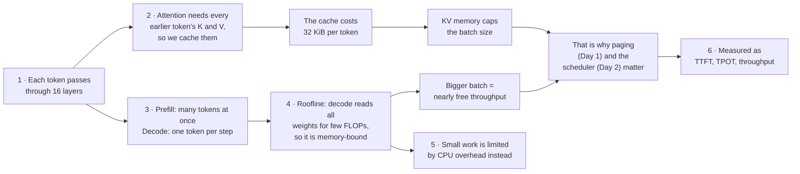

# Prerequisite: LLM inference basics (done at the start of Day 1)

Part of [[Interview plan (Nov 2026)]]. Read sections 1–6 and answer the self-check at the start of [[Day 01 - mini-vLLM I]] (about 60 min). Then do the `llama.py` block on Day 1 too, in place of the README skim. Every number here comes from your own repos, so you can quote them.

> [!tip] How to read this note
> Every section has the same four parts: **the idea in plain words → a picture → the numbers for your model → what to say in an interview**. Read the plain idea first; if it clicks, the rest is detail.
>
> **Interactive lab** (KV calculator, roofline slider, paging simulator, these questions as flashcards): <https://claude.ai/artifact/SNFAyKDabiFMnwXppfj8wi>. An offline copy is in `figures/inference-lab.html`; open it in a browser.

## The whole note in one chain

## Blocks

- [ ] **T, 60 min.** Sections 1–6 below, plus Horace He, *Making Deep Learning Go Brrrr* (compute- vs memory- vs overhead-bound work).
- [ ] **C, 60 min.** `vLLMmini/src/mini_vllm/model/llama.py` (about 200 lines of real code). Trace one token through one layer and write down every tensor shape.
- [ ] **T, 45 min.** Pope et al., *Efficiently Scaling Transformer Inference* (2022), §2–3. Then the metrics in section 6.
- [ ] **P, 30 min.** The self-check questions at the bottom, said out loud.

## 0. Words you need

| Word | Plain meaning |
|---|---|
| **token** | a piece of text (about ¾ of a word); the model reads and writes one at a time |
| **hidden size** (2048) | the length of the vector that represents one token inside the model |
| **layer** (16) | one attention block plus one MLP block; the token goes through all 16 in order |
| **head** | attention is split into independent parts of 64 numbers each (`head_dim`) |
| **Q, K, V** | per token: the *query* ("what am I looking for"), the *key* ("what do I contain") and the *value* ("what I pass on") |
| **bf16** | a 16-bit (2-byte) number format; all sizes here assume 2 bytes per value |
| **FLOP** | one multiply or one add. FLOP/s = how fast the GPU computes |
| **bandwidth** (TB/s) | how fast the GPU moves bytes from its memory (HBM) to the compute units |
| **batch size B** | how many sequences are processed together in one step |
| **TTFT / TPOT** | time to first token / time per output token (section 6) |

## 1. One token's forward pass

**The idea.** A decoder-only model turns each token into a vector, pushes it through L identical layers (attention, then an MLP), and turns the final vector into a score for every word in the vocabulary. A forward pass costs about
**2·P FLOPs per token** (P = parameter count), because each weight does one multiply and one add.

![[p1-one-token-one-layer.svg]]

Your mini-vLLM model, **Llama-3.2-1B**, has:
- 16 layers and hidden size 2048;
- 32 query heads and 8 KV heads (GQA, 4:1), head_dim 64;
- about 1.24B parameters, which is about 2.5 GB in bf16.

**GQA in one picture.** Grouped-query attention lets 4 query heads share one K/V head. Only the K/V heads are cached, so the cache is 4× smaller than if every query head had its own.

![[p7-gqa.svg]]

> [!quote] Say it like this
> "Llama-3.2-1B has 16 layers, hidden 2048, 32 query heads sharing 8 KV heads with head_dim 64. Most of the 1.24B parameters are in the MLPs and the embedding. In bf16 the weights are about 2.5 GB, and every decode step has to read all of them."

## 2. Why a KV cache

**The idea.** To produce token t, attention compares token t's query with the keys of *every* earlier token and mixes their values. Those old keys and values never change, so compute them once and keep them.

![[p2-kv-cache.svg]]

Without a cache you recompute them at every step, so the work per step grows with the whole history. With a cache you compute only the new token's K and V, and read the old ones from memory. The cost is memory:

`KV bytes per token = 2 (K and V) × layers × kv_heads × head_dim × bytes per value`

For Llama-3.2-1B: 2 × 16 × 8 × 64 × 2 B = **32 KiB per token**, so a 4k-token sequence holds 128 MiB. GQA cuts this
4× compared with having 32 KV heads. **KV memory, not compute, limits how many requests you can batch.** That is the
problem mini-vLLM's paging solves.

> [!example] Feel the size
> An H200 has 141 GB. Take away 2.5 GB of weights and runtime overhead, and say 40 GB is left for KV.
> 40 GB ÷ 128 MiB per 4k-token sequence ≈ **298 sequences**. Waste 17% of that memory on padding (your Phase 0 baseline) and you lose about 50 of them.
> Try other models in the lab's *KV memory* tab.

## 3. Prefill and decode are two different workloads

**The idea.** A request has two phases. First the whole prompt goes through the model at once (prefill). Then the model writes the answer one token at a time (decode). Same weights, same maths, very different shapes.

![[p3-prefill-vs-decode.svg]]

- **Prefill** handles all N prompt tokens at once. The work is large matrix–matrix multiplies, so it is **compute-bound**. It sets the TTFT.
- **Decode** makes one token per sequence per step. The work is matrix–vector multiplies, and each step reads all the weights plus that sequence's KV cache, so it is **memory-bandwidth-bound**. It sets the TPOT.

> [!info] Why "reused N times" decides everything
> Reading a byte from GPU memory is slow; doing maths on it once it has arrived is fast. In prefill each weight byte that arrives is used for N tokens, so the GPU stays busy computing. In decode each byte is used for only B tokens (often 1–8), so the GPU spends most of its time waiting for the next bytes.

## 4. The roofline

**The idea.** A GPU has two speed limits: how fast it computes (FLOP/s) and how fast it can feed data to the compute units (bytes/s). Which limit you hit depends on **arithmetic intensity** = FLOPs done per byte moved.

![[p4-roofline.svg]]

Arithmetic intensity is FLOPs per byte moved. An H200 does about 989 TFLOP/s in bf16 and moves 4.8 TB/s. The ridge point is about
989/4.8 ≈ **206 FLOP/byte**; below it you are memory-bound.
- Decode at batch B does about 2·P·B FLOPs while reading 2·P bytes of weights, so its intensity is about **B**. Decode stays
  memory-bound until B is about 200. **Batching is nearly free throughput**, which is why schedulers and KV memory management matter.
- At batch 1 the floor is the weight read: 2.5 GB ÷ 4.8 TB/s ≈ **0.5 ms per token** for Llama-3.2-1B.

> [!example] Worked example: decode at batch 1 vs batch 64 (weights only)
> | | batch 1 | batch 64 |
> |---|---|---|
> | bytes read (weights) | 2.48 GB | 2.48 GB (the same!) |
> | FLOPs (2·P·B) | 2.48 G | 159 G |
> | intensity | ≈ 1 | ≈ 64 |
> | time if memory-bound (bytes ÷ 4.8 TB/s) | 0.52 ms | 0.52 ms |
> | time if compute-bound (FLOPs ÷ 989 T) | 0.003 ms | 0.16 ms |
> | **floor = the larger of the two** | **0.52 ms → 1 token** | **0.52 ms → 64 tokens** |
>
> 64× the tokens for the same step time. Each extra sequence also reads its own KV cache, so at long contexts the gain is smaller: slide *context* in the lab's *Roofline* tab to see it.

> [!quote] Say it like this
> "Decode reads all 2.5 GB of weights every step but does only 2·P FLOPs per sequence, so its intensity is about the batch size, far below the H200's ridge of about 206. It is memory-bound, so adding sequences is almost free until KV memory runs out. That is why the serving problem is really a memory-management problem."

## 5. A third regime: overhead-bound

**The idea.** Sometimes neither memory nor compute is the limit: the GPU finishes each small kernel so fast that it sits idle waiting for Python and the CPU to launch the next one. Then time depends on *how many kernels* you launch, not on how big they are.

Small kernels at batch 1 can be limited by Python and the CPU launching kernels, not by the GPU.
- **Speculative decoding:** eager per-layer cost was **0.81 ms for the 0.5B, 1.5B and 14B models alike**, a 28× range of
  model sizes (`speculative_decoding/RESULTS.md`, about lines 88–104). `torch.compile` plus a StaticCache brought it to 0.10–0.22 ms.
- **mini-vLLM:** the prefix cache saves **0% of the time below about 2k tokens**. Short prefill is overhead-bound, so skipping it saves almost nothing.

![[p5-overhead-bound-prefill.svg]]

> [!info] Spot the regime from a measurement
> | Symptom | Regime | Fix |
> |---|---|---|
> | time ∝ FLOPs; GPU busy | compute-bound | fewer FLOPs, lower precision, better kernels |
> | time ∝ bytes read; same time for B = 1 and B = 8 | memory-bound | bigger batch, smaller weights/KV (quantise, GQA) |
> | time ∝ number of layers/kernels, not size; flat in tokens | overhead-bound | `torch.compile`, CUDA graphs, fused kernels |
>
> Your HF baseline's TPOT was 11.9 ms at batch 8, against a 0.5 ms memory floor: the README says decode at this size is bound by host-side kernel launches. Your 0.88× speculative decoder and your 0% prefix-cache saving are both this regime.

## 6. The serving metrics

**The idea.** A user cares about two waits (how long until the first word appears, and how fast the rest streams); the operator cares about total tokens per second.

- **TTFT** (time to first token) = queueing + prefill.
- **TPOT** (time per output token) = one decode step.
- **Throughput** = tokens per second across all requests.
- Static batching makes new requests wait for the batch to finish. Continuous batching lets them join at the next step.
  That is your mini-vLLM result of TTFT p50 **2448 → 179 ms**, with **3.82×** throughput.

![[p6-static-vs-continuous-batching.svg]]

**Links to the next days:** paging frees KV memory, so batches get bigger and decode climbs the roofline (Days 2–3).
Speculative decoding (Day 4) spends idle compute in memory-bound decode to verify γ draft tokens in one pass. Day 5
applies the roofline to single matmul kernels.

## Cheat sheet (for revision)

> [!summary] Numbers to know cold
> | Quantity | Value | How |
> |---|---|---|
> | Llama-3.2-1B weights | 1.24B params ≈ 2.5 GB | 16 × 60.8M per layer + 262.7M embedding |
> | KV per token | 32 KiB | 2 × 16 × 8 × 64 × 2 B |
> | KV per 4k sequence | 128 MiB | 4096 × 32 KiB |
> | Qwen2.5-0.5B KV per token | 12 KiB | 2 × 24 × 2 × 64 × 2 B |
> | H200 ridge | ≈ 206 FLOP/byte | 989 TFLOP/s ÷ 4.8 TB/s |
> | decode intensity | ≈ B | 2·P·B FLOPs ÷ 2·P bytes |
> | batch-1 floor | ≈ 0.5 ms/token | 2.5 GB ÷ 4.8 TB/s |
> | prefill crossover (mini-vLLM, H200) | ≈ 2k tokens | 15.6 ms at 128, 19.1 at 1024, 49.8 at 2048 |
> | eager per-layer cost (spec. decoding) | 0.81 ms, any model size | → 0.10–0.22 ms compiled |
> | mini-vLLM vs HF | 3.82× throughput, TTFT p50 2448 → 179 ms | Phase 6, five paired rounds |

## Self-check (answer out loud, then check against the text above)

Unfold an answer only *after* saying yours.

1. Why does decode get almost free throughput from a bigger batch, while prefill doesn't?
> [!success]- Answer
> A decode step reads all 2.5 GB of weights whatever B is, and does 2·P·B FLOPs, so its intensity is ≈ B, far below the ridge (≈ 206). Up to B ≈ 200 the step time barely changes while tokens per step grow with B. Prefill's intensity is ≈ N (prompt length), already past the ridge for long prompts: it is compute-bound, so twice the tokens cost twice the time. Caveat: each extra sequence also reads its own KV, so the decode win shrinks at long contexts.

2. Give the KV-cache formula, and the bytes per token for Qwen2.5-0.5B (24 layers, 2 KV heads, head_dim 64, bf16).
> [!success]- Answer
> 2 × layers × kv_heads × head_dim × bytes = 2 × 24 × 2 × 64 × 2 = **12,288 B = 12 KiB** (the README *Model* table says 12 KB). That is why the project uses Llama-3.2-1B: at 12 KiB/token the pool never fills, so preemption and eviction would never fire.

3. "Your prefix cache hits 91% by turn 4. Why doesn't it speed things up?" Answer in two sentences.
> [!success]- Answer
> The conversations peak at about 1.2k tokens, and below about 2k tokens prefill is overhead-bound (15.6 ms at 128 tokens, 19.1 ms at 1024), so skipping 85% of the tokens skips almost no time. Past the crossover the same hit pays off: with 90% cached, 2.92× at 2048 tokens and 7.41× at 8192.

4. Why did speculative decoding first run at 0.88×?
> [!success]- Answer
> Batch-1 decode was CPU-launch-bound: eager per-layer cost was about 0.81 ms for the 0.5B, 1.5B and 14B models alike, so a 28-layer 1.5B draft cost as much as a 28-layer 7B target. The algorithm itself was fine (acceptance 0.84–0.92, target passes down 4.3×). `torch.compile` + StaticCache, length tracked on the host, and rollback as a counter reset took it to **2.25×** (`speculative_decoding/RESULTS.md`, *Why the first working version was slower*).

5. At batch 1 on an H200, what is the lower bound on time per token for Llama-3.2-1B, and what sets it?
> [!success]- Answer
> About **0.5 ms**: 2.5 GB of weights ÷ 4.8 TB/s. Memory bandwidth sets it, because every weight must be read once per step. Real runs are far above it (HF baseline TPOT 11.9 ms at batch 8) because at this model size the CPU launching kernels is the real limit.

6. When does continuous batching improve TTFT, and when can it make TPOT worse?
> [!success]- Answer
> It improves TTFT when requests keep arriving and output lengths differ: a new request joins at the next step instead of waiting for the slowest member of the current batch (yours: TTFT p50 2448 → 179 ms). It can make TPOT worse because a newcomer's prefill shares a step with everyone's decode, and the batch is larger, so running requests wait longer per token. The usual fix is chunked prefill, which real vLLM has and mini-vLLM does not (part of the 6.2× gap in the README).

## My notes and fumbles

- 
