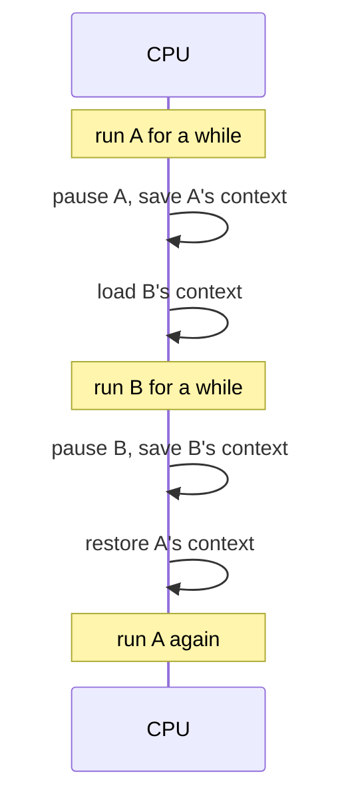
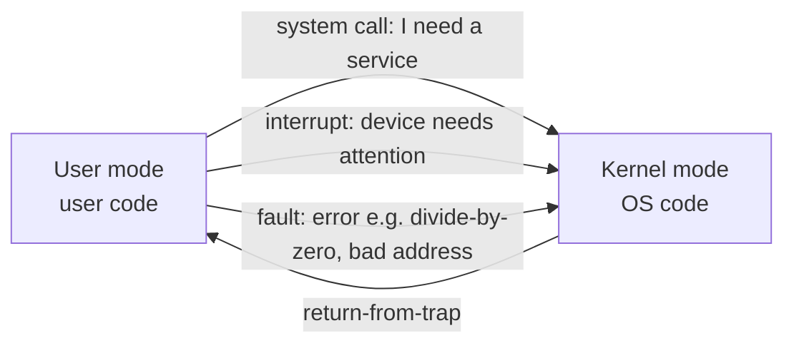

# 00 · OS Introduction

> **In one line:** the OS is the trusted middleware that sits between user programs and the hardware, and its
> whole job reduces to three tricks — **virtualize** the CPU and memory, manage **concurrency**, and provide
> **persistence** — all while keeping mutually-distrusting programs isolated.

Prereqs: none. Pairs with [[01 - Computer Architecture Background]]. Next: [[02 - Processes]].

---

## 1. What is an operating system?

A user program (browser, database, game) should not have to know how a specific disk or network card works.
The OS is **system software** that manages the hardware (CPU, RAM, disks, NICs, keyboard…) and hands programs a
clean, uniform interface instead.

```
        ┌─────────────────────────────────────────────┐
        │  User programs (browser, DB, your a.out)      │   ← unprivileged
        ├─────────────────────────────────────────────┤
        │  OS kernel  (scheduler, VM, FS, drivers)      │   ← privileged
        ├─────────────────────────────────────────────┤
        │  Hardware   (CPU cores, RAM, disk, NIC, …)    │
        └─────────────────────────────────────────────┘
```

- **Kernel** = the core, privileged part of the OS (scheduling, memory management, filesystems, drivers).
- **The rest of the OS** = shell, utilities (`ls`, `cat`), libraries — useful, but not privileged.
- Examples: Linux, Windows, macOS. The kernel is written mostly in C (+ a little assembly).

**Why it exists (history):** it started as a *library* of common routines to talk to hardware. Once machines ran
multiple programs for multiple **untrusted** users at once, the OS had to become a *trusted referee* that isolates
users from each other and protects the hardware from misuse. That "trusted referee" role is why so much of the OS
is about **protection**, not just convenience.

## 2. The three big ideas (OSTEP)

Everything in the course is one of these:

| Concept | The illusion given | How |
|---|---|---|
| **Virtualization** | "I own the whole CPU" / "I own all of memory, starting at address 0" | time-sharing + context switch; per-process virtual address space |
| **Concurrency** | many programs run "at the same time" | interleave on each core; real parallelism across cores |
| **Persistence** | data survives after my program exits / after a crash | filesystems on durable I/O devices |

## 3. Program vs process

- A **program** is passive: instructions + data sitting in an executable file (`a.out`) on disk.
- A **process** is a program *in motion*: loaded into RAM, with CPU registers holding its live state.

**What the OS does to run `./a.out`:**
1. Allocate memory in RAM for the new process.
2. Load code + compile-time data from the executable on disk.
3. Set up the **stack** and **heap**.
4. Initialize CPU context — set the **program counter (PC)** to the first instruction.
5. Let it run. Now the CPU runs *user* instructions directly; **the OS steps aside** until it's needed again.

While a process runs, the CPU registers *are* its execution context: PC = next instruction, general-purpose
registers = its working data, stack pointer = top of its stack.

## 4. Virtualizing the CPU: concurrency by switching

One core runs **one** process at a time. The OS fakes "everyone runs at once" by rapidly switching:



Because the context is **saved and restored** exactly, A never notices it was paused. This is a **context switch**
(full mechanism in [[04 - Trap Handling and Context Switching]]). The **scheduler** ([[05 - CPU Scheduling]])
decides who runs next.

## 5. Virtualizing memory: the virtual address space

Each process is given the illusion that its memory is laid out contiguously from address 0:

```
virtual view (what the program sees)        physical reality (RAM)
┌───────────┐ 0                             scattered chunks all over DRAM
│   code    │                               ┌──┐      ┌──┐
│   data    │                               │  │  ...  │  │
│   heap ↓  │            OS maps             └──┘      └──┘
│    ...    │        virtual → physical       ↑ the programmer never sees these
│   stack ↑ │ max
└───────────┘
```

Every pointer you print is a **virtual address**, not a physical one. When the process touches a virtual address,
the OS (with hardware help — the MMU) translates it to the real physical address. Details: [[13 - Paging]].

## 6. Isolation: privilege levels, user mode vs kernel mode

How do you share hardware *safely* between distrusting programs? The CPU itself enforces it:

- Instructions are **privileged** (touch hardware / sensitive state) or **unprivileged** (`add`, `mov`).
- The CPU runs at a **privilege level**. x86 has 4 "rings"; in practice we use two:
  - **User mode** (ring 3, unprivileged): user code. Privileged instructions are forbidden.
  - **Kernel mode** (ring 0, privileged): OS code. Anything is allowed.

A user program **cannot** run a privileged instruction directly — that's what stops one process from reading
another's memory or scribbling on the disk. To get privileged work done, it must ask the OS.

The CPU switches **user → kernel** only on three events (collectively called **traps**):



## 7. System calls

A **system call** is a function call *into* the OS that runs at higher privilege.

- Example: a process can't run the privileged instructions to read a disk, so it calls `read()`; the CPU jumps to
  OS code, the OS does the hardware work, then returns to the user code.
- **Blocking** syscalls (e.g. `read()` from disk) can put the process to sleep; **non-blocking** ones (e.g.
  `getpid()`) return immediately.
- You rarely call syscalls directly. `printf` is a **C library** function that eventually calls the `write`
  syscall. (POSIX is the standard set of syscalls that makes code portable across Unix-like OSes.)

## 8. Interrupts (and how they differ from syscalls)

An **interrupt** is an *external* signal from a device asking for the CPU's attention (key pressed, disk data
ready, packet arrived, timer tick).

| | System call | Interrupt |
|---|---|---|
| Who triggers it | the **running program** (on purpose) | an **external device** (any time) |
| Synchronous? | yes — at a known instruction | no — asynchronous to the program |
| Example | `read()`, `write()` | disk-done, keyboard, timer |

**Handling an interrupt:** CPU running process P → interrupt arrives → CPU saves P's context, runs the OS
**interrupt handler** in kernel mode → restores P's context → resumes P. The handler is OS code; neither P's
author nor P itself chose to run it.

The **timer interrupt** is special: it's how the OS wrestles the CPU back from a process that would otherwise
run forever — the basis of *preemptive* scheduling ([[05 - CPU Scheduling]]).

## 9. I/O devices, controllers, and drivers

```
     ┌─────┐   memory bus   ┌────────┐
     │ CPU │════════════════│  RAM   │
     └──┬──┘                └────────┘
        │ I/O bus
   ┌────┴─────┬──────────┬───────────┐
 [disk ctl] [NIC ctl] [kbd ctl]  ...        each device has a controller
```

- A device is managed by a hardware **device controller** (a small microcontroller the CPU talks to over a bus).
- Talking to a controller correctly needs device-specific knowledge → that's the job of a **device driver**,
  which is part of the OS. The driver initializes the device, issues commands (e.g. "read this disk block"), and
  **handles the interrupt** the device raises when the work is done.

---

## Interview questions

> [!question] Q1. What's the difference between a program and a process?
> A program is the passive file on disk (code + data). A process is a program being executed: it has memory
> allocated in RAM, a PID, live CPU register state (PC, stack pointer, GP registers), and OS bookkeeping (open
> files, etc.). One program can back many processes (run `./a.out` three times → three processes).

> [!question] Q2. Why do we need user mode and kernel mode? Can't the OS just trust programs?
> Because programs are mutually distrusting and possibly buggy or malicious. Privileged instructions (touching
> hardware, changing page tables, disabling interrupts) are only allowed in kernel mode, so a user program
> *physically cannot* harm others or the hardware directly — it must route every sensitive action through the OS,
> which can check it. Isolation is enforced by hardware, not politeness.

> [!question] Q3. What exactly happens, step by step, when a user program calls `read()`?
> The library issues a **trap instruction**; the CPU switches to kernel mode, saves the user context on the
> **kernel stack**, and jumps (via the IDT) to the OS's syscall handler. The OS validates arguments, issues the
> disk command, and — since the data isn't ready — **blocks** the process and switches to another. Later a disk
> interrupt fires, the OS marks the process ready, and eventually it's rescheduled and returns from the trap to
> user mode with the data. (Mechanism: [[04 - Trap Handling and Context Switching]].)

> [!question] Q4. System call vs interrupt vs fault?
> All three are **traps** (user→kernel). A **system call** is *synchronous and deliberate* — the program asked.
> An **interrupt** is *asynchronous and external* — a device fired it. A **fault/exception** is *synchronous but
> unintended* — the current instruction did something illegal (bad address, divide by zero); the handler either
> fixes it and re-runs the instruction (e.g. page fault) or kills the process (segfault).

> [!question] Q5. Is the OS a separate process that runs on its own?
> No. The OS mostly runs *inside* the context of whatever process trapped into the kernel — process P traps, the
> CPU goes to kernel mode, OS code runs "as P" on P's kernel stack. The OS is code that gets to run on traps; it
> is not a process waiting its turn in the scheduler. (xv6's `scheduler` is a partial exception — see
> [[27 - xv6 Switch]].)

## Five things to remember
1. OS = trusted middleware doing **virtualization, concurrency, persistence**, with isolation enforced by hardware.
2. **Program** (on disk) vs **process** (running, in RAM, with live CPU context).
3. CPU runs user code in **user mode**; it enters **kernel mode** only on a **trap** = syscall / interrupt / fault.
4. **Syscall** = deliberate & synchronous; **interrupt** = external & asynchronous; **fault** = accidental & synchronous.
5. The OS virtualizes the CPU by **context switching** and memory by giving each process a **virtual address space**.
